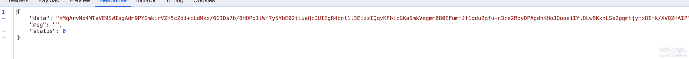
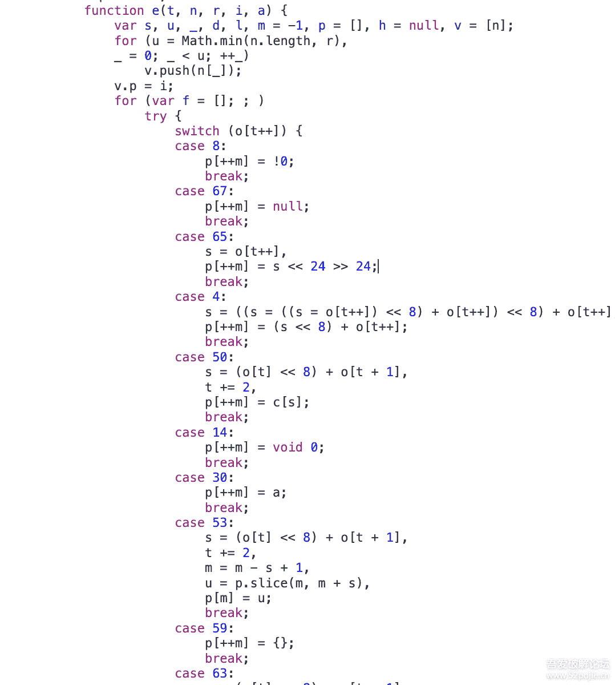
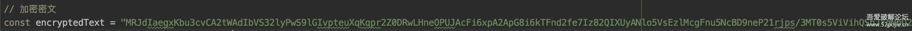
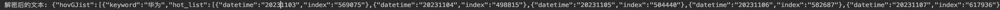

# [Web逆向] 巨量算数`response`解密[`jsvmp`]

- 原帖: https://www.52pojie.cn/forum.php?mod=viewthread&tid=1865657
- 抓取时间: 2026-11-01T22:42:08

众所周知。巨量现在的`response`大多数都是以加密后的数据在本地解析；

## 抓包

`image.png` (61.91 KB, 下载次数: 1)
[href="forum.php?mod=attachment&aid=MjY2MTg2MHxkM2RlODQxOHwxNzkzNTcyOTI2fDE2ODA4NnwxODY1NjU3&nothumb=yes" target="_blank"](https://www.52pojie.cn/forum.php?mod=attachment&aid=MjY2MTg2MHxkM2RlODQxOHwxNzkzNTcyOTI2fDE2ODA4NnwxODY1NjU3&nothumb=yes)
2023-12-5 19:42 上传

可以看到该接口的返回值是一串加密数据，那么开始解这条`response`。
调试过程省略。。。

## 最终定位

`image.png` (132.93 KB, 下载次数: 1)
[href="forum.php?mod=attachment&aid=MjY2MTg1OXxiZmFmZjMyZnwxNzkzNTcyOTI2fDE2ODA4NnwxODY1NjU3&nothumb=yes" target="_blank"](https://www.52pojie.cn/forum.php?mod=attachment&aid=MjY2MTg1OXxiZmFmZjMyZnwxNzkzNTcyOTI2fDE2ODA4NnwxODY1NjU3&nothumb=yes)
2023-12-5 19:40 上传

可以看到这是一个`vmp`，但是和字节之前通用的`vmp`有点不一样，就叫他小`vmp`吧

## 解密过程

`image.png` (38.96 KB, 下载次数: 0)
[href="forum.php?mod=attachment&aid=MjY2MTg2MXwxYzFhYzc0MnwxNzkzNTcyOTI2fDE2ODA4NnwxODY1NjU3&nothumb=yes" target="_blank"](https://www.52pojie.cn/forum.php?mod=attachment&aid=MjY2MTg2MXwxYzFhYzc0MnwxNzkzNTcyOTI2fDE2ODA4NnwxODY1NjU3&nothumb=yes)
2023-12-5 19:44 上传

## 结果

`image.png` (23.76 KB, 下载次数: 1)
[href="forum.php?mod=attachment&aid=MjY2MTg2MnxjNTdmY2JlMXwxNzkzNTcyOTI2fDE2ODA4NnwxODY1NjU3&nothumb=yes" target="_blank"](https://www.52pojie.cn/forum.php?mod=attachment&aid=MjY2MTg2MnxjNTdmY2JlMXwxNzkzNTcyOTI2fDE2ODA4NnwxODY1NjU3&nothumb=yes)
2023-12-5 19:44 上传

逆向结束

## 总结

这个`vmp`虽然小，但是执行量巨大，我的电脑跑崩了无数次，所以调试的时候需要耐心点，清除无用的数据；
