# [Web逆向] [JSvmp] 某书最新webprofile之profileData逆向算法

- 原帖：`https://www.52pojie.cn/forum.php?mod=viewthread&tid=1865940`
- 抓取时间：`2026-11-01T22:42:06`
- 抓包：

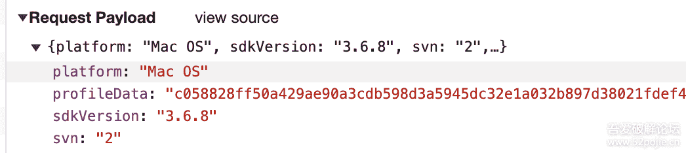

image.png (54.04 KB, 下载次数: 1)

2023-12-6 14:42 上传

在`request`中上报的信息如下：

- `platform`: 平台
- `profileData`：加密数据（一些浏览器环境罢了）
- `sdkVersion`：版本
- `svn`：这是啥

主要分析的就是`profileData`；

## 下断点

这里直接搜的话是搜不到什么东西的，所以采用`xhr`断点进行调试：

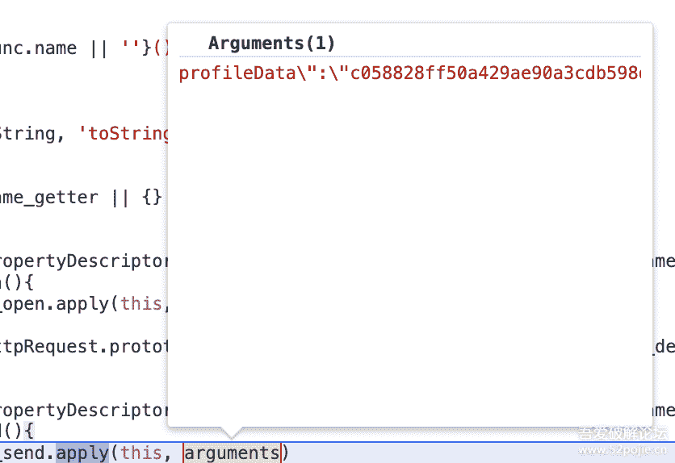

image.png (65.45 KB, 下载次数: 0)

2023-12-6 14:43 上传

跟踪堆栈：

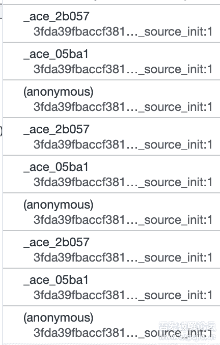

image.png (104.23 KB, 下载次数: 0)

2023-12-6 14:43 上传

堆栈打开可以看到是一个`vmp`，和签名`x-s`的很像

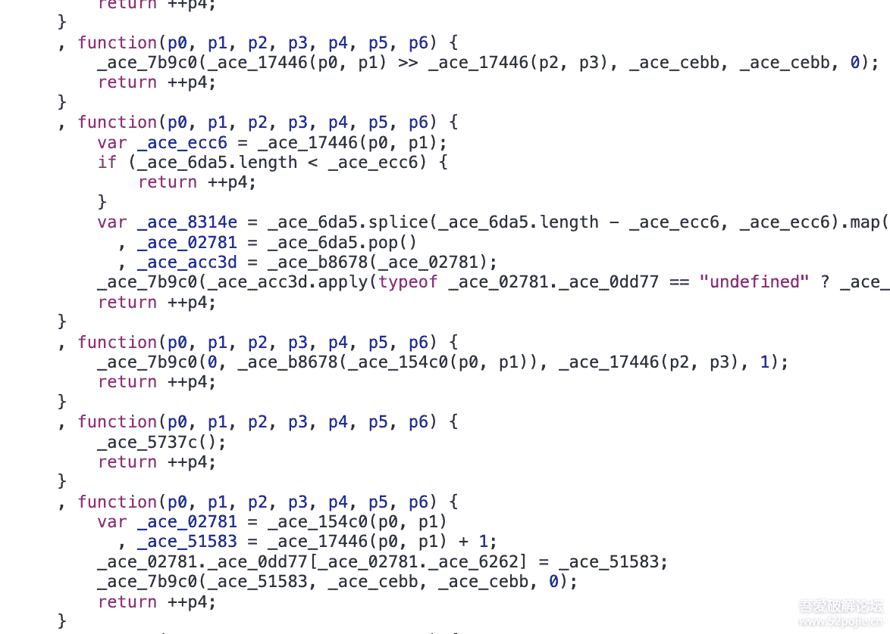

image.png (189.45 KB, 下载次数: 0)

2023-12-6 14:43 上传

一般来说，代码使用`vmp`加密，最后能够实现补环境获取签名后，再在本地分析（我推荐的方式），但字节的`vm`都是跳来跳去的，一个签名可能使用了好几个`vmp`；

那么，开始补环境：

懂事的小伙伴都知道

- `x-s`入口函数：`window._webmsxyw()`
- `profileData`: `window.xhsFingerprintV3.getV18`

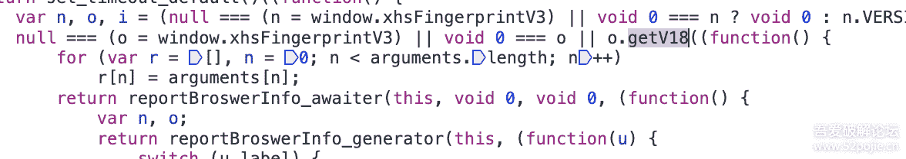

image.png (79.8 KB, 下载次数: 0)

2023-12-6 14:45 上传

## 补环境（jsdom）

签名函数入口调用：

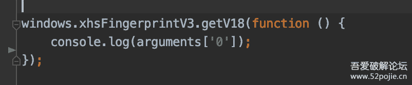

image.png (23.32 KB, 下载次数: 0)

2023-12-6 14:45 上传

运行一下：

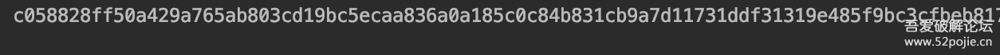

image.png (16.18 KB, 下载次数: 0)

2023-12-6 14:46 上传

我擦，有结果了，格式看起来和网页上的一致

但是我不喜欢，执行`vmp`消耗的资源巨大，手上没点钱是顶不住业务机器的高并发的；

## 分析算法

那么，分析算法：

首先，这个`vm`和之前的`x-s`的`vmp`很像，那么，根据之前分析`x-s`的思路来分析这个`vmp`会不会大大提升效率？开干！

打`log`调试，看看内存变化：

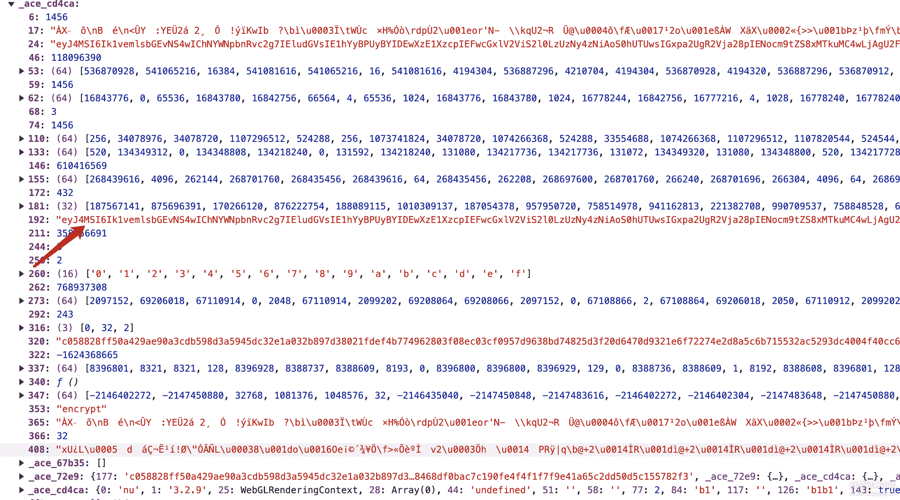

image.png (477.28 KB, 下载次数: 0)

2023-12-6 14:48 上传

什么？乱七八糟的看不懂啊！！，别急，懂事的小伙伴已经看到了我标记的一处地点了，抓下来，`base64`看看是什么数据

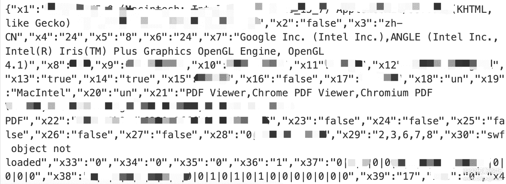

image.png (144.11 KB, 下载次数: 0)

2023-12-6 14:49 上传

这不就是浏览器各种各样的环境吗，太棒了。

分析到这里，笔者发现，这思路逻辑不就妥妥的和`x-s`的一模一样吗！？好的，开始验证：：

在`x-s`签名算法中，我们使用的是 `"x1=" + x1 + ";x2=0|0|0|1|0|0|1|0|0|0|1|0|0|0|0;" + "x3=" + setCa1 + ";x4=1687164665;"`; 那么，我将这个字符串替换成我们上面得到的呢

image.png (9.51 KB, 下载次数: 0)

2023-12-6 14:50 上传

好像不太一样；那换个`key`呢？返回到内存中看看有没有类似于`key`的数组存在

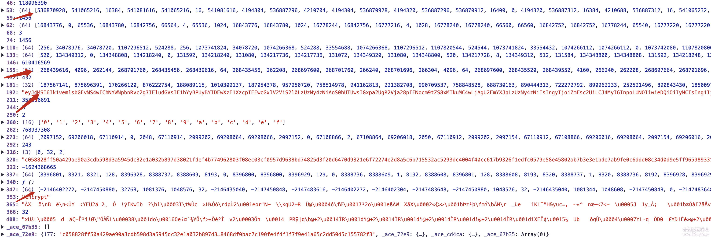

image.png (452.08 KB, 下载次数: 0)

2023-12-6 14:50 上传

好吧，原来答案已经写在脸上了，当然前提要有和笔者一样分析过`x-s`的经验。

最好将key替换得到结果：

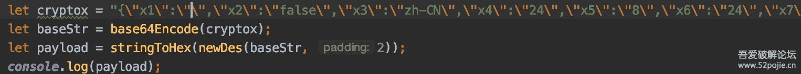

image.png (49.62 KB, 下载次数: 0)

2023-12-6 14:39 上传

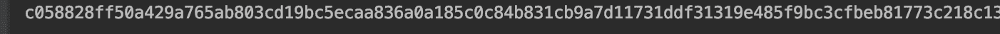

image.png (11.3 KB, 下载次数: 0)

2023-12-6 14:40 上传

好的，完美结束！
