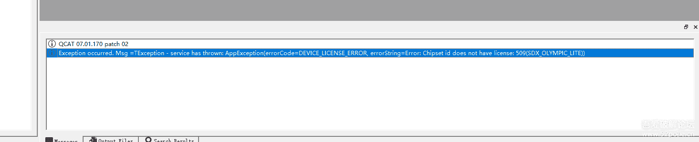
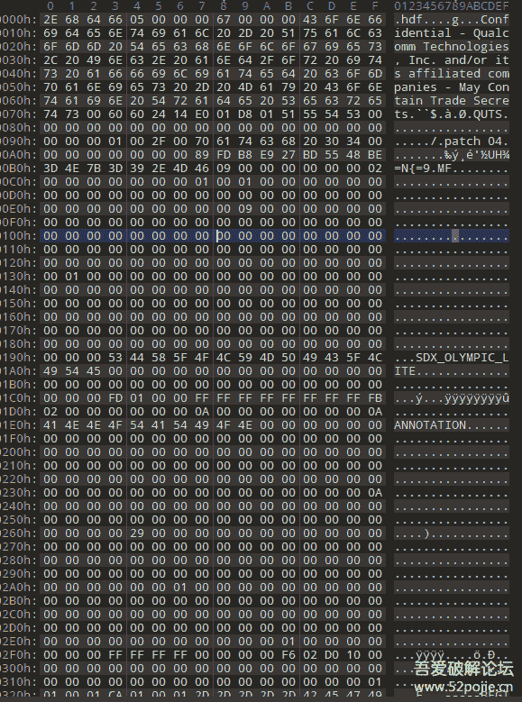
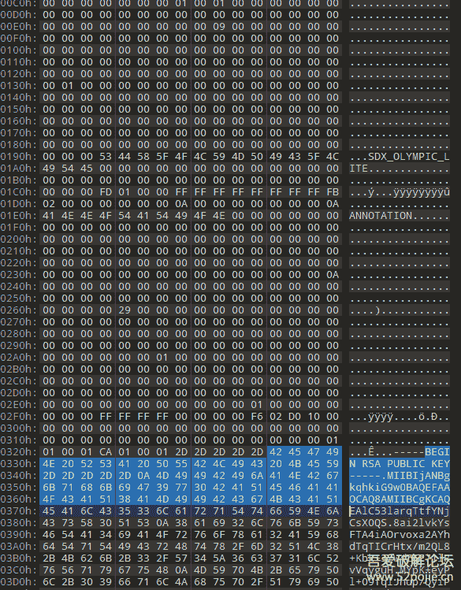
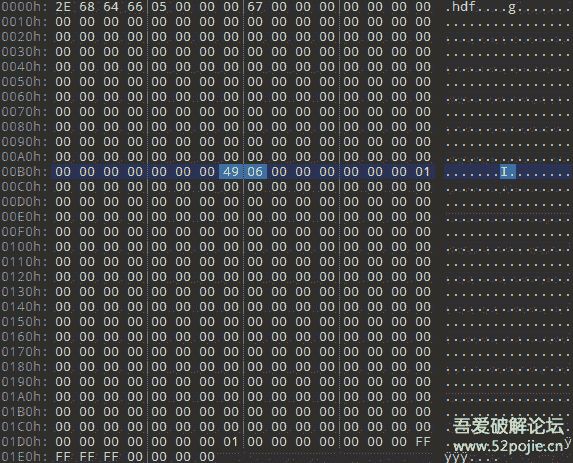
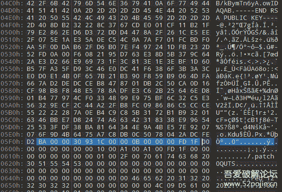
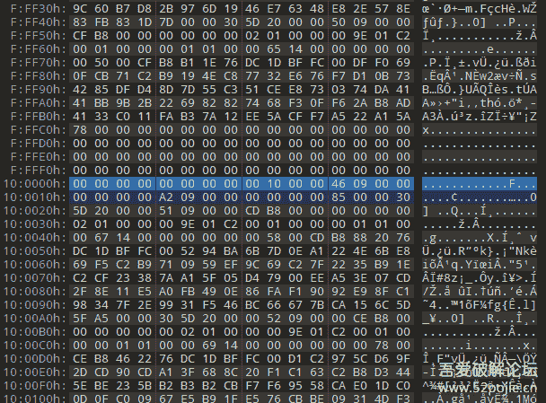
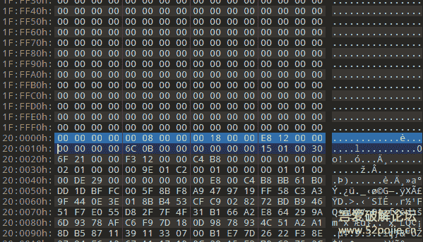
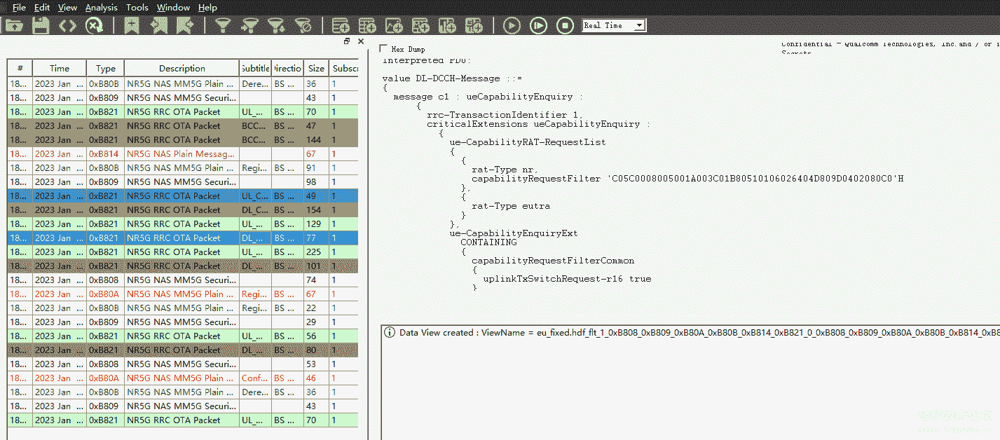

# [原创] 高通`QCAT7`日志解析时芯片`license`限制规避另类思路

- 原帖: https://www.52pojie.cn/forum.php?mod=viewthread&tid=1868737
- 抓取时间: 2026-11-01T22:40:41

注意：仅供学习使用，仅为个人爱好，不提供任何成品，而且只提供大体思路，以免产生不必要的麻烦。
之前经过较多的研究，对于`QCAT6`, `QXDM`, `QUTS`, `PCAT`等都有了自己成熟的解除限制思路。然而随着`QCAT6`的进一步停止维护，大部分日志出现`QCAT6`无法解析的情况，不得不升级`QCAT7`。 `QCAT7`的总体[//www.52pojie.cn" target="_blank" class="relatedlink"](https://www.52pojie.cn:href="https)思路和`QCAT6`类似，虽然是64位的程序，但是主要的破解点却没有改变。照猫画虎以后， `QCAT7`轻轻松松的就可以运行了。但是却遇到一个新的障碍，`QCAT7`对于日志进行了芯片级的`license`限制，而且`license`限制的校验放到了`QUTS`里面，由于对于这部分新加入的功能不熟悉，短时间内无法迅速破解这个限制。具体的现象如下所示，打开一个别人发的`log`，会出现对应的芯片平台没有`License`的情况。

000.png (18.33 KB, 下载次数: 0)
[href="forum.php?mod=attachment&aid=MjY2MzczNXw1OTA0YTI2ZHwxNzkzNTcyODM5fDE2ODA4NnwxODY4NzM3&nothumb=yes" target="_blank"](https://www.52pojie.cn/forum.php?mod=attachment&aid=MjY2MzczNXw1OTA0YTI2ZHwxNzkzNTcyODM5fDE2ODA4NnwxODY4NzM3&nothumb=yes)
2023-12-13 21:32 上传

用`010 editor`打开日志文件，发现高通确实在新的文件格式`hdf`里面做了手脚。 如下可以看到文件头中多了好多信息，包括了芯片的平台型号和`RSA KEY`

0.png (74.87 KB, 下载次数: 1)
[href="forum.php?mod=attachment&aid=MjY2MzczNnwyNzE5YzlmNnwxNzkzNTcyODM5fDE2ODA4NnwxODY4NzM3&nothumb=yes" target="_blank"](https://www.52pojie.cn/forum.php?mod=attachment&aid=MjY2MzczNnwyNzE5YzlmNnwxNzkzNTcyODM5fDE2ODA4NnwxODY4NzM3&nothumb=yes)
2023-12-13 21:33 上传

1.png (78.6 KB, 下载次数: 0)
[href="forum.php?mod=attachment&aid=MjY2MzczN3w5ZDJjYmExZnwxNzkzNTcyODM5fDE2ODA4NnwxODY4NzM3&nothumb=yes" target="_blank"](https://www.52pojie.cn/forum.php?mod=attachment&aid=MjY2MzczN3w5ZDJjYmExZnwxNzkzNTcyODM5fDE2ODA4NnwxODY4NzM3&nothumb=yes)
2023-12-13 21:34 上传

这个`key`的作用到底只是校验芯片的`license`呢，还是解密日志的其他内容呢。 庆幸的是，经过好多天的对比验证，发现这个`key`只是用来校验芯片`license`的，并不会对后面的所有日志进行加密解密，也就是`hdf`里面的日志主体内容仍然是明文方式。
那么应该怎么去掉这部分校验呢。 尝试把所有的`key`部分删掉或者设置为全零都宣告失败。
经过仔细对比老日志的`hdf`头和新日志的`hdf`头，发现老日志的文件头要短的多。以老文件头为模板，后面拼接日志主体，或许是可行的。
找到一个老日志的`hdf`头，经过反复研究，发现这个头的长度是`0x1e7`。 并且唯一比较关键的可变值是在`0xB7`开始的两个字节，例如下图中的 `49 06`,是按照`LSB`方式排列的，倒过来是`0x0649`, 代表了当前这个`sector`后面跟的`log packet`的个数。 这个个数必须要和后面的个数保持一致，（这个是需要动态变化的，其他部分都是静态的）。

2.png (32.03 KB, 下载次数: 0)
[href="forum.php?mod=attachment&aid=MjY2MzczOHw1ZWIyZWY0OXwxNzkzNTcyODM5fDE2ODA4NnwxODY4NzM3&nothumb=yes" target="_blank"](https://www.52pojie.cn/forum.php?mod=attachment&aid=MjY2MzczOHw1ZWIyZWY0OXwxNzkzNTcyODM5fDE2ODA4NnwxODY4NzM3&nothumb=yes)
2023-12-13 21:38 上传

另外的规律是带芯片`License`加密的文件头，真正的有用日志是从`0x5F1`这个地址开始的。如下图所示的`BA 00 00 30`， 那么我们形成新的解密文件的时候就需要从这里开始真正读取新的日志。

3.png (81.22 KB, 下载次数: 0)
[href="forum.php?mod=attachment&aid=MjY2MzczOXxhMmRmYmM5OHwxNzkzNTcyODM5fDE2ODA4NnwxODY4NzM3&nothumb=yes" target="_blank"](https://www.52pojie.cn/forum.php?mod=attachment&aid=MjY2MzczOXxhMmRmYmM5OHwxNzkzNTcyODM5fDE2ODA4NnwxODY4NzM3&nothumb=yes)
2023-12-13 21:41 上传

`hdf`文件还有一个特性就是每隔`0x100000`是一个主要单元，我称为`sector`, 每个`sector`的起始位置必须是`0x100000`的整数倍，也就是说在你新生成的解密文件时也必须遵从这个规律，而且对于加入`License`限制的`hdf`而言，只有第一个`sector`是受影响的，其他内容不受影响。 如下是`0x100000`和`0x200000`附近的字节流，可以看到每个`sector`都有一个子头，这个字头的第`0xC`和`0xD`字节代表的是接下来紧跟着的`log packet`的数目。

4.png (77.9 KB, 下载次数: 1)
[href="forum.php?mod=attachment&aid=MjY2Mzc0MnxiNzk3YzdmOXwxNzkzNTcyODM5fDE2ODA4NnwxODY4NzM3&nothumb=yes" target="_blank"](https://www.52pojie.cn/forum.php?mod=attachment&aid=MjY2Mzc0MnxiNzk3YzdmOXwxNzkzNTcyODM5fDE2ODA4NnwxODY4NzM3&nothumb=yes)
2023-12-13 21:44 上传

5.png (44.8 KB, 下载次数: 1)
[href="forum.php?mod=attachment&aid=MjY2Mzc0M3xiZjhmMzVhNHwxNzkzNTcyODM5fDE2ODA4NnwxODY4NzM3&nothumb=yes" target="_blank"](https://www.52pojie.cn/forum.php?mod=attachment&aid=MjY2Mzc0M3xiZjhmMzVhNHwxNzkzNTcyODM5fDE2ODA4NnwxODY4NzM3&nothumb=yes)
2023-12-13 21:44 上传

采用如上的思路开始编写解密程序，解密程序按照上述的主体算法工作之后，生成的`hdf`文件用`QCAT7`打开之后，发现一切OK。`License`的解密规避成功。

6.png (97.96 KB, 下载次数: 0)
[href="forum.php?mod=attachment&aid=MjY2Mzc0N3wzYjAwOTYyMnwxNzkzNTcyODM5fDE2ODA4NnwxODY4NzM3&nothumb=yes" target="_blank"](https://www.52pojie.cn/forum.php?mod=attachment&aid=MjY2Mzc0N3wzYjAwOTYyMnwxNzkzNTcyODM5fDE2ODA4NnwxODY4NzM3&nothumb=yes)
2023-12-13 21:47 上传
