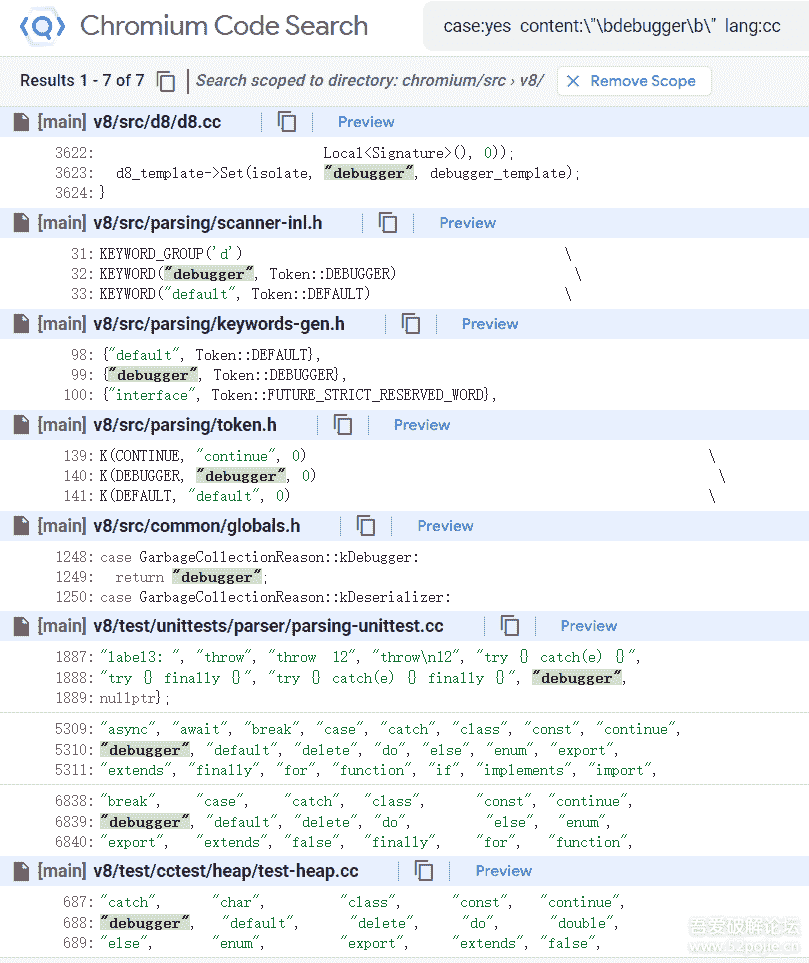
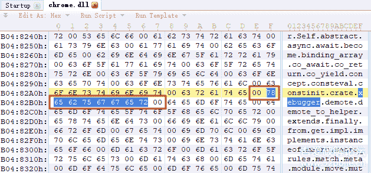
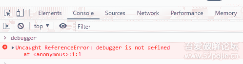

# [Web逆向] 反调试-编译pass彻底解决调试web无限debugger问题

- 原帖: https://www.52pojie.cn/forum.php?mod=viewthread&tid=1868749
- 抓取时间: 2026-11-01T22:40:39

本文尝试从编译过程彻底解决调试web无限debugger问题

## 背景

当我们调试`JS`的时候，时常会遇见无限`debugger`。

`debugger`语句用于停止执行 JavaScript(以下简称`JS`)，并调用 (如果可用) 调试函数。

使用`debugger`语句类似于在代码中设置断点。

```
setInterval(()=>{debugger;}, 100);
setInterval(()=>{eval("debugg"+"er");}, 100);
```

复制上述语句到控制台执行就可以触发了。

实际中的反调试语句会更加复杂和嵌套各种调试技巧，例如常见的无限制`debugger`、配合`setTimeout`延迟`debugger`、代码混淆+`debugger`等等。

## 解决思路

任何代码都必须编译原理几步-词法语法中间代码机器码，`js`既然要编译，直接在编译时把关键词屏蔽掉/或生成空语句。

## 实现

Chrome浏览器内置的是`v8` engine，

### 1 源代码

`chromium/v8` 代码搜索: https://source.chromium.org/search?q=case:yes%20%20content:%5C%22%5Cbdebugger%5Cb%5C%22%20%20lang:cc&ss=chromium%2Fchromium%2Fsrc:v8%2F



49424255.png (98.79 KB, 下载次数: 2)

2023-12-13 22:13 上传

注意到`v8`和`nodejs`项目基本一致，直接下载`nodejs`进行关键词检索：

```
node/node-v12.22.9/deps/v8/src$ grep -Rn '"[xd]ebugger"'
parsing/keywords-gen.h:99:     {"debugger", Token::DEBUGGER},
parsing/token.h:139:  K(DEBUGGER, "debugger", 0)
parsing/scanner-inl.h:31:  KEYWORD("debugger", Token::DEBUGGER)
heap/heap.cc:3793:      return "debugger";
```

替换掉`parsing`目录下的几个`"debugger"`就达到了目标。

只编译`nodejs`比较简单，`make -j16`一把梭，使用修改后的`node`调试即可。

但对于Chrome浏览器内置`v8`就非常无敌超级麻烦要下载工具链，具体请参考网文 `V8 在 Chrome 中的位置&编译调试V8`: https://cloud.tencent.com/developer/article/1800229

那怎么办呢？挠头.jpg


naotou.jpg (34.77 KB, 下载次数: 1)

2023-12-13 22:11 上传

### 2 二进制修改

系统环境 Windows 10，Chrome 109

先看看DLL内置的字符串信息，bingo，第一行就是了。

```
λ strings chrome.dll | grep debugger
debugger
ICE debugger
ICD2 in-circuit debugger
wait-for-debugger-children
Error loading debugger
await can not be used when evaluating code while paused in the debugger
Cannot access '%' from debugger
debuggerStatement
debuggerId
debuggerEnabled
DevTools debugger
debuggerId
devtools-frontend/front_end/panels/browser_debugger/browser_debugger-legacy.js
devtools-frontend/front_end/panels/browser_debugger/browser_debugger-meta.js
devtools-frontend/front_end/panels/browser_debugger/browser_debugger.js
permission:debugger
wait-for-debugger
silent-debugger-extension-api
Cannot navigate to a devtools:// page without either the devtools or debugger permission.
[...其他...]
```

编译字符串常量必直接表示在`rdata`区，可直接修改这些`hard token`。

- 📢修改前请备份文件`chrome.dll`;
- 打开`chrome`安装目录⚙，使用`010 editor`/`IDA Pro`/`Win HEX`暴力搜索实际字节为`\x00debugger\x00`的地方，前后都是16进制的`00`;


文件修改.png (59.16 KB, 下载次数: 2)

2023-12-13 22:10 上传

- `debugger`修改为别的等长字符比如`xebugger`；

```
λ grep -aboP "\x00[xd]ebugger\x00" chrome.dll
167677043: xebugger
λ xxd -l10 -s 167677043 chrome.dll
09fe8c73: 0078 6562 7567 6765 7200                 .debugger.
λ printf x | dd of=chrome.dll   bs=1 seek=167677044 count=1 conv=notrunc
1+0 records in
1+0 records out
1 byte copied, 0.0017532 s, 0.6 kB/s
λ xxd -l20 -s 167677043 chrome.dll
09fe8c73: 0078 6562 7567 6765 7200 0000 0001 0000  .xebugger.......
09fe8c83: 0070 6572                                .per
```

- 重新打开 `chrome` 控制台测试 `debugger` 是否生效；正常情况下应该已经不会触发`debug`状态了。



调试测试.png (15.64 KB, 下载次数: 2)

2023-12-13 22:10 上传

- 完工，这样就绕过编译`Chrome`的工程问题。

## 副作用

- 代码中的`debugger`成为非法语句，调试器中人工鼠标设置的`line breakpoint`依然生效。
- 破坏标准语法完整性，导致被探测到`debug`被破坏输出了`warning` `error`，相比之下源码解除`debugger`/`修改ast`编译过程更加安全。
- 部分插件失效，如油猴插件

## EOF

/革命尚未成功，同志任需努力；
欲知后事如何，请听下回分解😁/
