# [Web逆向] [补环境流]易盾智能无感逆向fp参数

- 原帖: https://www.52pojie.cn/forum.php?mod=viewthread&tid=1868945
- 抓取时间: 2026-11-01T22:40:37

## 背景
这2个月一直在忙着写补环境框架，希望能够把执行流程代码丢进去就会自己获取结果(这其中因为无法真正达到浏览器环境，所以一些类似于元素位置等详细信息，轨迹过程就可能需要自己稍微修改)

于是我就在不断进行实战以此来完善和了解其中代码检测流程,所以我的会更多偏向新手类型，很多还是欠缺，很多是自己这个新手总结出来的小心得（大佬们还望手下留情）。

补环境流的思路非常简单粗暴，就是找到加密函数位置然后进行想办法进行导出，然后跑去运行，如果运行出来了还好，不然就继续检测哪里出问题就一步步进入代码里面看看哪里进行环境检测。

接下来进入正题，这是本次要进行的目标
我们由结果来找出我们要进行逆向的目标

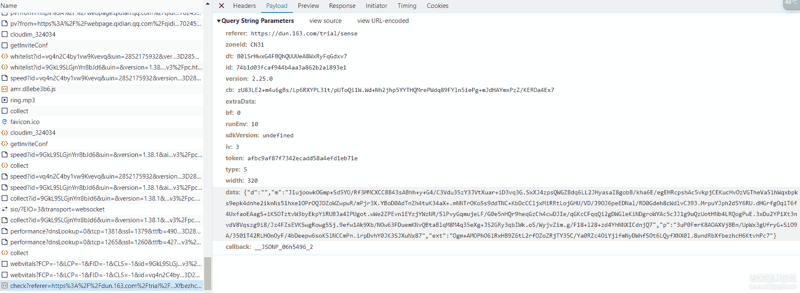

## 目标分析
在经过一系列检测排除后可以得到我们要逆向的目标

`cb`

`data`

`callback`

不需要我们进行逆向的目标有

`id` 这个是写死的

`token` 是网页请求得来的(`api/v3/get`) 但这个依赖于`cb` `fp`

`dt` 网页请求得来的

`fp`是我想要说的重点，因为它是经过环境检测的，而其它参数逆向过程中我没有发现

`fp`就是cookie里面的`gdxidpyhxdE`

这里在我们进行hook `gdxidpyhxdE`就能得到以下调用

而函数调用`QO`这里就是`gdxidpyhxdE`即`fp`的 里面也包括了环境检测，建议仔细调试会大有收获

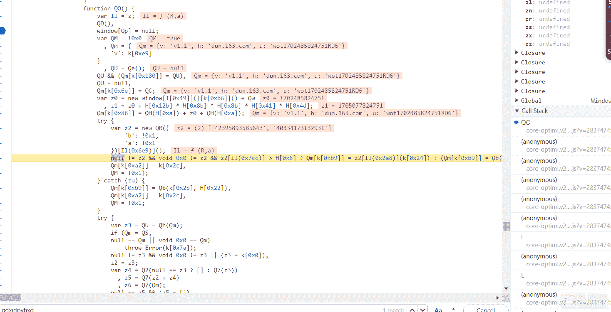

## 环境检测
环境检测有`Z2=new QR`这里函数进去后会看到一些检测如`localstorage` `body` `opendatabase`

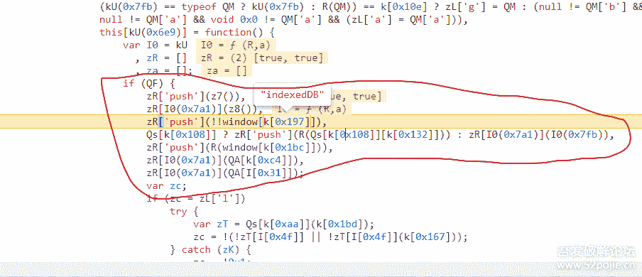

到了`var zc`下面会检测到`canvas` 对于`dom`节点的检测，我自己尝试过不用`jsdom`模块去完成，但发现自己要是真弄得考虑非常多问题，可是听说`jsdom`被检测烂了，但没办法，我就只使用提供的`document`，不知道大佬有没有更好的方法。

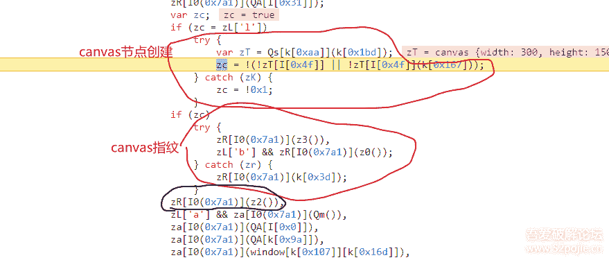
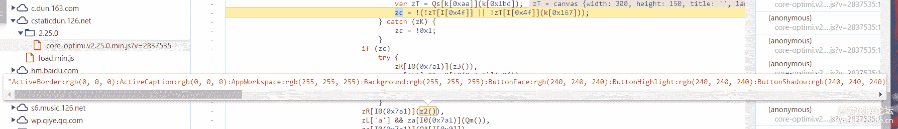

看图上，黑色那部分就是我自己觉得比较重要的一点

直接追进`z2`这个函数中看，大概是先检测`getComputedStyle`是否存在然后有没有创建一个元素`div`然后给它的`style` `color`赋值一些值（这里重点是如果单单看值是没有发现和颜色有什么关系的）

其中`getComputedStyle`如果用的是`jsdom`的模块中的`window`的话，后面它检测的时候立马就被发现了。我想过去在源代码基础上进行完善，但实在看的头晕，这个可以自己实现很简单

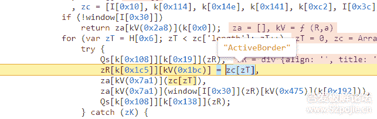

然后就会执行`window.getComputedStyle(div).getPropertyValue('color')` 这行代码

这时候奇怪的事情发生了，如果是补环境的人不去仔细看是真的没发现有什么问题

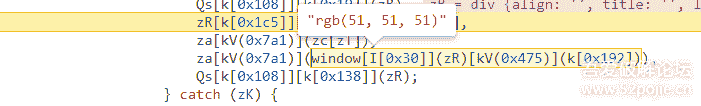

## getComputedStyle 颜色转换细节
可以看到之前赋值的是`div.style.color='ActiveBorder'` 这以我们的直觉来说应该没啥问题

但为什么获取`getPropertyValue('color')` 的时候是转换成`rgb`呢?

下面我就进行了下实验 拿火狐浏览器和edg浏览器来都给一个元素设置`color:activecaption` (这里我做实验的时候忘记拿`ActiveBorder`了)

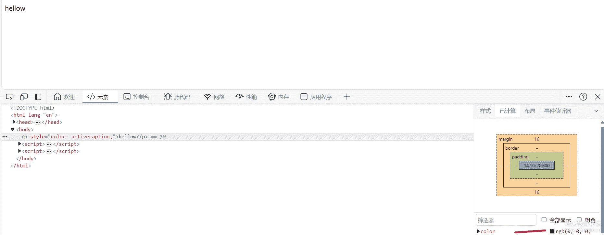
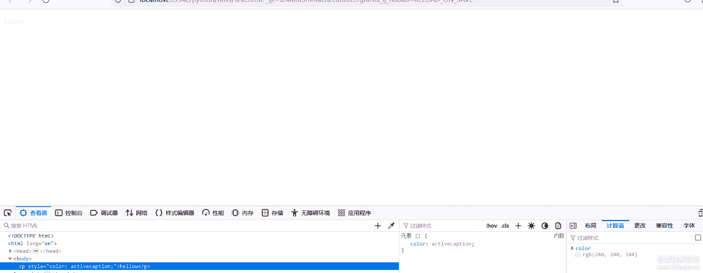

从图上可以看出当我设置`color:activecaption`会自动变成颜色并且不同浏览器颜色不同

所以我就自己斗胆自己搞了下

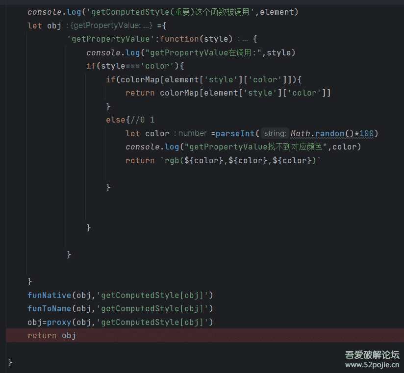
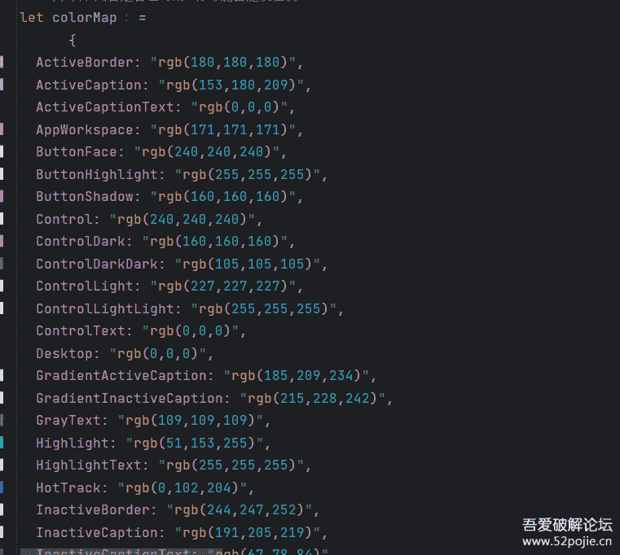

大概意思就是当`style.color`设置这些值的时候，并且被`getPropertyValue('color')`了就会转换成`rgb` ，我试了下颜色值随机也能过

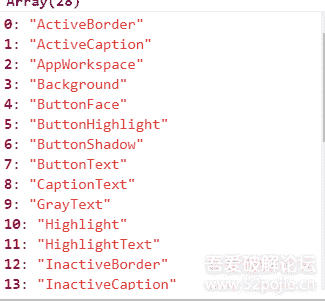

然后这个函数这样子过掉了

然后接下来就没有什么奇怪的地方了，直接照搬套路看然后丢环境里面跑，最后得到结果

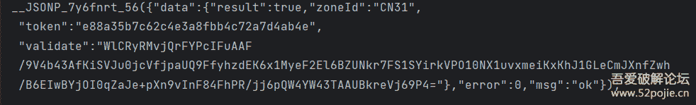
