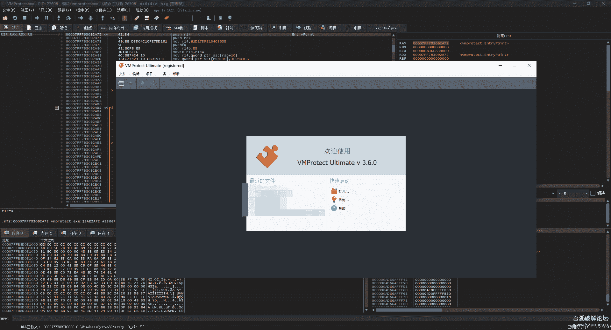
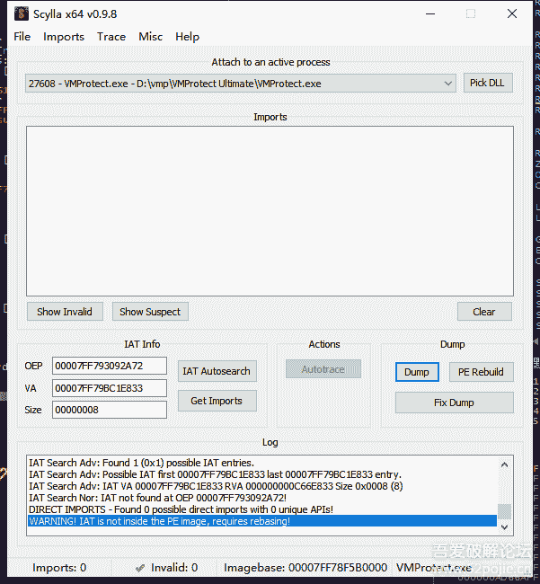
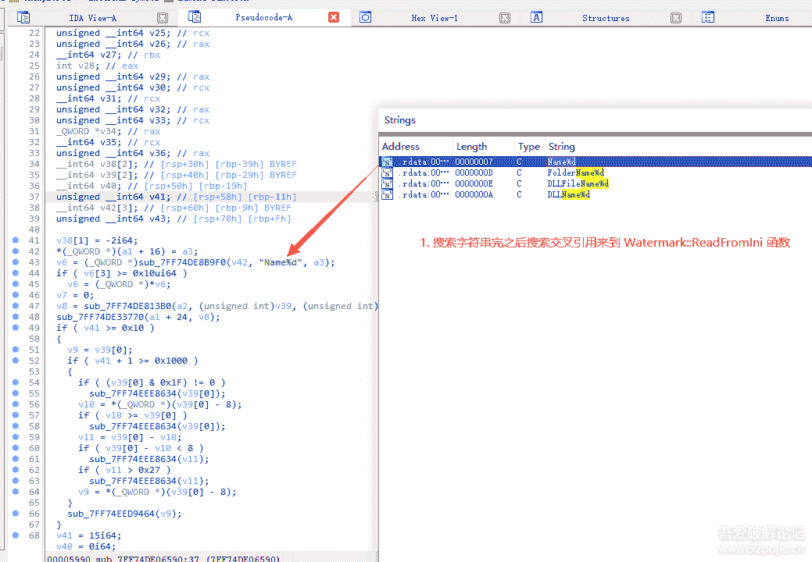
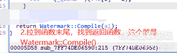
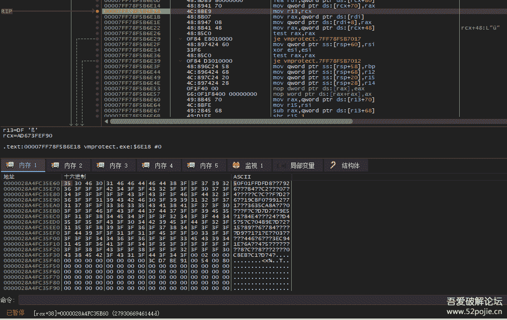
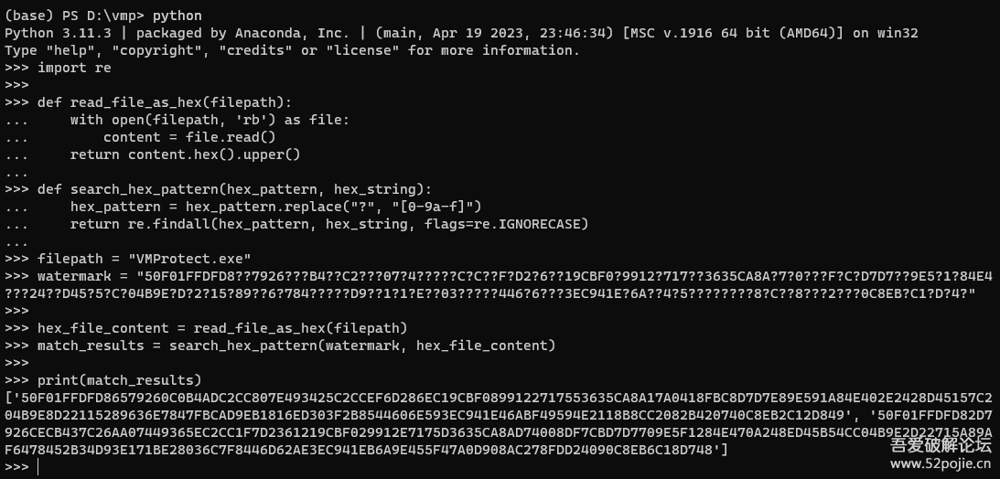
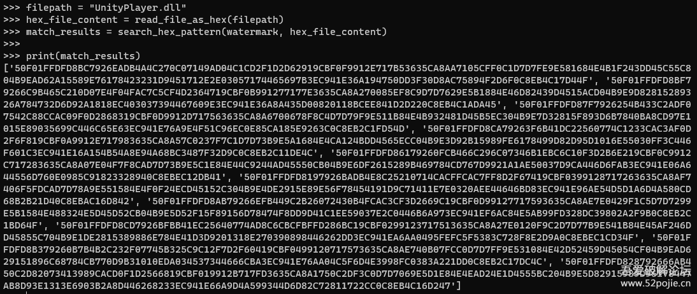
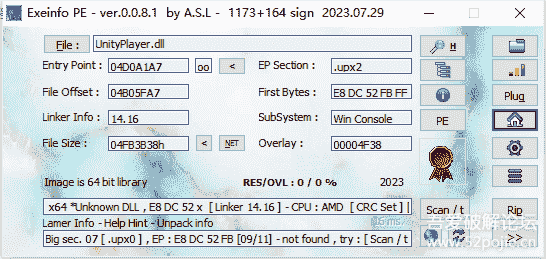

# [原创] 一种新的辨认VMP3的方法

- 原帖: https://www.52pojie.cn/forum.php?mod=viewthread&tid=1869758
- 抓取时间: 2026-11-01T22:40:32

## 一种新的辨认VMP3的方法

最近，VMP 3.5.1 的源码被完整泄露了 等不及看见国产虚拟机了

朋友在读源码的时候发现了 VMP 编译器水印的位置，我只是个调试菜鸡, 写这个文章来记录一下过程

### 思路 [来自朋友友情赞助]

在 `cores/processors.cc` 的第 2070 行，出现了一个函数 `BaseFunction::AddWatermark`, 内容如下

```
uint8_t *version_watermark = NULL;
uint8_t *owner_watermark = NULL;

void BaseFunction::AddWatermark(Watermark *watermark, int copy_count)
{
        Watermark secure_watermark(NULL);
        std::string value;
        uint8_t *internal_watermarks[] = {version_watermark, owner_watermark};

        for (size_t k = 0; k (ptr);
                        uint16_t len = *reinterpret_cast(ptr + 4);
                        value.resize(len);
                        for (size_t i = 0; i (_rotl32(key, (int)i) + i);
                        }
                        secure_watermark.set_value(value);
                        watermark = &secure_watermark;
                }

                for (int i = 0; i Compile();
                        ICommand *command = AddCommand(Data(watermark->dump()));
                        command->include_option(roCreateNewBlock);
                }
        }
}
```

这段代码定义了一个名为 `BaseFunction::AddWatermark` 的方法，该方法将特定的“水印”添加到一个对象或数据中。以下是关于这个函数以及代码中每行的简单解释。

首先，定义了两个指向 `uint8_t` 类型的全局指针，`version_watermark` 和 `owner_watermark`, 既版本水印和用户水印。

```
uint8_t *version_watermark = NULL;

uint8_t *owner_watermark = NULL;
```

`BaseFunction::AddWatermark` 函数接收两个参数: 一个 `Watermark` 对象指针和一个表示要复制的次数的整数。

```
void BaseFunction::AddWatermark(Watermark *watermark, int copy_count)
```

然后，创建了一个新的 `Watermark` 对象 `secure_watermark`。并创建了一个字符串 `value` 用于存放从内部 watermark 中提取和处理的数据。

```
Watermark secure_watermark(NULL);

std::string value;
```

接下来创建了一个内部 watermark 数组 `internal_watermarks`，它包含了之前定义的全局 watermark 指针。

```
uint8_t *internal_watermarks[] = {version_watermark, owner_watermark};
```

这里的代码穿过所有 watermark（包括输入的 watermark 和内部的 watermark）。对于每个 watermark，如果它是 `NULL`，那么就直接跳过当前迭代。

```
for (size_t k = 0; k 
```

取出内部 watermark，将它的数据作为 32 位和 16 位的块重新解释（也就是把原始的数据直接视作这些数值）。然后，它用一个特殊的算法（对每个字节都执行异或，然后添加到索引上），在 `value` 中生成新的字符。

```
        uint32_t key = *reinterpret_cast(ptr);
        uint16_t len = *reinterpret_cast(ptr + 4);
        value.resize(len);
        for (size_t i = 0; i (_rotl32(key, (int)i) + i);
        }
        secure_watermark.set_value(value);
        watermark = &secure_watermark;
```

最后，它为每个 watermark 创建 `copy_count` 个复制项，编译每个复制项，并将其添加到 `ICommand` 中，随后设置创建新块的数据选项标志。

```
        for (int i = 0; i Compile();

                ICommand *command = AddCommand(Data(watermark->dump()));

                command->include_option(roCreateNewBlock);

        }

}
```

这段代码的主要目的是为了处理和添加 watermark 到数据中。它首先处理传入的 watermark，然后处理定义的内部 watermark。处理的方式包括从中提取数据，以特定方式编辑这些数据，并设置 `secure_watermark` 或新增 watermark 的值。然后为这些 watermark 创建指定数量的复制项，并添加到命令中。

其中的 `secure_watermark.set_value(value);` 设定水印内容，之后使用这个实例进行水印的添加 (见上方)，我们可以通过获取这个实例的 `this` 指针来获取水印内容

然而在后期测试的时候，`BaseFunction::AddWatermark` 实际上是被虚拟机保护了，但 `Watermark` 类并没有被虚拟机保护，其中的 `Watermark::ReadFromIni` 函数特征及其鲜明，这意味着我们可以通过 dump 下来的程序，抓住函数地址并直接读取水印内容，见下文

注：必须要用dump后的程序分析，因为VMP似乎只有在运行时才会解密字符串

```
// 在 IDA 中可以通过搜索dump后的程序内字符串，快速锁定这个函数，如 Name%d
// 快捷键: Shift + F12
void Watermark::ReadFromIni(IniFile &file, size_t id)
{
        id_ = id;
        name_ = file.ReadString("Watermarks", string_format("Name%d", id).c_str());
        value_ = file.ReadString("Watermarks", string_format("Value%d", id).c_str());
        use_count_ = file.ReadInt("Watermarks", string_format("UseCount%d", id).c_str());
        enabled_ = file.ReadBool("Watermarks", string_format("Enabled%d", id).c_str(), true);
        Compile(); // Watermark::Compile()
}
```

```
void Watermark::Compile()

{

        dump_.clear();

        mask_.clear();

        if (value_.size() == 0)

                return;

        for (size_t i = 0; i = dump_.size()) {

                        dump_.push_back(0);

                        mask_.push_back(0);

                }

                uint8_t m = 0xff;

                uint8_t b;

                char c = value_[i]; // 可以从这里直接抓取水印的内存地址，然后直接读取

                if ((c >= '0') && (c = 'A') && (c = 'a') && (c 
```

### 实际调试

这里就是我干活的地方了（

掏出带有反反调试器的 `x64dbg`，直接 逆向，启动！()



image.png (196.58 KB, 下载次数: 0)

[href="forum.php?mod=attachment&aid=MjY2NDQ1Nnw1ZDgxNDY4ZXwxNzkzNTcyODMwfDE2ODA4NnwxODY5NzU4&nothumb=yes" target="_blank"](https://www.52pojie.cn/forum.php?mod=attachment&aid=MjY2NDQ1Nnw1ZDgxNDY4ZXwxNzkzNTcyODMwfDE2ODA4NnwxODY5NzU4&nothumb=yes)

2023-12-16 16:51 上传

使用自带的 `Scylla` 把 VMP 主程序 dump 出来



image-1.png (41.53 KB, 下载次数: 0)

[href="forum.php?mod=attachment&aid=MjY2NDQ1N3wzOWM2YTk1ZnwxNzkzNTcyODMwfDE2ODA4NnwxODY5NzU4&nothumb=yes" target="_blank"](https://www.52pojie.cn/forum.php?mod=attachment&aid=MjY2NDQ1N3wzOWM2YTk1ZnwxNzkzNTcyODMwfDE2ODA4NnwxODY5NzU4&nothumb=yes)

2023-12-16 16:51 上传

在 `IDA` 内搜索特征字符串，找到 `Watermark::Compile()` 函数



image-2.png (92.29 KB, 下载次数: 0)

[href="forum.php?mod=attachment&aid=MjY2NDQ0OXxkNjY5YzM3ZnwxNzkzNTcyODMwfDE2ODA4NnwxODY5NzU4&nothumb=yes" target="_blank"](https://www.52pojie.cn/forum.php?mod=attachment&aid=MjY2NDQ0OXxkNjY5YzM3ZnwxNzkzNTcyODMwfDE2ODA4NnwxODY5NzU4&nothumb=yes)

2023-12-16 16:50 上传



image-3.png (15.99 KB, 下载次数: 0)

[href="forum.php?mod=attachment&aid=MjY2NDQ1MHw1NGU2NzE3NnwxNzkzNTcyODMwfDE2ODA4NnwxODY5NzU4&nothumb=yes" target="_blank"](https://www.52pojie.cn/forum.php?mod=attachment&aid=MjY2NDQ1MHw1NGU2NzE3NnwxNzkzNTcyODMwfDE2ODA4NnwxODY5NzU4&nothumb=yes)

2023-12-16 16:50 上传

解释后的伪代码 `Watermark::Compile()` 函数如下


```cpp
char __fastcall Watermark::Compile(_QWORD *this)
{
  _QWORD *mask_; // rdi
  __int64 size_value_; // rax (value_.size())
  unsigned __int64 i; // rsi (iteration variable)
  unsigned __int64 p; // r15 (i / 2, index for dump_ and mask_)
  unsigned __int64 new_size; // rax (used during vector expansion)
  unsigned __int64 dump_condition; // rcx (condition for growth check)
  char *value_pointer; // r14
  _BYTE *dump_bytes; // rdx
  _BYTE *mask_bytes; // rax
  unsigned __int64 mask_new_size; // rax (used during vector expansion)
  char *mask_pointer; // r14
  _BYTE *mask_data; // rdx
  _BYTE *dump_expansion; // rax
  char mask_byte; // bp (temporary bit mask)
  _QWORD *value_data; // rax (pointer to value_ data)
  char c_value; // al (current character in value_)
  char hex_value; // al (hexadecimal representation for current character)
  __int64 dump_offset; // rdx (offset into dump_)
  char current_byte; // cl (current byte in dump_)
  char v22[8]; // [rsp+50h] [rbp+8h] BYREF (used for temporary growth checking)

  mask_ = this + 16;
  this[14] = this[13];
  this[17] = this[16];
  size_value_ = this[9];
  if ( size_value_ )
  {
    i = 0i64;
    do
    {
      p = i >> 1;
      if ( p >= this[14] - this[13] )
      {
        new_size = this[14];
        v22[0] = 0;
        if ( (unsigned __int64)v22 >= new_size || (dump_condition = this[13], dump_condition > (unsigned __int64)v22) )
        {
          if ( new_size == this[15] )
            ResizeDump(this + 13, 1i64);
          mask_bytes = (_BYTE *)this[14];
          if ( mask_bytes )
            *mask_bytes = 0;
        }
        else
        {
          value_pointer = &v22[-dump_condition];
          if ( new_size == this[15] )
            ResizeDump(this + 13, 1i64);
          dump_bytes = (_BYTE *)this[14];
          if ( dump_bytes )
            *dump_bytes = value_pointer[this[13]];
        }
        ++this[14];
        mask_new_size = mask_[1];
        v22[0] = 0;
        if ( (unsigned __int64)v22 >= mask_new_size || *mask_ > (unsigned __int64)v22 )
        {
          if ( mask_new_size == mask_[2] )
            ResizeMask(mask_, 1i64);
          dump_expansion = (_BYTE *)mask_[1];
          if ( dump_expansion )
            *dump_expansion = 0;
        }
        else
        {
          mask_pointer = &v22[-*mask_];
          if ( mask_new_size == mask_[2] )
            ResizeMask(mask_, 1i64);
          mask_data = (_BYTE *)mask_[1];
          if ( mask_data )
            *mask_data = mask_pointer[*mask_];
        }
        ++mask_[1];
      }
      mask_byte = -1;
      if ( this[10]  9u )
      {
        if ( (unsigned __int8)(c_value - 65) > 5u )
        {
          if ( (unsigned __int8)(c_value - 97) > 5u )
          {
            mask_byte = 0;
            hex_value = RandomFunction();
          }
          else
          {
            hex_value = c_value - 87;
          }
        }
        else
        {
          hex_value = c_value - 55;
        }
      }
      else
      {
        hex_value = c_value - 48;
      }
      dump_offset = this[13];
      current_byte = *(_BYTE *)(dump_offset + p);
      if ( (i & 1) != 0 )
      {
        *(_BYTE *)(dump_offset + p) ^= (hex_value ^ current_byte) & 0xF;
        LOBYTE(size_value_) = (mask_byte ^ *(_BYTE *)(*mask_ + p)) & 0xF;
        *(_BYTE *)(*mask_ + p) ^= size_value_;
      }
      else
      {
        *(_BYTE *)(dump_offset + p) = (16 * hex_value) | current_byte & 0xF;
        LOBYTE(size_value_) = (16 * mask_byte) | *(_BYTE *)(*mask_ + p) & 0xF;
        *(_BYTE *)(*mask_ + p) = size_value_;
      }
      ++i;
    }
    while ( i 
```

其中的 `value_data` 就是我们想找的水印字符串的指针，对应汇编为

```asm
.text:00007FF74DE06F61 loc_7FF74DE06F61:                       ; CODE XREF: Watermark__Compile+71↑j
.text:00007FF74DE06F61                 cmp     qword ptr [r13+50h], 10h
.text:00007FF74DE06F66                 mov     bpl, 0FFh
.text:00007FF74DE06F69                 jb      short loc_7FF74DE06F71
.text:00007FF74DE06F6B                 mov     rax, [r13+38h]
.text:00007FF74DE06F6F                 jmp     short loc_7FF74DE06F75
.text:00007FF74DE06F71 ; ---------------------------------------------------------------------------
.text:00007FF74DE06F71
.text:00007FF74DE06F71 loc_7FF74DE06F71:                       ; CODE XREF: Watermark__Compile+169↑j
.text:00007FF74DE06F71                 lea     rax, [r13+38h]
```

其中 `[r13+0x38]` 为从实例指针(`this`)+偏移量中取出水印字符串指针赋值给 `rax`，既 `value_data`

进一步追寻 `r13` 的来源，在函数开头发现了这一行

```asm
.text:00007FF74DE06E18                 mov     r13, rcx
```

根据 Windows 平台 x64 下的 `fastcall` 调用约定，第一个传入参数为 `rcx`，既 `this` 指针，因此我们在 `Watermark::Compile` 函数开头直接使用 `[rcx+0x38]` 就可以获取水印字符串指针

注: 关于 x64 调用约定，可参考微软官方文档 [//learn.microsoft.com/zh-cn/cpp/build/x64-calling-convention?view=msvc-170#calling-convention-defaults" target="_blank" rel="noopener noreferrer nofollow"](https://learn.microsoft.com/zh-cn/cpp/build/x64-calling-convention?view=msvc-170#calling-convention-defaults:rel="nofollow noopener" href="https)

在调试器内下断点，获取水印字符串指针，直接看内存获得水印具体内容



image-5.png (114.26 KB, 下载次数: 0)

[href="forum.php?mod=attachment&aid=MjY2NDQ1Mnw4MTc0ODIxNnwxNzkzNTcyODMwfDE2ODA4NnwxODY5NzU4&nothumb=yes" target="_blank"](https://www.52pojie.cn/forum.php?mod=attachment&aid=MjY2NDQ1Mnw4MTc0ODIxNnwxNzkzNTcyODMwfDE2ODA4NnwxODY5NzU4&nothumb=yes)

2023-12-16 16:51 上传

```
0000028A4FC35E60  35 30 46 30 31 46 46 44 46 44 38 3F 3F 37 39 32  50F01FFDFD8??792  
0000028A4FC35E70  36 3F 3F 3F 42 34 3F 3F 43 32 3F 3F 3F 30 37 3F  6???B4??C2???07?  
0000028A4FC35E80  34 3F 3F 3F 3F 3F 43 3F 43 3F 3F 46 3F 44 32 3F  4?????C?C??F?D2?  
0000028A4FC35E90  36 3F 3F 31 39 43 42 46 30 3F 39 39 31 32 3F 37  6??19CBF0?9912?7  
0000028A4FC35EA0  31 37 3F 3F 33 36 33 35 43 41 38 41 3F 37 3F 30  17??3635CA8A?7?0  
0000028A4FC35EB0  3F 3F 3F 46 3F 43 3F 44 37 44 37 3F 3F 39 45 35  ???F?C?D7D7??9E5  
0000028A4FC35EC0  3F 31 3F 38 34 45 34 3F 3F 3F 32 34 3F 3F 44 34  ?1?84E4???24??D4  
0000028A4FC35ED0  35 3F 35 3F 43 3F 30 34 42 39 45 3F 44 3F 32 3F  5?5?C?04B9E?D?2?  
0000028A4FC35EE0  31 35 3F 38 39 3F 3F 36 3F 37 38 34 3F 3F 3F 3F  15?89??6?784????  
0000028A4FC35EF0  3F 44 39 3F 3F 31 3F 31 3F 45 3F 3F 30 33 3F 3F  ?D9??1?1?E??03??  
0000028A4FC35F00  3F 3F 3F 34 34 36 3F 36 3F 3F 3F 33 45 43 39 34  ???446?6???3EC94  
0000028A4FC35F10  31 45 3F 36 41 3F 3F 34 3F 35 3F 3F 3F 3F 3F 3F  1E?6A??4?5??????  
0000028A4FC35F20  3F 3F 38 3F 43 3F 3F 38 3F 3F 3F 32 3F 3F 3F 30  ??8?C??8???2???0  
0000028A4FC35F30  43 38 45 42 3F 43 31 3F 44 3F 34 3F 00           C8EB?C1?D?4?.     
```

其中的 `?` 为随机内容，疑似为保留随机性的行为，同时，这里的内容其实为十六进制表示的二进制内容，所以我们在搜索的时候需要将程序转化为 hex 形式的字符串再进行搜索，概念验证代码如下


```python
import re

def read_file_as_hex(filepath):
    with open(filepath, 'rb') as file:
        content = file.read()
    return content.hex().upper()

def search_hex_pattern(hex_pattern, hex_string):
    hex_pattern = hex_pattern.replace("?", "[0-9a-f]")
    return re.findall(hex_pattern, hex_string, flags=re.IGNORECASE)

filepath = "VMProtect.exe"
watermark = "50F01FFDFD8??7926???B4??C2???07?4?????C?C??F?D2?6??19CBF0?9912?717??3635CA8A?7?0???F?C?D7D7??9E5?1?84E4???24??D45?5?C?04B9E?D?2?15?89??6?784?????D9??1?1?E??03?????446?6???3EC941E?6A??4?5????????8?C??8???2???0C8EB?C1?D?4?"

hex_file_content = read_file_as_hex(filepath)
match_results = search_hex_pattern(watermark, hex_file_content)

print(match_results)
```

可以看到成功识别了 VMP 的水印



`image-6.png`（75.88 KB，下载次数：0）

[附件下载](https://www.52pojie.cn/forum.php?mod=attachment&aid=MjY2NDQ1M3wxNDY3YTI0MHwxNzkzNTcyODMwfDE2ODA4NnwxODY5NzU4&nothumb=yes)

2023-12-16 16:51 上传

换用某厂加了 VMP 壳的 `UnityPlayer` 进行测试，一样成功检测，并且 ExeinfoPe 没有检测到 VMP 的存在（已使用 ExeinfoPe 最新版本）



`image-7.png`（97.87 KB，下载次数：0）

[附件下载](https://www.52pojie.cn/forum.php?mod=attachment&aid=MjY2NDQ1NHw4ZmU4NGRhMnwxNzkzNTcyODMwfDE2ODA4NnwxODY5NzU4&nothumb=yes)

2023-12-16 16:51 上传



`image-8.png`（103.93 KB，下载次数：0）

[附件下载](https://www.52pojie.cn/forum.php?mod=attachment&aid=MjY2NDQ1NXw1MDYxNzU3NHwxNzkzNTcyODMwfDE2ODA4NnwxODY5NzU4&nothumb=yes)

2023-12-16 16:51 上传

### 总结

朋友赏饭吃，我只是个蹭饭的 ()

顺便给个 Star 呗 ()：[`github.com/DNLINYJ/DetectVMP3`](https://github.com/DNLINYJ/DetectVMP3)
