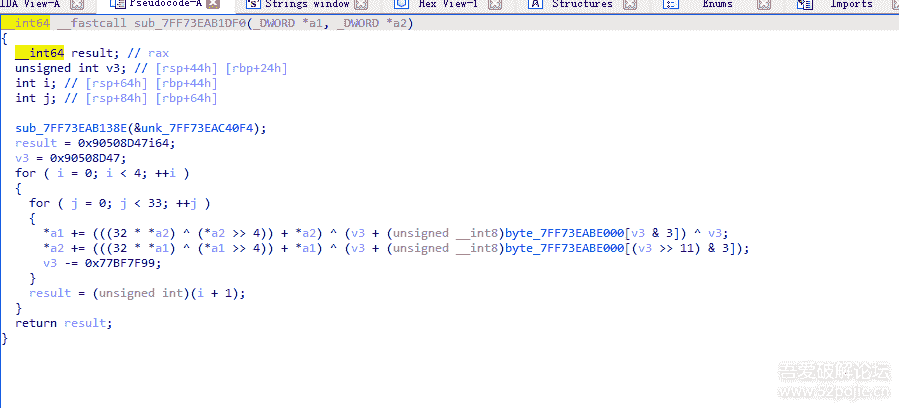
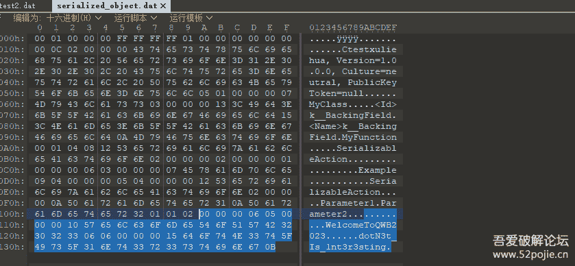
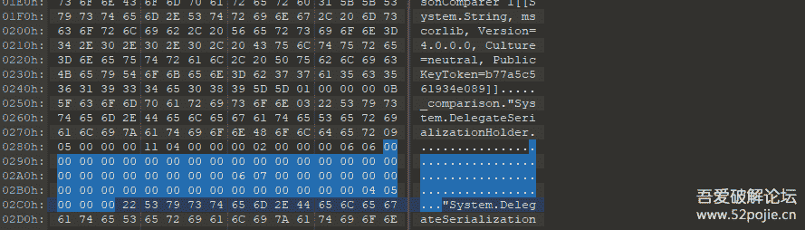
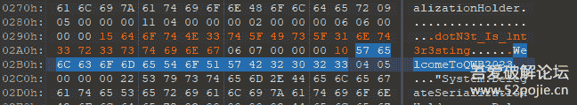
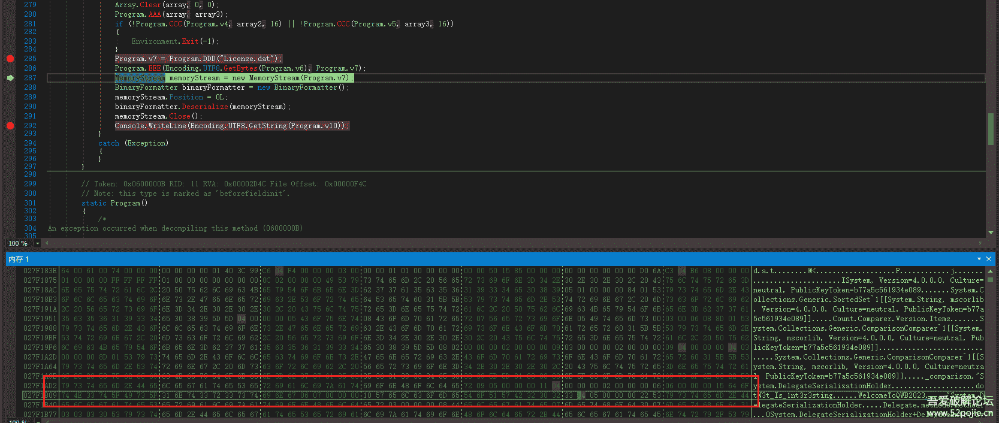
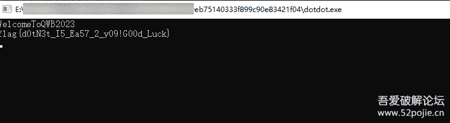
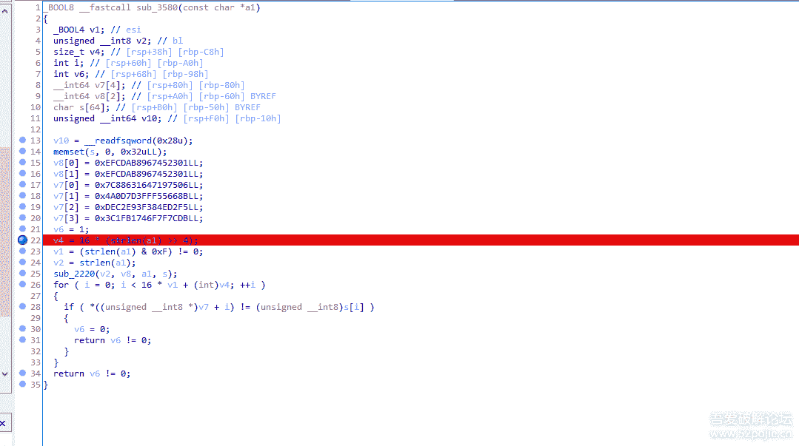
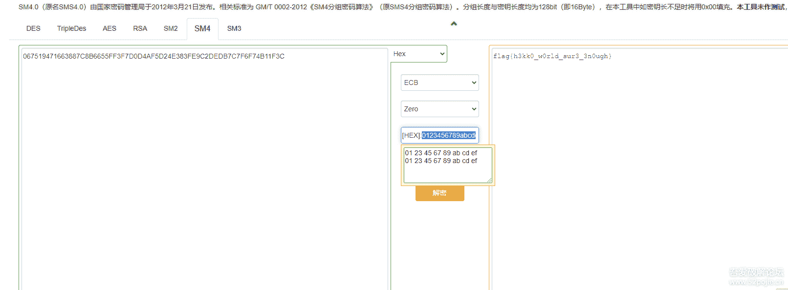
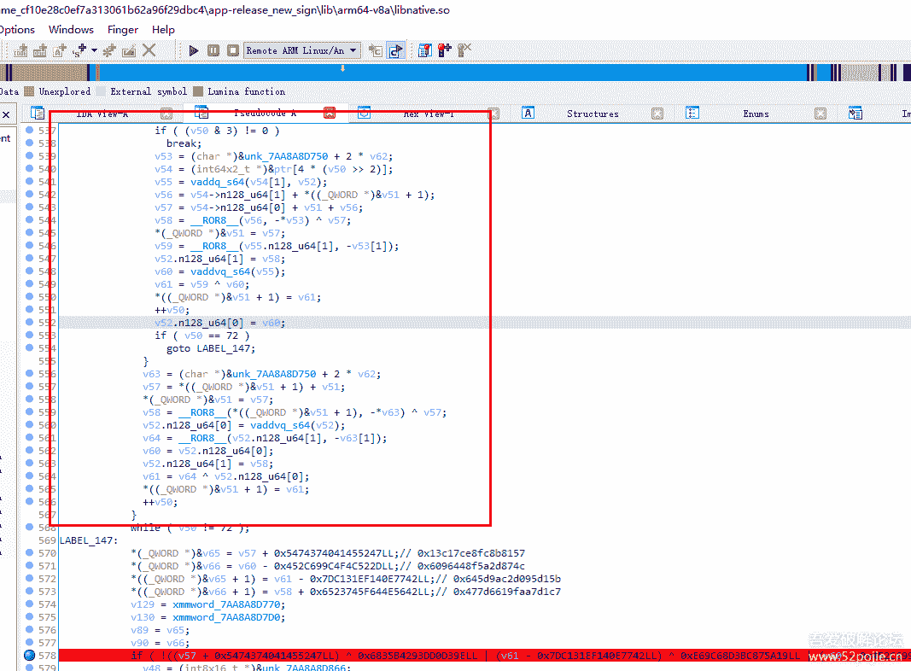

# [CTF] 2023强网杯部分RE_WP

- 原帖: https://www.52pojie.cn/forum.php?mod=viewthread&tid=1870480
- 抓取时间: 2026-11-01T22:40:25

## Babyre

IDA打开分析，TLS中有反调试，直接patch

来到主函数分析加密算法，主逻辑是个魔改的xtea算法



`1.png` (35.01 KB, 下载次数: 2)

[下载附件](https://www.52pojie.cn/forum.php?mod=attachment&aid=MjY2NDc5M3xiMzdkMjg4ZXwxNzkzNTcyODIyfDE2ODA4NnwxODcwNDgw&nothumb=yes)

2023-12-18 17:00 上传

直接调试取出`key`和密文，写对应的解密逻辑解密即可

```c
#include 
#include 

/* take 64 bits of data in v[0] and v[1] and 128 bits of key[0] - key[3] */

void encipher(uint32_t v[2], uint32_t const key[4]) {
    unsigned int i, j;
    uint32_t v0 = v[0], v1 = v[1], sum = 0x90508D47;
    for (i = 0; i > 4)) + v1) ^ (sum + key[sum & 3]) ^ sum;
            v1 += (((32 * v0) ^ (v0 >> 4)) + v0) ^ (sum + key[(sum >> 11) & 3]);
            sum -= 0x77BF7F99;
        }
    }
    v[0] = v0; v[1] = v1;
}
void decipher(uint32_t v[2], uint32_t const key[4]) {
    unsigned int i, j;
    uint32_t v0 = v[0], v1 = v[1], sum = 0x90508D47;
    for (i = 0; i > 4)) + v0) ^ (sum + key[(sum >> 11) & 3]);
            v0 -= (((32 * v1) ^ (v1 >> 4)) + v1) ^ (sum + key[sum & 3]) ^ sum;
        }
    }

    v[0] = v0; v[1] = v1;
}

int main()
{
    //char flag[] = "123456789012345678901234567890ab";
    char flag[] = { 0xE0, 0xF2, 0x23, 0x95, 0x93, 0xC2, 0xD8, 0x8E, 0x93, 0xC3, 0x68, 0x86, 0xBC, 0x50, 0xF2, 0xDD, 0x99, 0x44, 0x0E, 0x51, 0x44, 0xBD, 0x60, 0x8C, 0xF2, 0xAB, 0xDC, 0x34, 0x60, 0xD2, 0x0F, 0xC1 ,0};
    uint32_t * v = (uint32_t *)flag;
    uint32_t const k[4] = { 0x62, 0x6F, 0x6D, 0x62 };

    //for (int i = 0; i 
```

Flag为 `flag{W31com3_2_Th3_QwbS7_4nd_H4v3_Fun}`

## dotdot

输入16位的`key`，将16位的`key`打乱，然后重组与密文对比，对比成功，用`key`进行RC4解密得到`license.dat`。爆破可解，用C爆破

贴出正向的代码

```python
from utils_date import *

def GGG(v16):

    array = bytearray(16)

    array2 = [0, 5, 10, 15, 4, 9, 14, 3, 8, 13, 2, 7, 12, 1, 6, 11]

    for i in range(16):

        array[i] = v16[array2[i]]

    v16[:16] = array

def inverse_GGG(v16):

    array = bytearray(16)

    array2 = [0, 5, 10, 15, 4, 9, 14, 3, 8, 13, 2, 7, 12, 1, 6, 11]

    for i in range(16):

        array[array2[i]] = v16[i]

    v16[:16] = array

if __name__ == "__main__":

    aaa = [  # 模拟输入。aaa是最终要解密的key

        0x31,

        0x32,

        0x33,

        0x34,

        0x35,

        0x36,

        0x37,

        0x38,

        0x39,

        0x30,

        0x61,

        0x62,

        0x63,

        0x64,

        0x65,

        0x66,

    ]

    for i in range(9):

        GGG(aaa)

        for j in range(4):

            num = v11[i][4 * j][aaa[4 * j]]

            num2 = v11[i][4 * j + 1][aaa[4 * j + 1]]

            num3 = v11[i][4 * j + 2][aaa[4 * j + 2]]

            num4 = v11[i][4 * j + 3][aaa[4 * j + 3]]

            num5 = v12[(num >> 28 & 0xF)][(num2 >> 28 & 0xF)]

            num6 = v12[(num3 >> 28 & 0xF)][(num4 >> 28 & 0xF)]

            num7 = v12[(num >> 24 & 0xF)][(num2 >> 24 & 0xF)]

            num8 = v12[(num3 >> 24 & 0xF)][(num4 >> 24 & 0xF)]

            aaa[4 * j] = v12[num5][num6] > 20 & 0xF)][(num2 >> 20 & 0xF)]

            num6 = v12[(num3 >> 20 & 0xF)][(num4 >> 20 & 0xF)]

            num7 = v12[(num >> 16 & 0xF)][(num2 >> 16 & 0xF)]

            num8 = v12[(num3 >> 16 & 0xF)][(num4 >> 16 & 0xF)]

            aaa[4 * j + 1] = v12[num5][num6] > 12 & 0xF)][(num2 >> 12 & 0xF)]

            num6 = v12[(num3 >> 12 & 0xF)][(num4 >> 12 & 0xF)]

            num7 = v12[(num >> 8 & 0xF)][(num2 >> 8 & 0xF)]

            num8 = v12[(num3 >> 8 & 0xF)][(num4 >> 8 & 0xF)]

            aaa[4 * j + 2] = v12[num5][num6] > 4 & 0xF)][(num2 >> 4 & 0xF)]

            num6 = v12[(num3 >> 4 & 0xF)][(num4 >> 4 & 0xF)]

            num7 = v12[(num & 0xF)][(num2 & 0xF)]

            num8 = v12[(num3 & 0xF)][(num4 & 0xF)]

            aaa[4 * j + 3] = v12[num5][num6] > 28 & 0xF)][(num2 >> 28 & 0xF)]

            num6 = v12[(num3 >> 28 & 0xF)][(num4 >> 28 & 0xF)]

            num7 = v12[(num >> 24 & 0xF)][(num2 >> 24 & 0xF)]

            num8 = v12[(num3 >> 24 & 0xF)][(num4 >> 24 & 0xF)]

            aaa[4 * j] = v12[num5][num6] > 20 & 0xF)][(num2 >> 20 & 0xF)]

            num6 = v12[(num3 >> 20 & 0xF)][(num4 >> 20 & 0xF)]

            num7 = v12[(num >> 16 & 0xF)][(num2 >> 16 & 0xF)]

            num8 = v12[(num3 >> 16 & 0xF)][(num4 >> 16 & 0xF)]

            aaa[4 * j + 1] = v12[num5][num6] > 12 & 0xF)][(num2 >> 12 & 0xF)]

            num6 = v12[(num3 >> 12 & 0xF)][(num4 >> 12 & 0xF)]

            num7 = v12[(num >> 8 & 0xF)][(num2 >> 8 & 0xF)]

            num8 = v12[(num3 >> 8 & 0xF)][(num4 >> 8 & 0xF)]

            aaa[4 * j + 2] = v12[num5][num6] > 4 & 0xF)][(num2 >> 4 & 0xF)]

            num6 = v12[(num3 >> 4 & 0xF)][(num4 >> 4 & 0xF)]

            num7 = v12[(num & 0xF)][(num2 & 0xF)]

            num8 = v12[(num3 & 0xF)][(num4 & 0xF)]

            aaa[4 * j + 3] = v12[num5][num6] 
```

`utils_date`是我自己定义的，用到的数据都在里面（每次运行都一样），太大了,直接调试获取数据即可

逻辑就是通过`bbb`，即`[0x61, 0x93, 0x31, 0x7B, 0xF8, 0x96, 0xE0, 0x00, 0xA5, 0x27, 0xB7, 0x37, 0x4A, 0xE3, 0x03, 0xA8]`反推出`aaa`就可以了，应该是需要爆破

先逆第一层

```python
from utils_date import *

def inverse_GGG(v16):
    array = bytearray(16)
    array2 = [0, 5, 10, 15, 4, 9, 14, 3, 8, 13, 2, 7, 12, 1, 6, 11]

    for i in range(16):
        array[array2[i]] = v16[i]

    v16[:16] = array

a = [
    0x61,
    0x93,
    0x31,
    0x7B,
    0xF8,
    0x96,
    0xE0,
    0x00,
    0xA5,
    0x27,
    0xB7,
    0x37,
    0x4A,
    0xE3,
    0x03,
    0xA8,
]
for k in range(16):
    a[k] = v14[9][k].index(a[k])

# print(a)
inverse_GGG(a)
print(a)

# [84, 198, 121, 220, 8, 66, 11, 175, 66, 40, 248, 34, 82, 252, 193, 146]
```

然后爆破

```c
#include 
#include 

char v3[] = {}; //数据太大

char v1[] = {}; //。。。

char v4[] = {};//。。。

int * v13_int = (int *)v3; 

int (*v13)[0x10][0x100] = (int (*)[0x10][0x100]) v13_int;

int * v11_int = (int *)v1; 

int(*v11)[0x10][0x100] = (int(*)[0x10][0x100]) v11_int;

unsigned char (*v14)[0x10][0x100] = (unsigned char (*)[0x10][0x100]) v4;

unsigned char v12[16][16] = {{0, 1, 2, 3, 4, 5, 6, 7, 8, 9, 10, 11, 12, 13, 14, 15},

 {1, 0, 3, 2, 5, 4, 7, 6, 9, 8, 11, 10, 13, 12, 15, 14},

 {2, 3, 0, 1, 6, 7, 4, 5, 10, 11, 8, 9, 14, 15, 12, 13},

 {3, 2, 1, 0, 7, 6, 5, 4, 11, 10, 9, 8, 15, 14, 13, 12},

 {4, 5, 6, 7, 0, 1, 2, 3, 12, 13, 14, 15, 8, 9, 10, 11},

 {5, 4, 7, 6, 1, 0, 3, 2, 13, 12, 15, 14, 9, 8, 11, 10},

 {6, 7, 4, 5, 2, 3, 0, 1, 14, 15, 12, 13, 10, 11, 8, 9},

 {7, 6, 5, 4, 3, 2, 1, 0, 15, 14, 13, 12, 11, 10, 9, 8},

 {8, 9, 10, 11, 12, 13, 14, 15, 0, 1, 2, 3, 4, 5, 6, 7},

 {9, 8, 11, 10, 13, 12, 15, 14, 1, 0, 3, 2, 5, 4, 7, 6},

 {10, 11, 8, 9, 14, 15, 12, 13, 2, 3, 0, 1, 6, 7, 4, 5},

 {11, 10, 9, 8, 15, 14, 13, 12, 3, 2, 1, 0, 7, 6, 5, 4},

 {12, 13, 14, 15, 8, 9, 10, 11, 4, 5, 6, 7, 0, 1, 2, 3},

 {13, 12, 15, 14, 9, 8, 11, 10, 5, 4, 7, 6, 1, 0, 3, 2},

 {14, 15, 12, 13, 10, 11, 8, 9, 6, 7, 4, 5, 2, 3, 0, 1},

 {15, 14, 13, 12, 11, 10, 9, 8, 7, 6, 5, 4, 3, 2, 1, 0}};

unsigned char v12[16][16] = {{0, 1, 2, 3, 4, 5, 6, 7, 8, 9, 10, 11, 12, 13, 14, 15},

 {1, 0, 3, 2, 5, 4, 7, 6, 9, 8, 11, 10, 13, 12, 15, 14},

 {2, 3, 0, 1, 6, 7, 4, 5, 10, 11, 8, 9, 14, 15, 12, 13},

 {3, 2, 1, 0, 7, 6, 5, 4, 11, 10, 9, 8, 15, 14, 13, 12},

 {4, 5, 6, 7, 0, 1, 2, 3, 12, 13, 14, 15, 8, 9, 10, 11},

 {5, 4, 7, 6, 1, 0, 3, 2, 13, 12, 15, 14, 9, 8, 11, 10},

 {6, 7, 4, 5, 2, 3, 0, 1, 14, 15, 12, 13, 10, 11, 8, 9},

 {7, 6, 5, 4, 3, 2, 1, 0, 15, 14, 13, 12, 11, 10, 9, 8},

 {8, 9, 10, 11, 12, 13, 14, 15, 0, 1, 2, 3, 4, 5, 6, 7},

 {9, 8, 11, 10, 13, 12, 15, 14, 1, 0, 3, 2, 5, 4, 7, 6},

 {10, 11, 8, 9, 14, 15, 12, 13, 2, 3, 0, 1, 6, 7, 4, 5},

 {11, 10, 9, 8, 15, 14, 13, 12, 3, 2, 1, 0, 7, 6, 5, 4},

 {12, 13, 14, 15, 8, 9, 10, 11, 4, 5, 6, 7, 0, 1, 2, 3},

 {13, 12, 15, 14, 9, 8, 11, 10, 5, 4, 7, 6, 1, 0, 3, 2},
```


# 逆向分析记录

## RC4 解密与 `FFF` 函数

```c
{15, 14, 13, 12, 11, 10, 9, 8, 7, 6, 5, 4, 3, 2, 1, 0}};

void GGG(unsigned char v16[]) {
    unsigned char array[16];
    unsigned char array2[] = { 0, 5, 10, 15, 4, 9, 14, 3, 8, 13, 2, 7, 12, 1, 6, 11 };
    for (int i = 0; i > 28 & 0xF)][(num2 >> 28 & 0xF)];
    num6 = v12[(num3 >> 28 & 0xF)][(num4 >> 28 & 0xF)];
    num7 = v12[(num >> 24 & 0xF)][(num2 >> 24 & 0xF)];
    num8 = v12[(num3 >> 24 & 0xF)][(num4 >> 24 & 0xF)];
    aaa[4 * j] = v12[num5][num6] > 20 & 0xF)][(num2 >> 20 & 0xF)];
    num6 = v12[(num3 >> 20 & 0xF)][(num4 >> 20 & 0xF)];
    num7 = v12[(num >> 16 & 0xF)][(num2 >> 16 & 0xF)];
    num8 = v12[(num3 >> 16 & 0xF)][(num4 >> 16 & 0xF)];
    aaa[4 * j + 1] = v12[num5][num6] > 12 & 0xF)][(num2 >> 12 & 0xF)];
    num6 = v12[(num3 >> 12 & 0xF)][(num4 >> 12 & 0xF)];
    num7 = v12[(num >> 8 & 0xF)][(num2 >> 8 & 0xF)];
    num8 = v12[(num3 >> 8 & 0xF)][(num4 >> 8 & 0xF)];
    aaa[4 * j + 2] = v12[num5][num6] > 4 & 0xF)][(num2 >> 4 & 0xF)];
    num6 = v12[(num3 >> 4 & 0xF)][(num4 >> 4 & 0xF)];
    num7 = v12[(num & 0xF)][(num2 & 0xF)];
    num8 = v12[(num3 & 0xF)][(num4 & 0xF)];
    aaa[4 * j + 3] = v12[num5][num6] > 28 & 0xF)][(num2 >> 28 & 0xF)];
    num6 = v12[(num3 >> 28 & 0xF)][(num4 >> 28 & 0xF)];
    num7 = v12[(num >> 24 & 0xF)][(num2 >> 24 & 0xF)];
    num8 = v12[(num3 >> 24 & 0xF)][(num4 >> 24 & 0xF)];
    aaa[4 * j] = v12[num5][num6] > 20 & 0xF)][(num2 >> 20 & 0xF)];
    num6 = v12[(num3 >> 20 & 0xF)][(num4 >> 20 & 0xF)];
    num7 = v12[(num >> 16 & 0xF)][(num2 >> 16 & 0xF)];
    num8 = v12[(num3 >> 16 & 0xF)][(num4 >> 16 & 0xF)];
    aaa[4 * j + 1] = v12[num5][num6] > 12 & 0xF)][(num2 >> 12 & 0xF)];
    num6 = v12[(num3 >> 12 & 0xF)][(num4 >> 12 & 0xF)];
    num7 = v12[(num >> 8 & 0xF)][(num2 >> 8 & 0xF)];
    num8 = v12[(num3 >> 8 & 0xF)][(num4 >> 8 & 0xF)];
    aaa[4 * j + 2] = v12[num5][num6] > 4 & 0xF)][(num2 >> 4 & 0xF)];
    num6 = v12[(num3 >> 4 & 0xF)][(num4 >> 4 & 0xF)];
    num7 = v12[(num & 0xF)][(num2 & 0xF)];
    num8 = v12[(num3 & 0xF)][(num4 & 0xF)];
    aaa[4 * j + 3] = v12[num5][num6] =0; i--)
    {
        for (j = 3; j >=0; j--)
        {
            baopo(&res[j][0], i, j, &res[j][0]);
        }
        inverse_GGG((unsigned char *)res);
        printf("RES -->");
        for (int i = 0; i 
```

最终爆破`res`是`WelcomeToQWB2023`，这是RC4的 key，解密`license.dat`，发现里面有`FFF`函数，去观察`FFF`函数。

`FFF`函数`tea`解密得到`b`。

```c
#include 
#include 

//加密函数
void encrypt(uint32_t* v, uint32_t* k) {
    uint32_t v0 = v[0], v1 = v[1], sum = 0, i;           /* set up */
    uint32_t delta = 0xDEADBEEF;                     /* a key schedule constant */
    uint32_t k0 = k[0], k1 = k[1], k2 = k[2], k3 = k[3];   /* cache key */
    for (i = 0; i > 5) + k1);
        v1 += ((v0 > 5) + k3);
    }                                              /* end cycle */
    v[0] = v0; v[1] = v1;
}

//解密函数
void decrypt(uint32_t* v, uint32_t* k) {
    uint32_t v0 = v[0], v1 = v[1], sum = 0xDEADBEEF * 32, i;  /* set up */
    uint32_t delta = 0xDEADBEEF;                     /* a key schedule constant */
    uint32_t k0 = k[0], k1 = k[1], k2 = k[2], k3 = k[3];   /* cache key */
    for (i = 0; i > 5) + k3);
        v0 -= ((v1 > 5) + k1);
        sum -= delta;
    }                                              /* end cycle */
    v[0] = v0; v[1] = v1;
}

int main()
{
    uint32_t k[4] = { 0x636C6557,0x54656D6F,0x4257516F,0x33323032 };
    char v28[24] = {0x45, 0xB6, 0xAB, 0x21, 0x79, 0x6B, 0xFE, 0x96, 0x5C, 0x1D, 0x04, 0xB2, 0x8A, 0xA6, 0xB8, 0x6A,
    0x35, 0xF1, 0x2A, 0xBF, 0x17, 0xD3, 0x03, 0x6B };
    uint32_t* encc = (uint32_t*)v28;

    for (int i = 0; i 
```

## 修复 `Lincense.dat` 反序列化

程序在执行`binaryFormatter.Deserialize(memoryStream);`老是失败，结合题目提示Fix the lincense，再加上解密后的`Lincense.dat`并不包含`FFF`的参数`dotN3t_Is_1nt3r3sting`和`WelcomeToQWB2023`，需要修复下`V7`，即RC4解密后的`Lincense.dat`。

自己写了点C#代码，序列化对象观察对应的`dat`文件。

```csharp
using System;
using System.IO;
using System.Runtime.Serialization;
using System.Runtime.Serialization.Formatters.Binary;

[Serializable]
class MyClass
{
    public int Id { get; set; }
    public string Name { get; set; }
    public SerializableAction MyFunction;

    public void ExecuteFunction()
    {
        MyFunction?.Invoke();
    }
}

[Serializable]
class SerializableAction : ISerializable
{
    public string Parameter1 { get; set; }
    public string Parameter2 { get; set; }

    public SerializableAction()
    {
    }

    public SerializableAction(SerializationInfo info, StreamingContext context)
    {
        Parameter1 = info.GetString("Parameter1");
        Parameter2 = info.GetString("Parameter2");
        Invoke();
    }

    public void GetObjectData(SerializationInfo info, StreamingContext context)
    {
        info.AddValue("Parameter1", Parameter1);
        info.AddValue("Parameter2", Parameter2);
    }

    public void Invoke()
    {
        Console.WriteLine($"Parameter1: {Parameter1}, Parameter2: {Parameter2}");
    }
}

class Program
{
    static void Main()
    {
        // 创建要序列化的对象
        var obj = new MyClass
        {
            Id = 1,
            Name = "Example",
            MyFunction = new SerializableAction
            {
                Parameter1 = "WelcomeToQWB2023",
                Parameter2 = "dotN3t_Is_1nt3r3sting"
            }
        };

        // 创建 BinaryFormatter 对象
        var formatter = new BinaryFormatter();

        // 创建文件流
        var fileStream = new FileStream("serialized_object.dat", FileMode.Create);

        try
        {
            // 使用 BinaryFormatter 将对象序列化到文件流中
            formatter.Serialize(fileStream, obj);
            Console.WriteLine("对象已成功序列化并保存到文件中！");
        }
        catch (Exception ex)
        {
            Console.WriteLine("序列化对象时出现错误：" + ex.Message);
        }
        finally
        {
            // 关闭文件流
            fileStream.Close();
        }
    }
}
```



2.png (60.89 KB, 下载次数: 0)

[附件下载](https://www.52pojie.cn/forum.php?mod=attachment&aid=MjY2NDc5NHw2ZjhkNGYzYXwxNzkzNTcyODIyfDE2ODA4NnwxODcwNDgw&nothumb=yes)

2023-12-18 17:00 上传

发现是先小端形式保存大小，再后面跟着字符串，直接找`Lincense.dat`找对应的空闲空间



3.png (44.88 KB, 下载次数: 0)

[附件下载](https://www.52pojie.cn/forum.php?mod=attachment&aid=MjY2NDc5NXw1MmNiNTZmOHwxNzkzNTcyODIyfDE2ODA4NnwxODcwNDgw&nothumb=yes)

2023-12-18 17:00 上传

将其补入



4.png (27.71 KB, 下载次数: 1)

[附件下载](https://www.52pojie.cn/forum.php?mod=attachment&aid=MjY2NDc5NnxmM2E2OWE2MXwxNzkzNTcyODIyfDE2ODA4NnwxODcwNDgw&nothumb=yes)

2023-12-18 17:00 上传

直接调试起来，修改对应的`V7`



-17028218031471.png (72.62 KB, 下载次数: 2)

[附件下载](https://www.52pojie.cn/forum.php?mod=attachment&aid=MjY2NDc5N3w3YjA3NDI5ZHwxNzkzNTcyODIyfDE2ODA4NnwxODcwNDgw&nothumb=yes)

2023-12-18 17:00 上传




-17028218179603.png (13.82 KB, 下载次数: 1)

[href="forum.php?mod=attachment&aid=MjY2NDc5OHw0ZWYzNGFhY3wxNzkzNTcyODIyfDE2ODA4NnwxODcwNDgw&nothumb=yes" target="_blank"](https://www.52pojie.cn/forum.php?mod=attachment&aid=MjY2NDc5OHw0ZWYzNGFhY3wxNzkzNTcyODIyfDE2ODA4NnwxODcwNDgw&nothumb=yes)

2023-12-18 17:00 上传

可以发现反序列化成功，flag直接被打印了出来

flag为`flag{d0tN3t_I5_Ea57_2_y09!G00d_Luck}`

## 2> ezre
### D-810去混淆,去混淆后SM4算法



-17028218263365.png (58.52 KB, 下载次数: 0)

[href="forum.php?mod=attachment&aid=MjY2NDc5OXxlZjY4ZDlkOXwxNzkzNTcyODIyfDE2ODA4NnwxODcwNDgw&nothumb=yes" target="_blank"](https://www.52pojie.cn/forum.php?mod=attachment&aid=MjY2NDc5OXxlZjY4ZDlkOXwxNzkzNTcyODIyfDE2ODA4NnwxODcwNDgw&nothumb=yes)

2023-12-18 17:00 上传

密文: `067519471663887C8B6655FF3F7D0D4AF5D24E383FE9C2DEDB7C7F6F74B11F3C`

KEY: `0123456789abcdef0123456789abcdef`

直接在线网站解密即可



image-20231217221634787.png (68.59 KB, 下载次数: 0)

[href="forum.php?mod=attachment&aid=MjY2NDgwMnwxOTU5YjViOXwxNzkzNTcyODIyfDE2ODA4NnwxODcwNDgw&nothumb=yes" target="_blank"](https://www.52pojie.cn/forum.php?mod=attachment&aid=MjY2NDgwMnwxOTU5YjViOXwxNzkzNTcyODIyfDE2ODA4NnwxODcwNDgw&nothumb=yes)

2023-12-18 17:00 上传

flag: `flag{h3kk0_w0rld_sur3_3n0ugh}`

## 2> unname

初步看,flag的check逻辑在`so`文件里

但是`apk`没有加`android:extractNativeLibs="true"` 所以没法调试`so`，用脚本给`apk`这个属性设置为`true`且重新打包签名

```
import sys
import subprocess
import os
from xml.dom.minidom import parse

# 1、先解包APK
# 2、打开xml文件分析，android:debuggable 和 android:extractNativeLibs属性
# 3、如果没有android:debuggable,则可以加入并且设置为属性为 true
# 4、如果有android:debuggable， 则直接设置为true
# 5、如果没有android:extractNativeLibs 则不管，如果有且为false，则改为true
# 6、apktool重新打包
# 7、生成签名文件
# 8、将签名加入到apk中

def handle_xml():
    # 3,4,5 处理XML文件并写回
    # AndroidManifest.xml
    dom = parse("AndroidManifest.xml")
    data = dom.documentElement
    # android:extractNativeLibs="true"
    # android:debuggable="true"
    application = data.getElementsByTagName("application")
    print("[+] 正在修改 android:debuggable 属性")
    application[0].setAttribute("android:debuggable", "true")
    if application[0].getAttribute("android:extractNativeLibs") == 'false':
        print("[+] 正在修改android:extractNativeLibs 属性")
        application[0].setAttribute("android:extractNativeLibs", "true")
    f = open("AndroidManifest.xml", 'w')
    dom.writexml(f, encoding="utf-8")
    f.close()
    with open("AndroidManifest.xml", "r", encoding="utf-8") as f:
        c = f.read()
        c = c.replace('encoding="utf-8"', 'encoding="utf-8" standalone="no"')
        f.close()
    with open("AndroidManifest.xml", "w", encoding="utf-8")as f:
        f.write(c)

if __name__ == "__main__":
    if len(sys.argv) != 2:
        print("[X] 格式有错! python后跟apk名字")
        sys.exit(-1)

    apkpath = sys.argv[1]
    apkname = os.path.splitext(apkpath)[0]
    apkdirpath = apkname + "_DIR"
    # 1、解包APK
    print("[+] 解包APK文件")
    subprocess.run(['apktool.bat', 'd', apkpath, "-o", apkdirpath])
    os.chdir(apkdirpath)
    # 2、打开xml文件
    print("[+] 当前工作路径为: " + os.getcwd())
    handle_xml()
    print("[+] 修改XML文件成功")
    # 6、重新打包为APK
    os.chdir('../')
    print("[+] 重新打包APK文件")
    print("[+] 当前工作路径为: " + os.getcwd())
    apkpath_new = apkname + "_new.apk"
    subprocess.run(['apktool.bat', 'b', apkdirpath, "-o", apkpath_new])
    # 7、生成签名文件
    print("[+] 密码请输入123456，否则会出错")
    # keytool -genkey -keystore 签名文件的文件名 -keyalg RSA -validity 10000 -alias 签名文件别名
    subprocess.run(['keytool', '-genkey', '-keystore', apkname + "_new.keystore",
                   '-keyalg', 'RSA', '-validity', '10000', '-alias', apkname])
    # 8、给APK文件添加签名
    print(f"[+] 给{apkname}_new.apk添加签名")
    subprocess.run(['jarsigner.exe', '-verbose', '-keystore', apkname + "_new.keystore", '-storepass', '123456', '-signedjar',
                   apkname + '_new_sign.apk', '-digestalg', 'SHA1', '-sigalg', 'MD5withRSA', apkname + "_new.apk", apkname])
```

调试起来



-17028218333239.png (113.75 KB, 下载次数: 1)

[href="forum.php?mod=attachment&aid=MjY2NDgwMHw5NDVhMmZjZXwxNzkzNTcyODIyfDE2ODA4NnwxODcwNDgw&nothumb=yes" target="_blank"](https://www.52pojie.cn/forum.php?mod=attachment&aid=MjY2NDgwMHw5NDVhMmZjZXwxNzkzNTcyODIyfDE2ODA4NnwxODcwNDgw&nothumb=yes)

2023-12-18 17:00 上传

找到了关键验证逻辑

```
           do

            {

              while ( 1 )

              {

                v62 = v50 & 7;

                if ( (v50 & 3) != 0 )

                  break;

                v53 = (char *)&unk_7AA8BD6750 + 2 * v62;// v53 = unk_7AA8BC0750[2*v62]

                v54 = (int64x2_t *)&ptr[4 * (v50 >> 2)];// v54 为QWORD v54[2] [0x465F5530595F4E6F, 0xB378E3C5C3A47B89]

                v55 = vaddq_s64(v54[1], v52);   // v55 = vaddq_s64(0xB378E3C5C3A47B89, [0x3433323130393837, 0x6261303938373635])

                v56 = v54->n128_u64[1] + *((_QWORD *)&flag_0 + 1);// v54[1] + flag0[1]  flag0是QWORD [2]类型  v56 = 0xB378E3C5C3A47B89  +0x3635343332313039

                                                // 即v56 = 0xe9ae17f8f5d5abc2

                x11 = v54->n128_u64[0] + flag_0 + v56;// x11 = v54[0] + flag0[0] + v56 = 0x465F5530595F4E6F + 0x3837363534333231 + 0xe9ae17f8f5d5abc2

                                                // x11 = 0x6844a35e83682c62

                x12 = __ROR8__(v56, -*v53) ^ x11;// ROR8(v56, -0xe) ^ x11| 0x85fe3d756af0ba6b ^ v11 =0x85fe3d756af0ba6b ^0x6844a35e83682c62

                                                // x12 = 0xedba9e2be9989609

                *(_QWORD *)&flag_0 = x11;       // flag_0[0] = x11(0x6844a35e83682c62)

                v59 = __ROR8__(v55.n128_u64[1], -v53[1]);// v59 = ROR8(v55[1], -16)

                                                // v59 = 0x6779797C887CB6D5

                                                // v55[1]=0XB6D56779797C887C

                v52.n128_u64[1] = x12;          // v52[1] = 0xedba9e2be9989609

                x13 = vaddvq_s64(v55);          // x13 = vaddvq_s64(v55) = 0xBEAD2E3D5A3D5376

                x14 = v59 ^ x13;                // x14 = 0x6779797C887CB6D5 ^ 0xBEAD2E3D5A3D5376

                                                // x14 = 0xd9d45741d241e5a3

                *((_QWORD *)&flag_0 + 1) = x14; // flag0[1] = x14 = 0xd9d45741d241e5a3

                ++v50;

                v52.n128_u64[0] = x13;          // v52[0] = 0xBEAD2E3D5A3D5376

                if ( v50 == 72 )

                  goto LABEL_147;

              }

              v63 = (char *)&unk_7AA8BD6750 + 2 * v62;// v63 = (char *)&unk_7AA8BC0750[2]

              x11 = *((_QWORD *)&flag_0 + 1) + flag_0;// x11 =0xd9d45741d241e5a3+ 0x6844a35e83682c62

                                                // x11 = 0x4218FAA055AA1205

              *(_QWORD *)&flag_0 = x11;         // flag0[0] = x11(0x4218FAA055AA1205)

              x12 = __ROR8__(*((_QWORD *)&flag_0 + 1), -*v63) ^ x11;// ROR8( 0xd9d45741d241e5a3, -0X34) ^ 0x4218FAA055AA1205

                                                // x12 = 0x182567e521b7361b

              v52.n128_u64[0] = vaddvq_s64(v52);// v52[0] = 0xBEAD2E3D5A3D5376 + 0xedba9e2be9989609

                                                // v52[0] = 0xAC67CC6943D5E97F

              v64 = __ROR8__(v52.n128_u64[1], -v63[1]);// v64 = ROR8(v52[1], -0X39) = 0x13db753c57d3312c

              x13 = v52.n128_u64[0];            // x13 = 0xAC67CC6943D5E97F

              v52.n128_u64[1] = x12;            // v52[1] = x12 = 0x182567e521b7361b

              x14 = v64 ^ v52.n128_u64[0];      // x14 = 0x13db753c57d3312c ^0xAC67CC6943D5E97F

                                                // x14 = 0xbfbcb9551406d853

              *((_QWORD *)&flag_0 + 1) = x14;   // flag0[1] = x14

              ++v50;

            }

            while ( v50 != 72 );
```

模拟了一遍程序逻辑


```
#include 

unsigned long long key[80] = {
 0x465F5530595F4E6F, 0xB378E3C5C3A47B89, 0xD3A49492B08792C3, 0x5474374041455247,
 0x6523745F644E5630, 0xD3A49492B08792C3, 0x8E9565954947CC84, 0x33E95EAA8C9B6366,
 0x5F30535F5933335F, 0x8E9565954947CC84, 0x823ECE10EBF188BE, 0x465F5530595F4E71,
 0x5474374041455247, 0x823ECE10EBF188BE, 0xBAD39663B0B3ADD3, 0x6523745F644E5633,
 0x33E95EAA8C9B6365, 0xBAD39663B0B3ADD3, 0x9F44A2B46C50D06D, 0x5F30535F59333363,
 0x465F5530595F4E6F, 0x9F44A2B46C50D06D, 0xAD85C2C5B88958B8, 0x547437404145524C,
 0x6523745F644E5630, 0xAD85C2C5B88958B8, 0xC8E878739899B1AB, 0x33E95EAA8C9B636B,
 0x5F30535F5933335F, 0xC8E878739899B1AB, 0x6E0A8CFF949DDDA2, 0x465F5530595F4E76,
 0x5474374041455247, 0x6E0A8CFF949DDDA2, 0x94B4C496B8B573C8, 0x6523745F644E5638,
 0x33E95EAA8C9B6365, 0x94B4C496B8B573C8, 0xD997B592BBA2B594, 0x5F30535F59333368,
 0x465F5530595F4E6F, 0xD997B592BBA2B594, 0x995181B46135AD9C, 0x5474374041455251,
 0x6523745F644E5630, 0x995181B46135AD9C, 0xA2C9A6A6A09B77A0, 0x33E95EAA8C9B6370,
 0x5F30535F5933335F, 0xA2C9A6A6A09B77A0, 0xA85D9FDDE3EFC2C9, 0x465F5530595F4E7B,
 0x5474374041455247, 0xA85D9FDDE3EFC2C9, 0x808083856161C8AC, 0x6523745F644E563D,
 0x33E95EAA8C9B6365, 0x808083856161C8AC, 0xB378E3C5C3A47B89, 0x5F30535F5933336D,
 0x465F5530595F4E6F, 0xB378E3C5C3A47B89, 0xD3A49492B08792C3, 0x5474374041455256,
 0x6523745F644E5630, 0xD3A49492B08792C3, 0x8E9565954947CC84, 0x33E95EAA8C9B6375,
 0x5F30535F5933335F, 0x8E9565954947CC84, 0x823ECE10EBF188BE, 0x465F5530595F4E80,
 0x0000007A414B22C2, 0x0000000000000028, 0x0000000000000000, 0xB400007B596C6C00,
 0xB400007A99ABAC40, 0x0000000000000010, 0x0000000000000010, 0x0000000000000001
};

//x11, x12, x13, x14最终的结果
unsigned long long res[4] = {
        0x13c17ce8fc8b8157,
        0x477d6619faa7d1c7,
        0x6096448f5a2d874c,
        0x645d9ac2d095d15b
};

unsigned char ror_num[16] = {
        0x0E, 0x10, 0x34, 0x39, 0x17, 0x28, 0x05, 0x25, 0x19, 0x21, 0x2E, 0x0C, 0x3A, 0x16, 0x20, 0x20
};

unsigned long long rotateRight64(unsigned long long num, unsigned int shift)
{
        unsigned int bits = sizeof(unsigned long long) * 8;
        shift = shift % bits;  // 确保位移值在合理范围内

        if (shift == 0)
                return num;

        return (num >> shift) | (num > 2)];
                        vaddq_s64(v54+2, &input[2], v55);
                        v56 = v54[1] + input[1];
                        x11 = v54[0] + input[0] + v56;
                        x12 = rotateRight64(v56, 64 - v53[0]) ^ x11;
                        input[0] = x11;
                        v59 = rotateRight64(v55[1], 64 - v53[1]);
                        v52[1] = x12;
                        x13 = vaddvq_s64(v55);
                        x14 = v59 ^ x13;
                        input[1] = x14;
                        v50++;
                        v52[0] = x13;
                        printf("v50: %d\n", v50);
                        printf("0x%llX\n", x11);
                        printf("0x%llX\n", x12);
                        printf("0x%llX\n", x13);
                        printf("0x%llX\n", x14);
                        printf("-----------------------------------\n");
                        if (v50 == 72)
                                goto LABEL_147;
                }
                v63 = &ror_num[2 * v62];
                x11 = input[1] + input[0];
                input[0] = x11;
                x12 = rotateRight64(input[1], 64 - v63[0]) ^ x11;
                v52[0] = vaddvq_s64(v52);
                v64 = rotateRight64(v52[1], 64 - v63[1]);
                x13 = v52[0];
                v52[1] = x12;
                x14 = v64 ^ v52[0];

                input[1] = x14;

                ++v50;
                printf("v50: %d\n", v50);
                printf("0x%llX\n", x11);
                printf("0x%llX\n", x12);
                printf("0x%llX\n", x13);
                printf("0x%llX\n", x14);
                printf("-----------------------------------\n");
        } while (v50 != 72);

LABEL_147:

        x11 = 0xbad39663b0b3add3 + x13;

        printf("end\n");
        printf("0x%llX\n", x11);
        printf("0x%llX\n", x12);
        printf("0x%llX\n", x13);
        printf("0x%llX\n", x14);

        return 0;
}
```

逆回去

```
#include 

unsigned long long key[80] = {

 0x465F5530595F4E6F, 0xB378E3C5C3A47B89, 0xD3A49492B08792C3, 0x5474374041455247,

 0x6523745F644E5630, 0xD3A49492B08792C3, 0x8E9565954947CC84, 0x33E95EAA8C9B6366,

 0x5F30535F5933335F, 0x8E9565954947CC84, 0x823ECE10EBF188BE, 0x465F5530595F4E71,

 0x5474374041455247, 0x823ECE10EBF188BE, 0xBAD39663B0B3ADD3, 0x6523745F644E5633,

 0x33E95EAA8C9B6365, 0xBAD39663B0B3ADD3, 0x9F44A2B46C50D06D, 0x5F30535F59333363,

 0x465F5530595F4E6F, 0x9F44A2B46C50D06D, 0xAD85C2C5B88958B8, 0x547437404145524C,

 0x6523745F644E5630, 0xAD85C2C5B88958B8, 0xC8E878739899B1AB, 0x33E95EAA8C9B636B,

 0x5F30535F5933335F, 0xC8E878739899B1AB, 0x6E0A8CFF949DDDA2, 0x465F5530595F4E76,

 0x5474374041455247, 0x6E0A8CFF949DDDA2, 0x94B4C496B8B573C8, 0x6523745F644E5638,

 0x33E95EAA8C9B6365, 0x94B4C496B8B573C8, 0xD997B592BBA2B594, 0x5F30535F59333368,

 0x465F5530595F4E6F, 0xD997B592BBA2B594, 0x995181B46135AD9C, 0x5474374041455251,

 0x6523745F644E5630, 0x995181B46135AD9C, 0xA2C9A6A6A09B77A0, 0x33E95EAA8C9B6370,

 0x5F30535F5933335F, 0xA2C9A6A6A09B77A0, 0xA85D9FDDE3EFC2C9, 0x465F5530595F4E7B,

 0x5474374041455247, 0xA85D9FDDE3EFC2C9, 0x808083856161C8AC, 0x6523745F644E563D,

 0x33E95EAA8C9B6365, 0x808083856161C8AC, 0xB378E3C5C3A47B89, 0x5F30535F5933336D,

 0x465F5530595F4E6F, 0xB378E3C5C3A47B89, 0xD3A49492B08792C3, 0x5474374041455256,

 0x6523745F644E5630, 0xD3A49492B08792C3, 0x8E9565954947CC84, 0x33E95EAA8C9B6375,

 0x5F30535F5933335F, 0x8E9565954947CC84, 0x823ECE10EBF188BE, 0x465F5530595F4E80,

 0x0000007A414B22C2, 0x0000000000000028, 0x0000000000000000, 0xB400007B596C6C00,

 0xB400007A99ABAC40, 0x0000000000000010, 0x0000000000000010, 0x0000000000000001

};

//x11, x12, x13, x14最终的结果

unsigned long long res[4] = {

        0x13c17ce8fc8b8157,

        0x477d6619faa7d1c7,

        0x6096448f5a2d874c,

        0x645d9ac2d095d15b

};

unsigned char ror_num[16] = {

        0x0E, 0x10, 0x34, 0x39, 0x17, 0x28, 0x05, 0x25, 0x19, 0x21, 0x2E, 0x0C, 0x3A, 0x16, 0x20, 0x20

};

unsigned long long rotateRight64(unsigned long long num, unsigned int shift)

{

        unsigned int bits = sizeof(unsigned long long) * 8;

        shift = shift % bits;  // 确保位移值在合理范围内

        if (shift == 0)

                return num;

        return (num >> shift) | (num = 1)

        {

                --v50;

                v62 = v50 % 8;

                if (v50 % 4 != 0)

                {

                        v63 = &ror_num[2 * v62];

                        input[1] = x14;

                        v52[1] = x12;

                        v52[0] = x13;

                        v64 = v52[0] ^ x14;

                        v52[1] = rotateRight64(v64, v63[1]);

                        v52[0] = v52[0] - v52[1];

                        input[1] = rotateRight64(x11 ^ x12, v63[0]);

                        input[0] = x11 - input[1];

                }

                else {

                        v53 = &ror_num[2 * v62];

                        v54 = &key[4 * (v50 >> 2)];

                        v52[0] = x13;

                        input[1] = x14;

                        v59 = x13 ^ x14;

                        v52[1] = x12;

                        v55[1] = rotateRight64(v59, v53[1]);

                        v55[0] = x13 - v55[1];

                        input[0] = x11;

                        v56 = rotateRight64(x11 ^ x12, v53[0]);

                        input[0] = x11 - v56 - v54[0];

                        input[1] = v56 - v54[1];

                        unsigned long long* v54_2 = v54 + 2;

                        input[2] = v55[0] - v54_2[0];

                        input[3] = v55[1] - v54_2[1];

                }

                x11 = input[0];

                x14 = input[1];
```


# CTF 记录

## 第一题

```
                x13 = input[2];

                x12 = input[3];

        }

        printf("%s", (char*)input);

        //

        return 0;

}
```
//v50: 1
//0x6844A35E83682C62
//0xEDBA9E2BE9989609
//0xBEAD2E3D5A3D5376
//0xD9D45741D241E5A3
//---------------------------------- -
//v50 : 2
//0x4218FAA055AA1205
//0x182567E521B7361B
//0xAC67CC6943D5E97F
//0xBFBCB9551406D853
//v50: 72
//0x502B4560187D82BE
//0x893D3A3DAA3E518D
//0x9C3963553FA89D18
//0xB82C1832ED0CEB1A

`flag`为 `flag{7hIs_I$_nEw_Try1N9_@cu7U@1}`

比赛结束后做出来的，迟到了4h，主要是`vaddq_s64`函数这里浪费了太长的时间了

## 2> 强网先锋_ezre

`flag`的长度是34

换表的`base64` + 伪随机数，`sub_402230`那里有个反调试，需要`patch`掉

```
__int64 __fastcall main(int a1, char **a2, char **a3)
{
  unsigned int v3; // eax
  unsigned __int64 v4; // rsi
  unsigned int v5; // eax
  int k; // [rsp+12Ch] [rbp-114h]
  int j; // [rsp+130h] [rbp-110h]
  int i; // [rsp+134h] [rbp-10Ch]
  int v10; // [rsp+13Ch] [rbp-104h]
  char v11[64]; // [rsp+140h] [rbp-100h] BYREF
  char v12[64]; // [rsp+180h] [rbp-C0h] BYREF
  char v13[64]; // [rsp+1C0h] [rbp-80h] BYREF
  char s[52]; // [rsp+200h] [rbp-40h] BYREF
  int v15; // [rsp+234h] [rbp-Ch]
  size_t v16; // [rsp+238h] [rbp-8h]

  v15 = 0;
  printf("Welcome to the CTF world:");
  memset(s, 0, 0x32uLL);
  __isoc99_scanf("%s", s);
  v16 = strlen(s);
  v3 = strlen(s);
  v10 = 0;
  sub_401980((__int64)s, (__int64)v11, v3);
  while ( v10 = strlen(v12) )
    {
      printf("right!");
      return 0;
    }
    if ( byte_406180[k] != v13[k] )
      break;
  }
  printf("wrong!");
  return 0;
}
```

整体逻辑为输入`flag`，然后`base64`加密，然后换表，再`base64`解密，然后换表，再`base64`加密，然后换表，再`base64`解密，然后换表，再`base64`加密，然后一个错位异或得到密文，写对应的解密脚本即可

```
import base64

import string

enc = [
    0x3A,
    0x2C,
    0x4B,
    0x51,
    0x68,
    0x46,
    0x59,
    0x63,
    0x24,
    0x04,
    0x5E,
    0x5F,
    0x00,
    0x0C,
    0x2B,
    0x03,
    0x29,
    0x5C,
    0x74,
    0x70,
    0x6A,
    0x62,
    0x7F,
    0x3D,
    0x2C,
    0x4E,
    0x6F,
    0x13,
    0x06,
    0x0D,
    0x06,
    0x0C,
    0x4D,
    0x56,
    0x0F,
    0x28,
    0x4D,
    0x51,
    0x76,
    0x70,
    0x2B,
    0x05,
    0x51,
    0x68,
    0x48,
    0x55,
    0x24,
    0x19,
]

flag = [0] * 48

v3s = [
    109,
    76,
    22,
    73,
    110,
    77,
    74,
    78,
    16,
    98,
    22,
    109,
    16,
    126,
    78,
    109,
    76,
    22,
    73,
    110,
    77,
    74,
    78,
    16,
    98,
    22,
    109,
    16,
    126,
    78,
    109,
    76,
    22,
    73,
    110,
    77,
    74,
    78,
    16,
    98,
    22,
    109,
    16,
    126,
    78,
    109,
    76,
]

flag[0] = enc[0] ^ v3s[0]

for i in range(1, 47):
    flag[i] = enc[i] ^ enc[i - 1] ^ v3s[i]

flag[-1] = enc[-2] ^ enc[-1]

print(flag)

print(bytes(flag))

# WZqSWcUtWBLlOriEfcajWBSRstLlkEfFWR7j/R7dMCDGnp==

# str1 = b"1234567890123456789012345678901234"

# string1 = "l+USN4J5Rfj0TaVOcnzXiPGZIBpoAExuQtHyKD692hwmqe7/Mgk8v1sdCW3bYFLr"

# string2 = "ABCDEFGHIJKLMNOPQRSTUVWXYZabcdefghijklmnopqrstuvwxyz0123456789+/"

# string3 = "FGseVD3ibtHWR1czhLnUfJK6SEZ2OyPAIpQoqgY0w49u+7rad5CxljMXvNTBkm/8"  # 随机后

# enc_str1 = base64.b64encode(str1).decode()

# enc_str2 = enc_str1.translate(str.maketrans(string2, string1))

# print(enc_str2)

def enc_str(_str: bytes, _base64_table):
    string1 = _base64_table
    string2 = "ABCDEFGHIJKLMNOPQRSTUVWXYZabcdefghijklmnopqrstuvwxyz0123456789+/"
    enc_str1 = base64.b64encode(_str).decode()
    enc_str2 = enc_str1.translate(str.maketrans(string2, string1))
    print(enc_str2)
    return enc_str2  # 加密

def dec_str(_str: str, _base64_table):
    str1 = _str
    string1 = _base64_table
    string2 = "ABCDEFGHIJKLMNOPQRSTUVWXYZabcdefghijklmnopqrstuvwxyz0123456789+/"
    dec = base64.b64decode(str1.translate(str.maketrans(string1, string2)))
    print(dec)
    return dec

string1 = "l+USN4J5Rfj0TaVOcnzXiPGZIBpoAExuQtHyKD692hwmqe7/Mgk8v1sdCW3bYFLr"
string2 = "FGseVD3ibtHWR1czhLnUfJK6SEZ2OyPAIpQoqgY0w49u+7rad5CxljMXvNTBkm/8"
string3 = "Hc0xwuZmy3DpQnSgj2LhUtrlVvNYks+BX/MOoETaKqR4eb9WF8ICGzf6id1P75JA"
string4 = "pnHQwlAveo4DhGg1jE3SsIqJ2mrzxCiNb+Mf0YVd5L8c97/WkOTtuKFZyRBUPX6a"
string5 = "plxXOZtaiUneJIhk7qSYEjD1Km94o0FTu52VQgNL3vCBH8zsA/b+dycGPRMwWfr6"

enc = "WZqSWcUtWBLlOriEfcajWBSRstLlkEfFWR7j/R7dMCDGnp=="
dec = dec_str(enc, string5)
print(dec)
enc = enc_str(dec, string4)
print(enc)
dec = dec_str(enc, string3)
print(dec)
enc = enc_str(dec, string2)
print(enc)
dec = dec_str(enc, string1)
print(dec)

# flag{3ea590ccwxehg715264fzxnzepqz\x7f
```

代码可能有点小错误，直接修改`flag`的最后一个字符为`}`

得到`flag`为`flag{3ea590ccwxehg715264fzxnzepqz}`
