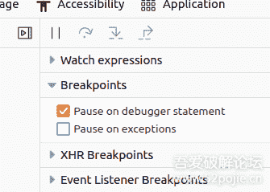

# [Web逆向] 简单无脑过无限`debugger`

- 原帖：[https://www.52pojie.cn/forum.php?mod=viewthread&tid=1871058](https://www.52pojie.cn/forum.php?mod=viewthread&tid=1871058)
- 抓取时间：2026-11-01T22:40:16

## 前言

Firefox 更新 Version 121.0，照常看下更新日志，都更新了什么，看见这条：

> The Firefox Debugger now includes a new feature: an option to disable the `debugger;` keyword on the current page. This feature is accessible via a new checkbox in the Breakpoints side panel labeled `Pause on debugger statement`, located next to the existing `Pause on exceptions` checkbox. By default, this option is enabled, meaning that the `debugger` statements are active unless manually disabled.

`121_devtools_disable_debugger_statement.png`（27.94 KB，下载次数: 0）

[附件下载](https://www.52pojie.cn/forum.php?mod=attachment&aid=MjY2NTA2OXw4MTViNDUwNXwxNzkzNTcyODEzfDE2ODA4NnwxODcxMDU4&nothumb=yes)

2023-12-20 04:29 上传

## 正文

更新日志写得很明白：

取消勾选 `Pause on debugger statement`（在调试器语句暂停）。

自己打的断点不受影响。

比停用断点这种全局停用好用多了，就这么简单。

## 结语

用 Firefox 调试的人应该很少，希望其他浏览器跟进此功能。

以后花样百出的无限`debugger`是不是都相当于白写了？
