# [原创] 某软件是如何伪装一下实现下岗再就业的？论国产的软件的未来!

- 原帖：https://www.52pojie.cn/forum.php?mod=viewthread&tid=1872640
- 抓取时间：2026-11-01T22:39:59

## 拿到软件后先观察一下

这真是小葱拌豆腐====一清二白啊~~

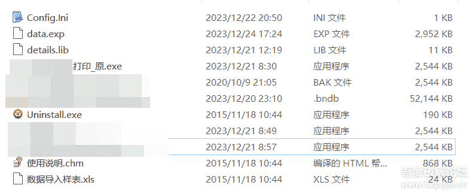

### 看一眼帮助是咋写的？

妈啊，感觉是我爷爷的爷爷那辈子使用的电脑哟~~

反正是老得渣都不剩了。。。

再有未注册版本，保存不能超过3条，打印不能超过20条。。。

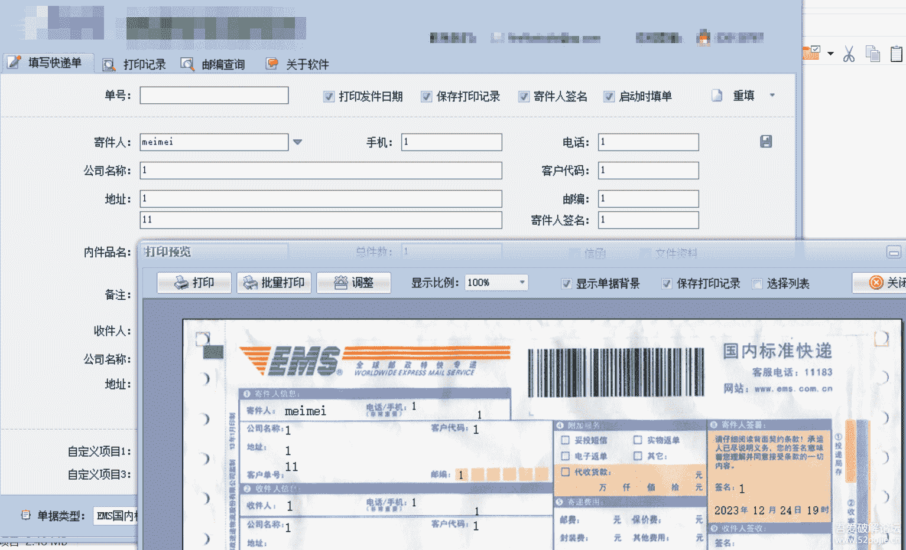

### 运行软件，看一眼界面，很古老很传统一猜就是Delphi的啊。

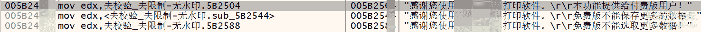

小白喜欢的字符串调用啊。。。

貌似还有文件被修改的自校验啊。。 

## 再看看伪代码

是不是巨有意思？前面的地址都一样，后面的参数不一样。

汇编指令里也是如此这样反应出来的

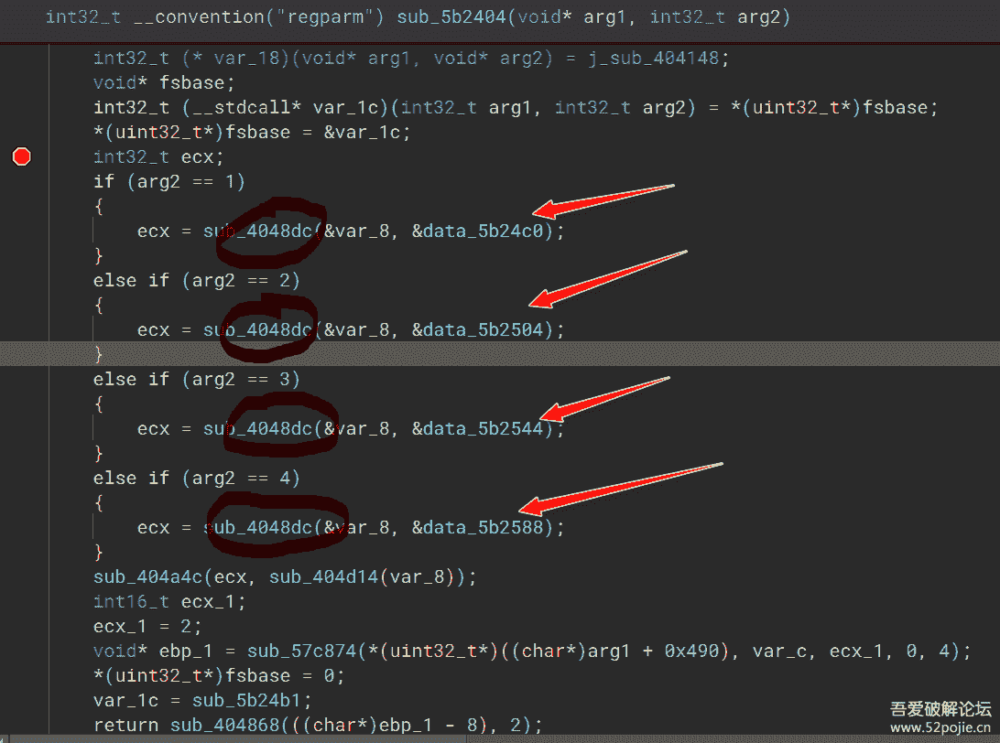

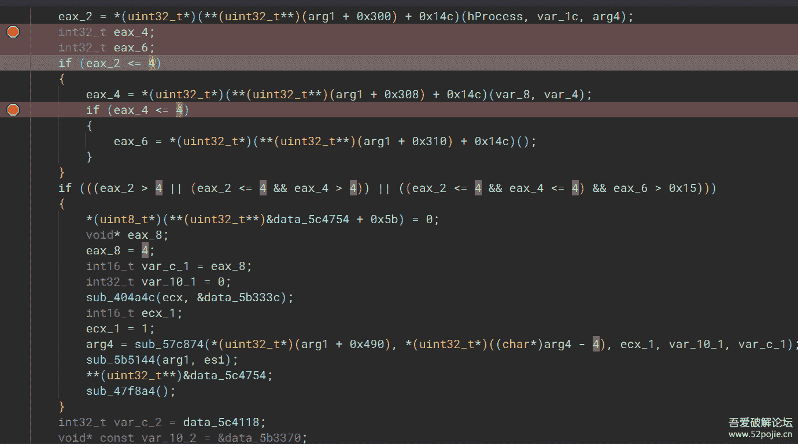

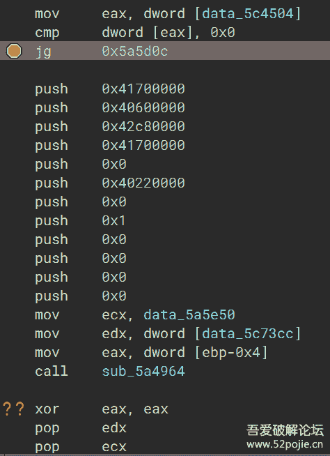

`JNLE`；有符号不小于等于则跳转，同`JG`。

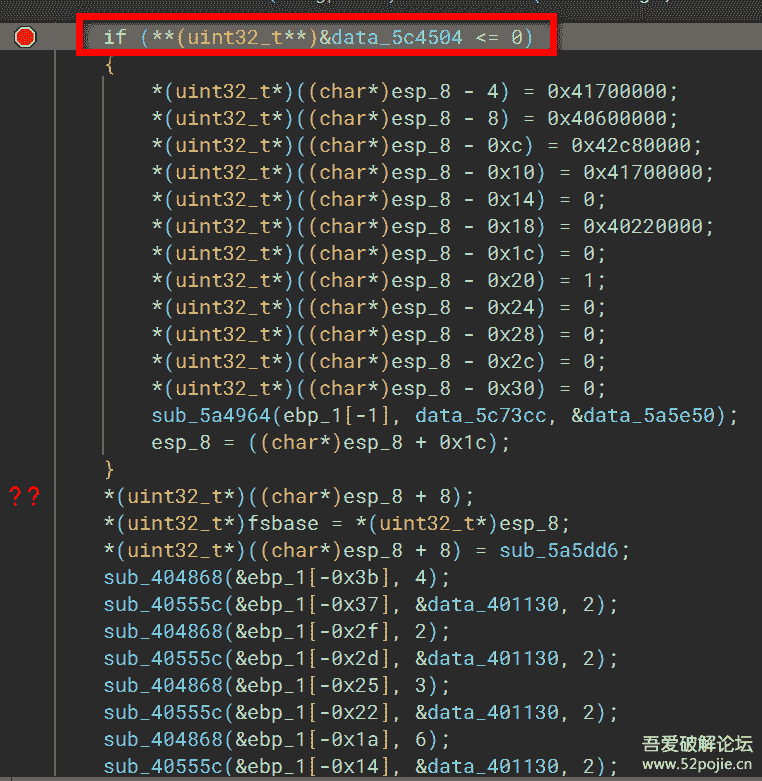

其他位置皆同此理，不再赘述。改法就不用说了吧？

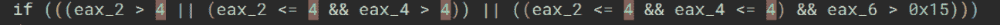

### 比如这行吧？就非常典型有代表意义

`if`翻译成英语就是如果的意思？

后面的`eax`、`xx`什么的可以全部无视

`||`就是或者的意思

`0x15`正好是十进制的21

那你说作者是希望默认实现（让你交费呢？还是希望你白用呢？）到底是该改跳还是不跳呢？自行思考。

`{`大括号 就是程序体`}`

右击`Patch`。。。`Save AS`，第2，即可！

## 最后再来看看作者是如何实现下岗再就业的呢？

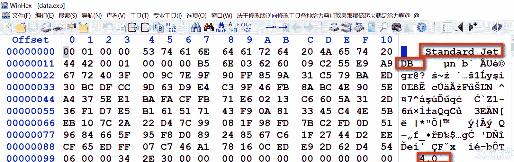

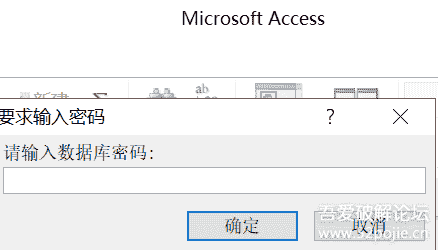

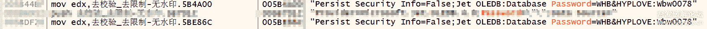

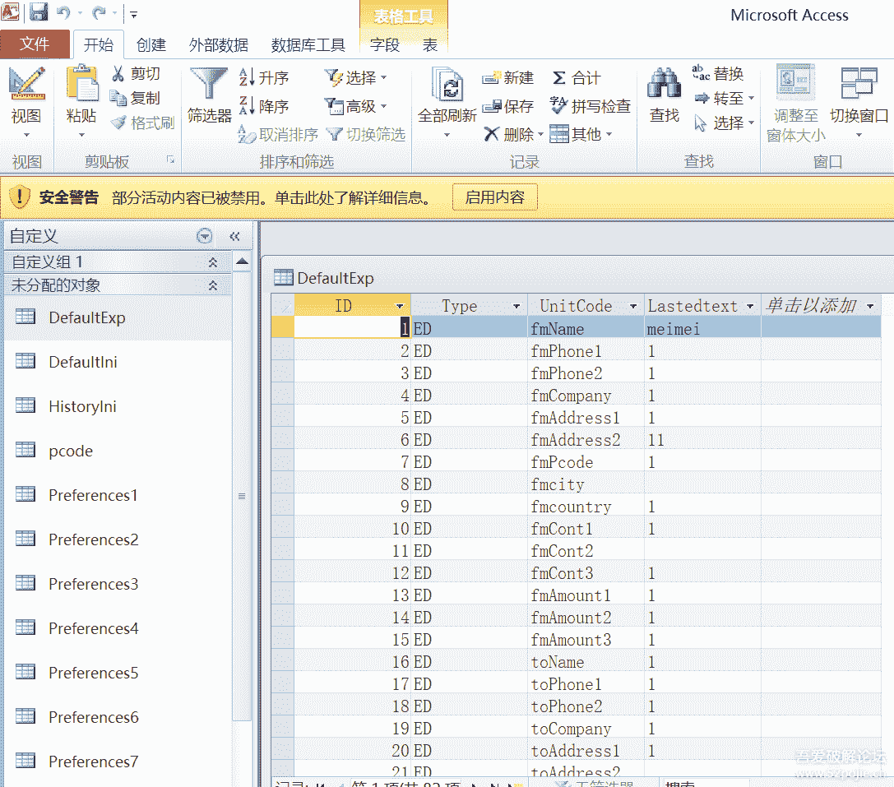

把密码粘入，也就打开了。哈哈。

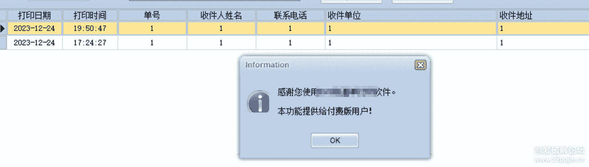

### 最后还有一个回填已打印的功能

经过`IDR+SPY`的联合侦查发现代码欠缺无法实现。

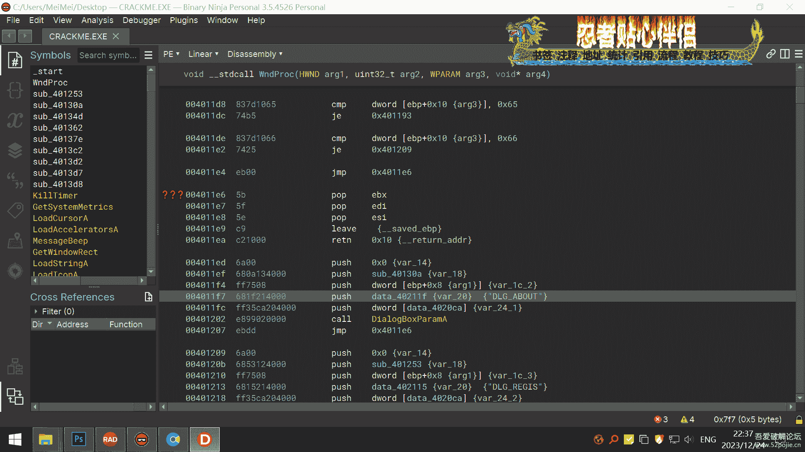
