# [原创] 某招聘网站202312月新版token生成分析

- 原帖：https://www.52pojie.cn/forum.php?mod=viewthread&tid=1873206
- 抓取时间：2026-11-01T22:39:53

[某招聘网站202312月新版token生成分析](https://www.52pojie.cn/某招聘网站202312月新版token生成分析)

## 前言

1. 本篇文章讲述一些关键点，无法非常详细
2. 部分内容可能需要提前了解旧版算法
3. 参考文献
   - <https://mp.weixin.qq.com/s/iQikjtZpBF4djPXlBQItbg>
   - <https://nerodesu017.github.io/posts/2023-12-01-antibots-part-8>

## js逆向初步分析

目标地址：`aHR0cHM6Ly93d3cuemhpcGluLmNvbS93ZWIvZ2Vlay9qb2I/cXVlcnk9SmF2YSZjaXR5PTEwMTI4MDcwMA==`

当在搜索职位的时候，会发生一次跳转，使用 Reqable 抓包查看。

当第一次访问 `/wapi/zpgeek/search/joblist.json` 接口的时候

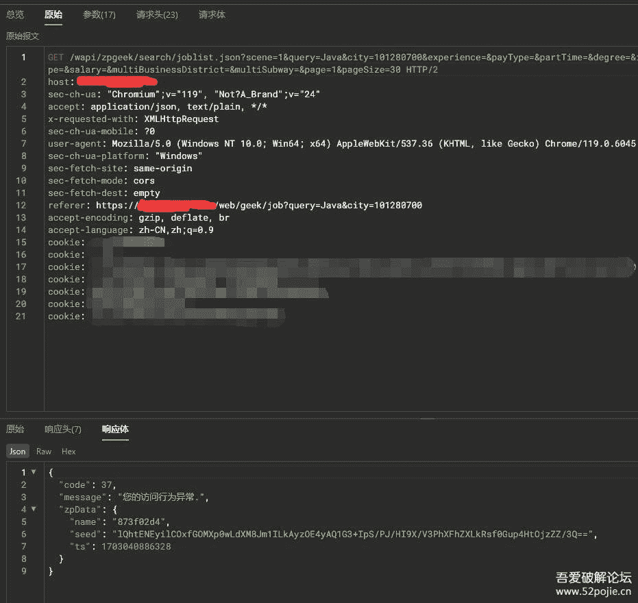

1.jpg（93.45 KB，下载次数：2）；[附件下载](https://www.52pojie.cn/forum.php?mod=attachment&aid=MjY2NjI5MXwyOGIzYjc3N3wxNzkzNTcyNzkwfDE2ODA4NnwxODczMjA2&nothumb=yes)；2023-12-26 10:57 上传

会显示【您的访问行为异常】，然后还会带有 `zpData` 后面的三个参数

接着会拼接这三个参数去请求一个中间的验证页面

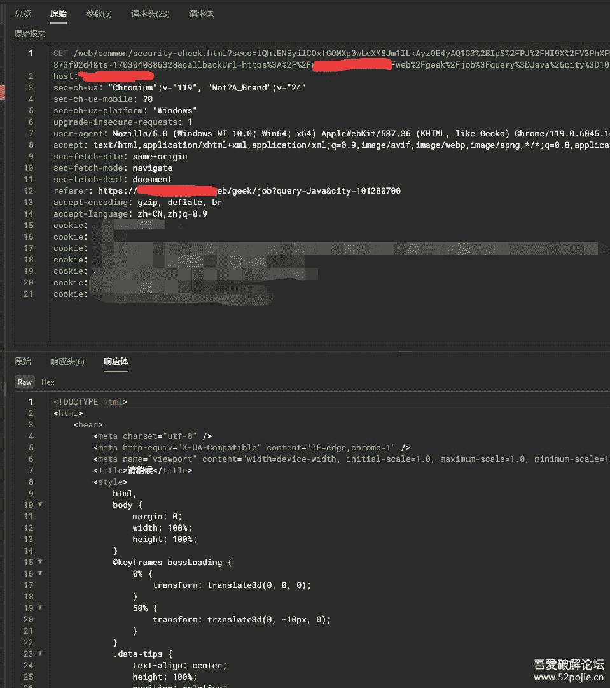

2.jpg（125.94 KB，下载次数：1）；[附件下载](https://www.52pojie.cn/forum.php?mod=attachment&aid=MjY2NjI5M3w1NTUxZjJiNXwxNzkzNTcyNzkwfDE2ODA4NnwxODczMjA2&nothumb=yes)；2023-12-26 10:57 上传

这样的话，可以下一个【脚本】断点来在中间页面的时候断下

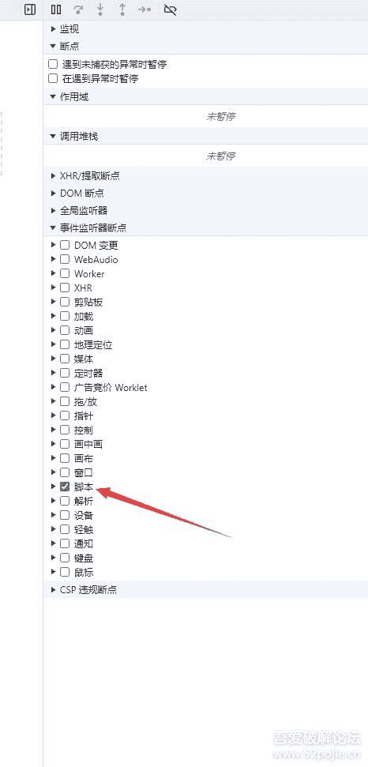

3.jpg（39.9 KB，下载次数：1）；[附件下载](https://www.52pojie.cn/forum.php?mod=attachment&aid=MjY2NjI5NHxlNTE5MzBiN3wxNzkzNTcyNzkwfDE2ODA4NnwxODczMjA2&nothumb=yes)；2023-12-26 10:58 上传

一致点击执行，直到出现中间页面

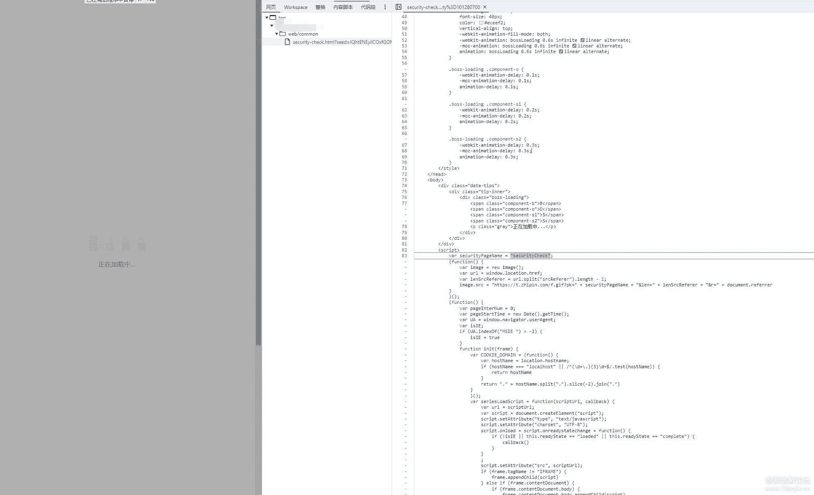

4.jpg（181.25 KB，下载次数：1）；[附件下载](https://www.52pojie.cn/forum.php?mod=attachment&aid=MjY2NjI5NXwzNGU3NzFjZHwxNzkzNTcyNzkwfDE2ODA4NnwxODczMjA2&nothumb=yes)；2023-12-26 10:58 上传

此时就可以搜索关键参数 `zp_stoken`

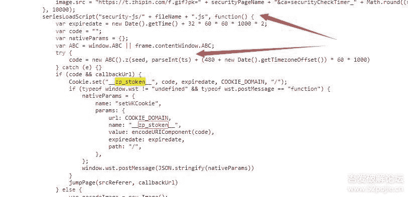

5.jpg（53.5 KB，下载次数：1）；[附件下载](https://www.52pojie.cn/forum.php?mod=attachment&aid=MjY2NjI5Nnw2NzFhOTQ3OXwxNzkzNTcyNzkwfDE2ODA4NnwxODczMjA2&nothumb=yes)；2023-12-26 10:58 上传

可以看到上面会加载一个关键 js，并且在回调里面会调用 `ABC` 的 `z` 方法，生成的值就是 `zp_stoken`，那么在函数调用的地方下一个断点，并可以关闭前面设置的脚本断点

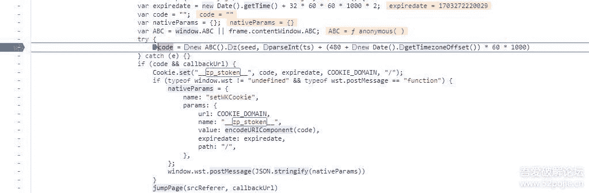

6.jpg（49.67 KB，下载次数：0）；[附件下载](https://www.52pojie.cn/forum.php?mod=attachment&aid=MjY2NjI5N3w4MWE1MWUwZnwxNzkzNTcyNzkwfDE2ODA4NnwxODczMjA2&nothumb=yes)；2023-12-26 10:59 上传

可以在控制台上尝试一下是不是我们需要的值

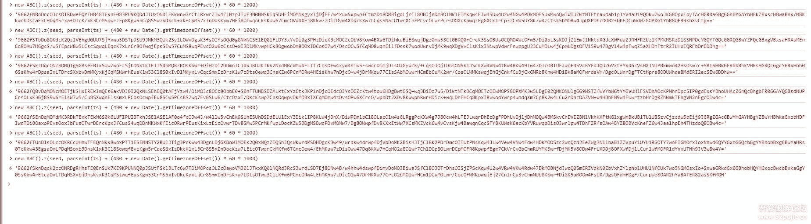

7.jpg（290.96 KB，下载次数：1）；[附件下载](https://www.52pojie.cn/forum.php?mod=attachment&aid=MjY2NjI5OHwyYzZjY2Q4M3wxNzkzNTcyNzkwfDE2ODA4NnwxODczMjA2&nothumb=yes)；2023-12-26 10:59 上传

看起来就是需要的值，但是多次执行结果不一样，可以猜测到里面计算涉及到了随机数或者时间

接着进入到函数内部查看

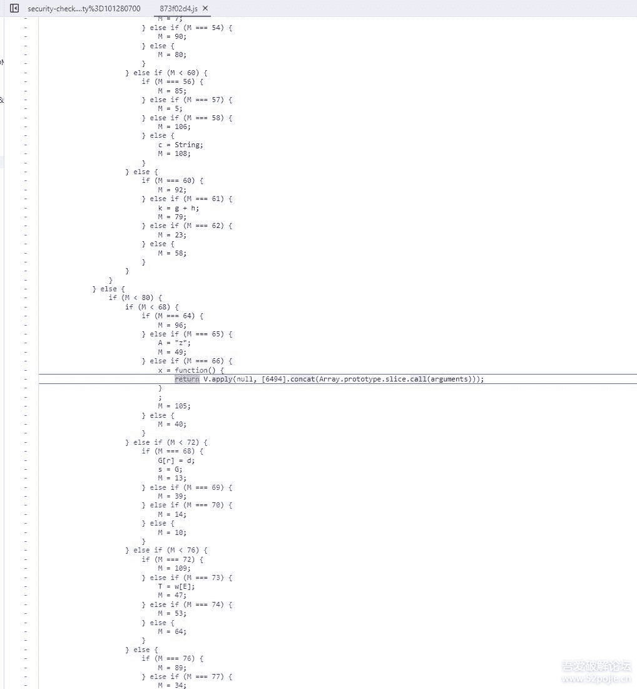

8.jpg（74.01 KB，下载次数：2）；[附件下载](https://www.52pojie.cn/forum.php?mod=attachment&aid=MjY2NjI5OXwxYzVhOGM5MHwxNzkzNTcyNzkwfDE2ODA4NnwxODczMjA2&nothumb=yes)；2023-12-26 10:59 上传

跳转的就是前面加载的 js，但是这个文件明显存在混淆，里面把函数实体切分成单条语句放到 `if` 或者 `else` 里面，如果不还原的话，很难进行调试分析

## ast反混淆

使用 babel 库进行反混淆，首先安装依赖

```
npm install @babel/core
```

首先把 `if` 转换为 `switch`

例如一开始的

```
if (M
```

那么按照对应的逻辑，就可以转换为

```
switch (M){
    case 0:
        M = 57;
        break;
    case 1:
        M = 25;
        break;
    case 2:
        M = undefined;
        break;
    case 3:
        M = 29;
        break;
        // 省略
}
```

因为 `if` 的深度有多种，所以一般使用递归的方式来提取所有的块

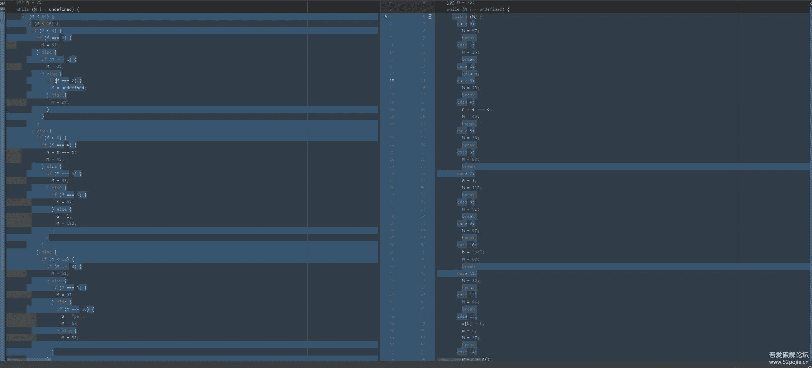

9.jpg（115.14 KB，下载次数：1）；[附件下载](https://www.52pojie.cn/forum.php?mod=attachment&aid=MjY2NjMwMHw0OWUxMmEzYnwxNzkzNTcyNzkwfDE2ODA4NnwxODczMjA2&nothumb=yes)；2023-12-26 10:59 上传

其中需要注意：

1. `return` 语句后面就不需要添加 `break` 语句
2. `else` 里面语句用的的 `case` 值是 `if` 里面的 `case + 1`

这一步比较简单，没有坑

还原到这里后调试的话，虽然每一步都可以直接跳转到实际运行的语句，但是一直跳来跳去的也很烦人

接下来需要把多个单语句的块，合并成一个多语句的块

## 3. CFF（控制流扁平化）

假设一个原函数为

```
function countToAndReturnSum(num) {
  let sum = 0;
  console.time(`countToAndReturnSum(${num})`);
  for (let i = 1; i 
```

混淆后为

```
function countToAndReturnSum(num) {
  let jmp_var = 2;
  while (jmp_var != 42) {
    switch (jmp_var) {
      case 7:
        console.log(i);
        sum += i;
        i++;
        jmp_var = 4;
        break;
      case 2:
        var sum = 0;
        var i = 1;
        jmp_var = 5;
        break;
      case 5:
        console.time(`countToAndReturnSum(${num})`);
        jmp_var = 4;
        break;
      case 9:
        console.timeEnd(`countToAndReturnSum(${num})`);
        return sum;
        break;
      case 4:
        jmp_var = i 
```

将其转换为图表的形式可以得到

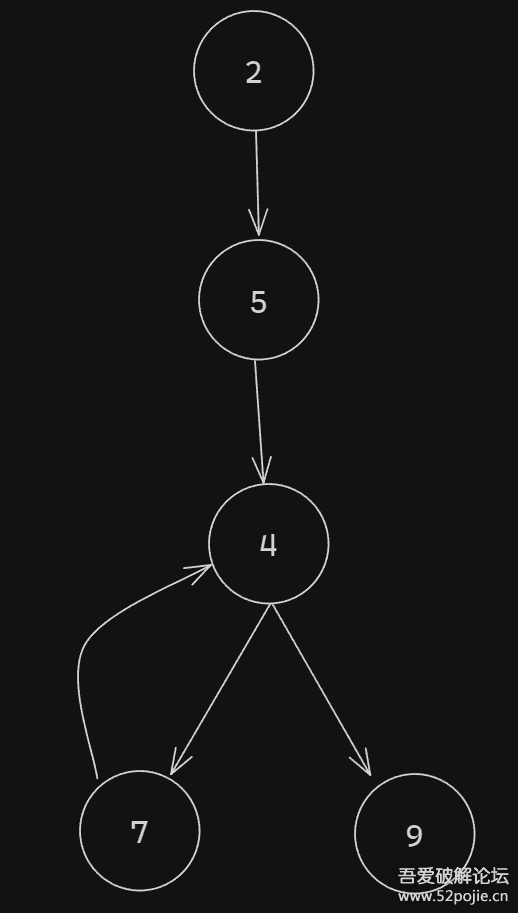

1.png（27.74 KB，下载次数：2）；[附件下载](https://www.52pojie.cn/forum.php?mod=attachment&aid=MjY2NjMwMXxjMjUwMzkzYnwxNzkzNTcyNzkwfDE2ODA4NnwxODczMjA2&nothumb=yes)；2023-12-26 10:59 上传

下面主要讲述 `2 -> 5 -> 4` 的逻辑

可以看到 `2` 节点，其仅有一个指出方向，并且指向 `5`。也就是说当 `2` 执行完以后，无论如何都会走到 `5`

再看 `5` 节点，其中仅有一个指出方向，并且指向 `4`，仅有一个指人方向，并且指向 `2`。当 `5` 的父级执行完成后，如论如何都会轮到 `5` 自己，并且当自己执行完成后，无论如何都会走到 `4`

满足这两个条件的时候，就可以把节点 `2 -> 5` 看成一个整体，把 `2` 节点的跳转删除，然后把 `5` 的内容和跳转合并到 `2`

代码就可以优化为

```
function countToAndReturnSum(num) {
  let jmp_var = 2;
  while (jmp_var != 42) {
    switch (jmp_var) {
      case 7:
        console.log(i);
        sum += i;
        i++;
        jmp_var = 4;
        break;
      case 2:
        var sum = 0;
        var i = 1;
        console.time(`countToAndReturnSum(${num})`);
        jmp_var = 4;
        break;
      case 9:
        console.timeEnd(`countToAndReturnSum(${num})`);
        return sum;
        break;
      case 4:
        jmp_var = i 
```

对应的图表为

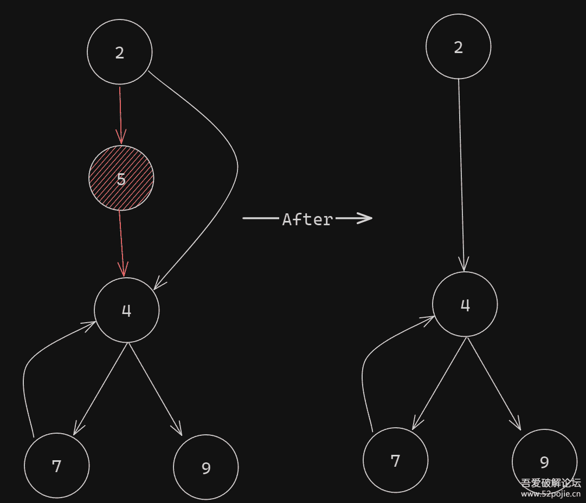

2.png（71.95 KB，下载次数：1）；[附件下载](https://www.52pojie.cn/forum.php?mod=attachment&aid=MjY2NjMwMnw3OWVhMDIxZHwxNzkzNTcyNzkwfDE2ODA4NnwxODczMjA2&nothumb=yes)；2023-12-26 11:00 上传

那么此时整个结构就被优化了，整体的节点数减少了一个

回到前面解混淆后的代码

```
    var M = 75;
    while (M !== undefined) {
      switch (M) {
        // 省略
        case 12:
          M = 86;
          break;
        // 省略
        case 54:
          M = 90;
          break;
        // 省略
        case 64:
          M = 96;
          break;
        // 省略
        case 75:
          M = 64;
          break;
        // 省略
        case 86:
          t = "ect";
          M = 54;
          break;
        // 省略
        case 96:
          M = 12;
          break;
        // 省略
      }
    }
```

可以看到其中的节点顺序 `75 -> 64 -> 96 -> 12 -> 86 -> 54 -> 90` 等等，都是符合上面所述的情况，那么就都可以将其一一合并

合并后的代码大概为


```javascript
var M = 75;

while (M !== undefined) {
  switch (M) {
    // 省略
    case 75:
      t = "ect";
      M = 90;
      break;
    // 省略
  }
}
```

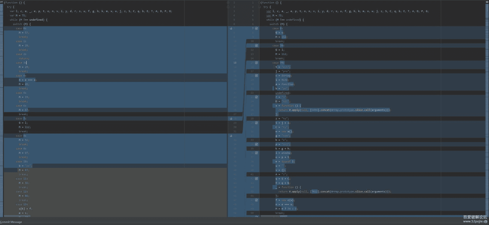

[10.jpg（162.96 KB，下载次数：1）](https://www.52pojie.cn/forum.php?mod=attachment&aid=MjY2NjMwM3xiNGQ5OGJlOHwxNzkzNTcyNzkwfDE2ODA4NnwxODczMjA2&nothumb=yes)

2023-12-26 11:00 上传

合并后由原来的节点数8500+优化为900+，此时再调试的话，难度相当于原来的十分之一了，整个逻辑也是几乎清晰可见

## `zp_stoken` 的生成逻辑

将处理完成的js替换到网页上进行调试

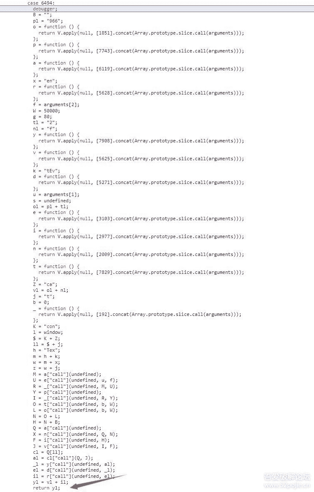

[11.jpg（116.2 KB，下载次数：1）](https://www.52pojie.cn/forum.php?mod=attachment&aid=MjY2NjMwNHxjMTIzNGE2Y3wxNzkzNTcyNzkwfDE2ODA4NnwxODczMjA2&nothumb=yes)

2023-12-26 11:00 上传

可以看到`zp_stoken`的值就是两个字符串的拼接，至于这些字符串怎么生成的呢，那么就需要单步调试分析了

前面一半都是变量的定义，主要看后面`call`的部分

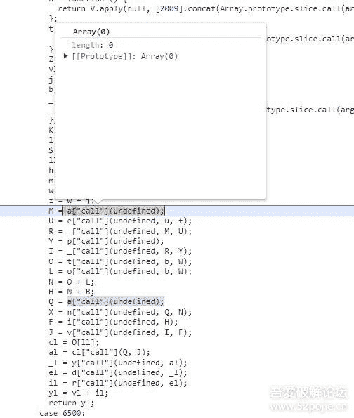

[12.jpg（43.06 KB，下载次数：2）](https://www.52pojie.cn/forum.php?mod=attachment&aid=MjY2NjMwNXxiYzYzZWNiNXwxNzkzNTcyNzkwfDE2ODA4NnwxODczMjA2&nothumb=yes)

2023-12-26 11:00 上传

第一个函数返回了一个空数组，可以理解为函数的作用是创建一个数组

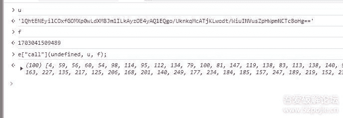

[13.jpg（28.16 KB，下载次数：2）](https://www.52pojie.cn/forum.php?mod=attachment&aid=MjY2NjMwNnw0Y2FhZTFiNnwxNzkzNTcyNzkwfDE2ODA4NnwxODczMjA2&nothumb=yes)

2023-12-26 11:00 上传

接着是把前面拿到的`seed`和`ts`作为参数，返回一个固定长度为100的数组，但是内容的最后一位会有一些变化

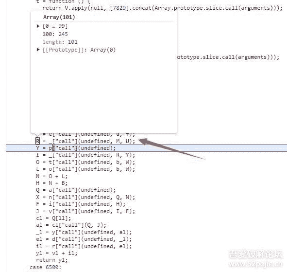

[14.jpg（43.23 KB，下载次数：1）](https://www.52pojie.cn/forum.php?mod=attachment&aid=MjY2NjMwN3wwOGI1Njc2NHwxNzkzNTcyNzkwfDE2ODA4NnwxODczMjA2&nothumb=yes)

2023-12-26 11:01 上传

接着把前面创建的数组和100位数组作为参数，返回一个固定长度101的数组，实际是在头部增加了一个100的元素，也就是前面数组的长度

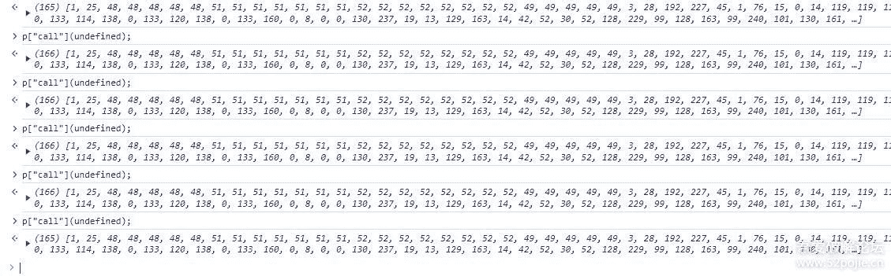

[15.jpg（121.18 KB，下载次数：1）](https://www.52pojie.cn/forum.php?mod=attachment&aid=MjY2NjMwOHxkZjdhYzY4YXwxNzkzNTcyNzkwfDE2ODA4NnwxODczMjA2&nothumb=yes)

2023-12-26 11:01 上传

接着是一个没有参数的函数，返回一个不定长的数组，大概在160+的长度这样，实际上这个就是环境检测的结果

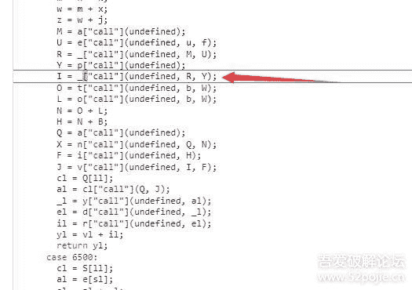

[16.jpg（34.03 KB，下载次数：2）](https://www.52pojie.cn/forum.php?mod=attachment&aid=MjY2NjMwOXxkMTk5OTFkMXwxNzkzNTcyNzkwfDE2ODA4NnwxODczMjA2&nothumb=yes)

2023-12-26 11:01 上传

然后把前面101位数组和160+位数组进行拼接，得到一个260+位的大数组

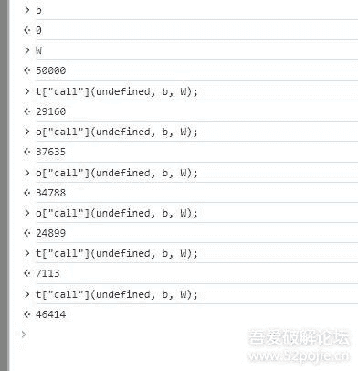

[17.jpg（24.12 KB，下载次数：1）](https://www.52pojie.cn/forum.php?mod=attachment&aid=MjY2NjMxMHxlYTFmNWVjM3wxNzkzNTcyNzkwfDE2ODA4NnwxODczMjA2&nothumb=yes)

2023-12-26 11:01 上传

接着两个没有参数的函数就是生成两个随机数

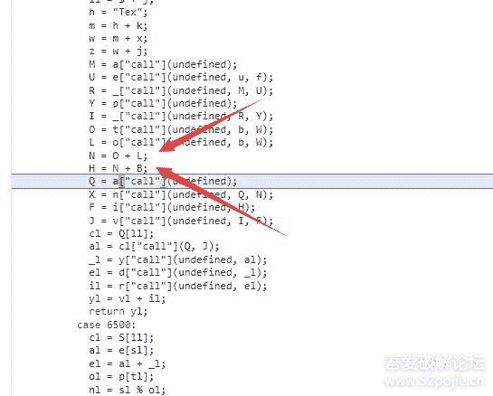

[18.jpg（38.42 KB，下载次数：3）](https://www.52pojie.cn/forum.php?mod=attachment&aid=MjY2NjMxMXwwNjU5ZDY0M3wxNzkzNTcyNzkwfDE2ODA4NnwxODczMjA2&nothumb=yes)

2023-12-26 11:01 上传

接着两个语句是把随机数相加，再转成字符串类型

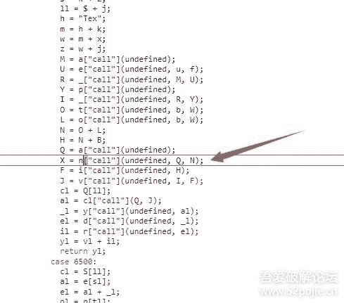

[19.jpg（34.71 KB，下载次数：1）](https://www.52pojie.cn/forum.php?mod=attachment&aid=MjY2NjMxMnwxNGViNzU4MnwxNzkzNTcyNzkwfDE2ODA4NnwxODczMjA2&nothumb=yes)

2023-12-26 11:01 上传

这里把前面相加后的随机数添加到新创建的数组中

例如我这里的随机数是62991，添加后得到的数组就是`[192, 246, 15]`

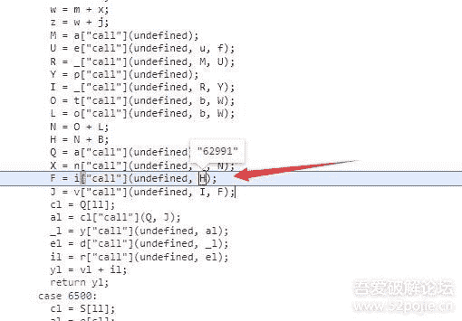

[20.jpg（32.86 KB，下载次数：1）](https://www.52pojie.cn/forum.php?mod=attachment&aid=MjY2NjMzMnwxODYxMzE5ZXwxNzkzNTcyNzkwfDE2ODA4NnwxODczMjA2&nothumb=yes)

2023-12-26 11:08 上传

接着是将随机数的字符串类型转为字节数组

例如我这里的随机数是62991，得到的数组就是`[54, 50, 57, 57, 49]`

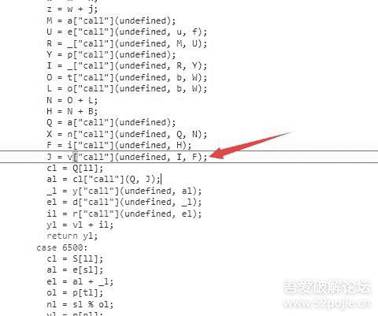

[21.jpg（34.56 KB，下载次数：1）](https://www.52pojie.cn/forum.php?mod=attachment&aid=MjY2NjMzM3xkZDA5MTFmMnwxNzkzNTcyNzkwfDE2ODA4NnwxODczMjA2&nothumb=yes)

2023-12-26 11:08 上传

这里就是比较重要的一部，把大数组和随机数的字节数组作为参数，返回一个新的加密数组

可以理解成这里的随机数的字节数组作为`key`，对大数组进行加密

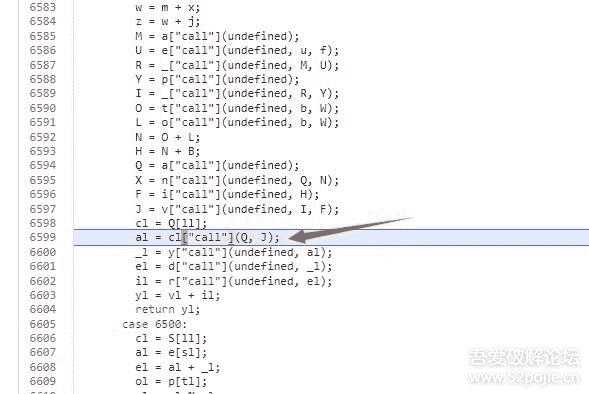

[22.jpg（40.85 KB，下载次数：2）](https://www.52pojie.cn/forum.php?mod=attachment&aid=MjY2NjMzNHwyNDJlYzFjMXwxNzkzNTcyNzkwfDE2ODA4NnwxODczMjA2&nothumb=yes)

2023-12-26 11:08 上传

接着拼接序列化整数的数组和加密后的数组

后面的三个函数调用分别是

1. 自偏移加密。涉及一些异或和加减法运算，对每一个元素的操作都是相同的
2. 序列化数组。把所有元素都序列化为`0-255`的范围，为下一步做准备
3. 标准 `base64` 编码。将数组转为 `base64` 字符串的形式

此时再头部拼接一个5长度的字符串，就是最终的`zp_stoken`了

下面来总结一个整个过程

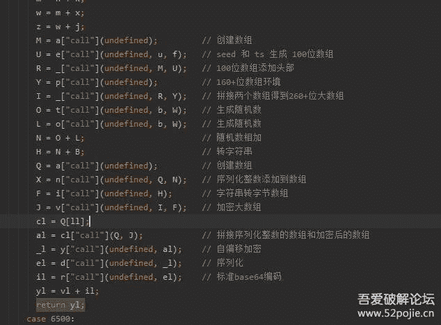

[23.jpg（47.13 KB，下载次数：1）](https://www.52pojie.cn/forum.php?mod=attachment&aid=MjY2NjMzNXwxYTM1MDVhM3wxNzkzNTcyNzkwfDE2ODA4NnwxODczMjA2&nothumb=yes)

2023-12-26 11:08 上传

## `zp_stoken` 的序列化和反序列化

因为js代码每天都会变化，所以下面的代码均已文章编写当天的为准

根据上面已有的信息，画一个思维导图整理一下

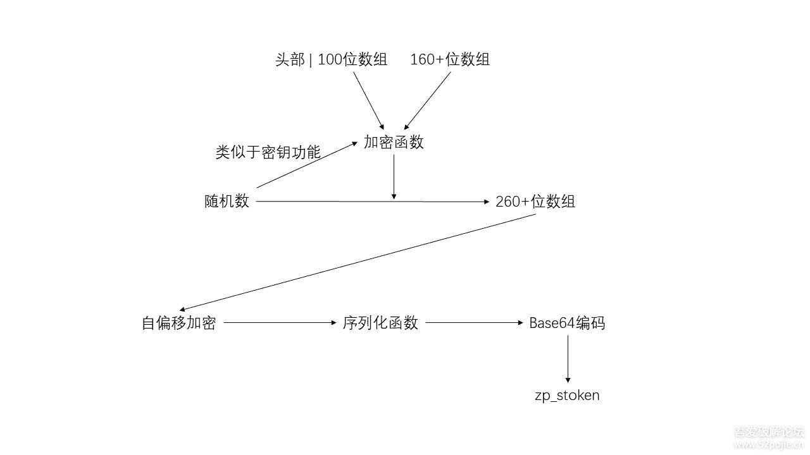

[24.jpg（42.74 KB，下载次数：1）](https://www.52pojie.cn/forum.php?mod=attachment&aid=MjY2NjMzNnwwYjE1YzFhMnwxNzkzNTcyNzkwfDE2ODA4NnwxODczMjA2&nothumb=yes)

2023-12-26 11:09 上传

如果要做到序列化和反序列化，那么现有的分析还是不够的，还需要分析100位数组，160+位数组，以及各个加密函数的具体是什么实现的

本篇文章就主要讲述以100位数组为例，其他的分析基本类似

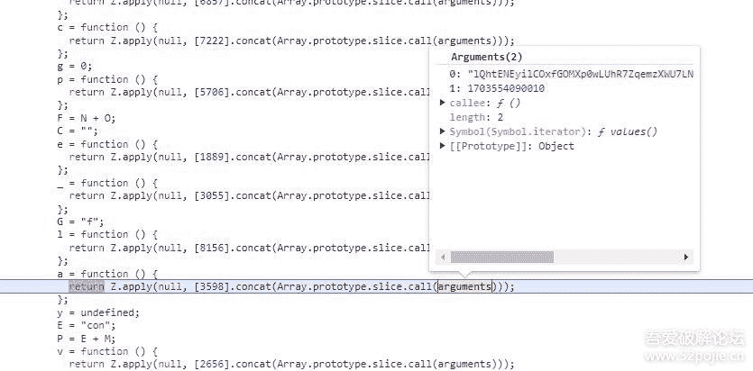

[25.jpg（57.17 KB，下载次数：1）](https://www.52pojie.cn/forum.php?mod=attachment&aid=MjY2NjMzN3w3MjNhMmNhYXwxNzkzNTcyNzkwfDE2ODA4NnwxODczMjA2&nothumb=yes)

2023-12-26 11:09 上传

跟进100位数组生成的函数

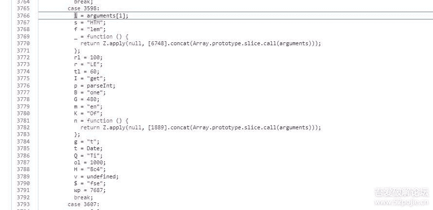

[26.jpg（40.03 KB，下载次数：1）](https://www.52pojie.cn/forum.php?mod=attachment&aid=MjY2NjMzOHw1YzNjY2Y3YnwxNzkzNTcyNzkwfDE2ODA4NnwxODczMjA2&nothumb=yes)

2023-12-26 11:09 上传

然后记录所有经过的代码块

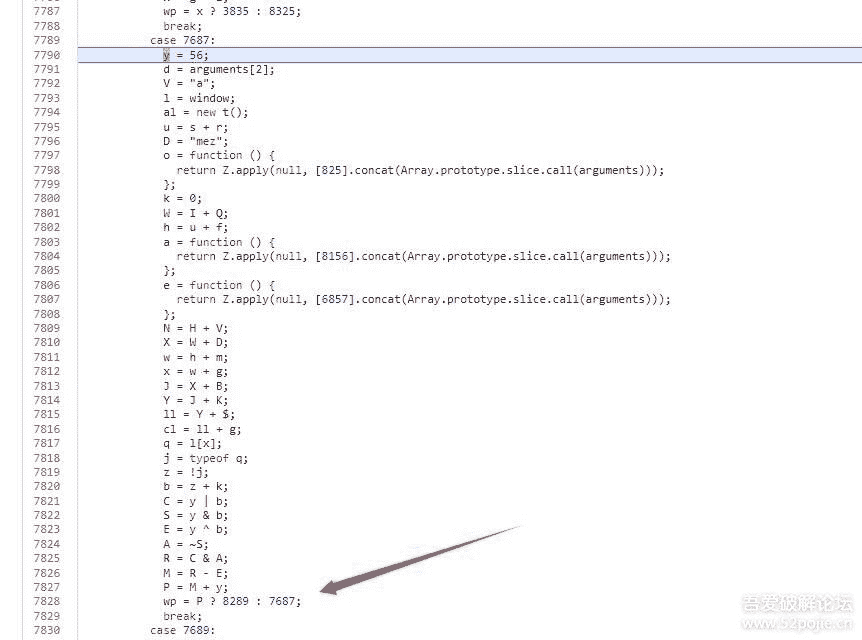

[27.jpg（58.3 KB，下载次数：1）](https://www.52pojie.cn/forum.php?mod=attachment&aid=MjY2NjMzOXw4NmVkZmMwNHwxNzkzNTcyNzkwfDE2ODA4NnwxODczMjA2&nothumb=yes)

2023-12-26 11:09 上传

在分析过程中，很容易遇到这种类型的分支

这种就是影响正常逻辑的虚假分支，为什么这么说呢

这里的判断条件为`P`

又因为`P = M + y`


# 分析过程

## `P` 公式展开与跳转优化

继续把 `P` 公式展开可以得到 `P = (((56 | (z)) & (~(56 & (z)))) - (56 ^ (z))) + 56;`

上面的 `z = !j;` 就是布尔型，所以 `z` 只能取 `1` 或者 `0`

那么无论当 `z` 为 `0` 还是为 `1`，`P` 都是恒定为 `56`

所以 `wp = P ? 8289 : 7687;` 的跳转是一定跳转到 `8289`

相当于可以把 `wp = P ? 8289 : 7687;` 优化为 `wp = 8289;`

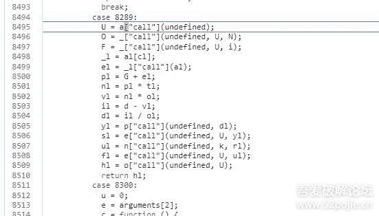
`28.jpg` (31.04 KB, 下载次数: 1) [附件](https://www.52pojie.cn/forum.php?mod=attachment&aid=MjY2NjM0MHxiYzQ0MjkyM3wxNzkzNTcyNzkwfDE2ODA4NnwxODczMjA2&nothumb=yes) 2023-12-26 11:09 上传

## 业务逻辑与数组构建

函数前面的都是变量赋值，最后才到业务逻辑部分

第一步也是创建一个数组

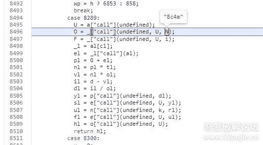
`29.jpg` (30.68 KB, 下载次数: 1) [附件](https://www.52pojie.cn/forum.php?mod=attachment&aid=MjY2NjM0MXw4MTEwNTE2ZXwxNzkzNTcyNzkwfDE2ODA4NnwxODczMjA2&nothumb=yes) 2023-12-26 11:09 上传

然后把第一步的数组和每天固定变化的5位固定字符串取前四位作为参数

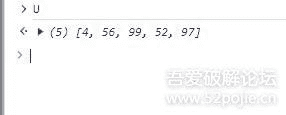
`30.jpg` (4.51 KB, 下载次数: 1) [附件](https://www.52pojie.cn/forum.php?mod=attachment&aid=MjY2NjM0Mnw1NWFlOWM1OHwxNzkzNTcyNzkwfDE2ODA4NnwxODczMjA2&nothumb=yes) 2023-12-26 11:09 上传

第一步的数组就有5个元素了，这里很明显可以看到，第一位就是指后面数据的长度，接着四位就是传进去的字符串了

这时结合前面可以发现，数据大多以数据头和数据体的方式存在，数据头用来表明了数据提的长度

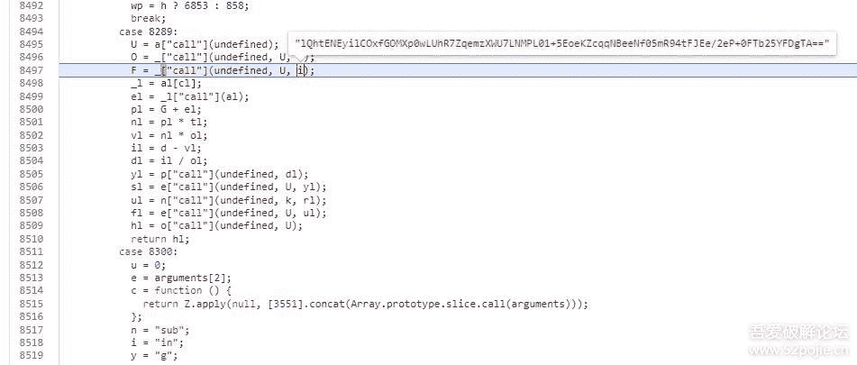
`31.jpg` (51.81 KB, 下载次数: 1) [附件](https://www.52pojie.cn/forum.php?mod=attachment&aid=MjY2NjM0M3xlOGE0NzE2MHwxNzkzNTcyNzkwfDE2ODA4NnwxODczMjA2&nothumb=yes) 2023-12-26 11:09 上传

接着就是传进去 `seed`，猜测一下，很有可能是添加 `seed` 的长度和 `seed` 的字符串内容

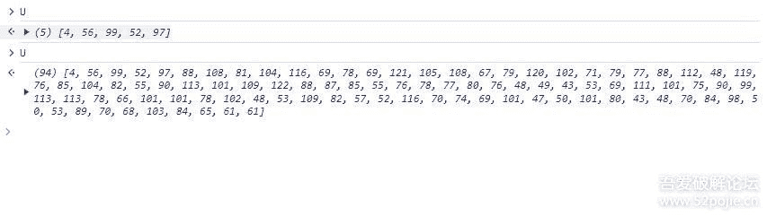
`32.jpg` (30.37 KB, 下载次数: 1) [附件](https://www.52pojie.cn/forum.php?mod=attachment&aid=MjY2NjM0NHxkNmM2YjM5OHwxNzkzNTcyNzkwfDE2ODA4NnwxODczMjA2&nothumb=yes) 2023-12-26 11:09 上传

运行后发现确实是这样

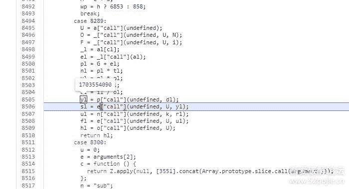
`33.jpg` (40.84 KB, 下载次数: 2) [附件](https://www.52pojie.cn/forum.php?mod=attachment&aid=MjY2NjM0NXwxNGE3NjI5OHwxNzkzNTcyNzkwfDE2ODA4NnwxODczMjA2&nothumb=yes) 2023-12-26 11:09 上传

接着来到 `yl`，就是传进去的 `ts` 的前 10 位

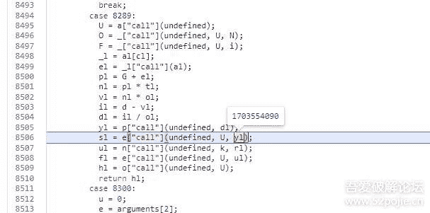
`34.jpg` (31.37 KB, 下载次数: 1) [附件](https://www.52pojie.cn/forum.php?mod=attachment&aid=MjY2NjM0Nnw2NTI3ZTM2NnwxNzkzNTcyNzkwfDE2ODA4NnwxODczMjA2&nothumb=yes) 2023-12-26 11:09 上传

现在传进去数组的就不是字符串的，而是整数

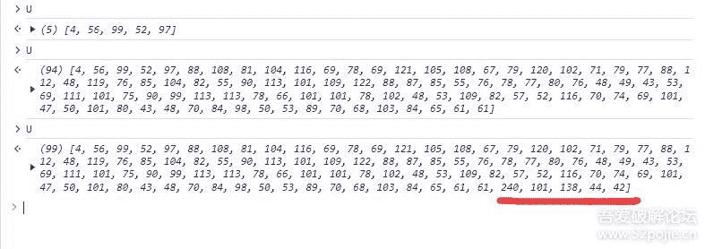
`35.jpg` (52.43 KB, 下载次数: 1) [附件](https://www.52pojie.cn/forum.php?mod=attachment&aid=MjY2NjM0N3w0MTdmZWNkY3wxNzkzNTcyNzkwfDE2ODA4NnwxODczMjA2&nothumb=yes) 2023-12-26 11:09 上传

这里可以看到添加了一个 `240`，剩下的四位就是 `ts` 的 `int` 类型大端续，但是 `240` 这里也不是长度，到底表达什么意思呢

具体可以跟入函数分析，这里实际是一个标志位

`240` 的二进制数为 `11110000`，其中第一个 0 前面有四个 1，说明后面还有四字节数据

这样的做法，类似一个变体型的数据，可以根据参数来改变自身序列化后的长度，来节省网络传输的大小

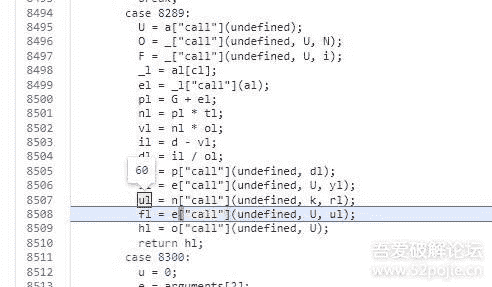
`36.jpg` (29.56 KB, 下载次数: 2) [附件](https://www.52pojie.cn/forum.php?mod=attachment&aid=MjY2NjM0OHwyY2FlMWQ4MXwxNzkzNTcyNzkwfDE2ODA4NnwxODczMjA2&nothumb=yes) 2023-12-26 11:09 上传

`ul` 是一个 0 到 100 的随机数，两个参数分别就是 0 和 100

接着把随机数放到数组，这个没有什么好说，和前面放入 `ts` 一样

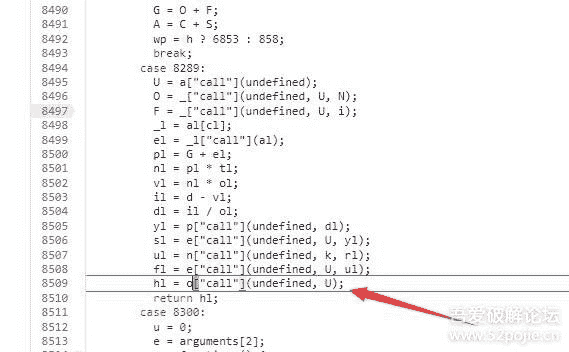
`37.jpg` (35.88 KB, 下载次数: 2) [附件](https://www.52pojie.cn/forum.php?mod=attachment&aid=MjY2NjM0OXxkNWVlNzAzYnwxNzkzNTcyNzkwfDE2ODA4NnwxODczMjA2&nothumb=yes) 2023-12-26 11:09 上传

最后这里就是做了一个小的加密变化，需要是根据下标来变化字节，篇幅原因就不详细分析列出了

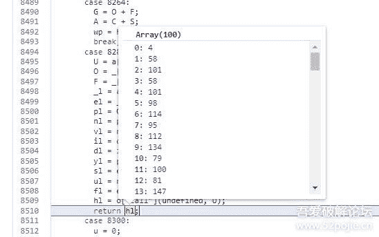
`38.jpg` (27.92 KB, 下载次数: 2) [附件](https://www.52pojie.cn/forum.php?mod=attachment&aid=MjY2NjM1MHxlY2NlODJmZHwxNzkzNTcyNzkwfDE2ODA4NnwxODczMjA2&nothumb=yes) 2023-12-26 11:09 上传

### 100 位数组的组成

此时就成功得到了100位数组

那么再来总结一下100位数组是怎么组成的

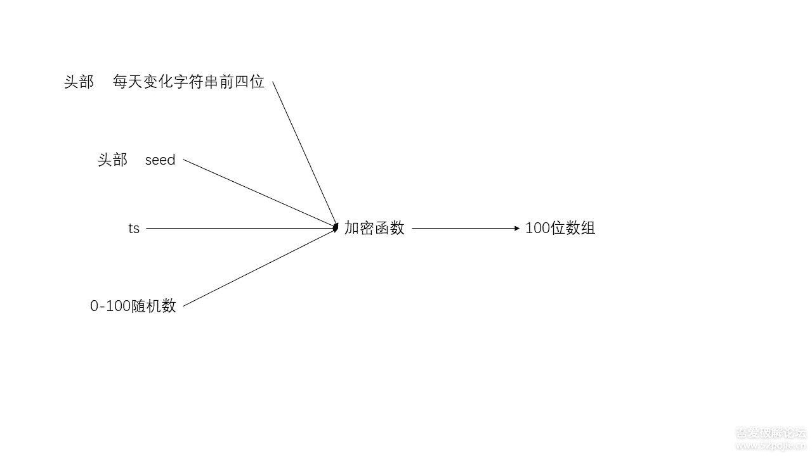
`39.jpg` (33.03 KB, 下载次数: 2) [附件](https://www.52pojie.cn/forum.php?mod=attachment&aid=MjY2NjM1MXxkZmI3ZmU2N3wxNzkzNTcyNzkwfDE2ODA4NnwxODczMjA2&nothumb=yes) 2023-12-26 11:09 上传

可以看到100位数组是主要用来保存服务器返回的两个重要参数，那么下面160+位数组就没有东西放了，那么是用来保存什么的呢？

### 160+ 位数组分析

可以猜测到，其中大概率就是保存当前的浏览器环境的了

这里160+数组也是类似的分析过程

分析过程可能会遇到两个特殊点

- 请求头的 `ua` 计算 `crc32`
    - 1.1 计算结果需要位与 `0xffff` 才是最终结果，也就是 `zlib.crc32(self.info['ua'].encode()) & 0xffff`
- 出现 `hmacsha1`
    - 2.1 这里的并不是标准的 `hmacsha1`，存在三处魔改
    - 2.2 第一处魔改是修改了 `ipad` 和 `opad` 的填充算法，把原来的两个固定字节，修改为两个固定的四字节
    - 2.3 修改了 5 个初始化的 `iv` 值
    - 2.4 修改了 4 个 `k` 值

较为详细的图如下

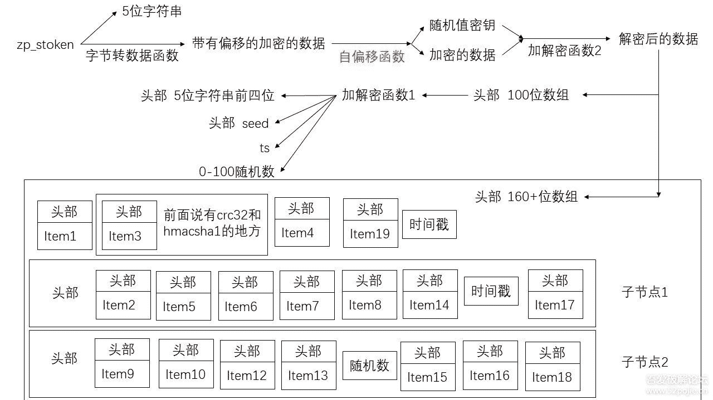
`40.jpg` (136.41 KB, 下载次数: 1) [附件](https://www.52pojie.cn/forum.php?mod=attachment&aid=MjY2NjM1Mnw4NTZkOTc3OHwxNzkzNTcyNzkwfDE2ODA4NnwxODczMjA2&nothumb=yes) 2023-12-26 11:09 上传
