# [原创] AbyssMedia Audio Converter Plus 6.9.1.0破解过程

- 原帖：<https://www.52pojie.cn/forum.php?mod=viewthread&tid=1873555>
- 抓取时间：2026-11-01T22:39:50

2019年做过此软件[www.52pojie.cn](https://www.52pojie.cn)，现在版本升级重新整理了一下破解过程，由于才疏学浅，不尽之处还请各位多实践几回。

## 1、运行程序

如图操作我们得到关键信息：（得到字符串`Trial version`）

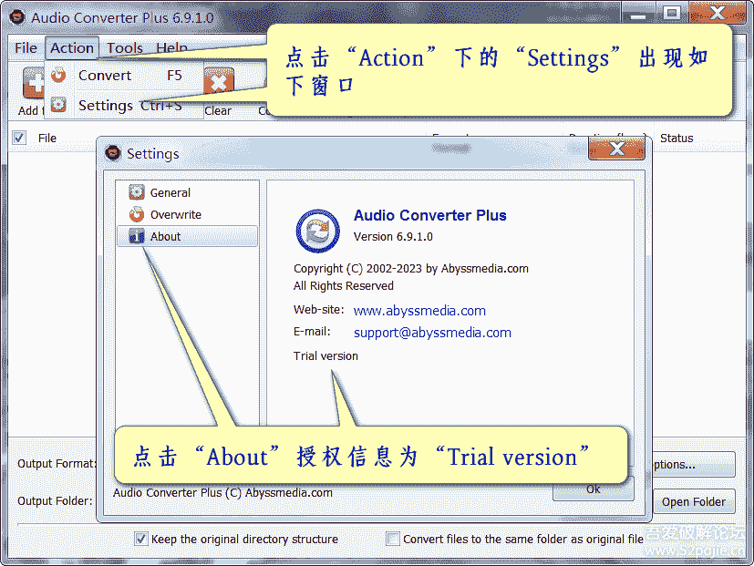

`1.png`（148.94 KB，下载次数：0）

[附件下载](https://www.52pojie.cn/forum.php?mod=attachment&aid=MjY2NjU1OHw4YmFlZmY5ZXwxNzkzNTcyNzg3fDE2ODA4NnwxODczNTU1&nothumb=yes)（2023-12-27 09:00 上传）

## 2、用`x32dbg`加载程序

`Alt+F9`运行到用户代码，`F8`单步运行在第一个`Call`处`F7`进入，此时查找字符串`Trial version`，得到一处：

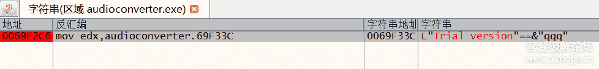

`2.png`（17.1 KB，下载次数：1）

[附件下载](https://www.52pojie.cn/forum.php?mod=attachment&aid=MjY2NjU1OXxiYWJmODcwM3wxNzkzNTcyNzg3fDE2ODA4NnwxODczNTU1&nothumb=yes)（2023-12-27 09:00 上传）

## 3、双击来到反汇编区

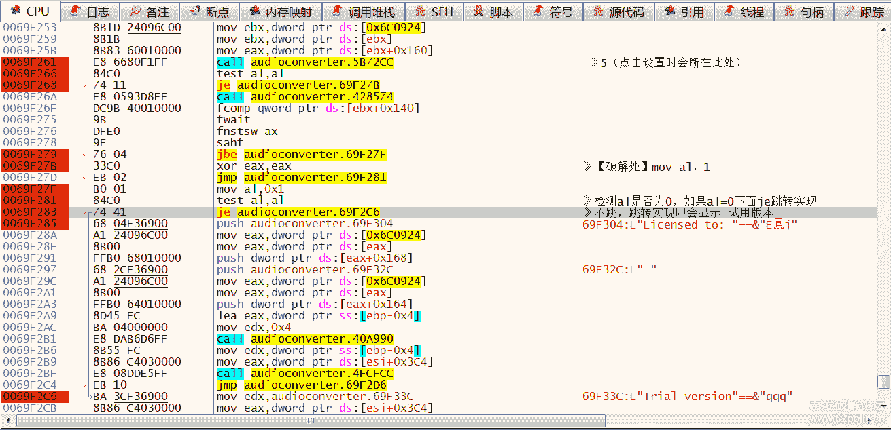

`3.png`（158.06 KB，下载次数：1）

[附件下载](https://www.52pojie.cn/forum.php?mod=attachment&aid=MjY2NjU2MHw0ZjU0YTI1M3wxNzkzNTcyNzg3fDE2ODA4NnwxODczNTU1&nothumb=yes)（2023-12-27 09:00 上传）

## 4、经上溯分析

关键`Call`为`0069F261 call audioconverter.5B72CC`，进入此`Call`分析，使返回的`EAX=1`

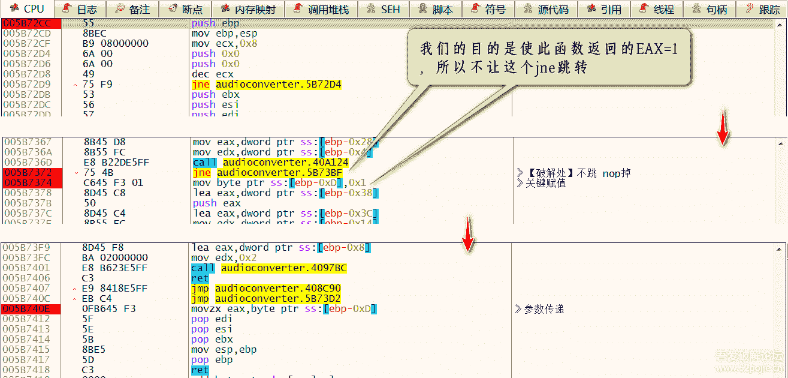

`4.png`（161.78 KB，下载次数：1）

[附件下载](https://www.52pojie.cn/forum.php?mod=attachment&aid=MjY2NjU2MXw5Nzg4ODA1M3wxNzkzNTcyNzg3fDE2ODA4NnwxODczNTU1&nothumb=yes)（2023-12-27 09:00 上传）

我们在代码段首`F2`下断并“`右键`——`查找引用`——`选定的地址`”，看看有几处调用，得到7处，在每一处下断，并按从上到下的顺序注释1、2、3、4、5、6、7（想想为什么要这样呢？）

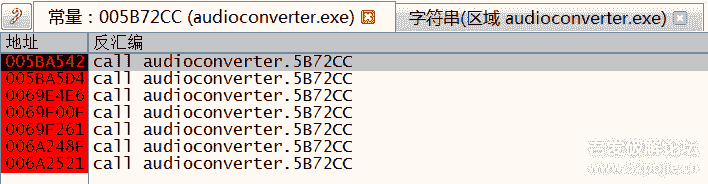

`5.png`（31.21 KB，下载次数：1）

[附件下载](https://www.52pojie.cn/forum.php?mod=attachment&aid=MjY2NjU2Mnw3ZjQ3OGRlMnwxNzkzNTcyNzg3fDE2ODA4NnwxODczNTU1&nothumb=yes)（2023-12-27 09:00 上传）

## 5、重新加载程序并断点

`Ctrl+F9`重新加载程序，`F9`运行，断在此处：

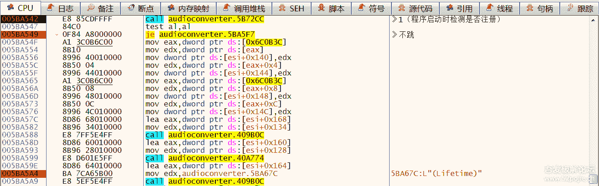

`6.png`（121.37 KB，下载次数：0）

[附件下载](https://www.52pojie.cn/forum.php?mod=attachment&aid=MjY2NjU2M3xmNzMzNTBjZXwxNzkzNTcyNzg3fDE2ODA4NnwxODczNTU1&nothumb=yes)（2023-12-27 09:00 上传）

接着运行，在【破解处-1】进行修改：

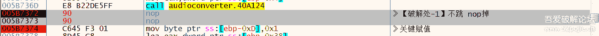

`7.png`（23.09 KB，下载次数：1）

[附件下载](https://www.52pojie.cn/forum.php?mod=attachment&aid=MjY2NjU2NHwwODZkMjIzM3wxNzkzNTcyNzg3fDE2ODA4NnwxODczNTU1&nothumb=yes)（2023-12-27 09:00 上传）

## 6、连续`F9`并修改设置

连续`F9`，出现程序界面，点击菜单中的`Action`下的`Settings`，程序断在此处：

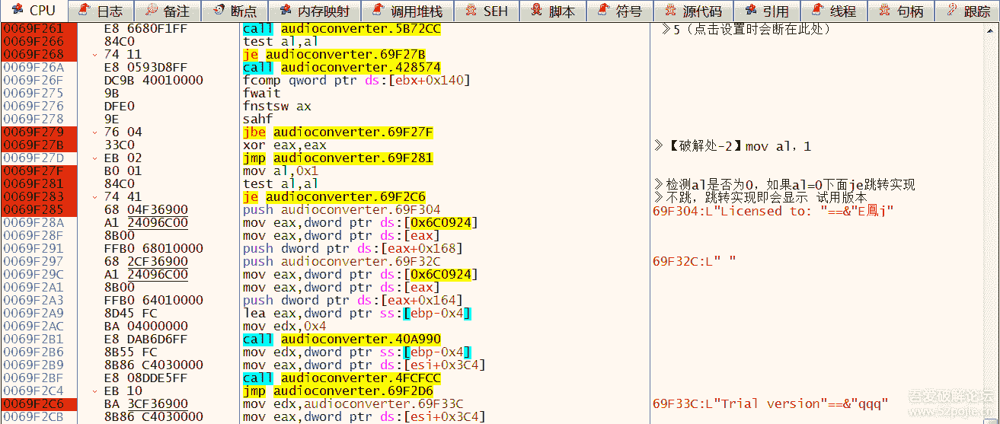

`8.png`（142.74 KB，下载次数：0）

[附件下载](https://www.52pojie.cn/forum.php?mod=attachment&aid=MjY2NjU2NXwyY2FmMDAzYXwxNzkzNTcyNzg3fDE2ODA4NnwxODczNTU1&nothumb=yes)（2023-12-27 09:00 上传）

`F8`运行，发现【破解处-2】，修改后继续`F9`运行，在点击`OK`之后，程序断在此处：

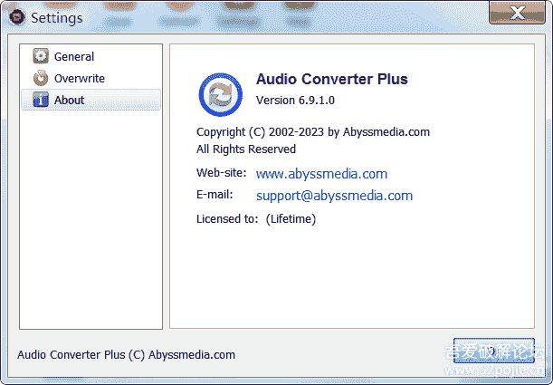

`9.png`（55.98 KB，下载次数：1）

[附件下载](https://www.52pojie.cn/forum.php?mod=attachment&aid=MjY2NjU2NnwzYmRkYzI5OXwxNzkzNTcyNzg3fDE2ODA4NnwxODczNTU1&nothumb=yes)（2023-12-27 09:00 上传）

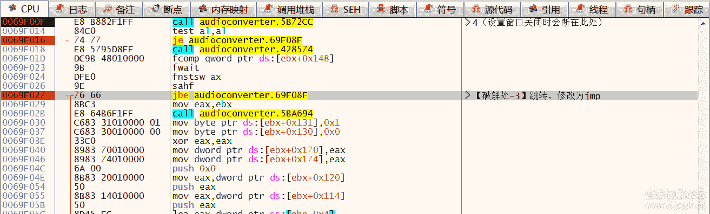

`10.png`（97.56 KB，下载次数：0）

[附件下载](https://www.52pojie.cn/forum.php?mod=attachment&aid=MjY2NjU2N3wwNDJiZDMzOHwxNzkzNTcyNzg3fDE2ODA4NnwxODczNTU1&nothumb=yes)（2023-12-27 09:00 上传）

## 7、转换音频文件

经分析发现【破解处-3】，修改后`F9`继续运行，打开一个音频文件进行转换，程序会断在此处：

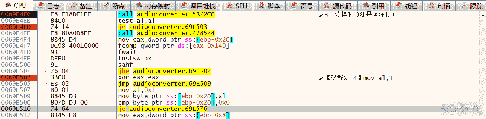

`11.png`（78.8 KB，下载次数：1）

[附件下载](https://www.52pojie.cn/forum.php?mod=attachment&aid=MjY2NjU2OHxkMzY1MmQ5ZXwxNzkzNTcyNzg3fDE2ODA4NnwxODczNTU1&nothumb=yes)（2023-12-27 09:00 上传）

经分析在【破解处-4】只有跳转后才能100%生成转换的文件：

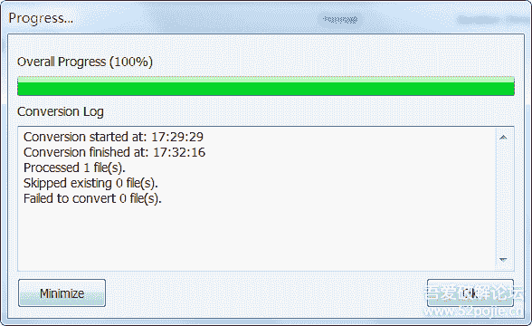

`12.png`（36.81 KB，下载次数：0）

[附件下载](https://www.52pojie.cn/forum.php?mod=attachment&aid=MjY2NjU2OXw5ODlmZGUxNHwxNzkzNTcyNzg3fDE2ODA4NnwxODczNTU1&nothumb=yes)（2023-12-27 09:00 上传）

## 8、处理完4处后与注册表信息

处理完4处后，程序转换功能已全部破解，但在“关于”处的授权信息不完善，需导入注册表一些信息，如下：（当然注册信息可以修改成你的，然后导入即可）

```
Windows Registry Editor Version 5.00

[HKEY_CURRENT_USER\Software\Abyssmedia\Audioconverter\Settings]

"user"="speedboy"

"bitrate"="1234567890
```

## 9、到此程序已经完美呈现在你的面前

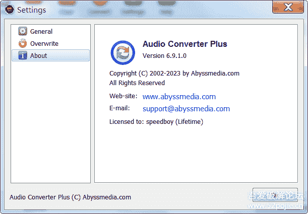

`13.png`（55.38 KB，下载次数：1）

[附件下载](https://www.52pojie.cn/forum.php?mod=attachment&aid=MjY2NjU3MHw3YzAzYjYwM3wxNzkzNTcyNzg3fDE2ODA4NnwxODczNTU1&nothumb=yes)（2023-12-27 09:00 上传）
