# [原创] 关于一个python程序的逆向

- 原帖：[https://www.52pojie.cn/forum.php?mod=viewthread&tid=1876958](https://www.52pojie.cn/forum.php?mod=viewthread&tid=1876958)
- 抓取时间：2026-11-01T22:39:33

## 前言

在站中也很多年了，可是没发过什么东西，想着总是白嫖也不是很好，而且自己对于软件安全方面也只是玩玩心态。正好看见站里面没有啥关于python程序的逆向分析，别给我说，python可以反编译成源码，只能说，有些程序是无法反编译为源码的形式，或者反编译不全。

就比如我接下来说的这程序，不说废话了，接下来开始吧。

## 判断是否为 Python 程序

为了社会稳定，这里不方便展示程序名称以及图标

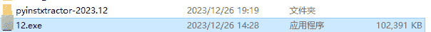

`image.png`（5.92 KB，下载次数：0）

2024-1-5 13:24 上传

这里可以看到这个程序很大，而且只有一个`exe`，这时候用`peid`查一下

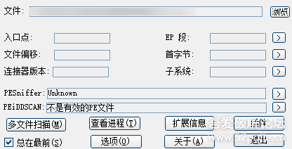

`image.png`（17.67 KB，下载次数：0）

2024-1-5 13:26 上传

这里由于用的`peid`版本太低了，查不到什么有用的东西，那么说一下，为什么能发现是python的程序呢

### python程序的几个特点

1. 在没有环境的电脑运行，首次启动的速度很慢，毕竟还要运行一个[//www.52pojie.cn/thread-661779-1-1.html](https://www.52pojie.cn/thread-661779-1-1.html)啊，肯定快不了
2. `exe`程序要被python虚拟机解包，那么接了放到哪里呢

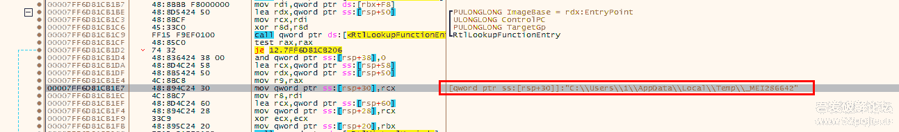

`image.png`（65.95 KB，下载次数：0）

2024-1-5 13:30 上传

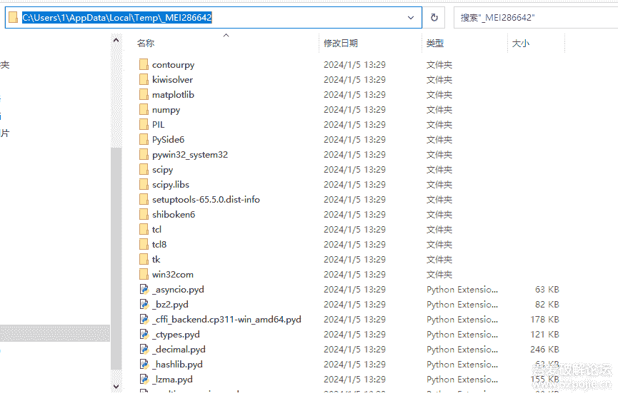

`image.png`（69.21 KB，下载次数：0）

2024-1-5 13:31 上传

这里可以很清楚的看见，这是python的打包文件，当然这里只有程序依赖，这就够了

是python程序，那么我们看到的那个`12.exe`肯定包含程序主体和虚拟机

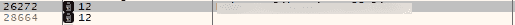

`image.png`（3.59 KB，下载次数：0）

2024-1-5 13:35 上传

使用`x64dbg`的附加就能很清楚的看见两个图标，没有标题的是python的虚拟机，附加那里啥都看不到

所以如果喜欢动态调试可以附加那个，这里由于是python这种有中间语言的高级语言，我一般不会想着动态调试，因为你动态调试写的补丁，有可能不会通用，当然只是追求破开的同学可以自己试试

## 解包与反编译

到了这里我们确定了程序的编程语言，现在开始解包

这里我用的是现成的解包脚本，当然都是公开的资料

`pyinstxtractor.py` 解包脚本是这个，具体使用去 github 上看下 `readme`，或者网上查查就行，毕竟已经公开了那么久了

解完包后，使用`pycdc`对`pyc`文件进行反编译，当然我这里肯定反编译不说全的，全的就不会有这篇文章了，一般来说python的内裤到这里，基本已经被拔干净了，肯定是防不住猛男的。

现在看下我是为啥说不行的呢

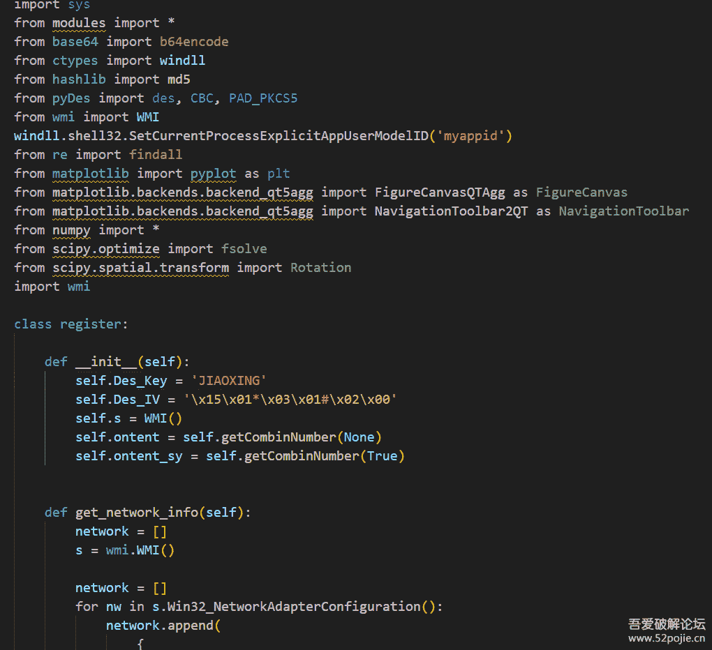

`image.png`（124.55 KB，下载次数：0）

2024-1-5 13:41 上传

这里是我反编译的结果，初看还不错，其实我已经将文件进行补全过了，其实反编译以后长这个样子

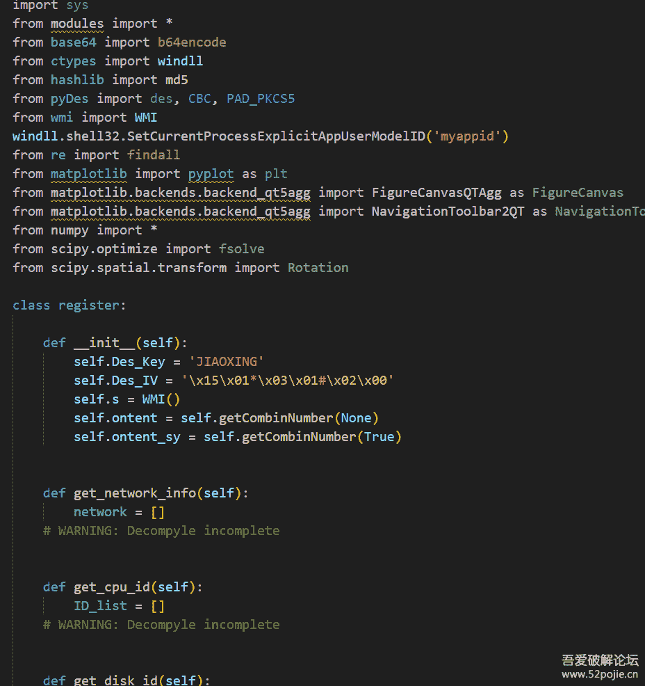

`image.png`（123.69 KB，下载次数：0）

2024-1-5 13:43 上传

底下就没了，所以我只能去看中间语言了，这个中间语言也分python版本。具体可以去这里看下`dis` --- Python 字节码反汇编器 — Python 3.12.1 文档

现在我只是为了能登陆即可，使用`pycda`进行转为python字节码

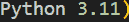

`image.png`（1.5 KB，下载次数：1）

2024-1-5 13:56 上传

可以看见，使用的是`python3.11`

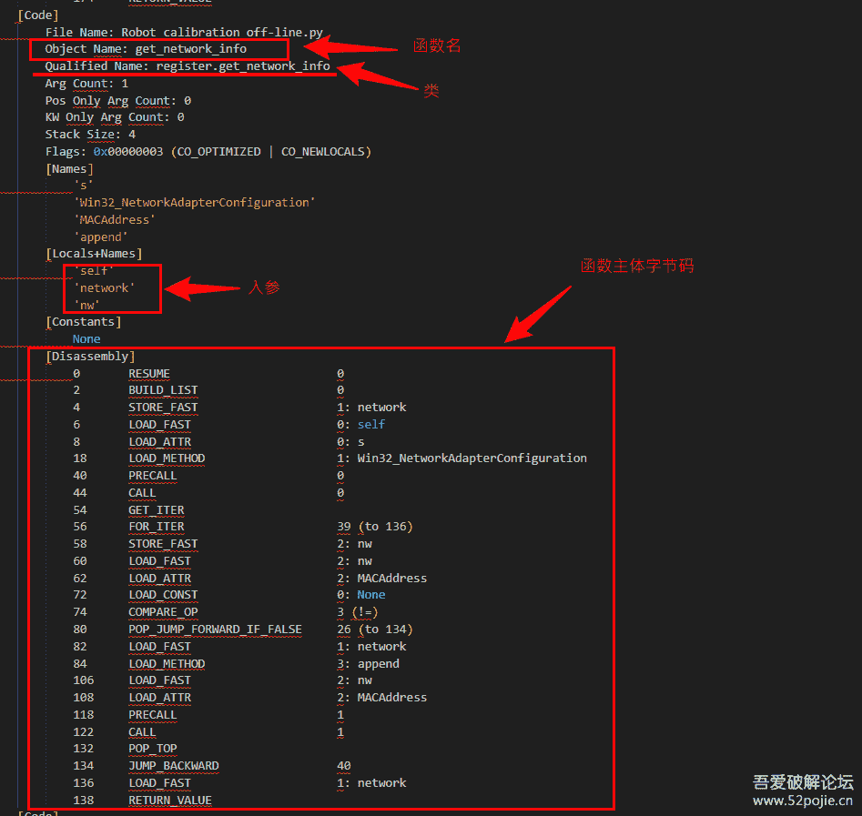

`image.png`（91.59 KB，下载次数：0）

2024-1-5 13:59 上传

## 定位验证逻辑

使用`pycda`反编译出来的，大概都是这个结构，那么我们开始找主要的

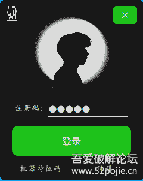

`image.png`（37.26 KB，下载次数：0）

2024-1-5 14:00 上传

这是程序主界面，那么就能分析出，肯定使用取`text`，python对应的搜索`text`

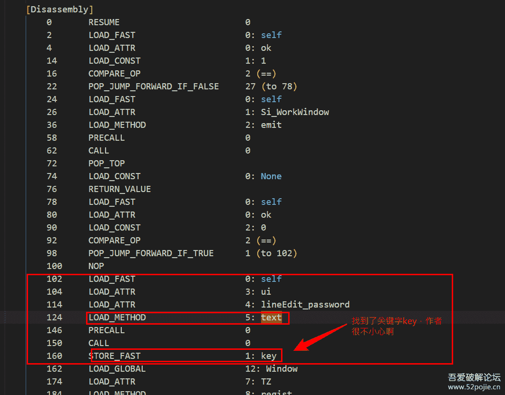

`image.png`（109.05 KB，下载次数：0）

2024-1-5 14:03 上传

继续往下跟

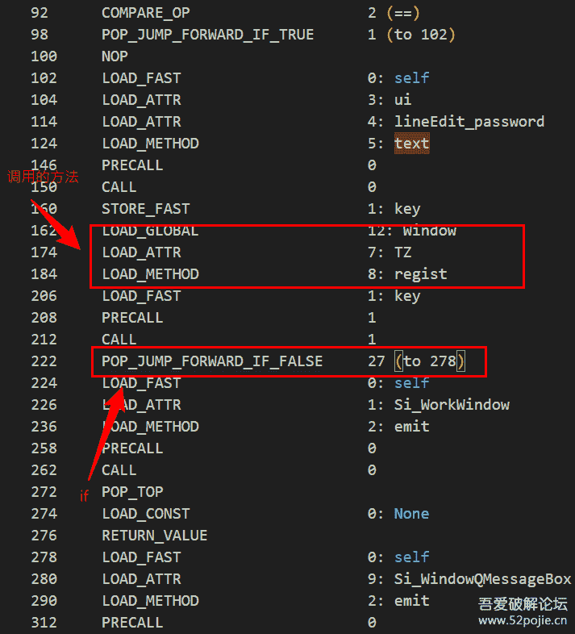

`image.png`（102.08 KB，下载次数：0）

2024-1-5 14:04 上传

接下来，找函数`regist`，

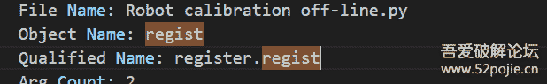

`image.png`（19.84 KB，下载次数：0）

2024-1-5 14:05 上传

找到了一个这个

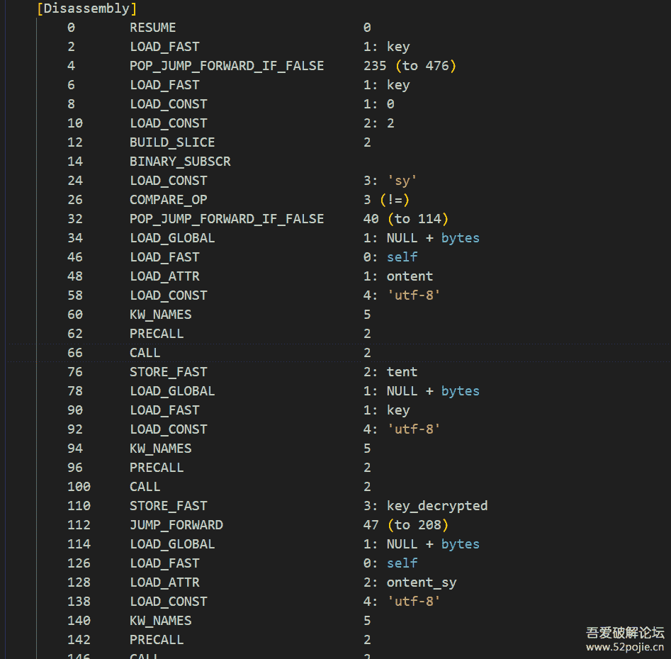

`image.png`（115.18 KB，下载次数：0）

2024-1-5 14:06 上传

这样一看差不多就是验证函数了，往下看发现可疑的地方，当然这个我分析过肯定有一下笔记

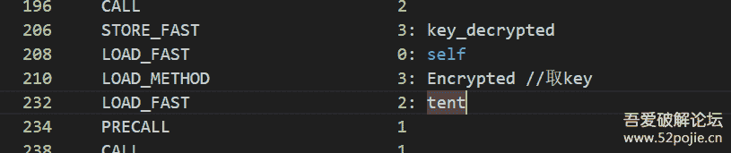

`image.png`（27.73 KB，下载次数：0）

2024-1-5 14:07 上传

## 分析关键函数

这里调用`Encrypted`函数，那么继续找这个函数

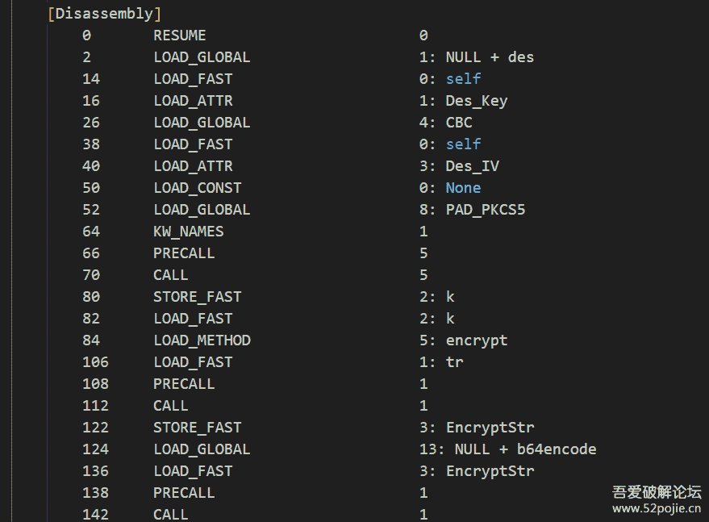

`image.png`（75.27 KB，下载次数：0）

2024-1-5 14:08 上传

找到这个关键的地方了，现在看下这个函数都干了什么

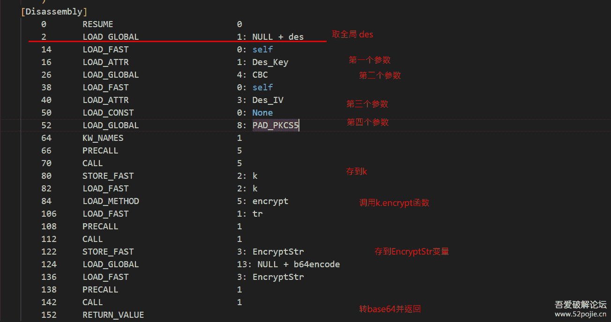

`image.png`（105.5 KB，下载次数：1）

2024-1-5 14:11 上传

这个函数分析完，那我们回到验证函数里面

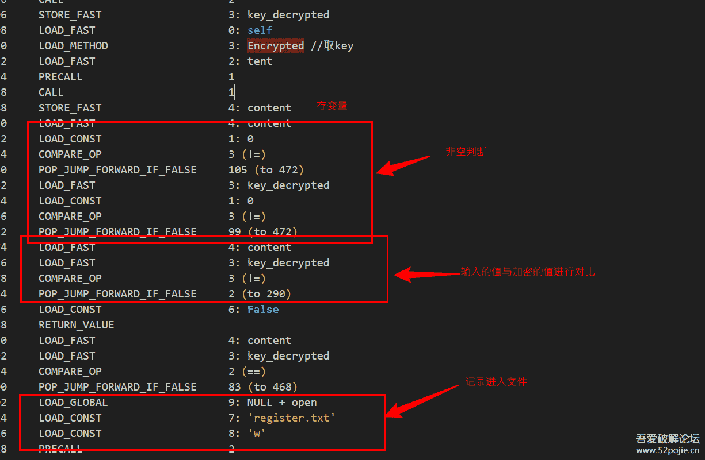

`image.png`（124.24 KB，下载次数：0）


`https://www.52pojie.cn/forum.php?mod=attachment&aid=MjY2ODEzMnw0ZWM2NzgzYnwxNzkzNTcyNzcxfDE2ODA4NnwxODc2OTU4&nothumb=yes`

2024-1-5 14:13 上传

那么看懂了字节码，我们直接开始写注册机脚本吧

## 注册机脚本

```python
from base64 import b64encode,b64decode
import binascii
from pyDes import des, CBC, PAD_PKCS5

class desSecret:
    def __init__(self):
        self.KEY = '八位密钥'  # 八位密钥
        self.IV='自定义偏移'
    # 加密
    def des_en(self, text):
        secret_key = self.KEY
        iv = self.IV
        k = des(secret_key, CBC, iv, None, PAD_PKCS5)
        data = k.encrypt(text)
        # data.进制返回文本字符串.解码字符串
        return b64encode(data)
input_text =bytes('4b1b637bce87932bcce8a2ff62a780fa','utf-8') 
DS = desSecret()

encode_str= DS.des_en(input_text)
#encode_str = DS.des_en(input_text)
print('注册码：', encode_str)
```

那我们看下脚本返回的注册码，是否可以打开吧

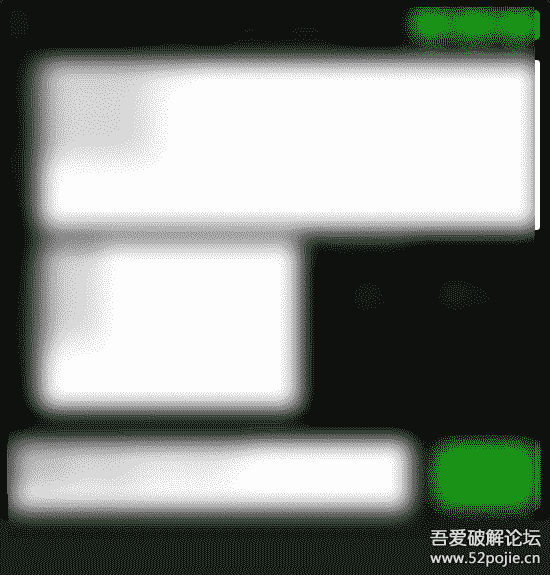

image.png (69.71 KB, 下载次数: 0)

`https://www.52pojie.cn/forum.php?mod=attachment&aid=MjY2ODEzNHwxZGE2MTAyMXwxNzkzNTcyNzcxfDE2ODA4NnwxODc2OTU4&nothumb=yes`

2024-1-5 14:16 上传

这里可以打开了啊，好了到这里`python`的字节码进行`https://www.52pojie.cn`就结束了

`python`字节码的破解在于能否读懂字节码，当然这些东西就和汇编一样，不会汇编你看个毛线的破解

那么祝52破解越来越好，各位吧友2024都能大展宏图
