# [Web逆向] 逆向系列-某翻译加密与解密过程

- 原帖：`https://www.52pojie.cn/forum.php?mod=viewthread&tid=1878501`
- 抓取时间：2026-11-01T22:39:30

## 逆向系列之某D翻译

案例仅作为学习使用

目标网站

`aHR0cHM6Ly9mYW55aS55b3VkYW8uY29tL2luZGV4Lmh0bWwjLw==`

### 分析数据包

首先打开开发者工具—>网络—>`XHR`

接下来在文本框中随意输入一个英语单词，看看会传递出一个什么数据包。

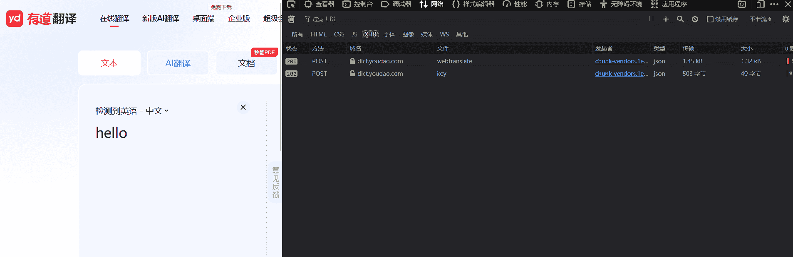

经过测试，输入一个单词之后会出现两个数据包，分别是`webtranslate`和`key`

> 注意：
>
> 这两个数据包的请求方式均为`post`

点开`webtranslate`，分析请求头有没有不寻常的值。

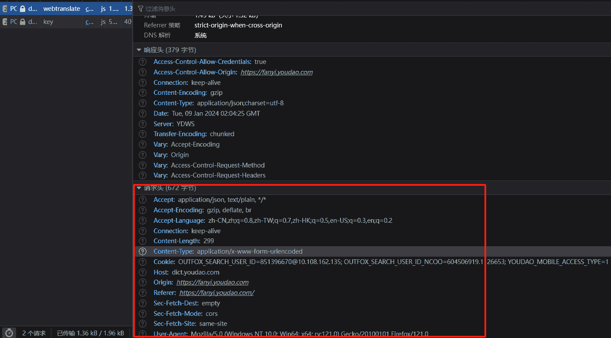

很正常。

接下来，分析请求参数

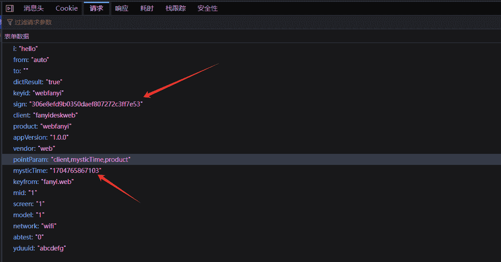

从上图可以看到，`i`为需要翻译的单词，`sign`值是头部加密，`mysticTime`值为当前时间的时间戳。

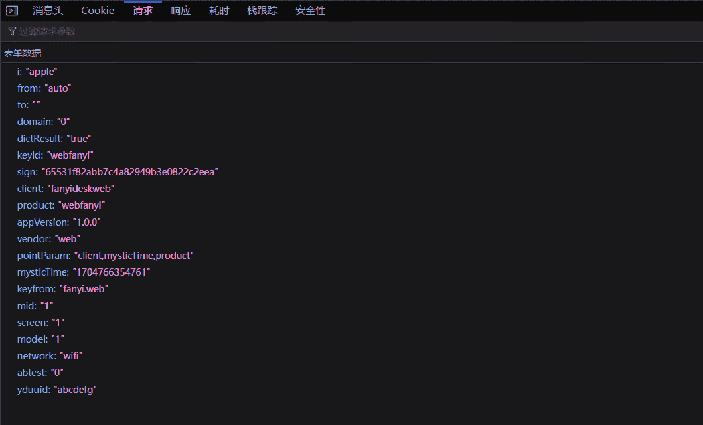

接下来再测试一个单词，发现变化的值只有`sign`和`mysticTime`。

### 调试数据

1、断点调试

`webtranslate`的URL为：`https://dict.youdao.com/webtranslate`

结合上一篇文章的思路，继续断点URL的路径。

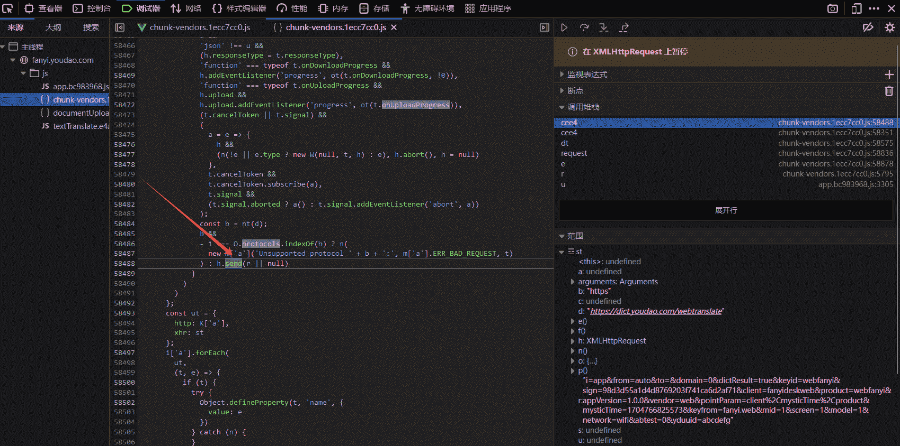

接下来点击左侧的调用堆栈，看看它是怎么样运行到这一步的。当然最重要的是找到数据包的URL在哪个程序。

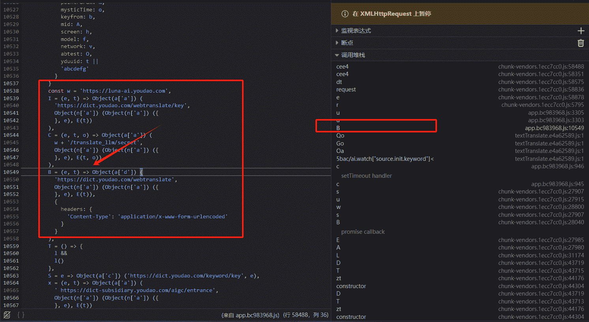

终于一个个往下走的时候找到了目标所在的位置，这是一个箭头函数。在这里JavaScript基础比较薄弱的同学，我为大家普及一下JavaScript的常用函数声明方式。

- 传统的调用方式

它以关键字`function`开头

```
function greet(name){
    return `hello, ${name}`
}

// 函数的调用
console.log(greet("Jack"))
```

- 函数表达式

它是把一个函数赋值给一个变量，这种创建函数的方式可以是匿名的也可也是命名的。

```
const sayGoodBye = function (name){

    return `GoodBye, ${name}`

}

console.log(sayGoodBye("Jack"))
```

- 箭头函数

ES6语法提供了更简洁的箭头函数

```
const sayHello = (name) => `hello ${name}`
console.log(sayHello("jack"))
```

箭头后面的是返回值

当然如果函数的内容比较复杂，依然可以使用花括号。

```
const sayHello = (name) => {

    return `hello ${name}`

}
```

接下来回到刚刚`js`中的代码，并把它拷贝下来

```
B = (e, t) => Object(a['d']) (
          'https://dict.youdao.com/webtranslate',
          Object(n['a']) (Object(n['a']) ({
          }, e), E(t)),
          {
            headers: {
              'Content-Type': 'application/x-www-form-urlencoded'
            }
          }
        )
```

稍微将上面的代码进行简单修改

```
const B = (e, t) => a.d(

    'https://dict.youdao.com/webtranslate',

    n(['a']) (n['a']) ({}, e), E(t),

     {

            headers: {

              'Content-Type': 'application/x-www-form-urlencoded'

            }

     }

)
```

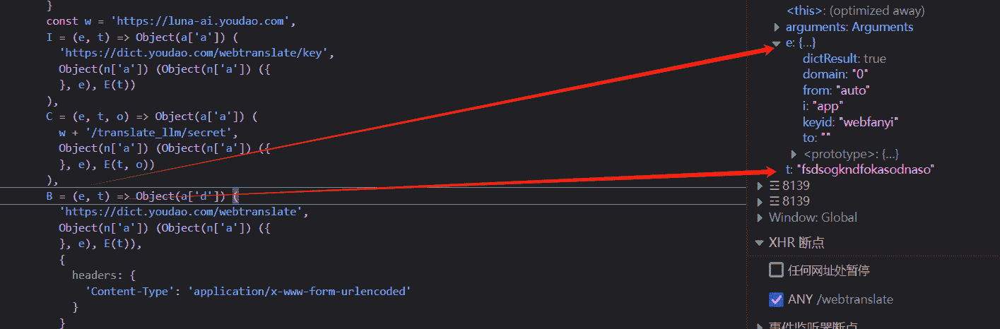

这个`B`函数，传递两个参数，分别是`t`和`e`

`t`值为：`"fsdsogkndfokasodnaso"`

`e`值为请求参数的一部分

```
Object { i: "app", from: "auto", to: "", domain: "0", dictResult: true, keyid: "webfanyi" }
```

另外它的返回值也是一个函数，那要看看里面的函数究竟做了什么，可以在这里打一个断点。

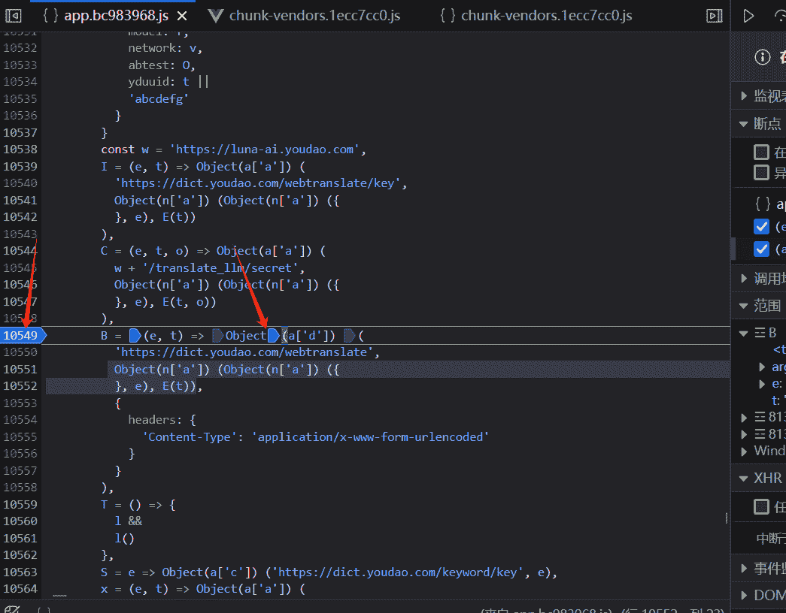

```
const B = (e, t) => a.d(

    'https://dict.youdao.com/webtranslate',

    n(['a']) (n['a']) ({}, e), E(t),

     {

            headers: {

              'Content-Type': 'application/x-www-form-urlencoded'

            }

     }

)
```

相当于我在`a.d`处打了一个断点，看看这个`a.d`主要做了什么事情。`a.d`一共传递了三个参数：

- `url`：`https://dict.youdao.com/webtranslate`
- 未知：`n(['a']) (n['a']) ({}, e), E(t)`
- `headers`：`'Content-Type': 'application/x-www-form-urlencoded'`

> 注意：`n(['a']) (n['a']) ({}, e)`和`E(t)`做了拼接

接下来在控制台中输出未知的参数，看看到底是一个什么

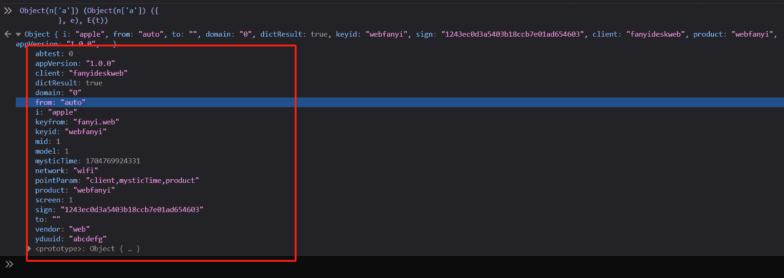

一种久违的熟悉感又回来了吧。这个不就是`webtranslate`的数据包的的请求参数的一部分吗？加上前面的`e`的参数就齐全了。

简单做个判断，应该是这个函数携带着三个参数向目标发起一个请求，获取到值。

接下来，分析`a.d`函数的逻辑，看看它里面的请求参数从哪里过来的。

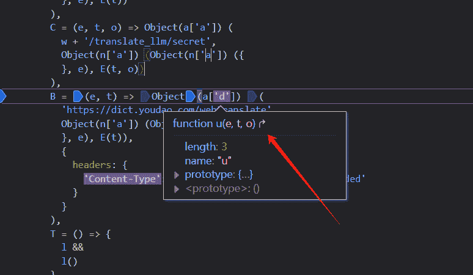

```
 function u(e, t, o) {
      return new Promise(
        (n, i) => {
          a['a'].post(e, t, o).then(e => {
            n(e.data)
          }).catch(e => {
            i(e)
          })
        }
      )
    }
```

这里声明了一个`Promise`函数，大致意思就是成功调用`n`函数处理；失败调用`i`函数处理。

接下来回到断点处，上面说到，第二个参数做了拼接。

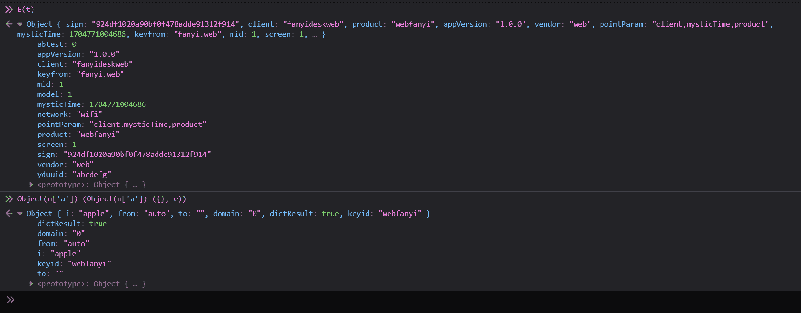

`E(t)`主要负责得到`sign`参数

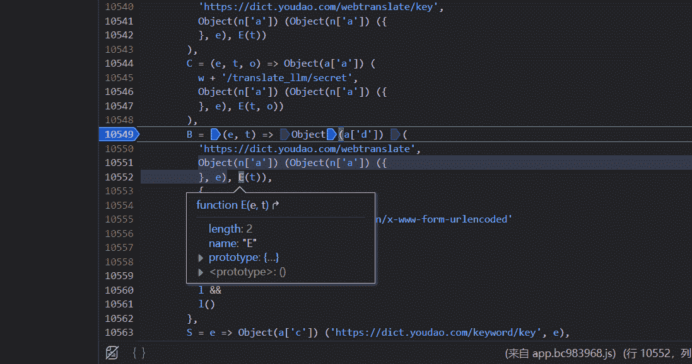

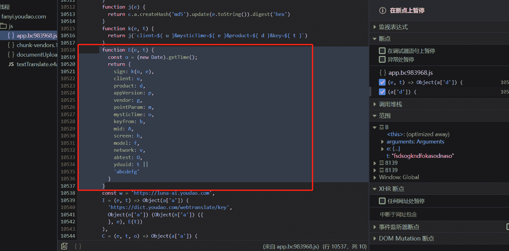

拨开云雾见月明

```
 function E(e, t) {

          const o = (new Date).getTime();

          return {

            sign: k(o, e),

            client: u,

            product: d,

            appVersion: p,

            vendor: g,

            pointParam: m,

            mysticTime: o,

            keyfrom: b,

            mid: A,

            screen: h,

            model: f,

            network: v,

            abtest: O,

            yduuid: t ||

            'abcdefg'

          }

        }
```

从上上面可以看到`sign`值是通过`k`函数获取得到的。

继续打个断点

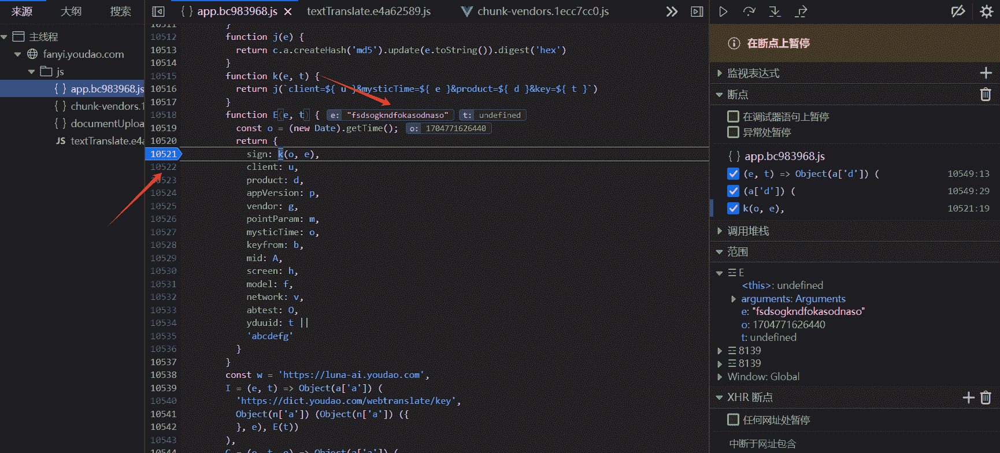

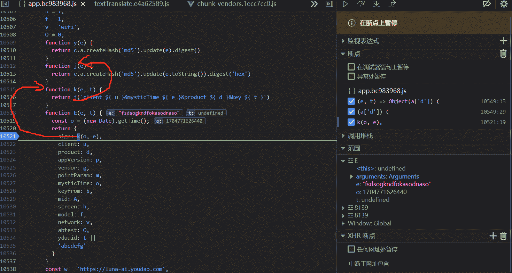

`E`函数里面传递了两个参数：

- `e`：`fsdsogkndfokasodnaso`
- `t`：`undefined`，不需要写实际是传递了一个参数

从上图不难发现，它的逻辑，`sign`通过调用`K`函数，`K`函数调用`j`函数

整体代码逻辑：

```
function j(e) {
          return c.a.createHash('md5').update(e.toString()).digest('hex')
        }
function k(e, t) {
    return j(`client=${ u }&mysticTime=${ e }&product=${ d }&key=${ t }`)
}
function E(e, t) {
    const o = (new Date).getTime();
    return {
        sign: k(o, e),
        client: u,
        product: d,
        appVersion: p,
        vendor: g,
        pointParam: m,
        mysticTime: o,
        keyfrom: b,
        mid: A,
        screen: h,
        model: f,
        network: v,
        abtest: O,
        yduuid: t ||
        'abcdefg'
    }
}

// 调用E函数
console.log(E("fsdsogkndfokasodnaso"))
```

执行上面的代码出现了如下错误：

```
ReferenceError: u is not defined
```

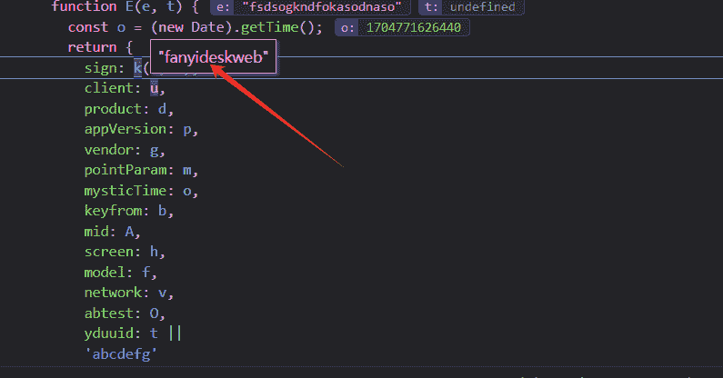

`u`值为：`fanyideskweb`

按`ctrl+F`进行搜索，看看它的值在哪里

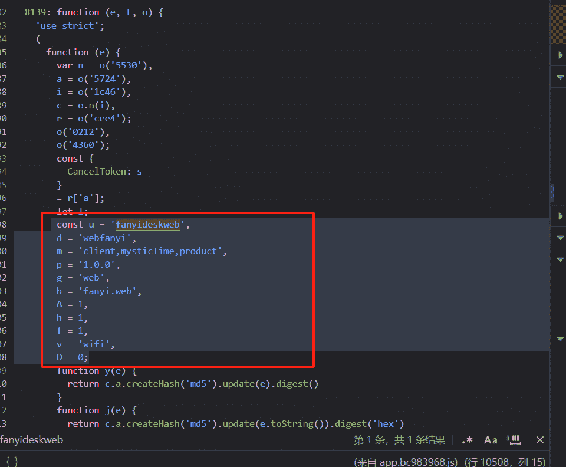

将上述`js`代码再进行修改一次

```
 const u = 'fanyideskweb',
        d = 'webfanyi',
        m = 'client,mysticTime,product',
        p = '1.0.0',
        g = 'web',
        b = 'fanyi.web',
        A = 1,
        h = 1,
        f = 1,
        v = 'wifi',
        O = 0;
function j(e) {
          return c.a.createHash('md5').update(e.toString()).digest('hex')
        }
function k(e, t) {
    return j(`client=${ u }&mysticTime=${ e }&product=${ d }&key=${ t }`)
}
function E(e, t) {
    const o = (new Date).getTime();
    return {
        sign: k(o, e),
        client: u,
        product: d,
        appVersion: p,
        vendor: g,
        pointParam: m,
        mysticTime: o,
        keyfrom: b,
        mid: A,
        screen: h,
        model: f,
        network: v,
        abtest: O,
        yduuid: t ||
        'abcdefg'
    }
}

console.log(E("fsdsogkndfokasodnaso"))
```

运行之后出现如下错误：

```
          return c.a.createHash('md5').update(e.toString()).digest('hex')

          ^

ReferenceError: c is not defined
```

这个是`node.js`独有的加密逻辑

```
const CryptJs = require("crypto")
const u = 'fanyideskweb',
        d = 'webfanyi',
        m = 'client,mysticTime,product',
        p = '1.0.0',
        g = 'web',
        b = 'fanyi.web',
        A = 1,
        h = 1,
        f = 1,
        v = 'wifi',
        O = 0;
function j(e) {
          return CryptJs.createHash('md5').update(e.toString()).digest('hex')
        }
function k(e, t) {
    return j(`client=${ u }&mysticTime=${ e }&product=${ d }&key=${ t }`)
}
function E(e, t) {
    const o = (new Date).getTime();
    return {
        sign: k(o, e),
        client: u,
        product: d,
        appVersion: p,
        vendor: g,
        pointParam: m,
        mysticTime: o,
        keyfrom: b,
        mid: A,
        screen: h,
        model: f,
        network: v,
        abtest: O,
        yduuid: t ||
        'abcdefg'
    }
}

console.log(E("fsdsogkndfokasodnaso"))
```

运行结果

```
{

  sign: '40b198684fe0d944ab0324a6cd54a403',

  client: 'fanyideskweb',

  product: 'webfanyi',

  appVersion: '1.0.0',

  vendor: 'web',

  pointParam: 'client,mysticTime,product',

  mysticTime: 1704772886214,

  keyfrom: 'fanyi.web',

  mid: 1,

  screen: 1,

  model: 1,

  network: 'wifi',

  abtest: 0,

  yduuid: 'abcdefg'

}
```

注意这个请求参数是不全的，因此不能忘记了还需要不全

最终JS代码


## 请求参数生成

```javascript
const CryptJs = require("crypto")
const u = 'fanyideskweb',
        d = 'webfanyi',
        m = 'client,mysticTime,product',
        p = '1.0.0',
        g = 'web',
        b = 'fanyi.web',
        A = 1,
        h = 1,
        f = 1,
        v = 'wifi'
        O = 0;
function j(e) {
          return CryptJs.createHash('md5').update(e.toString()).digest('hex')
        }
function k(e, t) {
    return j(`client=${ u }&mysticTime=${ e }&product=${ d }&key=${ t }`)
}
function E(word, t) {
    let e = "fsdsogkndfokasodnaso"
    const o = (new Date).getTime();
    return {
        sign: k(o, e),
        client: u,
        product: d,
        appVersion: p,
        vendor: g,
        pointParam: m,
        mysticTime: o,
        keyfrom: b,
        mid: A,
        screen: h,
        model: f,
        network: v,
        abtest: O,
        yduuid: t ||
        'abcdefg',
        i: word,
        from: "auto",
        to: "",
        domain: "0",
        dictResult: true,
        keyid: "webfanyi"
    }
}

// console.log(E("app"))
```

### Python 代码

```python
import requests
import execjs

headers = {
    'User-Agent': 'Mozilla/5.0 (Windows NT 10.0; Win64; x64; rv:121.0) Gecko/20100101 Firefox/121.0',
    'Referer': '',
    'Cookie': ''
}

url = 'https://dict.youdao.com/webtranslate'

with open('xzyoudao.js', 'r', encoding='utf8') as f:
    js = f.read()

data = execjs.compile(js).call('E', 'apple')

print(data)

response = requests.post(url, headers=headers, data=data)

print(response.text)
```

运行结果是一串加密数据

## 数据解密

```javascript
B = (e, t) => Object(a['d']) (
          'https://dict.youdao.com/webtranslate',
          Object(n['a']) (Object(n['a']) ({
          }, e), E(t)),
          {
            headers: {
              'Content-Type': 'application/x-www-form-urlencoded'
            }
          }
        )
```

刚刚有和大家分析过，这串代码的返回值是`Object(n['a']`，那么在这里继续打上断点。

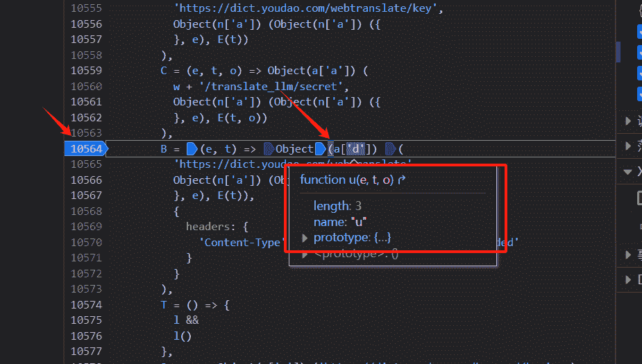

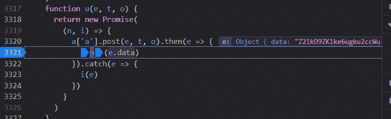

这个函数里面的`e.data`的值为

```text
"Z21kD9ZK1ke6ugku2ccWu-MeDWh3z252xRTQv-wZ6jd-f4VUaQOlThzHO02JcemZpYOzjRE7JK2Ol9PAth_lYO-ciiXQHRoDmiwMfUZ_6N8_yowUeIEJcbxPWJgY7dNYI4YyWpTc5DwB-Np7jdWB-O_x9nmNUoTP6Fyy1HVZWNTaxsHqw9N9NLEk3pek0iD_4LW7uWDilzVNEQ1jRbhDfcFCwPO40bM_pDjcYzkA4_AGiuoDWBMViRpVylnZ1cx3NXnZ6bJxX8wYgsKiDlfOj0ATQNdpDmuoo99ChkRcEgB8nhKHpxczVqfjl4L1ATBLIwgcllUGsTXtcIWwa24-AW81-c-C-iQ4rqNWYMo5J-AscCAl4JI_2OiAWdlfx5yFmRtLSepPBXGHa4-tww9pcM9rfE0vgz0Muf4SND5W_XNGv5NPKDiOf2prb-kQxX5pwE_DtuKVNhsws6acQC5NmGd3zm3njaj1ckG9egENVfzAYASvmQShnCLCkIyiFxAuK_n2AmgkMfYLuEcFgIsq-DNN4S0Z8NaKL3yqTTCmrNIrEImUqB4UfwgVm6CPa1Twt5LM6UjhgGUumThZswdKysm9sHoXLInlk5mICA1P8h2emAHO3VUxWS15U07mescRHF5e1gLoWnInX7QNROVBxslLHX6SCqKRUFEz3OA8OEmpIUwbmA6ej0E0vIlTEER5"
```

刚好这个就是加密数据。那么它是被哪个函数所执行的呢？也就是说要找到当前函数的上一层函数。

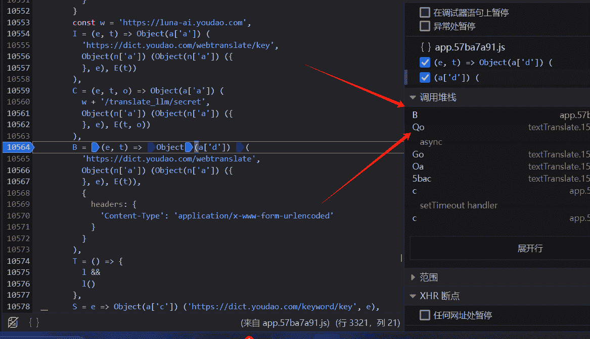

`B`指的是当前函数，而上一层函数是`Qo`

刚刚的函数主要是发起请求，然后获取返回值，获取到返回值后由`then`进行处理。

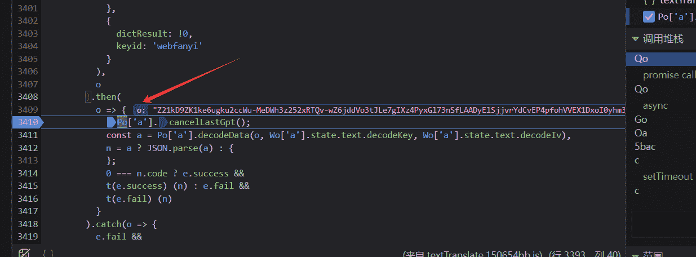

密文数据就是`o`

```javascript
o => {
            Po['a'].cancelLastGpt();
            const a = Po['a'].decodeData(o, Wo['a'].state.text.decodeKey, Wo['a'].state.text.decodeIv),
            n = a ? JSON.parse(a) : {
            };
            0 === n.code ? e.success &&
            t(e.success) (n) : e.fail &&
            t(e.fail) (n)
          }
```

不难看出，这里的函数`decodeData`传递了三个参数，分别是`o`（加密数据）、`decodeKey`(密钥)、`decodeIv`(偏移量)，很明显了这个就是解密函数

紧接着在控制台获取密钥和偏移量

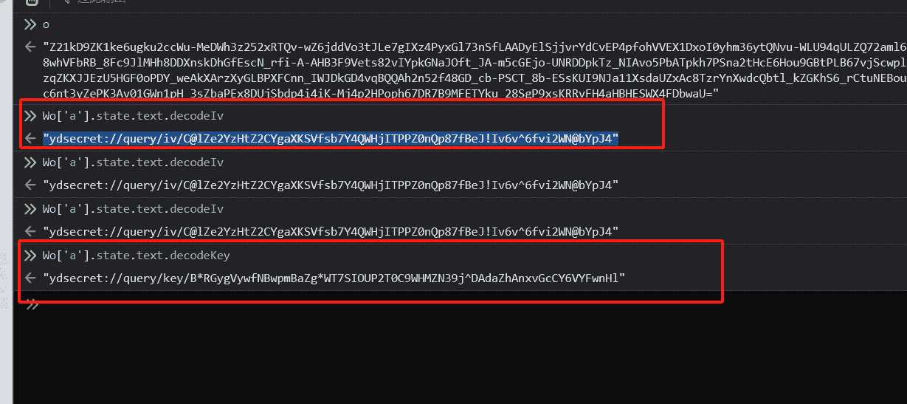

```javascript
function decodeData(){

    var decodeKey = "ydsecret://query/key/B*RGygVywfNBwpmBaZg*WT7SIOUP2T0C9WHMZN39j^DAdaZhAnxvGcCY6VYFwnHl";

    var decodeIv = "ydsecret://query/iv/C@lZe2YzHtZ2CYgaXKSVfsb7Y4QWHjITPPZ0nQp87fBeJ!Iv6v^6fvi2WN@bYpJ4";

}
```

接下来分析`decodeData`函数

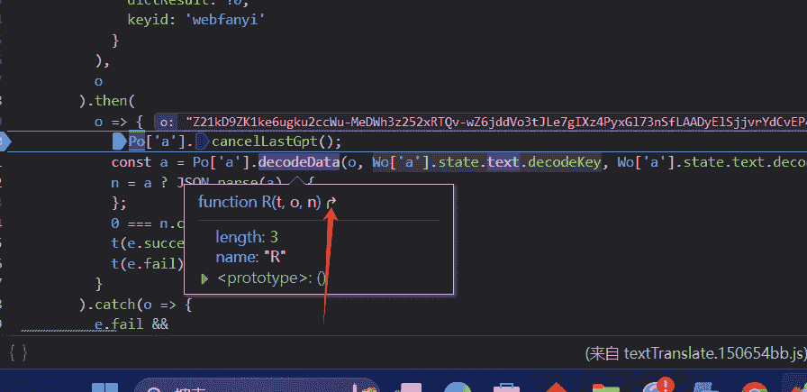

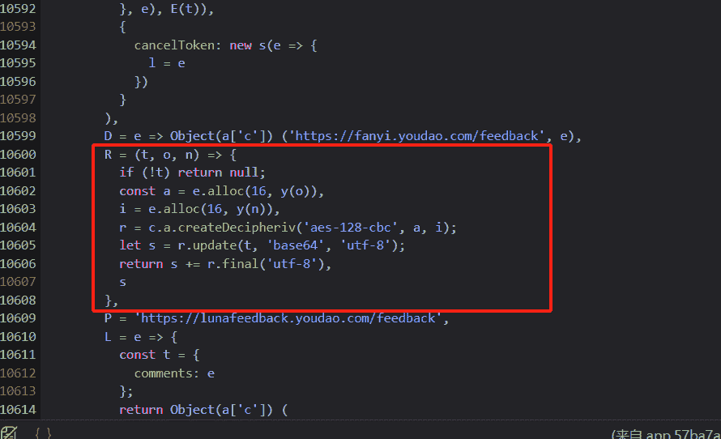

继续打个断点测试

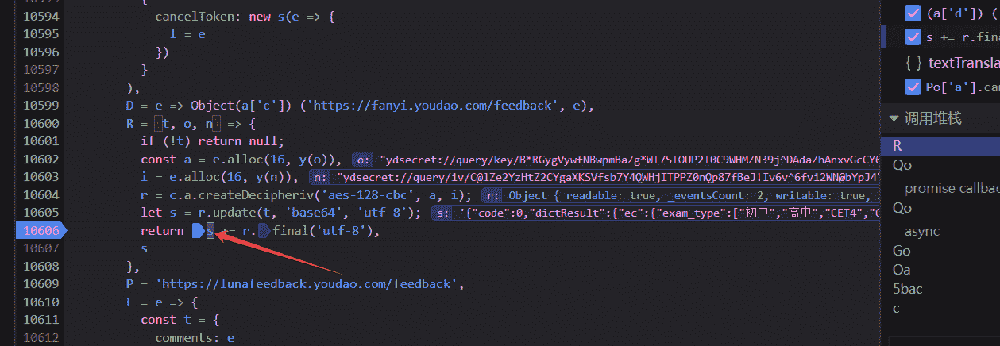

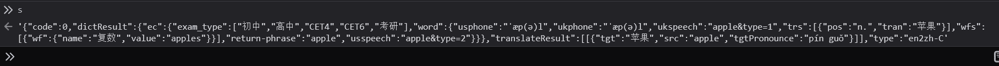

在控制台就可以看到`s`就是解密值

```javascript
// t:密文
function decodeData(t){
    var decodeKey = "ydsecret://query/key/B*RGygVywfNBwpmBaZg*WT7SIOUP2T0C9WHMZN39j^DAdaZhAnxvGcCY6VYFwnHl";
    var decodeIv = "ydsecret://query/iv/C@lZe2YzHtZ2CYgaXKSVfsb7Y4QWHjITPPZ0nQp87fBeJ!Iv6v^6fvi2WN@bYpJ4";
     if (!t) return null;
          const a = e.alloc(16, y(decodeKey)),
          i = e.alloc(16, y(decodeIv)),
          r = CryptJs.createDecipheriv('aes-128-cbc', a, i);
          let s = r.update(t, 'base64', 'utf-8');
          return s += r.final('utf-8'),
          s
}
```

紧接着继续分析

注意：

1. `alloc`是`node`下的`Buffer`模块下的
2. 在代码中还有一个`y`函数

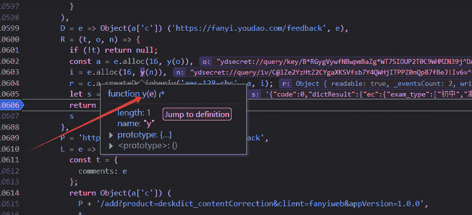

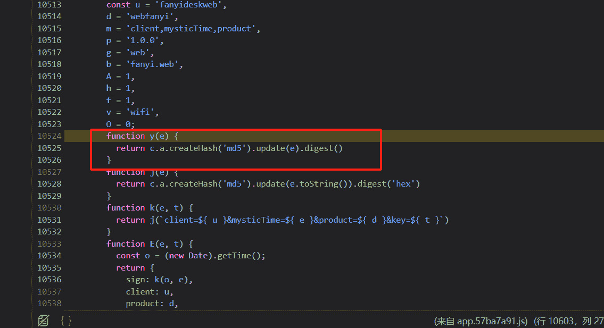

原来也是`md5`加密

### 最后的JS代码

```javascript
function y(e) {
          return CryptJs.createHash('md5').update(e).digest()
        }

function decodeData(t){
    var decodeKey = "ydsecret://query/key/B*RGygVywfNBwpmBaZg*WT7SIOUP2T0C9WHMZN39j^DAdaZhAnxvGcCY6VYFwnHl";
    var decodeIv = "ydsecret://query/iv/C@lZe2YzHtZ2CYgaXKSVfsb7Y4QWHjITPPZ0nQp87fBeJ!Iv6v^6fvi2WN@bYpJ4";
     if (!t) return null;
          const a = Buffer.alloc(16, y(decodeKey)),
          i = Buffer.alloc(16, y(decodeIv)),
          r = CryptJs.createDecipheriv('aes-128-cbc', a, i);
          let s = r.update(t, 'base64', 'utf-8');
          return s += r.final('utf-8'),
          s
}
```

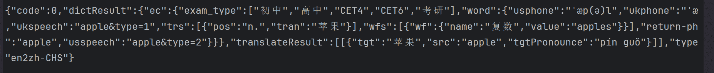

终于测试成功！

### 最后代码(Javascript)

```javascript
const CryptJs = require("crypto")
const u = 'fanyideskweb',
        d = 'webfanyi',
        m = 'client,mysticTime,product',
        p = '1.0.0',
        g = 'web',
        b = 'fanyi.web',
        A = 1,
        h = 1,
        f = 1,
        v = 'wifi'
        O = 0;
function j(e) {
          return CryptJs.createHash('md5').update(e.toString()).digest('hex')
        }
function k(e, t) {
    return j(`client=${ u }&mysticTime=${ e }&product=${ d }&key=${ t }`)
}
function y(e) {
          return CryptJs.createHash('md5').update(e).digest()
        }
function E(word, t) {
    let e = "fsdsogkndfokasodnaso"
    const o = (new Date).getTime();
    return {
        sign: k(o, e),
        client: u,
        product: d,
        appVersion: p,
        vendor: g,
        pointParam: m,
        mysticTime: o,
        keyfrom: b,
        mid: A,
        screen: h,
        model: f,
        network: v,
        abtest: O,
        yduuid: t ||
        'abcdefg',
        i: word,
        from: "auto",
        to: "",
        domain: "0",
        dictResult: true,
        keyid: "webfanyi"
    }
}

function decodeData(t){
    var decodeKey = "ydsecret://query/key/B*RGygVywfNBwpmBaZg*WT7SIOUP2T0C9WHMZN39j^DAdaZhAnxvGcCY6VYFwnHl";
    var decodeIv = "ydsecret://query/iv/C@lZe2YzHtZ2CYgaXKSVfsb7Y4QWHjITPPZ0nQp87fBeJ!Iv6v^6fvi2WN@bYpJ4";
     if (!t) return null;
          const a = Buffer.alloc(16, y(decodeKey)),
          i = Buffer.alloc(16, y(decodeIv)),
          r = CryptJs.createDecipheriv('aes-128-cbc', a, i);
          let s = r.update(t, 'base64', 'utf-8');
          return s += r.final('utf-8'),
          s
}
```

### Python 代码

```python
import requests
import execjs
import json

headers = {
    'User-Agent': 'Mozilla/5.0 (Windows NT 10.0; Win64; x64; rv:121.0) Gecko/20100101 Firefox/121.0',
    'Referer': '',
    'Cookie': ''
}

url = 'https://dict.youdao.com/webtranslate'

with open('xzyoudao.js', 'r', encoding='utf8') as f:
    js = f.read()

word = input('请输入你要翻译的单词：')

data = execjs.compile(js).call('E', word)

# print(data)

response = requests.post(url, headers=headers, data=data)

# 加密数据
encrypt_data = response.text

# # 解密数据
decrypt_data = json.loads(execjs.compile(js).call('decodeData', encrypt_data))

print(decrypt_data.get('dictResult').get('ec').get('word').get('trs')[0].get('tran'))
```


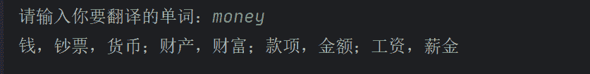
