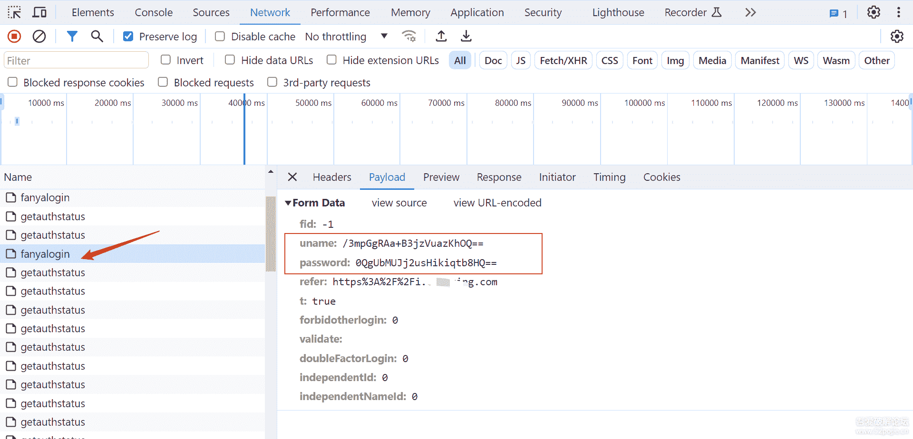
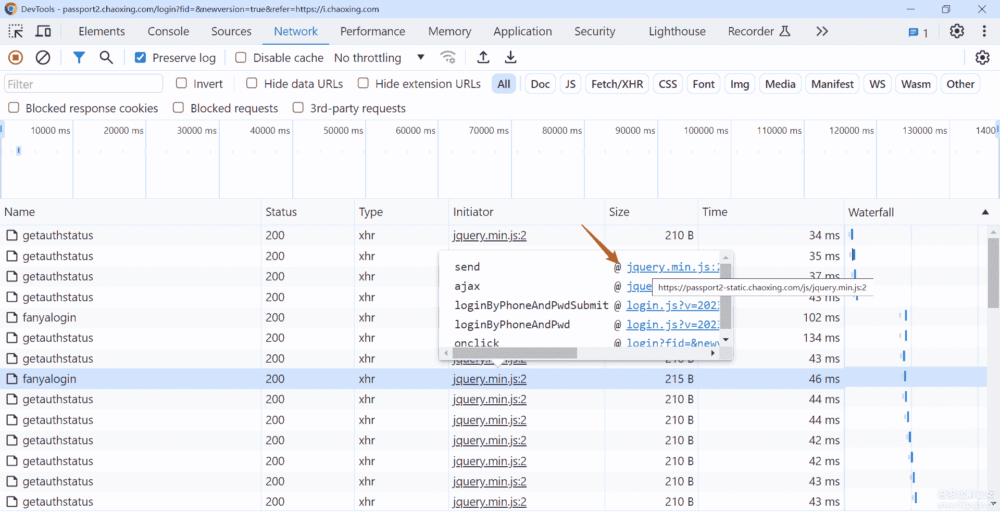
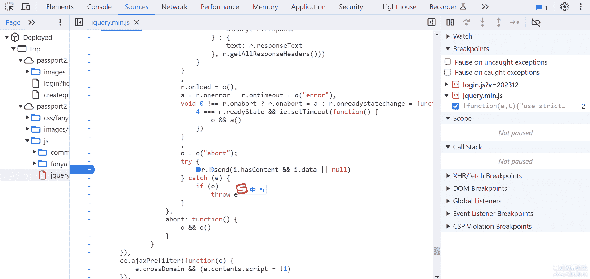
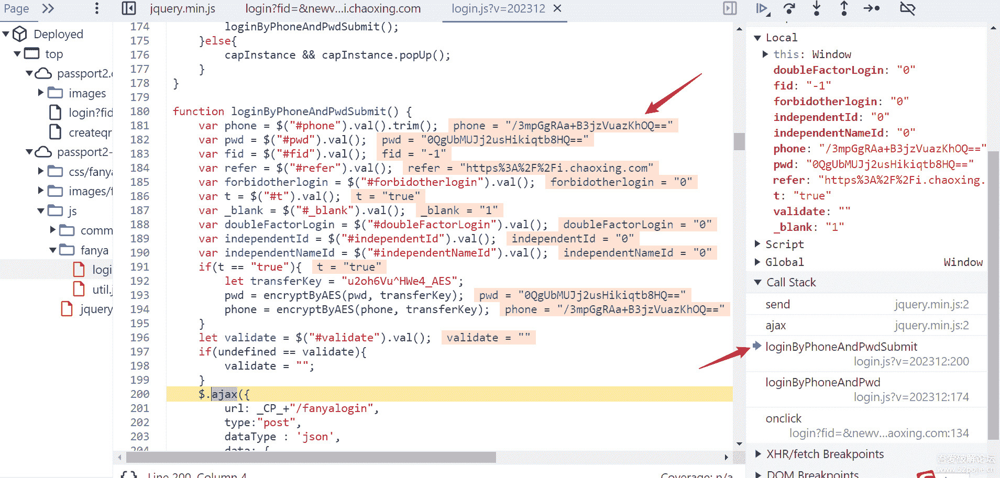
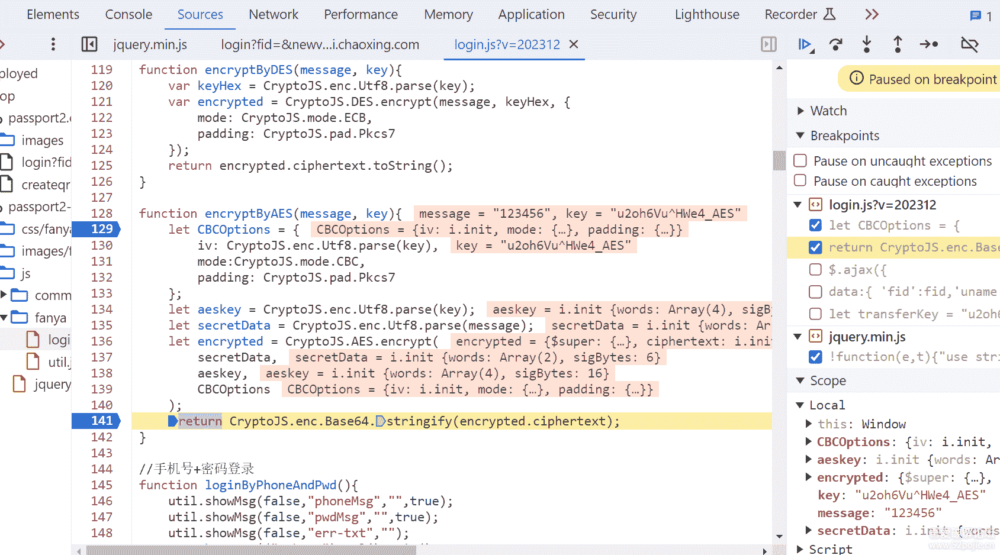
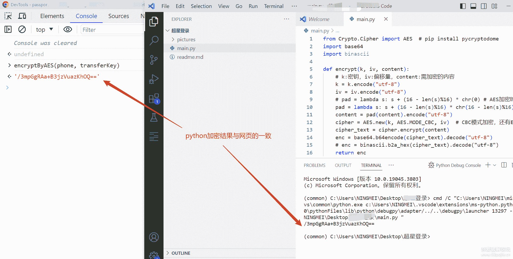

# [Web逆向] 某通登录

- 原帖: `https://www.52pojie.cn/forum.php?mod=viewthread&tid=1879925`
- 抓取时间: `2026-11-01T22:39:21`

## 某通登录

### 网站

```
aHR0cHM6Ly9wYXNzcG9ydDIuY2hhb3hpbmcuY29tL2xvZ2lu
```
base64

好久没有写文章了，今天带来一篇js逆向，加密算法是`AES`，网站没有混淆适合新手。

### 分析

F12打开抓包工具，访问登录页面点击登录，发现以下数据



image-20240112203424609.png (169.68 KB, 下载次数: 3)

[href="forum.php?mod=attachment&aid=MjY2OTgzMHwwM2Y0YTRkNXwxNzkzNTcyNzU5fDE2ODA4NnwxODc5OTI1&nothumb=yes" target="_blank"](https://www.52pojie.cn/forum.php?mod=attachment&aid=MjY2OTgzMHwwM2Y0YTRkNXwxNzkzNTcyNzU5fDE2ODA4NnwxODc5OTI1&nothumb=yes)

2024-1-12 20:58 上传

只需解决`uname`和`password`的加密方式，其他参数看起来都不太重要。



image-20240112203522284.png (229.31 KB, 下载次数: 4)

[href="forum.php?mod=attachment&aid=MjY2OTgzMXxmOWQ3MmM1ZnwxNzkzNTcyNzU5fDE2ODA4NnwxODc5OTI1&nothumb=yes" target="_blank"](https://www.52pojie.cn/forum.php?mod=attachment&aid=MjY2OTgzMXxmOWQ3MmM1ZnwxNzkzNTcyNzU5fDE2ODA4NnwxODc5OTI1&nothumb=yes)

2024-1-12 20:58 上传

打开调用栈随便打个断点，再次点击登录



image-20240112203558656.png (214.33 KB, 下载次数: 3)

[href="forum.php?mod=attachment&aid=MjY2OTgzMnxkNTZiMzdjMHwxNzkzNTcyNzU5fDE2ODA4NnwxODc5OTI1&nothumb=yes" target="_blank"](https://www.52pojie.cn/forum.php?mod=attachment&aid=MjY2OTgzMnxkNTZiMzdjMHwxNzkzNTcyNzU5fDE2ODA4NnwxODc5OTI1&nothumb=yes)

2024-1-12 20:59 上传

往前追两个调用栈，发现此处账号密码已经完成加密，并发现关键函数`encryptByAES`。



image-20240112203723512.png (401.52 KB, 下载次数: 2)

[href="forum.php?mod=attachment&aid=MjY2OTgzM3w5YjEwMjNjYnwxNzkzNTcyNzU5fDE2ODA4NnwxODc5OTI1&nothumb=yes" target="_blank"](https://www.52pojie.cn/forum.php?mod=attachment&aid=MjY2OTgzM3w5YjEwMjNjYnwxNzkzNTcyNzU5fDE2ODA4NnwxODc5OTI1&nothumb=yes)

2024-1-12 20:59 上传

进入到`encryptByAES`函数。



image-20240112204036304.png (404.54 KB, 下载次数: 2)

[href="forum.php?mod=attachment&aid=MjY2OTgzNHxlNmRmNGZkN3wxNzkzNTcyNzU5fDE2ODA4NnwxODc5OTI1&nothumb=yes" target="_blank"](https://www.52pojie.cn/forum.php?mod=attachment&aid=MjY2OTgzNHxlNmRmNGZkN3wxNzkzNTcyNzU5fDE2ODA4NnwxODc5OTI1&nothumb=yes)

2024-1-12 21:00 上传

以上是`AES`加密的参数

加密信息是`message`，模式`CBC`，密钥和`iv`都是 "u2oh6Vu^HWe4_AES"，填充模式`PKCS7`，都非常常规。

### 代码

```python
from Crypto.Cipher import AES  # pip install pycryptodome

import base64

import binascii

def encrypt(k, iv, content):
    # k:密钥，iv:偏移量，content:需加密的内容
    k = k.encode("utf-8")
    iv = iv.encode("utf-8")
    # pad = lambda s: s + (16 - len(s)%16) * chr(0) # AES加密时，明文长度需为16的倍数。这里的pad用来填充，chr(0)表示为ZeroPadding，在最后填充0直到长度为16的倍数
    pad = lambda s: s + (16 - len(s)%16) * chr(16 - len(s)%16) # 这里为Pkcs7填充
    content = pad(content).encode("utf-8")
    cipher = AES.new(k, AES.MODE_CBC, iv)  # CBC模式加密，还有ECB模式
    cipher_text = cipher.encrypt(content)
    enc = base64.b64encode(cipher_text).decode("utf-8")
    # enc = binascii.b2a_hex(cipher_text).decode("utf-8")
    return enc

k = "u2oh6Vu^HWe4_AES"
iv = "u2oh6Vu^HWe4_AES"
print(encrypt(k, iv, "13512341234"))
```



image-20240112205144100.png (229.58 KB, 下载次数: 1)

[href="forum.php?mod=attachment&aid=MjY2OTgzNXw0YjNmZGJkNHwxNzkzNTcyNzU5fDE2ODA4NnwxODc5OTI1&nothumb=yes" target="_blank"](https://www.52pojie.cn/forum.php?mod=attachment&aid=MjY2OTgzNXw0YjNmZGJkNHwxNzkzNTcyNzU5fDE2ODA4NnwxODc5OTI1&nothumb=yes)

2024-1-12 21:00 上传
