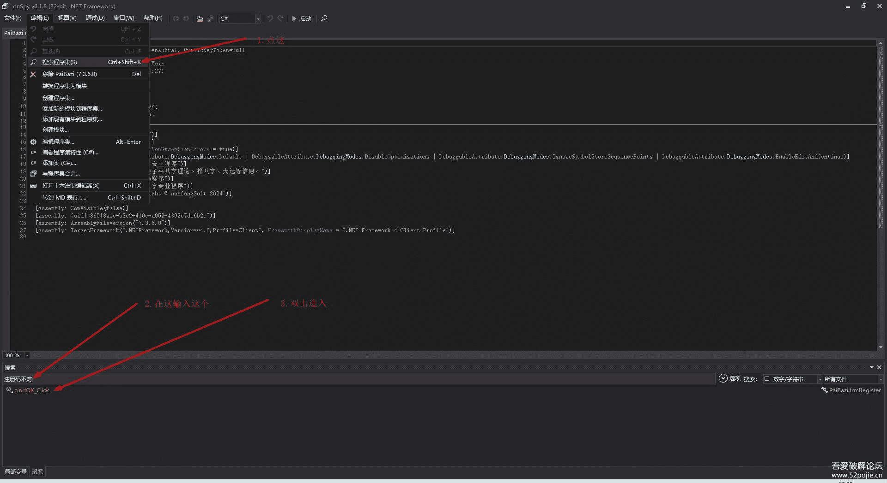
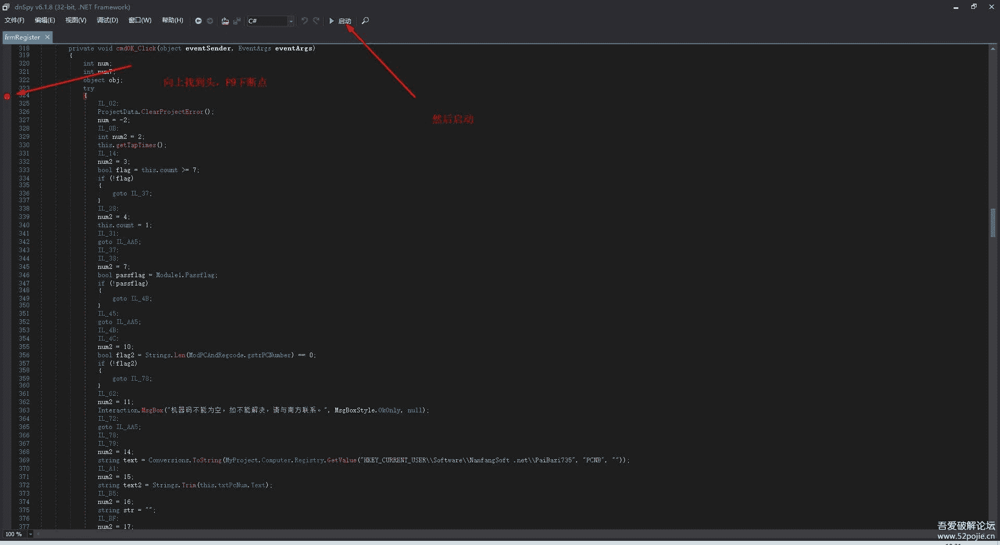
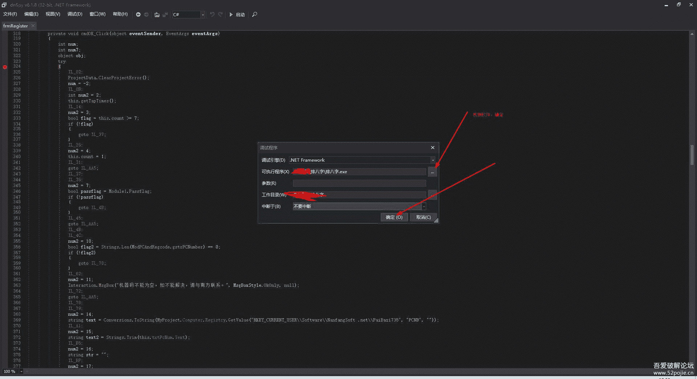
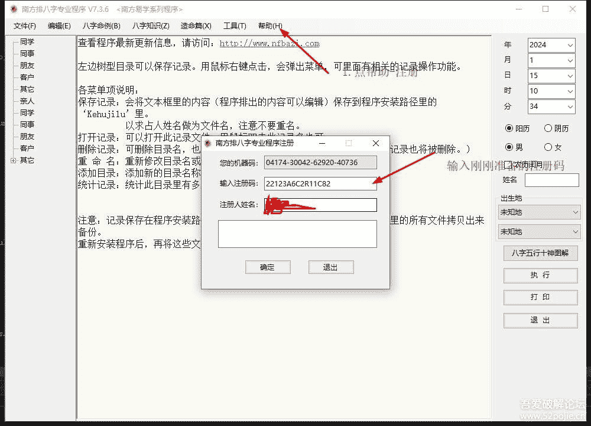
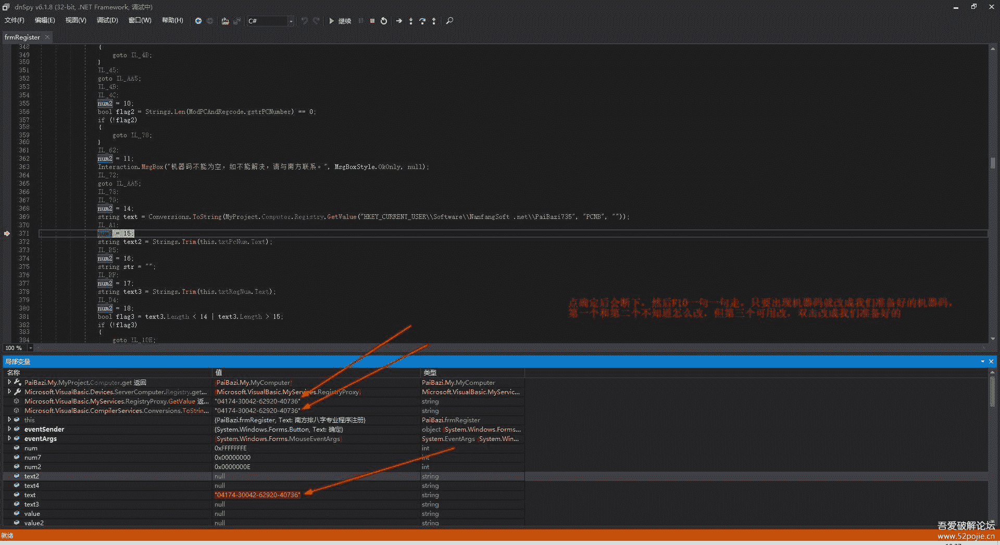
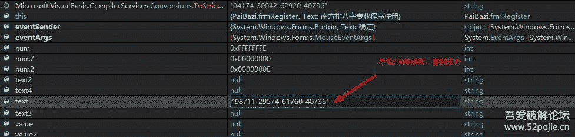
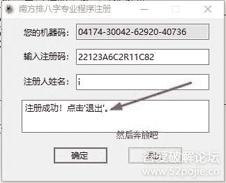
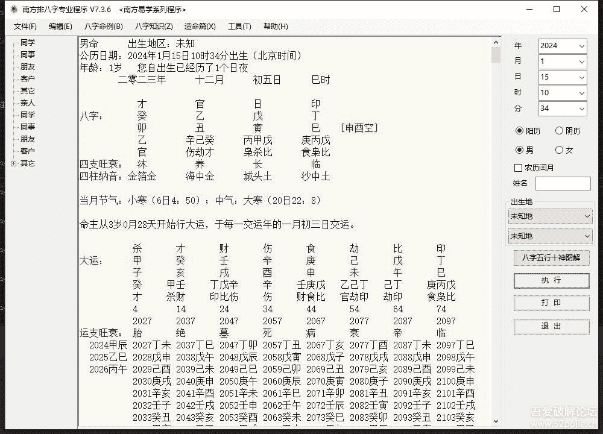

# [.NET逆向] 对某批八字软件的临时破解思路（小白篇）

- 原帖：<https://www.52pojie.cn/forum.php?mod=viewthread&tid=1880639>
- 抓取时间：2026-11-01T22:39:11

看到 @[//www.52pojie.cn/home.php?mod=space&uid=29588](https://www.52pojie.cn/home.php?mod=space&uid=29588) 大佬的 [//www.52pojie.cn/thread-1879683-1-1.html](https://www.52pojie.cn/thread-1879683-1-1.html) 帖子，心生膜拜，奈何能力有限，搞不懂什么叫反射调用，也不会 .net 和 C#，下了个 Visual Studio Code，代码放进去无法运行，使用 `dnSpy-x86` 改代码后报错，也没有系统学习过，又好奇想用一下，给自己算一卦，于是自己尝试，并取得成功，现在来分享一下思路。

## 一、准备部分

1. `dnSpy-x86` 爱盘有
2. 正确的注册号

感谢 [//www.52pojie.cn/home.php?mod=space&uid=261978](https://www.52pojie.cn/home.php?mod=space&uid=261978) 大佬分享的注册号 [//www.52pojie.cn/forum.php?mod=viewthread&tid=1875215&highlight=%C4%CF%B7%BD](https://www.52pojie.cn/forum.php?mod=viewthread&tid=1875215&highlight=%C4%CF%B7%BD)

可用机器码：`98711-29574-61760-40736`

注册码：`22123A6C2R11C82`

## 二、开始部分

打开 `dnSpy-x86`，加载“排八字”软件。

`1.jpg`（142.73 KB，下载次数：1；2024-1-15 10:43 上传）

`2.jpg`（129.36 KB，下载次数：1；2024-1-15 10:43 上传）

`3.jpg`（145.08 KB，下载次数：2；2024-1-15 10:43 上传）

`4.jpg`（122.28 KB，下载次数：2；2024-1-15 10:43 上传）

`5.jpg`（218.97 KB，下载次数：3；2024-1-15 10:43 上传）

`6.jpg`（52.38 KB，下载次数：1；2024-1-15 10:43 上传）

到出现注册码后就可以直接运行了。

`7.jpg`（20.1 KB，下载次数：2；2024-1-15 10:43 上传）

`8.jpg`（170.3 KB，下载次数：2；2024-1-15 10:43 上传）

亲测可用，关闭后无效，需要重新开始 [//www.52pojie.cn](https://www.52pojie.cn)。
