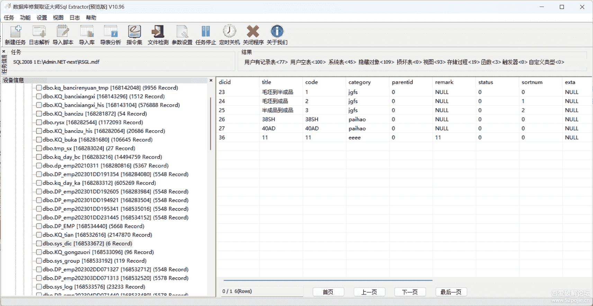
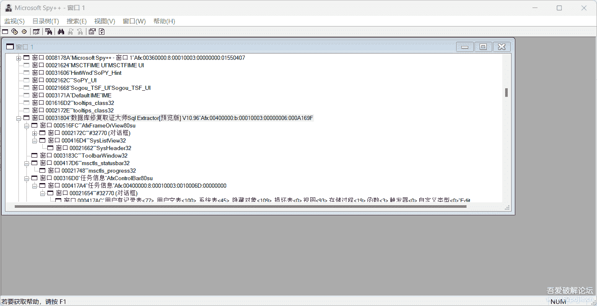
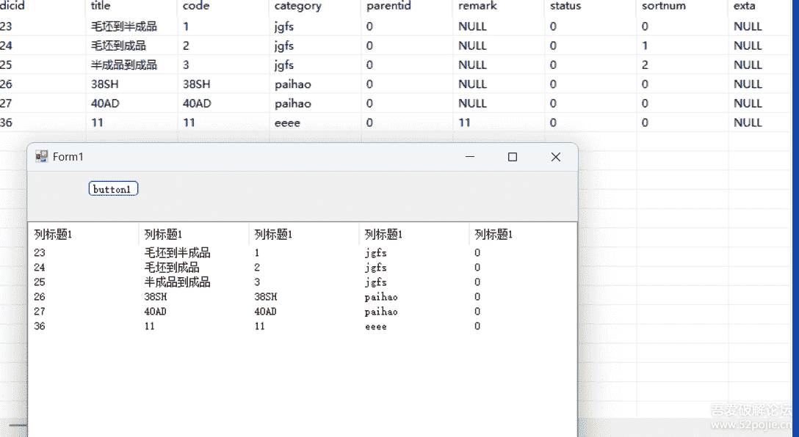

# [原创] 数据库修复解密大师预览版功能补全思路

- 原帖: https://www.52pojie.cn/forum.php?mod=viewthread&tid=1880839
- 抓取时间: 2026-11-01T22:39:07

论坛中有：数据库修复解密大师Sql Extractor V10.96下载 地址是：https://www.52pojie.cn/forum.php?mod=viewthread&tid=1855884&highlight=%CA%FD%BE%DD%BF%E2%D0%DE%B8%B4%BD%E2%C3%DC%B4%F3%CA%A6
预览版仅提供的数据预览功能，不支持数据复制，数据导出等功能（程序中没有该部分代码）。



因为程序是`MFC`开发的，采用读取数据列表方式读取数据，然后自己编写导出功能（仅提供思路）。

## 1. 采用 `spy++` 获取窗口句柄及类名



可以看到数据列表为类名 `SysListView32`

## 2. 编写程序获取列表中数据

关键代码如下：

```
//1、首先获取窗口句柄
HWND MMEWindow = FindWindow(NULL, L"数据库修复取证大师Sql Extractor[预览版] V10.96");
HWND MMEListView1 = FindWindowEx(MMEWindow, NULL, L"AfxFrameOrView80su", L"");

//2、通过父窗口句柄获取SysListView32控件的句柄
HWND MMEListView = FindWindowEx(MMEListView1, NULL, L"SysListView32", L"");

//3、获取SysListView32控件pid
DWORD MMEListViewPid;
GetWindowThreadProcessId(MMEListView, &MMEListViewPid);

//4、打开进程，返回进程句柄
HANDLE MMEListViewProcess = OpenProcess(PROCESS_ALL_ACCESS, false, MMEListViewPid);

//5、获取表格总的数量
int count = (int)SendMessage(MMEListView, LVM_GETITEMCOUNT, 0, 0); //使用int count = ListView_GetItemCount(hwnd);效果相同
cout
```



这样通过外挂方式实现了功能补全。
