# [分享] OLLVM混淆环境搭建与去平坦化

- 原帖: https://www.52pojie.cn/forum.php?mod=viewthread&tid=1880845
- 抓取时间: 2026-11-01T22:39:05

之前遇到了很多次 OLLVM 平坦化的题目，所以想学习一下，参照了很多前人的方法，特此记录一下。

## 环境

VMware 虚拟机，Ubuntu 20.04

## OLLVM 定义

LLVM（Low Level Virtual Machine）是一个开源的编译器基础架构，它包含了一组模块化、可重用的编译器和工具，支持多种编程语言和目标架构，包括 x86、ARM 和 MIPS 等。LLVM 的核心思想是将编译器分为前端和后端两个部分，前端负责将源代码转换为中间表示（IR），后端负责将中间表示转换为目标机器的汇编代码。这种设计使得 LLVM 可以支持多种编程语言，因为只需要为每种语言编写一个前端，就可以利用后端的通用性支持多种目标架构。

OLLVM（Obfuscator-LLVM）是瑞士西北应用科技大学安全实验室于 2010 年 6 月份发起的一个项目，这个项目的目标是提供一个 LLVM 编译套件的开源分支，能够通过代码混淆和防篡改，所使用的编译器是 `clang`。

## 搭建 OLLVM 环境

### 下载 OLLVM 源码

OLLVM GitHub 仓库：

https://github.com/obfuscator-llvm/obfuscator

git 下载 OLLVM 源码：

```
git clone -b llvm-4.0 --depth=1 https://github.com/obfuscator-llvm/obfuscator.git
```

### 配置编译工具

配置 `cmake`、`gcc`、`g++`。

安装 `cmake`。可以去官网下载 https://cmake.org/download/ 或者直接使用 `sudo` 安装：

```
sudo apt install cmake
```

安装 `gcc-8`、`g++-8` 降低版本。查看 `gcc` 和 `g++` 版本，若为 9 则要降低版本。

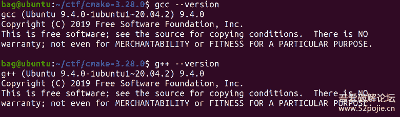

安装 `gcc-8` 和 `g++-8`：

```
sudo apt-get install gcc-8 g++-8 -y
```

配置软件的优先级，可以根据需要去选择默认的版本：

```
sudo update-alternatives --install /usr/bin/gcc gcc /usr/bin/gcc-8 8
sudo update-alternatives --install /usr/bin/g++ g++ /usr/bin/g++-8 8
sudo update-alternatives --install /usr/bin/gcc gcc /usr/bin/gcc-9 9
sudo update-alternatives --install /usr/bin/g++ g++ /usr/bin/g++-9 9
```

### 切换 gcc 和 g++ 版本

默认 `gcc` 8：

```
sudo update-alternatives --config gcc
```

输入选择版本的数字。

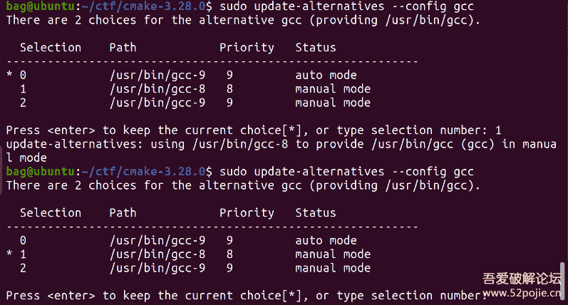

默认 `g++` 8：

```
sudo update-alternatives --config g++
```

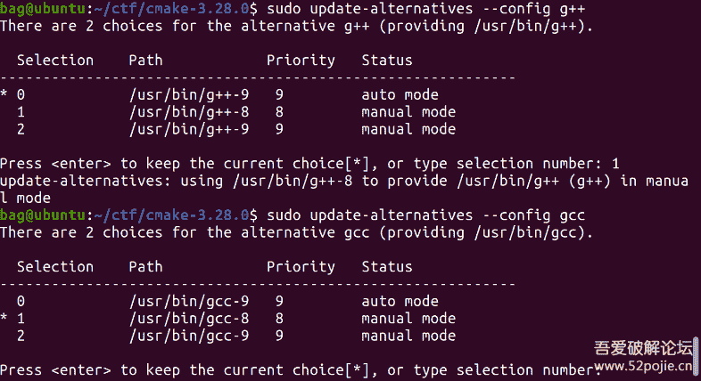

### 修改 OLLVM 源码

进入 `ollvm目录/include/llvm/ExecutionEngine/Orc/OrcRemoteTargetClient.h`，定位到第 690 行，把 `char` 改成 `uint8_t`。

在 `config.guess` 文件中存在一些 DOS 行结尾（DOS line endings），需要将其转换为 Unix 行结尾：

```
sudo apt-get install dos2unix
dos2unix obfuscator/cmake/config.guess
```

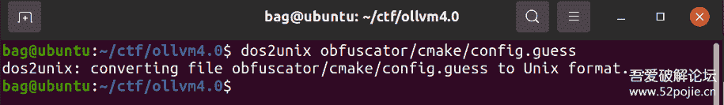

### 编译 OLLVM

```
mkdir build
cd build
cmake -DCMAKE_BUILD_TYPE=Release -DLLVM_INCLUDE_TESTS=OFF ../obfuscator/
```

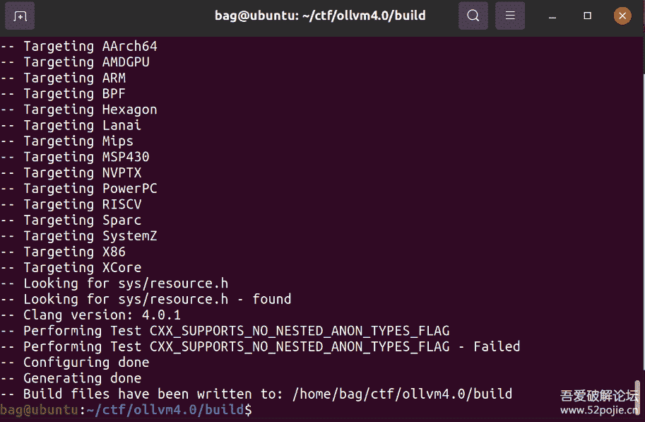

```
make -j4
```

这个过程会很久。

```
[ 97%] Built target llvm-objdump
[ 97%] Linking CXX executable ../../bin/llvm-mc
[ 97%] Built target llvm-mc
[ 97%] Linking CXX executable ../../bin/llvm-dwp
[ 97%] Linking CXX executable ../../bin/llvm-lto2
[ 97%] Built target llvm-dwp
[ 97%] Built target llvm-lto2
make: *** [Makefile:152: all] Error 2
```

可能是环境配置出了问题，编译到 97% 时就停止了，几个主要的 `clang` 文件都没编译成功。试了好几次都卡在这个。

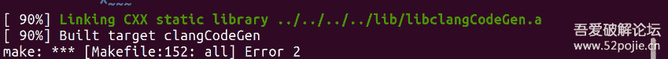

查阅资料，猜测是 swap 区空间不够，增加 swap 区空间为 4g，扩大虚拟机容量为 60g。如果卡住了，不要慌，不要删，继续 `make -j`。

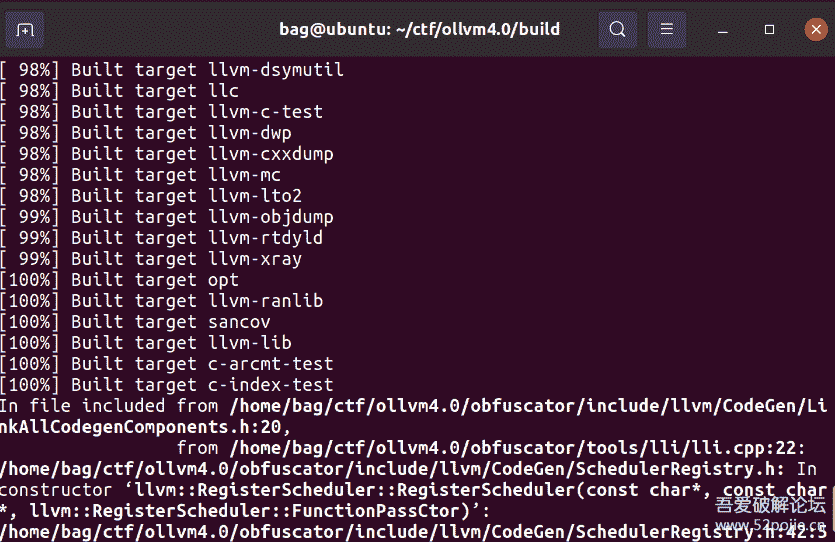

### 混淆

两种方法，一种是配置 NDK 环境混淆，另一种是直接将 `clang` 作为程序进行混淆。推荐第二种，第一种无法控制混淆的方法。注意，混淆时一定要采用 `gcc8` 和 `g++8`，9 以上的环境会混淆失败。

### 配置 NDK 环境

执行命令，打开配置文件：

```
gedit ~/.bashrc
```

把下面这两行粘贴到文件末尾，注意替换路径成自己下载的 NDK 路径：

```
export NDK_HOME=/home/bag/android/android-ndk-r16b/
export PATH=$NDK_HOME:$PATH
```

最后执行命令，使配置文件生效：

```
source ~/.bashrc
```

复制编译好的 4 个 `clang` 文件到 NDK 目录：`clang`、`clang++`、`clang-4.0`、`clang-format`，粘贴到 NDK 目录：

`ndk目录/toolchains/llvm/prebuilt/linux-x86_64/bin`

复制 build 目录的 3 个头文件到 NDK 目录：

```
fatal error 'Stddef.h' file not found
fatal error 'Stdarg.h' file not found
fatal error '__stddef_max_align_t.h' file not found
```

到 `android-ndk-r16b/sources/cxx-stl/system/include`

新建 `jni` 文件夹（名字改了的话在对应的配置文件得该指定路径方式）。在文件夹中新建 `Android.mk`、`Application.mk`、`try.cpp`。

`Android.mk`：

```
LOCAL_PATH := $(call my-dir)

include $(CLEAR_VARS)

LOCAL_MODULE := bag
LOCAL_SRC_FILES := try.cpp

include $(BUILD_EXECUTABLE)
```

`Application.mk`：

```
APP_ABI := armeabi-v7a arm64-v8a

APP_PIE := true

APP_CPPFLAGS := -frtti -std=c++11 -mllvm -fla -mllvm -bcf -mllvm -sub
```

`try.cpp`：

```
#include <stdio.h>
int main()
{
  int d;
  scanf("%d",&d);
  if(d==1)printf("d = 1");
  else if(d==2)printf("d = 2");
  else printf("not 1 or 2");
  return 0;
}
```

在 `jni` 的上级路径，输入 `ndk-build`：

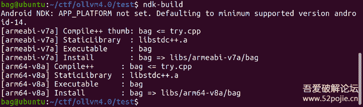

成功了！

混淆后的文件在 `libs` 内：

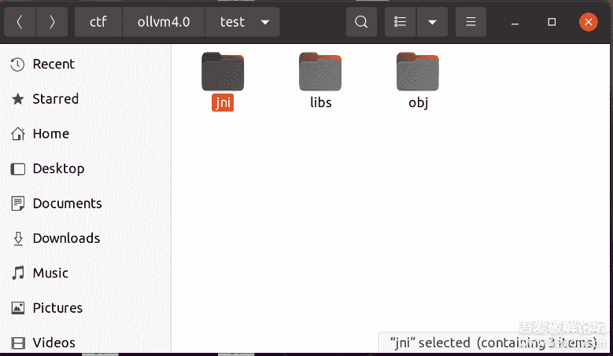

在 `ida` 中查看混淆效果：

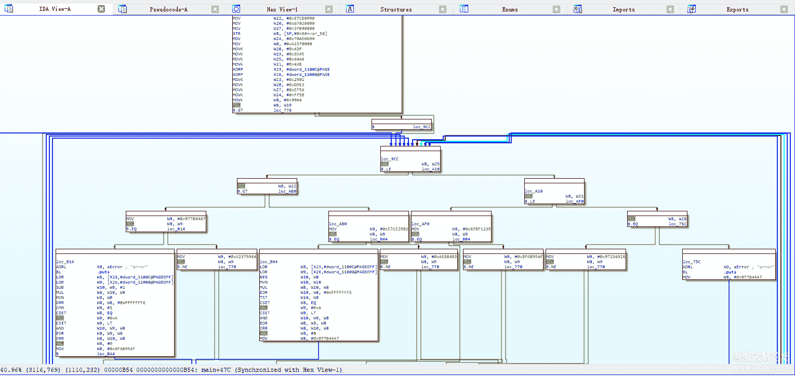

### clang 混淆

这里对源文件进行平坦化混淆处理。来到 `build/bin` 目录下，将待混淆的源文件放在该目录下。命令格式为：

```
./clang -mllvm -fla 源文件 -o 目标文件
```


```
./clang -mllvm -fla try.cpp -o try
```

成功生成混淆后的文件，用`ida`查看效果

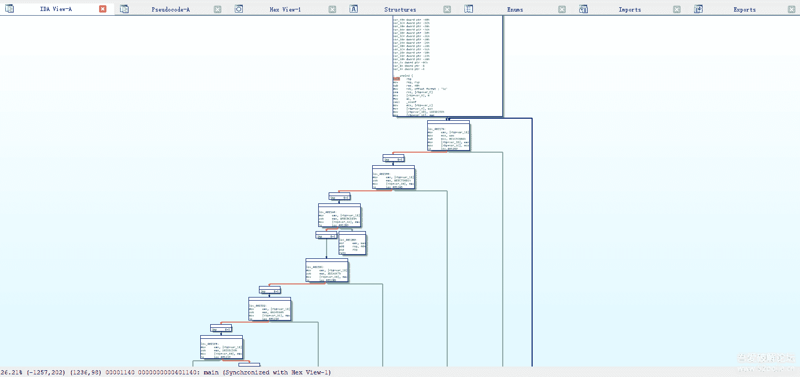

`image-20240115132134904.png` (80.75 KB, 下载次数: 0)

[附件下载](https://www.52pojie.cn/forum.php?mod=attachment&aid=MjY3MDM5Mnw0YzU2NjNjM3wxNzkzNTcyNzQzfDE2ODA4NnwxODgwODQ1&nothumb=yes)

2024-1-15 17:51 上传

## 去平坦化

### 虚拟环境

安装虚拟环境：

```
pip install virtualenv
```

配置环境变量：

```
export WORKON_HOME=$HOME/.virtualenvs
export PROJECT_HOME=$HOME/workspace
source /usr/local/bin/virtualenvwrapper.sh
```

打开虚拟环境：

```
source ~/.local/bin/virtualenvwrapper.sh
```

创建新的虚拟环境：

```
mkvirtualenv demo
```

展示当前虚拟环境：

```
workon
```

进入虚拟环境：

```
workon demo
```

### 使用脚本

由于脚本需要`angr`，在当前虚拟环境中安装：

```
pip install angr
```

脚本 GitHub 地址：[https://github.com/cq674350529/deflat](https://github.com/cq674350529/deflat)

将脚本中的`am_graph.py`和`util.py`文件复制到下级

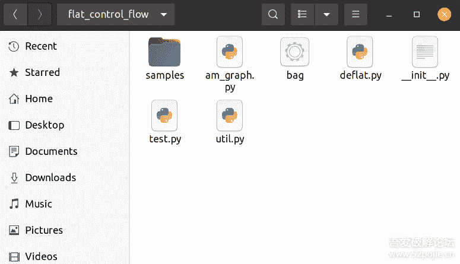

`image-20240115113143066.png` (54.38 KB, 下载次数: 1)

[附件下载](https://www.52pojie.cn/forum.php?mod=attachment&aid=MjY3MDM5MXw5NzZkNDRhMHwxNzkzNTcyNzQzfDE2ODA4NnwxODgwODQ1&nothumb=yes)

2024-1-15 17:51 上传

在`ida`中找到平坦化的入口地址，一般而言入口前都会存在大量`var_`（局部变量），下图入口地址为`0x401140`

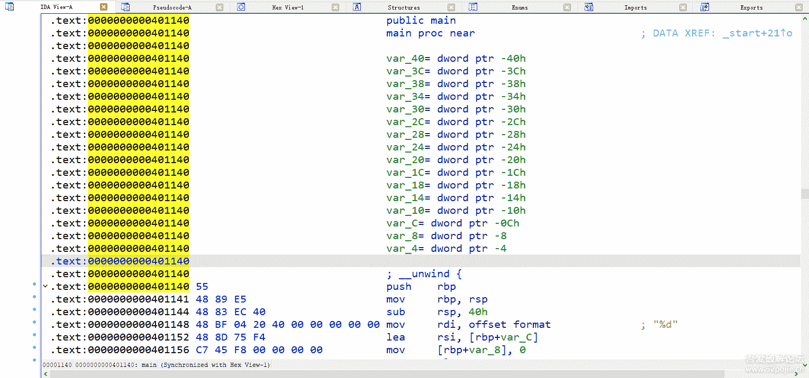

`image-20240115132230565.png` (105.26 KB, 下载次数: 0)

[附件下载](https://www.52pojie.cn/forum.php?mod=attachment&aid=MjY3MDM5M3xhMjYxOTVjY3wxNzkzNTcyNzQzfDE2ODA4NnwxODgwODQ1&nothumb=yes)

2024-1-15 17:51 上传

去平坦化命令格式为：

```
python3 deflat.py -f filename --addr address（入口地址，一般为main入口）
```

```
python3 deflat.py -f try --addr 0x401140
```

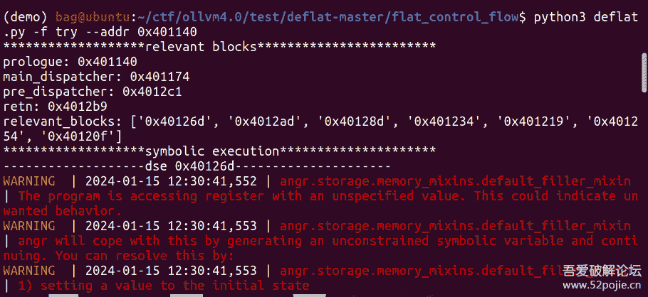

`image-20240115132332941.png` (122.93 KB, 下载次数: 0)

[附件下载](https://www.52pojie.cn/forum.php?mod=attachment&aid=MjY3MDM5NXxlMmQwYmViY3wxNzkzNTcyNzQzfDE2ODA4NnwxODgwODQ1&nothumb=yes)

2024-1-15 17:51 上传

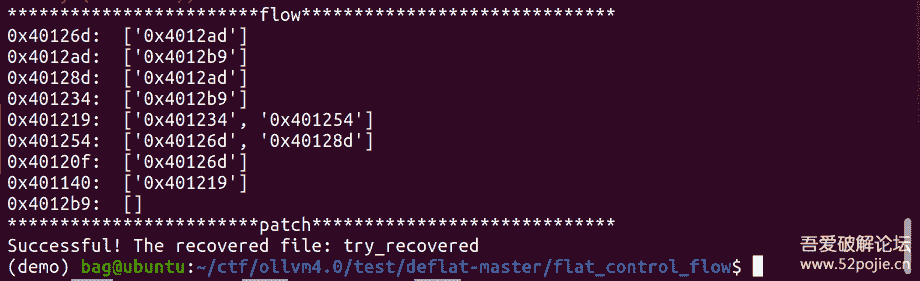

`image-20240115132452335.png` (73.3 KB, 下载次数: 0)

[附件下载](https://www.52pojie.cn/forum.php?mod=attachment&aid=MjY3MDM5Nnw4NzEzYmFmYXwxNzkzNTcyNzQzfDE2ODA4NnwxODgwODQ1&nothumb=yes)

2024-1-15 17:51 上传

去平坦化成功后，会在当前目录下生成源文件`_recovered`

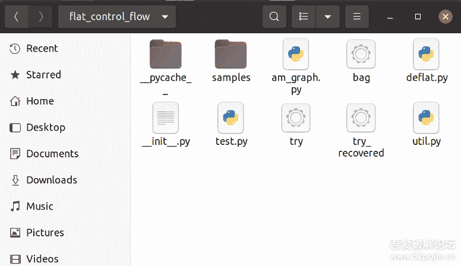

`image-20240115132612816.png` (62.83 KB, 下载次数: 0)

[附件下载](https://www.52pojie.cn/forum.php?mod=attachment&aid=MjY3MDM5N3wyMjZjYzQxM3wxNzkzNTcyNzQzfDE2ODA4NnwxODgwODQ1&nothumb=yes)

2024-1-15 17:51 上传

在`ida`中查看去平坦化后效果

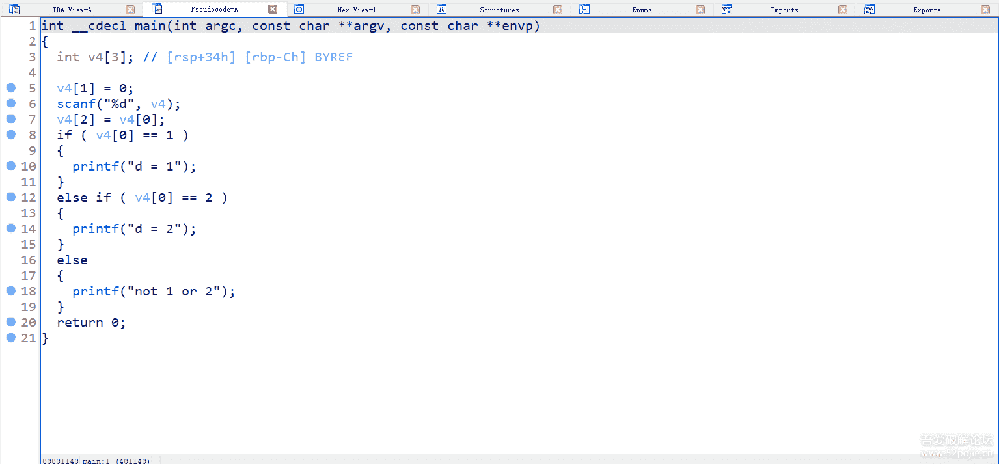

`image-20240115132654105.png` (50.14 KB, 下载次数: 0)

[附件下载](https://www.52pojie.cn/forum.php?mod=attachment&aid=MjY3MDM5OHxmMzU1YzFlOHwxNzkzNTcyNzQzfDE2ODA4NnwxODgwODQ1&nothumb=yes)

2024-1-15 17:51 上传

### 总结

- 定位入口地址
- 在`./deflat-master/flat_control_flow/`路径下启动虚拟环境

    ```
    source ~/.local/bin/virtualenvwrapper.sh
    workon
    workon demo
    ```

- 使用去平坦化命令

    ```
    python3 deflat.py -f filename --addr address（入口地址，一般为main入口）
    ```

## 参考文章

- [https://blog.csdn.net/weixin_51732593/article/details/126707046](https://blog.csdn.net/weixin_51732593/article/details/126707046)
- [https://www.jianshu.com/p/9136f7257e46](https://www.jianshu.com/p/9136f7257e46)
- [https://www.52pojie.cn/thread-1601573-1-1.html](https://www.52pojie.cn/thread-1601573-1-1.html)
