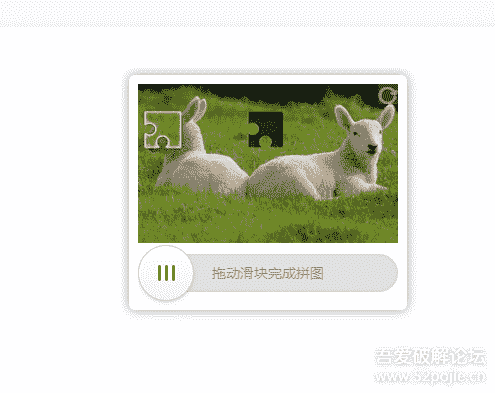
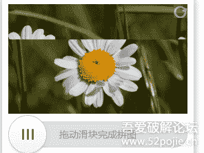

# [Web逆向] 异型滑块算法解决思路

- 原帖: https://www.52pojie.cn/forum.php?mod=viewthread&tid=1881668
- 抓取时间: 2026-11-01T22:38:56

网站：`aHR0cHM6Ly9jcmVkaXQuYWNsYS5vcmcuY24vY3JlZGl0L2xhd0Zpcm0/cmVmZXJfXzE3MTE9bjRBeFJEeURnRzBRaVFORHNEN21OZVBXVFR4ajJpTW9oYkQmYWxpY2hsZ3JlZj1odHRwcyUzQSUyRiUyRmNyZWRpdC5hY2xhLm9yZy5jbiUyRg==`

该网站存在无限`debugger`和ob混淆，不过逆向难度不高。

简单分享思路，不涉及逆向部分，这种解决方法也未必是最好的解决方法，有大佬有更好的算法解决方法望多多交流。


该网站存在有两种滑块，一种为标准滑块：



`558c9dd6529bff468a640edd4ce2fce.png` (102.86 KB, 下载次数: 3)

[href="forum.php?mod=attachment&aid=MjY3MDc4OXxhODE2MzdkZHwxNzkzNTcyNzM0fDE2ODA4NnwxODgxNjY4&nothumb=yes" target="_blank"](https://www.52pojie.cn/forum.php?mod=attachment&aid=MjY3MDc4OXxhODE2MzdkZHwxNzkzNTcyNzM0fDE2ODA4NnwxODgxNjY4&nothumb=yes)

2024-1-17 17:29 上传

另一种为异型滑块：



`35c75122f1042a0511262467e7b79a5.png` (82.06 KB, 下载次数: 3)

[href="forum.php?mod=attachment&aid=MjY3MDc4OHw2ZTA4ZTAwNnwxNzkzNTcyNzM0fDE2ODA4NnwxODgxNjY4&nothumb=yes" target="_blank"](https://www.52pojie.cn/forum.php?mod=attachment&aid=MjY3MDc4OHw2ZTA4ZTAwNnwxNzkzNTcyNzM0fDE2ODA4NnwxODgxNjY4&nothumb=yes)

2024-1-17 17:29 上传

第二种可以通过训练模型实现，也可以通过纯算法实现。

思路为：图像转灰度，横向切割后的图片转置出来然后做了下缩放，到0-9，然后余弦相似度做了图片像素间连续性判断。

不过算法实现有个缺点就是碰到颜色相近的图片会导致结果错误，总体准确度在70%。

代码实现：

```python
import math
import numpy as np
from PIL import Image

#余弦相似度计算
def cosine_similarity(vector1, vector2):
    dot_product = sum(x * y for x, y in zip(vector1, vector2))

    magnitude1 = math.sqrt(sum(x ** 2 for x in vector1))
    magnitude2 = math.sqrt(sum(x ** 2 for x in vector2))

    similarity = dot_product / (magnitude1 * magnitude2)

    return similarity

#缩放
def normalize_list(np_array):
    min_value = np.min(np_array)
    max_value = np.max(np_array)

    normalized_array = (np_array - min_value) / (max_value - min_value)

    return [round(i * 10) for i in normalized_array]

#主要方法
def convert_to_black_and_white(input_path, split, output_path='out.jpg'):
    image = Image.open(input_path)

    grayscale_image = image.convert("L")

    max_score = 1
    max_index = 0
   
    np_array = np.asarray(grayscale_image)[:360 - split - 10]
    np_array = np.transpose(np_array)
    
    for i in range(1, round(len(np_array) / 2)):
        forward = normalize_list(np_array[i * 2 - 1])
        rear = normalize_list(np_array[i * 2 + 1])
        similarity_score = cosine_similarity(forward, rear)
        if similarity_score 

```
