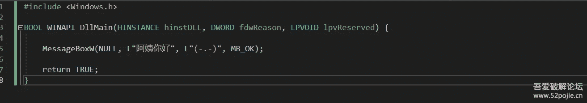
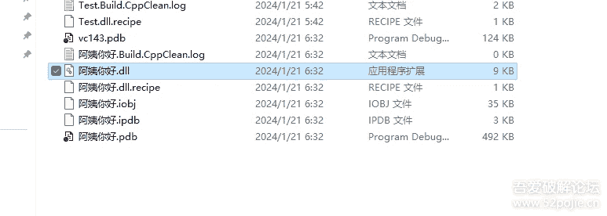
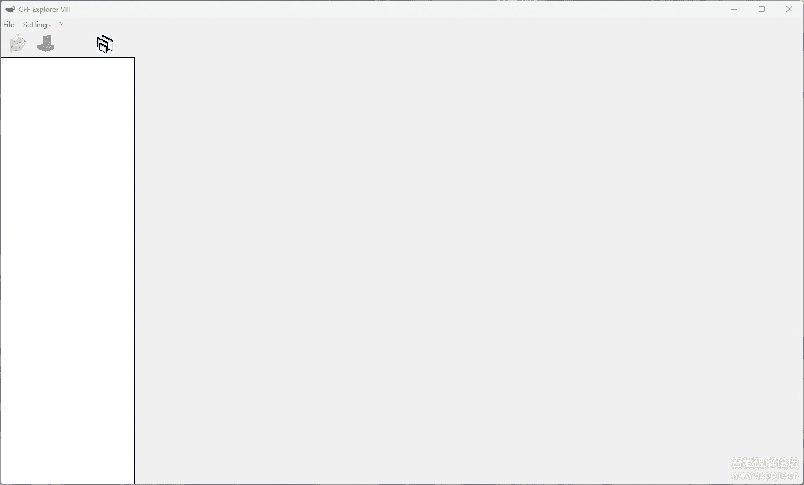
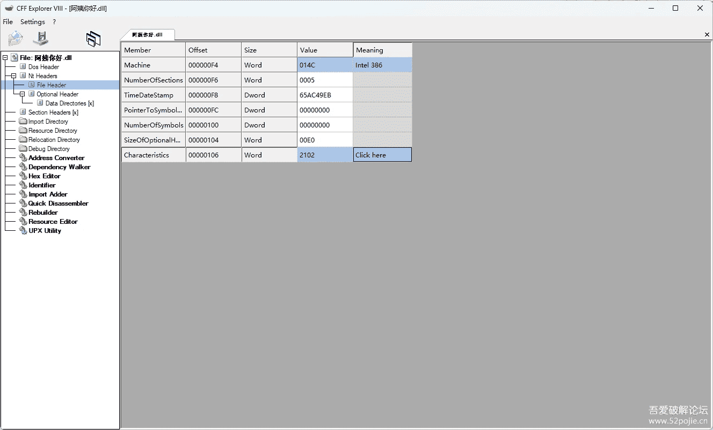
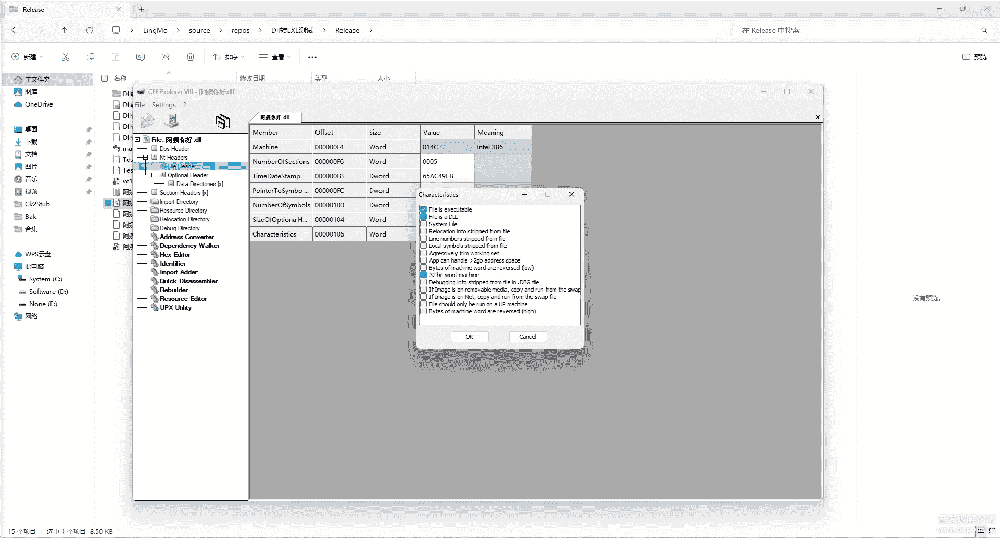
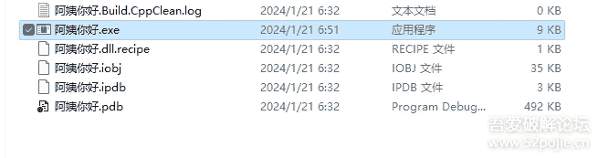
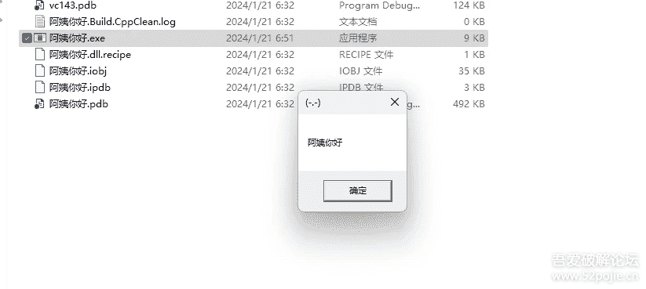
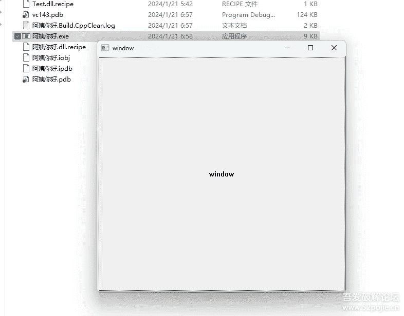
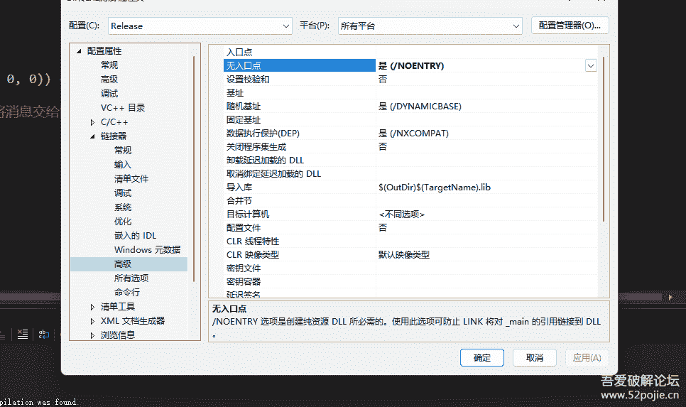
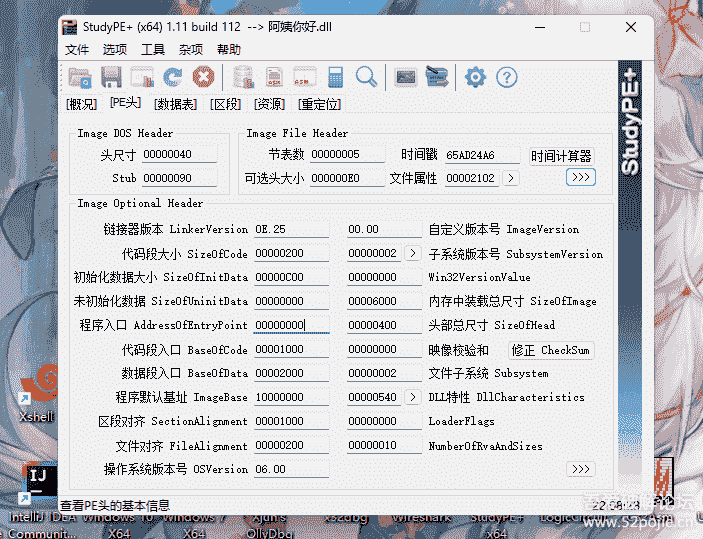

# [原创] 如何将 `dll` 转成 `exe` 并能够双击运行？——`PE` 结构原理

原帖：https://www.52pojie.cn/forum.php?mod=viewthread&tid=1882928

抓取时间：2026-11-01T22:38:45


1.png（49.78 KB，下载次数：0，2024-1-21 07:11 上传）

## 说明

`dll` 文件和 `exe` 文件看似只是后缀名不同，但其两者均遵循微软的可执行文件格式——`PE` 结构（`Portable Executable`）。

`Windows` 的 `PE` 装载器在识别所打开的一个可执行文件的时候，就是按照 `PE` 结构去解析相关的代码和数据信息。

为什么系统要提出 `dll` 文件这种概念呢？如果你作为程序员打算要编写一款小型程序，因为该程序的功能并不复杂，所以不需要编写过多复杂的代码。正因此，你只需要编译出一个体积差不多小的 `exe` 文件就能宣布项目开发完成了。

但如果是中大型项目呢？一个大小型项目往往能牵扯到许多的业务功能实现，将所有的业务功能实现的代码都全部写进同一个 `exe` 来的话，`exe` 的体积将会空前巨大，而且要是该项目在某一些业务功能上有了更新，要让用户用上新发布的版本就只能让用户重新下载 `exe`，影响极其不便。

而有了 `dll` 之后，事情就好办多了。把负责用户注册登录的代码写进一个 `dll` 里，把负责播放音乐、播放视频的代码写进另一个 `dll` 里，最后再让 `exe` 自己链接到相应的 `dll`，就不仅避免单个文件膨大的问题，还能使更新更加地方便。

## 实现步骤

咳咳，现在我们来说说根据 `PE` 结构的原理怎么实现把 `dll` 转成 `exe` 来，步骤超级超级简单。

首先我们随便写个代码来，静态编译出一个 `dll`：

```
#include 

BOOL WINAPI DllMain(HINSTANCE hinstDLL, DWORD fdwReason, LPVOID lpvReserved) {

    MessageBoxW(NULL, L"阿姨你好", L"(-.-)", MB_OK);

    return TRUE;
} 
```



2.png（81.03 KB，下载次数：0，2024-1-21 07:11 上传）



3.png（108.07 KB，下载次数：0，2024-1-21 07:11 上传）

接着我们随便使用一个 `PE` 编辑器来，用 `StudyPE+`、`CFF Explorer` 或 `LordPE` 等等都可以，这里我使用 `CFF Explorer`。

打开 `CFF Explorer`，我们将刚刚编译好的 `dll` 文件拖到里边去。



4.png（41.89 KB，下载次数：0，2024-1-21 07:11 上传）

找到 `nt` 头下的文件头，也就是 `Nt Headers` 下的 `File Header`，找到右边的 `Characteristics`，单击 `Click here`。



5.png（207.46 KB，下载次数：0，2024-1-21 07:11 上传）



6.png（423.12 KB，下载次数：0，2024-1-21 07:11 上传）

我们把 `File is a DLL` 这个选项取消掉，再 `OK`，然后覆盖保存即可。

（`PE` 装载器就是通过判断这个属性位来确定文件是 `exe` 还是 `dll`）

接着我们回到刚刚编译出来的目录那里，把 `dll` 文件的后缀改成 `.exe`，接着双击运行就可以啦。



7.png（75.54 KB，下载次数：0，2024-1-21 07:11 上传）



8.png（95.56 KB，下载次数：0，2024-1-21 07:11 上传）

我们还可以在 `Dll` 里边创建窗口并显示出来，此时我们应该要清楚，在清除了文件头属性 `File is a DLL` 的位的时候，文件已经不再是 `dll` 了：

```
#include 

BOOL WINAPI DllMain(HINSTANCE hinstDLL, DWORD fdwReason, LPVOID lpvReserved) {

        HWND hWnd = CreateWindowA("Button", "window", WS_OVERLAPPEDWINDOW, 100, 100, 500, 500, NULL, NULL, hinstDLL, NULL);

        //显示窗口

        ShowWindow(hWnd, SW_SHOW);

        UpdateWindow(hWnd);

        //消息循环

        MSG nMsg = { 0 };

        while (GetMessage(&nMsg, NULL, 0, 0)) {

                TranslateMessage(&nMsg);

                DispatchMessage(&nMsg);//将消息交给窗口处理函数来处理。

        }

    return TRUE;

} 
```

编译出来后重复上述步骤，双击运行。



9.png（87.55 KB，下载次数：0，2024-1-21 07:12 上传）

一句话总结：`dll` 本身就是为了模块化应用程序而诞生的，`dll` 跟 `exe` 的区别就是 `dll` 不能直接执行 `main` 入口，只能让其他 `exe` 或 `dll` 模块在加载和卸载的时候自动调用 `dllmain`，其他的编译方式跟 `exe` 并没有区别。

## 补充说明

`dll` 还有一种形式就是纯资源型的 `dll`，这种 `dll` 因为不需要链接入口点所以并不支持我上面所说的方法。



屏幕截图 2024-01-21 220623.png（68.34 KB，下载次数：0，2024-1-21 22:06 上传）

在 `vs` 的 `链接器 -> 高级` 里就能看到 `无入口点` 这个选项。

勾上此选项之后再静态编译，把编译出来的文件拖入到 `PE` 工具里查看。



屏幕截图 2024-01-21 220831.png（207.68 KB，下载次数：0，2024-1-21 22:10 上传）


屏幕截图 2024-01-21 221104.png（48.64 KB，下载次数：0，2024-1-21 22:11 上传）

可以看程序入口的 `rva` 值是 `0`，即没有入口点。

## 提醒

最后再说明下，这帖只是说明 `dll` 和 `exe` 在 `PE` 结构属性上的区别而已，要用实验证明能转 `exe` 还是得自己编译一个出来 `dll` 再操作才好，你要是随便去某一个目录里找个 `dll` 来做实验是没意义的，本来那个 `dll` 就是服务于主业务 `exe`，多数情况下肯定是没窗口的。
