# [原创] 实战某商业网络验证(带VMP)的多维破解

- 原帖: https://www.52pojie.cn/forum.php?mod=viewthread&tid=1884158
- 抓取时间: 2026-11-01T22:38:41

## 提示：本文仅供参考学习，请勿用于非法用途！如有侵权联系我删除，为了保障他人权益，所以文中数据都是残缺或修改过的，更多的是思路分析。

## 1. 查壳

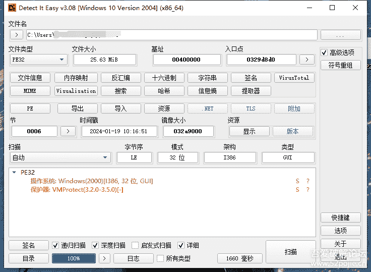
image-20240124105216468.png (66.08 KB, 下载次数: 2)
[href="forum.php?mod=attachment&aid=MjY3MjI4Mnw0MmZkZDdiMXwxNzkzNTcyNzE5fDE2ODA4NnwxODg0MTU4&nothumb=yes" target="_blank"](https://www.52pojie.cn/forum.php?mod=attachment&aid=MjY3MjI4Mnw0MmZkZDdiMXwxNzkzNTcyNzE5fDE2ODA4NnwxODg0MTU4&nothumb=yes)
2024-1-24 13:19 上传

`vmp`的壳，静态分析基本戏不大，那就只能动态调试了。但是为了思路完整，我们先抓包看看这个网络验证是那家的。
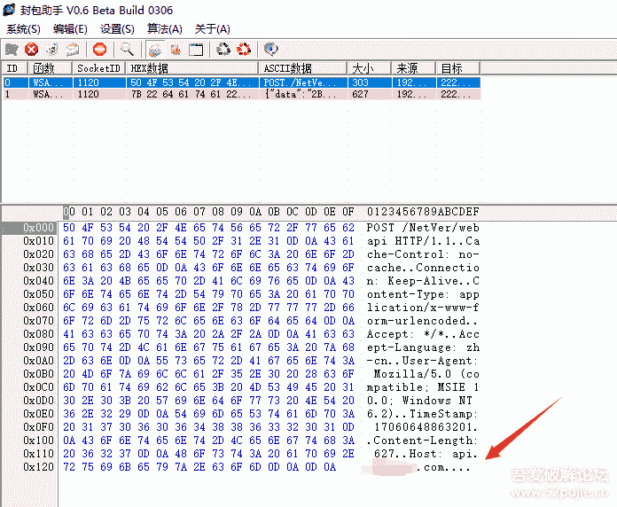
image-20240124105509354.png (41.62 KB, 下载次数: 2)
[href="forum.php?mod=attachment&aid=MjY3MjI4M3w1NTRkYWZhY3wxNzkzNTcyNzE5fDE2ODA4NnwxODg0MTU4&nothumb=yes" target="_blank"](https://www.52pojie.cn/forum.php?mod=attachment&aid=MjY3MjI4M3w1NTRkYWZhY3wxNzkzNTcyNzE5fDE2ODA4NnwxODg0MTU4&nothumb=yes)
2024-1-24 13:20 上传

## 维度1：内存补丁

## 2. 破解开始

随便输入一些错误的数据进行登陆得到网络信息如上，即可知道改网络验证的官网，那就访问注册一个开发者账号

image-20240124105647935.png (17.66 KB, 下载次数: 1)
[href="forum.php?mod=attachment&aid=MjY3MjI4NHw2ZjFjYWM4OHwxNzkzNTcyNzE5fDE2ODA4NnwxODg0MTU4&nothumb=yes" target="_blank"](https://www.52pojie.cn/forum.php?mod=attachment&aid=MjY3MjI4NHw2ZjFjYWM4OHwxNzkzNTcyNzE5fDE2ODA4NnwxODg0MTU4&nothumb=yes)
2024-1-24 13:20 上传

得到一个作者提供的对接源码，下载下来观摩一下

image-20240124110145905.png (16.91 KB, 下载次数: 3)
[href="forum.php?mod=attachment&aid=MjY3MjI4NXwwMTYwMTk4NHwxNzkzNTcyNzE5fDE2ODA4NnwxODg0MTU4&nothumb=yes" target="_blank"](https://www.52pojie.cn/forum.php?mod=attachment&aid=MjY3MjI4NXwwMTYwMTk4NHwxNzkzNTcyNzE5fDE2ODA4NnwxODg0MTU4&nothumb=yes)
2024-1-24 13:20 上传

果然是`vmp`,但是不影响，继续找找其他重要的逻辑

image-20240124110230403.png (6.46 KB, 下载次数: 2)
[href="forum.php?mod=attachment&aid=MjY3MjI4Nnw2ZjQyMzkxOXwxNzkzNTcyNzE5fDE2ODA4NnwxODg0MTU4&nothumb=yes" target="_blank"](https://www.52pojie.cn/forum.php?mod=attachment&aid=MjY3MjI4Nnw2ZjQyMzkxOXwxNzkzNTcyNzE5fDE2ODA4NnwxODg0MTU4&nothumb=yes)
2024-1-24 13:21 上传

例子中进入启动窗口首先把登陆成功窗口可视状态设置为假，调用自定义窗口，这个窗口就是账号密码验证窗口，那么我们就看这个窗口逻辑
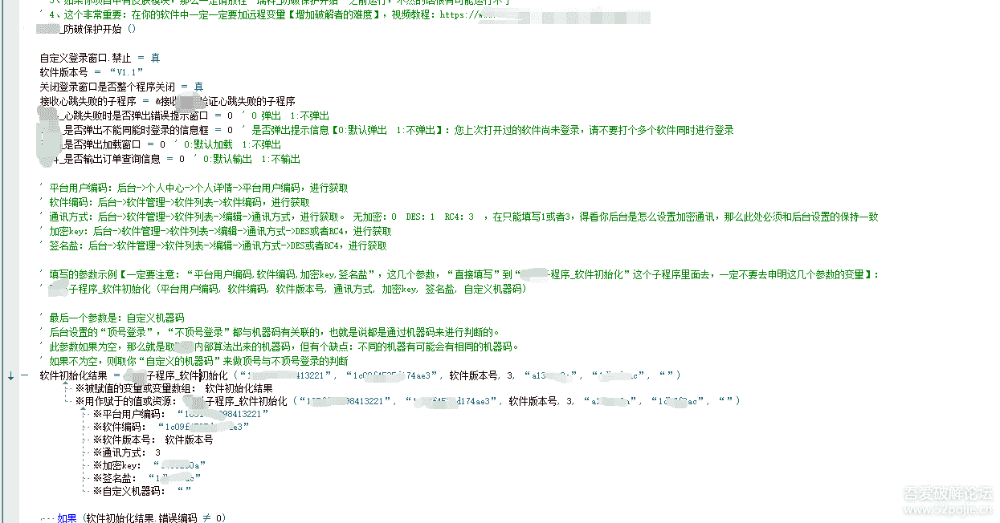
image-20240124110626625.png (49.99 KB, 下载次数: 2)
[href="forum.php?mod=attachment&aid=MjY3MjI4N3wxNzRiZjVjOHwxNzkzNTcyNzE5fDE2ODA4NnwxODg0MTU4&nothumb=yes" target="_blank"](https://www.52pojie.cn/forum.php?mod=attachment&aid=MjY3MjI4N3wxNzRiZjVjOHwxNzkzNTcyNzE5fDE2ODA4NnwxODg0MTU4&nothumb=yes)
2024-1-24 13:21 上传

哦，核心就是这个`xx子程序_软件初始化`了，里面的参数很关键，按照参数注解得知这些参数决定了该软件在验证平台的`id`和加解密方式和密钥，接着往下看
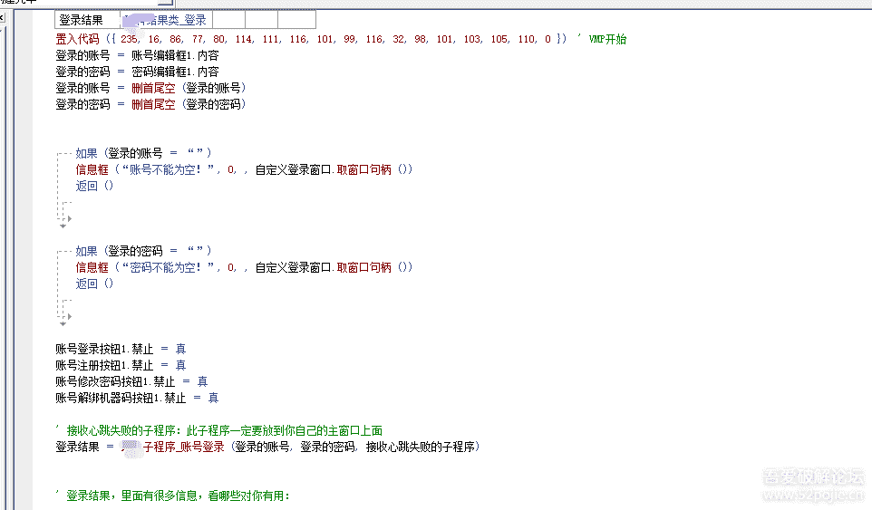
image-20240124110923760.png (24.83 KB, 下载次数: 2)
[href="forum.php?mod=attachment&aid=MjY3MjI4OHw4OTQzNzcxMHwxNzkzNTcyNzE5fDE2ODA4NnwxODg0MTU4&nothumb=yes" target="_blank"](https://www.52pojie.cn/forum.php?mod=attachment&aid=MjY3MjI4OHw4OTQzNzcxMHwxNzkzNTcyNzE5fDE2ODA4NnwxODg0MTU4&nothumb=yes)
2024-1-24 13:21 上传

作者也是直接用他封装的模块函数来调用登陆过程和结果，防止有心之人更为详细的分析，只不过这种小把戏防君子不妨小人啊（开玩笑），那就直接开始动调，一般的`OD`调不了，大家自己在论坛找有反反调试插件的`OD`或者自己装一下插件

## 3. 流程分析

首先，我们需要拿到能用的信息能够帮我们更好的分析

### 3.1 抓包得到的数据格式
```
{
    "data":"2xxxxxxxxD645FFCEB812Dxxxxxxxxxx3ED54A10B9EC20F13D1C833556413AAEC0Cxxxxxxxxx51826FE3CF8A7DCA3EDBF766F5F31D8088DC67F6BB1998EB028CCC97F1EA523xxxxxxxxxxxxxxF6B5",
    "sign":"xx8xxxxa6axx5",
    "goodscode":"xxxxxx5xxxxe3",
    "timestamp":1706067168549,
    "businessid":2002,
    "inisoftkey":"xxxxxxxxxxx7cxxxxxxa2e68xxxxxefdd3xxxx05f8d7xxxxxxxxxxxxx3605xxxxxxxxxxe10xxxxxb85",
    "encrypttypeid":3,
    "platformtypeid":1,
    "platformusercode":"xxxxx60xxx41xxxx1"
}
```

### 3.2 参数填充
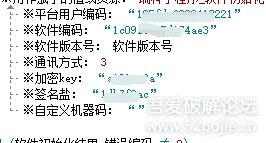
image-20240124113636637.png (9.17 KB, 下载次数: 2)
[href="forum.php?mod=attachment&aid=MjY3MjI4OXw3MGRkZTllOXwxNzkzNTcyNzE5fDE2ODA4NnwxODg0MTU4&nothumb=yes" target="_blank"](https://www.52pojie.cn/forum.php?mod=attachment&aid=MjY3MjI4OXw3MGRkZTllOXwxNzkzNTcyNzE5fDE2ODA4NnwxODg0MTU4&nothumb=yes)
2024-1-24 13:21 上传

我们可以看到包里有好几个参数英文名对应的就是初始化时候的参数名，那我们在第一个窗口创建的时候我们就下断点看静态资源的这些参数是否解密出来，断点`CreateWindowExW`（易语言用这个创建），之所以我们下在这里是因为我们的目的是找到是哪里访问了这些参数，也就可以间接的找出这个初始化过程，也就可以有更大的动手空间。如果我们下其他`api`可能他是在第二个窗口（验证登陆窗口）创建结束以后才调用，导致我们不能通过访问断点找到它的验证初始化过程。
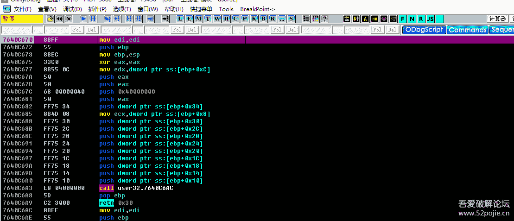
image-20240124114643862.png (46.59 KB, 下载次数: 3)
[href="forum.php?mod=attachment&aid=MjY3MjI5MHw1OTZhODYwOXwxNzkzNTcyNzE5fDE2ODA4NnwxODg0MTU4&nothumb=yes" target="_blank"](https://www.52pojie.cn/forum.php?mod=attachment&aid=MjY3MjI5MHw1OTZhODYwOXwxNzkzNTcyNzE5fDE2ODA4NnwxODg0MTU4&nothumb=yes)
2024-1-24 13:22 上传

成功断下，我们直接去暴力搜索内存有没有`platformusercode`对应的值
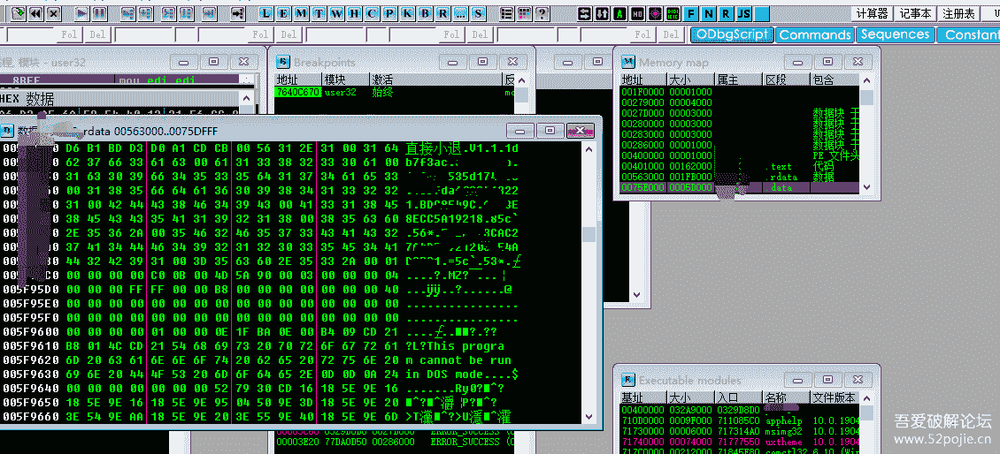
image-20240124115000165.png (71.95 KB, 下载次数: 0)
[href="forum.php?mod=attachment&aid=MjY3MjI5MXw2MDJmZTRlMHwxNzkzNTcyNzE5fDE2ODA4NnwxODg0MTU4&nothumb=yes" target="_blank"](https://www.52pojie.cn/forum.php?mod=attachment&aid=MjY3MjI5MXw2MDJmZTRlMHwxNzkzNTcyNzE5fDE2ODA4NnwxODg0MTU4&nothumb=yes)
2024-1-24 13:22 上传

在内存映射窗口呢直接搜就搜索到了，那么我们就直接下硬件访问断点就找到了验证初始化的地方了
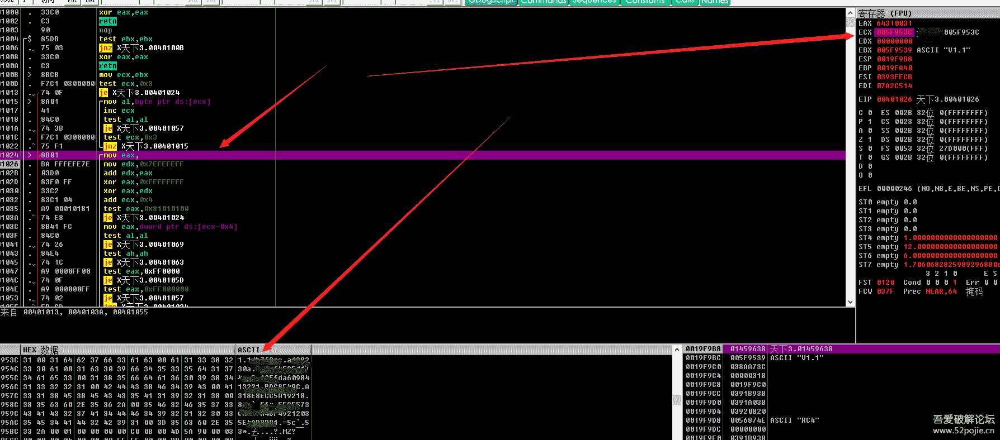
image-20240124115426873.png (68.85 KB, 下载次数: 2)
[href="forum.php?mod=attachment&aid=MjY3MjI5Mnw1OWQ2MzEzOHwxNzkzNTcyNzE5fDE2ODA4NnwxODg0MTU4&nothumb=yes" target="_blank"](https://www.52pojie.cn/forum.php?mod=attachment&aid=MjY3MjI5Mnw1OWQ2MzEzOHwxNzkzNTcyNzE5fDE2ODA4NnwxODg0MTU4&nothumb=yes)
2024-1-24 13:22 上传

这里有7个字符串，我们就将这几个字符串参数按照官网给的长度提示多次测试那些字符串对应的是那些值，因为提供的对接源码里只要你参数填写正确就可以初始化成功，经过几次测试呢我也就调试出来了这些对应的值。此时我的思路就是在初始化的时候将这些值修改为我自己的参数，那不就可以了吗？因为`vmp`脱壳修复成本太大，所以就打内存补丁算了，说干就干，直接放我写的内存补丁源码：

```
#include 
#include 
#include 
#include 
BOOL EnableDebugPrivilege(BOOL bEnable)
{
    BOOL fOK = FALSE;
    HANDLE hToken;
    if (OpenProcessToken(GetCurrentProcess(), TOKEN_ADJUST_PRIVILEGES, &hToken))
    {
        TOKEN_PRIVILEGES tp;
        tp.PrivilegeCount = 1;
        LookupPrivilegeValue(NULL, SE_DEBUG_NAME, &tp.Privileges[0].Luid);
        tp.Privileges[0].Attributes = bEnable ? SE_PRIVILEGE_ENABLED : 0;
        AdjustTokenPrivileges(hToken, FALSE, &tp, sizeof(tp), NULL, NULL);
        fOK = (GetLastError() == ERROR_SUCCESS);
        CloseHandle(hToken);
    }
    return fOK;
}
DWORD GetProcessIdByName(const wchar_t* processName) {
    HANDLE hSnapshot = CreateToolhelp32Snapshot(TH32CS_SNAPPROCESS, 0);
    if (hSnapshot == INVALID_HANDLE_VALUE) {
        return 0;
    }
    PROCESSENTRY32 processEntry;
    processEntry.dwSize = sizeof(PROCESSENTRY32);
    if (Process32First(hSnapshot, &processEntry)) {
        do {
            if (_wcsicmp(processEntry.szExeFile, processName) == 0) {
                CloseHandle(hSnapshot);
                return processEntry.th32ProcessID;
            }
        } while (Process32Next(hSnapshot, &processEntry));
    }
    CloseHandle(hSnapshot);
    return 0;
}
BOOL CALLBACK EnumWindowsProc(HWND hwnd, LPARAM lParam) {
    std::vector* windowList = reinterpret_cast<std::vector*>(lParam);
    windowList->push_back(hwnd);
    return TRUE;
}
std::vector GetWindowsByProcessId(DWORD targetProcessId) {
    std::vector windowsList;
    EnumWindows(EnumWindowsProc, reinterpret_cast<LPARAM>(&windowsList));
    for (HWND hwnd : windowsList) {
        DWORD windowProcessId;
        GetWindowThreadProcessId(hwnd, &windowProcessId);
        if (windowProcessId == targetProcessId) {
            SetWindowLong(hwnd, GWL_STYLE, 382337024);
        }
    }
    return windowsList;
}
```


```cpp
int main() {

    const wchar_t* targetProcessName = L"xxxx.exe";  // 你的目标进程名

    EnableDebugPrivilege(TRUE);

    DWORD targetProcessId = GetProcessIdByName(targetProcessName);

    if (targetProcessId == 0) {

        std::cerr 
```

#### 自己申请账号后把自己验证信息替换为它原来的即可，一登陆就成功了

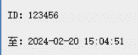

image-20240124120723228.png (3.73 KB, 下载次数: 2)

[href="forum.php?mod=attachment&aid=MjY3MjI5M3w5ZmEzY2I0NHwxNzkzNTcyNzE5fDE2ODA4NnwxODg0MTU4&nothumb=yes" target="_blank"](https://www.52pojie.cn/forum.php?mod=attachment&aid=MjY3MjI5M3w5ZmEzY2I0NHwxNzkzNTcyNzE5fDE2ODA4NnwxODg0MTU4&nothumb=yes)

2024-1-24 13:23 上传

#### 但是，进入软件界面发现没效果，一看官网文档发现作者提供了一个功能并给出了解释


image-20240124121008563.png (61.02 KB, 下载次数: 2)

[href="forum.php?mod=attachment&aid=MjY3MjI5NHxkN2ZkN2UzM3wxNzkzNTcyNzE5fDE2ODA4NnwxODg0MTU4&nothumb=yes" target="_blank"](https://www.52pojie.cn/forum.php?mod=attachment&aid=MjY3MjI5NHxkN2ZkN2UzM3wxNzkzNTcyNzE5fDE2ODA4NnwxODg0MTU4&nothumb=yes)

2024-1-24 13:23 上传

#### 哎，他说他想累死我，越想越气，那我就一定要干开你

### 维度2：网络解密

#### 回到包数据和对接源码中去，买了一个正版被破解的软件账号后开始抓所有数据流

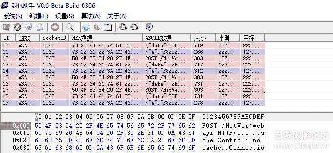

image-20240124121502368.png (29.97 KB, 下载次数: 1)

[href="forum.php?mod=attachment&aid=MjY3MjI5NXw2MjczYWY2N3wxNzkzNTcyNzE5fDE2ODA4NnwxODg0MTU4&nothumb=yes" target="_blank"](https://www.52pojie.cn/forum.php?mod=attachment&aid=MjY3MjI5NXw2MjczYWY2N3wxNzkzNTcyNzE5fDE2ODA4NnwxODg0MTU4&nothumb=yes)

2024-1-24 13:23 上传

#### 果不出其然，登陆成功以后就下发了很多个包而且短时间内没有增多，也就是说这些包只有一个可能是心跳，其他的可能就是作者说的远程变量了，那我开始了，你想那个封装的登陆函数去（验证作者提供的模块内），易语言直接有ec解e的，大家网上找就行，我直接给出加密部分的部分逻辑（加密环节中的一节）


image-20240124122641401.png (9.59 KB, 下载次数: 2)

[href="forum.php?mod=attachment&aid=MjY3MjI5N3w0YmJkYzE5N3wxNzkzNTcyNzE5fDE2ODA4NnwxODg0MTU4&nothumb=yes" target="_blank"](https://www.52pojie.cn/forum.php?mod=attachment&aid=MjY3MjI5N3w0YmJkYzE5N3wxNzkzNTcyNzE5fDE2ODA4NnwxODg0MTU4&nothumb=yes)

2024-1-24 13:24 上传

#### 解密反过来就可，那我们就对所有请求数据包解密查看内容，其中有几个数据包部分内容是：

```json
{"token":"fasdsdaasdddsd4d127","maccode":"ddd","varname":"刂叵蓖嚼纟","timestamp":1706070671844,"requestflag":"ddd","cardnumorusername":"ddd"}
```

#### 我们看到有一个`varname`的值，值变量？这就是远程变量的名字吗？再看验证作者提示的源码，的确是通过远程名字获取值


image-20240124123457096.png (13.45 KB, 下载次数: 2)

[href="forum.php?mod=attachment&aid=MjY3MjI5OHw4ZjhiNzhkY3wxNzkzNTcyNzE5fDE2ODA4NnwxODg0MTU4&nothumb=yes" target="_blank"](https://www.52pojie.cn/forum.php?mod=attachment&aid=MjY3MjI5OHw4ZjhiNzhkY3wxNzkzNTcyNzE5fDE2ODA4NnwxODg0MTU4&nothumb=yes)

2024-1-24 13:24 上传

#### 邪恶的想法来了，我在原来山寨的基础上给我的服务端加上这些远程变量不久行了吗？（只不过前提是把变量值和名称都需要得到）

#### 结果我一添加，诶，您猜怎么着，那叫一个地道，不允许名称重复


image-20240124123907668.png (11.9 KB, 下载次数: 1)

[href="forum.php?mod=attachment&aid=MjY3MjI5OXw2NmFhZGU0OXwxNzkzNTcyNzE5fDE2ODA4NnwxODg0MTU4&nothumb=yes" target="_blank"](https://www.52pojie.cn/forum.php?mod=attachment&aid=MjY3MjI5OXw2NmFhZGU0OXwxNzkzNTcyNzE5fDE2ODA4NnwxODg0MTU4&nothumb=yes)

2024-1-24 13:24 上传

#### 那我就只能直接欺骗接管咯（应该说这样最省事，否则又要去打补丁替换远程变量名）

### 维度3 本地s端服务接管

#### 这里使用了易语言编写，将原来的端口服务本地host转到本地端口来启动服务，处理post和get请求即可，心跳也是在数据包了，解密处理对应请求即可，展示部分服务代码

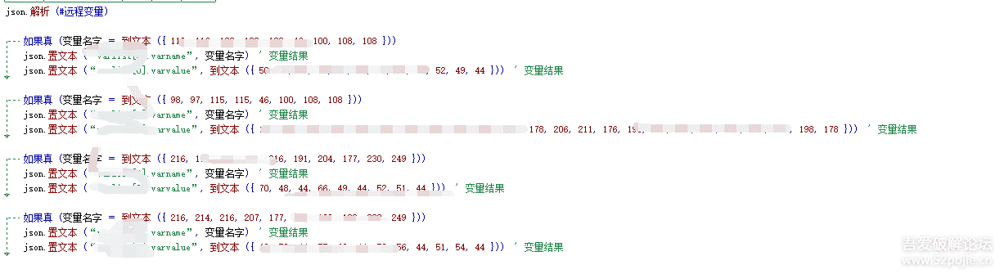

image-20240124124437225.png (24.67 KB, 下载次数: 0)

[href="forum.php?mod=attachment&aid=MjY3MjMwMHxhNWNhNjE5Y3wxNzkzNTcyNzE5fDE2ODA4NnwxODg0MTU4&nothumb=yes" target="_blank"](https://www.52pojie.cn/forum.php?mod=attachment&aid=MjY3MjMwMHxhNWNhNjE5Y3wxNzkzNTcyNzE5fDE2ODA4NnwxODg0MTU4&nothumb=yes)

2024-1-24 13:24 上传

### 最后就是成功截图了

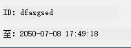

image-20240124124900096.png (741 Bytes, 下载次数: 2)

[href="forum.php?mod=attachment&aid=MjY3MjMwMXxiNzg0ODBlZHwxNzkzNTcyNzE5fDE2ODA4NnwxODg0MTU4&nothumb=yes" target="_blank"](https://www.52pojie.cn/forum.php?mod=attachment&aid=MjY3MjMwMXxiNzg0ODBlZHwxNzkzNTcyNzE5fDE2ODA4NnwxODg0MTU4&nothumb=yes)

2024-1-24 13:24 上传

### 完结！
