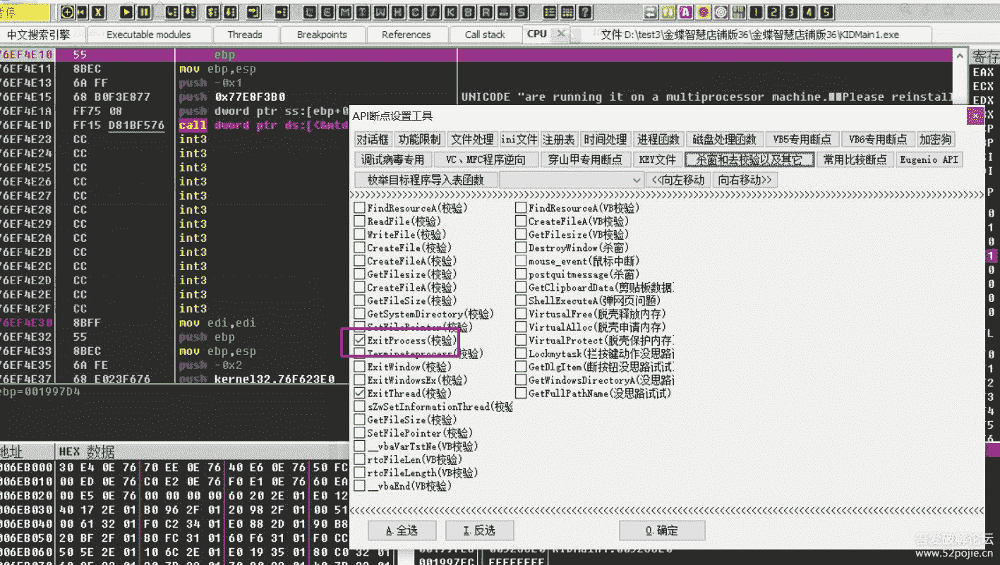
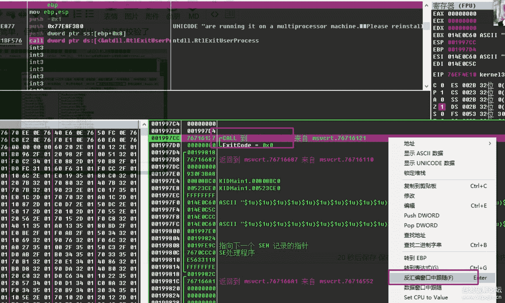
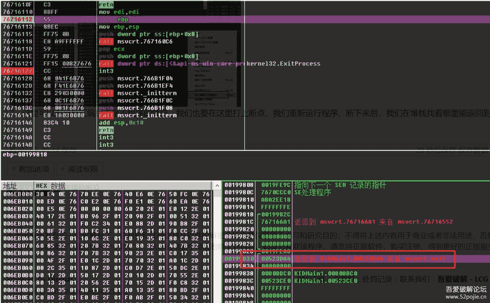
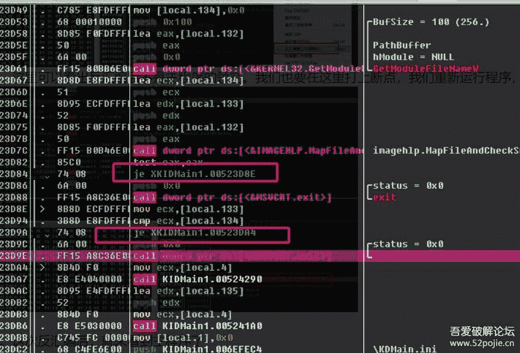

# [原创] 一个进销存软件破解后去自校验的过程

- 原帖：<https://www.52pojie.cn/forum.php?mod=viewthread&tid=1885129>
- 抓取时间：2026-11-01T22:38:40

软件本身就简单，但是运行后直接退出。这就有校验了。

## 1. 在`od`开 API 断点

`1.png`（275.68 KB，下载次数：2）

[附件下载](https://www.52pojie.cn/forum.php?mod=attachment&aid=MjY3Mjc4N3xhZDc3ZGZjYnwxNzkzNTcyNzE3fDE2ODA4NnwxODg1MTI5&nothumb=yes)

上传时间：2024-1-26 21:09

## 2. 重新运行软件

软件就断在`Exitprocess`，我就在原地址反汇编。

`2.png`（262.47 KB，下载次数：2）

[附件下载](https://www.52pojie.cn/forum.php?mod=attachment&aid=MjY3Mjc4OXwwNmE3NzQ4OXwxNzkzNTcyNzE3fDE2ODA4NnwxODg1MTI5&nothumb=yes)

上传时间：2024-1-26 21:11

## 3. 在堆栈中查找返回主程序的位置

这里可以看出反汇编后不是主程序的领空。我们也要在这里打上断点，我们重新运行程序，断下来后，我们在堆栈找看哪里能返回到主程序。

`3.png`（237.52 KB，下载次数：3）

[附件下载](https://www.52pojie.cn/forum.php?mod=attachment&aid=MjY3Mjc5MHxhNjU0NzNhOHwxNzkzNTcyNzE3fDE2ODA4NnwxODg1MTI5&nothumb=yes)

上传时间：2024-1-26 21:15

## 4. 跳过校验

这次反汇编后，就来看到主程序了，我们直接跳过校验就行了。

`4.png`（128.1 KB，下载次数：3）

[附件下载](https://www.52pojie.cn/forum.php?mod=attachment&aid=MjY3Mjc5MnwxZWNmNzcxYXwxNzkzNTcyNzE3fDE2ODA4NnwxODg1MTI5&nothumb=yes)

上传时间：2024-1-26 21:17

这要就完工了！
