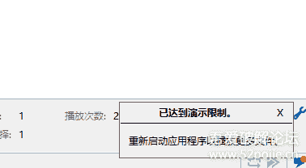
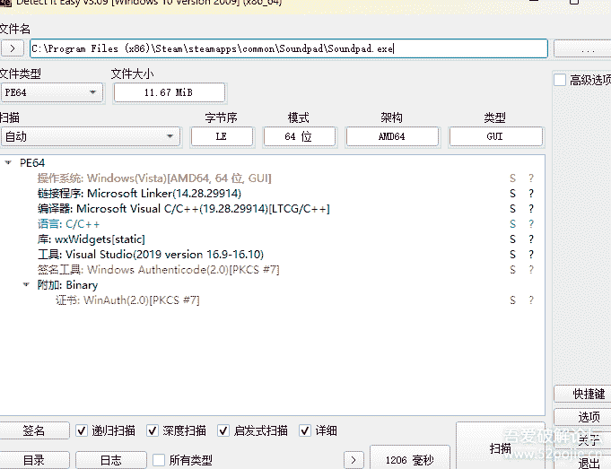
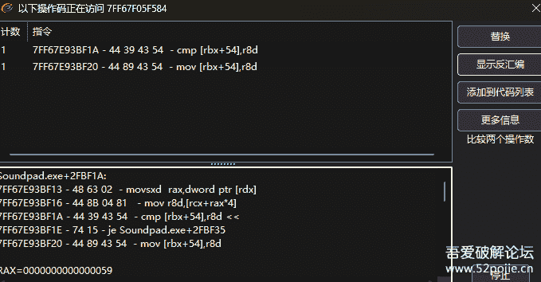
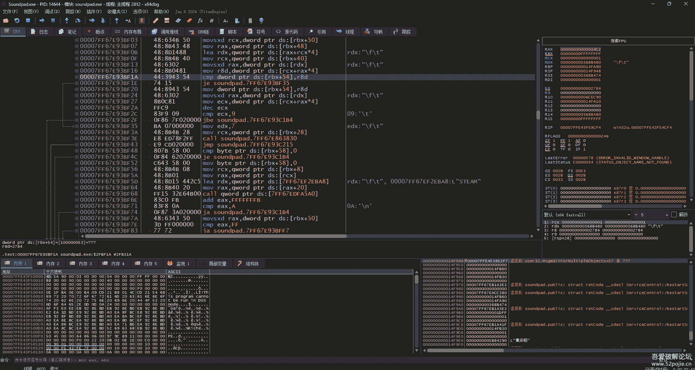
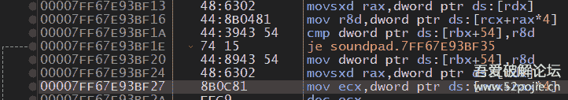
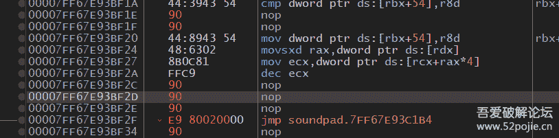

# [原创] 新人的一次破解steam上的Soundp d demo使用次数限制的尝试

- 原帖: https://www.52pojie.cn/forum.php?mod=viewthread&tid=1885801
- 抓取时间: 2026-11-01T22:38:36

新人第一次发帖，如有不对的地方请大家指出。

使用软件时发现Soudp*d Demo能够使用正式版的主要功能，但是具有次数限制，只能使用10次，达到上限后需要重启程序。

0.png (14.37 KB, 下载次数: 0)

[href="forum.php?mod=attachment&aid=MjY3MzE2MXxkOTdkOGM0NHwxNzkzNTcyNzE0fDE2ODA4NnwxODg1ODAx&nothumb=yes" target="_blank"](https://www.52pojie.cn/forum.php?mod=attachment&aid=MjY3MzE2MXxkOTdkOGM0NHwxNzkzNTcyNzE0fDE2ODA4NnwxODg1ODAx&nothumb=yes)

2024-1-29 11:57 上传

猜测程序可能使用一个全局`flag`来控制软件限制，通过整数变量来计数。

然后丢进`DIE`进行分析，发现无壳。

die分析.png (41.69 KB, 下载次数: 2)

[href="forum.php?mod=attachment&aid=MjY3MzE1OHw3YTA2NjBhYnwxNzkzNTcyNzE0fDE2ODA4NnwxODg1ODAx&nothumb=yes" target="_blank"](https://www.52pojie.cn/forum.php?mod=attachment&aid=MjY3MzE1OHw3YTA2NjBhYnwxNzkzNTcyNzE0fDE2ODA4NnwxODg1ODAx&nothumb=yes)

DIE分析

2024-1-29 11:53 上传

启动软件，直接上`CE`，搜索四字节；

猜测可能是反向计数，使用使用未知初始值搜索，也找到了一个内存地址(发现从11计数到1，然后继续使用功能，功能无法使用但此值仍然在减少，这可能是个bug我猜)：

屏幕截图 2024-01-29 121422.png (4.25 KB, 下载次数: 2)

[href="forum.php?mod=attachment&aid=MjY3MzE3MnwwNDk4YzI2ZHwxNzkzNTcyNzE0fDE2ODA4NnwxODg1ODAx&nothumb=yes" target="_blank"](https://www.52pojie.cn/forum.php?mod=attachment&aid=MjY3MzE3MnwwNDk4YzI2ZHwxNzkzNTcyNzE0fDE2ODA4NnwxODg1ODAx&nothumb=yes)

2024-1-29 12:14 上传

尝试修改该值，再使用功能，发现值变了回去，看看是什么访问了这个内存：

屏幕截图 2024-01-29 122229.png (32.63 KB, 下载次数: 2)

[href="forum.php?mod=attachment&aid=MjY3MzE3NHxjNmQ5ZTBjYnwxNzkzNTcyNzE0fDE2ODA4NnwxODg1ODAx&nothumb=yes" target="_blank"](https://www.52pojie.cn/forum.php?mod=attachment&aid=MjY3MzE3NHxjNmQ5ZTBjYnwxNzkzNTcyNzE0fDE2ODA4NnwxODg1ODAx&nothumb=yes)

2024-1-29 12:22 上传

接着选择第二个`mov`指令，点击显示反汇编，再使用`x64dbg`定位到对应汇编指令地址：

屏幕截图 2024-01-29 123210.png (317.32 KB, 下载次数: 1)

[href="forum.php?mod=attachment&aid=MjY3MzE4MHxhNzFmYzc2YnwxNzkzNTcyNzE0fDE2ODA4NnwxODg1ODAx&nothumb=yes" target="_blank"](https://www.52pojie.cn/forum.php?mod=attachment&aid=MjY3MzE4MHxhNzFmYzc2YnwxNzkzNTcyNzE0fDE2ODA4NnwxODg1ODAx&nothumb=yes)

2024-1-29 12:32 上传

关键可能是在这个`r8d`寄存器那里，

查看`rbx+54` 和 `r8d`，发现这两个值貌似不会相等，这个跳转没有用，直接`nop`掉。

仔细分析汇编代码注意到了`dword ptr ds:[rcx+rax*4]`，这里的值在前面会赋给`r8d`，然后`r8d`再赋值给`rbx+54`，接着`[rcx+rax*4]`的值赋值给了`ecx`，后面紧跟一个以`ecx`自减和条件跳转，这个也许就是破局的关键：

key.png (40.94 KB, 下载次数: 2)

[href="forum.php?mod=attachment&aid=MjY3MzE4NHxjZjE2ODE3Y3wxNzkzNTcyNzE0fDE2ODA4NnwxODg1ODAx&nothumb=yes" target="_blank"](https://www.52pojie.cn/forum.php?mod=attachment&aid=MjY3MzE4NHxjZjE2ODE3Y3wxNzkzNTcyNzE0fDE2ODA4NnwxODg1ODAx&nothumb=yes)

2024-1-29 12:50 上传

试试强制跳转，即把这个强制跳转

image.png (5.05 KB, 下载次数: 1)

[href="forum.php?mod=attachment&aid=MjcwOTYzOXwxYTQ5MGQ5YnwxNzkzNTcyNzE0fDE2ODA4NnwxODg1ODAx&nothumb=yes" target="_blank"](https://www.52pojie.cn/forum.php?mod=attachment&aid=MjcwOTYzOXwxYTQ5MGQ5YnwxNzkzNTcyNzE0fDE2ODA4NnwxODg1ODAx&nothumb=yes)

ce地址

2024-7-19 19:27 上传

变为：

res.png (47.91 KB, 下载次数: 2)

[href="forum.php?mod=attachment&aid=MjY3MzE4Nnw3ZmViN2RiNnwxNzkzNTcyNzE0fDE2ODA4NnwxODg1ODAx&nothumb=yes" target="_blank"](https://www.52pojie.cn/forum.php?mod=attachment&aid=MjY3MzE4Nnw3ZmViN2RiNnwxNzkzNTcyNzE0fDE2ODA4NnwxODg1ODAx&nothumb=yes)

2024-1-29 12:54 上传

测试发现使用其功能的限制解除了，即[//www.52pojie.cn" target="_blank" class="relatedlink"](https://www.52pojie.cn:href="https)成功。

然后使用使用`x64dbg`修改程序，保存，至此，破解结束。

文件就不贴了，steam上可以直接下载。
