# [Web逆向] 某些知识库文档密码破解

- 原帖: https://www.52pojie.cn/forum.php?mod=viewthread&tid=1886314
- 抓取时间: 2026-11-01T22:38:28

## 某文档一

浏览某技术文档时，发现此文档需要验证码，而验证码需加入知识星球才能看到

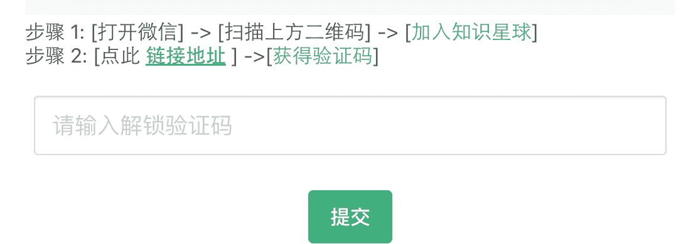

于是先看看能不能破解咯，打开 `F12`，先随便输入个验证码，看看是不是动态验证的

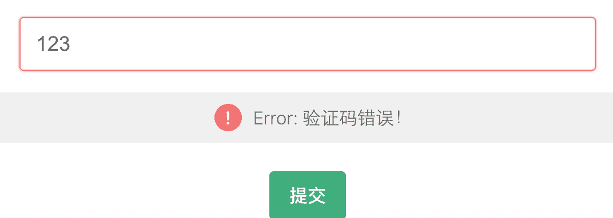

`XHR` 请求里有请求进行验证

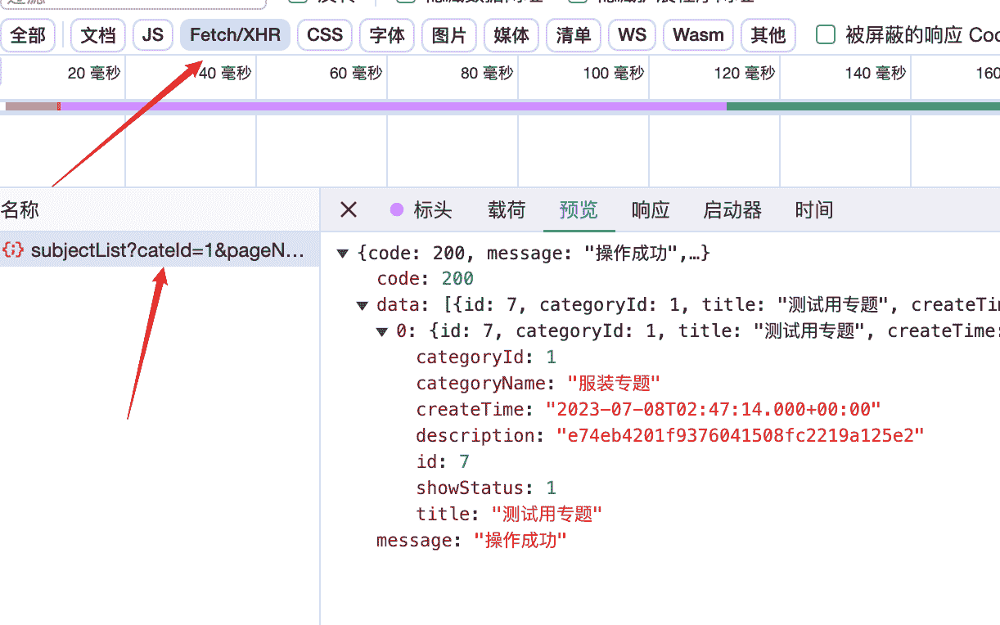

根据此链接去打个断点看看

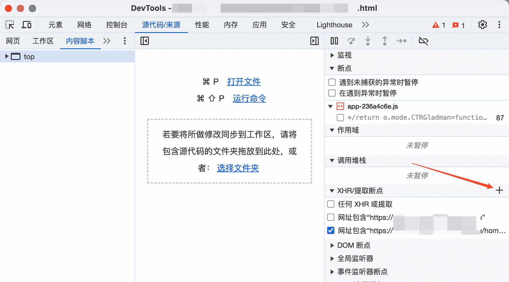

重新输入验证码发起请求，接着分析代码

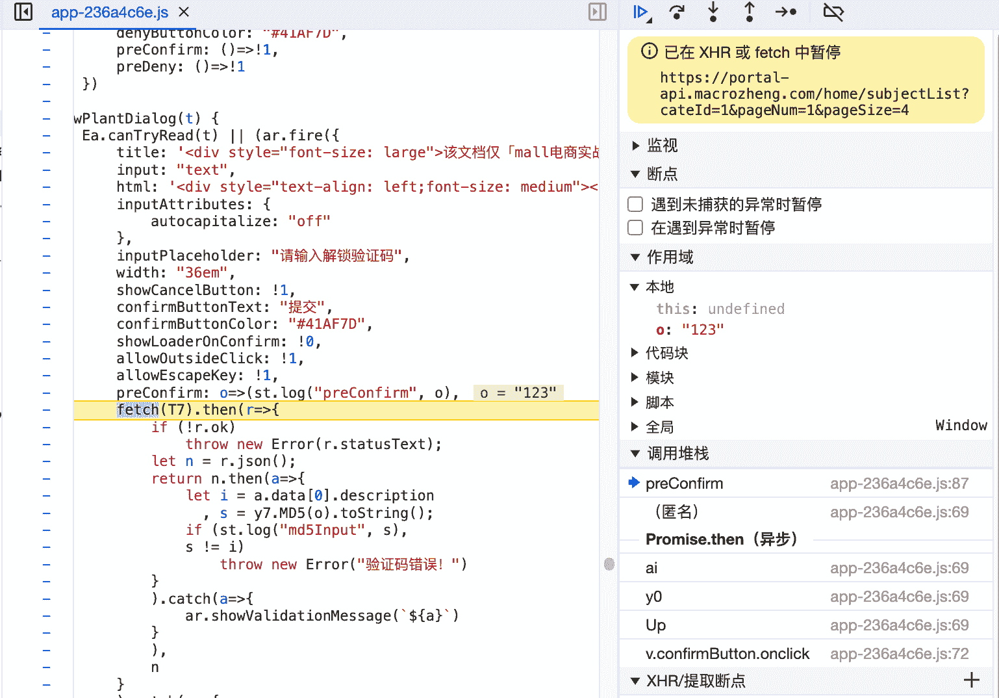

这里很容易就知道，当 `s` 不等于 `i` 时代表验证码错误

我们只需要让 `s==i` 就可以

```
if (st.log("md5Input", s),
    != i)
    throw new Error("验证码错误！")
```

打个断点，看看他俩值是多少

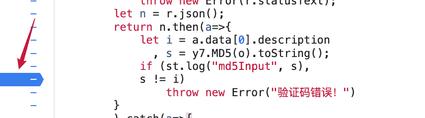

右上角继续执行

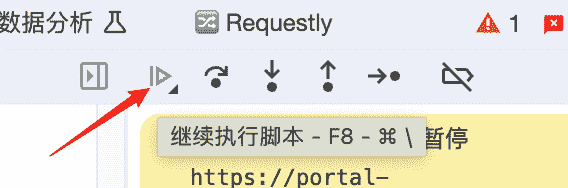

`i` 就是 `XHR` 请求返回数据中的字段 `description` 的值

`s` 就是 `y7.MD5(o).toString()`，`o` 就是输入的验证码

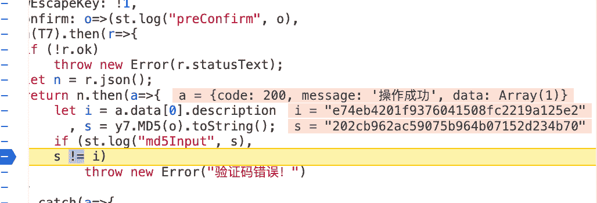

我们只要把 `s` 的内容改成 `"e74eb4201f9376041508fc2219a125e2"` 就行了

作用域里直接替换就行了

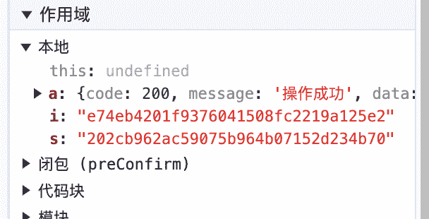

接着继续执行，提示文档解锁成功

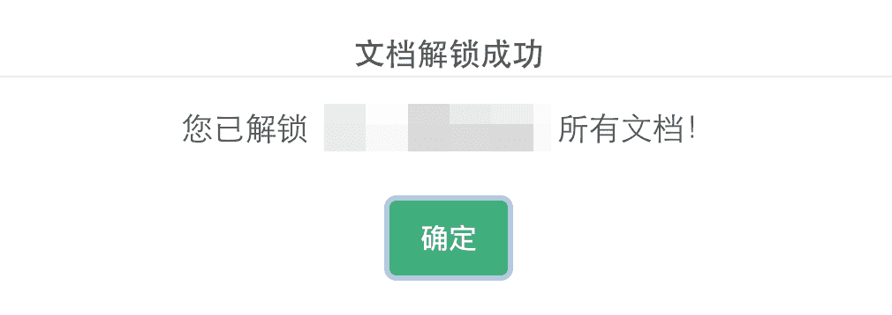

### 固定返回内容

验证码可能会定期更换，我们也可以更改接口的返回内容，这样就不用担心更换

使用一款拓展程序：`Requestly`: Open Source HTTPs Debugging Proxy

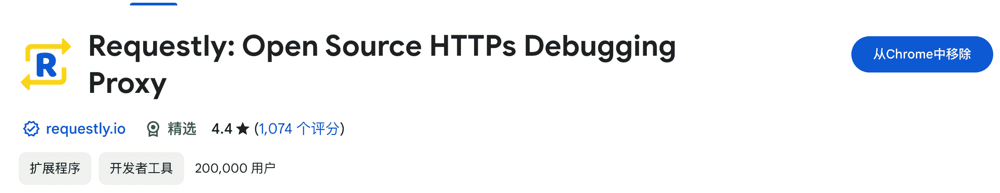

添加一个 `Modify API Response`（修改API响应）的规则

直接返回我们自己想要的

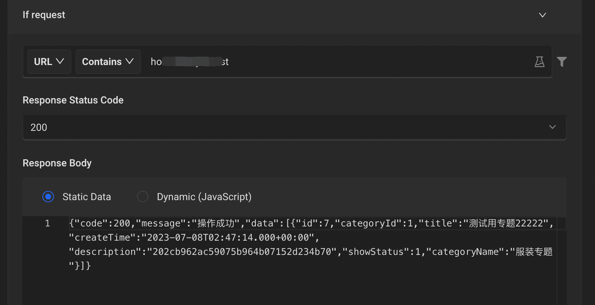

## 某文档二

浏览另一平台的文档，也是需要验证码

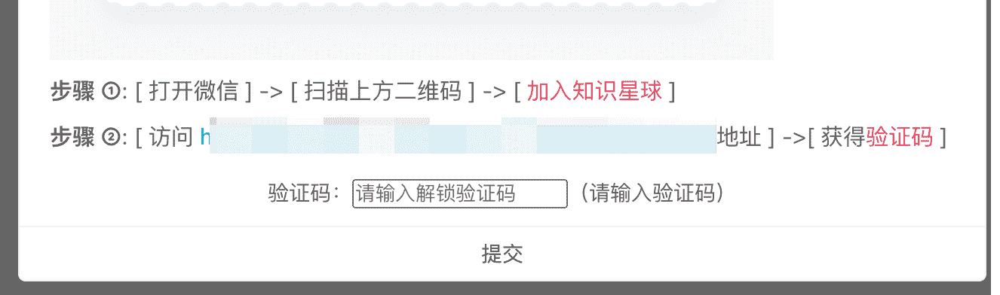

随机输入一个验证码后，没有网络请求，可以断定验证码在本地

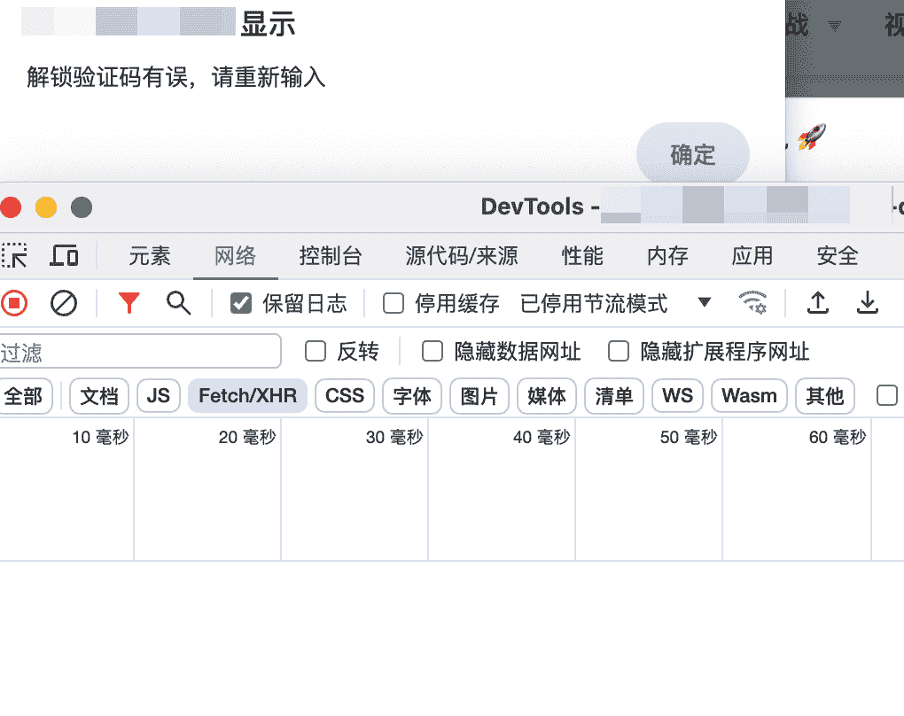

停用缓存，重新刷新网页，搜索关键字：解锁验证码有误

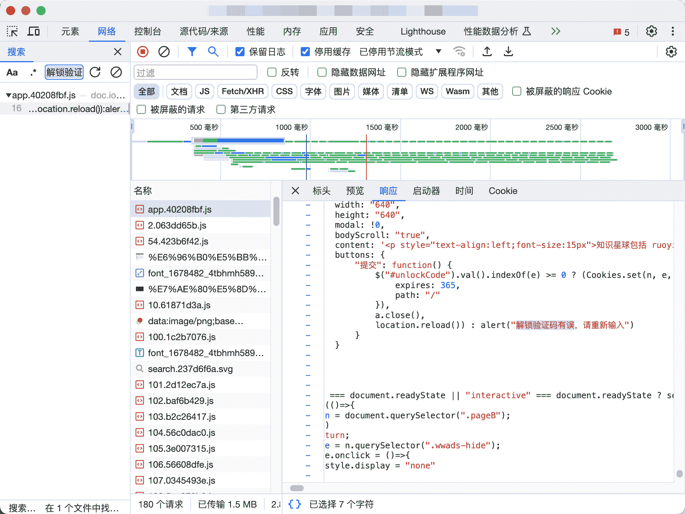

去分析下代码

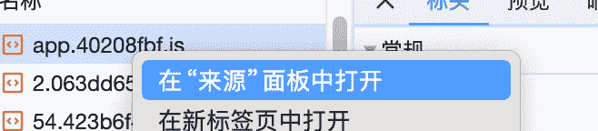

根据这块代码意思就是

输入框 `id="unlockCode"` 的值和 `e` 比较，存在也就是 `>= 0` 就设置 `Cookies` 否则就是验证码错误

所以 `e` 就是密码

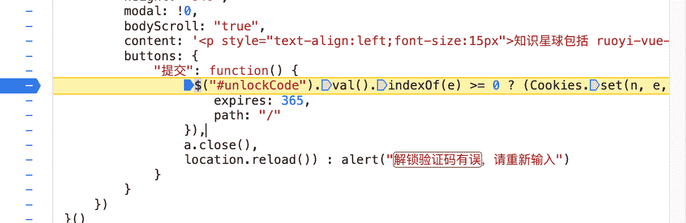

这个输入框也正好是 验证码 的输入框

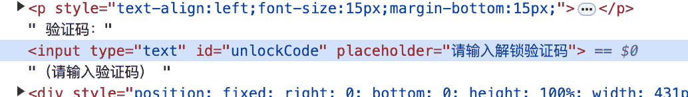

鼠标放过去就知道了密码

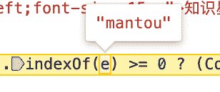
