# [Web逆向] 某查查登录验证（滑块验证、图标验证、字体验证）

- 原帖：<https://www.52pojie.cn/forum.php?mod=viewthread&tid=1886624>
- 抓取时间：2026-11-01T22:38:26

实战：如何使用 `yolov8` + `siamese` 轻松通过某查查登录验证（滑块验证、图标验证、字体验证），通过率高达 99%。

## 一、接口参数分析

### 1、接口分析

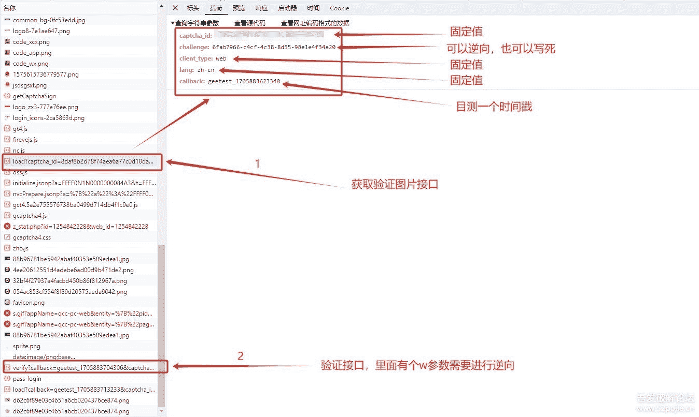

`1.png` (132.99 KB, 下载次数: 0)

[附件下载](https://www.52pojie.cn/forum.php?mod=attachment&aid=MjY3MzY1NnxiYTBmYTEyNXwxNzkzNTcyNzAzfDE2ODA4NnwxODg2NjI0&nothumb=yes)

2024-1-31 16:01 上传

### 2、`load` 接口参数分析——获取背景图、缺口图、验证小图

`captcha_type` 值：`icon` 图标验证、`word` 字体验证、`slide` 滑块验证。

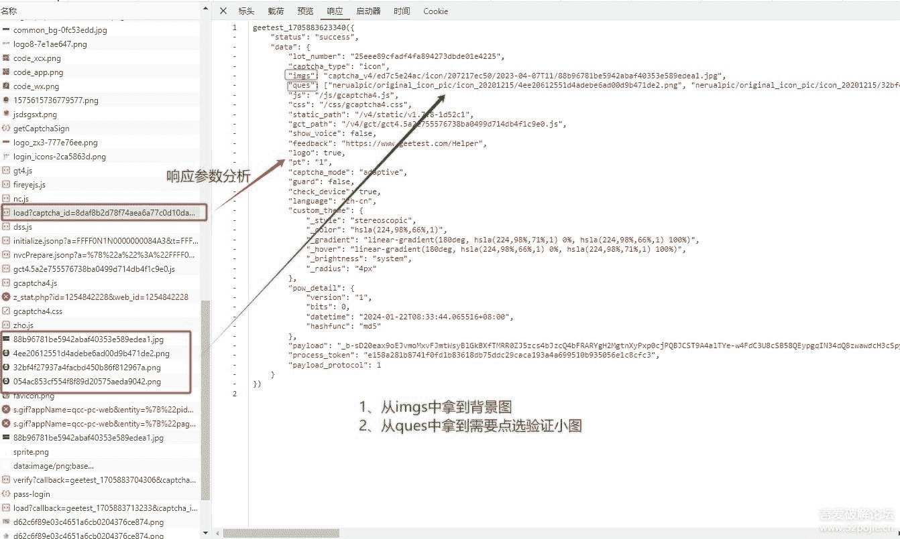

`2.png` (175.91 KB, 下载次数: 0)

[附件下载](https://www.52pojie.cn/forum.php?mod=attachment&aid=MjY3MzY1N3w3NGJiODdlMHwxNzkzNTcyNzAzfDE2ODA4NnwxODg2NjI0&nothumb=yes)

2024-1-31 16:02 上传

### 3、`verify` 接口参数分析——重点参数 `w`

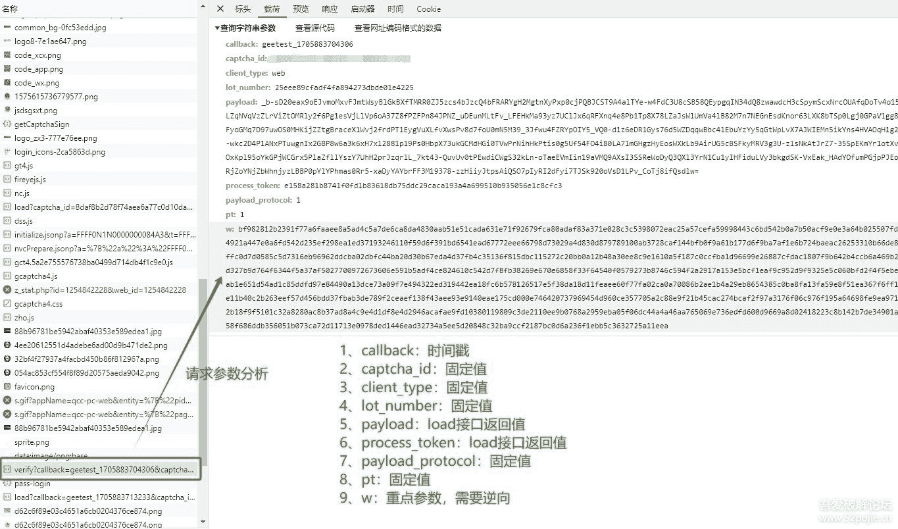

`3.png` (254.06 KB, 下载次数: 0)

[附件下载](https://www.52pojie.cn/forum.php?mod=attachment&aid=MjY3MzY1OHw1ZTc3ZjQyYnwxNzkzNTcyNzAzfDE2ODA4NnwxODg2NjI0&nothumb=yes)

2024-1-31 16:05 上传

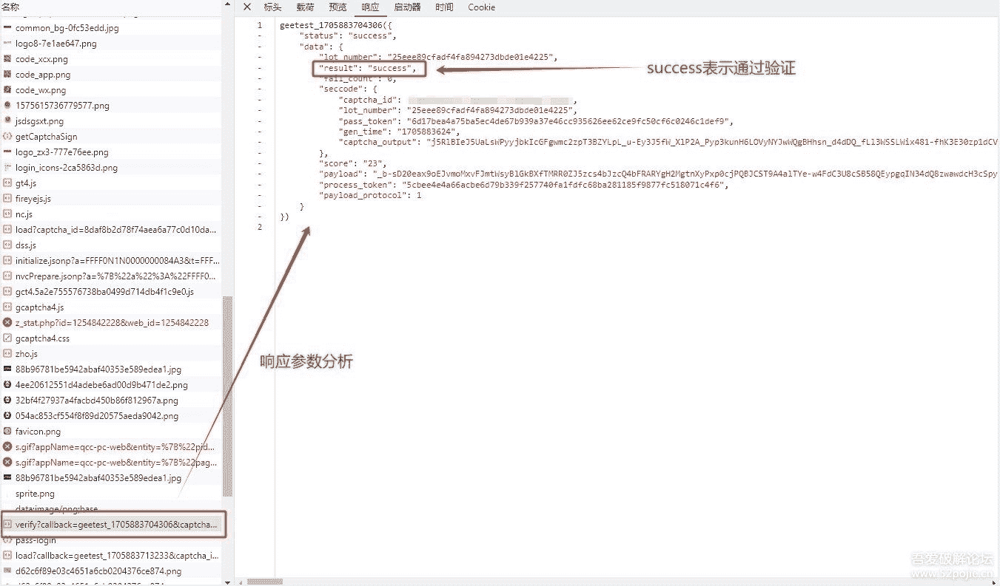

`4.png` (136.3 KB, 下载次数: 2)

[附件下载](https://www.52pojie.cn/forum.php?mod=attachment&aid=MjY3MzY1OXwxMGJjZDRjNnwxNzkzNTcyNzAzfDE2ODA4NnwxODg2NjI0&nothumb=yes)

2024-1-31 16:05 上传

### 4、重点参数 `w` 值逆向实现

```javascript
// 1、快速定位到w生成位置，可以从启动器中进入js文件，直接搜索w值是搜不到的，我们可以搜索其它参数；如：process_token
// 2、直接搜索'process_token'是搜索不到的，需要进行unicode编码转换
// 字符串转unicode编码
function unicodeEnc(str){
    var value = '';
    for(var i=0; i \u0070\u0072\u006f\u0063\u0065\u0073\u0073\u005f\u0074\u006f\u006b\u0065\u006e
// w值---> \u0077
```

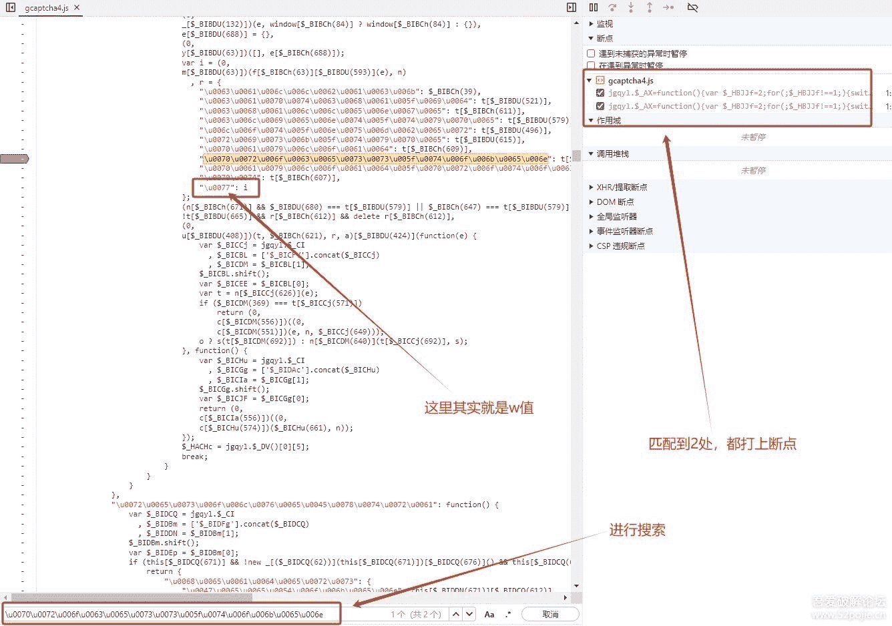

`5.png` (195.21 KB, 下载次数: 1)

[附件下载](https://www.52pojie.cn/forum.php?mod=attachment&aid=MjY3MzY2MHw5YzQwMzU5NXwxNzkzNTcyNzAzfDE2ODA4NnwxODg2NjI0&nothumb=yes)

2024-1-31 16:07 上传

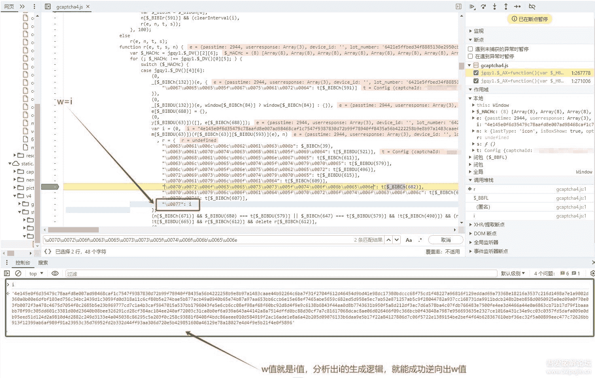

`6.png` (299.02 KB, 下载次数: 2)

[附件下载](https://www.52pojie.cn/forum.php?mod=attachment&aid=MjY3MzY2MXxlN2E4ZDQ0YXwxNzkzNTcyNzAzfDE2ODA4NnwxODg2NjI0&nothumb=yes)

2024-1-31 16:07 上传

```javascript
// w值=i值

// 1、i值的生成逻辑，扣取源码分析

var i = (0,m[$_BIBDU(63)])(f[$_BIBCh(63)][$_BIBDU(593)](e), n)

// 简写i的生成

var i = m[$_BIBDU(63)](f[$_BIBCh(63)][$_BIBDU(593)](e), n)

// m[$_BIBDU(63)]是一个方法，里面有2个参数：f[$_BIBCh(63)][$_BIBDU(593)](e)、n

// f[$_BIBCh(63)][$_BIBDU(593)]是一个方法，里面有1个参数：e

// 2、从里向外逐个分析即可
```

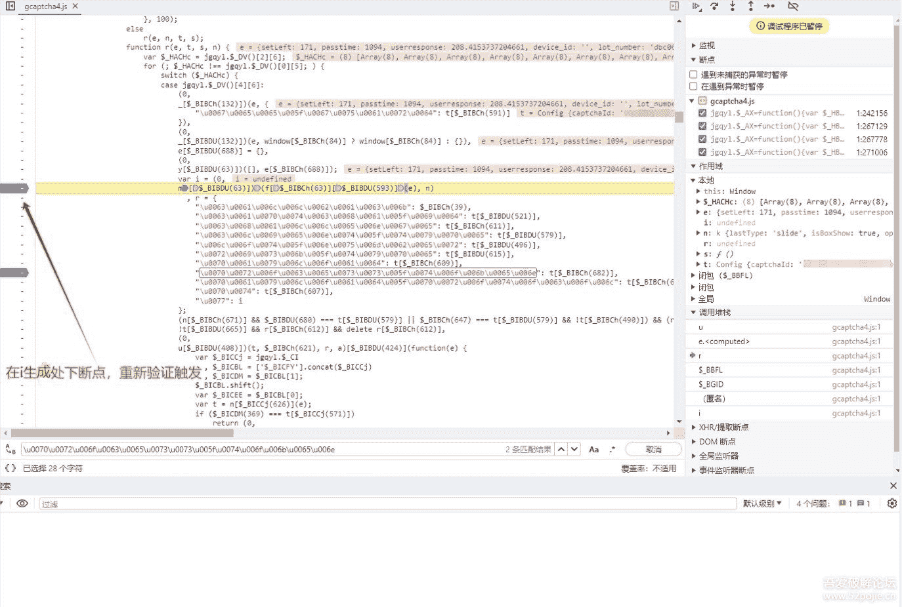

`7.png` (193.21 KB, 下载次数: 1)

[附件下载](https://www.52pojie.cn/forum.php?mod=attachment&aid=MjY3MzY2MnxlY2ZiN2IxYnwxNzkzNTcyNzAzfDE2ODA4NnwxODg2NjI0&nothumb=yes)

2024-1-31 16:09 上传

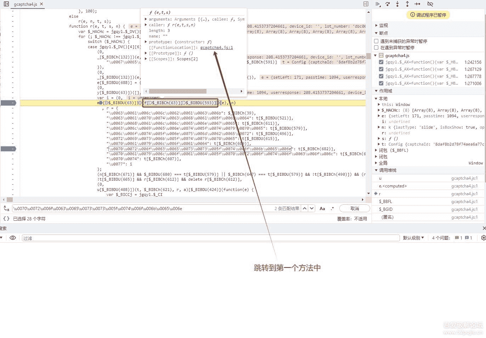

`8.png` (204.4 KB, 下载次数: 2)

[附件下载](https://www.52pojie.cn/forum.php?mod=attachment&aid=MjY3MzY2M3xjMWZjNTNlZXwxNzkzNTcyNzAzfDE2ODA4NnwxODg2NjI0&nothumb=yes)

2024-1-31 16:09 上传

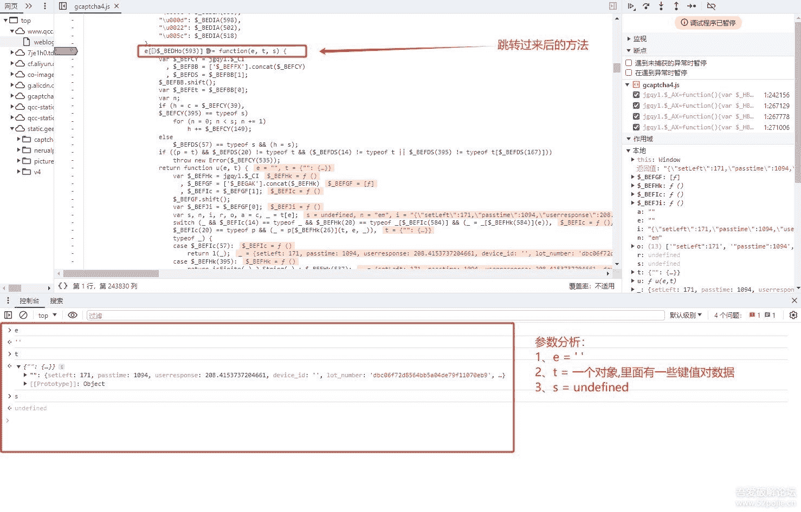

`9.png` (200.64 KB, 下载次数: 1)

[附件下载](https://www.52pojie.cn/forum.php?mod=attachment&aid=MjY3MzY2NHxiMjc1N2QyYXwxNzkzNTcyNzAzfDE2ODA4NnwxODg2NjI0&nothumb=yes)

2024-1-31 16:09 上传

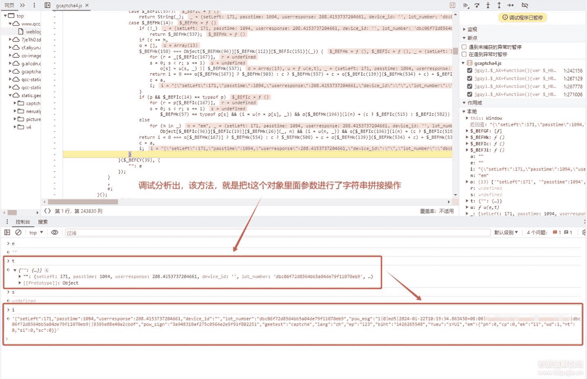

`10.png` (217.12 KB, 下载次数: 1)

[附件下载](https://www.52pojie.cn/forum.php?mod=attachment&aid=MjY3MzY2Nnw4NjU1ZTA2OXwxNzkzNTcyNzAzfDE2ODA4NnwxODg2NjI0&nothumb=yes)

2024-1-31 16:10 上传

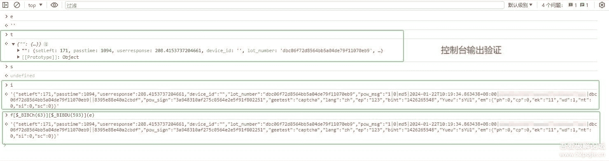

`11.png` (100.23 KB, 下载次数: 1)

[附件下载](https://www.52pojie.cn/forum.php?mod=attachment&aid=MjY3MzY2N3w2ZjFhNmRhY3wxNzkzNTcyNzAzfDE2ODA4NnwxODg2NjI0&nothumb=yes)

2024-1-31 16:10 上传

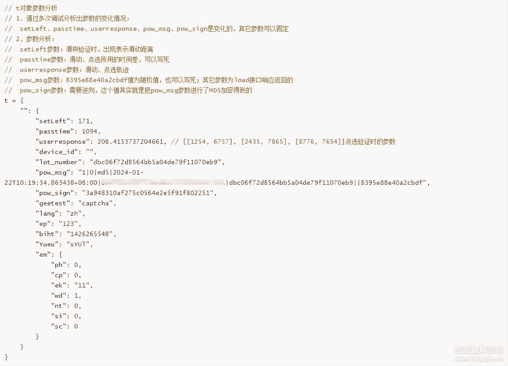

`12.png` (91.68 KB, 下载次数: 1)

[附件下载](https://www.52pojie.cn/forum.php?mod=attachment&aid=MjY3MzY2OHw0Y2UzYmE5YXwxNzkzNTcyNzAzfDE2ODA4NnwxODg2NjI0&nothumb=yes)

2024-1-31 16:10 上传

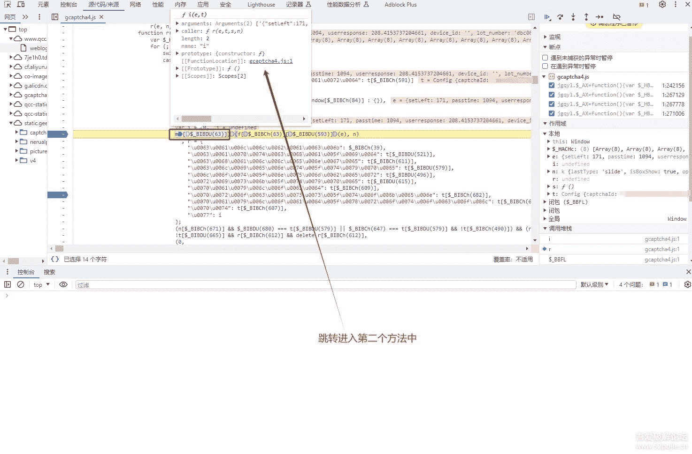

`13.png` (200.61 KB, 下载次数: 1)

[附件下载](https://www.52pojie.cn/forum.php?mod=attachment&aid=MjY3MzY2OXwyNjlhOTZkYXwxNzkzNTcyNzAzfDE2ODA4NnwxODg2NjI0&nothumb=yes)

2024-1-31 16:10 上传

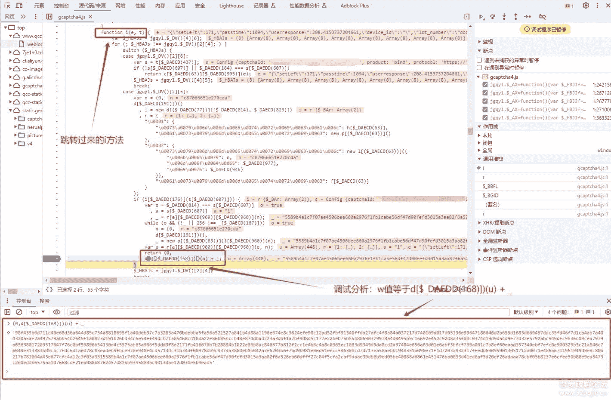

`14.png` (251.9 KB, 下载次数: 1)

[附件下载](https://www.52pojie.cn/forum.php?mod=attachment&aid=MjY3MzY3MXw2NjlkZGZlMXwxNzkzNTcyNzAzfDE2ODA4NnwxODg2NjI0&nothumb=yes)

2024-1-31 16:11 上传

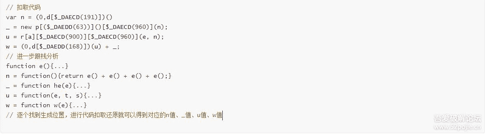

`15.png` (37.84 KB, 下载次数: 2)

[附件下载](https://www.52pojie.cn/forum.php?mod=attachment&aid=MjY3MzY3MnxmNWQ4YmUwYnwxNzkzNTcyNzAzfDE2ODA4NnwxODg2NjI0&nothumb=yes)

2024-1-31 16:11 上传

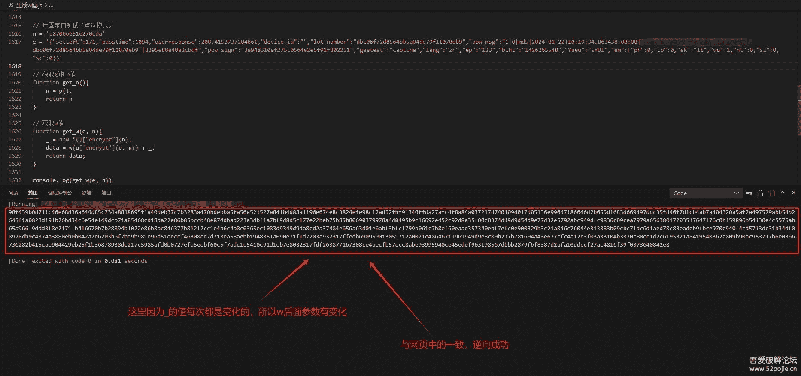

`16.png` (196.32 KB, 下载次数: 1)

[附件下载](https://www.52pojie.cn/forum.php?mod=attachment&aid=MjY3MzY3M3w2MDMxMTBhNHwxNzkzNTcyNzAzfDE2ODA4NnwxODg2NjI0&nothumb=yes)

2024-1-31 16:11 上传

### 5、构造请求实现验证

分析到这里就很简单了。

1. 请求 `load` 接口获取图片
2. 构造好滑块轨迹、点选轨迹的生成--->构造 `t` 参数--->生成 `w` 值
3. 请求 `verify` 接口进行验证

### 6、验证成功率

（模型训练好了，成功率相当高）

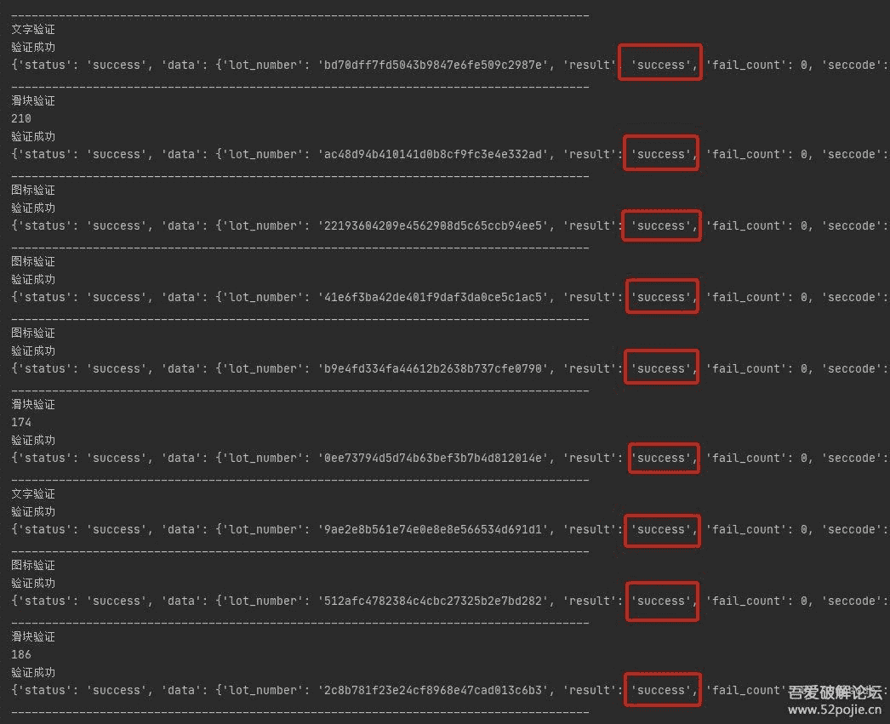

`17.png` (123.98 KB, 下载次数: 2)

[附件下载](https://www.52pojie.cn/forum.php?mod=attachment&aid=MjY3MzY3NHw2MTBiMThkN3wxNzkzNTcyNzAzfDE2ODA4NnwxODg2NjI0&nothumb=yes)

2024-1-31 16:13 上传

## 二、总结

1. 找到所需的接口请求
2. 进行请求参数分析
3. 对所需请求参数进行逆向还原
4. 训练点选模型
5. 发送请求进行验证

声明：本文章仅供学习使用，上述代码请不要违规使用，所造成的一切不良后果与作者无关；如有侵权，请联系删除！！！
