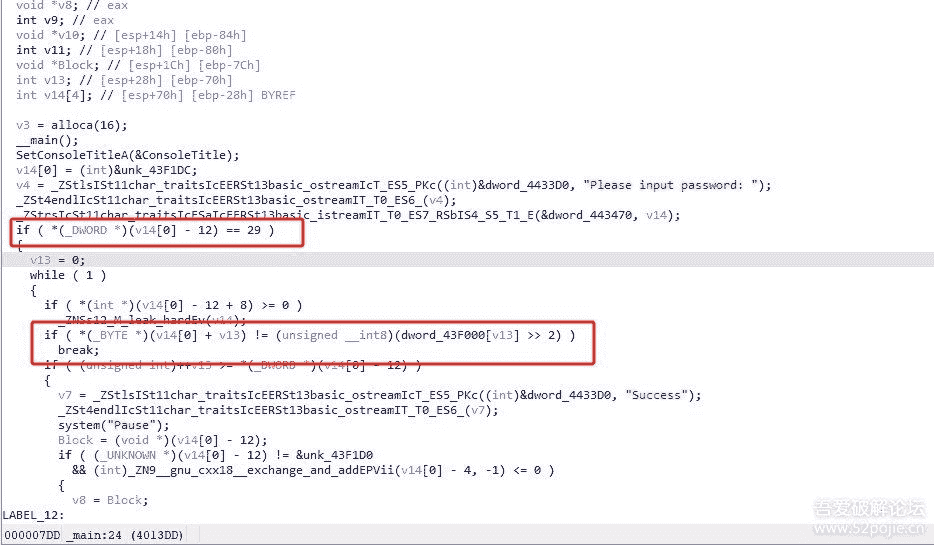
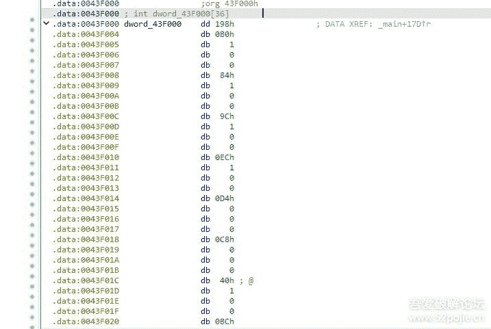
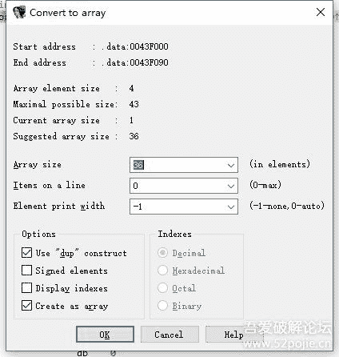
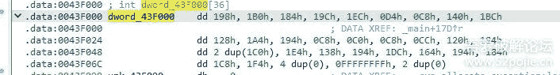
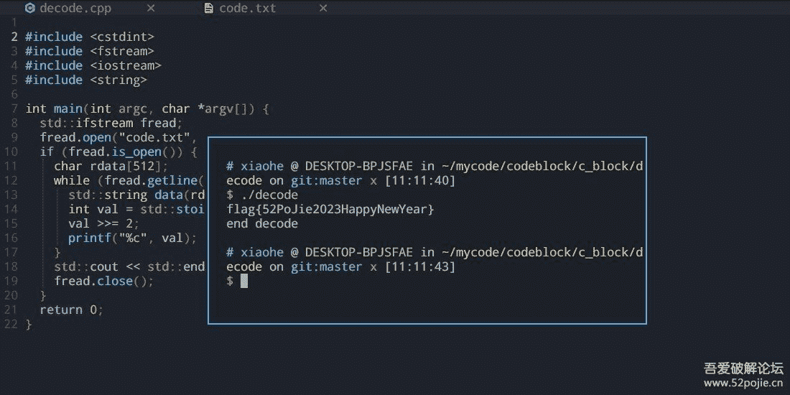

# [原创] 2023年解题领红包之二

- 原帖: https://www.52pojie.cn/forum.php?mod=viewthread&tid=1890269
- 抓取时间: 2026-11-01T22:38:05

首先说明一下，本人逆向方面菜的不行，写的不明白的地方，多多包含吧，第一次写也没有啥经验，希望管理多多指点本来想直接用`OD`来找到结果的，结果发现字符是一个一个进行计算出来再比较的，并且程序自己还没有保存计算好的字符串
* 思路一，改程序，让程序算好的`code`保存到内存里（这方面不是我太菜，感觉比较费时间，所以本人并没有这么实现
* 思路二，读代码，编写一段代码，将加密的字符串还原（这方面我感觉适合我）

二话不多说，上反编译的图


IDA.png (87.12 KB, 下载次数: 1)
[href="forum.php?mod=attachment&aid=MjY3NTc3MHw2ZDFhMmM4NnwxNzkzNTcyNjgyfDE2ODA4NnwxODkwMjY5&nothumb=yes" target="_blank"](https://www.52pojie.cn/forum.php?mod=attachment&aid=MjY3NTc3MHw2ZDFhMmM4NnwxNzkzNTcyNjgyfDE2ODA4NnwxODkwMjY5&nothumb=yes)
2024-2-17 10:54 上传

首先程序第一个关键信息是判长度必需是39，第二个关键信息是取表`dword_43F000`中的数据，进行右移两位，然后与我们的`code`进行比较

那我们来跟一下`table`中的字符，双击`dword_43F000`，下图即为表中的原始数据


43f000.png (51.91 KB, 下载次数: 1)
[href="forum.php?mod=attachment&aid=MjY3NTc3MXw5ODViZDA2OXwxNzkzNTcyNjgyfDE2ODA4NnwxODkwMjY5&nothumb=yes" target="_blank"](https://www.52pojie.cn/forum.php?mod=attachment&aid=MjY3NTc3MXw5ODViZDA2OXwxNzkzNTcyNjgyfDE2ODA4NnwxODkwMjY5&nothumb=yes)
2024-2-17 10:59 上传

由于是4字节的数据，我们需要整理一下，看着就比较清晰了，`dword_43f000`右键点`array`


array.png (35.08 KB, 下载次数: 1)
[href="forum.php?mod=attachment&aid=MjY3NTc3Mnw4MDc2YjYyMHwxNzkzNTcyNjgyfDE2ODA4NnwxODkwMjY5&nothumb=yes" target="_blank"](https://www.52pojie.cn/forum.php?mod=attachment&aid=MjY3NTc3Mnw4MDc2YjYyMHwxNzkzNTcyNjgyfDE2ODA4NnwxODkwMjY5&nothumb=yes)
2024-2-17 11:02 上传

默认即可，点OK，就是我们要的数据了


Array4byte.png (25.22 KB, 下载次数: 0)
[href="forum.php?mod=attachment&aid=MjY3NTc3M3wxNzM4MGU0ZXwxNzkzNTcyNjgyfDE2ODA4NnwxODkwMjY5&nothumb=yes" target="_blank"](https://www.52pojie.cn/forum.php?mod=attachment&aid=MjY3NTc3M3wxNzM4MGU0ZXwxNzkzNTcyNjgyfDE2ODA4NnwxODkwMjY5&nothumb=yes)
2024-2-17 11:04 上传

我们把表中的数据copy出来，自己写个代码将数据都右移两位，就是我们要的`code`了
我的代码如下：

```
#include 
#include 
#include 
#include 

int main(int argc, char *argv[]) {
  std::ifstream fread;
  fread.open("code.txt", std::ios::in);
  if (fread.is_open()) {
    char rdata[512];
    while (fread.getline(rdata, sizeof(rdata))) {
      std::string data(rdata);
      int val = std::stoi(data, nullptr, 16);
      val >>= 2;
      printf("%c", val);
    }
    std::cout 
```

198h
1B0h
184h
19Ch
1ECh
0D4h
0C8h
140h
1BCh
128h
1A4h
194h
0C8h
0C0h
0C8h
0CCh
120h
184h
1C0h
1C0h
1E4h
138h
194h
1DCh
164h
194h
184h
1C8h
1F4h

以下是我的运行结果，bingo


bingo.png (70.45 KB, 下载次数: 1)
[href="forum.php?mod=attachment&aid=MjY3NTc3NHxiNDllMmRkNXwxNzkzNTcyNjgyfDE2ODA4NnwxODkwMjY5&nothumb=yes" target="_blank"](https://www.52pojie.cn/forum.php?mod=attachment&aid=MjY3NTc3NHxiNDllMmRkNXwxNzkzNTcyNjgyfDE2ODA4NnwxODkwMjY5&nothumb=yes)
2024-2-17 11:12 上传
