# [CTF] 【2024春节】解题领红包部分 WP

- 原帖：[https://www.52pojie.cn/forum.php?mod=viewthread&tid=1892900](https://www.52pojie.cn/forum.php?mod=viewthread&tid=1892900)
- 抓取时间: 2026-11-01T22:37:41

## Windows 初级

`fl@g{H@ppy_N3w_e@r!2o24!Fighting!!!}`

```
#include 
int main() {
    char data[] = "ioCj~KCss|bQ6zbhCu$5r57$Iljkwlqj$$$\x80";
    char* ptr = (char*)data;
    while (*ptr != '\0') {
        *ptr = *ptr - 3;
        ptr++;
    }
    std::cout 
```

## 安卓初级

`flag{happy_new_year_2024}`

修改一下 `AndroidManifest.xml` 对应 `activity` 的 `android:exported` 改成 `true` 然后重新安装。

直接 `adb` 启动，视频播放结束后会出现 `flag`。

```
adb shell am start -n com.zj.wuaipojie2024_1/com.zj.wuaipojie2024_1.YSQDActivity
```

实际上藏在视频末尾。

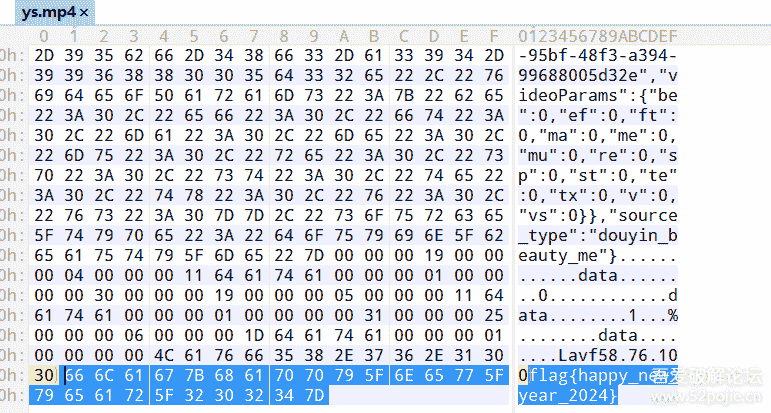

1.png (60.53 KB, 下载次数: 1)

[附件下载](https://www.52pojie.cn/forum.php?mod=attachment&aid=MjY3Njk1NXwzODNkN2JiMXwxNzkzNTcyNjU5fDE2ODA4NnwxODkyOTAw&nothumb=yes)

2024-2-24 11:38 上传

## 安卓初级

`flag{52pj_HappyNewYear2024}`

直接 `adb` 启动。

```
adb shell am start -n com.kbtx.redpack_simple/com.kbtx.redpack_simple.FlagActivity
```

主要是签名效验，如果修改了签名，还原出来可能乱码。

```
public class FlagActivity extends h {
    public static byte[] o = {86, -18, 98, 103, 75, -73, 51, -104, 104, 94, 73, 81, 125, 118, 112, 100, -29, 63, -33, -110, 108, 115, 51, 59, 55, 52, 77};
    public void onCreate(Bundle bundle) {
        byte[] bArr;
        Signature[] signatureArr;
        super.onCreate(bundle);
        setContentView(R.layout.activity_flag);
        byte[] bArr2 = o;
        try {
            signatureArr = getPackageManager().getPackageInfo(getPackageName(), 64).signatures;
        } catch (PackageManager.NameNotFoundException unused) {
            bArr = new byte[0];
        }
        if (signatureArr != null && signatureArr.length >= 1) {
            byte[] byteArray = signatureArr[0].toByteArray();
            ByteBuffer allocate = ByteBuffer.allocate(bArr2.length);
            for (int i i 
```

直接提取出 `CERT.RSA`，修改后缀为 `p7b`，双击导出证书。

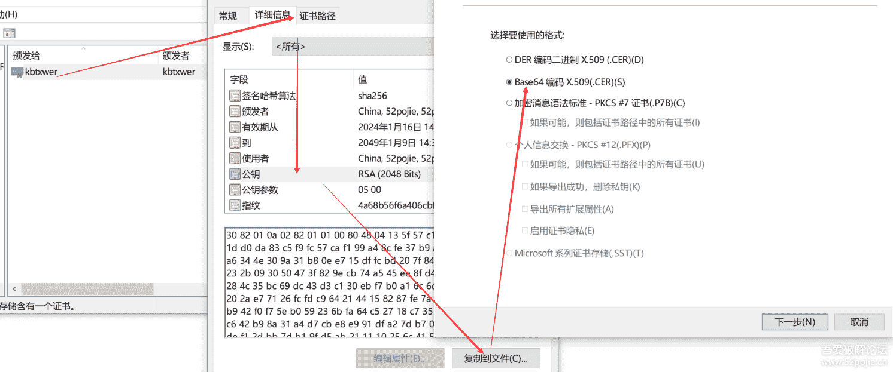

2.png (253.25 KB, 下载次数: 1)

[附件下载](https://www.52pojie.cn/forum.php?mod=attachment&aid=MjY3Njk1NnwxMjEzOTgwNHwxNzkzNTcyNjU5fDE2ODA4NnwxODkyOTAw&nothumb=yes)

2024-2-24 11:38 上传

```
public class cj {
    public static String CertString  ="MIIDADCCAegCAQEwDQYJKoZIhvcNAQELBQAwRjEQMA4GA1UEAwwHa2J0eHdlcjEQ" +
            "MA4GA1UECwwHNTJwb2ppZTEQMA4GA1UECgwHNTJwb2ppZTEOMAwGA1UEBwwFQ2hp" +
            "bmEwHhcNMjQwMTE2MDYzMzIzWhcNNDkwMTA5MDYzMzIzWjBGMRAwDgYDVQQDDAdr" +
            "YnR4d2VyMRAwDgYDVQQLDAc1MnBvamllMRAwDgYDVQQKDAc1MnBvamllMQ4wDAYD" +
            "VQQHDAVDaGluYTCCASIwDQYJKoZIhvcNAQEBBQADggEPADCCAQoCggEBAIBIBBNf" +
            "V8FTmAmp9ikd0NqDxfn8V8rxmaSM/je5oMxGoQUhMqY0TjCaMbgO5xXf/L0gf4Sw" +
            "fmIMi8MjKwkwUEc/gp7LdKVF7o/UKf6uhIDkKEw1vGncQ9PBMOv3sKFsbRCFdhPC" +
            "JCAq53Em/P3JZCFEFYKH/noZaWO8UqR7uULw916wWSNr+mTFJxjHNUekw2LxF07G" +
            "QrmKMaTXy+jpkd+ifbcANdRRyHm13vEtu32xn9WrIREQJWxBVs0L5z0i0sBgMUTe" +
            "oY5lehLAwBRrpcXrprlzoie4FfyO/tTEonVHcYVL08BEaG7L5lBaVA56+qCZkzlB" +
            "C1qf64JkB0UsKIsCAwEAATANBgkqhkiG9w0BAQsFAAOCAQEAXhAk7ZWZLNjYgzTq" +
            "82D9VpntfSMzY03e1l6c2mIiu1rmgYnbavtYmMqfNDeVnbLlDObRn8O5gu3n6e1d" +
            "2SSI3tZpKK1ZOf3zGLF7SpXwIFu22iej3k97aXANlKJegHZ9JWtjABTiVGSLKjfW" +
            "iZWe9HKTp3LBUJ2zGw3e03eWT+kzZtjvgI4gfRsji7vVG2odODMODCm+4a/dBnTl" +
            "ADtM0lVdJaDPUj8ReR0ql/99EyNUMv7wtE+3o0xpCrUd5NVLp4doEusfaRnSvS35" +
            "fDfp6SfODQ9BqE9TPgEPyOGn+iA8HHw+XQhzsrn8bNdNnlOBMsbXJcMFvF92Cw+4" +
            "cQGoog==";
    public static byte[] o = {86, -18, 98, 103, 75, -73, 51, -104, 104, 94, 73, 81, 125, 118, 112, 100, -29, 63, -33, -110, 108, 115, 51, 59, 55, 52, 77};
    public static void main(String[] args) {
        byte[] Flag = new byte[o.length];
        byte[] publicKeyBytes = Base64.getDecoder().decode(CertString);
        for (int i i 
```

## 安卓中级

简直就是终极谜语人。

没啥好分析的。

根据他的逻辑（完全没有逻辑）走，建议使用 `as` 或其他软件查看日志帮助调试。

首先需要手动修复 `classes.dex`，建议使用 `np` 只修复文件头，这里建议使用 `frida` 或其他去 `hook` 文件读写，避免签名效验。

```
            InputStream open = getAssets().open("classes.dex");
            byte[] bArr = new byte[open.available()];
            open.read(bArr);
            File file = new File(getDir("data", 0), "1.dex");
```

手动复制文件 `1.dex` 修改为 `decode.dex`，同目录 `/data/user/0/com.zj.wuaipojie2024_2/app_data/`。

```
    private static ByteBuffer read(Context context) {
        try {
            File file = new File(context.getDir("data", 0), "decode.dex");
            if (file.exists()) {
                FileInputStream fileInputStream = new FileInputStream(file);
                byte[] bArr = new byte[fileInputStream.available()];
                fileInputStream.read(bArr);
                ByteBuffer wrap = ByteBuffer.wrap(bArr);
                fileInputStream.close();
                return wrap;
            }
            return null;
        } catch (Exception unused) {
            return null;
        }
    }
```

`hook` 掉文件删除，主要删除了修复好了的 `2.dex`。

```
            fix.delete();
            new File(dir, fix.getName()).delete();
```

根据提示，还要修复 `B.D`，`hook` 这里修改为 `B` 的偏移，同时修改 `2.dex` 为 `decode.dex`。

```
getResources().getIntArray(R.array.A_offset)// int A_offset = 0x7f030000;int B_offset = 0x7f030001;
```

两次修复了就能看到完整代码了。

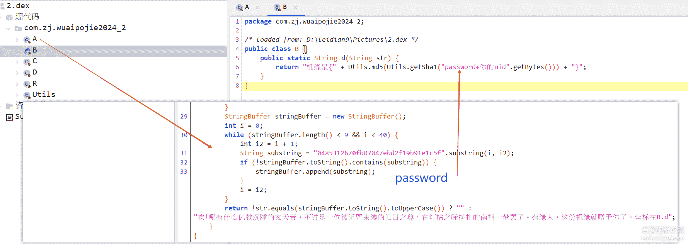

3.png (96.84 KB, 下载次数: 1)

[附件下载](https://www.52pojie.cn/forum.php?mod=attachment&aid=MjY3Njk1N3w1ZWFkY2VjMHwxNzkzNTcyNjU5fDE2ODA4NnwxODkyOTAw&nothumb=yes)

2024-2-24 11:38 上传

```
import java.security.MessageDigest;
import java.security.NoSuchAlgorithmException;

public class zj {
    static String UID = "1372193";
    public static void main(String[] args) {
        String password=GetPassword();
        String password_uid=password+UID;
        byte[] bArr = password_uid.getBytes();
        byte[] sha1 = GetSha1(bArr);
        String md5 = GetMd5(sha1);
        System.out.println("机缘是"+md5);
    }
    public static byte[] GetSha1(byte[] bArr) {
        try {
            return MessageDigest.getInstance("SHA-1").digest(bArr);
        } catch (NoSuchAlgorithmException e) {
            e.printStackTrace();
            return null;
        }
    }
    public static String GetMd5(byte[] bArr) {
        try {
            MessageDigest instance = MessageDigest.getInstance("MD5");
            instance.update(bArr);
            byte[] digest = instance.digest();
            StringBuffer stringBuffer = new StringBuffer();
            for (byte b : digest) {
                stringBuffer.append(Integer.toHexString((b & 255) | 256).substring(1, 3));
            }
            return stringBuffer.toString();
        } catch (NoSuchAlgorithmException e) {
            e.printStackTrace();
            return null;
        }
    }
    public static String GetPassword() {
        StringBuffer stringBuffer = new StringBuffer();
        int i = 0;
        while (stringBuffer.length() 
```

## win高级

没做出来只做记录，学会了再来。

客户端 `upx` 脱壳参考 [https://www.52pojie.cn/thread-1534675-1-1.html](https://www.52pojie.cn/thread-1534675-1-1.html)，主要是：

```
sub_140001CF0(uid, flag) //分别传入了int uid 和 char *flag
```

避免每次都去手动输入使用 `frida` 调用。

```
frida  crackme2024g_dump_SCY.exe 

var sub_140001CF0 = new NativeFunction(ptr(0x140001CF0), 'int64', ['int64', 'pointer']);
var uid = 1372193;
console.log(sub_140001CF0(uid, Memory.allocUtf8String("12345678-56789ABC-9ABDEF0C-12345678=")));
```

服务端 `Themida` 壳，看不懂，找了个现成的 [https://github.com/bobalkkagi/bobalkkagi](https://github.com/bobalkkagi/bobalkkagi)。

只找了部分对应函数，能力有限看不懂做了啥。

```
401360 verify (ppv a1,bool *a2)//成功后给a2赋值
4012B0 set_flag(ppv a1,char *a2)
401280 set_uid(ppv a1,int *a2)
```

## 安卓高级

没做出来只做记录，学会了再来。


因为只有`arm64`的`so`，真机刷废了，新的还没买，所以只有用`unidbg`跑

利用`unidbg`先知道函数地址

```
RegisterNative(com/wuaipojie/crackme2024/MainActivity, checkSn([BLjava/lang/String;)Z, RX@0x4001befc[lib52pojie.so]0x1befc)
```

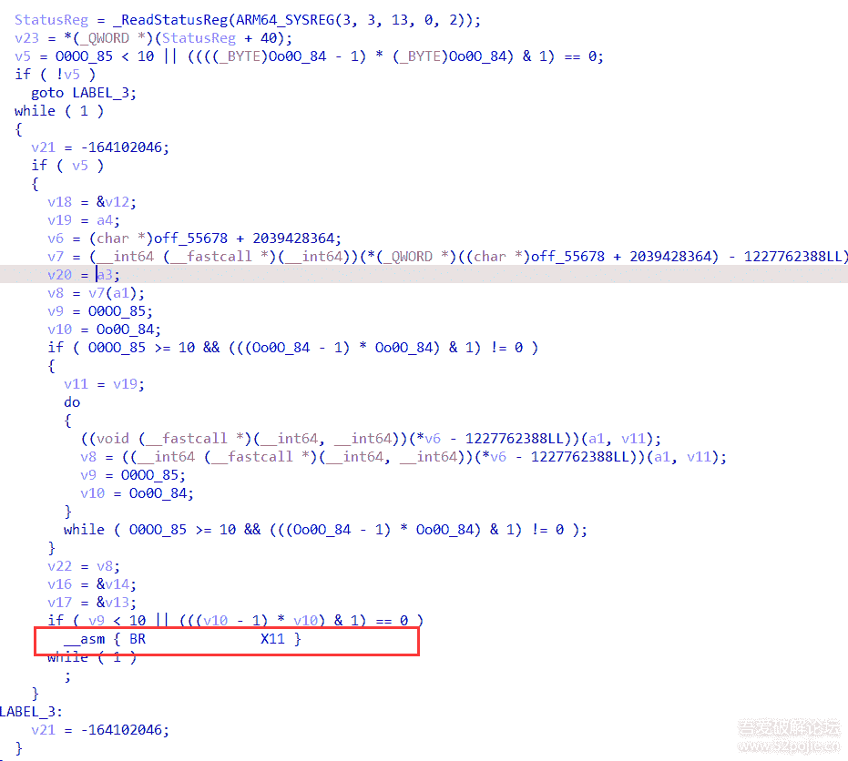

[4.png (59.36 KB, 下载次数: 1)](https://www.52pojie.cn/forum.php?mod=attachment&aid=MjY3Njk1OHxlMDkwYzlhYXwxNzkzNTcyNjU5fDE2ODA4NnwxODkyOTAw&nothumb=yes)

2024-2-24 11:38 上传

可以看见大部分都是间接跳转，参考 [bbs.kanxue.com/thread-277086.htm](https://bbs.kanxue.com/thread-277086.htm) 来还原部分，需要注意的是并不完全一样，不一定寄存器全部相同，建议直接遍历。

第一次还原后，仍有很多看不懂，参考往年[2022春节】解题领红包WP](https://www.52pojie.cn/forum.php?mod=viewthread&tid=1588403&highlight=2022%B4%BA%BD%DA#41606231_android-%E4%B8%AD%E7%BA%A7%E9%A2%98-2/4)

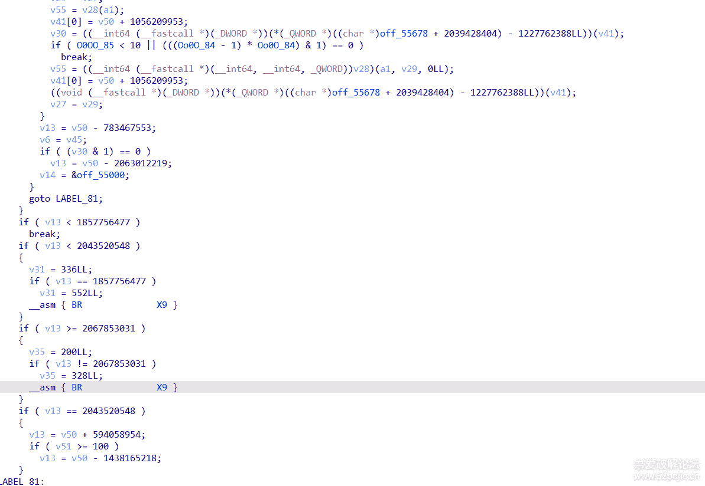

[5.png (62.59 KB, 下载次数: 2)](https://www.52pojie.cn/forum.php?mod=attachment&aid=MjY3Njk1OXxiNjNmNzI2MXwxNzkzNTcyNjU5fDE2ODA4NnwxODkyOTAw&nothumb=yes)

2024-2-24 11:38 上传

首先把`.bss`段`patch 0`，参考周易大佬的[www.52pojie.cn/forum.php?mod=redirect&goto=findpost&ptid=1742334&pid=45551435](https://www.52pojie.cn/forum.php?mod=redirect&goto=findpost&ptid=1742334&pid=45551435)，修改下就行。

```
import ida_bytes
import ida_idaapi
import ida_xref
import struct

def do_patch(ea):
    if ida_bytes.get_bytes(ea + 3, 1) == b"\xB9":
        reg = ord(ida_bytes.get_bytes(ea, 1)) & 0b00011111
        ida_bytes.patch_bytes(ea, struct.pack("
```

然后吧`.data`设置只读

形如`MOV W9, #(off_55398 - 0xFFFFFFFF86761E84)`，鼠标点击一下，按下`Q`，`MOV W9, #0x798F3514`

大部分还是勉强可以阅读了

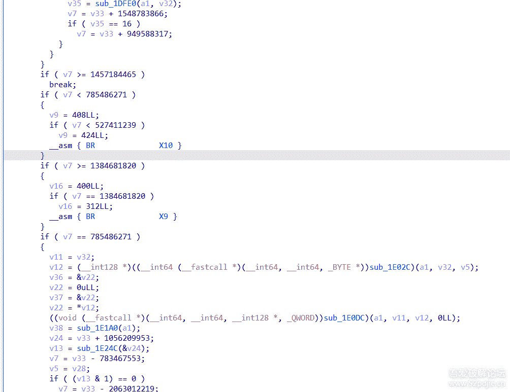

[6.png (53.83 KB, 下载次数: 1)](https://www.52pojie.cn/forum.php?mod=attachment&aid=MjY3Njk2MHxjNmFlODgyNXwxNzkzNTcyNjU5fDE2ODA4NnwxODkyOTAw&nothumb=yes)

2024-2-24 11:38 上传

首先获取输入`md5`后`uid`的字节长度，判断是否是16

```
              v35 = sub_1DFE0(a1, v32);
              v7 = v33 + 1548783866;
              if ( v35 == 16 )
                v7 = v33 + 949588317;

__int64 __fastcall sub_1DFE0(JNIEnv *a1)
{
  return ((*a1)->GetArrayLength)(a1);
}
```

然后是读取输入，以及判断某个东西

```
      v11 = v32;
      v12 = sub_1E02C(a1, v32, v5);//GetByteArrayElements
      v36 = &v22;
      v22 = 0uLL;
      v37 = &v22;
      v22 = *v12;
      sub_1E0DC(a1, v11, v12, 0);//ReleaseByteArrayElements
      v38 = sub_1E1A0(a1, v31, 0LL);//GetStringUTFChars
      v24 = v33 + 1056209953;
      v13 = sub_1E24C(&v24);
      v7 = v33 - 783467553;
      v5 = v28;
      if ( (v13 & 1) == 0 )
        v7 = v33 - 2063012219;
```

第一次`trace`就结束了，只有几千行就退出了

根据上面内容判断`sub_1E24C`函数返回值，走不同分支，根据`trace`代码，`hook`一下部分函数

```
        int ptrs[]={0x1E924,0x23D8C,0x21260,0x217f8,0x23f28,0x219cc,0x21c34,0x21020};
        for(int ptr:ptrs)
        {
            addHook(ptr);
        }
public void addHook(int address) {
    emulator.attach().addBreakPoint(module.base + address, new BreakPointCallback() {
        @Override
        public boolean onHit(Emulator emulator, long address) {
            RegisterContext context = emulator.getContext();
            System.out.println("addBreakPoint: 0x" + Long.toHexString(address) + ", LR=" + context.getLRPointer());
            for (int i = 0; i 
```

可以看出来主要检测`adb`，通过`init.svc.adbd`判断`running`，其余作用没看出来，直接`hook`

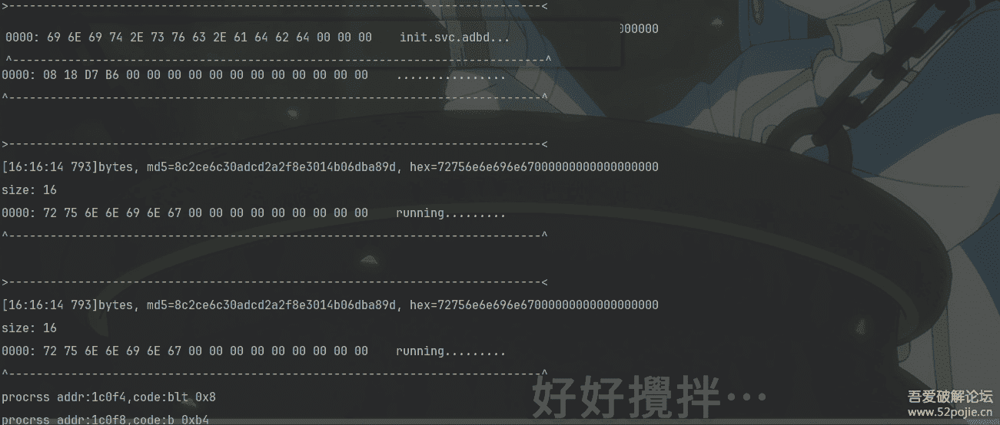

[7.png (335.96 KB, 下载次数: 1)](https://www.52pojie.cn/forum.php?mod=attachment&aid=MjY3Njk2MXwyZmQxZDYzY3wxNzkzNTcyNjU5fDE2ODA4NnwxODkyOTAw&nothumb=yes)

2024-2-24 11:38 上传

```
emulator.attach().addBreakPoint(module.base + 0x1E24C, new BreakPointCallback() {
    @Override
    public boolean onHit(Emulator emulator, long address) {
        RegisterContext context = emulator.getContext();
        emulator.getBackend().reg_write(Arm64Const.UC_ARM64_REG_PC, context.getLRPointer().peer);
        emulator.getBackend().reg_write(Arm64Const.UC_ARM64_REG_X0, 0);
        return true;
    }
});
```

然后他就崩了，在`1E924`函数里面，根据某位大佬提示，这里面就核心部分，主要涉及签名以及`flag`，但是手上没手机调试不了，也没看出为啥崩了

```
    v24 = sub_1E924(v31, v50, v22, v20, v26);
    v8 = v41;
    v5 = v38;
    v6 = v39;
    v9 = v43 + 2021858523;
    if ( !v24 )
      v9 = v43 - 1030713484;
```

通样的这里根据不同返回值走不同分支

```
emulator.attach().addBreakPoint(module.base + 0x1E24C, new BreakPointCallback() {
    @Override
    public boolean onHit(Emulator emulator, long address) {
        RegisterContext context = emulator.getContext();
        emulator.getBackend().reg_write(Arm64Const.UC_ARM64_REG_PC, context.getLRPointer().peer);
        emulator.getBackend().reg_write(Arm64Const.UC_ARM64_REG_X0, 0);
        return true;
    }
});
```

同样的操作，可以看到这次主函数基本跳转至少是还原了

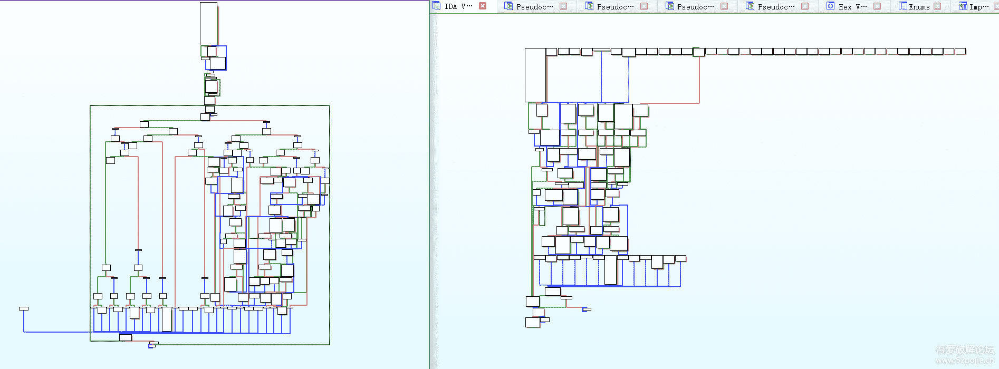

[8.png (48.63 KB, 下载次数: 2)](https://www.52pojie.cn/forum.php?mod=attachment&aid=MjY3Njk2Mnw0OTRiM2Q5MHwxNzkzNTcyNjU5fDE2ODA4NnwxODkyOTAw&nothumb=yes)

2024-2-24 11:38 上传

在子函数里面还有一种，通过传递常量，来跳转，不多，直接手动就行，也可以自动，不过没啥明显特征，就是多了几个`add`

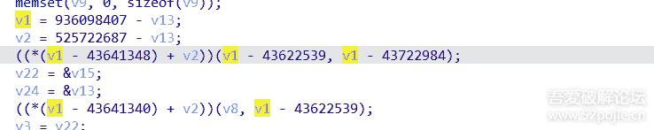

[9.png (18.47 KB, 下载次数: 2)](https://www.52pojie.cn/forum.php?mod=attachment&aid=MjY3Njk2M3w5NjkyMmNhOHwxNzkzNTcyNjU5fDE2ODA4NnwxODkyOTAw&nothumb=yes)

2024-2-24 11:38 上传

根据`trace`代码基本可以判断大致逻辑了，接着上面的读取了`md5`（`uid`）和`flag`

先`base64`解码`flag`

```
        v49 = v6;
        v50 = sub_24290(v48, v44, v6);
        (sub_1E85C)(a1, v8, v48);
        v8 = v41;
        if ( v50 )
          v9 = v43 + 1818917099;
        else
          v9 = v43 - 1972945260;
```

然后进行一系列运算

```
sub_1E924(v31, v50, v22, v20, v26)
```

然后对比`md5(uid)`和解密后的`flag`

```
          v19 = sub_21020(v31, v53, v47, v45);//xor
          v8 = v41;
          v5 = v38;
          v36 = v19 == 0;
```

```
emulator.attach().addBreakPoint(module.base + 0x21020,new BreakPointCallback() {
    @Override
    public boolean onHit(Emulator emulator, long address) {
        RegisterContext context = emulator.getContext();
        int x0 = context.getIntArg(0);
        System.out.println("x0: " + x0);
        Pointer pointer1 = context.getPointerArg(1);
        byte[] bytes1 = pointer1.getByteArray(0, 16);
        Inspector.inspect(bytes1, "bytes");
        Pointer pointer2 = context.getPointerArg(2);
        byte[] bytes2 = pointer2.getByteArray(0, 16);
        Inspector.inspect(bytes2, "bytes");
        int x3 = context.getIntArg(3);
        System.out.println("x3: " + x3);
        //emulator.getBackend().reg_write(Arm64Const.UC_ARM64_REG_PC, context.getLRPointer().peer);
        //emulator.getBackend().reg_write(Arm64Const.UC_ARM64_REG_X0, 0);
        return true;
    }
});
```

能力有限搞不定`sub_1E924`函数，等大佬来。

2> web
3> 初级


flag1{52pj2024}视频开头  
flag3{GRsgk2}  视频开头

flag2{xHOpRP} 扫描二维码重定向

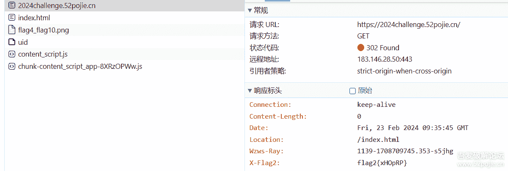

10.png (46.49 KB, 下载次数: 1)

[href="forum.php?mod=attachment&aid=MjY3Njk2NHw0MDNkMzYwZnwxNzkzNTcyNjU5fDE2ODA4NnwxODkyOTAw&nothumb=yes" target="_blank"](https://www.52pojie.cn/forum.php?mod=attachment&aid=MjY3Njk2NHw0MDNkMzYwZnwxNzkzNTcyNjU5fDE2ODA4NnwxODkyOTAw&nothumb=yes)

2024-2-24 11:38 上传

flag4{YvJZNS} 打开网站加载了图片`flag4_flag10.png`直接下载下来，或者浏览器改成黑暗模式

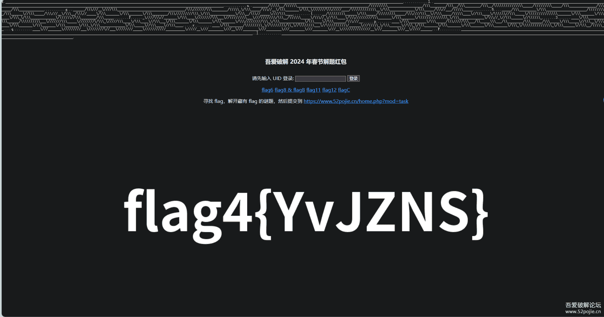

11.png (93.78 KB, 下载次数: 2)

[href="forum.php?mod=attachment&aid=MjY3Njk2NXw5M2U2YThkNXwxNzkzNTcyNjU5fDE2ODA4NnwxODkyOTAw&nothumb=yes" target="_blank"](https://www.52pojie.cn/forum.php?mod=attachment&aid=MjY3Njk2NXw5M2U2YThkNXwxNzkzNTcyNjU5fDE2ODA4NnwxODkyOTAw&nothumb=yes)

2024-2-24 11:38 上传

`flagA`

登录的时候，返回了加密flag, 然后又请求了一个地址，返回了`uid`,`uid`和flag格式类似,猜测加密算法一样，所以直接修改`uid`

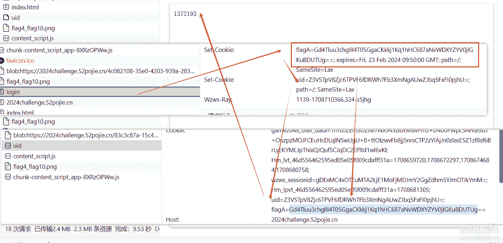

12.png (122.79 KB, 下载次数: 1)

[href="forum.php?mod=attachment&aid=MjY3Njk2Nnw4ZWZmY2VlN3wxNzkzNTcyNjU5fDE2ODA4NnwxODkyOTAw&nothumb=yes" target="_blank"](https://www.52pojie.cn/forum.php?mod=attachment&aid=MjY3Njk2Nnw4ZWZmY2VlN3wxNzkzNTcyNjU5fDE2ODA4NnwxODkyOTAw&nothumb=yes)

2024-2-24 11:38 上传

```python
import requests

headers = {

    "Accept": "*/*",

    "Accept-Language": "zh-CN,zh;q=0.9,en;q=0.8,en-GB;q=0.7,en-US;q=0.6",

    "Cache-Control": "no-cache",

    "Connection": "keep-alive",

    "Pragma": "no-cache",

    "Referer": "https://2024challenge.52pojie.cn/index.html",

    "Sec-Fetch-Dest": "empty",

    "Sec-Fetch-Mode": "cors",

    "Sec-Fetch-Site": "same-origin",

    "User-Agent": "Mozilla/5.0 (Windows NT 10.0; Win64; x64) AppleWebKit/537.36 (KHTML, like Gecko) Chrome/119.0.0.0 Safari/537.36 Edg/119.0.0.0",

    "sec-ch-ua": "\"Microsoft Edge\";v=\"119\", \"Chromium\";v=\"119\", \"Not?A_Brand\";v=\"24\"",

    "sec-ch-ua-mobile": "?0",

    "sec-ch-ua-platform": "\"Windows\""

}

cookies = {

    "Hm_lvt_46d556462595ed05e05f009cdafff31a": "1708659720,1708672297,1708674684,1708680758",

    "wzws_sessionid": "gDExMC4xOTEuMTA2LjE1MoFjMDJmY2GgZdhm5YJmOTJkYmM=",

    "Hm_lpvt_46d556462595ed05e05f009cdafff31a": "1708681305",

    "uid": "Gd4Tluu3chgIlI4T05GgaCKkkj1Kq1hHC687aNvWDXYZYV0jIGKuBDUTUg==",

    "flagA": "Gd4Tluu3chgIlI4T05GgaCKkkj1Kq1hHC687aNvWDXYZYV0jIGKuBDUTUg=="

}

url = "https://2024challenge.52pojie.cn/auth/uid"

response = requests.get(url, headers=headers, cookies=cookies)

print(response.text)

//flagA{55dd466e}
```

## 中级

flag5{P3prqF} - flag9{KHTALK}网页源码中有提示

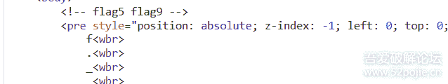

13.png (14.42 KB, 下载次数: 2)

[href="forum.php?mod=attachment&aid=MjY3Njk2N3xlNDgxODYzN3wxNzkzNTcyNjU5fDE2ODA4NnwxODkyOTAw&nothumb=yes" target="_blank"](https://www.52pojie.cn/forum.php?mod=attachment&aid=MjY3Njk2N3xlNDgxODYzN3wxNzkzNTcyNjU5fDE2ODA4NnwxODkyOTAw&nothumb=yes)

2024-2-24 11:38 上传

用记事本打开，一个字符一行，调整一下缩进

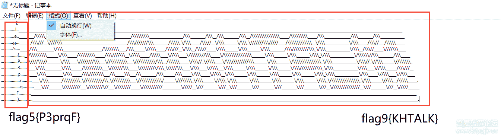

14.png (34.99 KB, 下载次数: 3)

[href="forum.php?mod=attachment&aid=MjY3Njk2OHxjNWM0MjBkYXwxNzkzNTcyNjU5fDE2ODA4NnwxODkyOTAw&nothumb=yes" target="_blank"](https://www.52pojie.cn/forum.php?mod=attachment&aid=MjY3Njk2OHxjNWM0MjBkYXwxNzkzNTcyNjU5fDE2ODA4NnwxODkyOTAw&nothumb=yes)

2024-2-24 11:38 上传

flag6{20240217} 计算md5

```javascript
    for (let i = 0; i 
```

直接跑一会或者https://www.cmd5.com/查询

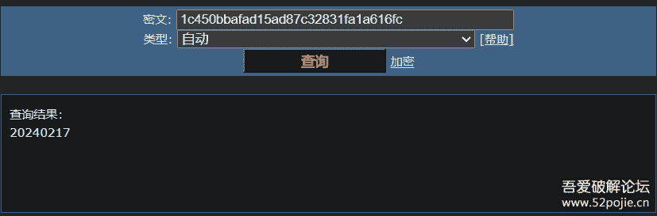

15.png (17.54 KB, 下载次数: 1)

[href="forum.php?mod=attachment&aid=MjY3Njk2OXxhZmQxNmRkMnwxNzkzNTcyNjU5fDE2ODA4NnwxODkyOTAw&nothumb=yes" target="_blank"](https://www.52pojie.cn/forum.php?mod=attachment&aid=MjY3Njk2OXxhZmQxNmRkMnwxNzkzNTcyNjU5fDE2ODA4NnwxODkyOTAw&nothumb=yes)

2024-2-24 11:38 上传

flag7{Djl9NQ} 视频中出现的git地址，根据历史提交记录找到https://github.com/ganlvtech/52pojie-2024-challenge/commit/6bbac038c4813fbc5d129a8d605471ea2e374786

flag8{OaOjIK} `flagB` 直接玩游戏干他丫的，根据`v50`的提示溢出


16.png (21.45 KB, 下载次数: 1)

[href="forum.php?mod=attachment&aid=MjY3Njk3MHxjMzE3ZGZjY3wxNzkzNTcyNjU5fDE2ODA4NnwxODkyOTAw&nothumb=yes" target="_blank"](https://www.52pojie.cn/forum.php?mod=attachment&aid=MjY3Njk3MHxjMzE3ZGZjY3wxNzkzNTcyNjU5fDE2ODA4NnwxODkyOTAw&nothumb=yes)

2024-2-24 11:38 上传

首先要知道多少溢出，直接从2^1-2^64次方买一遍5，买到2^34 17179869184 时提示变了

```json
{"code":1,"msg":"购买商品之后钱怎么还变多了？不知道出什么 bug 了，暂时先拦一下 ^_^"}
```

钱变多了肯定是有负号,说明需要钱不增加的情况下购买。

首先是数据类型，很容易判断出是`i64` -2^63 到 2^63-1

```cpp
#include 
#include 
int main() {
    int64_t a,b,c;
    a=999063388;
    b=8589934592;
    c=17179869184;
    std::cout 

ID | 
商品名称 | 
商品描述 | 
价格 | 

4

```
