# [CTF] 【2024春节】解题领红包 Web和初级题

- 原帖: https://www.52pojie.cn/forum.php?mod=viewthread&tid=1893061
- 抓取时间: 2026-11-01T22:37:50

## Web 一把梭

### flag1{52pj2024}

视频第2-3秒，多看几次背景

### flag2{xHOpRP}

拼接二维码得到地址`https://2024challenge.52pojie.cn`

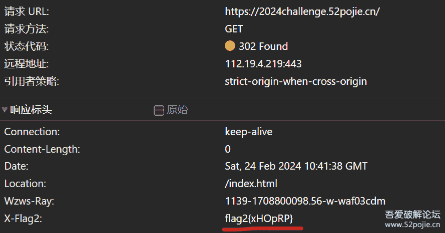

image001.png (67.72 KB, 下载次数: 3)，2024-2-24 19:23 上传

### flag3{GRsgk2}

视频第一秒，肉眼可见

### flag4{YvJZNS}

肉眼可见`https://2024challenge.52pojie.cn/flag4_flag10.png`

### flag5{P3prqF}

f12关掉`pre`白色样式，浏览器宽度1440

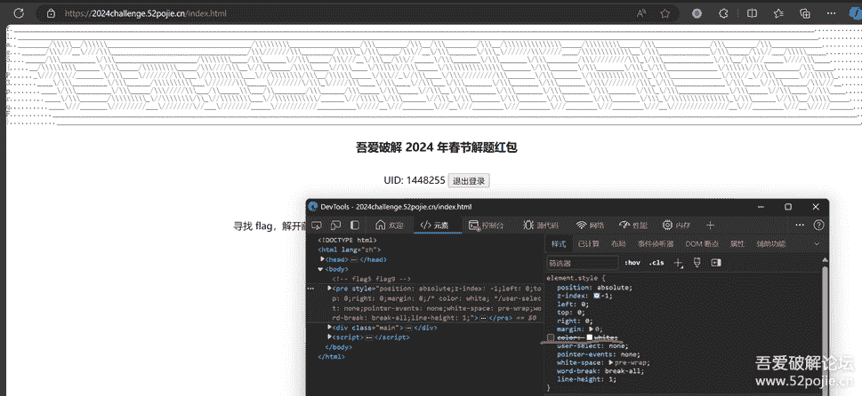

image002.png (212.77 KB, 下载次数: 1)，2024-2-24 19:23 上传

### flag6{20240217}

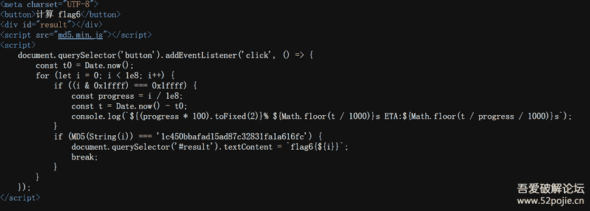

image003.png (132.81 KB, 下载次数: 2)，2024-2-24 19:23 上传

电脑不好，直接在线MD5解

`1c450bbafad15ad87c32831fa1a616fc1c450bbafad15ad87c32831fa1a616fc`得到20240217

### flag7{Djl9NQ}

查看github仓库历史commit

`https://github.com/ganlvtech/52pojie-2024-challenge/commit/b8988dee85f9c96f672157396e6240786fca402b`

### flag8{OaOjIK}

先玩一会，然后找Bug，买18464037713件flagB直接溢出。

### flag9{KHTALK}

参考flag5

### flag10{6BxMkW}

flag4的图片上传到`https://georgeom.net/StegOnline/image`选LSB Half

### flag11{HPQfVF}

敲个数字按↑↓键或者写个循环坐等

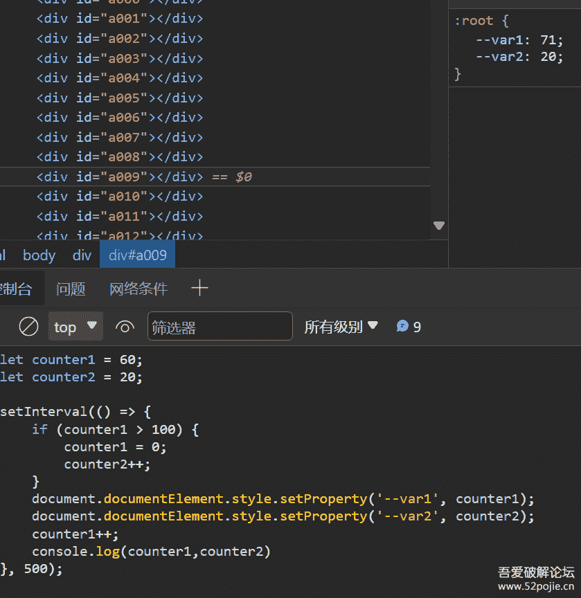

image004.png (129.29 KB, 下载次数: 1)，2024-2-24 19:23 上传

image005.png (377.49 KB, 下载次数: 2)，2024-2-24 19:23 上传

### flag12{HOXI}

懒人方法，F12坐等

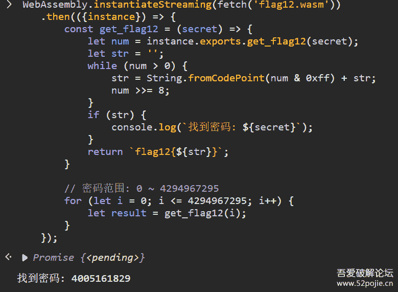

image006.png (92.86 KB, 下载次数: 2)，2024-2-24 19:24 上传

### flagA

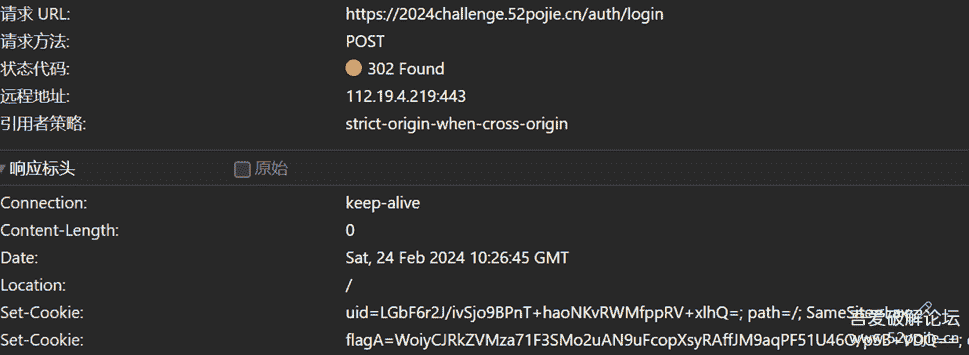

image007.png (132.69 KB, 下载次数: 1)，2024-2-24 19:24 上传

登陆后得到加密的flag，不知道怎么加密的。伪装成`uid`解密，替换`uid`的`cookie`，然后请求`https://2024challenge.52pojie.cn/auth/uid`

### flagB

参考flag8

### flagC

按提示，用画图工具调一下种类和位置，多试几次即可。

image008.png (181.06 KB, 下载次数: 2)，2024-2-24 19:24 上传

## Windows 初级题

1. 直接文本打开，搜索2024

   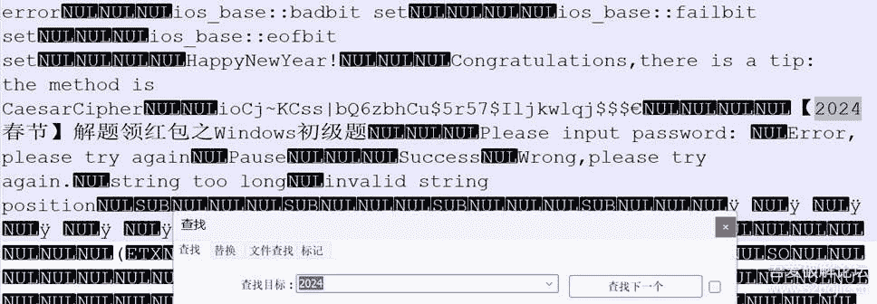

   image009.jpg (90.95 KB, 下载次数: 2)，2024-2-24 19:24 上传

2. 看见提示：`there is a tip: the method isCaesarCipher ioCj~KCss|bQ6zbhCu$5r57$Iljkwlqj$$$?`。凯撒密码偏移3位，有点像但不对, 显然不是常规密码表。

3. 搜索1234找到包含大小写的密码表，按表偏移得到`fl@g{H@ppy_N3w_e@r!2o24!Fighting!!!}`。

   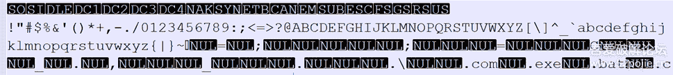

   image010.png (96.6 KB, 下载次数: 1)，2024-2-24 19:24 上传

## Android 初级题

1. 反编译。

2. 一个抓猫游戏，赢了触发`AndroidInterface.onSolverReturnValue(-1)`。

   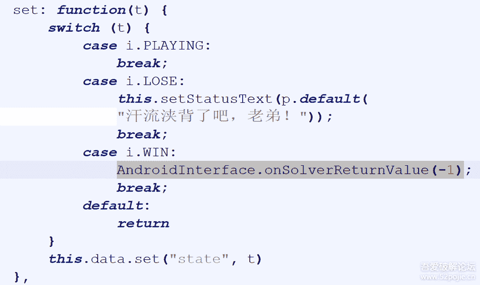

   image011.png (134.24 KB, 下载次数: 1)，2024-2-24 19:24 上传

3. 一步步分析得到最终方法是`extractDataFromFile("/data/user/0/com.zj.wuaipojie2024_1/files/ys.mp4")`。

   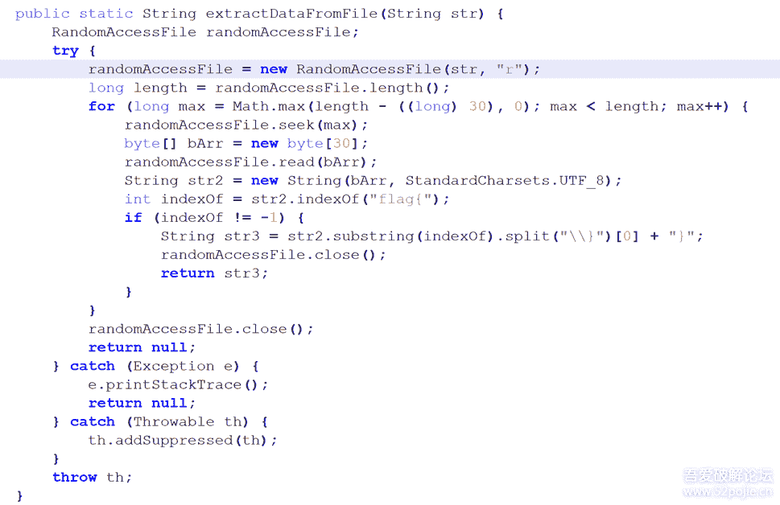

   image013.png (155.45 KB, 下载次数: 2)，2024-2-24 19:24 上传

4. ok,看不懂的给gpt。 这段代码的目的是从给定的文件中提取数据。它打开一个文件，然后从文件的末尾开始读取30字节的数据，然后查找`flag{`字符串。如果找到，它会提取从`flag{`开始到第一个`}`的字符串，并返回。如果在文件中没有找到`flag{`，那么这个函数就会返回`null`。

5. 直接文本打开`ys.mp4`，得到最后几个字符`flag{happy_new_year_2024}`。

   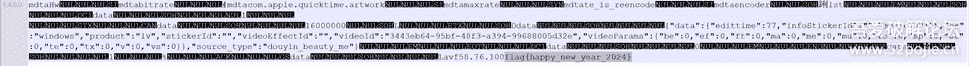

   image015.png (93.37 KB, 下载次数: 2)，2024-2-24 19:24 上传

## Android 初级题2

重复打开几次即可

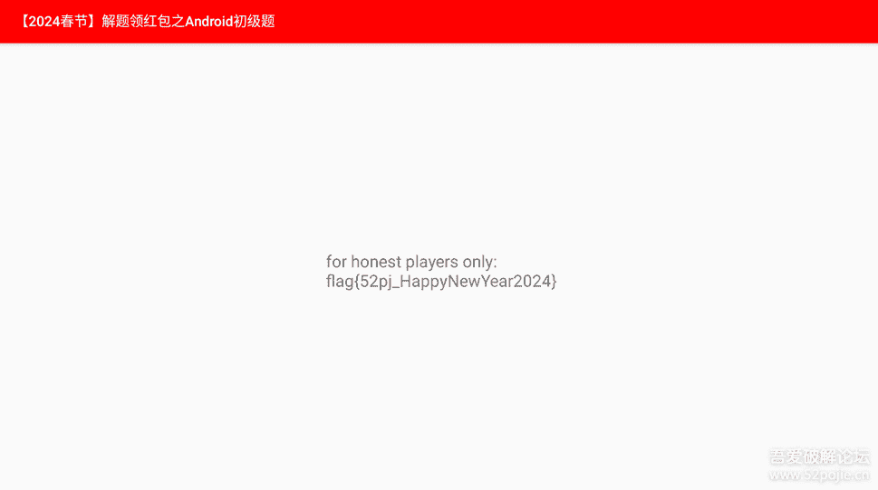

image016.png (30.41 KB, 下载次数: 3)，2024-2-24 19:24 上传
