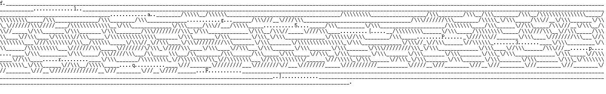
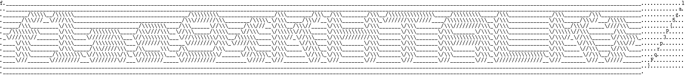
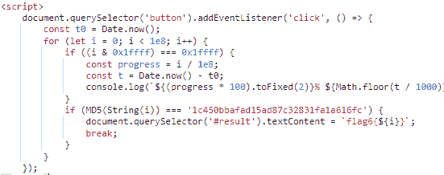
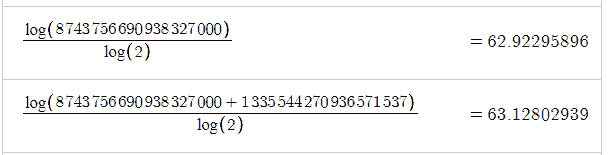
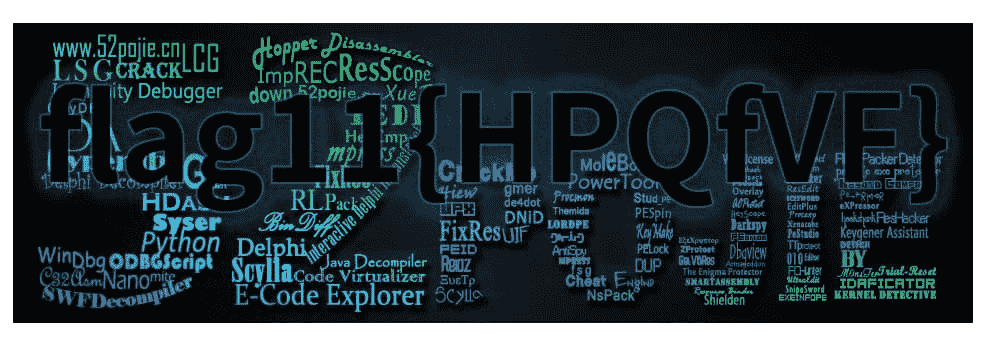
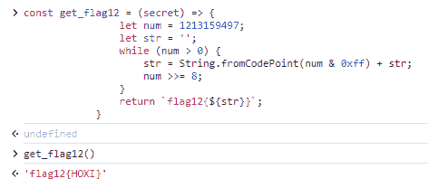
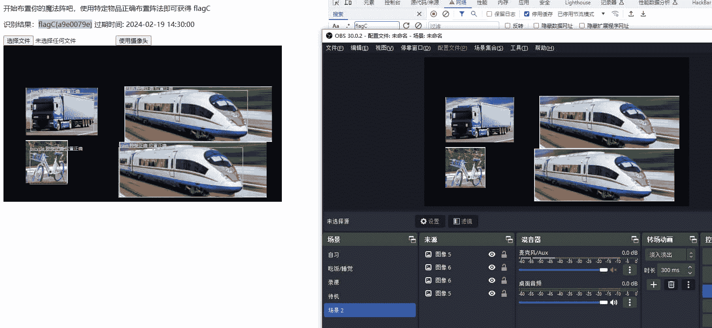

# [原创] 吾爱破解 2024 春节解题领红包之 Web 题解

- 原帖: https://www.52pojie.cn/forum.php?mod=viewthread&tid=1893064
- 抓取时间: 2026-11-01T22:37:43

## 写在前面

找 Flag 的顺序其实是 3 -> 7 -> 6 -> 4 -> 5 -> 9 -> 8 -> 11 -> B -> 10 -> 1 -> 12 -> C -> 2 -> A

感觉初级题反而是最难的。怎么回事呢？

第一天只找到了 `flag3` 和 `flag7`，因为懒得拼二维码，想再找找其他的 flag。

第三天了又想起来这个活动，于是拼好了二维码，发现剩下的 flag 几乎全在这里了……被自己蠢到了。

二维码拼好后的扫出来链接是 [//2024challenge.52pojie.cn" target="_blank" rel="noopener noreferrer nofollow"](https://2024challenge.52pojie.cn:href="https) 。

感觉 `flagB` 是最有意思的，很喜欢这种抢劫商店的感觉

## 初级题

`flag1` 在视频 2~3 秒的背景中。下载下来慢速看几遍就看出来了。`flag1{52pj2024}`

`flag3` 在视频最开始的噪点中。也是慢速看几遍就看出来了。`flag3{GRsgk2}`

`flag4` 是在看 `index.html` 源代码的时候发现有个 `flag4_flag10.png`。打开一看发现只有 `flag4`。然后就掏出来 `StegSolve` 来找被藏起来的 `flag10`。`flag4{YvJZNS}`、`flag10{6BxMkW}`

那么 `flag2` 去哪了呢？视频评论区也有好多人念叨 “我 `flag2` 呢？”。

最开始我也没找到，但是翻了去年 [//www.52pojie.cn/thread-1742787-1-1.html" target="_blank" rel="noopener noreferrer nofollow"](https://www.52pojie.cn/thread-1742787-1-1.html:href="https) ，被 `flag2` 的思路启发到了。

再一抓包 —— 果然，`https://2024challenge.52pojie.cn/` 被重定向到了 `/index.html`，而这个请求的响应标头里面就有一个 `X-Flag2`: `flag2{xHOpRP}`。

刷新过程中发现 `Cookie` 里面有一个 `flagA` 项。但是很显然被加密过了。

同时还有一个 `uid` 项，应该是被相同算法加密过。

想着拿 `uid` 的明文密文推一下加密算法，试了好久也没什么头绪。

突然发现还有一个 `https://2024challenge.52pojie.cn/auth/uid` 的请求返回了明文 `uid`。

第一想法是还有一个类似的接口解码 `flagA`。所以又试了一段时间。

吃饭的时候突然顿悟了 —— 这个接口，很有可能是读取 `cookie` 中的 `uid` 字段然后解密，那么把 `uid` 的值改为 `flagA` 的值不就行了？

试了一下，改了 `cookie` 后重发请求，真就得到了 `flagA`。

好大的脑洞！

## 中级题

书接上回看 `index.html` 源代码发现神秘图片，这次又在源代码里发现很长的一串字符，上面附有注释 。

把 `style` 里的 `color: white;` 注掉（其实还注掉了一点样式来让字符更易读）。



打眼一看就觉得这应该能拼出来个 flag。

于是调整宽度，找到了 `flag9`，旁边就是 `flag5`。



`flag5{P3prqF}`、`flag9{KHTALK}`

`flag6` 的页面上只有一个 计算 `flag6` 的按钮。打开控制台看源代码。



大概意思应该就是跑一个 `[0,1e8)` 的数字，这个数的 `md5` 值为 `1c450bbafad15ad87c32831fa1a616fc`。

去 [//www.cmd5.com/default.aspx" target="_blank" rel="noopener noreferrer nofollow"](https://www.cmd5.com/default.aspx:rel="nofollow noopener" href="https) 查一下，得到 `flag6{20240217}`。

`flag7` 在 Github仓库的 [//github.com/ganlvtech/52pojie-2024-challenge/commit/6bbac038c4813fbc5d129a8d605471ea2e374786" target="_blank" rel="noopener noreferrer nofollow"](https://github.com/ganlvtech/52pojie-2024-challenge/commit/6bbac038c4813fbc5d129a8d605471ea2e374786:rel="nofollow noopener" href="https) `flag7{Djl9NQ}`

`flag8` 的话，随便玩玩 2048 拿到 10000 金币直接买就行了（`flag8{OaOjIK}`

`flagB` 的价格有点太高了，应该不是玩到的。也正是因为数太大了，所以考虑溢出（ v他50也可以得到这一提示）

最开始试了买 -1、0、2.2个发现这个 `buyCount` 应该是个有符号整数。

又试了买 100000000000000000 个发现的确存在溢出问题。

通过提示 购买商品之后钱怎么还变多了？不知道出什么 bug 了，暂时先拦一下 ^_^，可知会校验金钱数额是否增加。

可以猜一下这个购买流程。如果拿 C++ 描述大概就是

```c
// 因为不清楚其他数据是 32位有符号整数 还是 64位有符号整数，于是就全用 long long了
long long price = 999063388;
long long nowCoin;

bool buyFlagB(long long buyCount){
    long long sum = price * buyCount;
    if(sum = 0){
            nowCoin -= sum;
            return true; // 成功购买
        }else{
            return false; // 购买商品之后钱怎么还变多了？不知道出什么 bug 了，暂时先拦一下 ^_^
        }
    }else return false; // 钱不够
}
```

那么 “购买” 思路也很明显了：构造一个 `buyCount` ，使 `buyCount * 999063388` 的溢出后结果小于目前的金币数即可。

即令 $\text{buyCount} \times \text{price} \equiv t\pmod{2^{65}}$。$t$ 指目标金额，就是你想实际多少金币买一个物品。

因为需要把符号位再溢出掉变为 $0$，所以模数是 $2^{65}$ 。

$\text{price}=2^2 \times 79 \times 3161593$，$\gcd(\text{price},2^{65})=2^2$，

$79 \times 3161593$ 在模 $2^{63}$ 意义下有逆元 $1976436867678028775$。

```python
mod = 2**63

def exgcd(a, b):
    if b == 0:
        x = 1
        y = 0
        return x, y
    x1, y1 = exgcd(b, a % b)
    x = y1
    y = x1 - (a // b) * y1
    return x, y

x,y = exgcd(79 * 3161593,mod)
print((x % mod + mod) % mod) # 得到正数

# 1976436867678028775
```

所以我们可以购买 $1976436867678028775$ 个 `flagB` ，实际花费为 $4$​​ 个金币。

都算到这了，顺便就算出来了可以购买 $1335544270936571537$ 个 `flag8`，实际花费为 $16$ 个金币。

都算到这了，顺便就算出来了可以购买 $1106804644422573097$ 个消除道具，实际花费为 $4$​ 个金币。

都算到这了，顺便就算出来了可以购买 $1106804644422573097$ 个翻倍道具，实际花费为 $2$​​​ 个金币。

至于为什么实际最少花费金币是这些数字：

由于两个整数 $a$ 与 $b$ 互素， $a$ 在模 $b$​ 意义下存在逆元，这两个命题间是充分必要关系。

那么要想求 $a$ 在模 $b$ 意义下的逆元，首先就要保证 $a$ 和 $b$ 互素。

所以在这里我们可以将 $\text{price}$ 和 $2^{65}$ 同时除以 $\gcd(\text{price},2^{65})$ 以保证它们互素。

这时我们求得了一个 `buyCount`，满足 $\dfrac{\text{price}}{\gcd(\text{price},2^{65})} \times \text{buyCount} \equiv 1 \pmod{\dfrac{2^{65}}{\gcd(\text{price},2^{65})}}$。

对于 $ax \equiv 1 \pmod b$，可以将它化为一个二元一次方程 $ax+by = 1$。

那么上面的那个式子，也可以化为一个二元一次方程（即令 $a \gets \dfrac{\text{price}}{\gcd(\text{price},2^{65})}$，$b \gets \dfrac{2^{65}}{\gcd(\text{price},2^{65})}$）

$\dfrac{\text{price}}{\gcd(\text{price},2^{65})} \times \text{buyCount} + \dfrac{2^{65}}{\gcd(\text{price},2^{65})} \times y = 1$

将等式两边同时乘一个 $\gcd(\text{price},2^{65})$，就得到了 $\text{price} \times \text{buyCount} + 2^{65} \times y = \gcd(\text{price},2^{65})$。

所以溢出后，$\text{price} \times \text{buyCount}$ 的值即为 $\gcd(\text{price},2^{65})$。



同时也确认了，用的是 $64$ 位有符号整数，最大值为 $2^{63}-1$。

## 高级题

`flag9` 在解中级题时拿到了 `flag9{KHTALK}`。

`flag10` 在解初级题时拿到了 `flag10{6BxMkW}`。

进了 `flag11` 的页面，看见打散的好多小图片。进控制台一看，发现每一个小图片都有一个 `transform` 的属性。他们都用到了参数 `--var1` 和 `--var2`。

所以就试，感觉 `--var1` 差不多了再去试 `--var2`。

然后微调微调，应该是 `--var1:71;--var2:20` 的时候，拿到了



对于 `flag12` ，进入页面后进控制台，看到

```javascript
WebAssembly.instantiateStreaming(fetch('flag12.wasm'))
    .then(({ instance }) => {
        const get_flag12 = (secret) => {
            let num = instance.exports.get_flag12(secret);
            let str = '';
            while (num > 0) {
                str = String.fromCodePoint(num & 0xff) + str;
                num >>= 8;
            }
            return `flag12{${str}}`;
        }
        document.querySelector('button').addEventListener('click', (e) => {
            e.preventDefault();
            document.querySelector('#result').textContent = get_flag12(parseInt(document.querySelector('input').value));
        });
    });
```

看不太懂，但大概意思就是调用了一个 `get_flag12(srcret)`，然后对其进行一些运算。

再去看 `flag12.wasm` 更看不懂了（去问了 ChatGPT

```
(func $get_flag12 (;0;) (export "get_flag12") (param $var0 i32) (result i32)
  i32.const 1213159497    ; 把常量 1213159497 推入栈顶
  i32.const 0             ; 把常量 0 推入栈顶
  local.get $var0         ; 把参数 $var0 的值推入栈顶
  i32.const 1103515245    ; 把常量 1103515245 推入栈顶
  i32.mul                 ; 弹出栈顶两个值相乘，结果推入栈顶
  i32.const 1             ; 把常量 1 推入栈顶
  i32.eq                  ; 弹出栈顶两个值比较是否相等，结果推入栈顶
  select                  ; 如果栈顶的第三个值为真，则返回栈顶第一个值，否则返回栈顶第二个值
)
```

根据这个操作序列，`$get_flag12` 函数的返回值取决于参数 `$var0` 的值与常量 1213159497 与 1103515245 的乘积是否等于 1。如果相等，则返回 1213159497，否则返回 0。

所以返回的应该为 1213159497。



所以 `flag12{HOXI}`。

这个 `flagC` ，评价是：OBS 最有用的一集（我感觉我的解法是不是有点取巧了）



最开始发现三个 “种类正确，位置错误” 的三个东西，于是到处试，试出来了正确的位置。

然后给的 Hint 提示少了一个，于是复制了一个又试出来了😋
