# [CTF] 试做【2024春节】解题Win初级+Web题flag1~12ABC

- 原帖: https://www.52pojie.cn/forum.php?mod=viewthread&tid=1893078
- 抓取时间: 2026-11-01T22:37:31

## Windows初级题

首先拖进 `exeinfo` 查壳，32 位无壳很好，非常适合我等新手宝宝的体质。

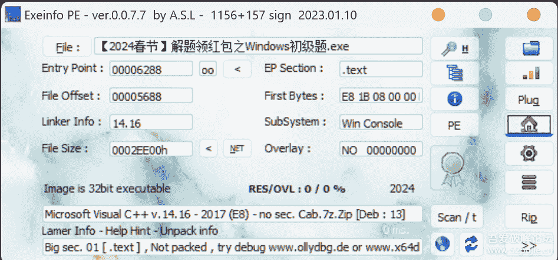

屏幕截图 2024-02-11 155655.png (325.75 KB, 下载次数: 2)

[href="forum.php?mod=attachment&aid=MjY3NzI4NXxlYzViMzgxNHwxNzkzNTcyNjQ5fDE2ODA4NnwxODkzMDc4&nothumb=yes" target="_blank"](https://www.52pojie.cn/forum.php?mod=attachment&aid=MjY3NzI4NXxlYzViMzgxNHwxNzkzNTcyNjQ5fDE2ODA4NnwxODkzMDc4&nothumb=yes)

2024-2-25 01:08 上传

接着我们尝试运行程序，随便输入一串字符，探测返回结果。

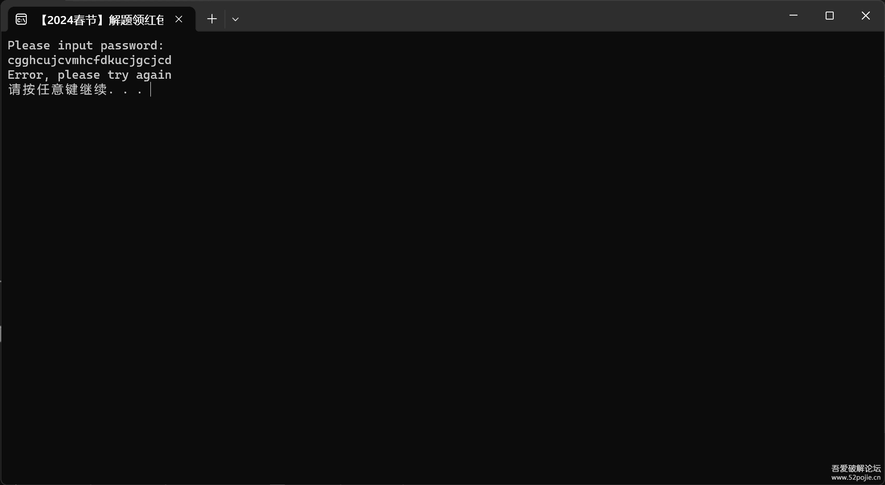

屏幕截图 2024-02-11 155714.png (40.36 KB, 下载次数: 1)

[href="forum.php?mod=attachment&aid=MjY3NzI4NnwxNDVkYjI1OXwxNzkzNTcyNjQ5fDE2ODA4NnwxODkzMDc4&nothumb=yes" target="_blank"](https://www.52pojie.cn/forum.php?mod=attachment&aid=MjY3NzI4NnwxNDVkYjI1OXwxNzkzNTcyNjQ5fDE2ODA4NnwxODkzMDc4&nothumb=yes)

2024-2-25 01:08 上传

接着我们拖入 `OD`，右键智能查找拖到最上方，可以看到出题人很贴心地为我们留下了提示，密码采用凯撒密码加密。

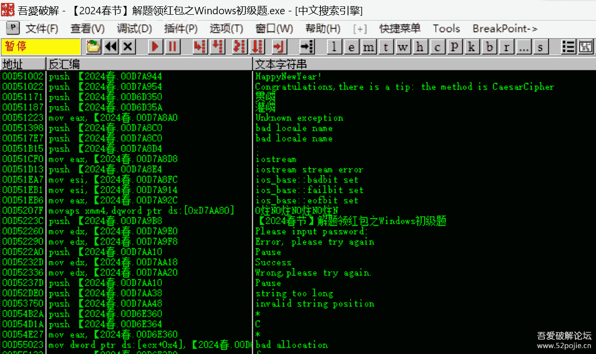

屏幕截图 2024-02-11 155748.png (245.52 KB, 下载次数: 0)

[href="forum.php?mod=attachment&aid=MjY3NzI4N3w4ZTA4YjFlNnwxNzkzNTcyNjQ5fDE2ODA4NnwxODkzMDc4&nothumb=yes" target="_blank"](https://www.52pojie.cn/forum.php?mod=attachment&aid=MjY3NzI4N3w4ZTA4YjFlNnwxNzkzNTcyNjQ5fDE2ODA4NnwxODkzMDc4&nothumb=yes)

2024-2-25 01:09 上传

找到错误提示 “Error, please try again”，双击此处

[Asm] 纯文本查看 复制代码
```
中文搜索引擎, 条目 18
 地址=00D52290
 反汇编=mov edx,【2024春.00D7A9F8
 文本字符串=Error, please try again
```

不难发现错误提示上方有一个 `je` 相等跳，我们尝试在 `00D5228E` 处下断点，运行程序

[Asm] 纯文本查看 复制代码
```
00D5228E  |. /74 22         je short 【2024春.00D522B2
```

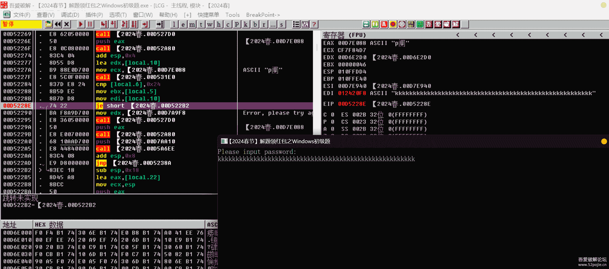

屏幕截图 2024-02-11 205314.png (459.07 KB, 下载次数: 0)

[href="forum.php?mod=attachment&aid=MjY3NzI4OXw2ZWFhNzBkMnwxNzkzNTcyNjQ5fDE2ODA4NnwxODkzMDc4&nothumb=yes" target="_blank"](https://www.52pojie.cn/forum.php?mod=attachment&aid=MjY3NzI4OXw2ZWFhNzBkMnwxNzkzNTcyNjQ5fDE2ODA4NnwxODkzMDc4&nothumb=yes)

2024-2-25 01:11 上传

寄存器中出现了我输入的假码，并且 `je` 相等跳并未实现，`F8` 单步，程序在 `00D522A5` 处跑起来了并弹出错误提示

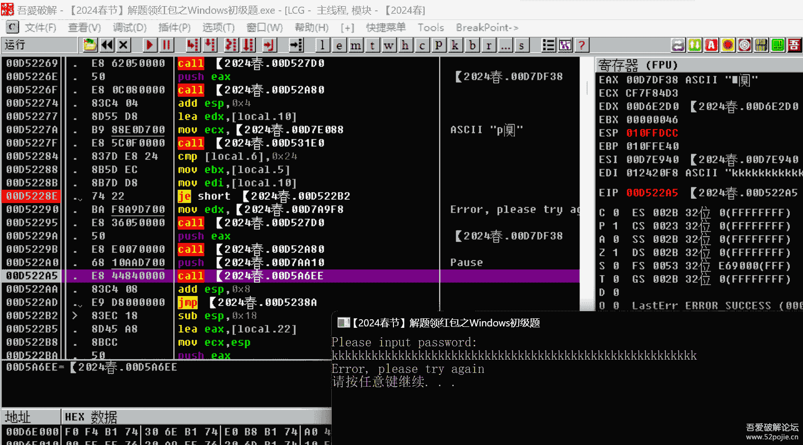

屏幕截图 2024-02-11 205603.png (406.29 KB, 下载次数: 1)

[href="forum.php?mod=attachment&aid=MjY3NzI5MHxiNWQ1YWQ2OHwxNzkzNTcyNjQ5fDE2ODA4NnwxODkzMDc4&nothumb=yes" target="_blank"](https://www.52pojie.cn/forum.php?mod=attachment&aid=MjY3NzI5MHxiNWQ1YWQ2OHwxNzkzNTcyNjQ5fDE2ODA4NnwxODkzMDc4&nothumb=yes)

2024-2-25 01:12 上传

所以我们重新载入程序，将此处 `je` 相等跳改为 `jmp` 强制跳

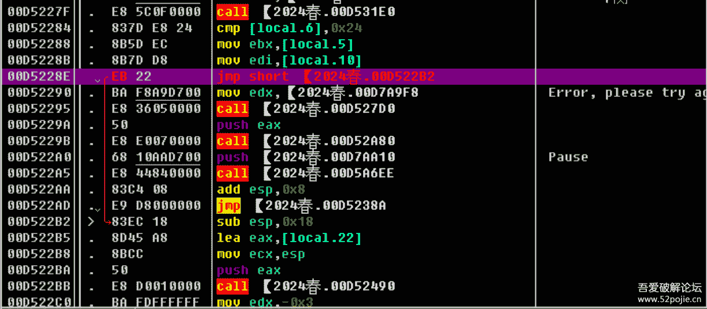

屏幕截图 2024-02-11 210414.png (156.78 KB, 下载次数: 1)

[href="forum.php?mod=attachment&aid=MjY3NzI5MXxhMWM1M2Q2OXwxNzkzNTcyNjQ5fDE2ODA4NnwxODkzMDc4&nothumb=yes" target="_blank"](https://www.52pojie.cn/forum.php?mod=attachment&aid=MjY3NzI5MXxhMWM1M2Q2OXwxNzkzNTcyNjQ5fDE2ODA4NnwxODkzMDc4&nothumb=yes)

2024-2-25 01:13 上传

运行起来后发现程序报错发生变化，Error 变成了 Wrong

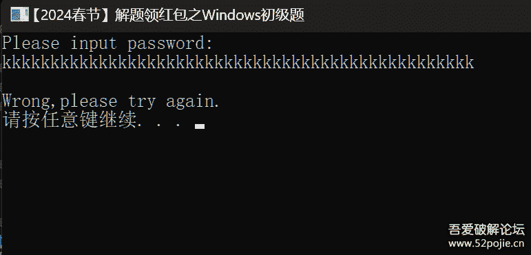

屏幕截图 2024-02-11 210616.png (25.27 KB, 下载次数: 1)

[href="forum.php?mod=attachment&aid=MjY3NzI5MnxkZGQ3YjZiYnwxNzkzNTcyNjQ5fDE2ODA4NnwxODkzMDc4&nothumb=yes" target="_blank"](https://www.52pojie.cn/forum.php?mod=attachment&aid=MjY3NzI5MnxkZGQ3YjZiYnwxNzkzNTcyNjQ5fDE2ODA4NnwxODkzMDc4&nothumb=yes)

2024-2-25 01:13 上传

所以我们需要重复以上操作，并找到第二个报错位置，发现有一个 `jnz` 不相等跳跳转到此，我们将其 `nop` 掉

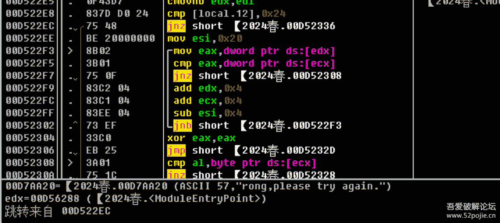

屏幕截图 2024-02-11 160053.png (139.16 KB, 下载次数: 0)

[href="forum.php?mod=attachment&aid=MjY3NzI5M3w0ZDI4ZjM3NHwxNzkzNTcyNjQ5fDE2ODA4NnwxODkzMDc4&nothumb=yes" target="_blank"](https://www.52pojie.cn/forum.php?mod=attachment&aid=MjY3NzI5M3w0ZDI4ZjM3NHwxNzkzNTcyNjQ5fDE2ODA4NnwxODkzMDc4&nothumb=yes)

2024-2-25 01:14 上传

继续分析，将 `je` 改为 `jmp`，避免 `edx` 被赋值为 Wrong，运行程序

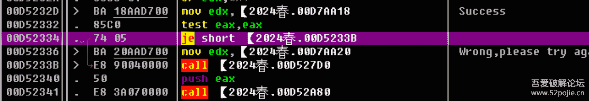

屏幕截图 2024-02-11 211731.png (72.93 KB, 下载次数: 0)

[href="forum.php?mod=attachment&aid=MjY3NzI5NHw2OGUwM2E1M3wxNzkzNTcyNjQ5fDE2ODA4NnwxODkzMDc4&nothumb=yes" target="_blank"](https://www.52pojie.cn/forum.php?mod=attachment&aid=MjY3NzI5NHw2OGUwM2E1M3wxNzkzNTcyNjQ5fDE2ODA4NnwxODkzMDc4&nothumb=yes)

2024-2-25 01:15 上传

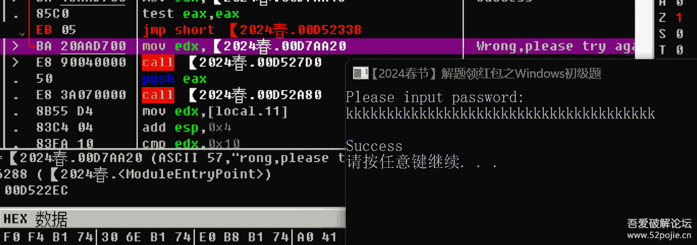

屏幕截图 2024-02-11 212019.png (113 KB, 下载次数: 0)

[href="forum.php?mod=attachment&aid=MjY3NzI5NXwwYjliNGY3OXwxNzkzNTcyNjQ5fDE2ODA4NnwxODkzMDc4&nothumb=yes" target="_blank"](https://www.52pojie.cn/forum.php?mod=attachment&aid=MjY3NzI5NXwwYjliNGY3OXwxNzkzNTcyNjQ5fDE2ODA4NnwxODkzMDc4&nothumb=yes)

2024-2-25 01:15 上传

程序爆破成功了，接下来的任务是找出正确密码，重复以上操作，在被 `nop` 掉的上方 `cmp` 比较处下断点

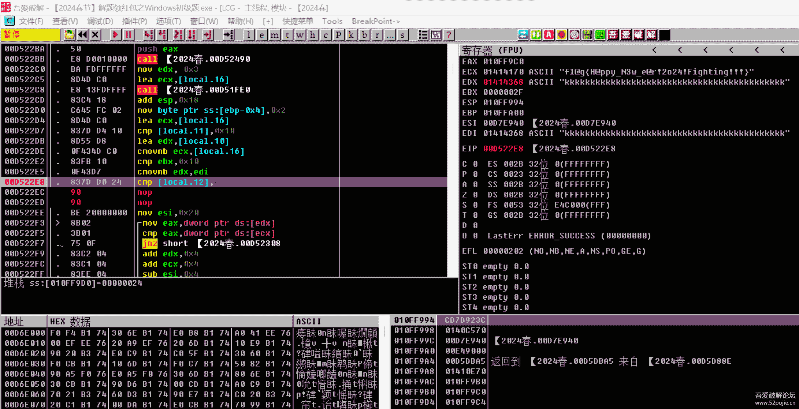

屏幕截图 2024-02-11 212723.png (540.3 KB, 下载次数: 0)

[href="forum.php?mod=attachment&aid=MjY3NzI5NnxhNjQxMTNmNHwxNzkzNTcyNjQ5fDE2ODA4NnwxODkzMDc4&nothumb=yes" target="_blank"](https://www.52pojie.cn/forum.php?mod=attachment&aid=MjY3NzI5NnxhNjQxMTNmNHwxNzkzNTcyNjQ5fDE2ODA4NnwxODkzMDc4&nothumb=yes)

2024-2-25 01:16 上传

出题人意识到这是初级题，于是很贴心地将程序解密后的明文放在了寄存器

[Asm] 纯文本查看 复制代码
```
```


# Web题flag1~12ABC

fl@g{H@ppy_N3w_e@r!2o24!Fighting!!!}


屏幕截图 2024-02-11 165727.png (384.46 KB, 下载次数: 1)

[附件下载](https://www.52pojie.cn/forum.php?mod=attachment&aid=MjY3NzI5N3w0NjcwNGRlY3wxNzkzNTcyNjQ5fDE2ODA4NnwxODkzMDc4&nothumb=yes)

2024-2-25 01:17 上传

## flag1

flag1{52pj2024} 剪映来回拖就能看到

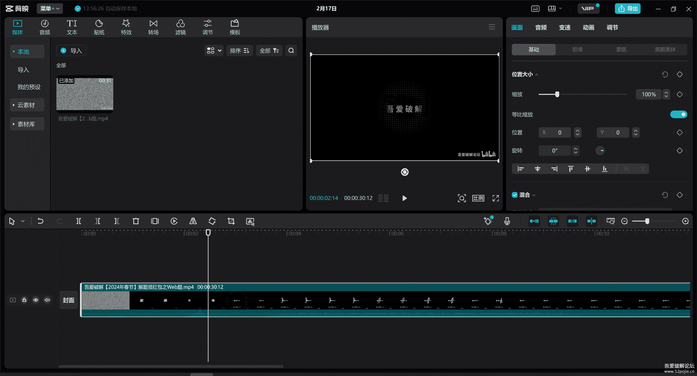

屏幕截图 2024-02-17 135641.png (407.42 KB, 下载次数: 0)

[附件下载](https://www.52pojie.cn/forum.php?mod=attachment&aid=MjY3NzI5OHxjOTRhMjhiMXwxNzkzNTcyNjQ5fDE2ODA4NnwxODkzMDc4&nothumb=yes)

2024-2-25 01:20 上传

## flag2

flag2{xHOpRP} 302跳转前响应标头

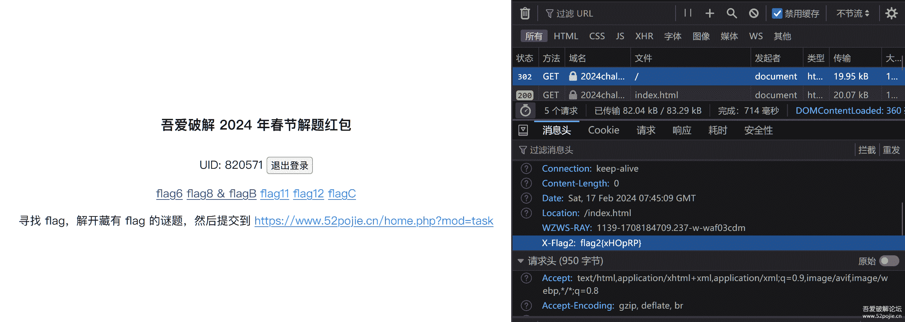

屏幕截图 2024-02-17 154536.png (275.12 KB, 下载次数: 1)

[附件下载](https://www.52pojie.cn/forum.php?mod=attachment&aid=MjY3NzI5OXw5NzM3YTA3MXwxNzkzNTcyNjQ5fDE2ODA4NnwxODkzMDc4&nothumb=yes)

2024-2-25 01:21 上传

## flag3

flag3{GRsgk2} 视频开头马赛克反复看

## flag4

flag4{YvJZNS} 网站资源中可以看到背景图

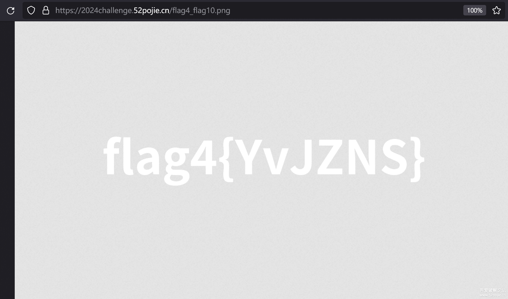

屏幕截图 2024-02-17 142450.png (971.3 KB, 下载次数: 1)

[附件下载](https://www.52pojie.cn/forum.php?mod=attachment&aid=MjY3NzMwMHxkNTNmNWJhMXwxNzkzNTcyNjQ5fDE2ODA4NnwxODkzMDc4&nothumb=yes)

2024-2-25 01:23 上传

## flag5

flag5{P3prqF} 右键查看网站源代码，替换功能删除所有符号，也可与flag9一起出

## flag6

flag6{20240217} md5解密，可以用cmd5查，也可以让它自动计算出来

## flag7

flag7{Djl9NQ} 视频中github链接打开可得

## flag8

flag8{OaOjIK} 2048，稍后与flagB一起写

## flag9

flag9{KHTALK}

难评，我屏幕dpi调的175%，浏览器默认缩放90%，拉到最长拉出屏幕外面都看不到

还得缩放到60%，平时从来不用默认记事本，EmEditor不开自动换行，啥也看不出来

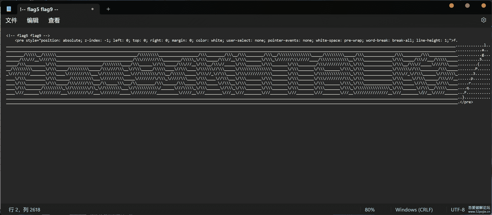

屏幕截图 2024-02-17 184031.png (99.19 KB, 下载次数: 3)

[附件下载](https://www.52pojie.cn/forum.php?mod=attachment&aid=MjY3NzMwMXwyMTc0OGIxNHwxNzkzNTcyNjQ5fDE2ODA4NnwxODkzMDc4&nothumb=yes)

2024-2-25 01:31 上传

## flag10

flag10{6BxMkW} flag4的那张图片隐写

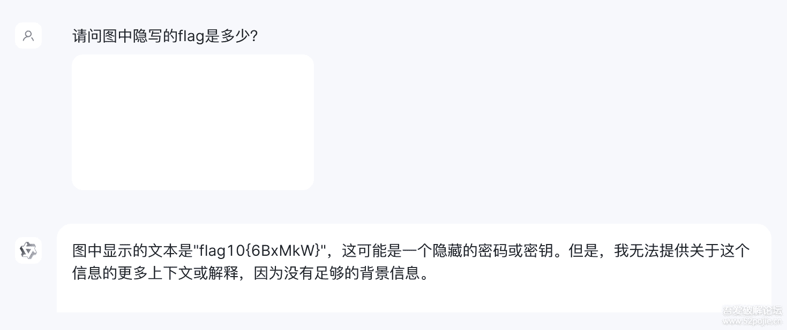

屏幕截图 2024-02-18 234201.png (63.64 KB, 下载次数: 1)

[附件下载](https://www.52pojie.cn/forum.php?mod=attachment&aid=MjY3NzMwMnw2NDY3Yzk5ZHwxNzkzNTcyNjQ5fDE2ODA4NnwxODkzMDc4&nothumb=yes)

2024-2-25 01:32 上传

## flag11

flag11{HPQfVF} 根据提示写一个生成10201个html，随两组数字变化图片会逐渐拼在一起

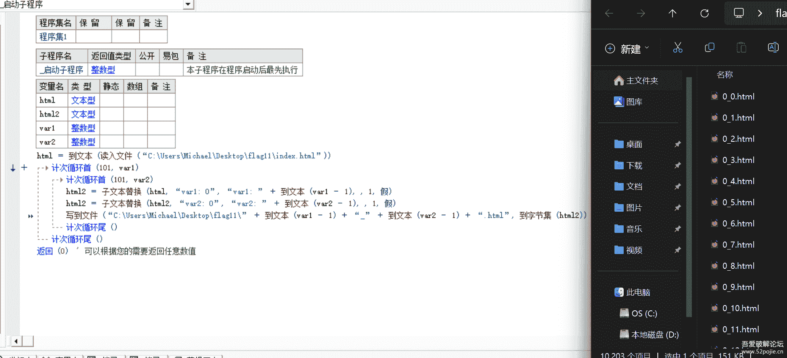

屏幕截图 2024-02-19 001412.png (268.85 KB, 下载次数: 0)

[附件下载](https://www.52pojie.cn/forum.php?mod=attachment&aid=MjY3NzMwM3w5YWM2MWExOHwxNzkzNTcyNjQ5fDE2ODA4NnwxODkzMDc4&nothumb=yes)

2024-2-25 01:34 上传

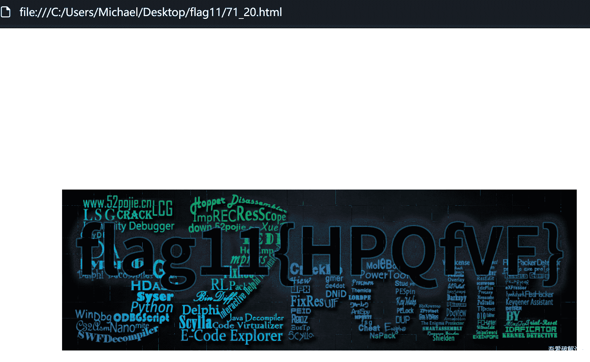

屏幕截图 2024-02-19 002259.png (943.96 KB, 下载次数: 1)

[附件下载](https://www.52pojie.cn/forum.php?mod=attachment&aid=MjY3NzMwNHw2Zjc3ZGNkM3wxNzkzNTcyNjQ5fDE2ODA4NnwxODkzMDc4&nothumb=yes)

2024-2-25 01:34 上传

## flag12

flag12{HOXI}

讨论过程链接：[https://tongyi.aliyun.com/qianwen/share?shareId=97b9a191-78ba-4822-a0a9-d0c055c5358b](https://tongyi.aliyun.com/qianwen/share?shareId=97b9a191-78ba-4822-a0a9-d0c055c5358b)

不了解wasm，可以问AI，gpt太耗tokens了所以用的通义千问

按照AI的要求提交网页html以及wasm文件，之后根据AI指示下载`wasm-dis`解码文件

反复讨论后AI认为不存在正确密码，但提示从`get_flag12()`函数逻辑来看，当输入满足特定条件时，会返回一个固定的32位整数值 1213159497，然后这个值会被转换为Unicode字符序列并包裹在 `"flag12{"` 和 `"}"` 之间显示出来。

执行js脚本得到flag

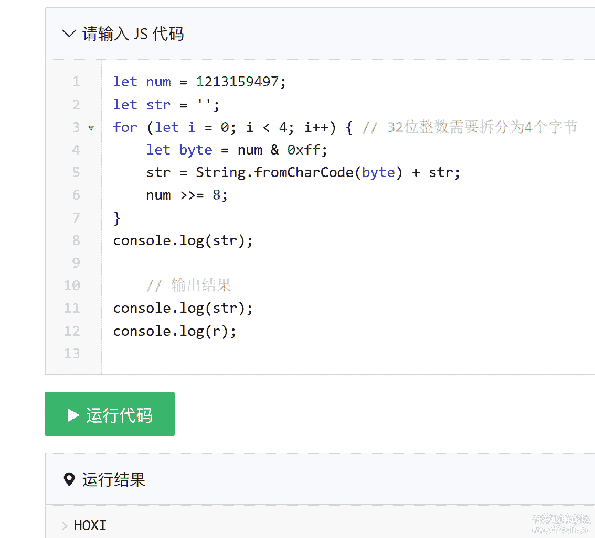

屏幕截图 2024-02-17 182050.png (96.86 KB, 下载次数: 1)

[附件下载](https://www.52pojie.cn/forum.php?mod=attachment&aid=MjY3NzMwNXw3OGQxY2U1NHwxNzkzNTcyNjQ5fDE2ODA4NnwxODkzMDc4&nothumb=yes)

2024-2-25 01:42 上传

## flagA

flagA{07618ece}

flagA需要退出并重新登录才能看到

显而易见`uid`与`flagA`采用同种加密方式，所以我们将`uid`替换为`flagA`

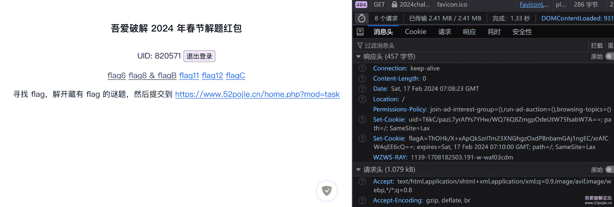

屏幕截图 2024-02-17 150847.png (305.58 KB, 下载次数: 1)

[附件下载](https://www.52pojie.cn/forum.php?mod=attachment&aid=MjY3NzMwNnw5MDU4MGYxMXwxNzkzNTcyNjQ5fDE2ODA4NnwxODkzMDc4&nothumb=yes)

2024-2-25 01:45 上传

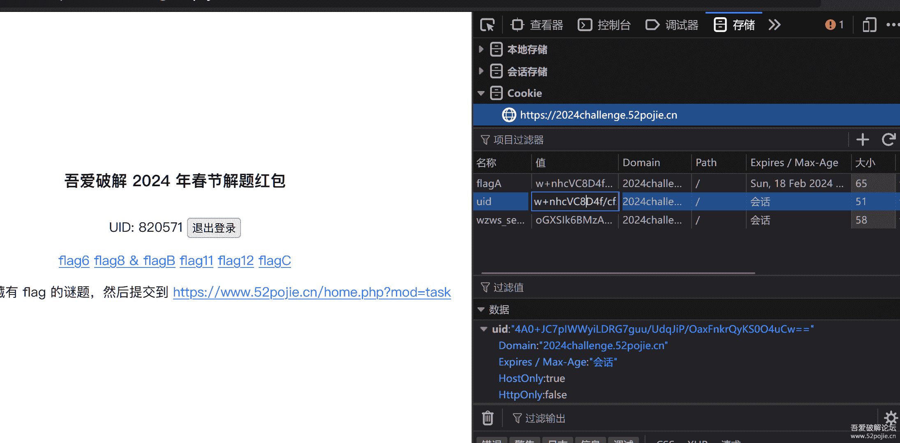

屏幕截图 2024-02-18 233026.png (220.88 KB, 下载次数: 2)

[附件下载](https://www.52pojie.cn/forum.php?mod=attachment&aid=MjY3NzMwOXwwZWUwYWE0OHwxNzkzNTcyNjQ5fDE2ODA4NnwxODkzMDc4&nothumb=yes)

2024-2-25 01:46 上传

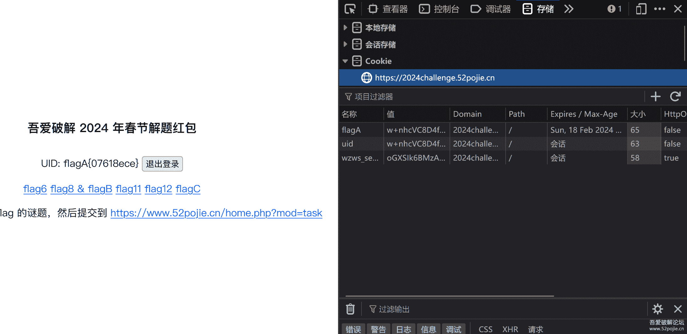

屏幕截图 2024-02-18 233045.png (189.86 KB, 下载次数: 1)

[附件下载](https://www.52pojie.cn/forum.php?mod=attachment&aid=MjY3NzMxMHw4YmY4ZGRmNXwxNzkzNTcyNjQ5fDE2ODA4NnwxODkzMDc4&nothumb=yes)

2024-2-25 01:46 上传

## flagB

flagB{d50f2fc4}

本来可以用post刷的，但cookie老是传不了导致一直提示未登录，所以写一个随机按键刷分

额没有截图了，明白意思就行，WASD随机按，刷一些分备用

根据提示词溢出并反复尝试各种购买数量可知

金币数量要大于购买总额（可为负数），并且购买后的剩余金币必须小于先前的

此处采用`long long`溢出，穷举可得满足条件的购买数量

10650是我的金币数量，999063388是flagB的价格

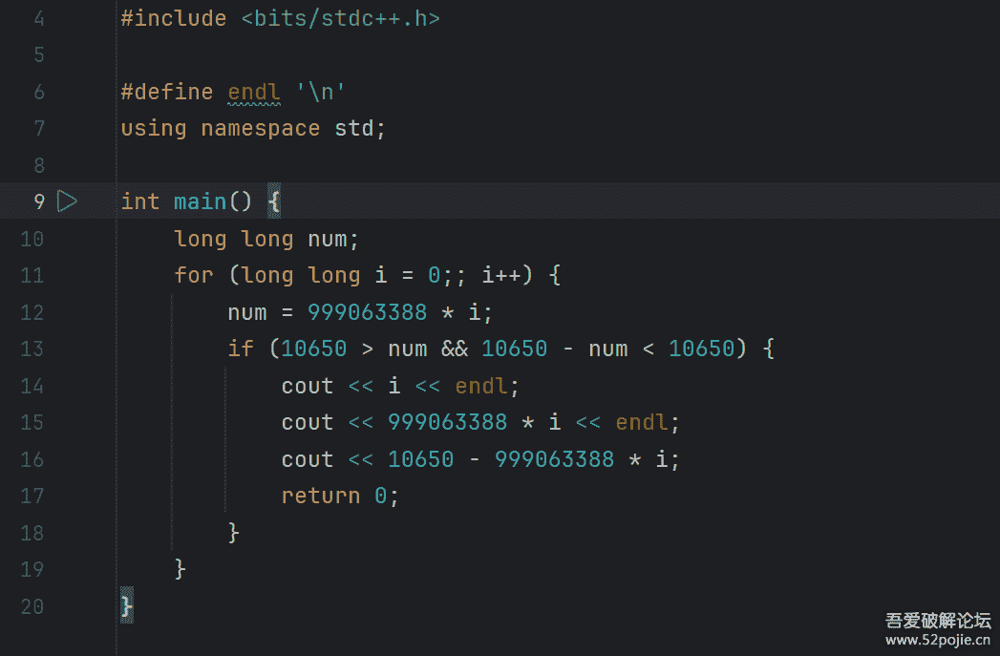

屏幕截图 2024-02-19 181819.png (66.96 KB, 下载次数: 0)

[附件下载](https://www.52pojie.cn/forum.php?mod=attachment&aid=MjY3NzMxMnw1N2M2NTE4ZXwxNzkzNTcyNjQ5fDE2ODA4NnwxODkzMDc4&nothumb=yes)

2024-2-25 01:52 上传

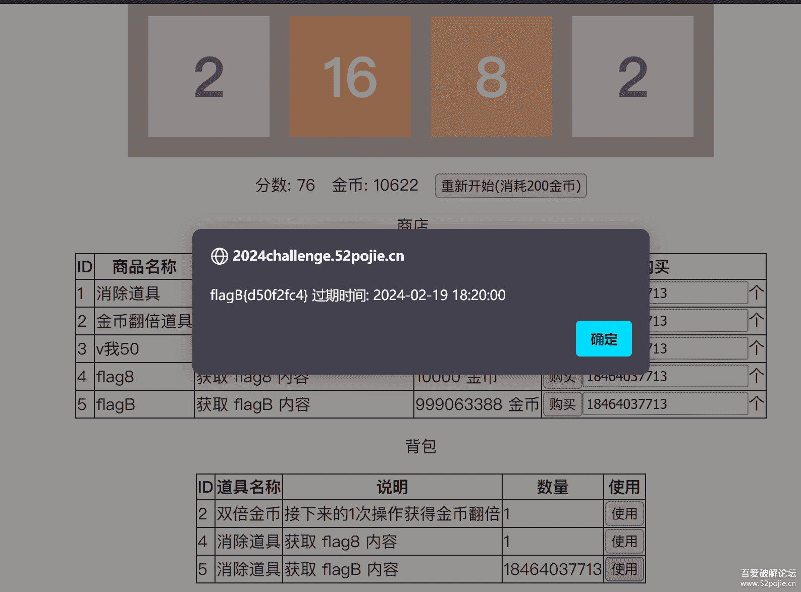

屏幕截图 2024-02-19 181357.png (200.85 KB, 下载次数: 1)

[附件下载](https://www.52pojie.cn/forum.php?mod=attachment&aid=MjY3NzMxM3w2MzdjNDMzMnwxNzkzNTcyNjQ5fDE2ODA4NnwxODkzMDc4&nothumb=yes)

2024-2-25 01:55 上传

## flagC

flagC

利用firefox的编辑并重发功能，手动试了80个种类，其中只有3个正确

利用obs虚拟摄像头反复调整位置得出flagc

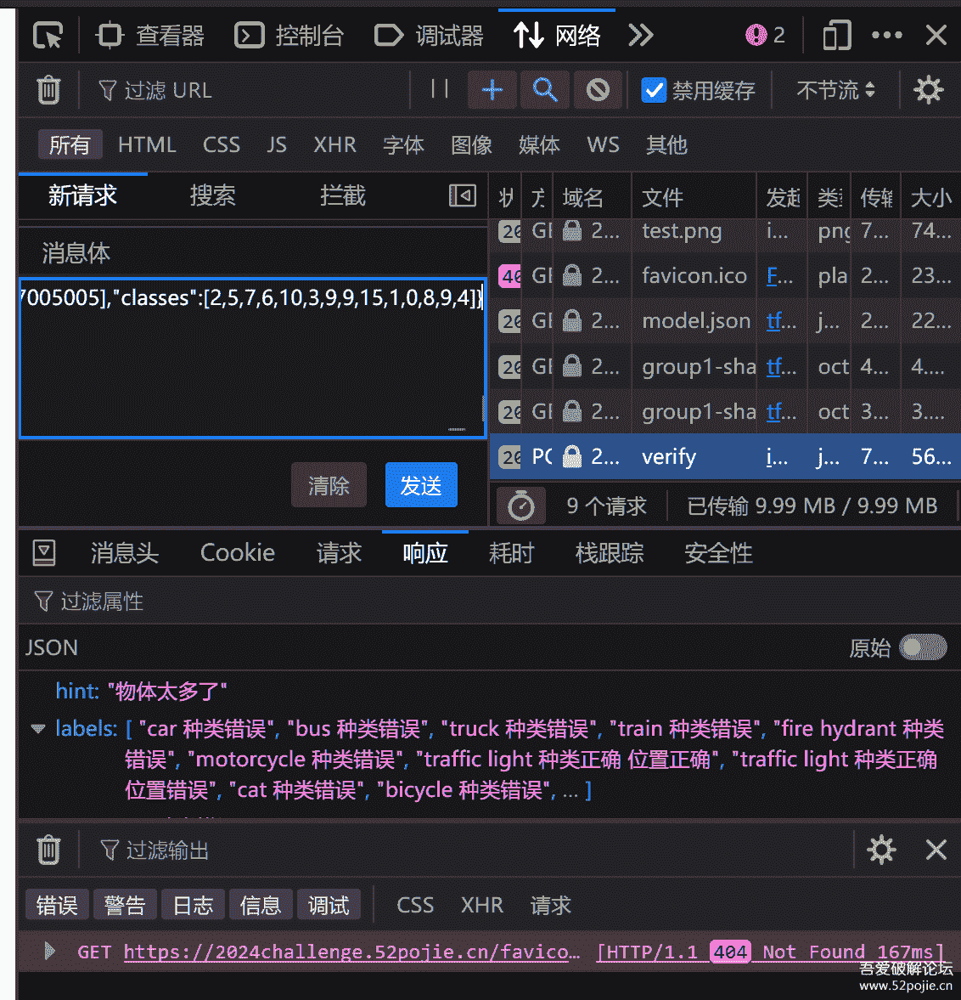

屏幕截图 2024-02-19 162147.png (244.63 KB, 下载次数: 3)

[附件下载](https://www.52pojie.cn/forum.php?mod=attachment&aid=MjY3NzMxNHw0MjU3OGUwOXwxNzkzNTcyNjQ5fDE2ODA4NnwxODkzMDc4&nothumb=yes)

2024-2-25 01:56 上传

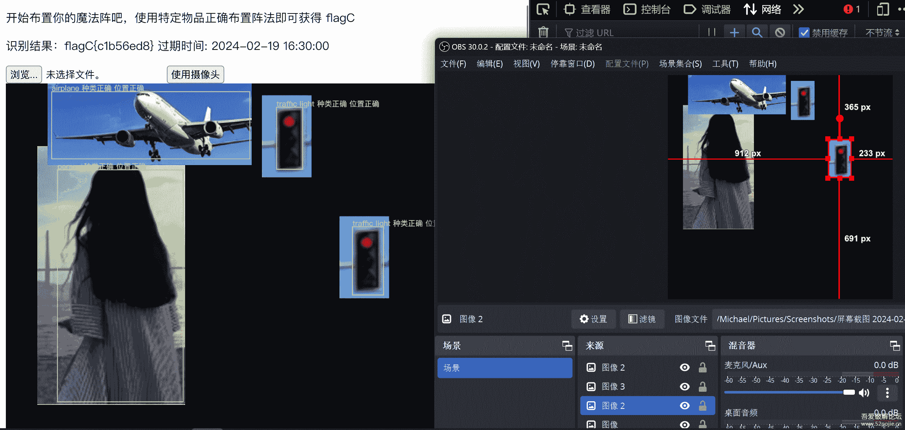

屏幕截图 2024-02-19 162033.png (924.39 KB, 下载次数: 0)

[附件下载](https://www.52pojie.cn/forum.php?mod=attachment&aid=MjY3NzMxNXwwYzFlNDk3NHwxNzkzNTcyNjQ5fDE2ODA4NnwxODkzMDc4&nothumb=yes)

2024-2-25 01:58 上传


屏幕截图 2024-02-19 164147.png (313.17 KB, 下载次数: 2)

[附件下载](https://www.52pojie.cn/forum.php?mod=attachment&aid=MjY3NzMxN3wyMmJiZmIzZnwxNzkzNTcyNjQ5fDE2ODA4NnwxODkzMDc4&nothumb=yes)

2024-2-25 02:04 上传

完结撒花，如有不足欢迎指正{:301_978:}
