# [CTF] 2024春节52pj红包解题(WEB、逆向初级题）
- 原帖: https://www.52pojie.cn/forum.php?mod=viewthread&tid=1893115
- 抓取时间: 2026-11-01T22:37:23
拼接二维码得到网址：[//2024challenge.52pojie.cn/" target="_blank" rel="noopener noreferrer nofollow"](https://2024challenge.52pojie.cn/:href="https)

未命名-2.fw.png (43.72 KB, 下载次数: 2)
[href="forum.php?mod=attachment&aid=MjY3NzQzMnxiODUxYzYzOXwxNzkzNTcyNjQwfDE2ODA4NnwxODkzMTE1&nothumb=yes" target="_blank"](https://www.52pojie.cn/forum.php?mod=attachment&aid=MjY3NzQzMnxiODUxYzYzOXwxNzkzNTcyNjQwfDE2ODA4NnwxODkzMTE1&nothumb=yes)
2024-2-25 09:47 上传
## 初级：
flag1{52pj2024} flag2{xHOpRP} flag3{GRsgk2} flag4{YvJZNS} flagA{09dbcd04}
### flag1
在视频出现二维码前边可逐帧查看

吾爱破解2024年春节解题红包视频.mp4_20240220_144141.287.jpg (141.73 KB, 下载次数: 2)
[href="forum.php?mod=attachment&aid=MjY3NzQzM3wzYTNlZmFjN3wxNzkzNTcyNjQwfDE2ODA4NnwxODkzMTE1&nothumb=yes" target="_blank"](https://www.52pojie.cn/forum.php?mod=attachment&aid=MjY3NzQzM3wzYTNlZmFjN3wxNzkzNTcyNjQwfDE2ODA4NnwxODkzMTE1&nothumb=yes)
2024-2-25 09:47 上传

吾爱破解2024年春节解题红包视频.mp4_20240220_144141.786.jpg (181.67 KB, 下载次数: 2)
[href="forum.php?mod=attachment&aid=MjY3NzQzNHxkNWExZjk2ZXwxNzkzNTcyNjQwfDE2ODA4NnwxODkzMTE1&nothumb=yes" target="_blank"](https://www.52pojie.cn/forum.php?mod=attachment&aid=MjY3NzQzNHxkNWExZjk2ZXwxNzkzNTcyNjQwfDE2ODA4NnwxODkzMTE1&nothumb=yes)
2024-2-25 09:47 上传

吾爱破解2024年春节解题红包视频.mp4_20240220_144142.536.jpg (225.25 KB, 下载次数: 1)
[href="forum.php?mod=attachment&aid=MjY3NzQzNXw4NWZhOTZlNHwxNzkzNTcyNjQwfDE2ODA4NnwxODkzMTE1&nothumb=yes" target="_blank"](https://www.52pojie.cn/forum.php?mod=attachment&aid=MjY3NzQzNXw4NWZhOTZlNHwxNzkzNTcyNjQwfDE2ODA4NnwxODkzMTE1&nothumb=yes)
2024-2-25 09:47 上传
### flag2
登陆时抓包跳转包中
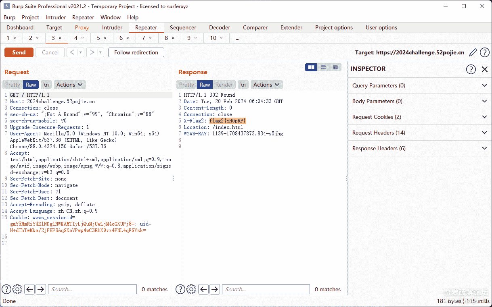
image-20240220144501595.png (118.55 KB, 下载次数: 0)
[href="forum.php?mod=attachment&aid=MjY3NzQwOHxmMGQ2N2VjZnwxNzkzNTcyNjQwfDE2ODA4NnwxODkzMTE1&nothumb=yes" target="_blank"](https://www.52pojie.cn/forum.php?mod=attachment&aid=MjY3NzQwOHxmMGQ2N2VjZnwxNzkzNTcyNjQwfDE2ODA4NnwxODkzMTE1&nothumb=yes)
2024-2-25 09:46 上传
### flag3
视频的最前部可播放器设置循环查看（静态看不出来）
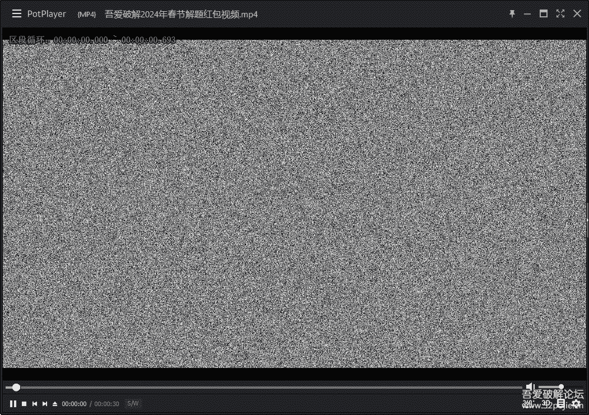
image-20240220143350056.png (1.72 MB, 下载次数: 2)
[href="forum.php?mod=attachment&aid=MjY3NzQwN3w1MTZiNTZhNXwxNzkzNTcyNjQwfDE2ODA4NnwxODkzMTE1&nothumb=yes" target="_blank"](https://www.52pojie.cn/forum.php?mod=attachment&aid=MjY3NzQwN3w1MTZiNTZhNXwxNzkzNTcyNjQwfDE2ODA4NnwxODkzMTE1&nothumb=yes)
2024-2-25 09:46 上传
### flag4
背景图中

image-20240220144929225.png (113.46 KB, 下载次数: 0)
[href="forum.php?mod=attachment&aid=MjY3NzQwOXwxMGEyNWIyZHwxNzkzNTcyNjQwfDE2ODA4NnwxODkzMTE1&nothumb=yes" target="_blank"](https://www.52pojie.cn/forum.php?mod=attachment&aid=MjY3NzQwOXwxMGEyNWIyZHwxNzkzNTcyNjQwfDE2ODA4NnwxODkzMTE1&nothumb=yes)
2024-2-25 09:46 上传
### flagA
登陆时输入`UID`，`burp` 抓包
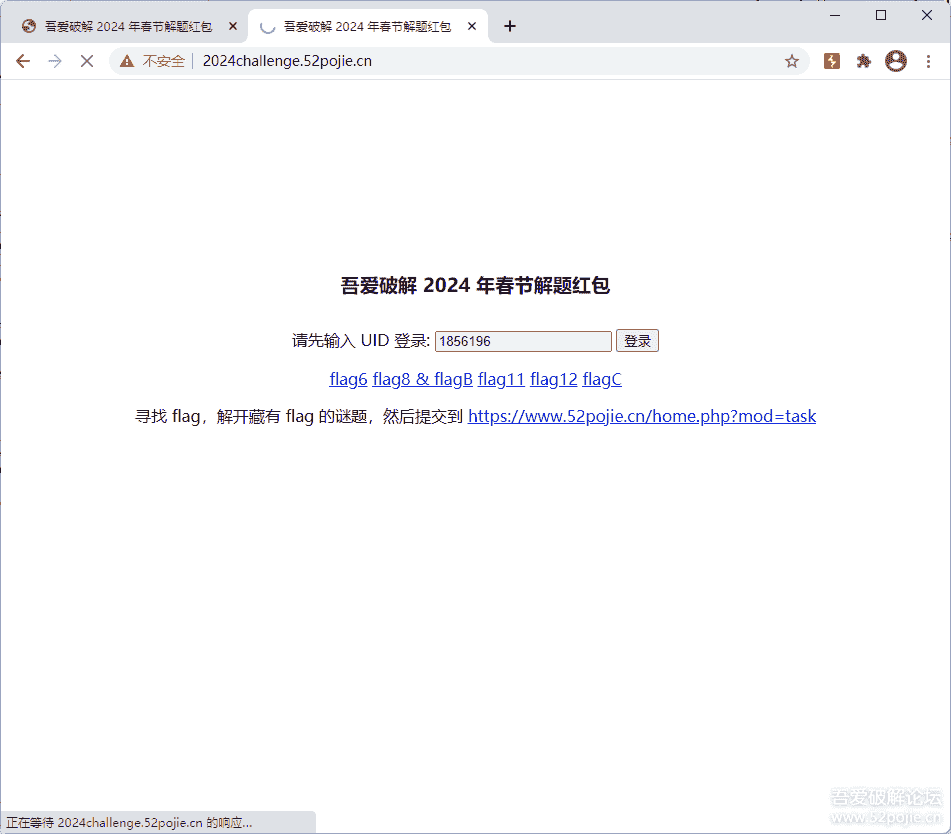
image-20240220142506518.png (47.1 KB, 下载次数: 0)
[href="forum.php?mod=attachment&aid=MjY3NzQwMXxjZjBlNThlNnwxNzkzNTcyNjQwfDE2ODA4NnwxODkzMTE1&nothumb=yes" target="_blank"](https://www.52pojie.cn/forum.php?mod=attachment&aid=MjY3NzQwMXxjZjBlNThlNnwxNzkzNTcyNjQwfDE2ODA4NnwxODkzMTE1&nothumb=yes)
2024-2-25 09:46 上传
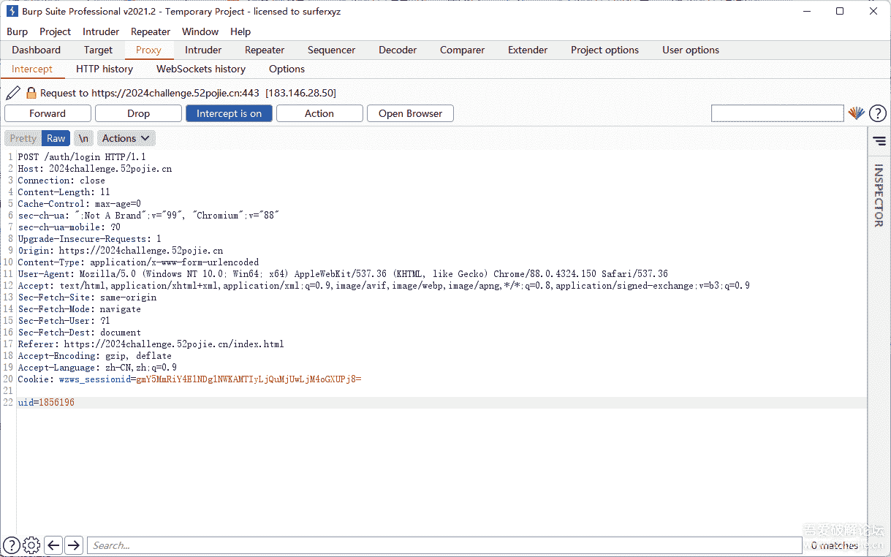
image-20240220142529798.png (102.7 KB, 下载次数: 2)
[href="forum.php?mod=attachment&aid=MjY3NzQwMnw2Nzg0NjY0MXwxNzkzNTcyNjQwfDE2ODA4NnwxODkzMTE1&nothumb=yes" target="_blank"](https://www.52pojie.cn/forum.php?mod=attachment&aid=MjY3NzQwMnw2Nzg0NjY0MXwxNzkzNTcyNjQwfDE2ODA4NnwxODkzMTE1&nothumb=yes)
2024-2-25 09:46 上传
Forward 到 `get` `/auth/uid`
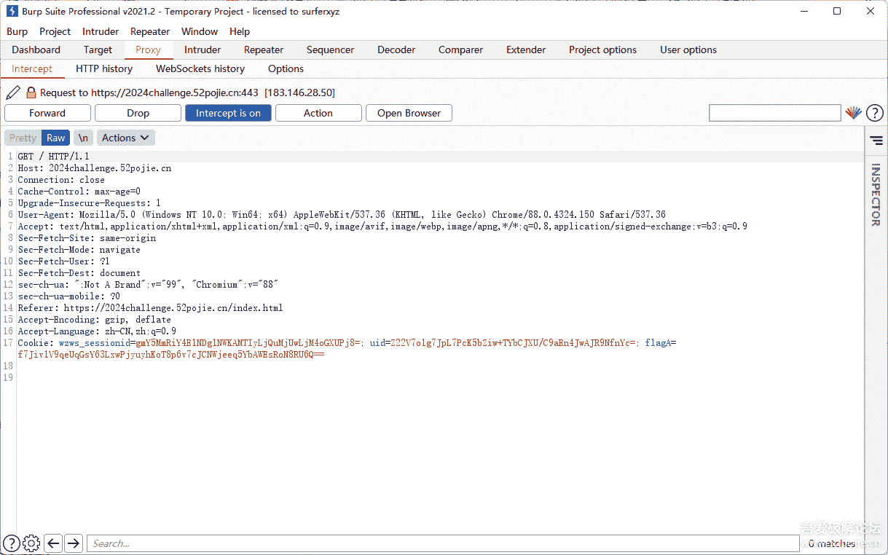
image-20240220142622855.png (101.12 KB, 下载次数: 1)
[href="forum.php?mod=attachment&aid=MjY3NzQwNHxmYjIxNjEyYnwxNzkzNTcyNjQwfDE2ODA4NnwxODkzMTE1&nothumb=yes" target="_blank"](https://www.52pojie.cn/forum.php?mod=attachment&aid=MjY3NzQwNHxmYjIxNjEyYnwxNzkzNTcyNjQwfDE2ODA4NnwxODkzMTE1&nothumb=yes)
2024-2-25 09:46 上传
将`flagA` 的内容覆盖`uid`的 `send`解密获取解密后的`flagA`
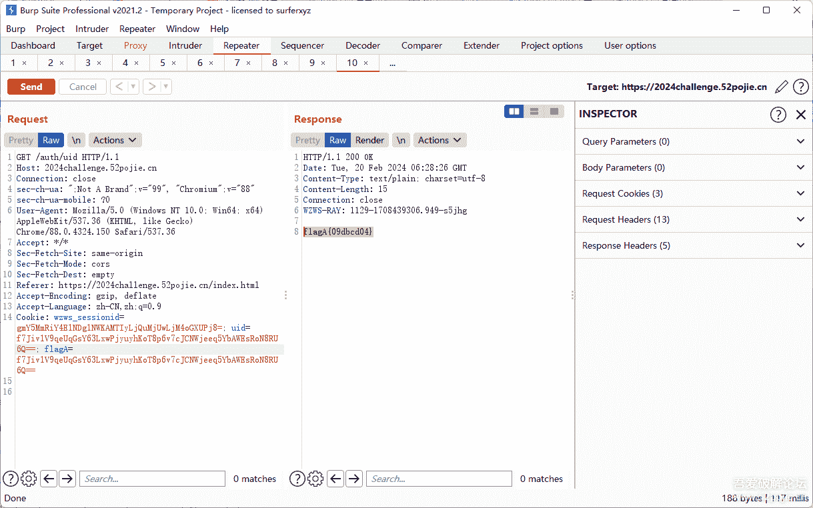
image-20240220142939225.png (116.67 KB, 下载次数: 1)
[href="forum.php?mod=attachment&aid=MjY3NzQwNnw5N2U4YzExZHwxNzkzNTcyNjQwfDE2ODA4NnwxODkzMTE1&nothumb=yes" target="_blank"](https://www.52pojie.cn/forum.php?mod=attachment&aid=MjY3NzQwNnw5N2U4YzExZHwxNzkzNTcyNjQwfDE2ODA4NnwxODkzMTE1&nothumb=yes)
2024-2-25 09:46 上传
## 中级：
flag5{P3prqF} flag6{20240217} flag7{Djl9NQ} flag8{OaOjIK} flagB{aeae5c68}
### flag5
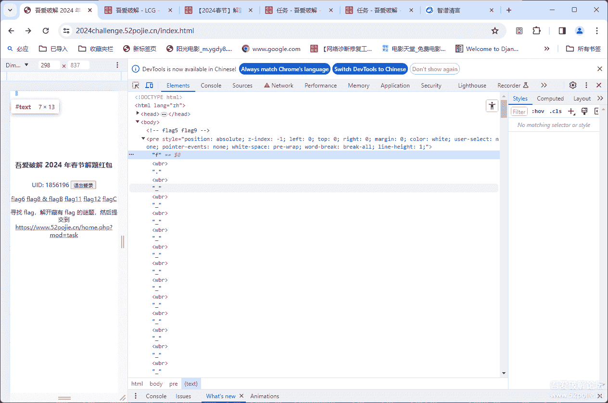
image-20240220175601560.png (108.11 KB, 下载次数: 1)
[href="forum.php?mod=attachment&aid=MjY3ODQ3NHwyNGI4NDFkNHwxNzkzNTcyNjQwfDE2ODA4NnwxODkzMTE1&nothumb=yes" target="_blank"](https://www.52pojie.cn/forum.php?mod=attachment&aid=MjY3ODQ3NHwyNGI4NDFkNHwxNzkzNTcyNjQwfDE2ODA4NnwxODkzMTE1&nothumb=yes)
2024-2-28 16:29 上传
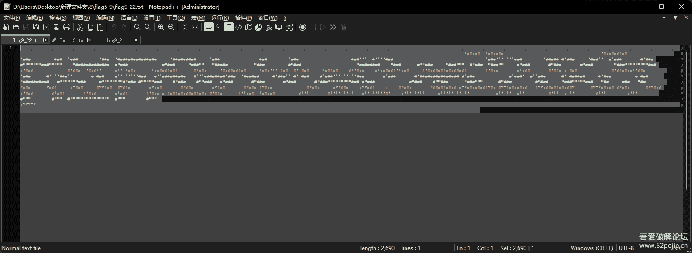
image-20240220175834126.png (44.55 KB, 下载次数: 1)
[href="forum.php?mod=attachment&aid=MjY3NzQxOXw3ZTk5NzU3MnwxNzkzNTcyNjQwfDE2ODA4NnwxODkzMTE1&nothumb=yes" target="_blank"](https://www.52pojie.cn/forum.php?mod=attachment&aid=MjY3NzQxOXw3ZTk5NzU3MnwxNzkzNTcyNjQwfDE2ODA4NnwxODkzMTE1&nothumb=yes)
2024-2-25 09:47 上传
去掉无用字符得到
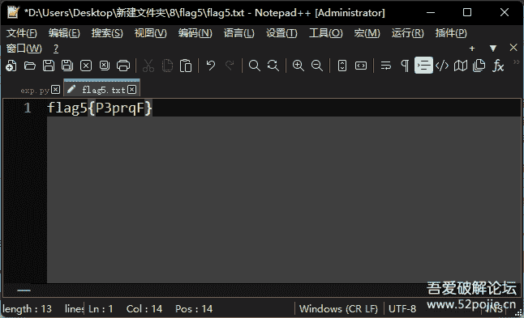
image-20240220145510172.png (30.04 KB, 下载次数: 1)
[href="forum.php?mod=attachment&aid=MjY3NzQxMXxmMTQ5NTNhY3wxNzkzNTcyNjQwfDE2ODA4NnwxODkzMTE1&nothumb=yes" target="_blank"](https://www.52pojie.cn/forum.php?mod=attachment&aid=MjY3NzQxMXxmMTQ5NTNhY3wxNzkzNTcyNjQwfDE2ODA4NnwxODkzMTE1&nothumb=yes)
2024-2-25 09:46 上传
### flag6
直接点击计算或者查询`MD5`的值
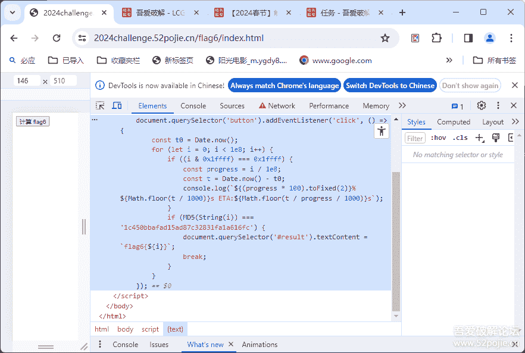
image-20240220145628355.png (86.76 KB, 下载次数: 2)
[href="forum.php?mod=attachment&aid=MjY3NzQxMnwxMmE4YWY0NHwxNzkzNTcyNjQwfDE2ODA4NnwxODkzMTE1&nothumb=yes" target="_blank"](https://www.52pojie.cn/forum.php?mod=attachment&aid=MjY3NzQxMnwxMmE4YWY0NHwxNzkzNTcyNjQwfDE2ODA4NnwxODkzMTE1&nothumb=yes)
2024-2-25 09:46 上传
### flag7
视频中github的历史提交记录中
[//github.com/ganlvtech/52pojie-2024-challenge" target="_blank" rel="noopener noreferrer nofollow"](https://github.com/ganlvtech/52pojie-2024-challenge:rel="nofollow noopener" href="https)
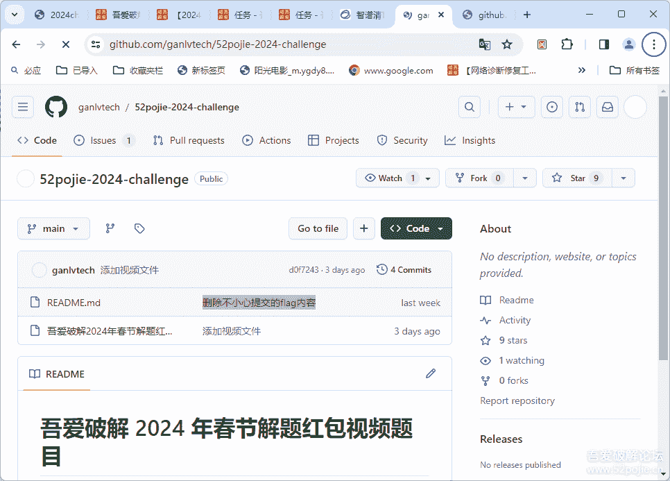
image-20240220190051450.png (109.72 KB, 下载次数: 3)
[href="forum.php?mod=attachment&aid=MjY3NzQzMHw4MWM5MzJjZnwxNzkzNTcyNjQwfDE2ODA4NnwxODkzMTE1&nothumb=yes" target="_blank"](https://www.52pojie.cn/forum.php?mod=attachment&aid=MjY3NzQzMHw4MWM5MzJjZnwxNzkzNTcyNjQwfDE2ODA4NnwxODkzMTE1&nothumb=yes)
2024-2-25 09:47 上传
flag7{Djl9NQ}

image-20240220190120288.png (79.29 KB, 下载次数: 1)
[href="forum.php?mod=attachment&aid=MjY3NzQzMXwxMTc5NzJlZHwxNzkzNTcyNjQwfDE2ODA4NnwxODkzMTE1&nothumb=yes" target="_blank"](https://www.52pojie.cn/forum.php?mod=attachment&aid=MjY3NzQzMXwxMTc5NzJlZHwxNzkzNTcyNjQwfDE2ODA4NnwxODkzMTE1&nothumb=yes)
2024-2-25 09:47 上传
### flag8
flag8{OaOjIK}
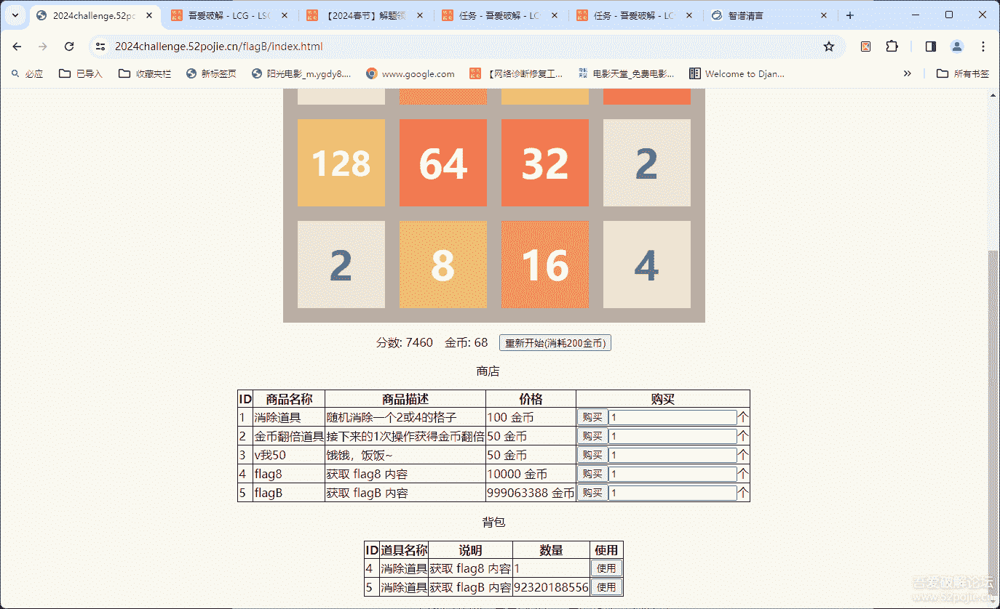
image-20240220184441275.png (99.68 KB, 下载次数: 1)
[href="forum.php?mod=attachment&aid=MjY3NzQyNHw0MjQwZDU3ZXwxNzkzNTcyNjQwfDE2ODA4NnwxODkzMTE1&nothumb=yes" target="_blank"](https://www.52pojie.cn/forum.php?mod=attachment&aid=MjY3NzQyNHw0MjQwZDU3ZXwxNzkzNTcyNjQwfDE2ODA4NnwxODkzMTE1&nothumb=yes)


# flagB

2024-2-25 09:47 上传

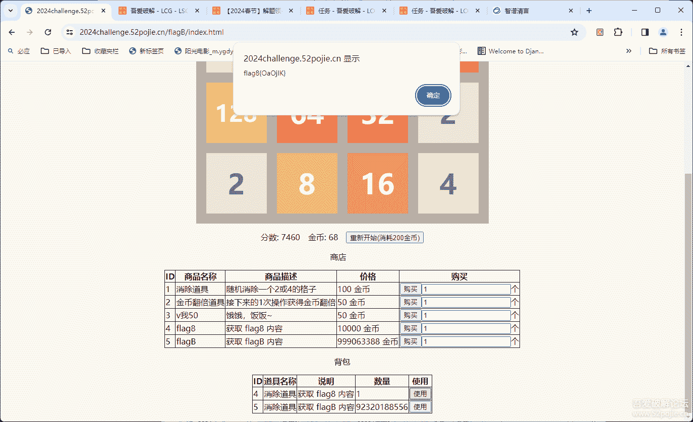

`image-20240220184519323.png` (99.71 KB, 下载次数: 1)

[附件链接](https://www.52pojie.cn/forum.php?mod=attachment&aid=MjY3NzQyNXxlYmQzYTUzYXwxNzkzNTcyNjQwfDE2ODA4NnwxODkzMTE1&nothumb=yes)

2024-2-25 09:47 上传

64为整数中`18446744073709551615`为0

> erichyx 发表于 2024-2-26 17:00
>
> flagB购买`18464037713`个也不是消耗0的，一样会提示钱不够。我看其他人说会扣除28个金币，不知道怎么来的 ...

flagB `999063388*18464037713=18446744073709551616`

这个搞错了`18446744073709551616`不能被`999063388`整除

```
18446744073709551616/999063388
18464037713.0
18446744073709551616//999063388
18464037712
18464037713*999063388
18446744073709551644
18446744073709551644-18446744073709551616
28
```

`18446744073709551616`不能被`999063388`整除，

`18464037713*999063388=18446744073709551644`

64位整数

`18446744073709551644&0xffffffff = 28`

所以会扣除28个金币

同理 `flag8`：

```
18446744073709551616/10000
1844674407370955.2
18446744073709560000&0xffffffff=8384
```

当购买`1844674407370956`个的时候需要`8384`个金币

`flagB{439d07a8}`（动态改变得，获取后必须在时间段内提交）

2024-2-25 09:46 上传

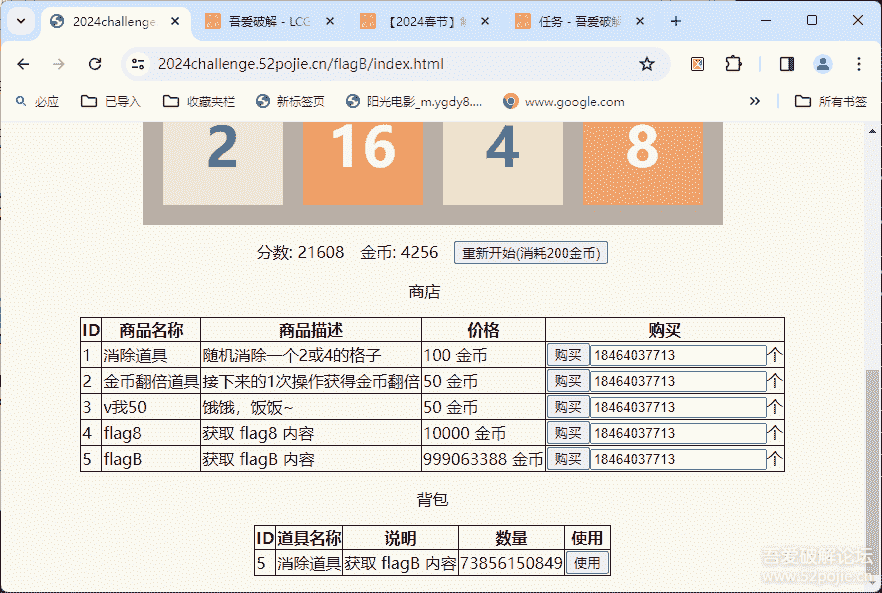

`image-20240220150309257.png` (81.12 KB, 下载次数: 1)

[附件链接](https://www.52pojie.cn/forum.php?mod=attachment&aid=MjY3NzQxM3xiNWI0ZjM4NHwxNzkzNTcyNjQwfDE2ODA4NnwxODkzMTE1&nothumb=yes)

2024-2-25 09:46 上传

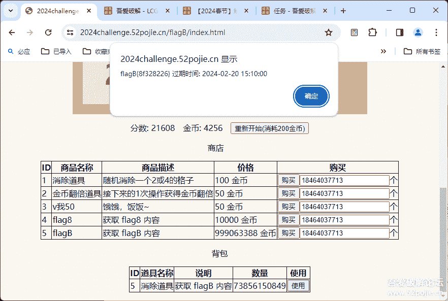

`image-20240220150336054.png` (81.57 KB, 下载次数: 1)

[附件链接](https://www.52pojie.cn/forum.php?mod=attachment&aid=MjY3NzQxNHwxZmRiOThmOXwxNzkzNTcyNjQwfDE2ODA4NnwxODkzMTE1&nothumb=yes)

2024-2-25 09:46 上传

# 高级

- `flag9{KHTALK}`
- `flag10{6BxMkW}`
- `flag11{HPQfVF}`
- `flag12{HOXI}`
- `flagC{412ce6c8}`

## flag9

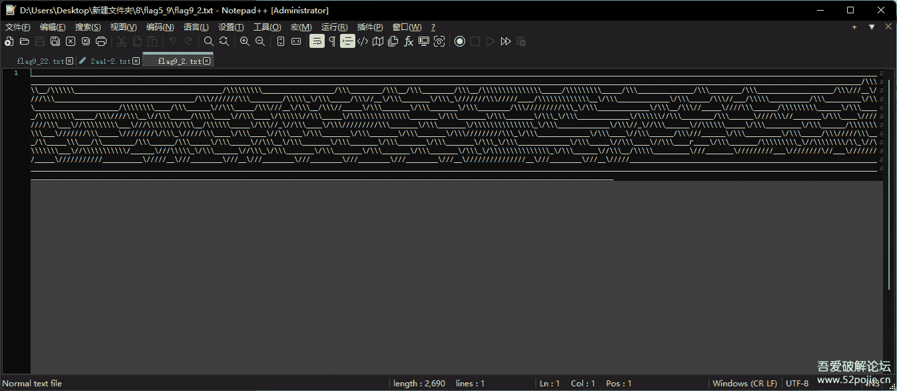

`image-20240220175716800.png` (44.9 KB, 下载次数: 1)

[附件链接](https://www.52pojie.cn/forum.php?mod=attachment&aid=MjY3NzQxOHwxYmE1YTY5N3wxNzkzNTcyNjQwfDE2ODA4NnwxODkzMTE1&nothumb=yes)

2024-2-25 09:46 上传

为了好查看把 `'_'`、`'\'`、`'/'` 分别替换为 `' '`、`'*'`、`'#'`

使用下面代码爆破

```
    flag9 = '                                                                                                                                                                                                                                                                                                                                                                                                                                    *#####  *######                                     *#########                  *###        *###  *###        *###  *###############     *#########     *###              *###        *###                   *###***  #****###                                   *###*******###        *##### #*###     *###**  #*###       #*### #*******###*****    *#############  #*###             #*###     *###**   *#####          *###         #*###                     *########    *###      #**###     *###***  #*###  *###**     #*###       #*###       #*###        *###*********### #*###             #*###  *###**     #****###      *#########      #*###     *#########     *###****###  #**###     *#####    #**###    #*######**###     #*###############       #*###       #*###       #*### #*###             #*######**###        *###      #****###**       #*###    #********###   #**#########   #***########*###  *######     #*###** #**###    #*###*********###       #*###       #*############### #*###             #*###** #**###      #**######     #*###         #*###      *##########   #*******###     #********#*### #*****###    #*###    #**###   #*###       #*###       #*###       #*###*********### #*###             #*###    #**###      *###***      #*###         #*###     *###*****###   *##     ###   *##        *###      *###     #*###     #**###  #*###       #*###       #*###       #*###       #*### #*###             #*###     #**###    #**###    r    #*###       *######### #**########*## #**########   #**###########*      #***##### #*###      #**### #*###       #*###       #*###       #*###       #*### #*############### #*###      #**###  *#####         #***       #*********   #********#**   #********     #***********          #*****  #***        #***  #***        #***        #***        #***        #***  #***************  #***        #***  #*****                                                                                                                                                                                                                                                                                                                                                                                                                                    '
alen = len(flag9)
#flag9 =flag9[::-1]
n=30
with open('2aa1-2.txt','w+') as f:
    for n in range(200,300):

    for i in range(0,alen,n):
        #print(i)
        #print(flag9[i:i+n])
        f.write(flag9[i:i+n]+'\n')
    f.write('\n\n\n')
```

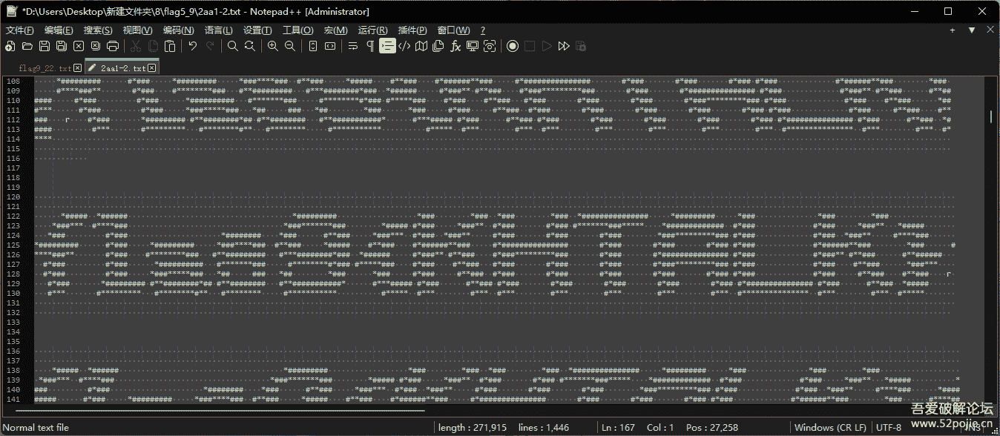

`image-20240220175500501.png` (63.31 KB, 下载次数: 1)

[附件链接](https://www.52pojie.cn/forum.php?mod=attachment&aid=MjY3NzQxNnwxOTk5MTNiZnwxNzkzNTcyNjQwfDE2ODA4NnwxODkzMTE1&nothumb=yes)

2024-2-25 09:46 上传

## flag10

`stegsolve` 查看

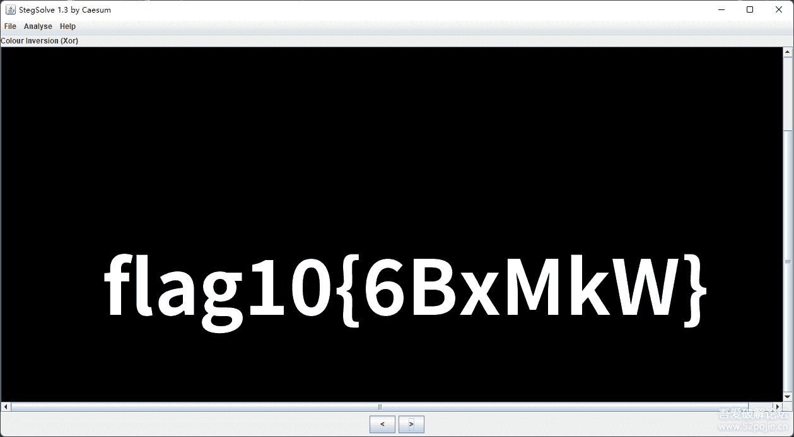

`image-20240220180853964.png` (45.36 KB, 下载次数: 1)

[附件链接](https://www.52pojie.cn/forum.php?mod=attachment&aid=MjY3NzQyMHw2NGFjY2U0NHwxNzkzNTcyNjQwfDE2ODA4NnwxODkzMTE1&nothumb=yes)

2024-2-25 09:47 上传

## flag11

根据提示 `--var1`、`--var2` 在 0-100 之间，总共有 `100*100`，10000中可能

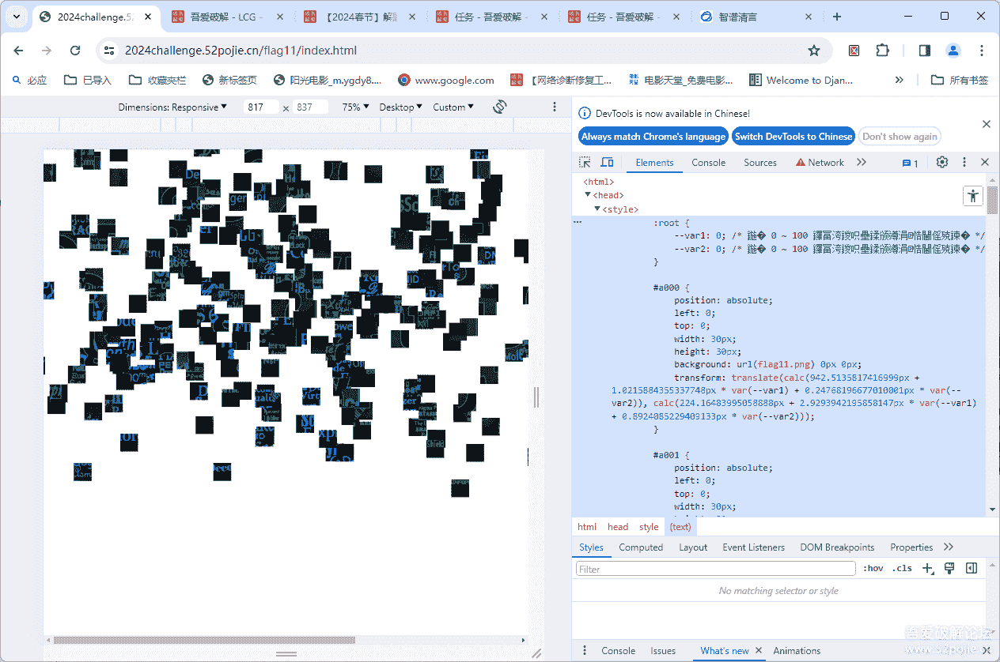

`image-20240220181041147.png` (299.53 KB, 下载次数: 1)

[附件链接](https://www.52pojie.cn/forum.php?mod=attachment&aid=MjY3NzQyMXwxMDhmYmNlM3wxNzkzNTcyNjQwfDE2ODA4NnwxODkzMTE1&nothumb=yes)

2024-2-25 09:47 上传

写 JS 脚本爆破

```
var x=0;

var y=0;

window.onclick=function(){if(y>100){x=1+x;y=0;}y=y+1;console.log(x,y);     document.documentElement.style.setProperty("--var1",x);

     document.documentElement.style.setProperty("--var2",y);}

setInterval(function() {

    document.head.click();},100);

//x=71,y=20 
```

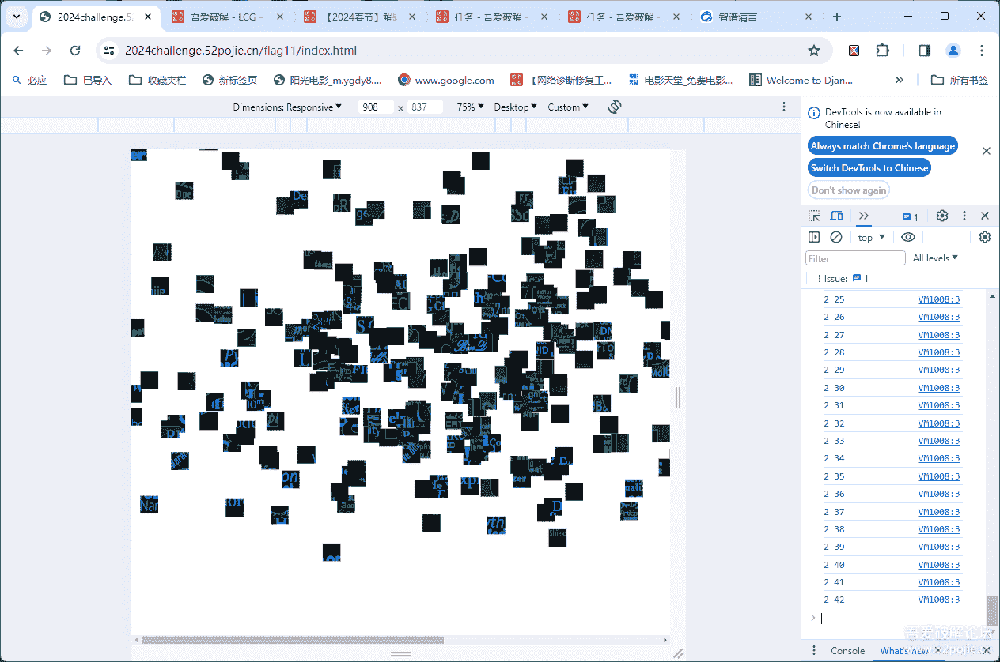

`image-20240220181452683.png` (294.96 KB, 下载次数: 1)

[附件链接](https://www.52pojie.cn/forum.php?mod=attachment&aid=MjY3NzQyMnw4MzJjZjYyY3wxNzkzNTcyNjQwfDE2ODA4NnwxODkzMTE1&nothumb=yes)

2024-2-25 09:47 上传

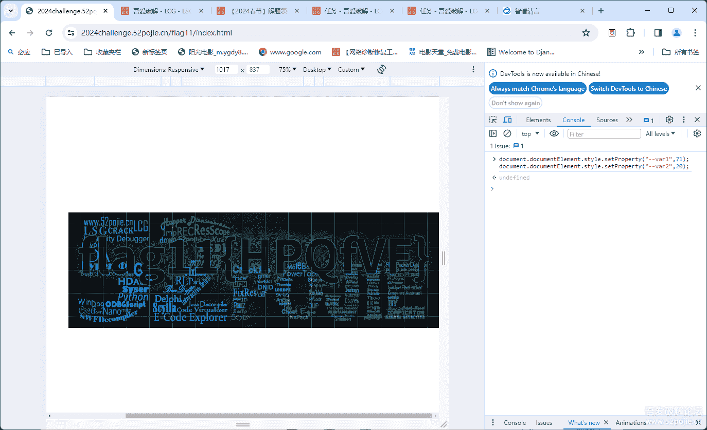

`image-20240220181626076.png` (356.88 KB, 下载次数: 1)

[附件链接](https://www.52pojie.cn/forum.php?mod=attachment&aid=MjY3NzQyM3xmNTg3NTk4NXwxNzkzNTcyNjQwfDE2ODA4NnwxODkzMTE1&nothumb=yes)

2024-2-25 09:47 上传

## flag12

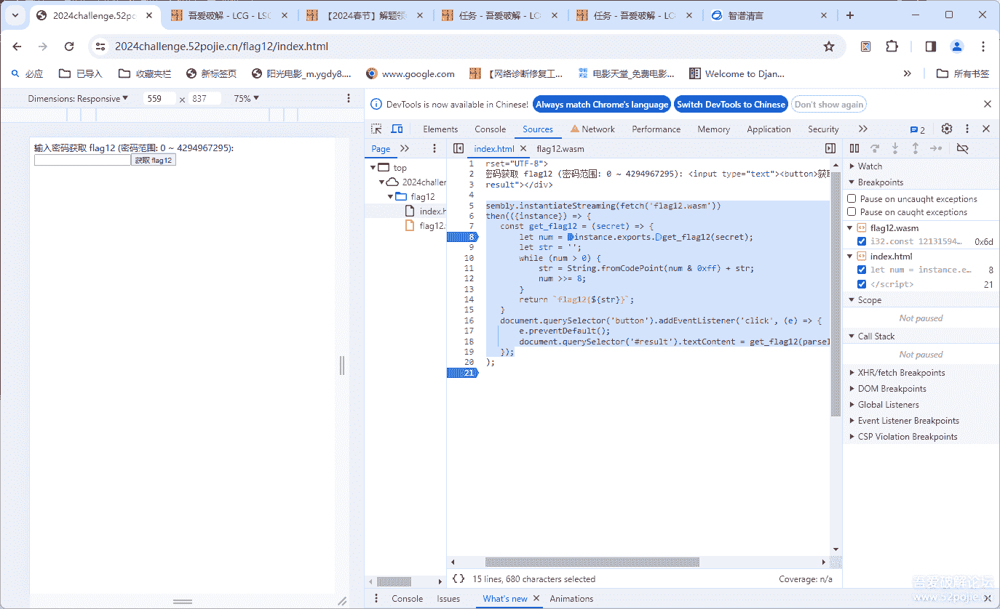

`image-20240220184716415.png` (134.63 KB, 下载次数: 1)


[href="forum.php?mod=attachment&aid=MjY3NzQyNnwzMTZjMTUwY3wxNzkzNTcyNjQwfDE2ODA4NnwxODkzMTE1&nothumb=yes" target="_blank"](https://www.52pojie.cn/forum.php?mod=attachment&aid=MjY3NzQyNnwzMTZjMTUwY3wxNzkzNTcyNjQwfDE2ODA4NnwxODkzMTE1&nothumb=yes)

2024-2-25 09:47 上传

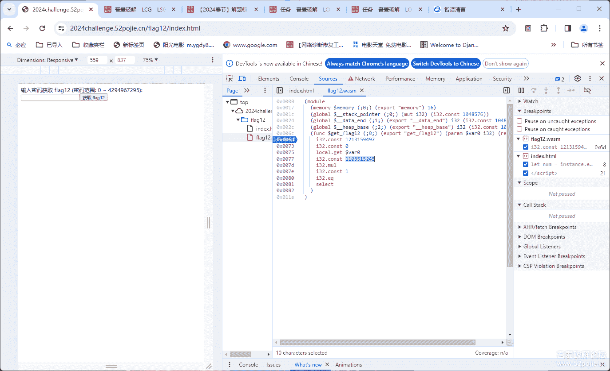

image-20240220184739216.png (139.76 KB, 下载次数: 1)

[href="forum.php?mod=attachment&aid=MjY3NzQyN3w0ODcyZjY5ZXwxNzkzNTcyNjQwfDE2ODA4NnwxODkzMTE1&nothumb=yes" target="_blank"](https://www.52pojie.cn/forum.php?mod=attachment&aid=MjY3NzQyN3w0ODcyZjY5ZXwxNzkzNTcyNjQwfDE2ODA4NnwxODkzMTE1&nothumb=yes)

2024-2-25 09:47 上传

## 爆破脚本

爆破脚本， `4294967296`在`i32`中位0，1依次`4294967296`，直到找到能被`1103515245`整除的数

也就是乘以`1103515245`为1的数。

```
a = 1
b = 4294967296
c = 1103515245
while True:
    a = a+b
    #print(a)
    if not a %c:
        print(a /c)
        break

#4005161829
```

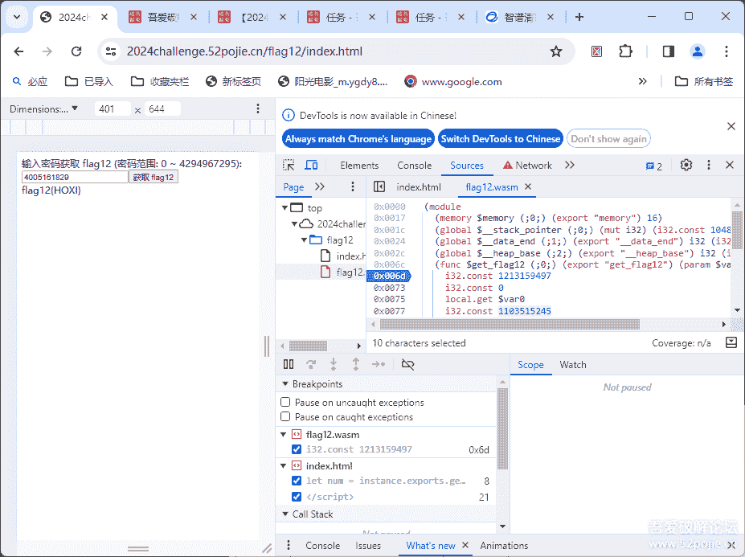

image-20240220185327787.png (109.42 KB, 下载次数: 2)

[href="forum.php?mod=attachment&aid=MjY3NzQyOHw5MWQxNDE0YnwxNzkzNTcyNjQwfDE2ODA4NnwxODkzMTE1&nothumb=yes" target="_blank"](https://www.52pojie.cn/forum.php?mod=attachment&aid=MjY3NzQyOHw5MWQxNDE0YnwxNzkzNTcyNjQwfDE2ODA4NnwxODkzMTE1&nothumb=yes)

2024-2-25 09:47 上传

flag12{HOXI}

## 4> flagC


image-20240220175118532.png (783.11 KB, 下载次数: 0)

[href="forum.php?mod=attachment&aid=MjY3NzQxNXwyMTA3NGM3MHwxNzkzNTcyNjQwfDE2ODA4NnwxODkzMTE1&nothumb=yes" target="_blank"](https://www.52pojie.cn/forum.php?mod=attachment&aid=MjY3NzQxNXwyMTA3NGM3MHwxNzkzNTcyNjQwfDE2ODA4NnwxODkzMTE1&nothumb=yes)

2024-2-25 09:46 上传

可针对`classes`爆破。

上传图片抓包，修改`classes`

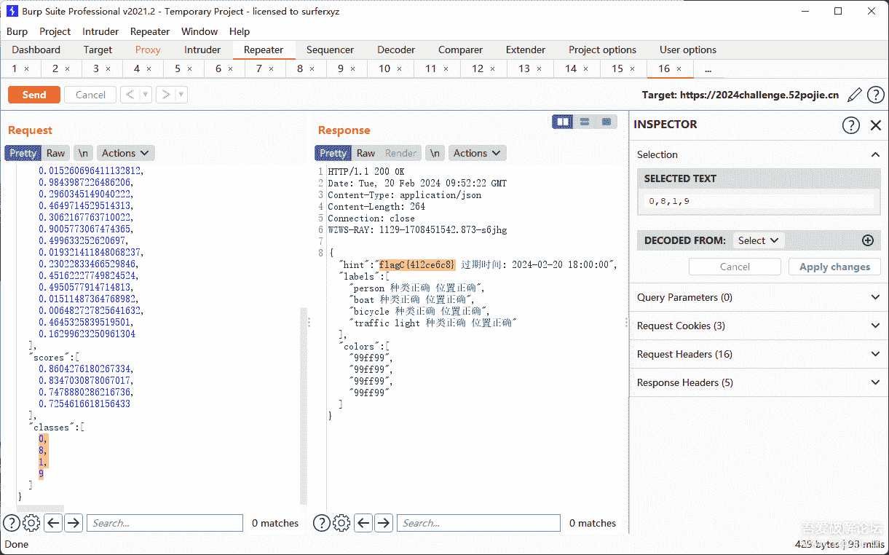

image-20240220185411772.png (114.93 KB, 下载次数: 0)

[href="forum.php?mod=attachment&aid=MjY3NzQyOXxlOTE0ZWM1MXwxNzkzNTcyNjQwfDE2ODA4NnwxODkzMTE1&nothumb=yes" target="_blank"](https://www.52pojie.cn/forum.php?mod=attachment&aid=MjY3NzQyOXxlOTE0ZWM1MXwxNzkzNTcyNjQwfDE2ODA4NnwxODkzMTE1&nothumb=yes)

2024-2-25 09:47 上传

## 6> 逆向初级

## 4> 初二

```
 "fl@g{H@ppy_N3w_e@r!2o24!Fighting!!!}"
```

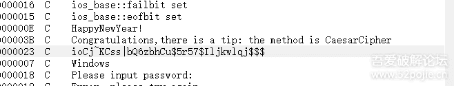

image-20240224114013858.png (9.97 KB, 下载次数: 2)

[href="forum.php?mod=attachment&aid=MjY3ODUwN3wwOGExNmM1ZnwxNzkzNTcyNjQwfDE2ODA4NnwxODkzMTE1&nothumb=yes" target="_blank"](https://www.52pojie.cn/forum.php?mod=attachment&aid=MjY3ODUwN3wwOGExNmM1ZnwxNzkzNTcyNjQwfDE2ODA4NnwxODkzMTE1&nothumb=yes)

2024-2-28 16:51 上传

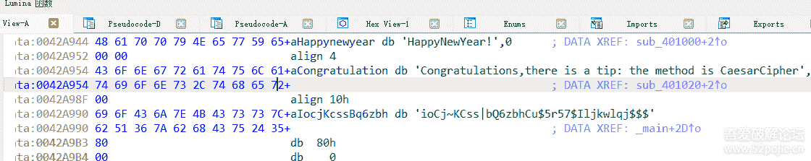

image-20240224114658794.png (44.08 KB, 下载次数: 1)

[href="forum.php?mod=attachment&aid=MjY3ODUwOHxhN2I5MTZmYnwxNzkzNTcyNjQwfDE2ODA4NnwxODkzMTE1&nothumb=yes" target="_blank"](https://www.52pojie.cn/forum.php?mod=attachment&aid=MjY3ODUwOHxhN2I5MTZmYnwxNzkzNTcyNjQwfDE2ODA4NnwxODkzMTE1&nothumb=yes)

2024-2-28 16:51 上传

```
提示CasearCipher
ioCj~KCss|bQ6zbhCu$5r57$Iljkwlqj$$$
```

```
eflag = 'ioCj~KCss|bQ6zbhCu$5r57$Iljkwlqj$$$'

for i in range(27):
    flag = ''
    for a in eflag:
        na = ord(a)-i
        if na>=33:
            flag += chr(na)
        else:
            flag += chr(na%126+33)
    print(flag+'\n')
```

动态调试

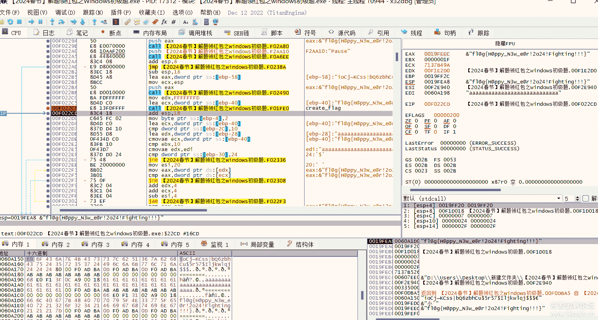

image-20240224121124678.png (259.24 KB, 下载次数: 0)

[href="forum.php?mod=attachment&aid=MjY3ODUwOXwxMjA3NjYwNHwxNzkzNTcyNjQwfDE2ODA4NnwxODkzMTE1&nothumb=yes" target="_blank"](https://www.52pojie.cn/forum.php?mod=attachment&aid=MjY3ODUwOXwxMjA3NjYwNHwxNzkzNTcyNjQwfDE2ODA4NnwxODkzMTE1&nothumb=yes)

2024-2-28 16:51 上传

## 4> 初三

```
flag{happy_new_year_2024}
```

游戏通关视频最后会出现flag

也可直接查看，在`ys.mp4`文件最后


image-20240224125309561.png (39.29 KB, 下载次数: 0)

[href="forum.php?mod=attachment&aid=MjY3ODUxMHxiMzUzNGQ0MXwxNzkzNTcyNjQwfDE2ODA4NnwxODkzMTE1&nothumb=yes" target="_blank"](https://www.52pojie.cn/forum.php?mod=attachment&aid=MjY3ODUxMHxiMzUzNGQ0MXwxNzkzNTcyNjQwfDE2ODA4NnwxODkzMTE1&nothumb=yes)

2024-2-28 16:51 上传

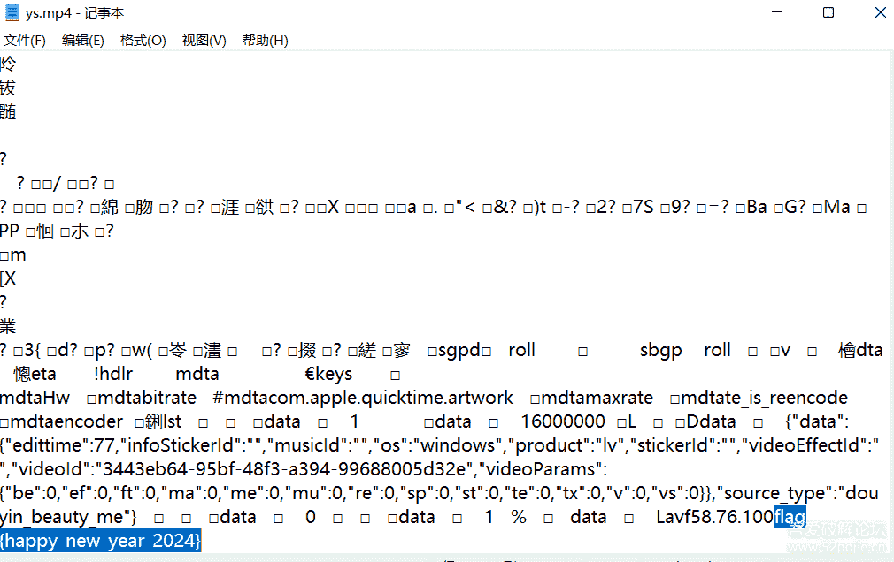

image-20240224125334049.png (49.57 KB, 下载次数: 3)

[href="forum.php?mod=attachment&aid=MjY3ODUxMXxhNjkzYWFmY3wxNzkzNTcyNjQwfDE2ODA4NnwxODkzMTE1&nothumb=yes" target="_blank"](https://www.52pojie.cn/forum.php?mod=attachment&aid=MjY3ODUxMXxhNjkzYWFmY3wxNzkzNTcyNjQwfDE2ODA4NnwxODkzMTE1&nothumb=yes)

2024-2-28 16:51 上传

## 4> 初四

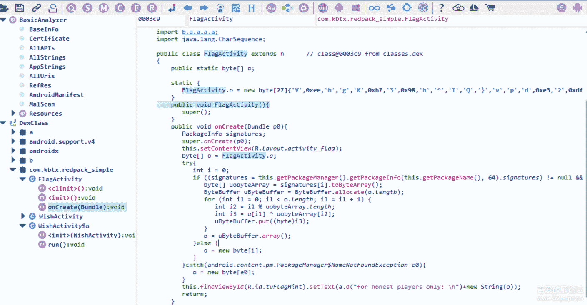

image-20240224125659248.png (307.41 KB, 下载次数: 1)

[href="forum.php?mod=attachment&aid=MjY3ODUxMnwwN2E1MjE2M3wxNzkzNTcyNjQwfDE2ODA4NnwxODkzMTE1&nothumb=yes" target="_blank"](https://www.52pojie.cn/forum.php?mod=attachment&aid=MjY3ODUxMnwwN2E1MjE2M3wxNzkzNTcyNjQwfDE2ODA4NnwxODkzMTE1&nothumb=yes)

2024-2-28 16:51 上传

flag 为

`FlagActivity.o = new byte[27]{'V',0xee,'b','g','K',0xb7,'3',0x98,'h','^','I','Q','}','v','p','d',0xe3,'?',0xdf,0x92,'l','s','3',';','7','4','M'};`

与apk的`signatures`亦或

`signatures`在apk `MET-INF`目录下的`CERT.RSA`中

```
Signature = [0x30, 0x82, 0x03, 0x00, 0x30, 0x82, 0x01, 0xE8, 0x02, 0x01, 0x01, 0x30, 0x0D, 0x06, 0x09, 0x2A, 0x86, 0x48, 0x86, 0xF7, 0x0D, 0x01, 0x01, 0x0B, 0x05, 0x00, 0x30, 0x46, 0x31, 0x10, 0x30, 0x0E, 0x06, 0x03, 0x55, 0x04, 0x03, 0x0C, 0x07, 0x6B, 0x62, 0x74, 0x78, 0x77, 0x65, 0x72, 0x31, 0x10, 0x30, 0x0E, 0x06, 0x03, 0x55, 0x04, 0x0B, 0x0C, 0x07]

#偏移11e-15d

enflag = [86, 238, 98, 103, 75, 183, 51, 152, 104, 94, 73, 81, 125, 118, 112, 100, 227, 63, 223, 146, 108, 115, 51, 59, 55, 52, 77]

n = len(Signature)

n2 = len(enflag)

flag = ''

for i in range(n2):
    aa = enflag[i] ^ Signature[i%n2]
    #print(aa)
    flag += chr(aa)
```
