# [CTF] 吾爱破解 2024 春节解题领红包--Web 题解

- 原帖: `https://www.52pojie.cn/forum.php?mod=viewthread&tid=1893136`
- 抓取时间: 2026-11-01T22:37:19

## 写在前面

本人没有任何逆向之类的经验，所以只能试试web题了，没想到也挺难的，感觉自己挺笨&#128514;

活动链接：`https://www.52pojie.cn/thread-1889163-1-1.html`

活动视频：`https://www.bilibili.com/video/BV1ap421R7VS/`

## 活动规则

活动规则如下：

题目共包含 12 个静态 `flag`: `flag1`~`flag12`，另外还需要寻找到 3 个动态 `flag`: `flagA`~`flagC`。

本题总共有 3 个难度，每个难度提交 4 个静态 `flag` 和 1 个动态 `flag` 就算通过（如果答对人数较少，我们会在未来二天逐步降低难度，依次减少静态 `flag` 提交的数量，奖励也会依次减少）。

初级难度为 `flag1`~`flag4` 与 `flagA`（当前需要提交所有5个答案，奖励对应降低，明天可以重新查看本题要求）

提交时，请将 `flag` 使用空格分隔，提交到对应任务中。

不要被吓到，当做猜灯谜就好了~

### flag1

这个其实我也被卡了半天，最后发现是在视频里面，从视频3s开始，出现一圈向外扩散的原点波纹，`flag1`就藏在里面，通过浏览器的 `Global Speed` 插件将视频调整为0.25倍速，通过观察可得得出 `flag1{52pj2024}`

### flag2

这个藏得还不算太深，可能也是我运气好，在视频4s开始一次出现了四块二维码，很明显，拼接到一起的完整二维码就是重要信息


二维码.jpg (42.81 KB, 下载次数: 1)

[href="forum.php?mod=attachment&aid=MjY3NzQ4Nnw1Y2QzYzhjYXwxNzkzNTcyNjM3fDE2ODA4NnwxODkzMTM2&nothumb=yes" target="_blank"](https://www.52pojie.cn/forum.php?mod=attachment&aid=MjY3NzQ4Nnw1Y2QzYzhjYXwxNzkzNTcyNjM3fDE2ODA4NnwxODkzMTM2&nothumb=yes)

2024-2-25 11:11 上传

扫描二维码得到活动主网址：`https://2024challenge.52pojie.cn/`

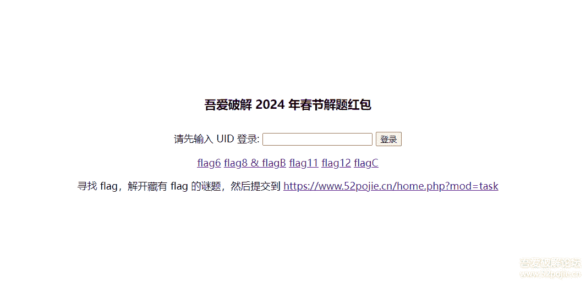

main.png (31.06 KB, 下载次数: 3)

[href="forum.php?mod=attachment&aid=MjY3NzQ4N3xkOTQxNGU4OXwxNzkzNTcyNjM3fDE2ODA4NnwxODkzMTM2&nothumb=yes" target="_blank"](https://www.52pojie.cn/forum.php?mod=attachment&aid=MjY3NzQ4N3xkOTQxNGU4OXwxNzkzNTcyNjM3fDE2ODA4NnwxODkzMTM2&nothumb=yes)

2024-2-25 11:12 上传

输入自己的 `uid` 点击登录，这里需要 `F12` 打开开发者工具，可以发现在 `https://2024challenge.52pojie.cn/` 的响应标头中出现了 `flag2{xHOpRP}`

### flag3

`flag3` 藏在视频开头的雪花中，通过 `Global Speed` 插件调整视频倍速为1.25-1.5倍，得到 `flag3{GRsgk2}`

### flag4

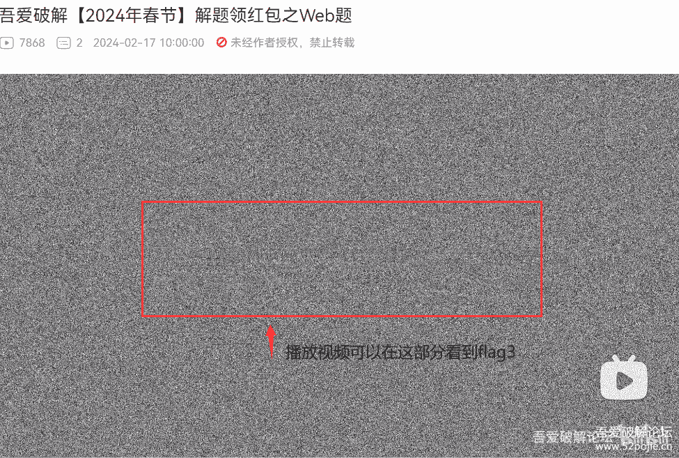

flag3.png (1.57 MB, 下载次数: 0)

[href="forum.php?mod=attachment&aid=MjY3NzQ5MHwwMWRkYjAzMXwxNzkzNTcyNjM3fDE2ODA4NnwxODkzMTM2&nothumb=yes" target="_blank"](https://www.52pojie.cn/forum.php?mod=attachment&aid=MjY3NzQ5MHwwMWRkYjAzMXwxNzkzNTcyNjM3fDE2ODA4NnwxODkzMTM2&nothumb=yes)

2024-2-25 11:14 上传

右键查看 `https://2024challenge.52pojie.cn/` 的页面源代码，发现引用了 `background: url("flag4_flag10.png") white center center no-repeat;`

得到 `flag4` 的图片：


flag4.png (48.41 KB, 下载次数: 4)

[href="forum.php?mod=attachment&aid=MjY3NzQ5MXwxYzg5OTU1YnwxNzkzNTcyNjM3fDE2ODA4NnwxODkzMTM2&nothumb=yes" target="_blank"](https://www.52pojie.cn/forum.php?mod=attachment&aid=MjY3NzQ5MXwxYzg5OTU1YnwxNzkzNTcyNjM3fDE2ODA4NnwxODkzMTM2&nothumb=yes)

2024-2-25 11:15 上传

### flag5

`flag5` 也在右键网页源代码中

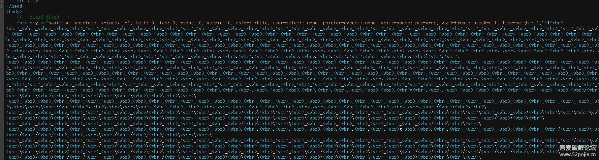

flag5_1.png (34.53 KB, 下载次数: 2)

[href="forum.php?mod=attachment&aid=MjY3NzQ5MnxkMmRhZjg2MnwxNzkzNTcyNjM3fDE2ODA4NnwxODkzMTM2&nothumb=yes" target="_blank"](https://www.52pojie.cn/forum.php?mod=attachment&aid=MjY3NzQ5MnxkMmRhZjg2MnwxNzkzNTcyNjM3fDE2ODA4NnwxODkzMTM2&nothumb=yes)

2024-2-25 11:16 上传

由于 css 的限制，没有直接显示出来，直接删掉 css 即可显示

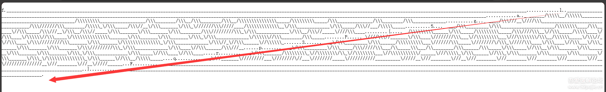

flag5_2.png (26.67 KB, 下载次数: 2)

[href="forum.php?mod=attachment&aid=MjY3NzQ5M3w3YmZiNWFlMXwxNzkzNTcyNjM3fDE2ODA4NnwxODkzMTM2&nothumb=yes" target="_blank"](https://www.52pojie.cn/forum.php?mod=attachment&aid=MjY3NzQ5M3w3YmZiNWFlMXwxNzkzNTcyNjM3fDE2ODA4NnwxODkzMTM2&nothumb=yes)

2024-2-25 11:16 上传

或者复制下来，写段 python 代码过滤一下多余的符号

```python
string = "f.______________________________________________________________________________________________________________________________________________________________________________________________________________.............l..______________________________________________________________________________________________________________________________________________________________________________________________________________............a..________/\\\\\\__/\\\\\\_____________________________________/\\\\\\\\\\__________________/\\\________/\\\__/\\\________/\\\__/\\\\\\\\\\\\\\\_____/\\\\\\\\\_____/\\\______________/\\\________/\\\_____________...........g...______/\\\///__\\////\\\___________________________________/\\\///////\\\________/\\\\\_\\/\\\_____/\\\//__\\/\\\_______\\/\\\_\\///////\\\/////____/\\\\\\\\\\\\\\__\\/\\\_____________\\/\\\_____/\\\//___/\\\\\\_____..........5...._____/\\\_________\\/\\\_____________________/\\\\\\\\____/\\\______\\//\\\_____/\\\///__\\/\\\__/\\\//_____\\/\\\_______\\/\\\_______\\/\\\________/\\\/////////\\\_\\/\\\_____________\\/\\\__/\\\//______\\////\\\____.........{.....__/\\\\\\\\\\______\\/\\\_____/\\\\\\\\\\_____/\\\////\\\__\\//\\\_____/\\\\\\____\\//\\\____\\/\\\\\\//\\\\\\_\\/\\\\\\\\\\\\\\\\\\_______\\/\\\_______\\/\\\_______\\/\\\_\\/\\\_____________\\/\\\\\\//\\\\\\________/\\\_____........P......_\\////\\\//_______\\/\\\____\\////////\\\___\\//\\\\\\\\\\___\\///\\\\\\\\/\\\__/\\\\\\_____\\/\\\//_\\//\\\____\\/\\\/////////\\\_______\\/\\\_______\\/\\\\\\\\\\\\\\\\\\_\\/\\\_____________\\/\\\//_\\//\\\______\\//\\\\\\_.......3.......____\\/\\\_________\\/\\\______/\\\\\\\\\\___\\///////\\\____\\////////\\/\\\_\\/////\\\____\\/\\\____\\//\\\___\\/\\\_______\\/\\\_______\\/\\\_______\\/\\\/////////\\\_\\/\\\_____________\\/\\\____\\//\\\______/\\\///__......p........____\\/\\\_________\\/\\\_____/\\\/////\\\___/\\_____\\\\___/\\________/\\\______/\\\_____\\/\\\____\\//\\\__\\/\\\_______\\/\\\_______\\/\\\_______\\/\\\_______\\/\\\_\\/\\\_____________\\/\\\____\\//\\\______\\//\\\____.....r.........____\\/\\\_______/\\\\\\\\\\_\\//\\\\\\\\/\\_\\//\\\\\\\\___\\//\\\\\\\\\\\\\\/______\\///\\\\\\_\\/\\\______\\//\\\_\\/\\\_______\\/\\\_______\\/\\\_______\\/\\\_______\\/\\\_\\/\\\\\\\\\\\\\\\\\\_\\/\\\______\\//\\\__/\\\\\\_____....q..........____\\///_______\\/////////___\\////////\\//___\\////////_____\\///////////__________\\/////__\\///________\\///__\\///________\\///________\\///__\\///////////////__\\///________\\///__\\/////______...F..........._______________________________________________________________________________________________________________________________________________________________________________________________________________..}............_______________________________________________________________________________________________________________________________________________________________________________________________________________."
result = string.replace('.', '').replace('_', '').replace('/', '').replace('\\', '')
print(result)
```

得到 `flag5{P3prqF}`

### flag6

从主网址即可来到 `flag6` 的网址，直接算肯定直接卡住，右键查看源代码，发现就是计算哪个数字的 `md5` 为 `1c450bbafad15ad87c32831fa1a616fc`

随便找个 `md5` 加解密网站即可得出 `flag6{20240217}`

```javascript
计算 flag6

   document.querySelector('button').addEventListener('click', () => { const t0 = Date.now(); for (let i = 0; i
```

### flag7

这个在视频中出现地址，即给出的 Github 地址 `https://github.com/ganlvtech/52pojie-2024-challenge`

打开网址，在 `README.MD` 中发现 `flag7{Djl9NQ}`

### flag8

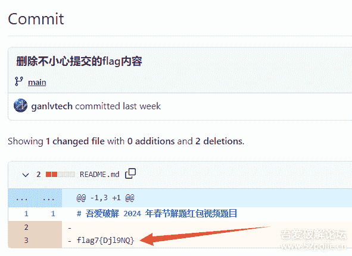

flag7.png (34.85 KB, 下载次数: 1)

[href="forum.php?mod=attachment&aid=MjY3NzQ5NHw1YmMxN2M1MnwxNzkzNTcyNjM3fDE2ODA4NnwxODkzMTM2&nothumb=yes" target="_blank"](https://www.52pojie.cn/forum.php?mod=attachment&aid=MjY3NzQ5NHw1YmMxN2M1MnwxNzkzNTcyNjM3fDE2ODA4NnwxODkzMTM2&nothumb=yes)

2024-2-25 11:18 上传

这个我是老老实实玩 2048 小游戏换的 `flag8{OaOjIK}`

### flag9

这个和 `flag5` 在一起的，那一堆符号中除了 `flag5` 等几个数字字母外，剩下的全是 _ / \  我看着那个界面貌似是能组成一些字，所以就删掉了 `flag5` 那些字，然后调整一下浏览器的宽度，结果出来了 `flag9{KHTALK}`，藏得挺深的！

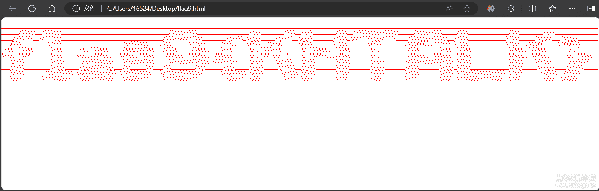

flag9.png (31.02 KB, 下载次数: 1)

[href="forum.php?mod=attachment&aid=MjY3NzQ5NXw1NGM4MzA2ZXwxNzkzNTcyNjM3fDE2ODA4NnwxODkzMTM2&nothumb=yes" target="_blank"](https://www.52pojie.cn/forum.php?mod=attachment&aid=MjY3NzQ5NXw1NGM4MzA2ZXwxNzkzNTcyNjM3fDE2ODA4NnwxODkzMTM2&nothumb=yes)

2024-2-25 11:19 上传

### flag10


## flag10
这个和`flag4`是一起的，`flag4`是在明面上，那`flag10`就是隐藏了？我先用`winhex`看，没有结果，又找了几个在线图片隐写解密的网站，还是白扯，最后在网上看到了`stegsolve`这个工具好像是可以处理图片隐写，所以下载了一个，你别说，还真好使，下面那俩箭头点几下就出答案了

## flag11
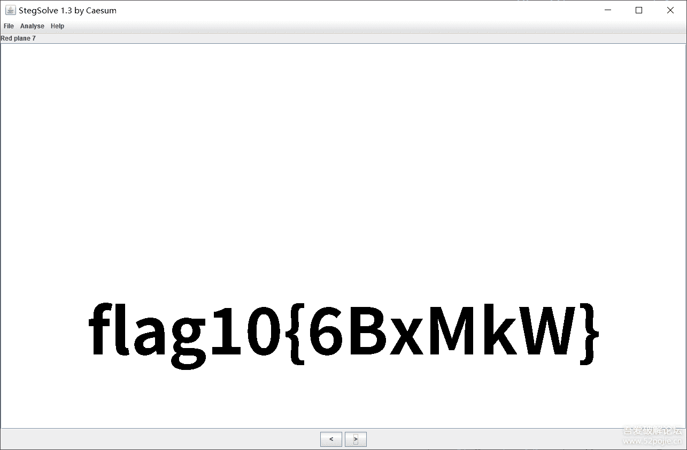

flag10.png (31.81 KB, 下载次数: 1)

[href="forum.php?mod=attachment&aid=MjY3NzQ5Nnw0NGY2NGJmYXwxNzkzNTcyNjM3fDE2ODA4NnwxODkzMTM2&nothumb=yes" target="_blank"](https://www.52pojie.cn/forum.php?mod=attachment&aid=MjY3NzQ5Nnw0NGY2NGJmYXwxNzkzNTcyNjM3fDE2ODA4NnwxODkzMTM2&nothumb=yes)

2024-2-25 11:20 上传

进入`flag11`的网址，发现是一堆乱糟糟的经过打乱拆分的图片，怀疑是拼图得到答案

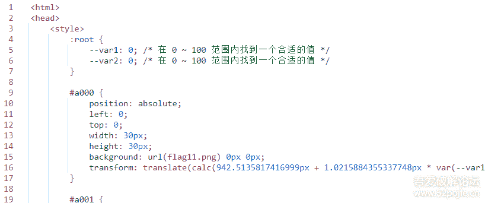

flag11_1.png (34.08 KB, 下载次数: 1)

[href="forum.php?mod=attachment&aid=MjY3NzQ5N3w5YzFjOWE3YnwxNzkzNTcyNjM3fDE2ODA4NnwxODkzMTM2&nothumb=yes" target="_blank"](https://www.52pojie.cn/forum.php?mod=attachment&aid=MjY3NzQ5N3w5YzFjOWE3YnwxNzkzNTcyNjM3fDE2ODA4NnwxODkzMTM2&nothumb=yes)

2024-2-25 11:20 上传

看到注释直接确定拼图,将代码和原图都下载到本地，用`python`两个嵌套循环枚举所有可能

[Python] 纯文本查看 复制代码
```
f = open("flag_0_0.html",encoding='utf-8') data = f.read() for i in range(1,101): for j in range(1,101): data_ = data.replace("--var1: 0; /*","--var1: "+str(i)+"; /*") data_ = data_.replace("--var2: 0; /*","--var2: "+str(j)+"; /*") fi = open("flag_"+str(i)+"_"+str(j)+".html",'w',encoding='utf-8') fi.write(data_) fi.close()
```

得到71 20的时候完美契合，得到flag11{HPQfVF}

## flag12


flag11.png (638.36 KB, 下载次数: 0)

[href="forum.php?mod=attachment&aid=MjY3NzQ5OHxmMWEyOGM0ZnwxNzkzNTcyNjM3fDE2ODA4NnwxODkzMTM2&nothumb=yes" target="_blank"](https://www.52pojie.cn/forum.php?mod=attachment&aid=MjY3NzQ5OHxmMWEyOGM0ZnwxNzkzNTcyNjM3fDE2ODA4NnwxODkzMTM2&nothumb=yes)

2024-2-25 11:22 上传

进网址一看,先抓包，发现js调用一个`wasm`文件，看不太懂，让ai分析一下

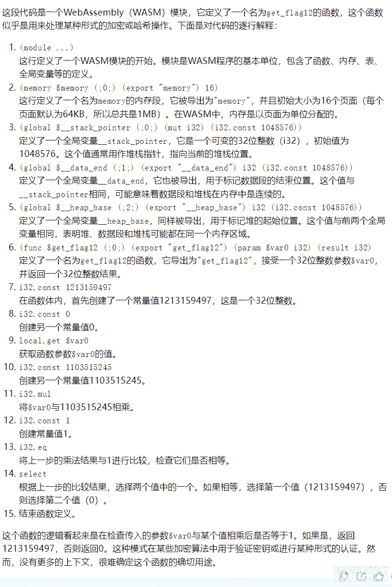

flag12.png (174.3 KB, 下载次数: 1)

[href="forum.php?mod=attachment&aid=MjY3NzQ5OXwxYzRlMzhmYXwxNzkzNTcyNjM3fDE2ODA4NnwxODkzMTM2&nothumb=yes" target="_blank"](https://www.52pojie.cn/forum.php?mod=attachment&aid=MjY3NzQ5OXwxYzRlMzhmYXwxNzkzNTcyNjM3fDE2ODA4NnwxODkzMTM2&nothumb=yes)

2024-2-25 11:22 上传

让他直接返回`1213159497`这个值，然后js解密

[JavaScript] 纯文本查看 复制代码
```
function get_flag12(num) { let str = ''; while (num > 0) { // 获取最低的8位 let byte = num & 0xff; // 将字节转换为字符 let char = String.fromCharCode(byte); // 将字符添加到字符串的前面 str = char + str; // 移除最低的8位 num >>= 8; } // 返回格式化的字符串 return `flag12{${str}}`; } // 使用给定的数值 let result = get_flag12(1213159497); console.log(result);
```

得到flag12{HOXI}

## flagA
这个我可太懵逼了，加密的flagA不难找，就在登录完设置的cookie里面，试了n种加密算法，全都对不上，后来细看了一下

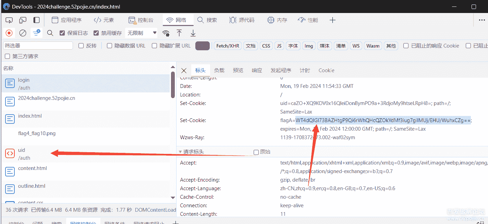

flagA.png (120.8 KB, 下载次数: 1)

[href="forum.php?mod=attachment&aid=MjY3NzUwMHwwMmQ4YzcwZnwxNzkzNTcyNjM3fDE2ODA4NnwxODkzMTM2&nothumb=yes" target="_blank"](https://www.52pojie.cn/forum.php?mod=attachment&aid=MjY3NzUwMHwwMmQ4YzcwZnwxNzkzNTcyNjM3fDE2ODA4NnwxODkzMTM2&nothumb=yes)

2024-2-25 11:24 上传

`/auth/uid`这个地址，怎么除了cookie什么参数也没提交，就能返回我的uid呢，然后突然想到cookie里面有加密的uid和加密的flagA啊，索性直接把uid的值替换成了flagA的值，用工具提交一下，flagA出来了

## flagB
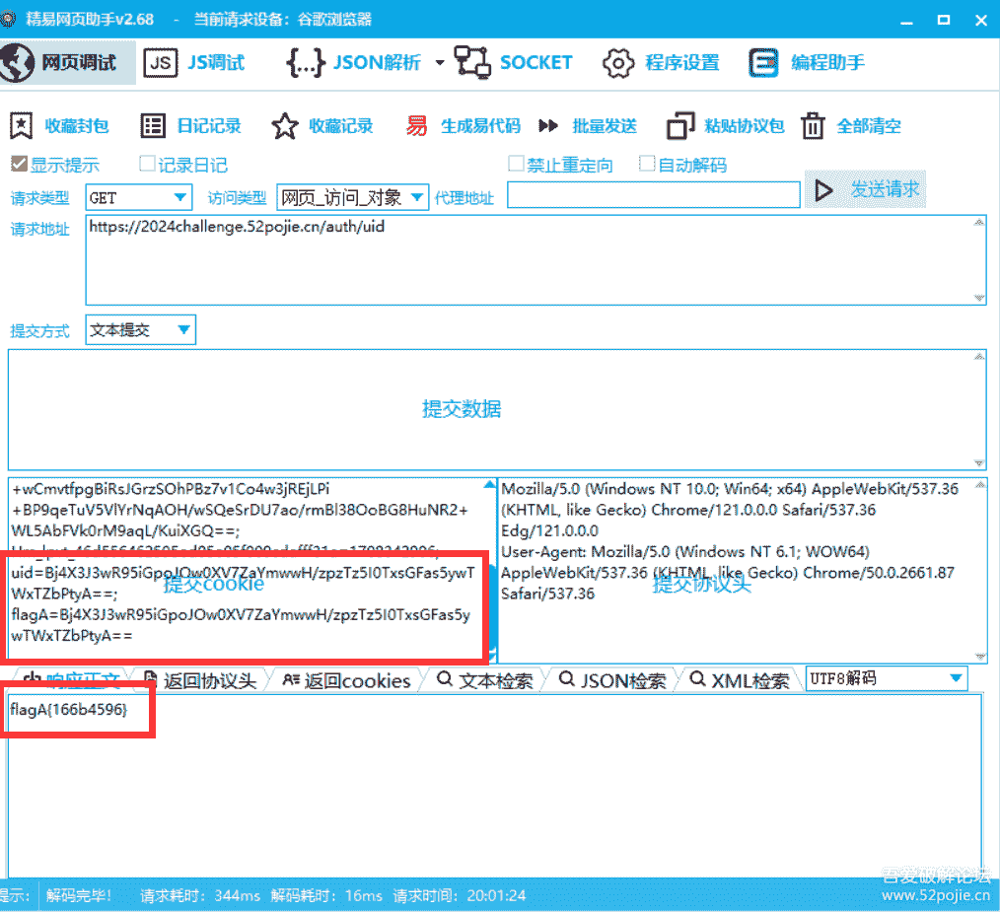

flagA_1.png (298.88 KB, 下载次数: 1)

[href="forum.php?mod=attachment&aid=MjY3NzUwMXw1YjNmNGU1M3wxNzkzNTcyNjM3fDE2ODA4NnwxODkzMTM2&nothumb=yes" target="_blank"](https://www.52pojie.cn/forum.php?mod=attachment&aid=MjY3NzUwMXw1YjNmNGU1M3wxNzkzNTcyNjM3fDE2ODA4NnwxODkzMTM2&nothumb=yes)

2024-2-25 11:24 上传

先玩几把2048小游戏，凑了一万来分，把flag8换了，但是flagB那么多分，肯定不是靠玩游戏获得的啊，接着我把除了flagB的道具全买了一遍，发现V50提示关键词“溢出”，溢出是指什么呢？数值溢出？2048游戏数据溢出？这个我可绕了个大弯，因为误入歧途甚至把2048游戏玩的明明白白的了...

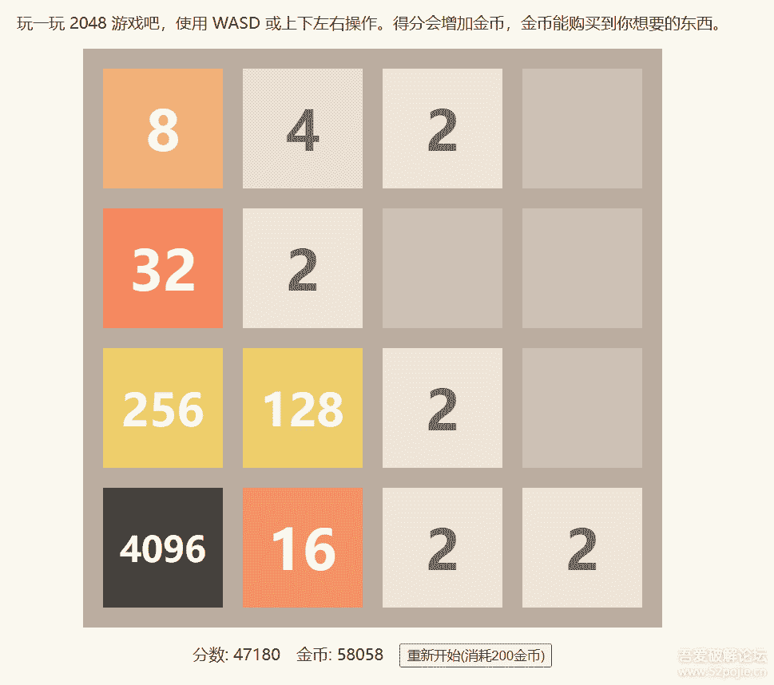

2048.png (48.24 KB, 下载次数: 2)

[href="forum.php?mod=attachment&aid=MjY3NzUwMnwwOWU2MDExYXwxNzkzNTcyNjM3fDE2ODA4NnwxODkzMTM2&nothumb=yes" target="_blank"](https://www.52pojie.cn/forum.php?mod=attachment&aid=MjY3NzUwMnwwOWU2MDExYXwxNzkzNTcyNjM3fDE2ODA4NnwxODkzMTM2&nothumb=yes)

2024-2-25 11:25 上传

我甚至以为超过2048再用金币翻倍就是溢出的意思，但是经过实验......并不是(吐血)

转头研究数值溢出，注意：题目是半拦，只拦截为负的数值，所以构造一个正的即可

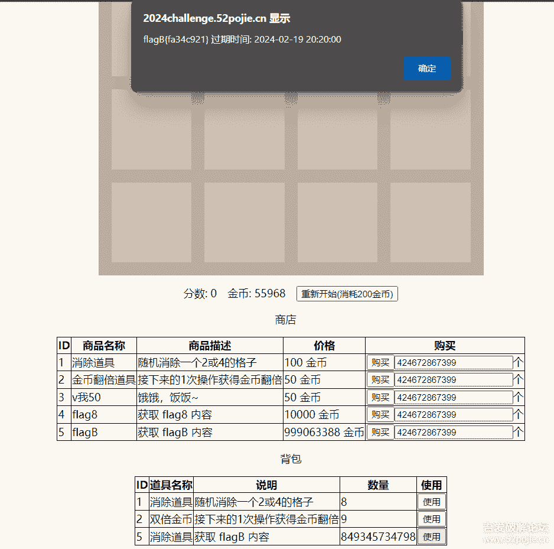

flagB.png (88.91 KB, 下载次数: 1)

[href="forum.php?mod=attachment&aid=MjY3NzUwM3wyMzAwZmI5YnwxNzkzNTcyNjM3fDE2ODA4NnwxODkzMTM2&nothumb=yes" target="_blank"](https://www.52pojie.cn/forum.php?mod=attachment&aid=MjY3NzUwM3wyMzAwZmI5YnwxNzkzNTcyNjM3fDE2ODA4NnwxODkzMTM2&nothumb=yes)

2024-2-25 11:25 上传

## flagC
这个应该是碰大运了

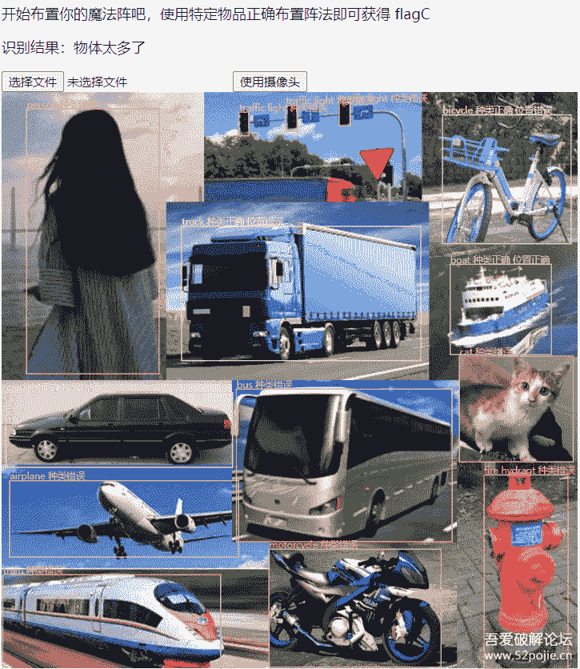

flagC.png (854.4 KB, 下载次数: 1)

[href="forum.php?mod=attachment&aid=MjY3NzUwNHxkMTgzM2JiOXwxNzkzNTcyNjM3fDE2ODA4NnwxODkzMTM2&nothumb=yes" target="_blank"](https://www.52pojie.cn/forum.php?mod=attachment&aid=MjY3NzUwNHxkMTgzM2JiOXwxNzkzNTcyNjM3fDE2ODA4NnwxODkzMTM2&nothumb=yes)

2024-2-25 11:26 上传

根据他给出的原始图片，确定需要的东西是小汽车，轮船，大卡车和自行车。摆出对应的顺序和位置即可。

截图四个东西，然后`PS`新建一个大一点的画布，开始摆位置测试即可


flagC_RE.png (335.44 KB, 下载次数: 1)

[href="forum.php?mod=attachment&aid=MjY3NzUwNXw2NDY5Y2Y3MXwxNzkzNTcyNjM3fDE2ODA4NnwxODkzMTM2&nothumb=yes" target="_blank"](https://www.52pojie.cn/forum.php?mod=attachment&aid=MjY3NzUwNXw2NDY5Y2Y3MXwxNzkzNTcyNjM3fDE2ODA4NnwxODkzMTM2&nothumb=yes)

2024-2-25 11:26 上传

## 总结
玩得很开心，虽然寻找flag的时候真的要气死，明明就差一点，为什么找不到？不过当找到以后，还是非常满足的

另外，也认识到自己确实是个菜鸡，各位大佬只用了一个下午就全部拿下，我tm捣鼓了将近三天（o(╥﹏╥)o）被自己蠢到了

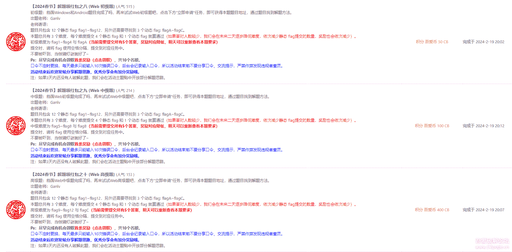

结果.png (231.76 KB, 下载次数: 1)

[href="forum.php?mod=attachment&aid=MjY3NzUwNnw5YzRmNDQ3Y3wxNzkzNTcyNjM3fDE2ODA4NnwxODkzMTM2&nothumb=yes" target="_blank"](https://www.52pojie.cn/forum.php?mod=attachment&aid=MjY3NzUwNnw5YzRmNDQ3Y3wxNzkzNTcyNjM3fDE2ODA4NnwxODkzMTM2&nothumb=yes)

2024-2-25 11:27 上传
