# [CTF] 吾爱破解 2024 年春节解题红包活动-Web题解

- 原帖：`https://www.52pojie.cn/forum.php?mod=viewthread&tid=1893200`
- 抓取时间：2026-11-01T22:37:09

## Web 初级题

### flag1

在视频第三秒开始的波纹中

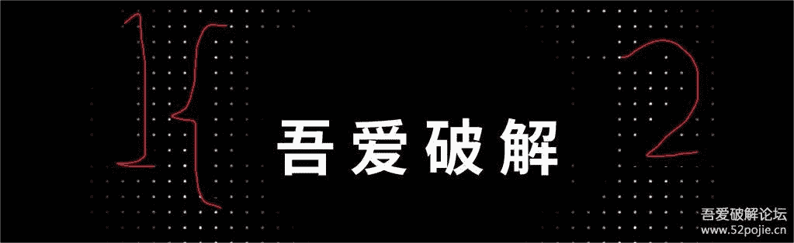


flag1{52pj2024}

### flag2

在 flag4 中得到的网址抓包，在响应体中得到 flag2

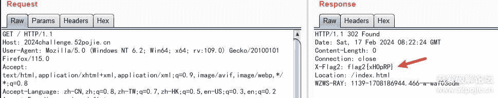

### flag3

视频开头的雪花水印中，反复播放几遍就能看清楚（截图看不出来就不截了）

flag3{GRsgk2}

### flag4

将视频中的四个二维码图片拼接得到网址：

`https://2024challenge.52pojie.cn/`

登录后看到 flag4 图片藏在了背景图片中

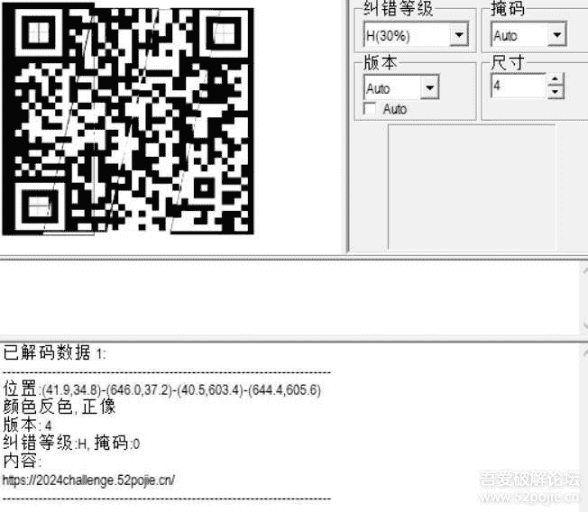

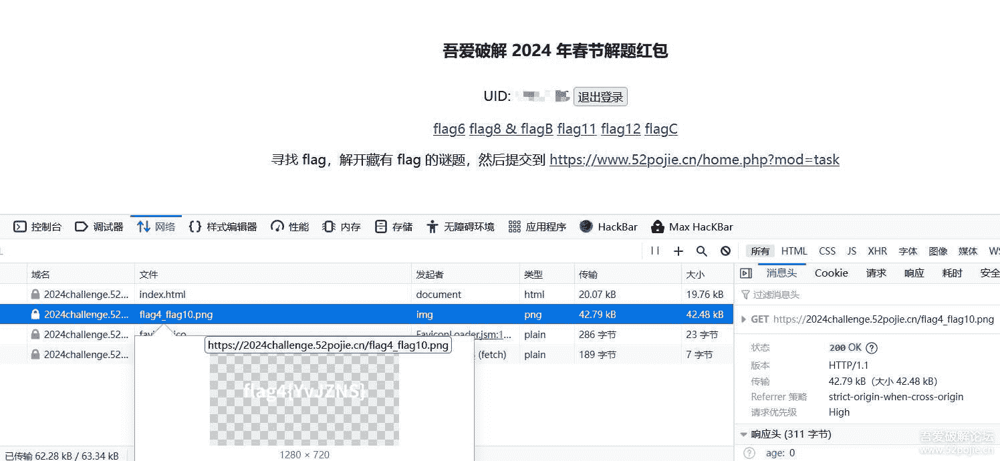

flag4{YvJZNS}

### flagA

登录时，请求包会在 `Set-Cookie` 中设置 `flagA` 变量，看视频评论区得知要找接口解

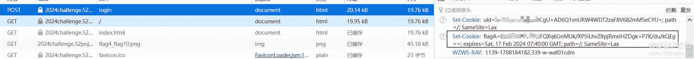

在页面源代码看到：

```javascript
fetch('/auth/uid').then(res => res.text()).then(res => {
    if (res) {
        document.querySelector('#uid').textContent = res;
        document.querySelector('#logout-form').style.display = '';
        document.querySelector('#login-form').style.display = 'none';
    }
});
```

访问 `/auth/uid` 接口，发现会将请求体中 `uid` 变量值解密成对应数字，抓包修改 `uid` 值为 `flagA` 变量值，得到 `flagA`

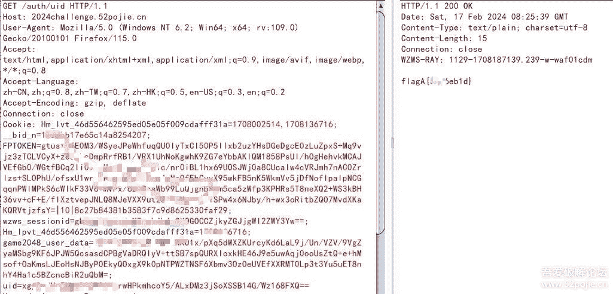

## Web 中级题

### flag5

主页面抓包的时候看到了源码中 flag5 跟 9 的提示

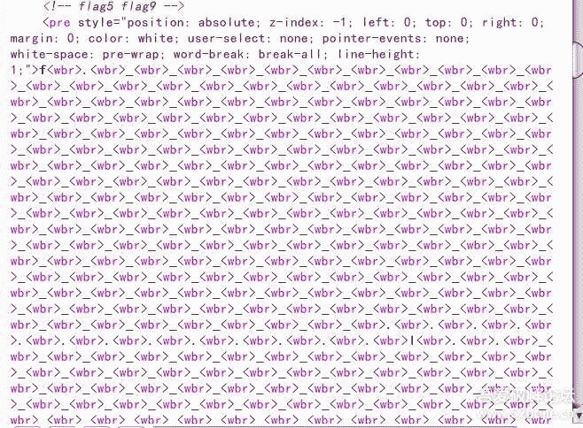

将全部替换为空，调整一下视角得到 flag5

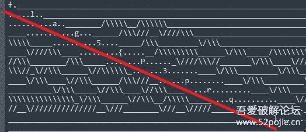

flag5{P3prqF}

### flag6

跳转 flag6 页面点击计算即可


flag6{20240217}

### flag7

在视频出现的 github 仓库的 `README` 文件中

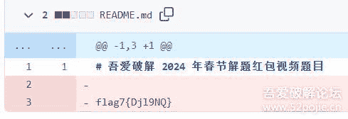

flag7{Djl9NQ}

### flag8

玩 2048 小游戏

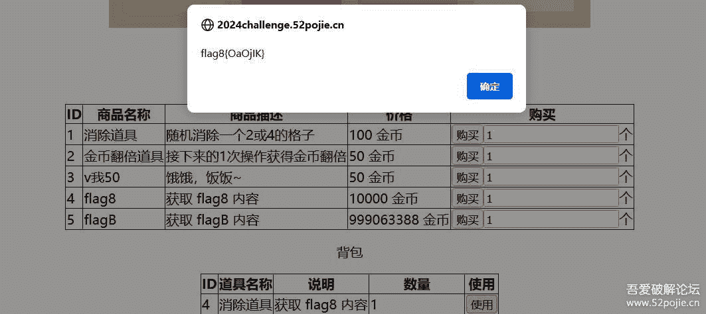

flag8{OaOjIK}

### flagB

通过买 v我50 道具得到“溢出”的关键词，手工尝试得到了几个临界值，还是没什么头绪，不知道后端溢出逻辑，然后写了个脚本爆破临界值，从左到右通过钱不够和钱变多状态变化确定每一位上的数字

```python
import requests
session = requests.Session()

headers = {"xxx":"xxx"}
cookies = {"xxx":"xxx"}

count = '91'
new_count = ''
weishu = 10 # 位数

while 1:
    num = count.ljust(weishu, "0")
    print(num)
    paramsPost = {"shop_item_id": "5", "buy_count": "" + num + ""}
    response = session.post("https://2024challenge.52pojie.cn/flagB/buy_item", data=paramsPost, headers=headers,
                            cookies=cookies)
    if "钱不够" not in response.content.decode():
        new_count = str(int(count)-1)
        count=new_count + '0'
        print(new_count)
        if len(new_count)>weishu:
            break
    else:
        count = str(int(count)+1)
```

通过控制 `weishu` 变量和 `count` 变量，得到最小临界值为 10 位，并且前几个临界值依次为：

- 9232018856
- 27696056569
- 46160094282
- 64624131995
- 83088169708

得到临界值公式：`9232018856 + (18464037713的倍数)`

继续写脚本将倍数从 1 开始每次加 1，提交每个临界值，发现还是不行，尝试将倍数改为每次加 0.5，发现凡是乘上 `x.5` 倍的都能购买成功

```python
import requests

session = requests.Session()

flag = 1

while 1:
    num = 9232018856 + 18464037713 * flag
    num = round(num+0.1) # 发现xx.5四舍五入的时候变成舍了，得加0.1
    print(num)

    headers = {"xxx":"xxx"}
    cookies = {"xxx":"xxx"}
    paramsPost = {"shop_item_id": "5", "buy_count": "" + str(num) + ""}
    response = session.post("https://2024challenge.52pojie.cn/flagB/buy_item", data=paramsPost, headers=headers,
                            cookies=cookies)

    if ("钱不够" or "暂时先拦一下") in response.content.decode():
        flag = flag + 0.5
    else:
        print(response.content.decode())
        break
```

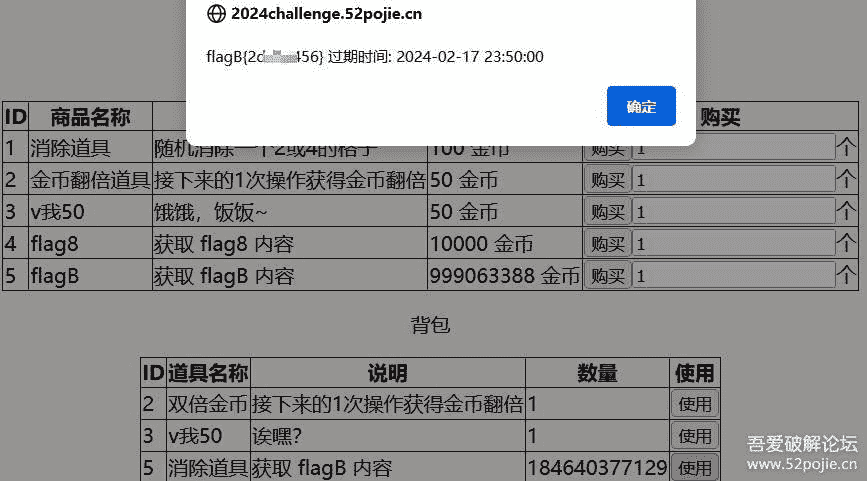

## Web 高级题

### flag9

同 flag5 一起在源码出现，观察 flag5 的位置，尝试将 flag5 的每个字符转成换行符，得到 flag9

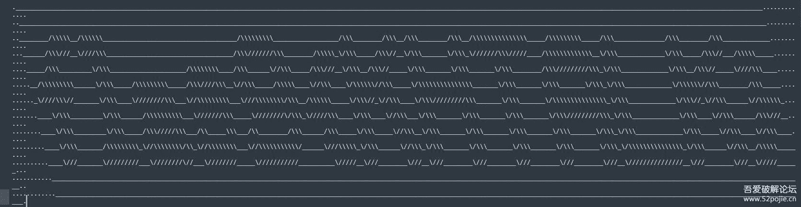

flag9{KHTALK}

### flag10


## flag4

跟flag4藏在一个图片中，Stegsolve查看发现RGB三个通道都有flag10

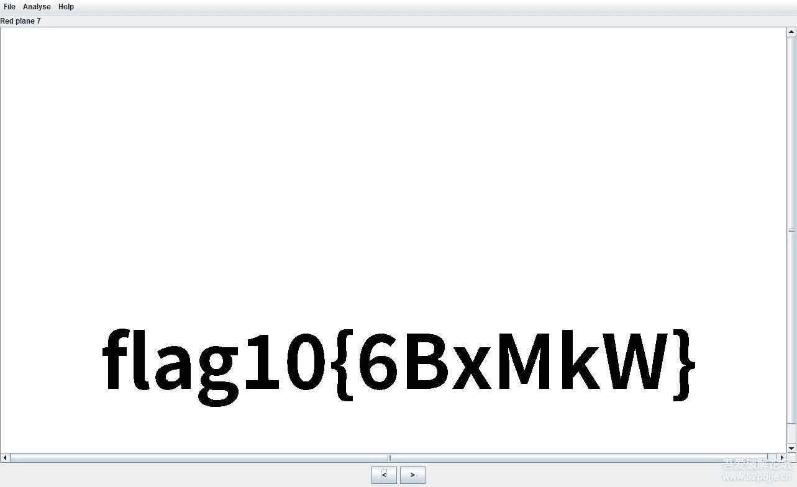

pj15.jpg (61.19 KB, 下载次数: 0)

[href="forum.php?mod=attachment&aid=MjY3NzU3MnwwMmQyNzNhN3wxNzkzNTcyNjI3fDE2ODA4NnwxODkzMjAw&nothumb=yes" target="_blank"](https://www.52pojie.cn/forum.php?mod=attachment&aid=MjY3NzU3MnwwMmQyNzNhN3wxNzkzNTcyNjI3fDE2ODA4NnwxODkzMjAw&nothumb=yes)

2024-2-25 15:07 上传

`flag10{6BxMkW}`

## flag11

点击flag11页面，查看源代码提示要将`var1`和`var2`两个变量改为合适的值，尝试后发现分别改为71和20时得到完整图片

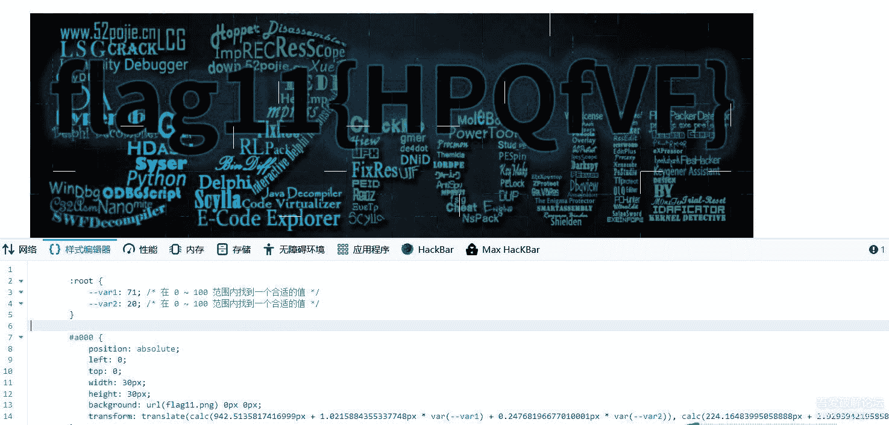

pj16.jpg (159.76 KB, 下载次数: 1)

[href="forum.php?mod=attachment&aid=MjY3NzU3NHw0ZTQxOGYwNHwxNzkzNTcyNjI3fDE2ODA4NnwxODkzMjAw&nothumb=yes" target="_blank"](https://www.52pojie.cn/forum.php?mod=attachment&aid=MjY3NzU3NHw0ZTQxOGYwNHwxNzkzNTcyNjI3fDE2ODA4NnwxODkzMjAw&nothumb=yes)

2024-2-25 15:07 上传

`flag11{HPQfVF}`

## flag12

非预期解，预期解法应该是要根据flag12页面这串逻辑解密（并且是通过点击获取参数，也不能通过`bp`抓包爆破）

```
    WebAssembly.instantiateStreaming(fetch('flag12.wasm'))
        .then(({instance}) => {
            const get_flag12 = (secret) => {
                let num = instance.exports.get_flag12(secret);
                let str = '';
                while (num > 0) {
                    str = String.fromCodePoint(num & 0xff) + str;
                    num >>= 8;
                }
                return `flag12{${str}}`;
            }
            document.querySelector('button').addEventListener('click', (e) => {
                e.preventDefault();
                document.querySelector('#result').textContent = get_flag12(parseInt(document.querySelector('input').value));
            });
        });
```

直接查看`flag12.wasm`内容，尝试将1048576、1213159497、1103515245转为bytes类型

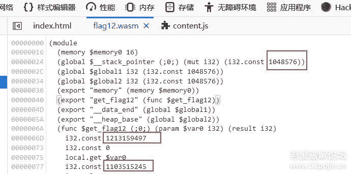

pj17.jpg (54.41 KB, 下载次数: 1)

[href="forum.php?mod=attachment&aid=MjY3NzU3NXxkZTRiZTdlZHwxNzkzNTcyNjI3fDE2ODA4NnwxODkzMjAw&nothumb=yes" target="_blank"](https://www.52pojie.cn/forum.php?mod=attachment&aid=MjY3NzU3NXxkZTRiZTdlZHwxNzkzNTcyNjI3fDE2ODA4NnwxODkzMjAw&nothumb=yes)

2024-2-25 15:07 上传

```python
from Crypto.Util.number import long_to_bytes

print(long_to_bytes(1103515245))
```

发现1103515245可以转成字符串HOXI，flag即为`flag12{HOXI}`

## flagC

首先根据测试图片，查看需要哪些种类，再用`ps`将其抠出来，提交测试修改它们的位置即可，感觉不如`flagA`难


pj18.jpg (160.55 KB, 下载次数: 0)

[href="forum.php?mod=attachment&aid=MjY3NzU3NnxhMDU1OWFiOXwxNzkzNTcyNjI3fDE2ODA4NnwxODkzMjAw&nothumb=yes" target="_blank"](https://www.52pojie.cn/forum.php?mod=attachment&aid=MjY3NzU3NnxhMDU1OWFiOXwxNzkzNTcyNjI3fDE2ODA4NnwxODkzMjAw&nothumb=yes)

2024-2-25 15:07 上传


pj19.jpg (71.18 KB, 下载次数: 1)

[href="forum.php?mod=attachment&aid=MjY3NzU3N3wwZjVhM2RjYnwxNzkzNTcyNjI3fDE2ODA4NnwxODkzMjAw&nothumb=yes" target="_blank"](https://www.52pojie.cn/forum.php?mod=attachment&aid=MjY3NzU3N3wwZjVhM2RjYnwxNzkzNTcyNjI3fDE2ODA4NnwxODkzMjAw&nothumb=yes)

2024-2-25 15:07 上传
