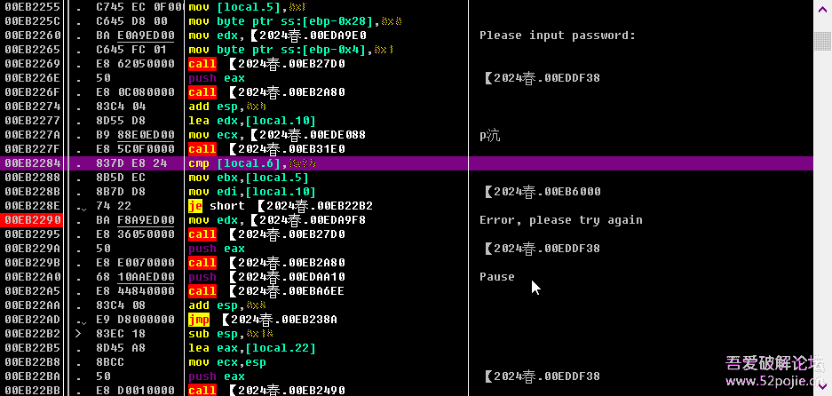
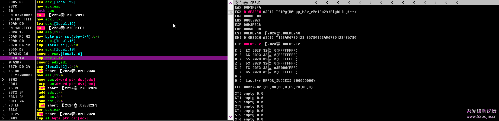
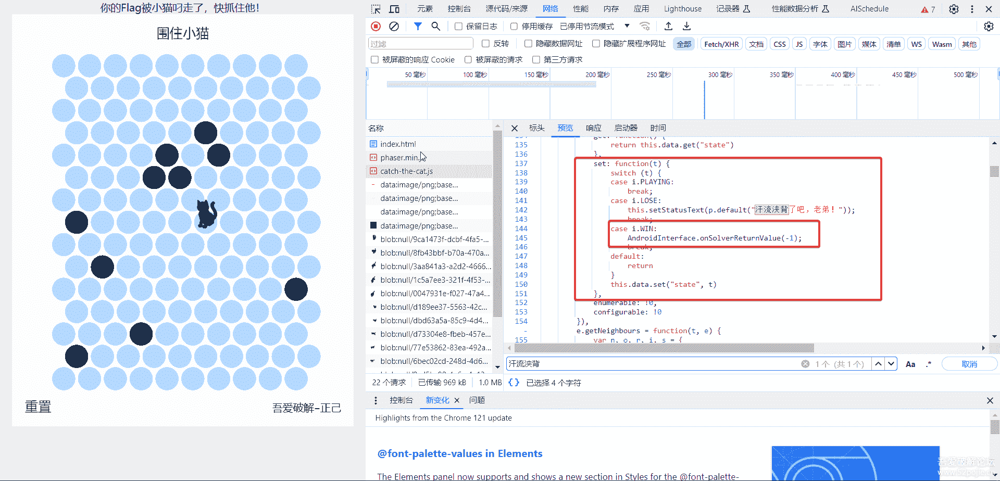
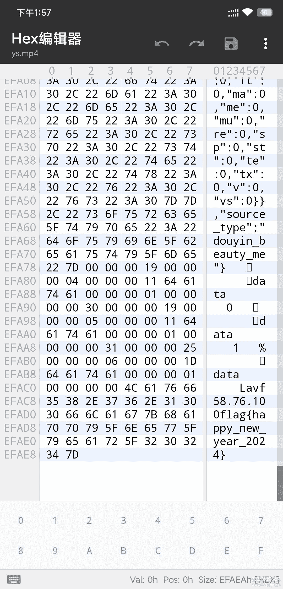
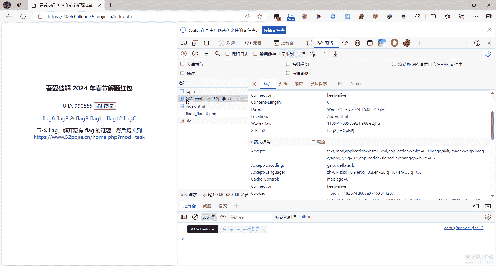
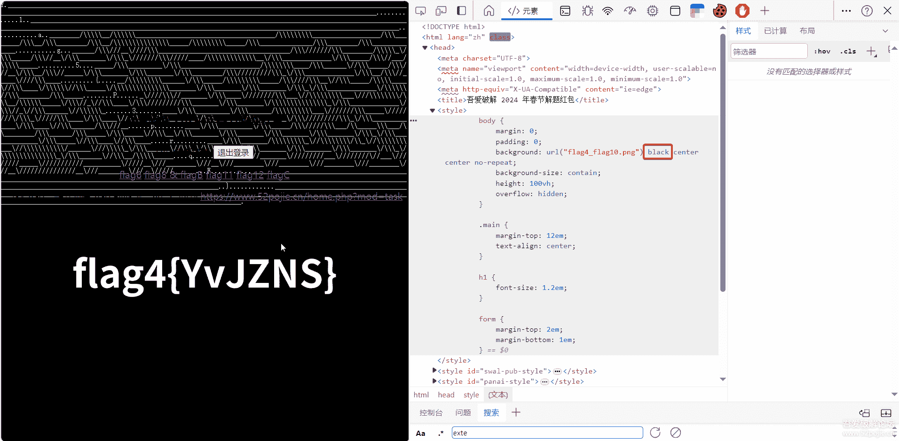
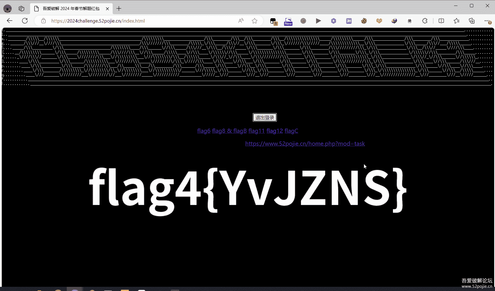
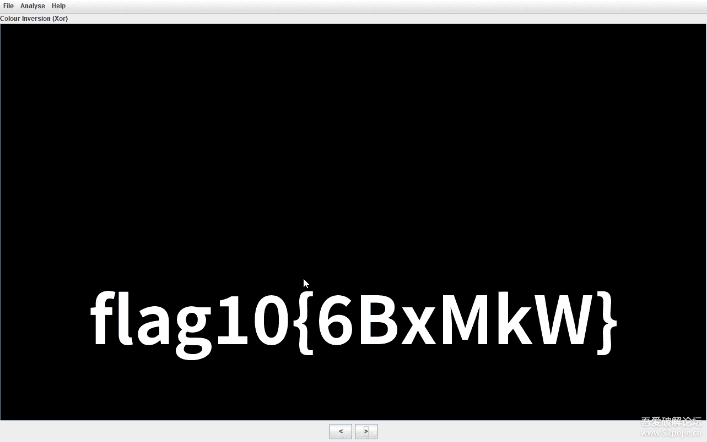
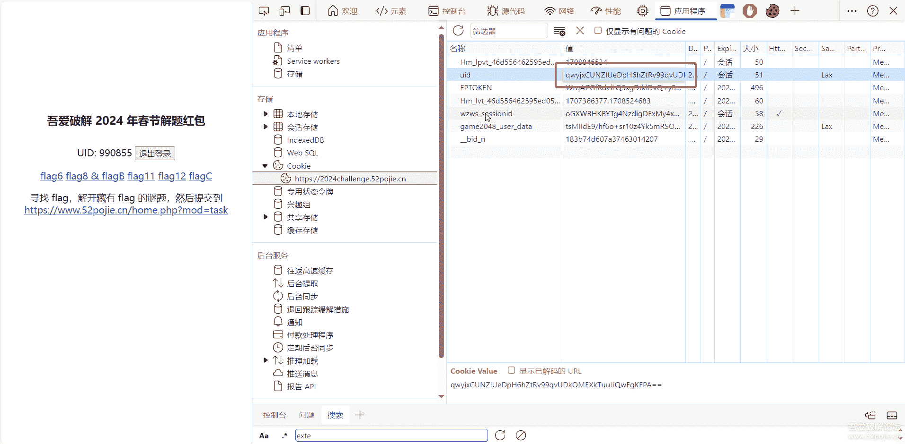
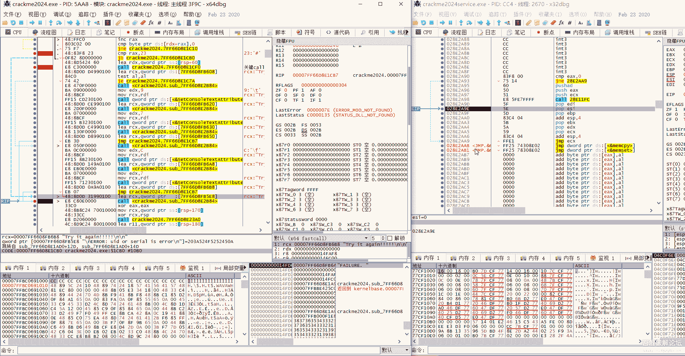

# [CTF] 【2024】春节解题领红包之二、三、四、Web(部分)，其余记录思路

- 原帖：<https://www.52pojie.cn/forum.php?mod=viewthread&tid=1893330>
- 抓取时间：2026-11-01T22:37:05

## 前言

> 本帖内容较为简略，对某些内容未作详述，详细软件使用和分析思路可以参考我之前帖子内容，如有疑问欢迎评论区一同交流探讨。

## 二、widows初级

使用 OD 加载程序，此次跳过了检测是否有壳环节，可直接根据提示搜索对应文字信息 `Please input password`(可选)，即程序无壳。通过 `F9` 后可观察到 `cmp` 指令，经验判断可知 `flag` 长度为 `0x24 = 36`，构造字符串，



`image-20240225132943211.png` (28.08 KB, 下载次数: 1) · [附件下载](https://www.52pojie.cn/forum.php?mod=attachment&aid=MjY3NzczOHw2N2I5YmEzOXwxNzkzNTcyNjIyfDE2ODA4NnwxODkzMzMw&nothumb=yes) · 2024-2-25 22:21 上传

单步 `F8` 后即可在右侧寄存器窗口看到 `flag` 信息。



`image-20240225133253874.png` (32.37 KB, 下载次数: 0) · [附件下载](https://www.52pojie.cn/forum.php?mod=attachment&aid=MjY3NzczOXw5YjQ0MWM0MnwxNzkzNTcyNjIyfDE2ODA4NnwxODkzMzMw&nothumb=yes) · 2024-2-25 22:21 上传

## 三、Android初级

### 方法一

玩抓小猫游戏，属实汗流浃背了，解出 `flag` 后的某一天无意中才通关。

### 方法二

使用 MT/NP 管理器可知无壳，可见 `assets` 文件夹下含有 `html`、`phasher.js`，`phasher.js` 为一个游戏引擎，可以通过修改 `cat.js` 如下的代码，即将调用 `Activity` 启用的方法，添加到 `switch` 每个(局部亦可，可自行选择)`case` 语句后即可，无论游戏成败均会自动播放视频，获取到 `flag`。



`image-20240225134456297.png` (203.78 KB, 下载次数: 1) · [附件下载](https://www.52pojie.cn/forum.php?mod=attachment&aid=MjY3Nzc0MHxmNDdkNmU2YnwxNzkzNTcyNjIyfDE2ODA4NnwxODkzMzMw&nothumb=yes) · 2024-2-25 22:21 上传

### 方法三

`assets` 文件除了游戏外，还包含 MP4 格式文件，让我看看，发生神魔事了，缘赖式——原神，启动！(下次可以考虑换个喜爱福的，视频开始放了几秒钟关了，解完题才认真看了一遍)，习惯性使用 16 进制编辑器打开该文件，即可在文件末尾处看到 `flag`，果然做事要有始有终，不能像看视频只看前面就不看了。



`1708840737613.jpg` (375.47 KB, 下载次数: 2) · [附件下载](https://www.52pojie.cn/forum.php?mod=attachment&aid=MjY3Nzc0MXxjOTdiMjNiY3wxNzkzNTcyNjIyfDE2ODA4NnwxODkzMzMw&nothumb=yes) · 2024-2-25 22:21 上传

### 源码分析

在 MP4 视频文件末尾追加内容，并未影响文件正常播放，通过游戏胜利调用安卓接口启动另一个 `Activity`，在该 `Activity` 中含有对文件末尾内容的读取，并将返回结果过使用 `TextView` 显示，因此正常播放视频并不会显示出 `Flag`。（`RandomAccessFile`，随机访问，支持从文件指定位置读取和写入数据，功能非常强大，但在 `JDK1.5` 后已由 NIO 的内存映射代替大部分功能，可用作断点续传。）

## 四、Android初级

抽奖游戏，肥肠滴好，本人于当日 10 点 17 分运气爆棚，一发入魂，截图为证。


`1708871055547.jpg` (90.67 KB, 下载次数: 1) · [附件下载](https://www.52pojie.cn/forum.php?mod=attachment&aid=MjY3Nzc0OHxkNmE1MWJlNHwxNzkzNTcyNjIyfDE2ODA4NnwxODkzMzMw&nothumb=yes) · 2024-2-25 22:25 上传

这里的 `honest` 肥肠滴有意思哈，诚实的人才能看到正确的答案。而每次抽奖积攒时间会越来越长，因此缩短时间间隔提升爆率是个不错的选择，但如果尝试改动文件，签名会发生变化，根据源码分析可知，程序会获取签名并且将签名数据取出与内置的数组进行异或后获得答案，因此最终结果会出现乱码。

那么可以考虑直接启动 `FlagActivity`，`adb` 中使用如下命令，即可获得最终 `Flag`。当然除此之外可以通过 Lucky Patcher 解决上一步中改动后签名问题，以非签名方式安装即可，或根据源码自行编写计算 `Flag` 代码亦可。

```bash
adb shell am start -n "com.kbtx.redpack_simple/.FlagActivity"
```

## Web部分

### `flag1`

- 视频 00:02 水滴声背景图
- `flag1{52pj2024}`

### `flag2`

- 登录成功后的响应头返回
- `flag2{xHOpRP}`



`image-20240225222003760.png` (178.75 KB, 下载次数: 1) · [附件下载](https://www.52pojie.cn/forum.php?mod=attachment&aid=MjY3Nzc1NXw5ZmJhNDk2M3wxNzkzNTcyNjIyfDE2ODA4NnwxODkzMzMw&nothumb=yes) · 2024-2-25 22:48 上传

### `flag3`

视频开头(动态模糊水印) `flag3{GRsgk2}`

### 二维码

截取视频中被切割的图片，拼接叠加后产生二维码扫描后得到网址：

<https://2024challenge.52pojie.cn/index.html>

### `flag4`

修改 `body` 页面 `backgroud:black` 出现 `flag4{YvJZNS}`



`image-20240225160805310.png` (141.62 KB, 下载次数: 1) · [附件下载](https://www.52pojie.cn/forum.php?mod=attachment&aid=MjY3Nzc0MnxkZjUxMTgzOXwxNzkzNTcyNjIyfDE2ODA4NnwxODkzMzMw&nothumb=yes) · 2024-2-25 22:21 上传

### `flag5`

修改后发现上方每一行均隐藏一个字母或数字，仔细观察后可见 `flag5{P3prqF}`，也可与 `flag9` 一同出现。

### `flag6`

引入 MD5 加密，具有迷惑效果，点击按钮后会通过取余方式实现进度条并打印数据，严重影响浏览器状态，直接根据源码对 `1c450bbafad15ad87c32831fa1a616fc` 使用 md5 解密工具尝试解密，获得 `flag6{20240217}`

### `flag7`

Github 提交记录 `flag7{Dj19NQ}`


`image-20240225161531637.png` (111.19 KB, 下载次数: 1) · [附件下载](https://www.52pojie.cn/forum.php?mod=attachment&aid=MjY3Nzc0M3w0MjUyYzVjNnwxNzkzNTcyNjIyfDE2ODA4NnwxODkzMzMw&nothumb=yes) · 2024-2-25 22:21 上传

### `flag8`

这个似乎只能“钞能力”，努力玩 2048，分数够了 `flag` 带回家，`flag8{OaOjIK}`。

### `flag9`

字符画？某乎 `F12` 会看到类似效果，些许公司会在控制台附上招聘信息，调整浏览器大小即可看到 `flag9` 的值，同时 `flag5` 同样会出现在一侧，他真的，我哭死。



`image-20240225161633432.png` (126.59 KB, 下载次数: 0) · [附件下载](https://www.52pojie.cn/forum.php?mod=attachment&aid=MjY3Nzc0NHxlMGRmNTgyOHwxNzkzNTcyNjIyfDE2ODA4NnwxODkzMzMw&nothumb=yes) · 2024-2-25 22:21 上传

### `flag10`

使用 `Stegsolve` 工具尝试解析，发现图片可以通过反色获取 `flag10{6BxMkW}`



`javaw_wCfFcXBIH2.png` (42 KB, 下载次数: 1) · [附件下载](https://www.52pojie.cn/forum.php?mod=attachment&aid=MjY3Nzc0OXwwZjdjNjVmMXwxNzkzNTcyNjIyfDE2ODA4NnwxODkzMzMw&nothumb=yes) · 2024-2-25 22:37 上传

### `flagA`

`flagA` 为动态请求，点击登录后会在该请求的响应体中设置，有过期时间。通过观察可知 `uid` 接口可以将加密参数解密并返回，通过修改浏览器 `cookie` 的 `uid` 属性值为 `flagA` 对应内容，可以获取动态 `flagA`。

`flagA{2eca08fd}`



`image-20240225163148881.png` (158.92 KB, 下载次数: 1) · [附件下载](https://www.52pojie.cn/forum.php?mod=attachment&aid=MjY3Nzc0NXwyMzAyNmIwM3wxNzkzNTcyNjIyfDE2ODA4NnwxODkzMzMw&nothumb=yes) · 2024-2-25 22:22 上传

## 其它

### Android中级&高级

翻阅源码可知动态加载 `dex` 与 `so` 层校验，高级题中采用了反调试+混淆流遂放弃。

### Windows高级

64 位，`upx` 魔改壳，需要使用 `x64dbg` 调试手动脱壳，修补后的程序必须关闭 `ASLR` 后才能正常打开，客户端与 `service` 与通信，校验完成后返回结果，可通过两个调试器同时调试，可知 `flag` 长度应为 35 位，但太菜没能跟出结果。



`image-20240225221043576.png` (415.47 KB, 下载次数: 2) · [附件下载](https://www.52pojie.cn/forum.php?mod=attachment&aid=MjY3Nzc0NnxiMmIxN2RkY3wxNzkzNTcyNjIyfDE2ODA4NnwxODkzMzMw&nothumb=yes) · 2024-2-25 22:22 上传

太累了，简单这样写一下，不足之处请多包涵。
