# [CTF] 【2024春节】解题领红包 二、三、四、八、九、十 （主打乱做出flag）

- 原帖: https://www.52pojie.cn/forum.php?mod=viewthread&tid=1893479
- 抓取时间: 2026-11-01T22:37:01

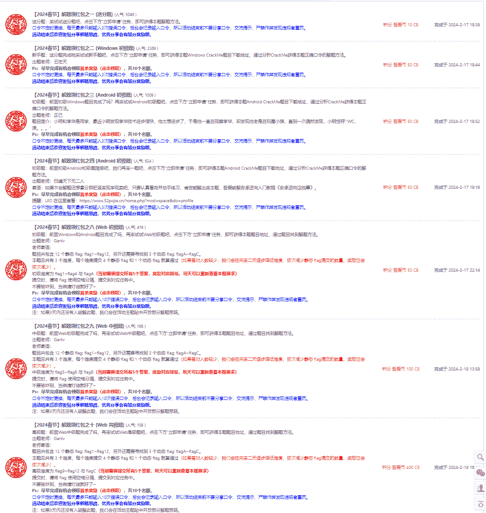

比往年多花了点时间玩，当然主要都去做这个Web（Misc）了

## 解题领红包之二{Windows初级题}

每年都差不多，`od`下断直接出来了

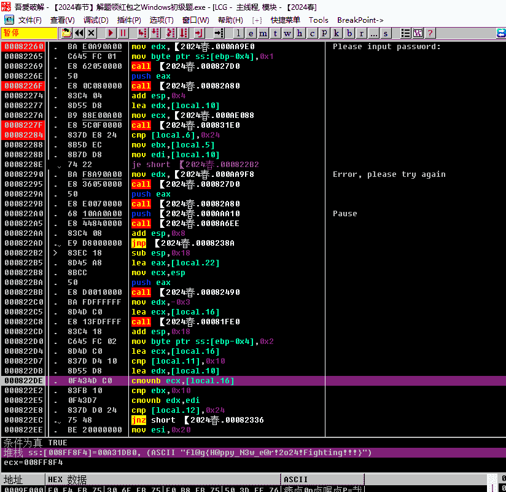

## 解题领红包之三{Andriod初级题}

装手机里试了试，结果玩游戏一下就过了（但是截图没截到）

## 解题领红包之四{Andriod初级题}

简单的加密

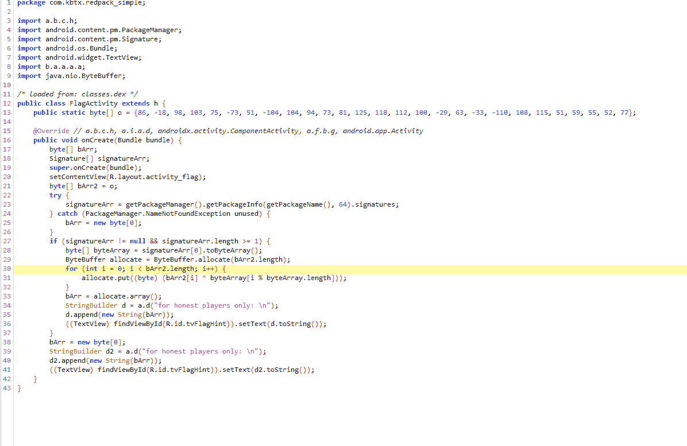

获取`apk`签名以后对签名做计算

写个脚本,由于没做过安卓开发，不知道这个签名是什么东西，开始以为是`hash`值什么的，最后发现就是原始值。

```
from androguard.misc import AnalyzeAPK

apk_path = 'app.apk'

#a, d, dx = AnalyzeAPK(apk_path)

#certs = a.get_certificates()

#c = certs[0]

c=b'0\x82\x03\x000\x82\x01\xe8\x02\x01\x010\r\x06\t*\x86H\x86\xf7\r\x01\x01\x0b\x05\x000F1\x100\x0e\x06\x03U\x04\x03\x0c\x07kbtxwer1\x100\x0e\x06\x03U\x04\x0b\x0c\x0752pojie1\x100\x0e\x06\x03U\x04\n\x0c\x0752pojie1\x0e0\x0c\x06\x03U\x04\x07\x0c\x05China0\x1e\x17\r240116063323Z\x17\r490109063323Z0F1\x100\x0e\x06\x03U\x04\x03\x0c\x07kbtxwer1\x100\x0e\x06\x03U\x04\x0b\x0c\x0752pojie1\x100\x0e\x06\x03U\x04\n\x0c\x0752pojie1\x0e0\x0c\x06\x03U\x04\x07\x0c\x05China0\x82\x01"0\r\x06\t*\x86H\x86\xf7\r\x01\x01\x01\x05\x00\x03\x82\x01\x0f\x000\x82\x01\n\x02\x82\x01\x01\x00\x80H\x04\x13_W\xc1S\x98\t\xa9\xf6)\x1d\xd0\xda\x83\xc5\xf9\xfcW\xca\xf1\x99\xa4\x8c\xfe7\xb9\xa0\xccF\xa1\x05!2\xa64N0\x9a1\xb8\x0e\xe7\x15\xdf\xfc\xbd \x7f\x84\xb0~b\x0c\x8b\xc3#+\t0PG?\x82\x9e\xcbt\xa5E\xee\x8f\xd4)\xfe\xae\x84\x80\xe4(L5\xbci\xdcC\xd3\xc10\xeb\xf7\xb0\xa1lm\x10\x85v\x13\xc2$ *\xe7q&\xfc\xfd\xc9d!D\x15\x82\x87\xfez\x19ic\xbcR\xa4{\xb9B\xf0\xf7^\xb0Y#k\xfad\xc5\'\x18\xc75G\xa4\xc3b\xf1\x17N\xc6B\xb9\x8a1\xa4\xd7\xcb\xe8\xe9\x91\xdf\xa2}\xb7\x005\xd4Q\xc8y\xb5\xde\xf1-\xbb}\xb1\x9f\xd5\xab!\x11\x10%lAV\xcd\x0b\xe7="\xd2\xc0`1D\xde\xa1\x8eez\x12\xc0\xc0\x14k\xa5\xc5\xeb\xa6\xb9s\xa2\'\xb8\x15\xfc\x8e\xfe\xd4\xc4\xa2uGq\x85K\xd3\xc0Dhn\xcb\xe6PZT\x0ez\xfa\xa0\x99\x939A\x0bZ\x9f\xeb\x82d\x07E,(\x8b\x02\x03\x01\x00\x010\r\x06\t*\x86H\x86\xf7\r\x01\x01\x0b\x05\x00\x03\x82\x01\x01\x00^\x10$\xed\x95\x99,\xd8\xd8\x834\xea\xf3`\xfdV\x99\xed}#3cM\xde\xd6^\x9c\xdab"\xbbZ\xe6\x81\x89\xdbj\xfbX\x98\xca\x9f47\x95\x9d\xb2\xe5\x0c\xe6\xd1\x9f\xc3\xb9\x82\xed\xe7\xe9\xed]\xd9$\x88\xde\xd6i(\xadY9\xfd\xf3\x18\xb1{J\x95\xf0 [\xb6\xda\'\xa3\xdeO{ip\r\x94\xa2^\x80v}%kc\x00\x14\xe2Td\x8b*7\xd6\x89\x95\x9e\xf4r\x93\xa7r\xc1P\x9d\xb3\x1b\r\xde\xd3w\x96O\xe93f\xd8\xef\x80\x8e }\x1b#\x8b\xbb\xd5\x1bj\x1d83\x0e\x0c)\xbe\xe1\xaf\xdd\x06t\xe5\x00;L\xd2U]%\xa0\xcfR?\x11y\x1d*\x97\xff}\x13#T2\xfe\xf0\xb4O\xb7\xa3Li\n\xb5\x1d\xe4\xd5K\xa7\x87h\x12\xeb\x1fi\x19\xd2\xbd-\xf9|7\xe9\xe9\'\xce\r\x0fA\xa8OS>\x01\x0f\xc8\xe1\xa7\xfa ]\x08s\xb2\xb9\xfcl\xd7M\x9eS\x812\xc6\xd7%\xc3\x05\xbc_v\x0b\x0f\xb8q\x01\xa8\xa2'
sha1_bytes= c
# 给定的整数数组
o = [86, -18, 98, 103, 75, -73, 51, -104, 104, 94, 73, 81, 125, 118, 112, 100, -29, 63, -33, -110, 108, 115, 51, 59, 55, 52, 77]

# 将数组中的负数转换为等价的正整数
o_bytes = [x & 0xff for x in o]

# 对SHA1指纹的每个字节和数组o中对应位置的数值进行异或操作
xor_result = [a ^ b for a, b in zip(sha1_bytes, o_bytes)]

# 转换每个异或结果为对应的ASCII字符，并确保它们都在ASCII字符集范围内
ascii_characters = [chr(x) if 0
```

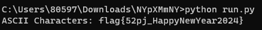

## 3> 解题领红包之八、九、十{Web题}

### 4> flag1、flag3

直接看视频

### 4> flag2

拼接二维码


扫码进入网页，源码里没有：[//2024challenge.52pojie.cn/" target="_blank" rel="noopener noreferrer nofollow"](https://2024challenge.52pojie.cn/:href="https)

`curl`看一下，有了

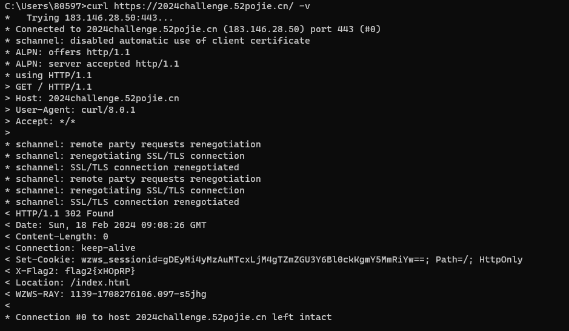

### 4> flag4

查看网页文件发现有`flag4_flag10.png`

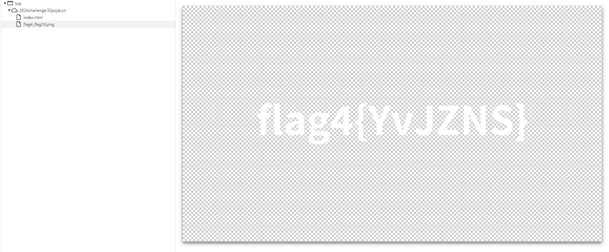

### 4> flagA

登录以后`cookie`里有，但是是加密的

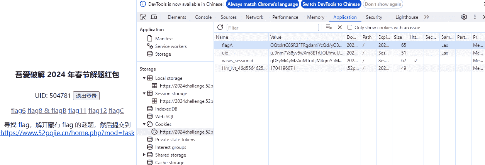

程序还有一个`uid`的接口，直接返回了`uid`，但是没有传参，这时候发现`cookie`里也有个加密的`uid`

推测直接解密了`cookie`的`uid`字段，把`cookie`的`uid`直接换成加密的`flagA`试试

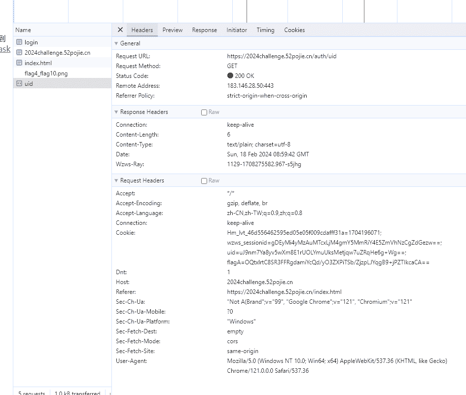

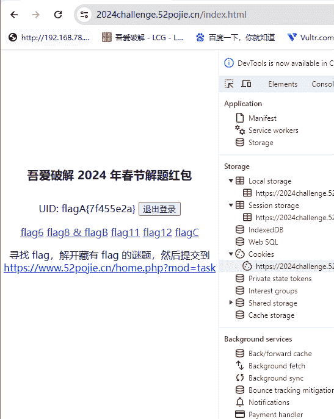

### 4> flag5

网页源码有注释，但是文字颜色是白的，改成黑色

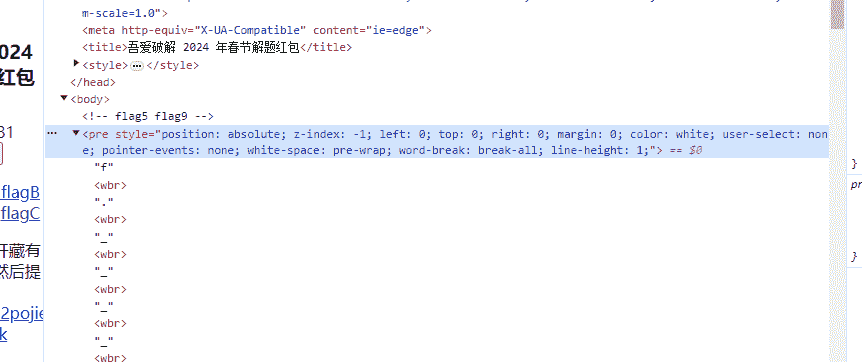

里面的字符除了点、横线、斜杠剩下的就是`flag5`

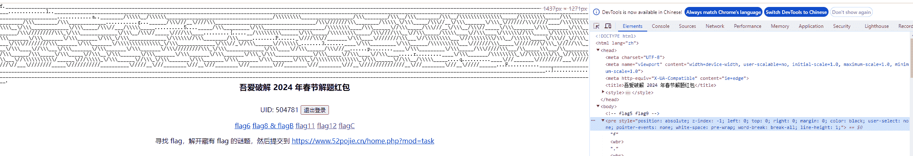

### 4> flag6

`md5`碰撞一下就出来了，或者扔`cmd5`，直接点计算按钮也可以，就是慢一点

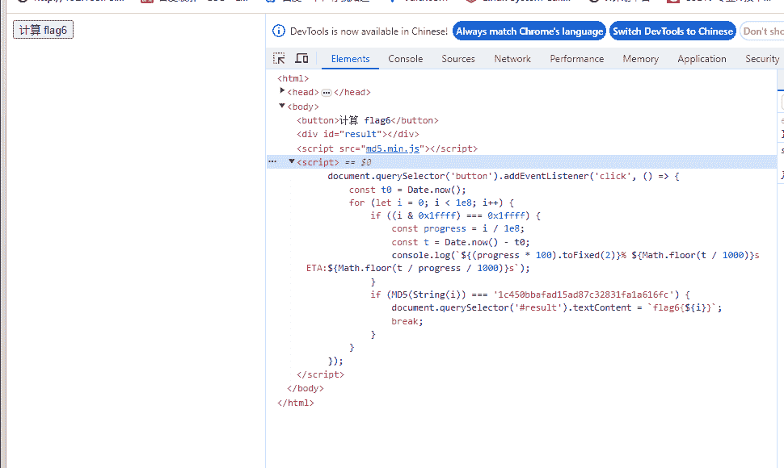

### 4> flag7

视频中有一个`github`仓库，查看仓库历史提交记录

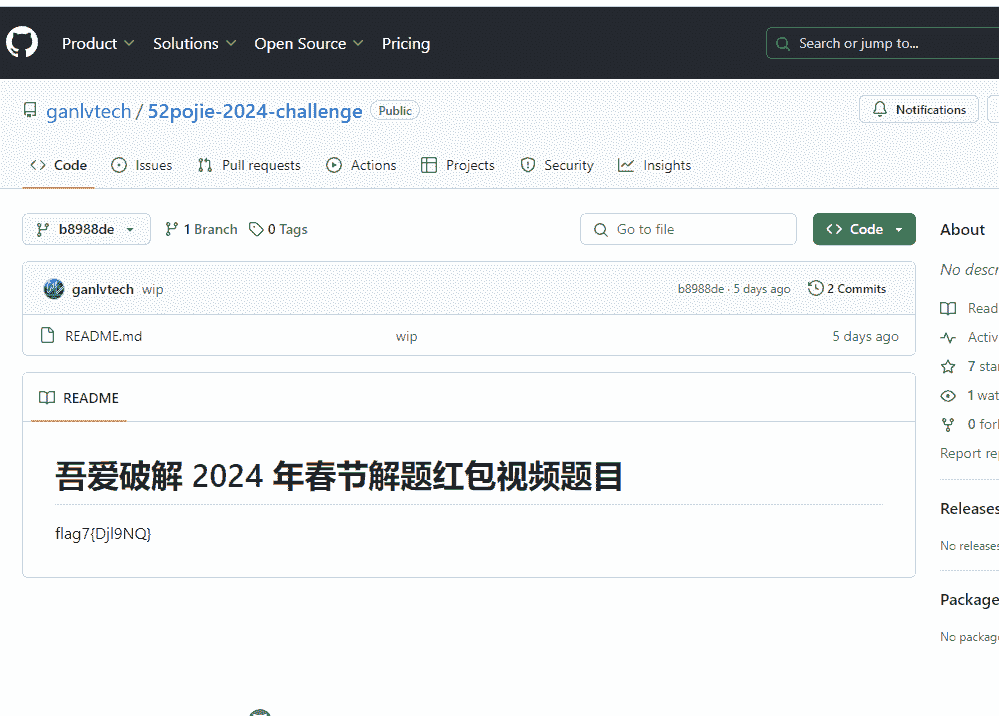

### 4> flag8

我是玩到的，多开几轮就可以买了

### 4> flagB

知道是溢出，但是限制了负数和"一些"大整数，`2^64-1`算最大值，除以2以后（应该是还计算了负数）除一下单价算个数量，提示钱越花越多，试了一下十倍左右可以买，具体溢出点不清楚，最后还是买到了

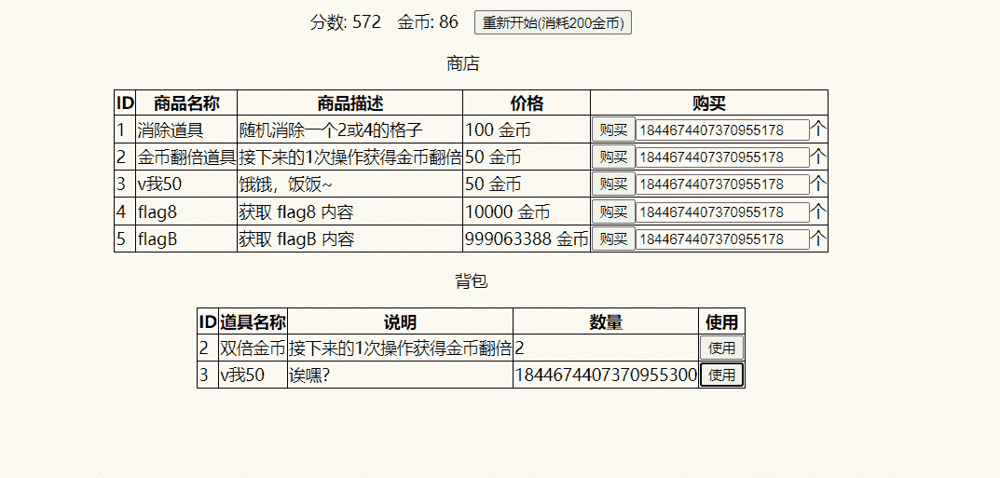

flag的购买数量：

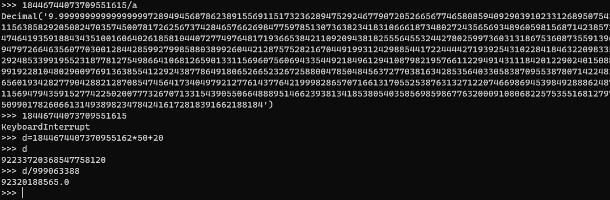

### 4> flag9

把`flag5`的字符串拿下来理一下，换行、删除`flag5`相关的字符，缩小一下就很明显

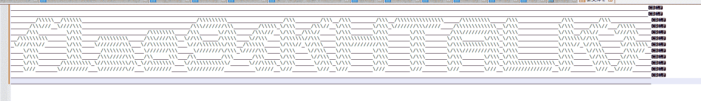

### 4> flag10

把`flag4`的图片扔到`stegsolver`里直接出来

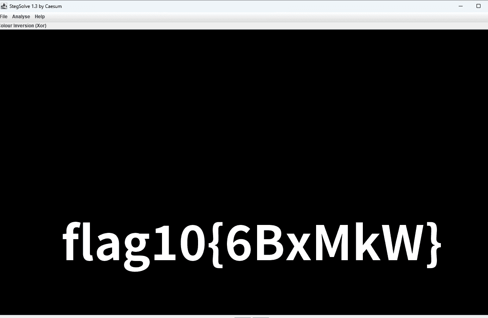

### 4> flag11

拼图，但是`html`里可以看到提示

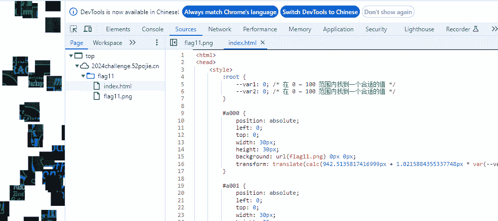

直接爆破，这个不是原始脚本，在试验过程中是修改过的

```
// 函数用于设置变量值

function setCSSVariable(var1, var2) {

  document.documentElement.style.setProperty('--var1', var1);

  document.documentElement.style.setProperty('--var2', var2);

}

// 开始值和结束值

const startVar1 = 71; // 设置 var1 的开始值为 70

const endVar1 = 100; // var1 的结束值

const startVar2 = 0;  // var2 的开始值

const endVar2 = 100;  // var2 的结束值

// 用于循环的函数

function loopVariables() {

  let var1 = startVar1; // 初始化 var1 为 70

  let var2 = startVar2;

  // 设置一个循环，每隔0.1秒赋值一次

  const interval = setInterval(() => {

    setCSSVariable(var1, var2);

    console.log(`--var1: ${var1}, --var2: ${var2}`);

    var2 += 1; // 增加 var2

    if (var2 > endVar2) {

      var2 = startVar2;

      var1 += 1; // var2 到达上限后增加 var1

    }

    if (var1 > endVar1) {

      clearInterval(interval); // 完成循环后清除定时器

      console.log('Finished looping through variables.');

    }

  }, 1000); // 设置间隔为0.1秒

}

// 调用函数开始循环

loopVariables();
```

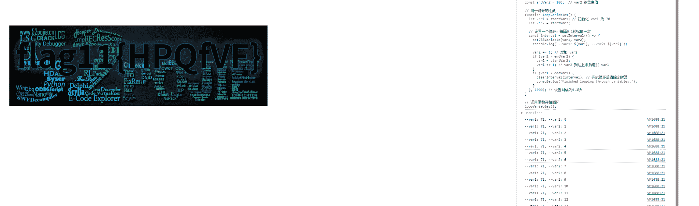

### 4> flag12

`wasm`扔给`gpt`分析一下

这段代码是WebAssembly文本格式的一个示例。它定义了一个包含单个函数`get_flag12`的WebAssembly模块。模块还包括一些导出，如内存和全局变量。下面逐步说明这段代码的作用：

- `(memory $memory (;0;) (export "memory") 16)`：定义了一个大小为16页（每页64KB）的内存，并将其导出。在WebAssembly中，内存是由一系列固定大小的页组成的线性数组。16页等于1MB。

- `(global $__stack_pointer (;0;) (mut i32) (i32.const 1048576))`：定义了一个可变的全局变量`$__stack_pointer`，它的初始值被设置为1048576（1MB）。这是堆栈指针的常见起始点，它通常指向内存的顶部。

- `(global $__data_end (;1;) (export "__data_end") i32 (i32.const 1048576))` 和 `(global $__heap_base (;2;) (export "__heap_base") i32 (i32.const 1048576))`：这两个全局变量通常表示模块中静态分配的数据的结束点和堆开始的地方。在这个例子中，它们都被设置为相同的值，1048576，这意味着静态数据占用的内存为空，所有的内存都可以用于堆分配。

- `(func $get_flag12 (;0;) (export "get_flag12") (param $var0 i32) (result i32) ...)`：定义并导出一个名为`get_flag12`的函数，该函数接收一个32位整数作为参数，并返回一个32位整数结果。

- `i32.const 1213159497`：将常数值1213159497推入栈顶。

- `i32.const 0`：将常数值0推入栈顶。

- `local.get $var0`：获取函数参数`$var0`的值并将其推入栈顶。

- `i32.const 1103515245`：将常数值1103515245推入栈顶。

- `i32.mul`：从栈顶取出两个值（`$var0`和1103515245），将它们相乘，并将结果推回栈顶。

- `i32.const 1`：将常数值1推入栈顶。

- `i32.eq`：比较栈顶两个值是否相等（乘法结果是否等于1），并将结果（0或1）推回栈顶。

- `select`：从栈顶取出三个值，使用第一个值（0或1）来选择剩下的两个值中的一个。如果第一个值是0，选择第三个值（0）；如果是1，选择第二个值（1213159497），并将选择的值作为结果。

总结来说，`$get_flag12`函数的作用是：

- 接收一个参数`$var0`。

- 将`$var0`与常数1103515245相乘。

- 检查乘法的结果是否等于1。

- 如果等于1，函数返回1213159497。

- 如果不等于1，函数返回0。

这个函数的行为类似一个非常简单的检查机制，可能用作某种形式的许可或验证。

没仔细看，因为写了控制台脚本直接跑出来了


```javascript
let secret = 0;
const maxSecret = 4294967295;

WebAssembly.instantiateStreaming(fetch('flag12.wasm'))
    .then(({instance}) => {
        const get_flag12 = (secret) => {
            let num = instance.exports.get_flag12(secret);
            let str = '';
            while (num > 0) {
                str = String.fromCodePoint(num & 0xff) + str;
                num >>= 8;
            }
            return `flag12{${str}}`;
        };

        const loopUntilFlagIsFound = () => {
            for (let i = secret; i  {
        console.error("WASM loading failed: ", error);
    });
```

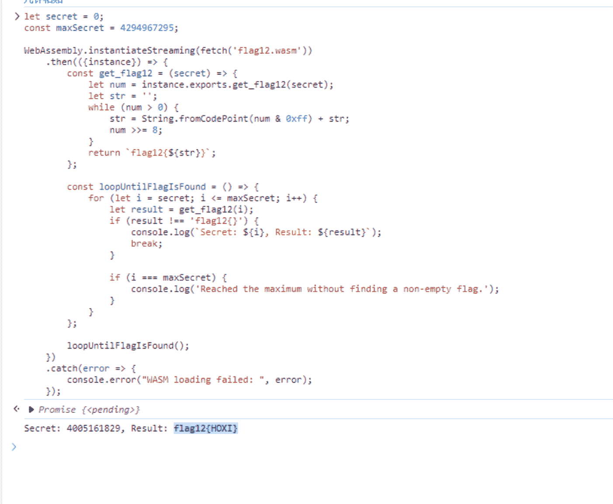

#### flagC

没猜到后台的逻辑，但是拿他原来的图改了改，删了点对象之后就提示只有一个位置错误了，剩下一个错的调了调位置就对了（狗头保命）


非预期解也是解嘛


#### flag全家福

动态flag可能变过了，不是截图里的

flag1{52pj2024} flag2{xHOpRP} flag3{GRsgk2} flag4{YvJZNS} flagA{58321b12} 

flag5{P3prqF} flag6{20240217} flag7{Djl9NQ} flag8{OaOjIK} flagB{5450247c}

flag9{KHTALK} flag10{6BxMkW} flag11{HPQfVF} flag12{HOXI} flagC{1219351b}
