# [Web逆向] 快手滑块轨迹分析

- 原帖: https://www.52pojie.cn/forum.php?mod=viewthread&tid=1897823
- 抓取时间: 2026-11-01T22:36:32

> 本文仅学习参考，如有涉及侵权联系本人删除  
> 如果有任何问题，欢迎交流指导  
> 文章仅记录本人分析轨迹变异的过程，用真实轨迹进行缩放也能通过。

目标网址：`aHR0cHM6Ly9saXZlLmt1YWlzaG91LmNvbS8=`

## 一、确定目标

通过`verifyParam`快速定位到加密后的位置，然后看上一层作用域，能拿到加密前的轨迹文本。

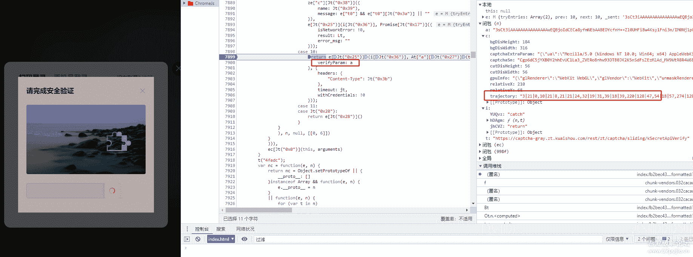

`image-20240218113041710.png` (215.83 KB, 下载次数: 2)

[href="forum.php?mod=attachment&aid=MjY4MDI2Mnw1ZWMxZGYxNHwxNzkzNTcyNTkwfDE2ODA4NnwxODk3ODIz&nothumb=yes" target="_blank"](https://www.52pojie.cn/forum.php?mod=attachment&aid=MjY4MDI2Mnw1ZWMxZGYxNHwxNzkzNTcyNTkwfDE2ODA4NnwxODk3ODIz&nothumb=yes)

1（2024-3-7 16:02 上传）

把轨迹的字符串取出，简单分析之后，可以判断轨迹包含`x`、`y`、`time`信息，每一组轨迹用“,”进行分割。稍微处理下，我们拿出`x`、`time`进行画图，从图中我们更能直观的观察轨迹变化。

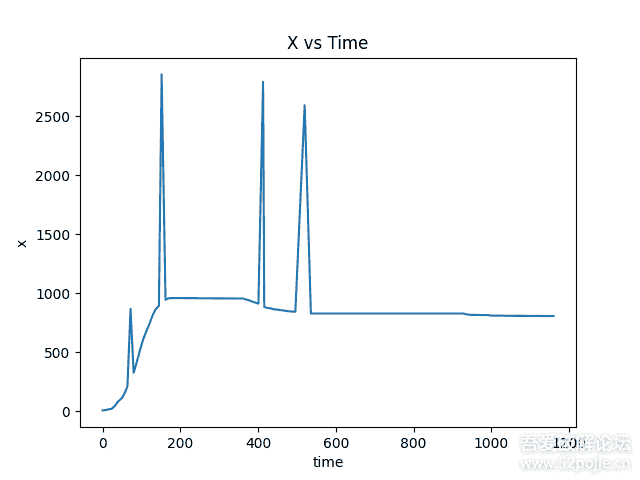

`image-20240218113738208.png` (27.91 KB, 下载次数: 1)

[href="forum.php?mod=attachment&aid=MjY4MDI2NHxmNTk1YzIyOXwxNzkzNTcyNTkwfDE2ODA4NnwxODk3ODIz&nothumb=yes" target="_blank"](https://www.52pojie.cn/forum.php?mod=attachment&aid=MjY4MDI2NHxmNTk1YzIyOXwxNzkzNTcyNTkwfDE2ODA4NnwxODk3ODIz&nothumb=yes)

2（2024-3-7 16:05 上传）

可以发现，在这个正常的轨迹中，有几个轨迹点发生了变异，不正常的凸起。这也就是本文需要分析的点。

## 二、分析过程

### 1. 轨迹分析

为了探究这几个点为什么发生了变异，就需要找到记录轨迹点的位置。

观察堆栈，发现三个有特殊含义的函数，`dragEndCb`、`slideEnd`、`verifyCaptcha`，分别进行下断点。

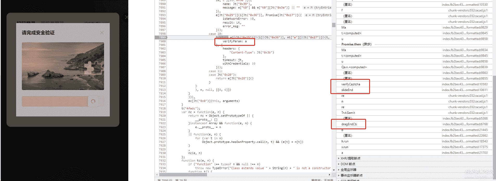

`image-20240218120249025.png` (279.2 KB, 下载次数: 2)

[href="forum.php?mod=attachment&aid=MjY4MDI3OXwxNDNkZTI0OXwxNzkzNTcyNTkwfDE2ODA4NnwxODk3ODIz&nothumb=yes" target="_blank"](https://www.52pojie.cn/forum.php?mod=attachment&aid=MjY4MDI3OXwxNDNkZTI0OXwxNzkzNTcyNTkwfDE2ODA4NnwxODk3ODIz&nothumb=yes)

2024-3-7 16:19 上传

刷新页面，再次拖动滑块，可以看到变量`r`就是轨迹数组，并且有几个轨迹点是异常的。

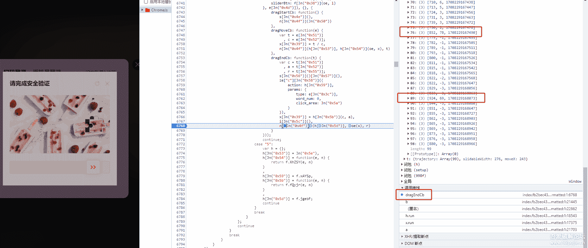

`image-20240218120702458.png` (316.67 KB, 下载次数: 1)

[href="forum.php?mod=attachment&aid=MjY4MDI4MHxlY2YzYmUzZHwxNzkzNTcyNTkwfDE2ODA4NnwxODk3ODIz&nothumb=yes" target="_blank"](https://www.52pojie.cn/forum.php?mod=attachment&aid=MjY4MDI4MHxlY2YzYmUzZHwxNzkzNTcyNTkwfDE2ODA4NnwxODk3ODIz&nothumb=yes)

2024-3-7 16:20 上传

并且在该断点的堆栈前两层还在`while`循环中，也分别打上日志点，如图所示。

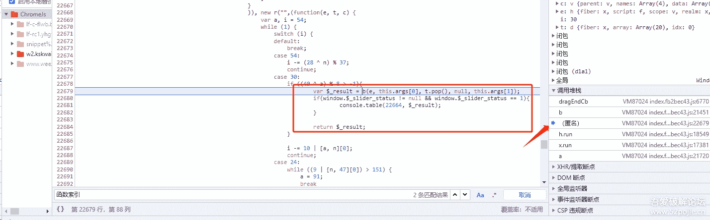

`image-20240218141652166.png` (91.97 KB, 下载次数: 1)

[href="forum.php?mod=attachment&aid=MjY4MDI4MXw4ZmM3YjUxNXwxNzkzNTcyNTkwfDE2ODA4NnwxODk3ODIz&nothumb=yes" target="_blank"](https://www.52pojie.cn/forum.php?mod=attachment&aid=MjY4MDI4MXw4ZmM3YjUxNXwxNzkzNTcyNTkwfDE2ODA4NnwxODk3ODIz&nothumb=yes)

2024-3-7 16:20 上传

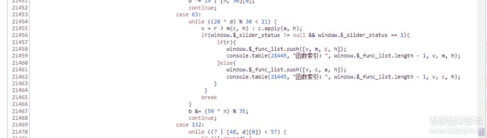

`image-20240218141652166-1.png` (39.26 KB, 下载次数: 1)

[href="forum.php?mod=attachment&aid=MjY4MDI4MnwzZTdiNDUyNHwxNzkzNTcyNTkwfDE2ODA4NnwxODk3ODIz&nothumb=yes" target="_blank"](https://www.52pojie.cn/forum.php?mod=attachment&aid=MjY4MDI4MnwzZTdiNDUyNHwxNzkzNTcyNTkwfDE2ODA4NnwxODk3ODIz&nothumb=yes)

2024-3-7 16:20 上传

在该断点的上方，还出现了“`dragStartCb`”、“`dragMoveCb`”，也打上日志点。

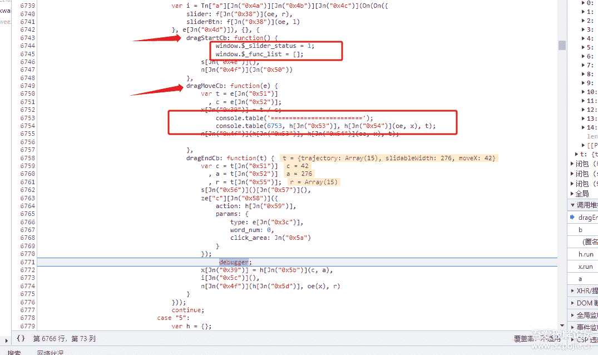

`image-20240218141652166-2.png` (97.99 KB, 下载次数: 1)

[href="forum.php?mod=attachment&aid=MjY4MDI4M3wzZTdkNWQyZnwxNzkzNTcyNTkwfDE2ODA4NnwxODk3ODIz&nothumb=yes" target="_blank"](https://www.52pojie.cn/forum.php?mod=attachment&aid=MjY4MDI4M3wzZTdkNWQyZnwxNzkzNTcyNTkwfDE2ODA4NnwxODk3ODIz&nothumb=yes)

2024-3-7 16:21 上传

通过分析日志，发现在第索引为3的函数中，传入了`MouseEvent`事件，随后开始了计算和取值。

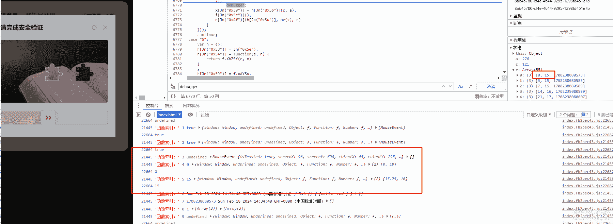

`image-20240218143551370.png` (249.93 KB, 下载次数: 1)

[href="forum.php?mod=attachment&aid=MjY4MDI4NXxlNDRlNzdhOHwxNzkzNTcyNTkwfDE2ODA4NnwxODk3ODIz&nothumb=yes" target="_blank"](https://www.52pojie.cn/forum.php?mod=attachment&aid=MjY4MDI4NXxlNDRlNzdhOHwxNzkzNTcyNTkwfDE2ODA4NnwxODk3ODIz&nothumb=yes)

2024-3-7 16:21 上传

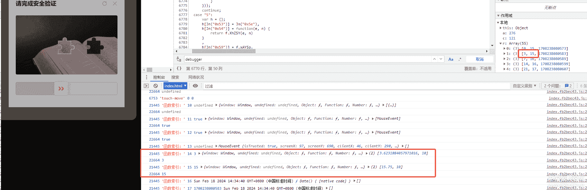

`image-20240218143628081.png` (233.2 KB, 下载次数: 0)

[href="forum.php?mod=attachment&aid=MjY4MDI4Nnw0ZDJhOTY0YnwxNzkzNTcyNTkwfDE2ODA4NnwxODk3ODIz&nothumb=yes" target="_blank"](https://www.52pojie.cn/forum.php?mod=attachment&aid=MjY4MDI4Nnw0ZDJhOTY0YnwxNzkzNTcyNTkwfDE2ODA4NnwxODk3ODIz&nothumb=yes)

2024-3-7 16:21 上传

于是，在索引为3、长度为4的时候，进行`debugger`，尝试单步调试，跟踪代码运行逻辑。

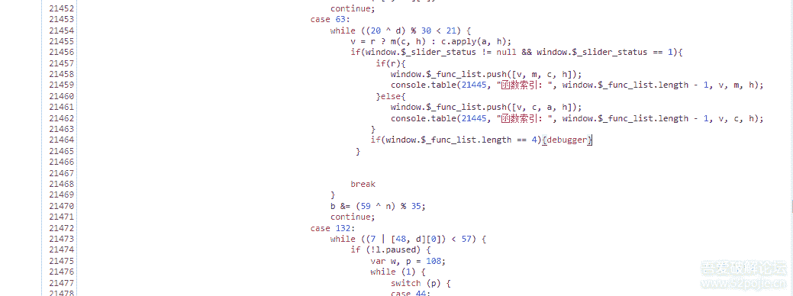

`image-20240218143628081-1.png` (47.45 KB, 下载次数: 0)

[href="forum.php?mod=attachment&aid=MjY4MDI4N3xjZDBlMmJiOXwxNzkzNTcyNTkwfDE2ODA4NnwxODk3ODIz&nothumb=yes" target="_blank"](https://www.52pojie.cn/forum.php?mod=attachment&aid=MjY4MDI4N3xjZDBlMmJiOXwxNzkzNTcyNTkwfDE2ODA4NnwxODk3ODIz&nothumb=yes)

2024-3-7 16:21 上传

在之后的单步调试中，发现了在大量`while`循环中，每次执行的结果都有`push`操作。

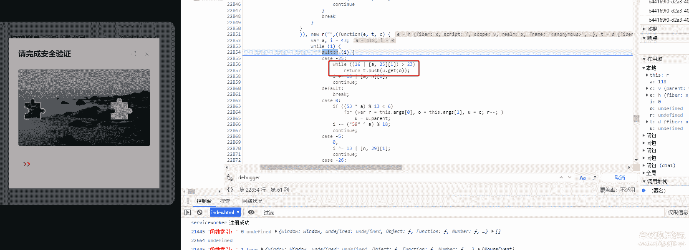

`image-20240218151257643.png` (169.82 KB, 下载次数: 0)

[href="forum.php?mod=attachment&aid=MjY4MDI4OHxiZjczMGFmOHwxNzkzNTcyNTkwfDE2ODA4NnwxODk3ODIz&nothumb=yes" target="_blank"](https://www.52pojie.cn/forum.php?mod=attachment&aid=MjY4MDI4OHxiZjczMGFmOHwxNzkzNTcyNTkwfDE2ODA4NnwxODk3ODIz&nothumb=yes)

2024-3-7 16:21 上传

并且`push`方法是官方js代码实现的一个函数，在`push`方法中打上日志点。

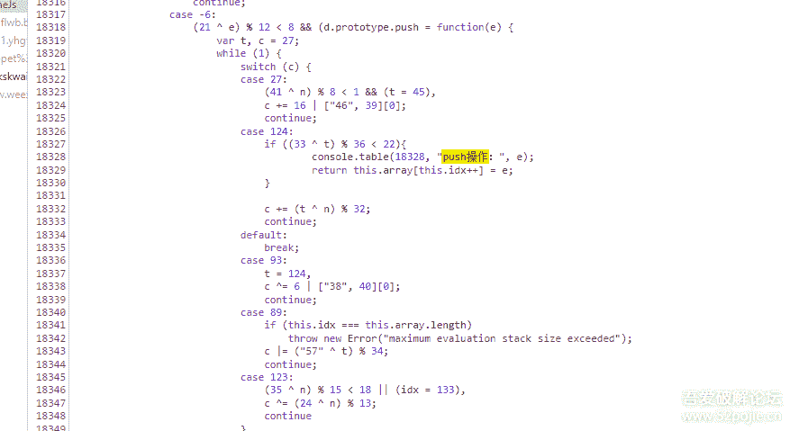

`image-20240218151955736.png` (56 KB, 下载次数: 1)

[href="forum.php?mod=attachment&aid=MjY4MDI5MHxhM2I5Yjg5NnwxNzkzNTcyNTkwfDE2ODA4NnwxODk3ODIz&nothumb=yes" target="_blank"](https://www.52pojie.cn/forum.php?mod=attachment&aid=MjY4MDI5MHxhM2I5Yjg5NnwxNzkzNTcyNTkwfDE2ODA4NnwxODk3ODIz&nothumb=yes)

2024-3-7 16:22 上传

此时结合轨迹和日志点进行分析，很清晰明了。

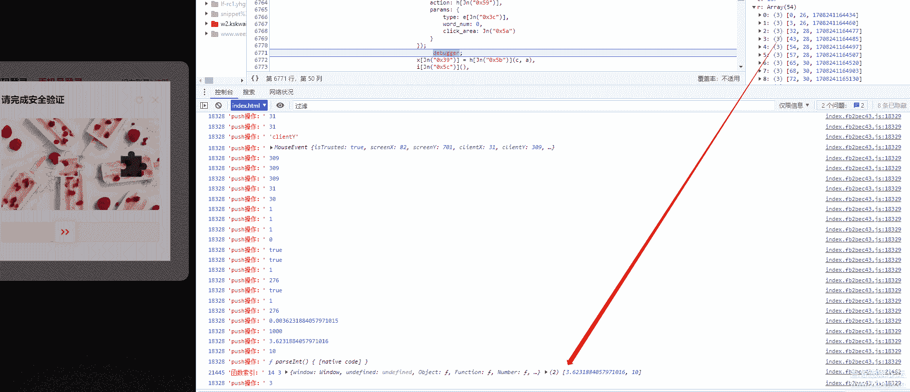

`image-20240218152900706.png` (282.17 KB, 下载次数: 2)

[href="forum.php?mod=attachment&aid=MjY4MDI5MXwzNzM4ZTRmY3wxNzkzNTcyNTkwfDE2ODA4NnwxODk3ODIz&nothumb=yes" target="_blank"](https://www.52pojie.cn/forum.php?mod=attachment&aid=MjY4MDI5MXwzNzM4ZTRmY3wxNzkzNTcyNTkwfDE2ODA4NnwxODk3ODIz&nothumb=yes)

2024-3-7 16:22 上传

通过下面这一段日志，进行猜测分析和对比，可以得出以下结论：

- 取出`clientX`的值，与第一个轨迹点的`clientX`进行相减
- 拿相减之后的结果除固定值276得到一个小数
- 拿小数乘1000，并拿到他的整数部分即为最终的`x`的值

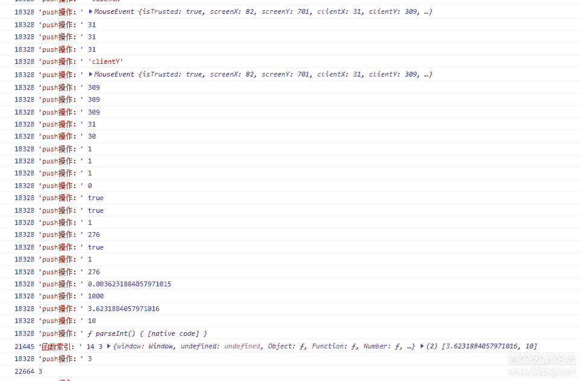

`image-20240218153009849.png` (59.85 KB, 下载次数: 0)

[href="forum.php?mod=attachment&aid=MjY4MDI5MnxmMWMzNTY3OHwxNzkzNTcyNTkwfDE2ODA4NnwxODk3ODIz&nothumb=yes" target="_blank"](https://www.52pojie.cn/forum.php?mod=attachment&aid=MjY4MDI5MnxmMWMzNTY3OHwxNzkzNTcyNTkwfDE2ODA4NnwxODk3ODIz&nothumb=yes)

2024-3-7 16:22 上传

同理，通过以下日志也可以分析出`y`值的计算方式：

取出`clientY`的值，减去固定值282.25再取整数部分。

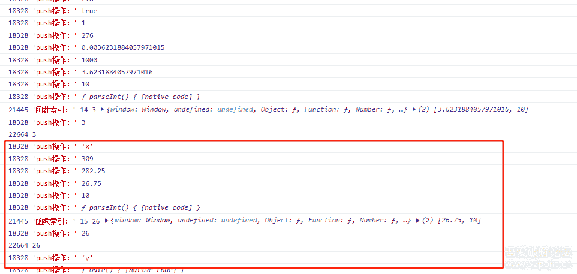

`image-20240218153533233.png` (50.45 KB, 下载次数: 1)

[href="forum.php?mod=attachment&aid=MjY4MDI5M3wyYzI0MDFjMHwxNzkzNTcyNTkwfDE2ODA4NnwxODk3ODIz&nothumb=yes" target="_blank"](https://www.52pojie.cn/forum.php?mod=attachment&aid=MjY4MDI5M3wyYzI0MDFjMHwxNzkzNTcyNTkwfDE2ODA4NnwxODk3ODIz&nothumb=yes)

2024-3-7 16:23 上传

### 2. 变异点的分析(A)

正常的轨迹点的计算方式找到了，下一步就是找为什么有的轨迹点会发生变异。根据`/rest/zt/captcha/sliding/config`返回的信息，可以分为两种情况讨论，本小点针对返回值中存在`q`值进行分析。

快速在日志中定位到变异点的位置。

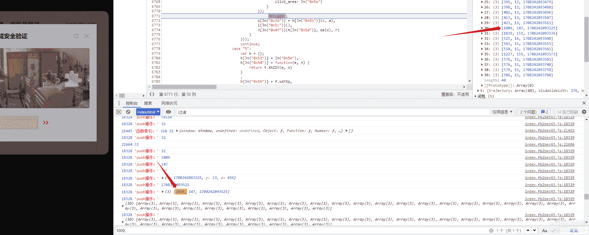

`image-20240218154227174.png` (266.98 KB, 下载次数: 2)

[href="forum.php?mod=attachment&aid=MjY4MDI5NHxkMDc4ZjkzOXwxNzkzNTcyNTkwfDE2ODA4NnwxODk3ODIz&nothumb=yes" target="_blank"](https://www.52pojie.cn/forum.php?mod=attachment&aid=MjY4MDI5NHxkMDc4ZjkzOXwxNzkzNTcyNTkwfDE2ODA4NnwxODk3ODIz&nothumb=yes)

2024-3-7 16:24 上传

为了方便观察，我这里截取了索引为29的轨迹点、索引30的变异点的日志。对比发现，变异的轨迹点也是正常执行了上方的计算，随后进行了某个判断，当判断值为`true`的时候，会进行额外的操作，也就是产生了文章所说的变异点。

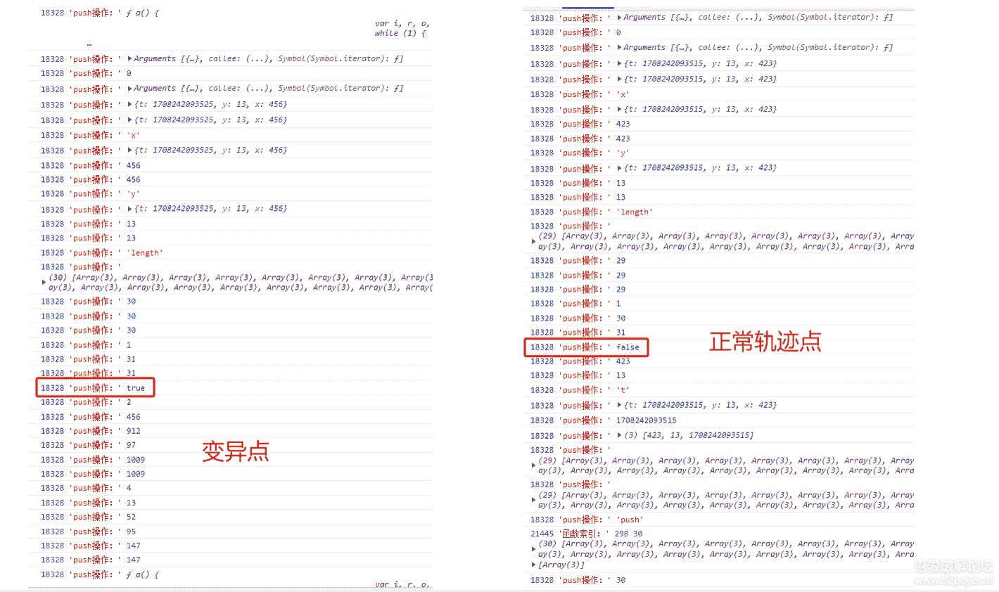

`image-20240218160633176.png` (224.8 KB, 下载次数: 0)

[href="forum.php?mod=attachment&aid=MjY4MDI5NXw2Mzg1ZDIxNnwxNzkzNTcyNTkwfDE2ODA4NnwxODk3ODIz&nothumb=yes" target="_blank"](https://www.52pojie.cn/forum.php?mod=attachment&aid=MjY4MDI5NXw2Mzg1ZDIxNnwxNzkzNTcyNTkwfDE2ODA4NnwxODk3ODIz&nothumb=yes)

2024-3-7 16:24 上传

## 变异点的分析

细心的可以发现，这个`true`猜测应该是`轨迹长度 + 1`之后与31进行了判断，当`轨迹长度 + 1`等于31之后，就会发生变异。同时回过头看`/rest/zt/captcha/sliding/config`这个接口返回的信息中，也有个`a`的值为30，在经过运算过得到了31。也就是轨迹长度等于`a + 1`的时候为第一个变异点（这个`a + 1`仅是多次测试的结论，没有实际进行跟栈观察）。

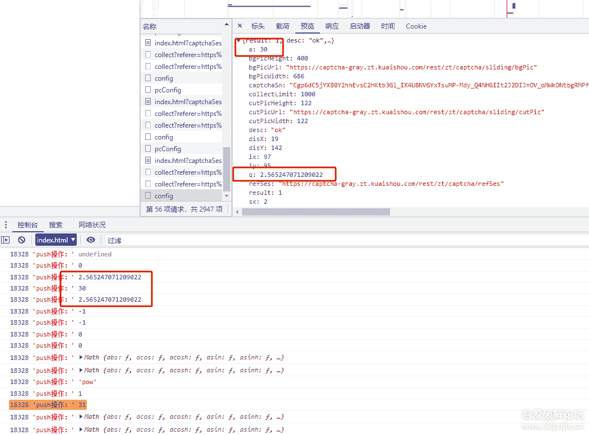

`image-20240218162449592.png`（93.35 KB，下载次数：1）

[附件下载](https://www.52pojie.cn/forum.php?mod=attachment&aid=MjY4MDI5NnxiOTk4OWUyN3wxNzkzNTcyNTkwfDE2ODA4NnwxODk3ODIz&nothumb=yes)

2024-3-7 16:24 上传

变异前的轨迹点为：`[456, 13, 1708242093525]`

变异后的轨迹点为：`[1009, 147, 1708242093525]`

继续分析`true`之后的日志，也能通过猜测得出结论：

`1009 = 456 sx + ix`

`147 = 13 sy + iy`

`sx`、`sy`、`ix`、`iy`都是接口返回，如下图所示。

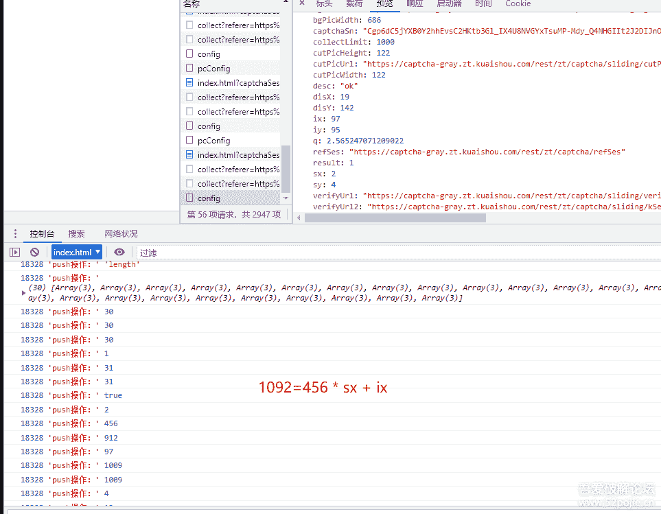

`image-20240218163251464.png`（82.2 KB，下载次数：1）

[附件下载](https://www.52pojie.cn/forum.php?mod=attachment&aid=MjY4MDI5N3wwNzk5ZjEyMHwxNzkzNTcyNTkwfDE2ODA4NnwxODk3ODIz&nothumb=yes)

2024-3-7 16:24 上传

继续观察后续日志（由于时间关系，此次日志与上文日志非同一份），分析后续变异点的规律。

其中2.258983396379993、30都是接口返回，分别为`q`和`a`，根据日志也可以猜测得出下个点的计算方式为：

`Math.floor(Math.pow(q, 变异次数) + a)`

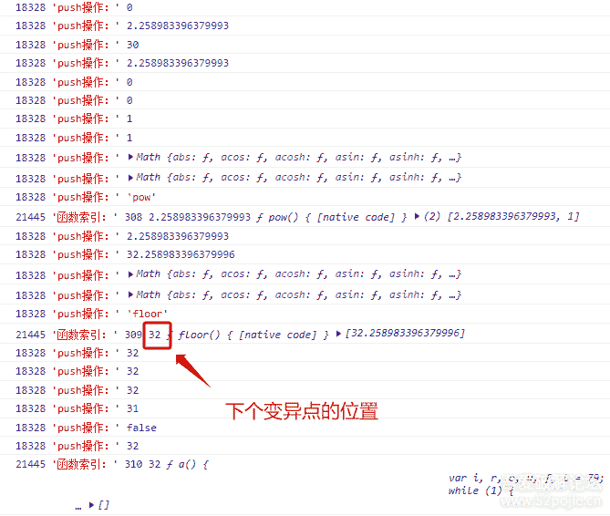

`image-20240218171257067.png`（60.31 KB，下载次数：0）

[附件下载](https://www.52pojie.cn/forum.php?mod=attachment&aid=MjY4MDI5OHw1YzViZDU5NXwxNzkzNTcyNTkwfDE2ODA4NnwxODk3ODIz&nothumb=yes)

2024-3-7 16:24 上传

### 3. 变异点的分析（B）

本小点针对返回值中存在`d`值进行分析。

当接口返回数据存在`d`值，要简单很多。

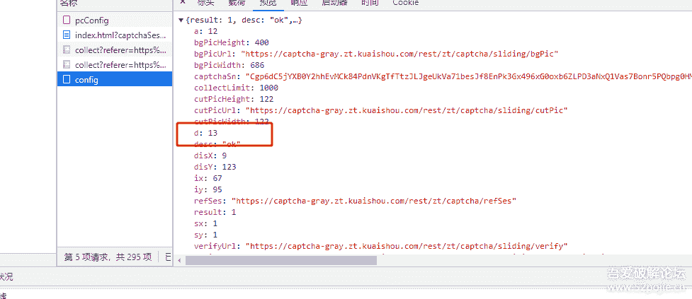

`image-20240218171727193.png`（47.59 KB，下载次数：1）

[附件下载](https://www.52pojie.cn/forum.php?mod=attachment&aid=MjY4MDI5OXxlYjJiMjdlNXwxNzkzNTcyNTkwfDE2ODA4NnwxODk3ODIz&nothumb=yes)

2024-3-7 16:24 上传

通过观察轨迹，就能发现，当轨迹长度等于`a`值，发生第一次变异，之后每间隔`d`值发生变异，如下图所示，分别在轨迹长度12、25（`12 + 13`）、38（`25 + 13`）发生了变异，变异值的计算方式与上文相同。

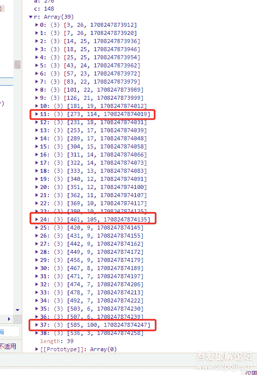

`image-20240218171931537.png`（51.2 KB，下载次数：1）

[附件下载](https://www.52pojie.cn/forum.php?mod=attachment&aid=MjY4MDMwMHw1YTZiNWRiZnwxNzkzNTcyNTkwfDE2ODA4NnwxODk3ODIz&nothumb=yes)

2024-3-7 16:25 上传

## 三、验证

针对轨迹这一块，是由算法生成的，优化下轨迹算法表现可能会更好。在本次测试中，分别进行了200次、500次、1000次测试，测试环境为不同IP、环境指纹部分随机的情况下连续进行，仅统计验证通过和因轨迹失败的结果，忽略缺口识别错误导致的失败，结果如下：

| 统计次数 | 通过率 |
| --- | --- |
| 200 |  |
