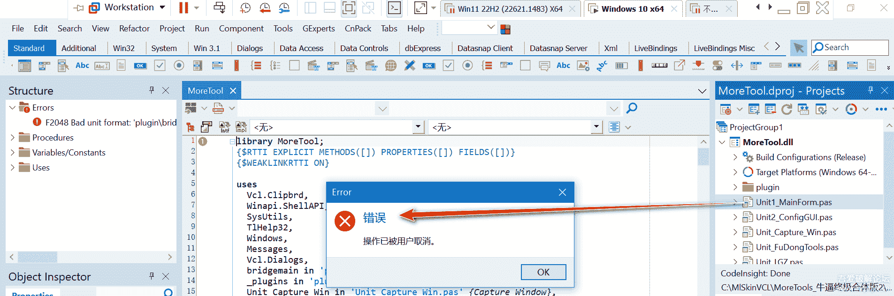
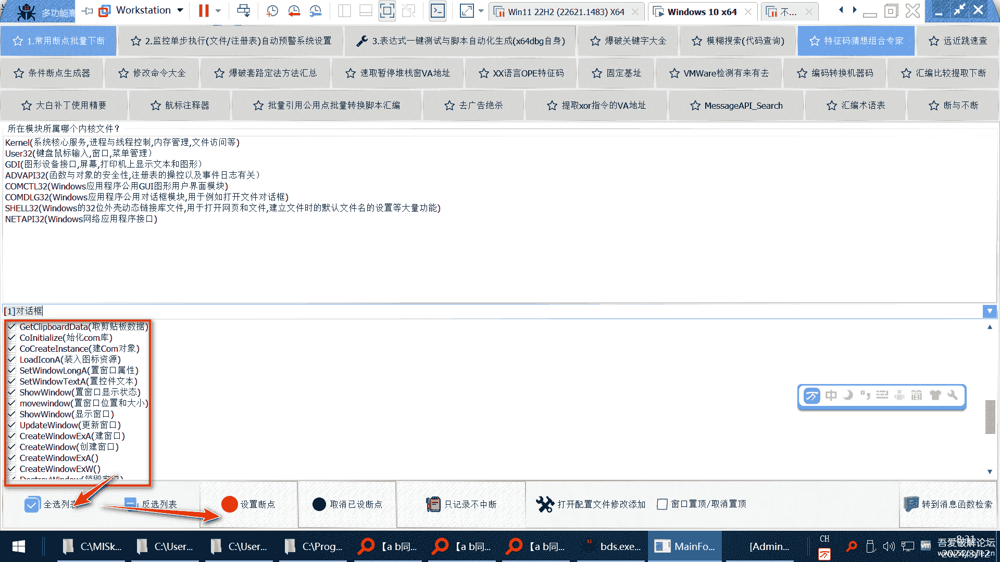
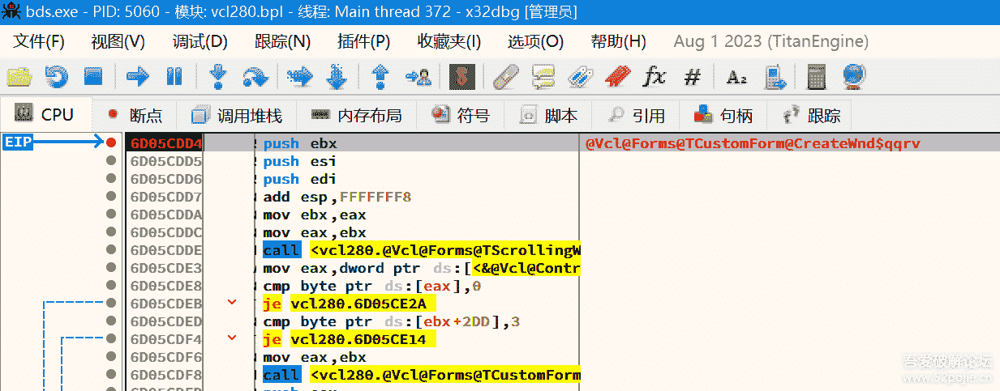
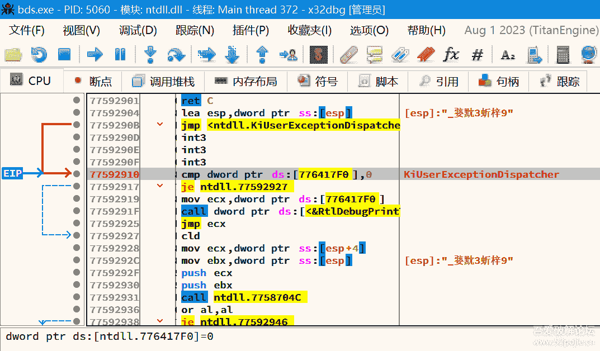
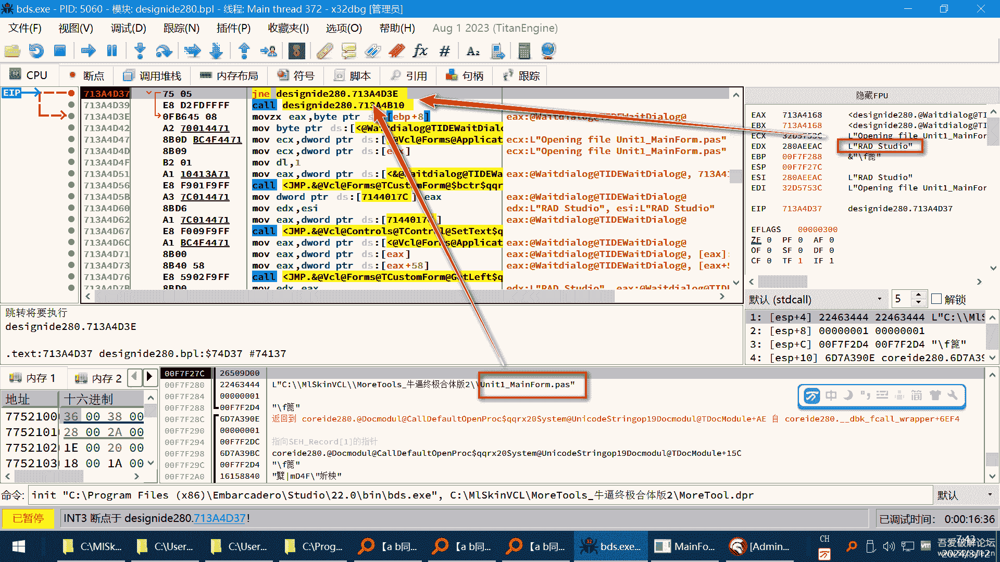
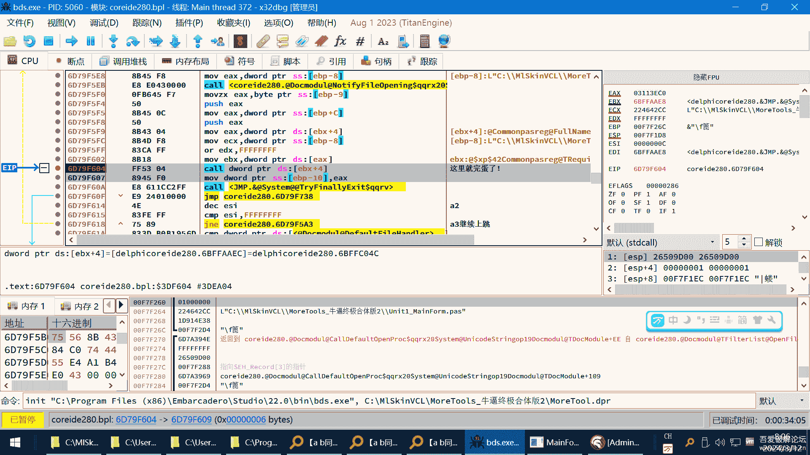
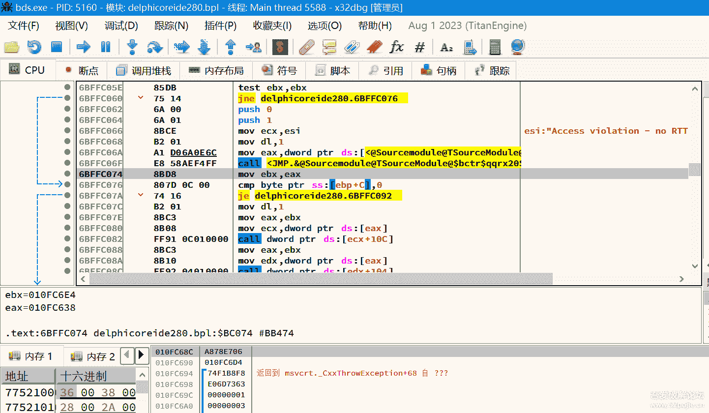
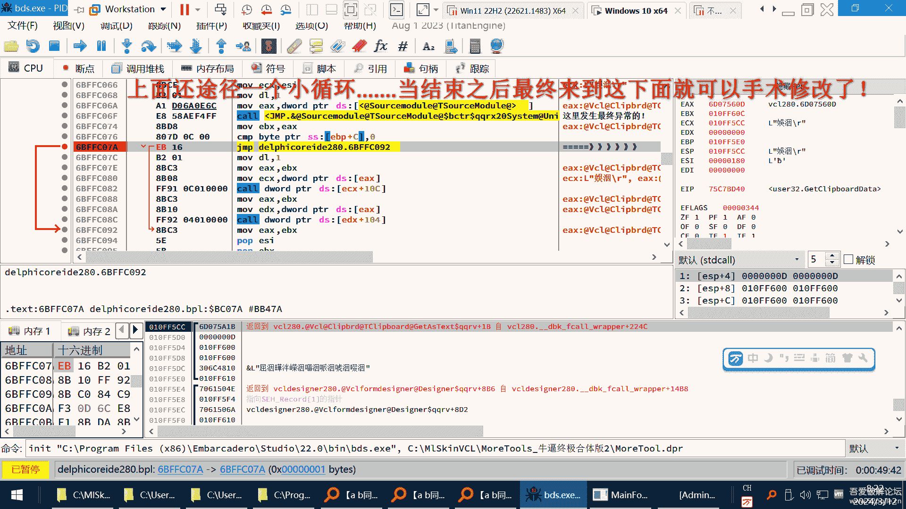

# [原创] Delphi 11.3紧急救险记《上集》

- 原帖：https://www.52pojie.cn/forum.php?mod=viewthread&tid=1899380
- 抓取时间：2026-11-01T22:36:27

## 问题现象

`image.png` (173.7 KB, 下载次数: 2)

[附件下载](https://www.52pojie.cn/forum.php?mod=attachment&aid=MjY4MTAzN3w4MmJmYjJmZHwxNzkzNTcyNTg0fDE2ODA4NnwxODk5Mzgw&nothumb=yes)；2024-3-12 08:25 上传

如图所示，当双击某个窗体继续编辑时，昨晚突然犯病了：总是出来这个。。。而且吧，再按 `F12` 键切换到设计视图再也回不去了。。

要双击其他的视图挑逗一下，才肯出来。。

## 调试过程

今早我打算来治愈一下它。

`image.png` (22.95 KB, 下载次数: 1)

[附件下载](https://www.52pojie.cn/forum.php?mod=attachment&aid=MjY4MTAzOHxmNWFhZTBiYXwxNzkzNTcyNTg0fDE2ODA4NnwxODk5Mzgw&nothumb=yes)；2024-3-12 08:27 上传

先用命令行来手动加载它。

注意，如有空格，别忘记加双引号。

第二个参数前别忘记加逗号。

`image.png` (327.37 KB, 下载次数: 2)

[附件下载](https://www.52pojie.cn/forum.php?mod=attachment&aid=MjY4MTA0MHxiZDBjZDE5YnwxNzkzNTcyNTg0fDE2ODA4NnwxODk5Mzgw&nothumb=yes)；2024-3-12 08:32 上传

接下来调用自制的插件，批量下个断点。

`image.png` (97.42 KB, 下载次数: 0)

[附件下载](https://www.52pojie.cn/forum.php?mod=attachment&aid=MjY4MTA0MXw1MjdmZDZiZnwxNzkzNTcyNTg0fDE2ODA4NnwxODk5Mzgw&nothumb=yes)；2024-3-12 08:33 上传

下完断点之后，还没有双击操作呢，就断到一堆堆。。

一个一个活人操作，去除无用的，之后只要来到消息过程中就行。

上面的位置不错，反正只要拦在消息前就算我方胜利。

继续 `F8` 单步步过

`image.png` (112.87 KB, 下载次数: 0)

[附件下载](https://www.52pojie.cn/forum.php?mod=attachment&aid=MjY4MTA0Mnw2NWYzMmE0Y3wxNzkzNTcyNTg0fDE2ODA4NnwxODk5Mzgw&nothumb=yes)；2024-3-12 08:35 上传

我们就来到了异常触发前的某处

继续 `F8`

`image.png` (434.49 KB, 下载次数: 1)

[附件下载](https://www.52pojie.cn/forum.php?mod=attachment&aid=MjY4MTA0M3wwNTU0YzIwMnwxNzkzNTcyNTg0fDE2ODA4NnwxODk5Mzgw&nothumb=yes)；2024-3-12 08:36 上传

不断的查看堆栈，和右上角寄存器器窗口

显然我们在 `MainForm.pas` 加载初始化之前的某处

`image.png` (341.18 KB, 下载次数: 2)

[附件下载](https://www.52pojie.cn/forum.php?mod=attachment&aid=MjY4MTA0NHxhZWJjODVjYnwxNzkzNTcyNTg0fDE2ODA4NnwxODk5Mzgw&nothumb=yes)；2024-3-12 08:37 上传

到这就完蛋了！

`image.png` (155.8 KB, 下载次数: 2)

[附件下载](https://www.52pojie.cn/forum.php?mod=attachment&aid=MjY4MTA0NnxjZDNjMzExZHwxNzkzNTcyNTg0fDE2ODA4NnwxODk5Mzgw&nothumb=yes)；2024-3-12 08:39 上传

到这里时基本上看到了有异常之类的字样了。

`image.png` (426.54 KB, 下载次数: 2)

[附件下载](https://www.52pojie.cn/forum.php?mod=attachment&aid=MjY4MTA0N3xlZTgxOWE5N3wxNzkzNTcyNTg0fDE2ODA4NnwxODk5Mzgw&nothumb=yes)；2024-3-12 08:41 上传

## 爆破成功

这样就爆破成功了。

## 下集预告

另外还有个开源的 `cnpack` 插件，这两天长久开着 Delphi 也会报错。

等下次再出问题时，立刻加载它调试，并把修改过程发给 QQ 群中软件的开发者刘啸。这个就留给下集吧。
