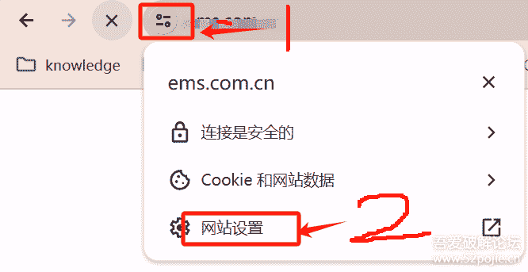
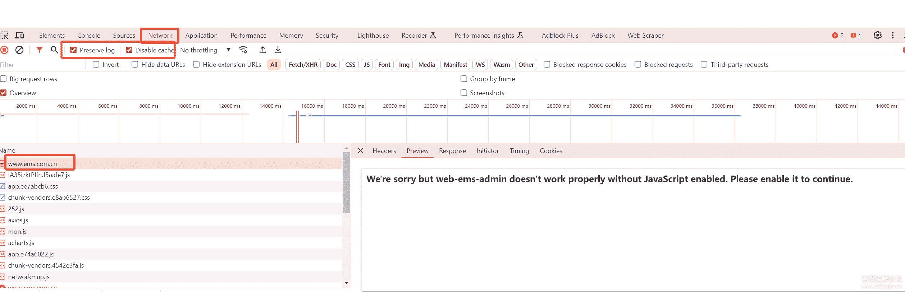
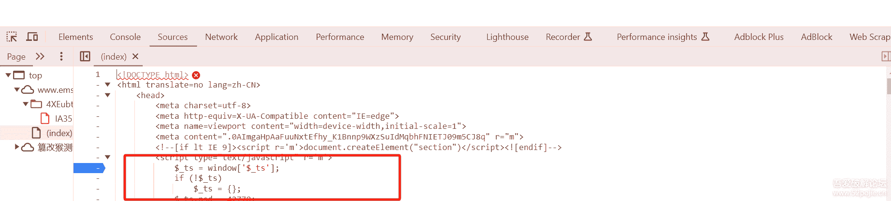
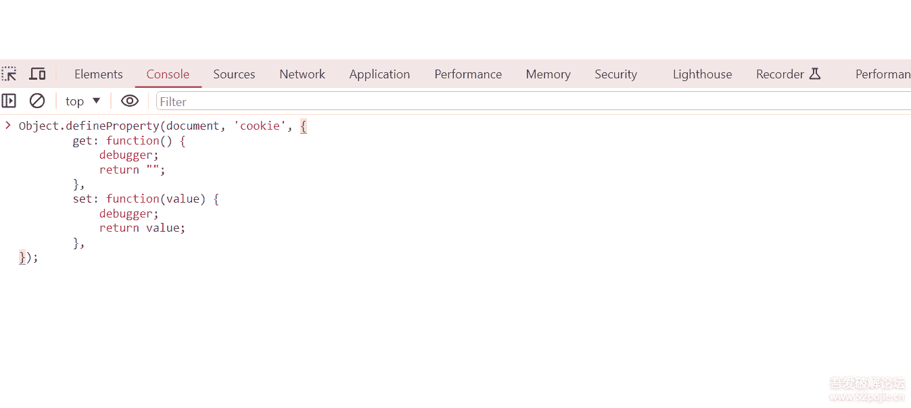
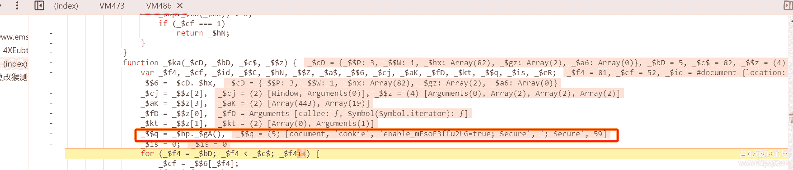

# [Web逆向] 小白hook网站cookie步骤详解

- 原帖: https://www.52pojie.cn/forum.php?mod=viewthread&tid=1900424
- 抓取时间: 2026-11-01T22:36:20

## 前言

小白，想要爬取目标网站：`aHR0cHM6Ly93d3cuZW1zLmNvbS5jbi8=`。但是不想要用 `selenium` 等图形化方式，就开始研究怎么通过接口方式获取信息。但是网上一些教程对纯小白来说还是太高深了，hook 很多都是一笔带过，这边试验过后，记录下前期的一些基础操作。

## hook脚本

```
// 定义 hook 脚本，这样，代码读写cookie的时候，就会断点停下来，方便分析了

Object.defineProperty(document, 'cookie', {

        get: function() {

            debugger;

            return "";

        },

        set: function(value) {

            debugger;

            return value;

        },

});
```

## 插入过程

1. 清空目标网站 cookie

    

    [`img.png` (32.4 KB, 下载次数: 1)](https://www.52pojie.cn/forum.php?mod=attachment&aid=MjY4MTY0MnwxNTRjNGVkZXwxNzkzNTcyNTc4fDE2ODA4NnwxOTAwNDI0&nothumb=yes) 2024-3-14 11:42 上传

    算了，不打码了

2. 在目标网站界面，按F12打开network, 选中Preserve log, 保留每个请求

    

    [`img_1.png` (108.14 KB, 下载次数: 0)](https://www.52pojie.cn/forum.php?mod=attachment&aid=MjY4MTY0M3w1YWRiNWZjM3wxNzkzNTcyNTc4fDE2ODA4NnwxOTAwNDI0&nothumb=yes) 2024-3-14 11:42 上传

3. 找到第一个请求, 右键点击open in sources panel, 在源码顶端加上断点

    

    [`img_2.png` (74.89 KB, 下载次数: 0)](https://www.52pojie.cn/forum.php?mod=attachment&aid=MjY4MTY0NHwxMGE2YTBiNHwxNzkzNTcyNTc4fDE2ODA4NnwxOTAwNDI0&nothumb=yes) 2024-3-14 11:42 上传

4. 在初始界面打上断点后，回到Cosole, 粘贴hook脚本

    

    [`img_3.png` (35.08 KB, 下载次数: 0)](https://www.52pojie.cn/forum.php?mod=attachment&aid=MjY4MTY0NXxmMTlmZmM3OHwxNzkzNTcyNTc4fDE2ODA4NnwxOTAwNDI0&nothumb=yes) 2024-3-14 11:42 上传

5. 继续运行, 成功找到设置cookie的位置

    

    [`img_4.png` (88.42 KB, 下载次数: 0)](https://www.52pojie.cn/forum.php?mod=attachment&aid=MjY4MTY0NnxjMDUxNzE0MXwxNzkzNTcyNTc4fDE2ODA4NnwxOTAwNDI0&nothumb=yes) 2024-3-14 11:42 上传

## TODO 继续分析

再往后貌似抠代码了，学习中...
