# [Web逆向] 某视频解析网站js逆向分析——学会wasm文件类型逆向

- 原帖: https://www.52pojie.cn/forum.php?mod=viewthread&tid=1900845
- 抓取时间: 2026-11-01T22:36:14

## 声明

本文章中所有内容仅供学习交流，相关链接做了脱敏处理，若有侵权，请联系我立即删除！

### 一、目标网站

aHR0cHM6Ly9qeC5qc29ucGxheWVyLmNvbS9wbGF5ZXIvP3VybD1odHRwczovL3d3dy5pcWl5aS5jb20vdl9tNG1qbDhtbzhrLmh0bWw=

### 二、过检测，然后找到所需加密参数位置

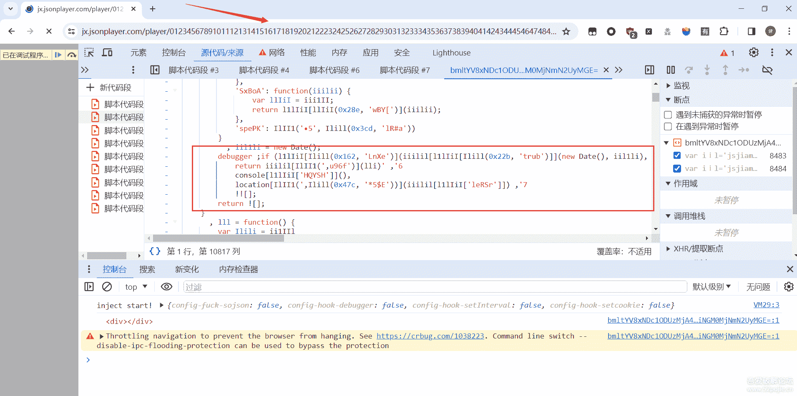

1.png (197.69 KB, 下载次数: 1)

[href="forum.php?mod=attachment&aid=MjY4MjA1MHw0MzcyOTZlN3wxNzkzNTcyNTcyfDE2ODA4NnwxOTAwODQ1&nothumb=yes" target="_blank"](https://www.52pojie.cn/forum.php?mod=attachment&aid=MjY4MjA1MHw0MzcyOTZlN3wxNzkzNTcyNTcyfDE2ODA4NnwxOTAwODQ1&nothumb=yes)

2024-3-14 22:07 上传

打开网站，按f12会发现`debugger`，然后你继续运行，他就会在网址后面一直加数值，导致浏览器崩掉。

要过这个确实很简单，这个网站的作者其实算留了一点小破绽吧，可能也算是他自己要调试设置检测点所以遗留下来的小破绽，就是`debugger`后面的`if`判断。

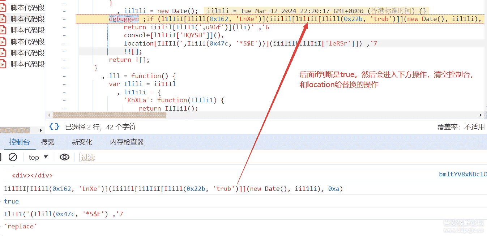

2.png (95.39 KB, 下载次数: 2)

[href="forum.php?mod=attachment&aid=MjY4MjA1MXxjNWUwMmVlM3wxNzkzNTcyNTcyfDE2ODA4NnwxOTAwODQ1&nothumb=yes" target="_blank"](https://www.52pojie.cn/forum.php?mod=attachment&aid=MjY4MjA1MXxjNWUwMmVlM3wxNzkzNTcyNTcyfDE2ODA4NnwxOTAwODQ1&nothumb=yes)

2024-3-14 22:07 上传

我们只要把`if`后面条件变成false。就能过第一个检测的地方了，这个网站还有哦。

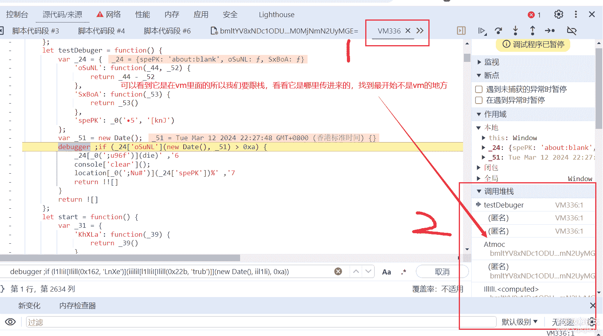

3.png (169.32 KB, 下载次数: 1)

[href="forum.php?mod=attachment&aid=MjY4MjA1MnxiZWU0ZDFhNnwxNzkzNTcyNTcyfDE2ODA4NnwxOTAwODQ1&nothumb=yes" target="_blank"](https://www.52pojie.cn/forum.php?mod=attachment&aid=MjY4MjA1MnxiZWU0ZDFhNnwxNzkzNTcyNTcyfDE2ODA4NnwxOTAwODQ1&nothumb=yes)

2024-3-14 22:07 上传

跟栈:原来是`eval`代码来的，那代码怎么来的呢？其实可以在某一返回里面看到。

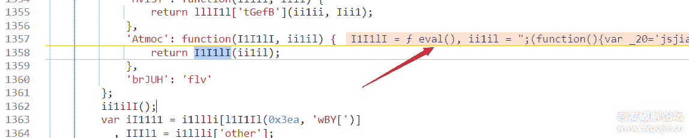

4.png (32.73 KB, 下载次数: 1)

[href="forum.php?mod=attachment&aid=MjY4MjA1M3wxZmE0NDA2NHwxNzkzNTcyNTcyfDE2ODA4NnwxOTAwODQ1&nothumb=yes" target="_blank"](https://www.52pojie.cn/forum.php?mod=attachment&aid=MjY4MjA1M3wxZmE0NDA2NHwxNzkzNTcyNTcyfDE2ODA4NnwxOTAwODQ1&nothumb=yes)

2024-3-14 22:08 上传

再跟一层。

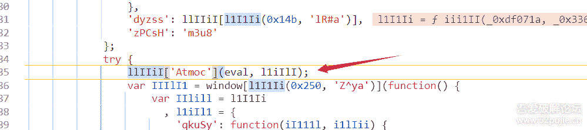

5.png (32.85 KB, 下载次数: 2)

[href="forum.php?mod=attachment&aid=MjY4MjA1NHw1MWUwYWM3ZnwxNzkzNTcyNTcyfDE2ODA4NnwxOTAwODQ1&nothumb=yes" target="_blank"](https://www.52pojie.cn/forum.php?mod=attachment&aid=MjY4MjA1NHw1MWUwYWM3ZnwxNzkzNTcyNTcyfDE2ODA4NnwxOTAwODQ1&nothumb=yes)

2024-3-14 22:08 上传

我的处理方式是：我直接把这一行给注释掉，这样操作可能会导致视频不播放，但是发包是正常的，我只要加密解密就好了，视频不需要播放。

刷新网页，运行。然后又遇到一个`debugger`，这个就是我说的返回的js代码。

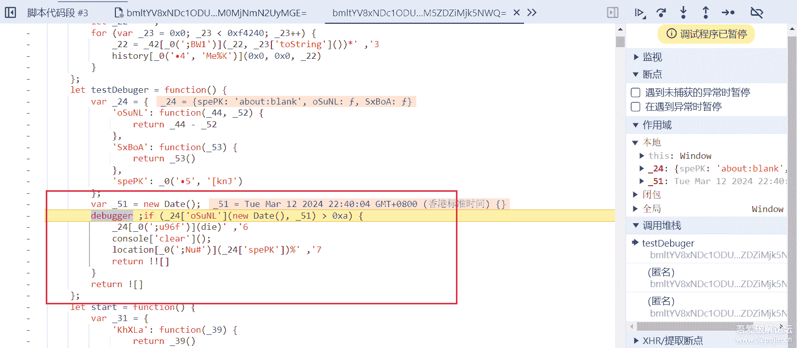

6.png (128.51 KB, 下载次数: 1)

[href="forum.php?mod=attachment&aid=MjY4MjA1NXxhM2M5MTFjYnwxNzkzNTcyNTcyfDE2ODA4NnwxOTAwODQ1&nothumb=yes" target="_blank"](https://www.52pojie.cn/forum.php?mod=attachment&aid=MjY4MjA1NXxhM2M5MTFjYnwxNzkzNTcyNTcyfDE2ODA4NnwxOTAwODQ1&nothumb=yes)

2024-3-14 22:08 上传

相同步骤，`if`后面改false。

然后刷新网页，你就会发现：都让他运行。

第一次修改：

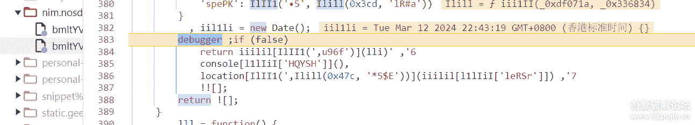

7.png (55.03 KB, 下载次数: 1)

[href="forum.php?mod=attachment&aid=MjY4MjA1Nnw4YWM1ZDE4ZXwxNzkzNTcyNTcyfDE2ODA4NnwxOTAwODQ1&nothumb=yes" target="_blank"](https://www.52pojie.cn/forum.php?mod=attachment&aid=MjY4MjA1Nnw4YWM1ZDE4ZXwxNzkzNTcyNTcyfDE2ODA4NnwxOTAwODQ1&nothumb=yes)

2024-3-14 22:08 上传

第二次修改：

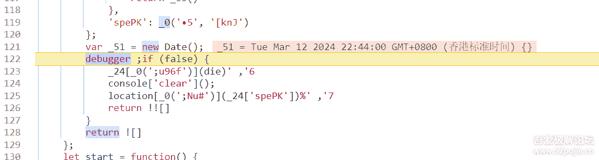

8.png (41.57 KB, 下载次数: 1)

[href="forum.php?mod=attachment&aid=MjY4MjA1N3w2ODlkNDU2MHwxNzkzNTcyNTcyfDE2ODA4NnwxOTAwODQ1&nothumb=yes" target="_blank"](https://www.52pojie.cn/forum.php?mod=attachment&aid=MjY4MjA1N3w2ODlkNDU2MHwxNzkzNTcyNTcyfDE2ODA4NnwxOTAwODQ1&nothumb=yes)

2024-3-14 22:08 上传

成功发包：

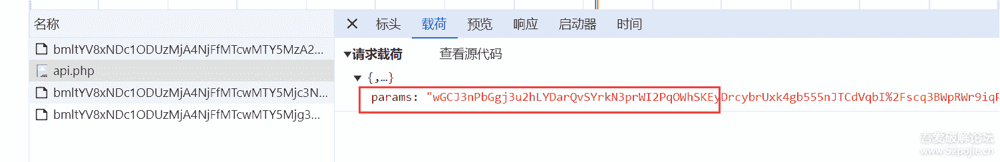

9.png (39.25 KB, 下载次数: 1)

[href="forum.php?mod=attachment&aid=MjY4MjA1OHwyNzJhMzJiY3wxNzkzNTcyNTcyfDE2ODA4NnwxOTAwODQ1&nothumb=yes" target="_blank"](https://www.52pojie.cn/forum.php?mod=attachment&aid=MjY4MjA1OHwyNzJhMzJiY3wxNzkzNTcyNTcyfDE2ODA4NnwxOTAwODQ1&nothumb=yes)

2024-3-14 22:08 上传

需要逆的参数：`params`

跟第二个进去：

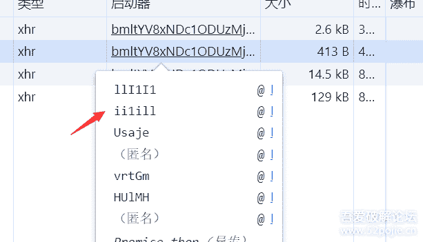

10.png (31.34 KB, 下载次数: 0)

[href="forum.php?mod=attachment&aid=MjY4MjA1OXw2M2JiYjA4M3wxNzkzNTcyNTcyfDE2ODA4NnwxOTAwODQ1&nothumb=yes" target="_blank"](https://www.52pojie.cn/forum.php?mod=attachment&aid=MjY4MjA1OXw2M2JiYjA4M3wxNzkzNTcyNTcyfDE2ODA4NnwxOTAwODQ1&nothumb=yes)

2024-3-14 22:08 上传

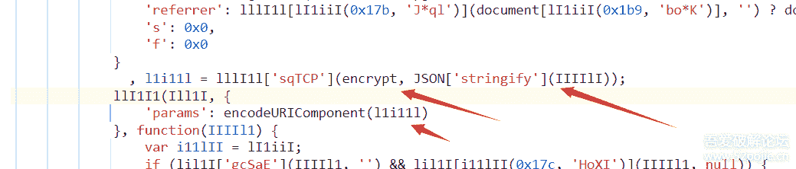

10.1.png (32.72 KB, 下载次数: 1)

[href="forum.php?mod=attachment&aid=MjY4MjA4N3w3YTY0NTU4ZnwxNzkzNTcyNTcyfDE2ODA4NnwxOTAwODQ1&nothumb=yes" target="_blank"](https://www.52pojie.cn/forum.php?mod=attachment&aid=MjY4MjA4N3w3YTY0NTU4ZnwxNzkzNTcyNTcyfDE2ODA4NnwxOTAwODQ1&nothumb=yes)

2024-3-14 22:17 上传

可以看到很清晰的`encrypt`，下个断点吧，然后目标位置已找到

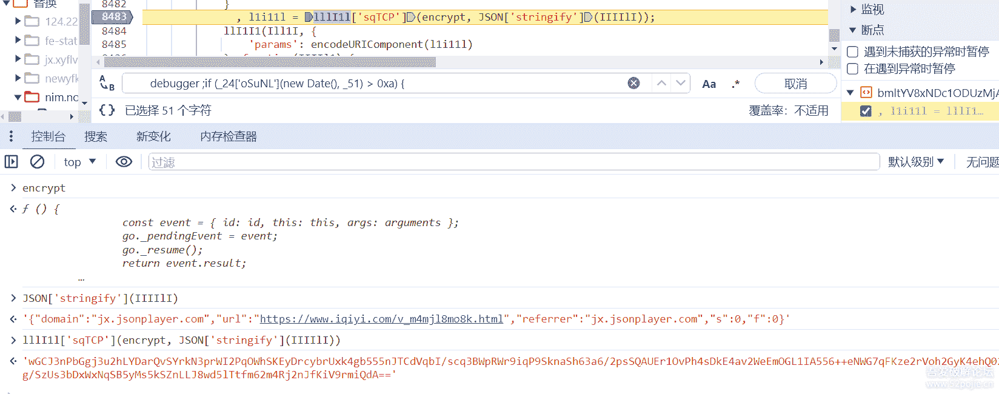

11.png (107.81 KB, 下载次数: 2)

[href="forum.php?mod=attachment&aid=MjY4MjA2MHw4NzFjYTg0NHwxNzkzNTcyNTcyfDE2ODA4NnwxOTAwODQ1&nothumb=yes" target="_blank"](https://www.52pojie.cn/forum.php?mod=attachment&aid=MjY4MjA2MHw4NzFjYTg0NHwxNzkzNTcyNTcyfDE2ODA4NnwxOTAwODQ1&nothumb=yes)

2024-3-14 22:09 上传

### 三、两种方式解决文件类型wasm

#### ①使用`node`自带`WebAssembly`初始化wasm文件，调相应算法

##### 关键点：初始化函数api 找传入`bytes`，和传入对象`importObject`


```
WebAssembly.Instance(module, importObject);  同步  module=new WebAssembly.Module(bytes)
WebAssembly.instantiate(bytes, importObject)  异步
WebAssembly.instantiateStreaming(bytes, importObject) 异步
```

所以我们可以搜索关键词`WebAssembly`，来找初始化的地方，调用wasm文件的关键。

这个网站有混淆，可能你不能直接找到`instantiate`啊之类的关键词，但是`WebAssembly`是可以完全搜索到的，

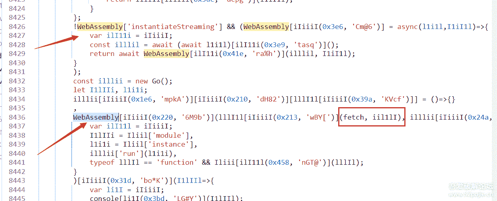
12.png (83.64 KB, 下载次数: 1)
[href="forum.php?mod=attachment&aid=MjY4MjA2MXxiNjc2MDAwZHwxNzkzNTcyNTcyfDE2ODA4NnwxOTAwODQ1&nothumb=yes" target="_blank"](https://www.52pojie.cn/forum.php?mod=attachment&aid=MjY4MjA2MXxiNjc2MDAwZHwxNzkzNTcyNTcyfDE2ODA4NnwxOTAwODQ1&nothumb=yes)
2024-3-14 22:09 上传

其实看到`fetch`大概率能猜到是第二个了，经验吧。

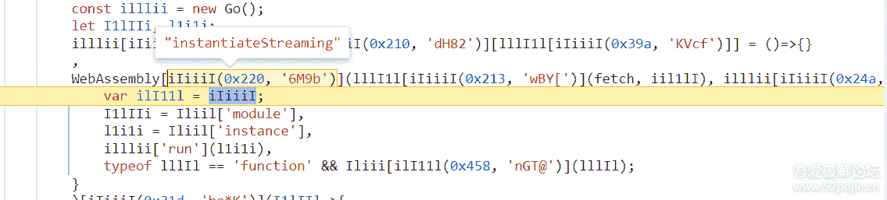
13.png (39.03 KB, 下载次数: 1)
[href="forum.php?mod=attachment&aid=MjY4MjA2MnxlMWFkMDI4Y3wxNzkzNTcyNTcyfDE2ODA4NnwxOTAwODQ1&nothumb=yes" target="_blank"](https://www.52pojie.cn/forum.php?mod=attachment&aid=MjY4MjA2MnxlMWFkMDI4Y3wxNzkzNTcyNTcyfDE2ODA4NnwxOTAwODQ1&nothumb=yes)
2024-3-14 22:09 上传

这里采用的是`instantiateStreaming`异步方式初始化。

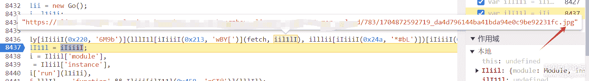
14.png (51.95 KB, 下载次数: 0)
[href="forum.php?mod=attachment&aid=MjY4MjA2M3w1Y2VhMDM4NXwxNzkzNTcyNTcyfDE2ODA4NnwxOTAwODQ1&nothumb=yes" target="_blank"](https://www.52pojie.cn/forum.php?mod=attachment&aid=MjY4MjA2M3w1Y2VhMDM4NXwxNzkzNTcyNTcyfDE2ODA4NnwxOTAwODQ1&nothumb=yes)
2024-3-14 22:09 上传

居然还把它以`.jpg`后缀伪装成图片，其实你直接访问链接下载的，真实后缀就是`.wasm`。

所以到这里传入的关键点一：`bytes`我们就拿到了。

接下来就是第二个参数`importObject`

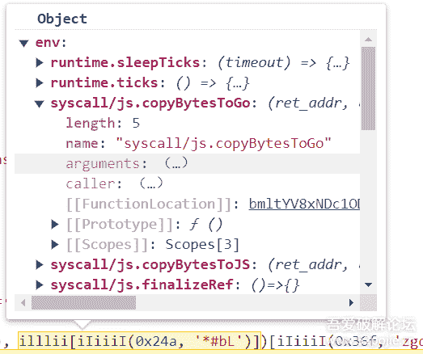
15.png (55.95 KB, 下载次数: 0)
[href="forum.php?mod=attachment&aid=MjY4MjA2NHxkZDg4ZmIwYXwxNzkzNTcyNTcyfDE2ODA4NnwxOTAwODQ1&nothumb=yes" target="_blank"](https://www.52pojie.cn/forum.php?mod=attachment&aid=MjY4MjA2NHxkZDg4ZmIwYXwxNzkzNTcyNTcyfDE2ODA4NnwxOTAwODQ1&nothumb=yes)
2024-3-14 22:09 上传

展开随便进一个函数，发现里面是go编译的，没做什么处理，可以发现其实用这个算法的人也不太熟悉，不敢随便改动，直接拿生成的就来用了。

直接复制下来，然后我们找到要的`importObject`是`new .Go`下面的

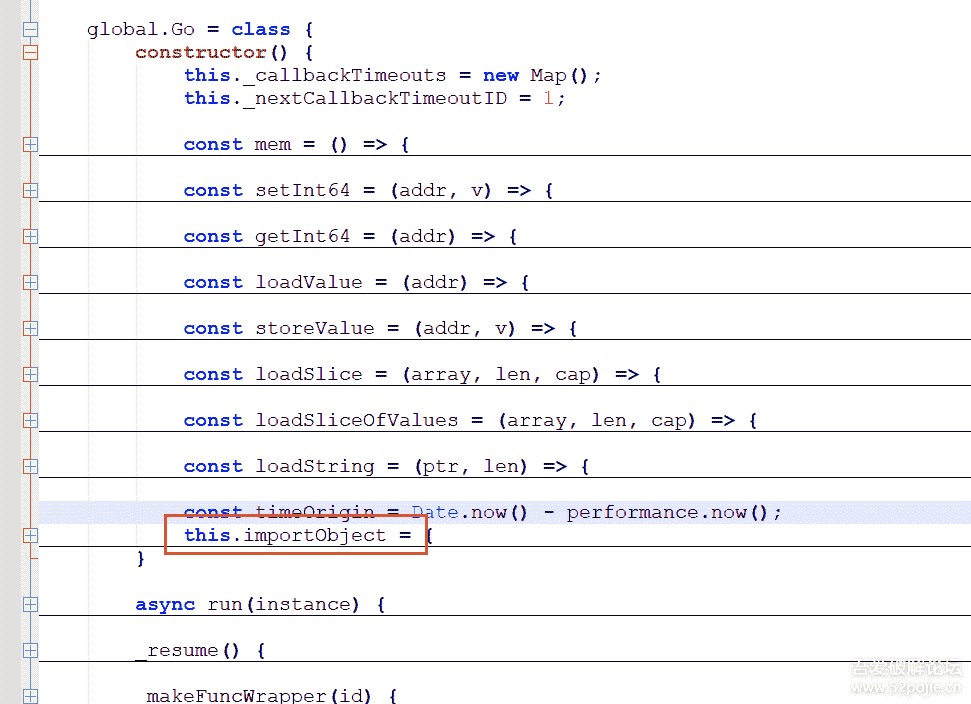
16.png (57.28 KB, 下载次数: 2)
[href="forum.php?mod=attachment&aid=MjY4MjA2NXw2ZDU3NjE3OXwxNzkzNTcyNTcyfDE2ODA4NnwxOTAwODQ1&nothumb=yes" target="_blank"](https://www.52pojie.cn/forum.php?mod=attachment&aid=MjY4MjA2NXw2ZDU3NjE3OXwxNzkzNTcyNTcyfDE2ODA4NnwxOTAwODQ1&nothumb=yes)
2024-3-14 22:09 上传

直接运行不行啊，因为最底下是命令行调用形式，所以把底下这一块删掉，就可以直接运行这个自执行了。

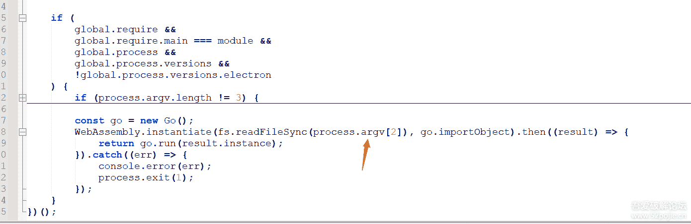
17.png (46.14 KB, 下载次数: 0)
[href="forum.php?mod=attachment&aid=MjY4MjA2NnxlMjU3YTBmNXwxNzkzNTcyNTcyfDE2ODA4NnwxOTAwODQ1&nothumb=yes" target="_blank"](https://www.52pojie.cn/forum.php?mod=attachment&aid=MjY4MjA2NnxlMjU3YTBmNXwxNzkzNTcyNTcyfDE2ODA4NnwxOTAwODQ1&nothumb=yes)
2024-3-14 22:09 上传

然后`new`就有这个对象啦！！！

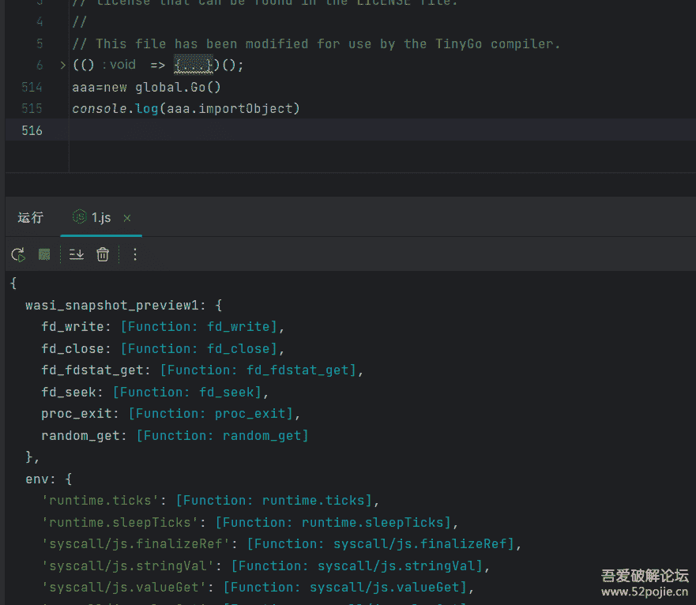
18.png (95.59 KB, 下载次数: 2)
[href="forum.php?mod=attachment&aid=MjY4MjA2N3xhMjMxNjY3ZnwxNzkzNTcyNTcyfDE2ODA4NnwxOTAwODQ1&nothumb=yes" target="_blank"](https://www.52pojie.cn/forum.php?mod=attachment&aid=MjY4MjA2N3xhMjMxNjY3ZnwxNzkzNTcyNTcyfDE2ODA4NnwxOTAwODQ1&nothumb=yes)
2024-3-14 22:09 上传

接下来就是初始化了，文件我们已经下载下来了。我这里采用同步的形式，返回就是`instance`了，同步后期好调用一点。

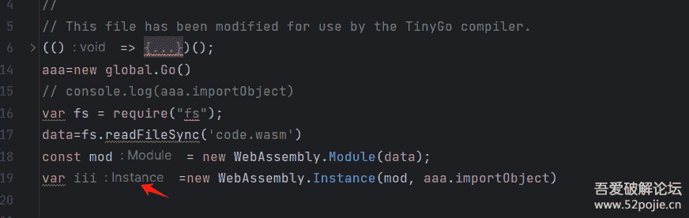
19.png (53.12 KB, 下载次数: 1)
[href="forum.php?mod=attachment&aid=MjY4MjA2OHw3NzQxOGRiNnwxNzkzNTcyNTcyfDE2ODA4NnwxOTAwODQ1&nothumb=yes" target="_blank"](https://www.52pojie.cn/forum.php?mod=attachment&aid=MjY4MjA2OHw3NzQxOGRiNnwxNzkzNTcyNTcyfDE2ODA4NnwxOTAwODQ1&nothumb=yes)
2024-3-14 22:09 上传

然后网页调用了`run()`方法就在全局加载了`encrypt()`，`decrypt()`函数。

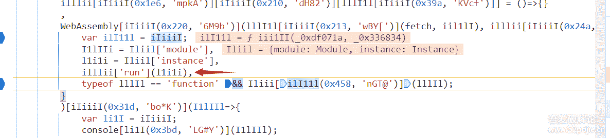
20.png (46.52 KB, 下载次数: 0)
[href="forum.php?mod=attachment&aid=MjY4MjA2OXxmZjg5OTYzY3wxNzkzNTcyNTcyfDE2ODA4NnwxOTAwODQ1&nothumb=yes" target="_blank"](https://www.52pojie.cn/forum.php?mod=attachment&aid=MjY4MjA2OXxmZjg5OTYzY3wxNzkzNTcyNTcyfDE2ODA4NnwxOTAwODQ1&nothumb=yes)
2024-3-14 22:09 上传

我们也来模拟一下吧

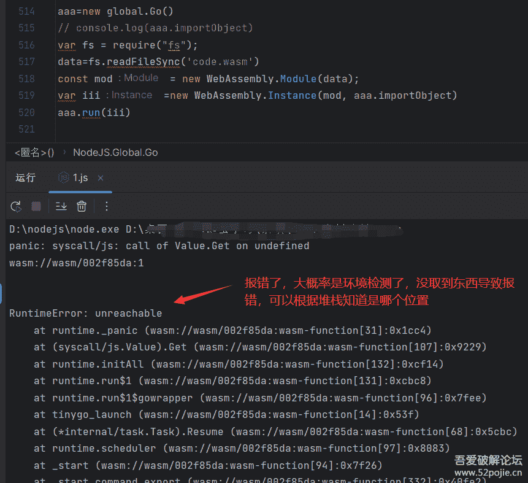
21.png (148.01 KB, 下载次数: 2)
[href="forum.php?mod=attachment&aid=MjY4MjA3MHxiMGQ2YTkyYnwxNzkzNTcyNTcyfDE2ODA4NnwxOTAwODQ1&nothumb=yes" target="_blank"](https://www.52pojie.cn/forum.php?mod=attachment&aid=MjY4MjA3MHxiMGQ2YTkyYnwxNzkzNTcyNTcyfDE2ODA4NnwxOTAwODQ1&nothumb=yes)
2024-3-14 22:10 上传

那么，它环境是怎么检测的呢，通过什么呢？

5> 其实就是通过第二个参数`importObject`中的js方法拿浏览器环境中的值。

我们可以代{过}{滤}理全局`global`，看看它是不是取了什么东西，也就是对应网站的`window`。

以下是简单的挂代{过}{滤}理函数：

```
function myProxy(obj,name){

    return new Proxy(obj,{

    get(target, propKey, receiver)

    {

        let temp =Reflect.get(target,propKey,receiver);

        if  (typeof temp == 'object'){

            temp=myProxy(temp,name+'=>'+propKey.toString())

        }

        console.log(`${name}->get ${propKey.toString()}  return ->${temp}`)

        return temp;

    },

    set(target, propKey, value, receiver)

    {

        let temp = Reflect.set(target,propKey,value);

        console.log(`${name}->set ${propKey.toString()}  value ->${value}`)

        return temp;

    }

})

}
```

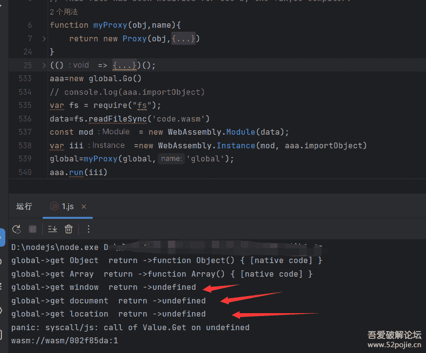
22.png (109.67 KB, 下载次数: 1)
[href="forum.php?mod=attachment&aid=MjY4MjA3MXwwN2JmMmEwZXwxNzkzNTcyNTcyfDE2ODA4NnwxOTAwODQ1&nothumb=yes" target="_blank"](https://www.52pojie.cn/forum.php?mod=attachment&aid=MjY4MjA3MXwwN2JmMmEwZXwxNzkzNTcyNTcyfDE2ODA4NnwxOTAwODQ1&nothumb=yes)
2024-3-14 22:10 上传

可以发现它全局取不到`location`就导致了报错，所以我们补一个`location`

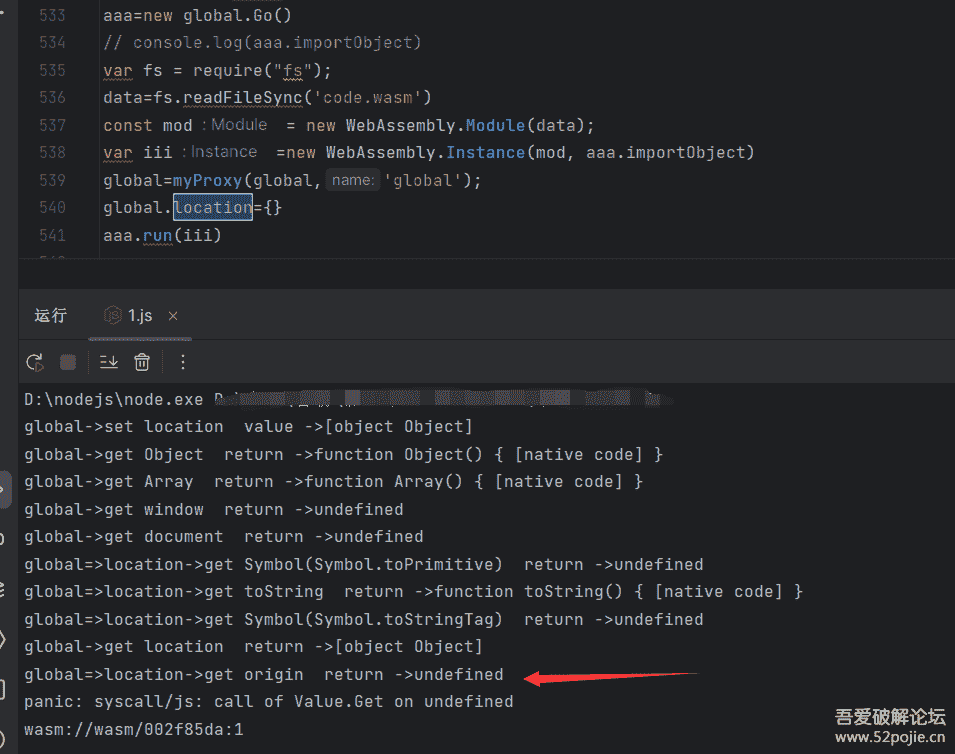
23.png (122.18 KB, 下载次数: 2)
[href="forum.php?mod=attachment&aid=MjY4MjA3MnwwODA0Yzg1MHwxNzkzNTcyNTcyfDE2ODA4NnwxOTAwODQ1&nothumb=yes" target="_blank"](https://www.52pojie.cn/forum.php?mod=attachment&aid=MjY4MjA3MnwwODA0Yzg1MHwxNzkzNTcyNTcyfDE2ODA4NnwxOTAwODQ1&nothumb=yes)
2024-3-14 22:11 上传

又缺了东西，按照报错来补。补`document`，`window`，然后又报了一个核心函数错。

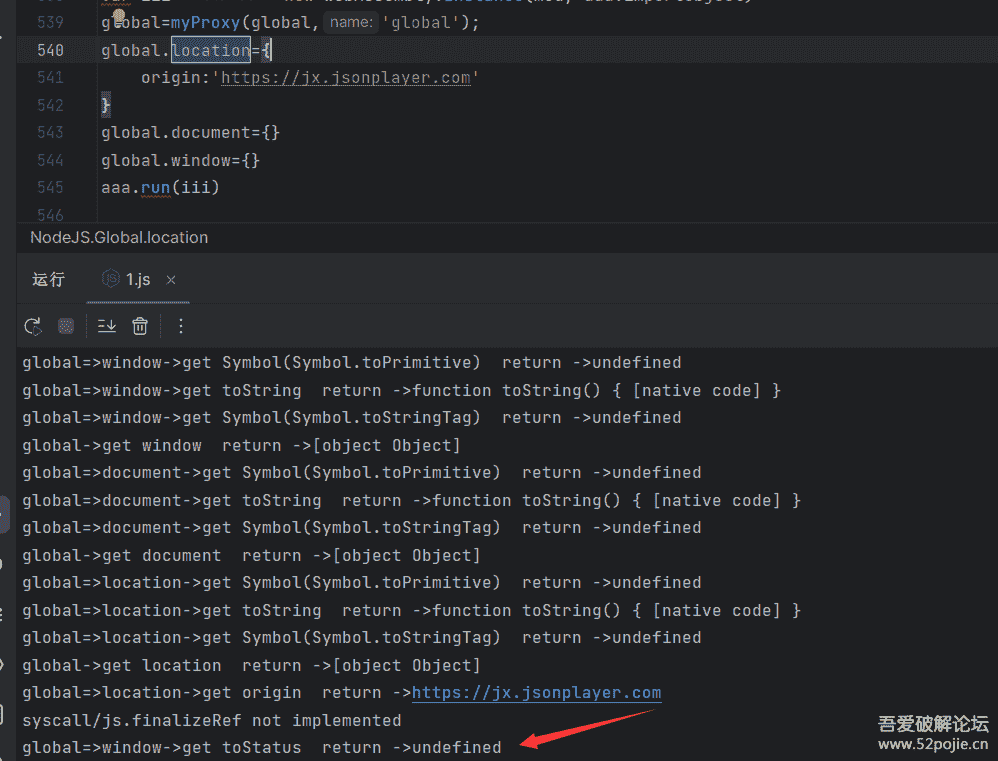
24.png (123.11 KB, 下载次数: 0)
[href="forum.php?mod=attachment&aid=MjY4MjA3M3w0ZTA2ZTQyNHwxNzkzNTcyNTcyfDE2ODA4NnwxOTAwODQ1&nothumb=yes" target="_blank"](https://www.52pojie.cn/forum.php?mod=attachment&aid=MjY4MjA3M3w0ZTA2ZTQyNHwxNzkzNTcyNTcyfDE2ODA4NnwxOTAwODQ1&nothumb=yes)
2024-3-14 22:11 上传

一搜索关键词（`toStatus()`）就能搜索到：

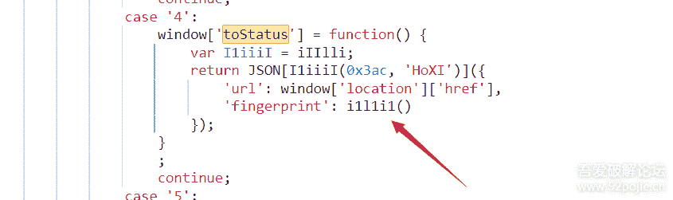
25.png (24.69 KB, 下载次数: 1)
[href="forum.php?mod=attachment&aid=MjY4MjA3NHw2YzUyMDk4ZHwxNzkzNTcyNTcyfDE2ODA4NnwxOTAwODQ1&nothumb=yes" target="_blank"](https://www.52pojie.cn/forum.php?mod=attachment&aid=MjY4MjA3NHw2YzUyMDk4ZHwxNzkzNTcyNTcyfDE2ODA4NnwxOTAwODQ1&nothumb=yes)
2024-3-14 22:11 上传

原来返回了一个url，一个指纹，经过测试，只要`fingerprint`任意值都可以。

所以我们就直接

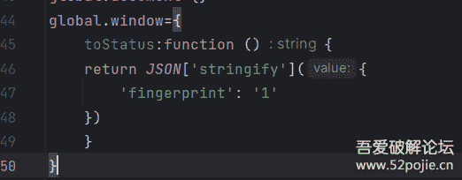
26.png (26.83 KB, 下载次数: 0)
[href="forum.php?mod=attachment&aid=MjY4MjA3NXxjYWRmYTBlMHwxNzkzNTcyNTcyfDE2ODA4NnwxOTAwODQ1&nothumb=yes" target="_blank"](https://www.52pojie.cn/forum.php?mod=attachment&aid=MjY4MjA3NXxjYWRmYTBlMHwxNzkzNTcyNTcyfDE2ODA4NnwxOTAwODQ1&nothumb=yes)
2024-3-14 22:11 上传

成功补好，运行就有加密函数了

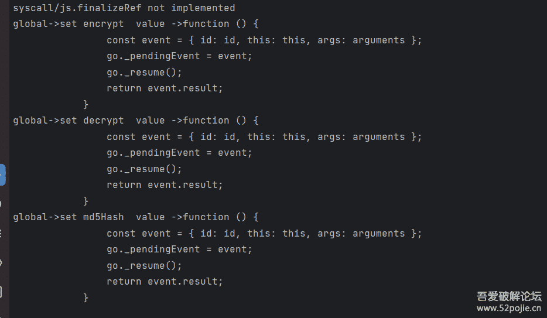
27.png (62.91 KB, 下载次数: 2)
[href="forum.php?mod=attachment&aid=MjY4MjA3NnxiNDUzZDM1NnwxNzkzNTcyNTcyfDE2ODA4NnwxOTAwODQ1&nothumb=yes" target="_blank"](https://www.52pojie.cn/forum.php?mod=attachment&aid=MjY4MjA3NnxiNDUzZDM1NnwxNzkzNTcyNTcyfDE2ODA4NnwxOTAwODQ1&nothumb=yes)
2024-3-14 22:11 上传

运行加密函数，成功出值，多试几次，可以发现只有后面一部分会变，我们用第二种方法解就会知道是什么原因了。至此，第一种文件调用基的方案就是这样了，基本上文件调用的都可以这样通杀吧。

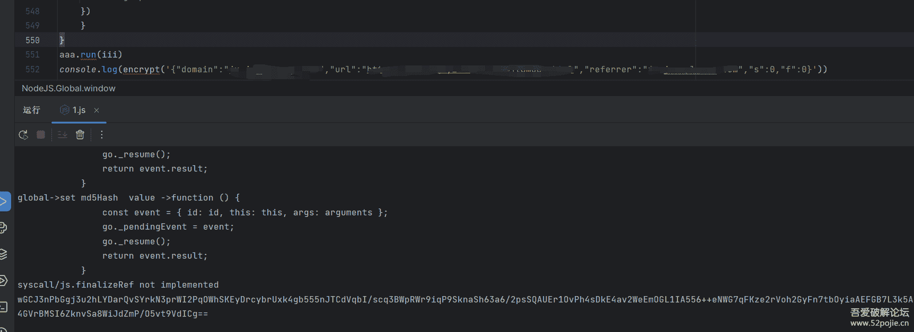
28.png (87.48 KB, 下载次数: 0)


[附件](https://www.52pojie.cn/forum.php?mod=attachment&aid=MjY4MjA3N3w0YWJhYjA3MXwxNzkzNTcyNTcyfDE2ODA4NnwxOTAwODQ1&nothumb=yes)

## ② 分析 wasm 文件拿算法（这个较难）

### 1. 针对 wasm 函数名字隐藏的

用工具反编译成 `.c` 文件，然后再用 IDA 静态分析结合网站动态分析。（这种方式需要对汇编、算法等很熟悉，有点像解 App 的 `so` 层算法。）

### 2. 针对 wasm 函数名字暴露的

根据暴露的函数名在 wasm 文件关键位置下断点，找到加密参数、关键 `key` 和 `iv`（需要一些算法经验）。

我们来看看这个网站是什么情况？

### 进入 wasm 内部

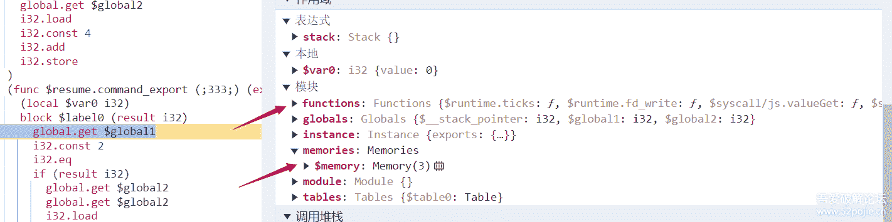

`29.png` (77.29 KB, 下载次数: 2)

我们主要关注两个地方：`functions` 和 `memory`，`tables` 也可以看看，`tables` 里面是 wasm 和 js 都可以访问和更改的对象。

展开 `functions`：

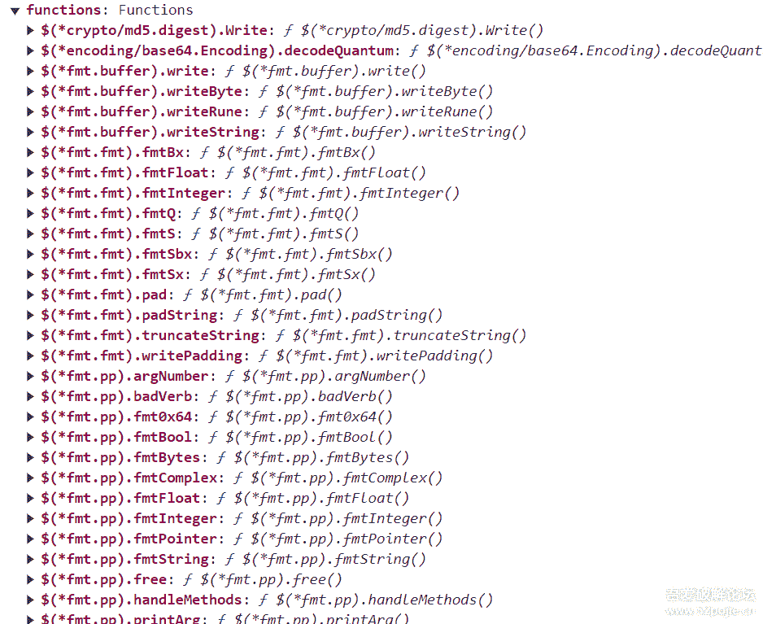

`30.png` (187.56 KB, 下载次数: 0)

可以发现并没有函数名混淆，应该是调了 Go 某个库里面的东西，有很多函数。

```
crypto/md5.digest
crypto/aes.NewCipher
crypto/cipher.newCBC
....
```

有很多其他 crypto 库，其实根据上面加密后的结果，可以大胆猜测是 AES 加密。

在这里，我找了一下 Go 的 AES 加密有关的文章：

[文章](https://www.jianshu.com/p/47e8c137ecd4)

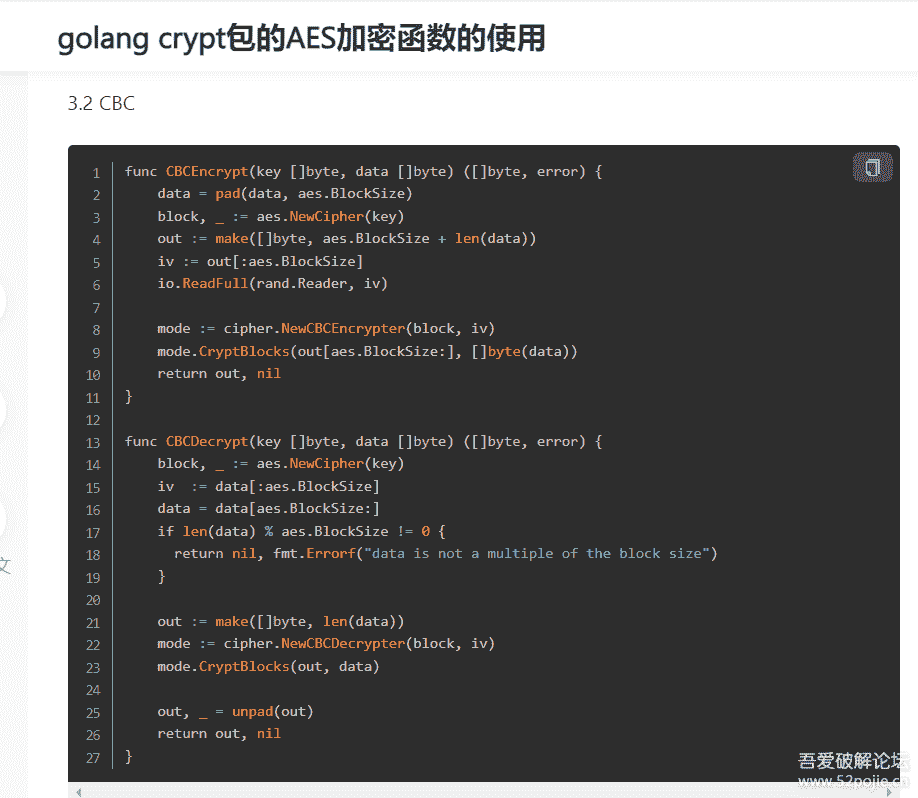

`31.png` (83.31 KB, 下载次数: 1)

其实就可以找到关键的地方了。

`$crypto/aes.NewCipher` 下加载了 `key`

`$crypto/cipher.newCBC` 下加载了 `iv`

`$interface:{BlockSize:func:{}{basic:int},CryptBlocks` 里面加载了加密参数

我们可以在这些关键函数位置下断点，然后看内存中的数据是什么：

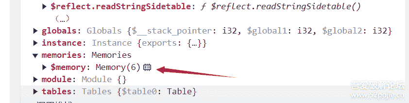

`32.png` (35.84 KB, 下载次数: 1)

点击后输入地址就能看对应内存的内容了。

第一个位置 `$crypto/aes.NewCipher`：

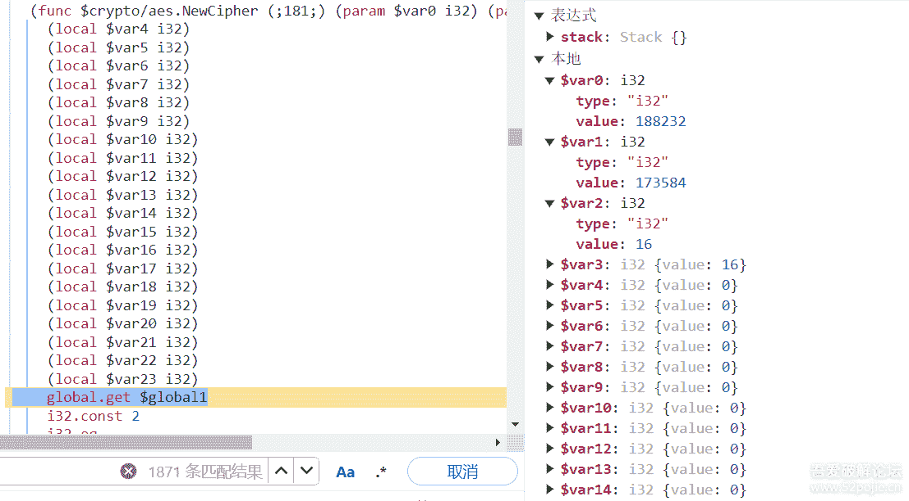

`33.png` (118.79 KB, 下载次数: 0)

每一个入参你都搜索一下，就能看到加密 `key` 了。

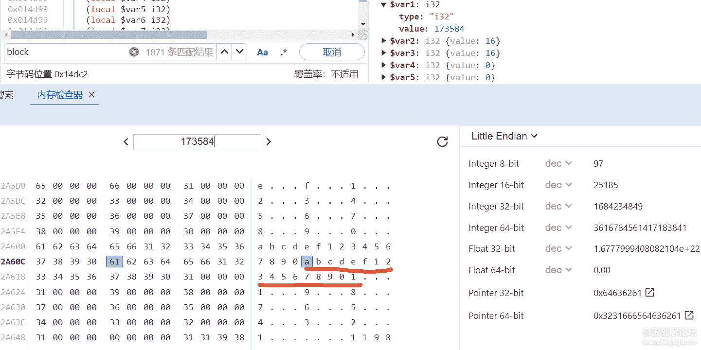

`34.png` (122.03 KB, 下载次数: 2)

16 位就是 `key` 了。

第二个位置一样的操作：

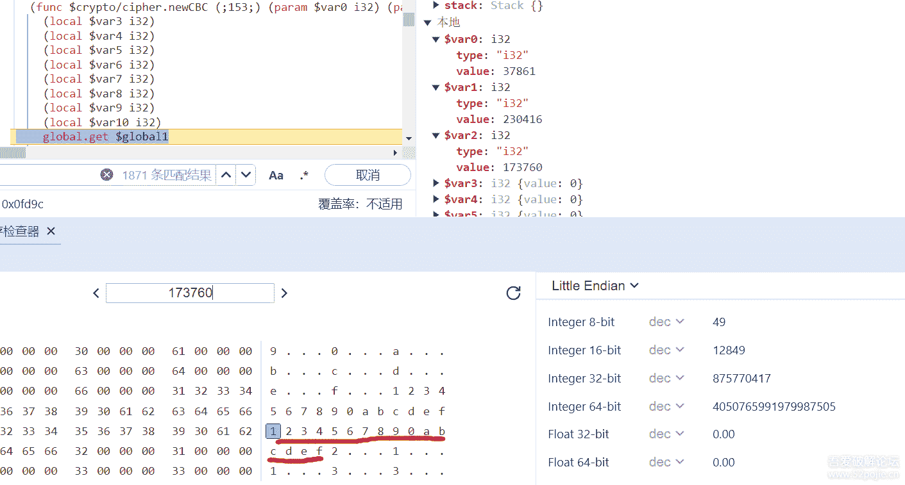

`35.png` (116.88 KB, 下载次数: 1)

第三个位置：

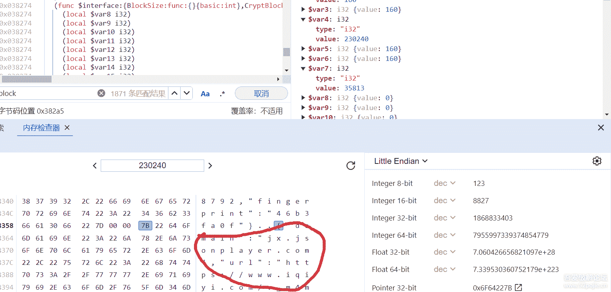

`36.png` (156.44 KB, 下载次数: 3)

明文清清楚楚的。我们当然可以把明文显示到控制台：

```
viewChar = (addr, size = 16) => {
    const arr = new Uint8Array(memories[0].buffer.slice(addr, addr + size));
    return String.fromCharCode.apply(null, arr);
};
```

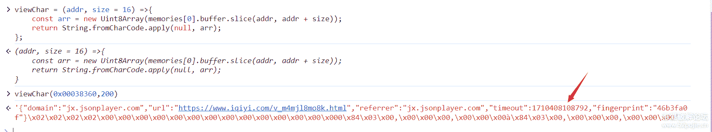

`37.png` (52.17 KB, 下载次数: 1)

可以看到一直变动的就是时间戳。

解密也是同理，至此，这个网站的逆向基本上结束了。

## 四、总结

对 wasm 文件类型的网站逆向，基本上掌握第一种方式就可以完全解决，因为 wasm 只能通过 js `importobject` 获取浏览器的值，无法在里面做环境检测；wasm 环境检测也只能是值的校验。所以通过代{过}{滤}理等方式，在 js 层把传进去的东西都捕获到，只要补齐对应值就能完成逆向调用。

重点还是找初始化的 `bytes` 和 `importobject`，如果有不对的地方，请大佬们多多指正~~

## 五、相关练习案例网站

视频网站1：`aHR0cHM6Ly9qeC55YW5ndHUudG9wLz91cmw9aHR0cHM6Ly93d3cuaXFpeWkuY29tL3ZfMXZuN3ZpMm9vZGMuaHRtbA==`

视频网站2：`aHR0cHM6Ly9nYXplLnJ1bi9wbGF5Lzc0NmIxZTBiM2E5MjcyNTU1ZDkzYTZiOWQ4NTIzNzBh`

视频网站3：`aHR0cHM6Ly93d3cuZ2R0di5jbi90dlByb2dyYW1z`

某数藏登录：（请求头 `Secc-Fetch-Hash-Key`）

`aHR0cHM6Ly9kYy5tYXl0ZWsuY24vIy9Mb2dpbkJveA==`
