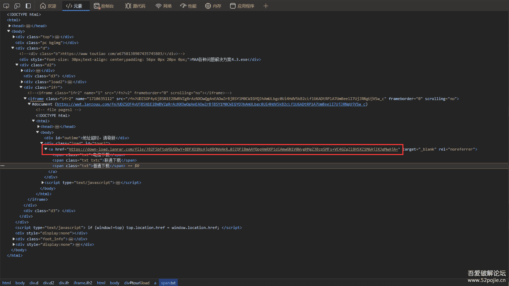
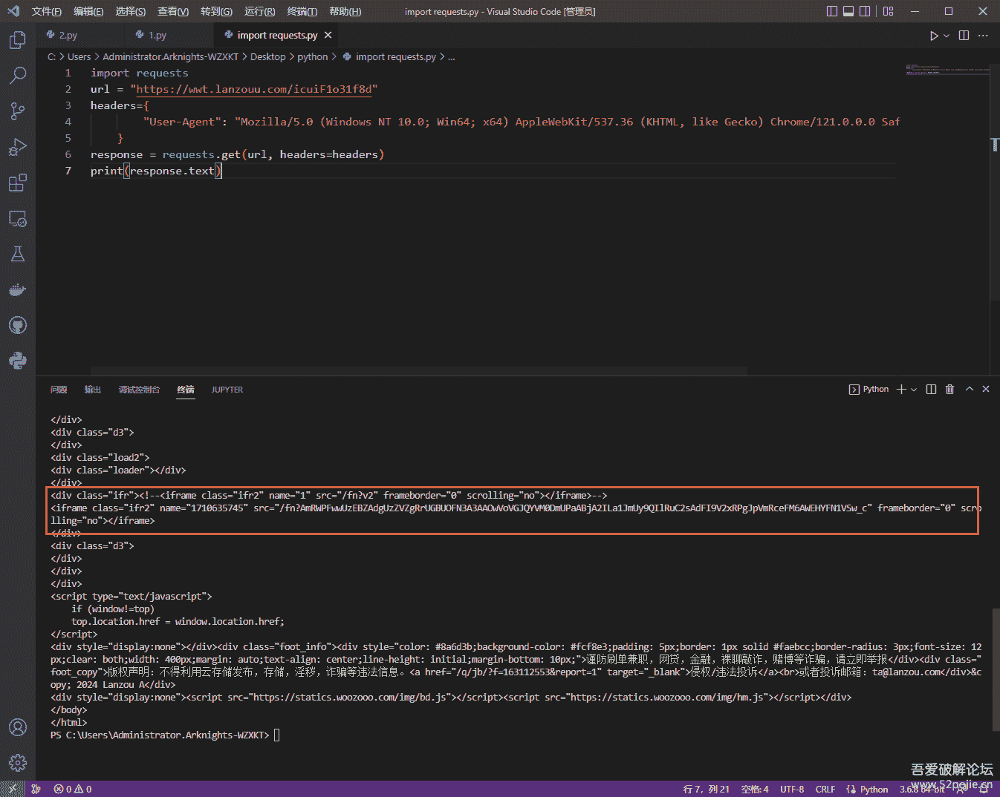
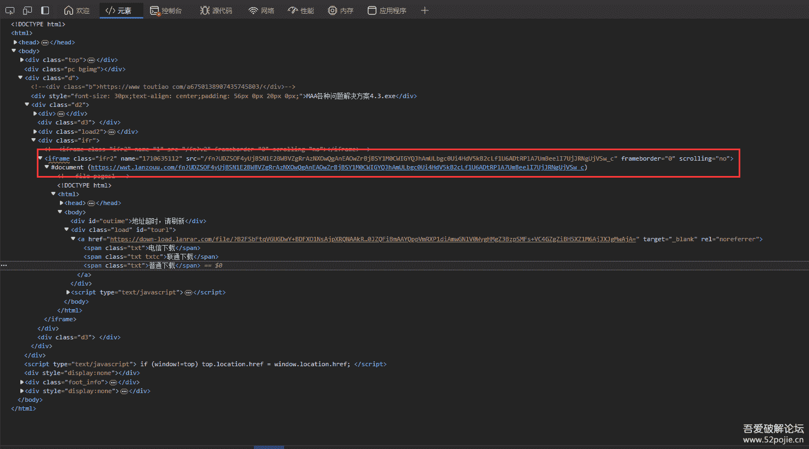
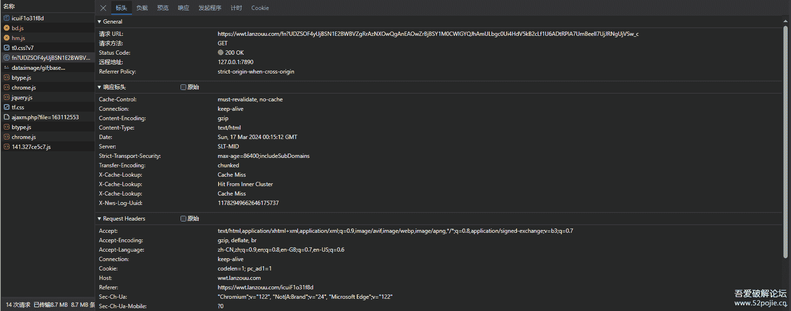
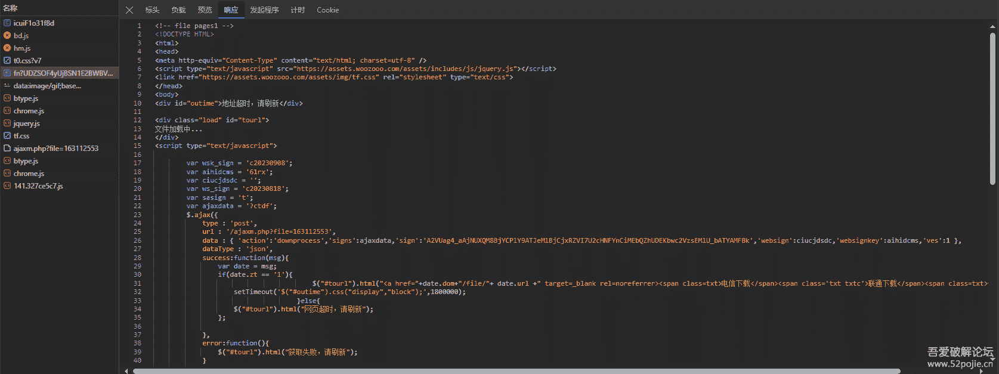
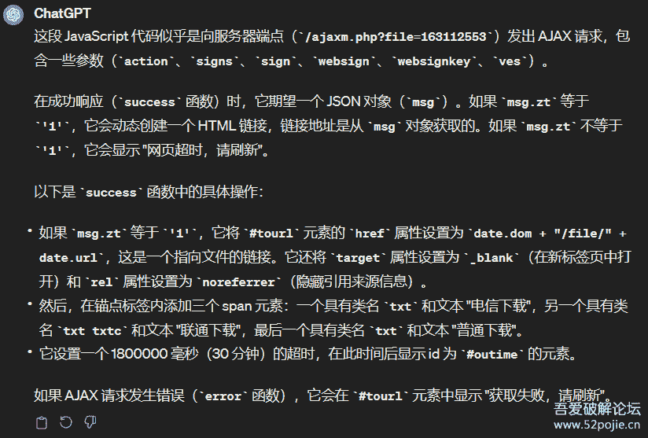
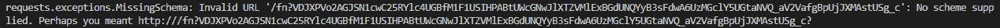
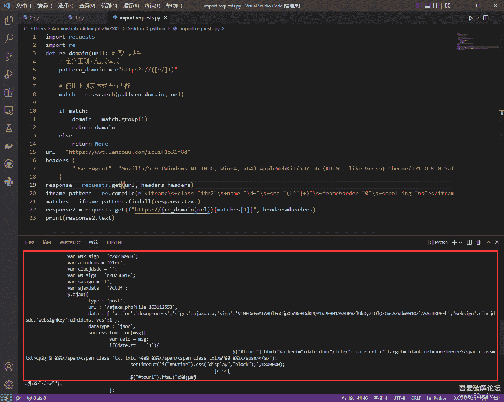
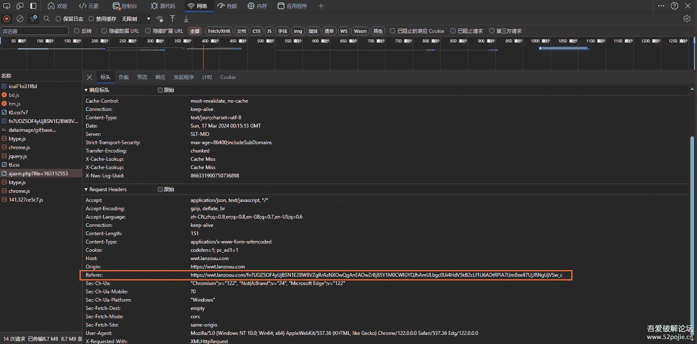
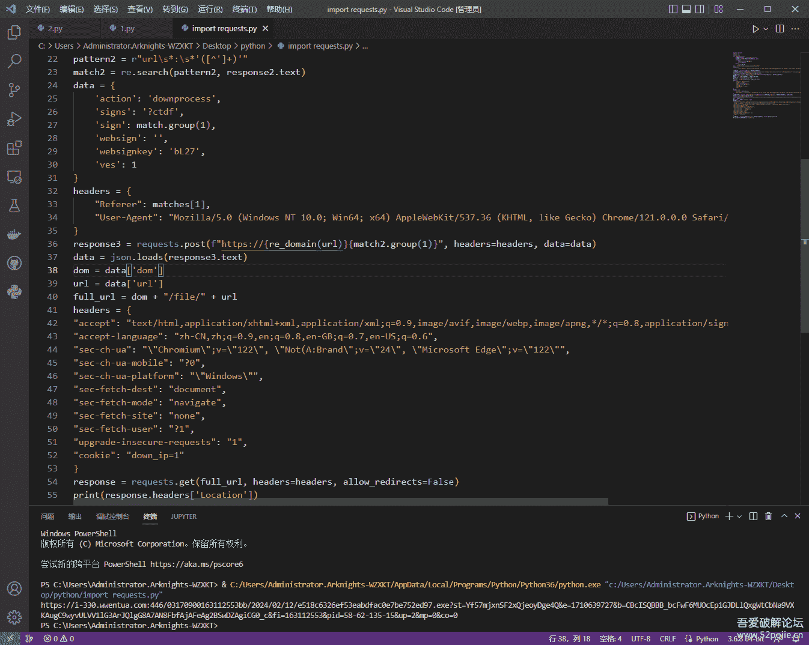

# [Web逆向] 取蓝奏云直链教程（附python源码）

- 原帖: https://www.52pojie.cn/forum.php?mod=viewthread&tid=1901884
- 抓取时间: 2026-11-01T22:36:10

## 准备工作

- 浏览器
- python环境

### 所需的库

- `request` 用于发送请求
- `json` 用于解析 `json` 格式的 `response`
- `re` 用于正则提取 `response` 中的参数

## 开始分析

访问我们的网盘分享链接，浏览器打开 `F12` 元素，直接看下载按钮的属性，



{1CB005F8-29BF-48a1-AEF6-3A2EABC1A8E1}.png (112.83 KB, 下载次数: 6)

[href="forum.php?mod=attachment&aid=MjY4MjgzNnwzZjMxMzkyYXwxNzkzNTcyNTY4fDE2ODA4NnwxOTAxODg0&nothumb=yes" target="_blank"](https://www.52pojie.cn/forum.php?mod=attachment&aid=MjY4MjgzNnwzZjMxMzkyYXwxNzkzNTcyNTY4fDE2ODA4NnwxOTAxODg0&nothumb=yes)

2024-3-17 08:18 上传

会发现直接包含了下载直链，我们尝试直接 `request`，看看能不能直接获取这个直链

```python
import requests
url = "https://wwt.lanzouu.com/icuiF1o31f8d"
headers={
        "User-Agent": "Mozilla/5.0 (Windows NT 10.0; Win64; x64) AppleWebKit/537.36 (KHTML, like Gecko) Chrome/121.0.0.0 Safari/537.36 Edg/121.0.0.0"
    }
response = requests.get(url, headers=headers)
print(response.text)
```

运行后会发现没有我们刚刚找到的直链，但是发现了另外一个链接跟网页中格式是相同的



{51DFF670-2C12-4c6d-9AFD-AB08F573E1BB}.png (121.47 KB, 下载次数: 3)

[href="forum.php?mod=attachment&aid=MjY4MjgzN3xlMmFmYjFhNXwxNzkzNTcyNTY4fDE2ODA4NnwxOTAxODg0&nothumb=yes" target="_blank"](https://www.52pojie.cn/forum.php?mod=attachment&aid=MjY4MjgzN3xlMmFmYjFhNXwxNzkzNTcyNTY4fDE2ODA4NnwxOTAxODg0&nothumb=yes)

2024-3-17 08:27 上传



{65E23D3F-8B0C-460f-B0CD-79FEB4CDEFF8}.png (107.85 KB, 下载次数: 5)

[href="forum.php?mod=attachment&aid=MjY4MjgzOHxmM2JhOTg2OXwxNzkzNTcyNTY4fDE2ODA4NnwxOTAxODg0&nothumb=yes" target="_blank"](https://www.52pojie.cn/forum.php?mod=attachment&aid=MjY4MjgzOHxmM2JhOTg2OXwxNzkzNTcyNTY4fDE2ODA4NnwxOTAxODg0&nothumb=yes)

2024-3-17 08:27 上传

所以我们就要先从这个链接入手，看看他返回什么，

我们打开浏览器的网络调试，发现他确实访问了这个网页



{63364134-E26C-424f-AC97-43F931F0A200}.png (92.42 KB, 下载次数: 3)

[href="forum.php?mod=attachment&aid=MjY4MjgzOXwyMWUwYWE0NnwxNzkzNTcyNTY4fDE2ODA4NnwxOTAxODg0&nothumb=yes" target="_blank"](https://www.52pojie.cn/forum.php?mod=attachment&aid=MjY4MjgzOXwyMWUwYWE0NnwxNzkzNTcyNTY4fDE2ODA4NnwxOTAxODg0&nothumb=yes)

2024-3-17 08:29 上传

点开 `response` 查看响应，发现了下载地址来源于一个 ajax 脚本



{1414B676-27CF-467e-B87A-3E93B67A89BE}.png (104.82 KB, 下载次数: 3)

[href="forum.php?mod=attachment&aid=MjY4Mjg0MXxiYWVjOTFkZnwxNzkzNTcyNTY4fDE2ODA4NnwxOTAxODg0&nothumb=yes" target="_blank"](https://www.52pojie.cn/forum.php?mod=attachment&aid=MjY4Mjg0MXxiYWVjOTFkZnwxNzkzNTcyNTY4fDE2ODA4NnwxOTAxODg0&nothumb=yes)

2024-3-17 08:31 上传

我们把这个 ajax 扔到 chatgpt



{808E5214-4779-493d-9365-4AB4A4D1A632}.png (77.64 KB, 下载次数: 4)

[href="forum.php?mod=attachment&aid=MjY4Mjg0Mnw0ZjI3MmE3N3wxNzkzNTcyNTY4fDE2ODA4NnwxOTAxODg0&nothumb=yes" target="_blank"](https://www.52pojie.cn/forum.php?mod=attachment&aid=MjY4Mjg0Mnw0ZjI3MmE3N3wxNzkzNTcyNTY4fDE2ODA4NnwxOTAxODg0&nothumb=yes)

2024-3-17 08:33 上传

发现其实是一个 `post` 请求，将 `data` 中包含的几个值 `post` 到指定网页，我们在网络调试中也可以看到

---

说了这么多程序还不能匹配这个网页，我们先给程序加上正则

```python
import re

iframe_pattern = re.compile(r'')

matches = iframe_pattern.findall(response.text)
```

这样 `matches[1]` 就是我们要的网页了。

再次 `request` 这个网页。

```python
response2 = requests.get(matches[1], headers=headers)
print(response2.text)
```

运行发现……竟然报错了！



{25F3529E-3119-4027-BAC4-BF3E30549174}.png (10.22 KB, 下载次数: 3)

[href="forum.php?mod=attachment&aid=MjY4Mjg1MHw0NWY5NjVjMnwxNzkzNTcyNTY4fDE2ODA4NnwxOTAxODg0&nothumb=yes" target="_blank"](https://www.52pojie.cn/forum.php?mod=attachment&aid=MjY4Mjg1MHw0NWY5NjVjMnwxNzkzNTcyNTY4fDE2ODA4NnwxOTAxODg0&nothumb=yes)

2024-3-17 08:40 上传

原来是忘记把域名加上了，这里我们可以直接添加

```python
response2 = requests.get(f"https://wwt.lanzouu.com{matches[1]}, headers=headers)
```

也可以写一个函数正则匹配我们的 `url` 的域名

```python
def re_domain(url): 
    pattern_domain = r"https?://([^/]+)"
    match = re.search(pattern_domain, url)
    if match:
        domain = match.group(1)
        return domain
    else:
        return None
```

发现确实能取回这个 ajax 脚本，那不就好办了



{B86B16E1-AFC3-480e-A576-119B64C2D6CA}.png (144.05 KB, 下载次数: 2)

[href="forum.php?mod=attachment&aid=MjY4Mjg1MXw3OWRlMmJhNnwxNzkzNTcyNTY4fDE2ODA4NnwxOTAxODg0&nothumb=yes" target="_blank"](https://www.52pojie.cn/forum.php?mod=attachment&aid=MjY4Mjg1MXw3OWRlMmJhNnwxNzkzNTcyNTY4fDE2ODA4NnwxOTAxODg0&nothumb=yes)

2024-3-17 08:45 上传

多试几次发现只有 `sign` 是变化的，剩下的几个 `data` 都是固定的

所以正则匹配我们需要的 `sign` 和下一步 `post` 的 `url`

```python
pattern = r"'sign'\s*:\s*'([^']+)'"

match = re.search(pattern, response2.text)

pattern2 = r"url\s*:\s*'([^']+)'"

match2 = re.search(pattern2, response2.text)

print(match[0], match2[0])
```

```text
'sign':'VTMHOVloBjcEDVRrCzsAPFQ_aBTZSPgMwBzFXYwVsW29SYVUkAClSOwViVjdUMQEwVzsFMwRtADQCMVBk' url : '/ajaxm.php?file=163112553'
```

取出了 `sign` 和 `url` 就好办了，直接写下一个 `post`

注意这里的 `sign` 和 `url` 都不是 `str` 类型，而是 `Match` 类型，我们要先用 `group(1)` 方法取回 `str`

（有的人会说为啥不直接 `post` 这个固定网页还要进行前面的操作？

因为 `sign` 值是会变化的，只有通过第二次访问我们才能知道这个 `sign` 值是多少）

```python
data = {

    'action': 'downprocess',

    'signs': '?ctdf',

    'sign': match.group(1),

    'websign': '',

    'websignkey': 'bL27',

    'ves': 1

}

response3 = requests.post(f"https://{re_domain(url)}{match2.group(1)}", headers=headers, data=data)

print(response3.text)
```

```json
{"zt":1,"dom":"https:\/\/down-load.lanrar.com","url":"?VDJVaw08BzYBCFdvAjdTP1JtADhfTVESCkxXtFGdUtcB5gb2CNgFuAPCBf0AvVX2V5VXugX9CqsG5FHRXbJXsFTCVbsNtgfyAd9XNQJ4U2FSJgBgX3hRNgorVzdRZFI\/AWQGDgg8BTUDaAViAGJVZ1c8V2MFaAo9BjRRZF0nVzBUJ1U\/DWEHawFmVzkCYFNgUjwAI19wUSMKMFdjUT1SYQE1Bn4IZQVjA3oFYgBmVXtXaFdnBWsKMAZiUWFdMldkVGJVZw02B2YBZFdkAjdTMFJsAGNfYVEwCj1XNFE6UjEBZAZmCGAFYwMwBTcAbVVjVyNXNwUiCm0GJ1EiXXJXM1QmVWsNNAduAWZXNwJvU2dSMAA9XzVRdQp5VzhRYFI2AWcGbAhkBWEDZQVjAGRVelcjV3QFPApkBnZRal0wV2FUZVUyDWUHagFiVzgCYFNrUi4AcF9wUSQKMFdgUTpSYwE2BmYIZgVjA2UFYgBmVXJXeFc7BSoKNQY0UW9dL1dgVGZVLA1hB2ABYlcvAmdTZw==","inf":0}
```

取回的 `text` 是 `json` 格式的，那么我们就要用 `json` 解析它

```python
import json

data = json.loads(response3.text)
```

通过上面的 ajax 脚本我们会发现他下载链接的拼接方式为 `dom + "/file/" + url`

```python
dom = data['dom']
url = data['url']
full_url = dom + "/file/" + url
print(full_url)
```

打印这个 `url` 后发现，不管是我们用 `python` `request` 还是浏览器访问这个网页，都显示错误 400

查看浏览器的网络调试，原来是访问的时候协议头有一个来源



{D0B9F372-1315-4e0f-85D8-841E78F96D9B}.png (126.72 KB, 下载次数: 3)

[href="forum.php?mod=attachment&aid=MjY4Mjg1MnxkOTNjOTljNXwxNzkzNTcyNTY4fDE2ODA4NnwxOTAxODg0&nothumb=yes" target="_blank"](https://www.52pojie.cn/forum.php?mod=attachment&aid=MjY4Mjg1MnxkOTNjOTljNXwxNzkzNTcyNTY4fDE2ODA4NnwxOTAxODg0&nothumb=yes)

2024-3-17 09:01 上传

这个挺关键的，我们把它加到 `post` 的协议头中

```python
headers2 = {

    "Referer": matches[1],

    "User-Agent": "Mozilla/5.0 (Windows NT 10.0; Win64; x64) AppleWebKit/537.36 (KHTML, like Gecko) Chrome/121.0.0.0 Safari/537.36 Edg/121.0.0.0"

}

response3 = requests.post(f"https://{re_domain(url)}{match2.group(1)}", headers=headers2, data=data)
```

重新运行得到新的直链，打开发现就能正常下载了

但是我们观察浏览器，发现其实这个直链还进行了一次重定向，那么我们也进行一次重定向再获取重定向后的网页


```python
headers = {
"accept": "text/html,application/xhtml+xml,application/xml;q=0.9,image/avif,image/webp,image/apng,*/*;q=0.8,application/signed-exchange;v=b3;q=0.7",
"accept-language": "zh-CN,zh;q=0.9,en;q=0.8,en-GB;q=0.7,en-US;q=0.6",
"sec-ch-ua": "\"Chromium\";v=\"122\", \"Not(A:Brand\";v=\"24\", \"Microsoft Edge\";v=\"122\"",
"sec-ch-ua-mobile": "?0",
"sec-ch-ua-platform": "\"Windows\"",
"sec-fetch-dest": "document",
"sec-fetch-mode": "navigate",
"sec-fetch-site": "none",
"sec-fetch-user": "?1",
"upgrade-insecure-requests": "1",
"cookie": "down_ip=1"
}
response = requests.get(full_url, headers=headers, allow_redirects=False)
print(response.headers['Location'])
```

运行后终于找到了最终的直链。



`{41986CD7-C865-48e8-83F7-FCE7641F62D5}.png` (173.14 KB, 下载次数: 4)

[附件下载](https://www.52pojie.cn/forum.php?mod=attachment&aid=MjY4Mjg1M3w1YWQxMDA3YXwxNzkzNTcyNTY4fDE2ODA4NnwxOTAxODg0&nothumb=yes)

2024-3-17 09:09 上传

## 完整程序

```python
import requests
import re
import json

def re_domain(url):
    pattern_domain = r"https?://([^/]+)"
    match = re.search(pattern_domain, url)
    if match:
        domain = match.group(1)
        return domain
    else:
        return None

url = "https://wwt.lanzouu.com/icuiF1o31f8d"
domain = re_domain(url)
headers = {
    "User-Agent": "Mozilla/5.0 (Windows NT 10.0; Win64; x64) AppleWebKit/537.36 (KHTML, like Gecko) Chrome/121.0.0.0 Safari/537.36 Edg/121.0.0.0"
}
response = requests.get(url, headers=headers)
iframe_pattern = re.compile(r'')
matches = iframe_pattern.findall(response.text)
response2 = requests.get(f"https://{domain}{matches[1]}", headers=headers)
pattern = r"'sign'\s*:\s*'([^']+)'"
sign = re.search(pattern, response2.text).group(1)
pattern2 = r"url\s*:\s*'([^']+)'"
url2 = re.search(pattern2, response2.text).group(1)
data = {
    'action': 'downprocess',
    'signs': '?ctdf',
    'sign': sign,
    'websign': '',
    'websignkey': 'bL27',
    'ves': 1
}
headers = {
    "Referer": matches[1],
    "User-Agent": "Mozilla/5.0 (Windows NT 10.0; Win64; x64) AppleWebKit/537.36 (KHTML, like Gecko) Chrome/121.0.0.0 Safari/537.36 Edg/121.0.0.0"
}
response3 = requests.post(f"https://{domain}{url2}", headers=headers, data=data)
data = json.loads(response3.text)
full_url = data['dom'] + "/file/" + data['url']
headers = {
    "accept": "text/html,application/xhtml+xml,application/xml;q=0.9,image/avif,image/webp,image/apng,*/*;q=0.8,application/signed-exchange;v=b3;q=0.7",
    "accept-language": "zh-CN,zh;q=0.9,en;q=0.8,en-GB;q=0.7,en-US;q=0.6",
    "sec-ch-ua": "\"Chromium\";v=\"122\", \"Not(A:Brand\";v=\"24\", \"Microsoft Edge\";v=\"122\"",
    "sec-ch-ua-mobile": "?0",
    "sec-ch-ua-platform": "\"Windows\"",
    "sec-fetch-dest": "document",
    "sec-fetch-mode": "navigate",
    "sec-fetch-site": "none",
    "sec-fetch-user": "?1",
    "upgrade-insecure-requests": "1",
    "cookie": "down_ip=1"
}
response4 = requests.get(full_url, headers=headers, allow_redirects=False)
print(response4.headers['Location'])
```

## 传送门

[https://www.52pojie.cn/thread-1904710-1-1.html](https://www.52pojie.cn/thread-1904710-1-1.html)
