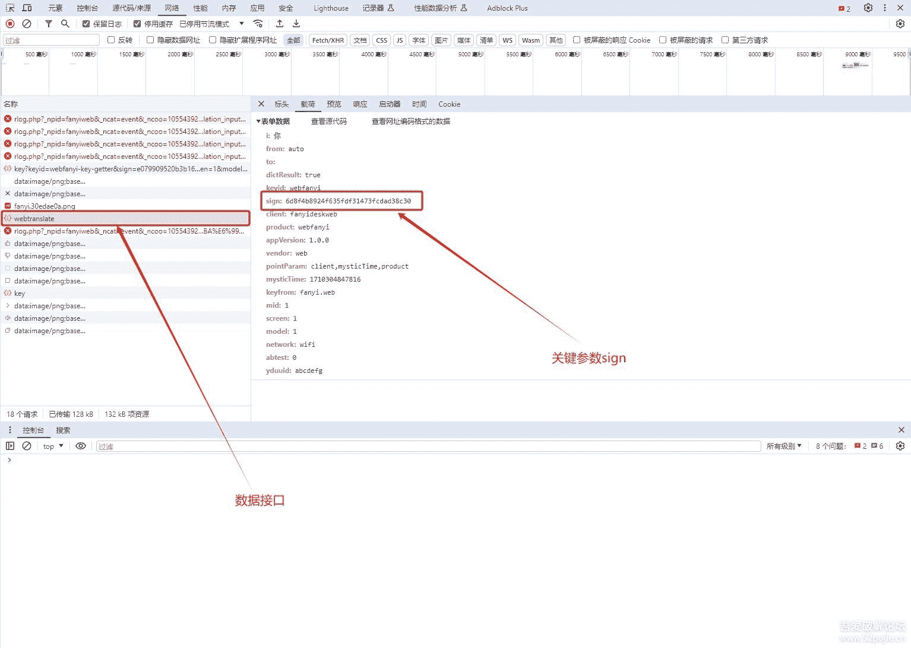
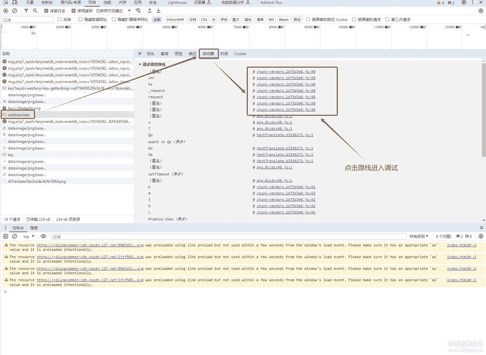
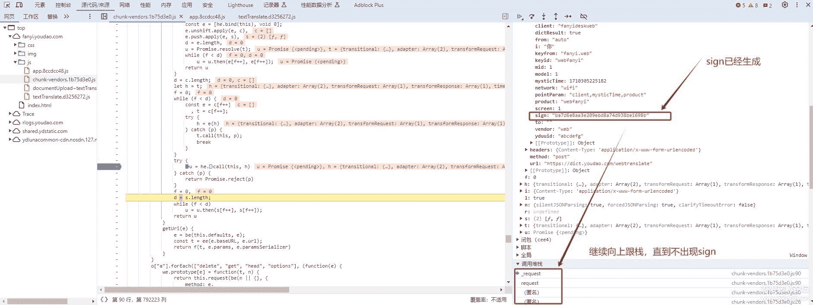
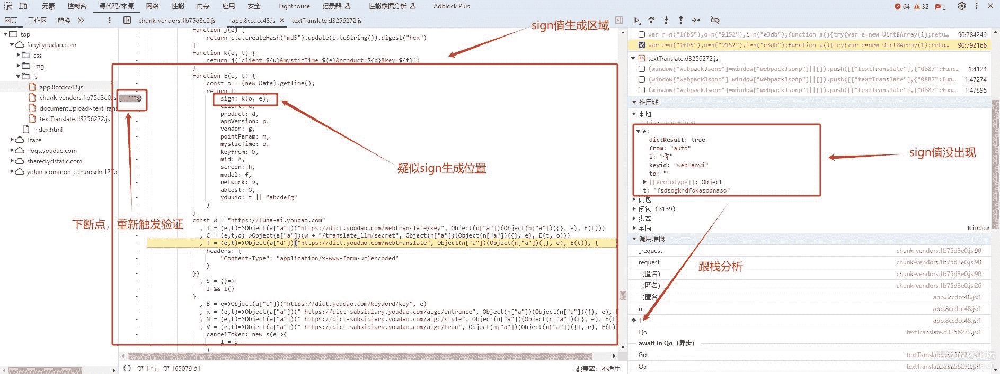
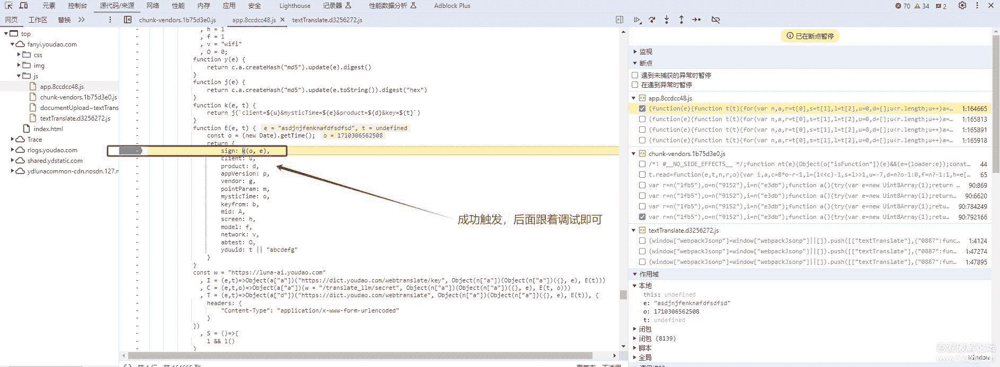
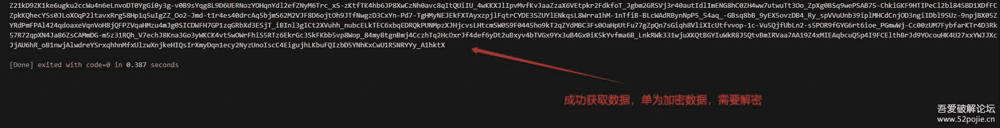
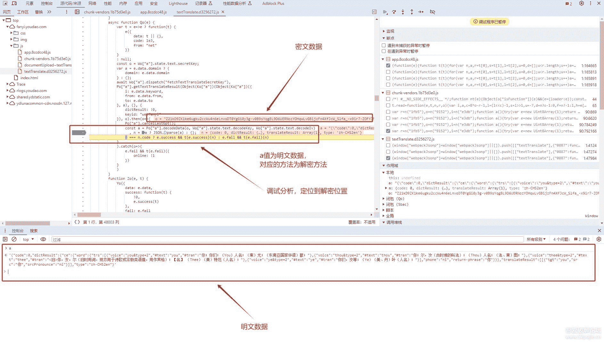
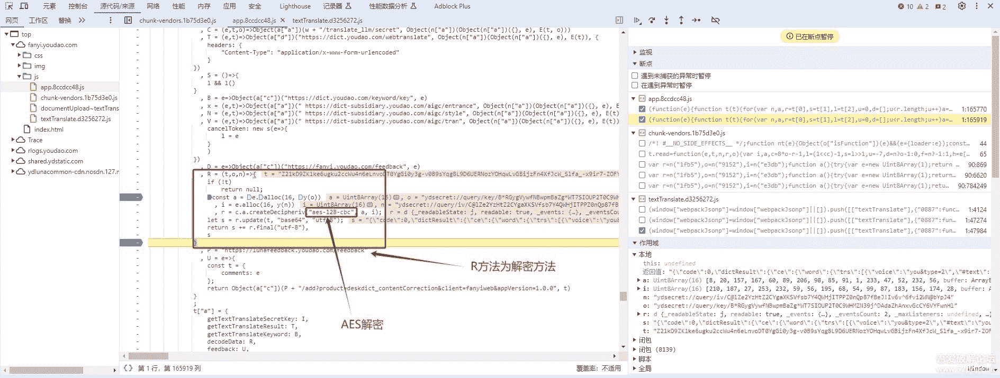

# [Web逆向] 某道翻译（MD5加密、AES解密）

- 原帖: https://www.52pojie.cn/forum.php?mod=viewthread&tid=1902605
- 抓取时间: 2026-11-01T22:34:50

web爬虫逆向笔记：js逆向案例三 某道翻译（MD5加密、AES解密）

## 一、目标网址
`https://fanyi.youdao.com/index.html#/`

## 二、接口分析



1.png (154.42 KB, 下载次数: 1)



2.png (241.07 KB, 下载次数: 1)



3.png (190.62 KB, 下载次数: 1)



4.png (225.96 KB, 下载次数: 2)



5.png (205.04 KB, 下载次数: 1)

### 1、sign值生成逻辑

```javascript
// c.a为crypto加密模块，直接导包替换就好
function j(e) {
    return c.a.createHash("md5").update(e.toString()).digest("hex")
}
function k(e, t) {
    return j(`client=${u}&mysticTime=${e}&product=${d}&key=${t}`)
}
const o = (new Date).getTime();
let e = 'fsdsogkndfokasodnaso'
// sign值生成
// e为固定值
// o为时间戳
sign = k(o, e)
```

### 2、整合封装代码

```javascript
const Crypto = require("crypto");

const u = "fanyideskweb", 
        d = "webfanyi", 
        m = "client,mysticTime,product", 
        p = "1.0.0", 
        g = "web", 
        b = "fanyi.web", 
        A = 1, 
        h = 1, 
        f = 1, 
        v = "wifi", 
        O = 0;

function j(e) {
    return Crypto.createHash("md5").update(e.toString()).digest("hex")
}

function k(e, t) {
    return j(`client=${u}&mysticTime=${e}&product=${d}&key=${t}`)
}

function set_post_data(txt) {
    const o = (new Date).getTime();
    let e = 'fsdsogkndfokasodnaso'
    return {
        i: txt,
        from: 'auto',
        to: '',
        dictResult: 'true',
        keyid: 'webfanyi',
        sign: k(o, e),
        client: u,
        product: d,
        appVersion: p,
        vendor: g,
        pointParam: m,
        mysticTime: o,
        keyfrom: b,
        mid: A,
        screen: h,
        model: f,
        network: v,
        abtest: O,
        yduuid: "abcdefg"
    }
}
```

### 3、使用python调用验证请求

```python
import requests
import execjs

cookies = {....}
headers = {
        'Accept': 'application/json, text/plain, */*',
        'Accept-Language': 'zh-CN,zh;q=0.9',
        'Cache-Control': 'no-cache',
        'Connection': 'keep-alive',
        'Content-Type': 'application/x-www-form-urlencoded',
        'Origin': 'https://fanyi.youdao.com',
        'Pragma': 'no-cache',
        'Referer': 'https://fanyi.youdao.com/',
        'Sec-Fetch-Dest': 'empty',
        'Sec-Fetch-Mode': 'cors',
        'Sec-Fetch-Site': 'same-site',
        'User-Agent': 'Mozilla/5.0 (Windows NT 10.0; Win64; x64) AppleWebKit/537.36 (KHTML, like Gecko) Chrome/122.0.0.0 Safari/537.36',
        'sec-ch-ua': '"Chromium";v="122", "Not(A:Brand";v="24", "Google Chrome";v="122"',
        'sec-ch-ua-mobile': '?0',
        'sec-ch-ua-platform': '"Windows"',
}
with open('./set_post_data.js', 'r', encoding='utf-8') as f:
    set_post_data_code = f.read()
data = execjs.compile(set_post_data_code).call('set_post_data', txt)
response = requests.post('https://dict.youdao.com/webtranslate', headers=headers, cookies=cookies, data=data)
print(response.text)
```



6.png (91.28 KB, 下载次数: 2)

## 三、数据解密



7.png (307.17 KB, 下载次数: 2)



8.png (268.97 KB, 下载次数: 1)

### 1、解密js分析

```javascript
//解密分析
// c.a为crypto加密模块，直接导包替换就好
function y(e) {
    return c.a.createHash("md5").update(e).digest()
}
R = (t,o,n)=>{
    if (!t)
        return null;
    const a = e.alloc(16, y(o))
    , i = e.alloc(16, y(n))
    , r = c.a.createDecipheriv("aes-128-cbc", a, i);
    let s = r.update(t, "base64", "utf-8");
    return s += r.final("utf-8"),
        s
}
// t为加密数据data
// o为key值
// n为iv值
// 固定值可写死
let o = "ydsecret://query/key/B*RGygVywfNBwpmBaZg*WT7SIOUP2T0C9WHMZN39j^DAdaZhAnxvGcCY6VYFwnHl";
// 固定值可写死
let n = "ydsecret://query/iv/C@lZe2YzHtZ2CYgaXKSVfsb7Y4QWHjITPPZ0nQp87fBeJ!Iv6v^6fvi2WN@bYpJ4";
```

### 2、整合封装代码

```javascript
const Crypto = require("crypto");

function y(e) {
  // 使用 md5 算法创建一个哈希对象
  return Crypto.createHash("md5")
    // 更新哈希对象的内容为参数 e
    .update(e)
    // 获取哈希值并返回
    .digest()
}

function get_data(data){
  // 定义变量o，存储密钥
  let o = "ydsecret://query/key/B*RGygVywfNBwpmBaZg*WT7SIOUP2T0C9WHMZN39j^DAdaZhAnxvGcCY6VYFwnHl";
  // 定义变量n，存储初始化向量
  let n = "ydsecret://query/iv/C@lZe2YzHtZ2CYgaXKSVfsb7Y4QWHjITPPZ0nQp87fBeJ!Iv6v^6fvi2WN@bYpJ4";

  // 调用函数y，传入密钥o，将返回值赋给变量a
  const a = y(o)
    // 调用函数y，传入初始化向量n，将返回值赋给变量i
    , i = y(n)
    // 创建解密器r，使用AES-128-CBC算法，密钥为a，初始化向量为i
    , r = Crypto.createDecipheriv("aes-128-cbc", a, i);

  // 使用解密器r对传入的base64编码的数据data进行解密，结果以utf-8编码
  let s = r.update(data, "base64", "utf-8");

  // 将解密器r的最终结果以utf-8编码添加到s中，并返回s
  return s += r.final("utf-8"),
  s
}
```

### 3、整合代码使用python调用

```python
import requests

import execjs

import json

def youdao_translation(txt, headers, cookies):

    try:

        with open('./set_post_data.js', 'r', encoding='utf-8') as f:

            set_post_data_code = f.read()

        data = execjs.compile(set_post_data_code).call('set_post_data', txt)

        response = requests.post('https://dict.youdao.com/webtranslate', headers=headers, cookies=cookies, data=data)

        if response.status_code != 200:

            raise Exception(f"无法获得翻译状态码: {response.status_code}")

        with open('./get_data.js', 'r', encoding='utf-8') as f:

            get_data_code = f.read()
```


```
        result = execjs.compile(get_data_code).call('get_data', response.text)
        print(json.loads(result)['translateResult'][0][0]['tgt'])
    except FileNotFoundError:
        print("没有找到一个所需的JS文件.")
    except execjs.ProgramError:
        print("日志含义执行JavaScript代码失败.")
    except requests.RequestException:
        print("建立网络失败")

if __name__ == '__main__':
    cookies = {....}
    headers = {
        'Accept': 'application/json, text/plain, */*',
        'Accept-Language': 'zh-CN,zh;q=0.9',
        'Cache-Control': 'no-cache',
        'Connection': 'keep-alive',
        'Content-Type': 'application/x-www-form-urlencoded',
        'Origin': 'https://fanyi.youdao.com',
        'Pragma': 'no-cache',
        'Referer': 'https://fanyi.youdao.com/',
        'Sec-Fetch-Dest': 'empty',
        'Sec-Fetch-Mode': 'cors',
        'Sec-Fetch-Site': 'same-site',
        'User-Agent': 'Mozilla/5.0 (Windows NT 10.0; Win64; x64) AppleWebKit/537.36 (KHTML, like Gecko) Chrome/122.0.0.0 Safari/537.36',
        'sec-ch-ua': '"Chromium";v="122", "Not(A:Brand";v="24", "Google Chrome";v="122"',
        'sec-ch-ua-mobile': '?0',
        'sec-ch-ua-platform': '"Windows"',
        }
    youdao_translation('你好', headers, cookies)
```

# 四、总结

1. 接口分析获取加密参数生成
2. 扣取代码，还原参数加密方法
3. 调试分析加密数据生成逻辑，还原实现解密

声明：本文章仅供学习使用，上述代码请不要违规使用，所造成的一切不良后果与作者无关；如有侵权，请联系删除！！！
