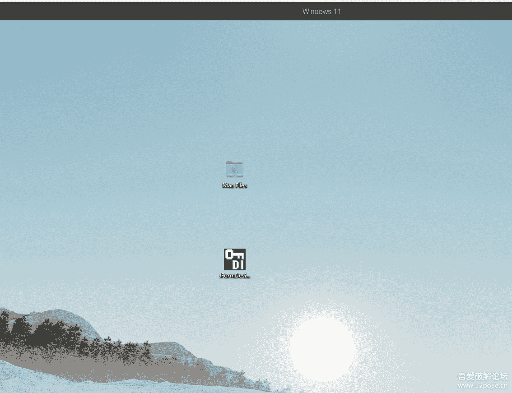
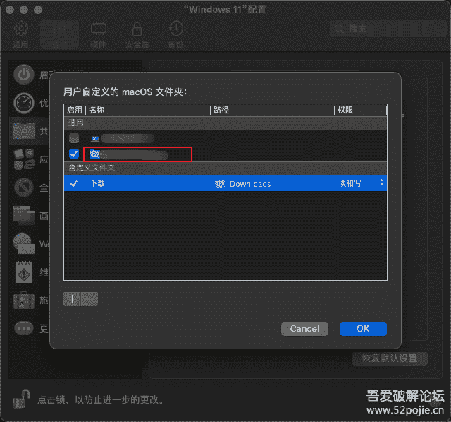
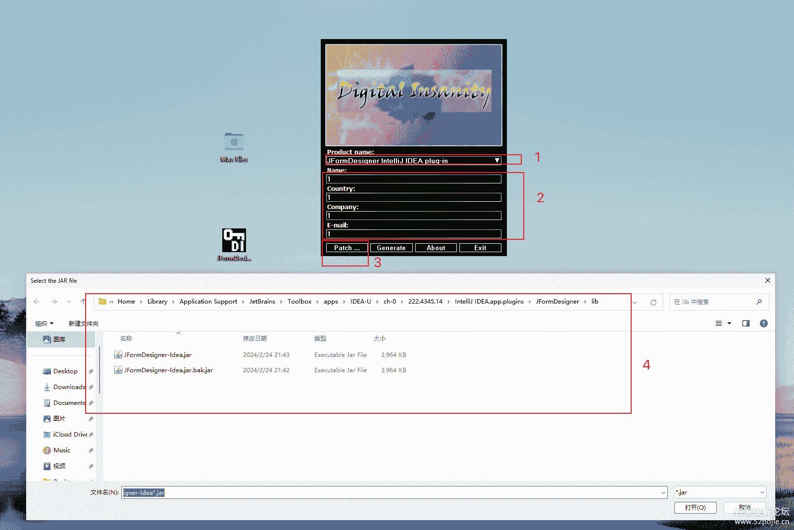
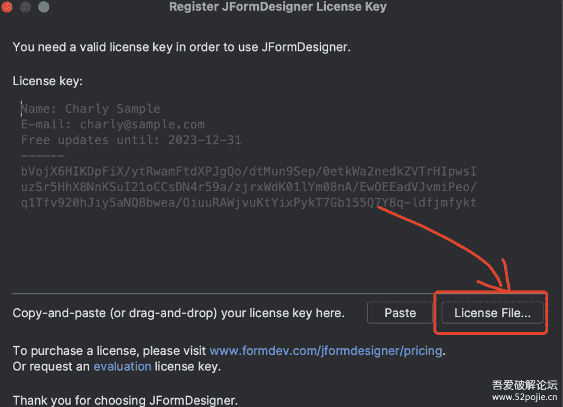
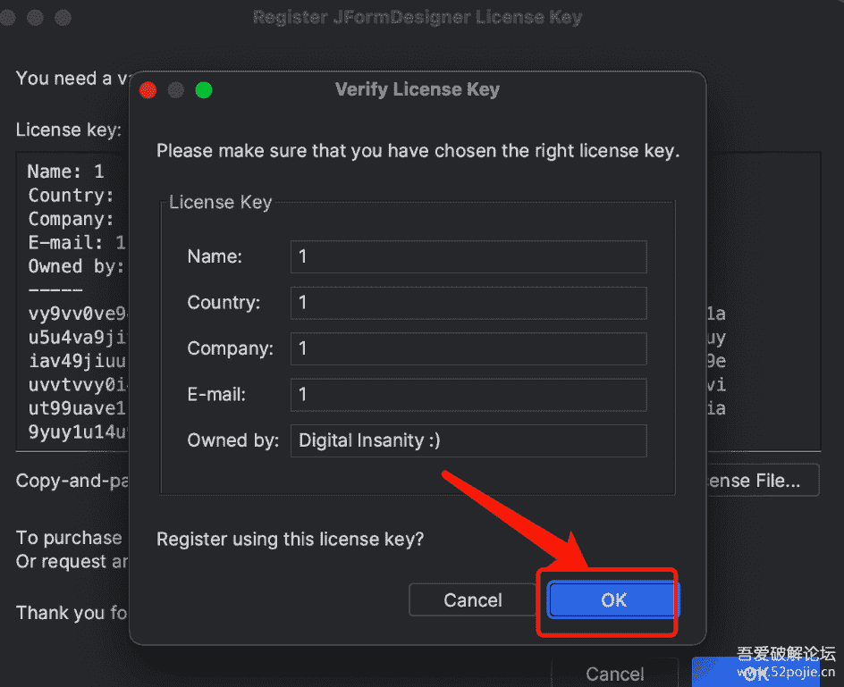
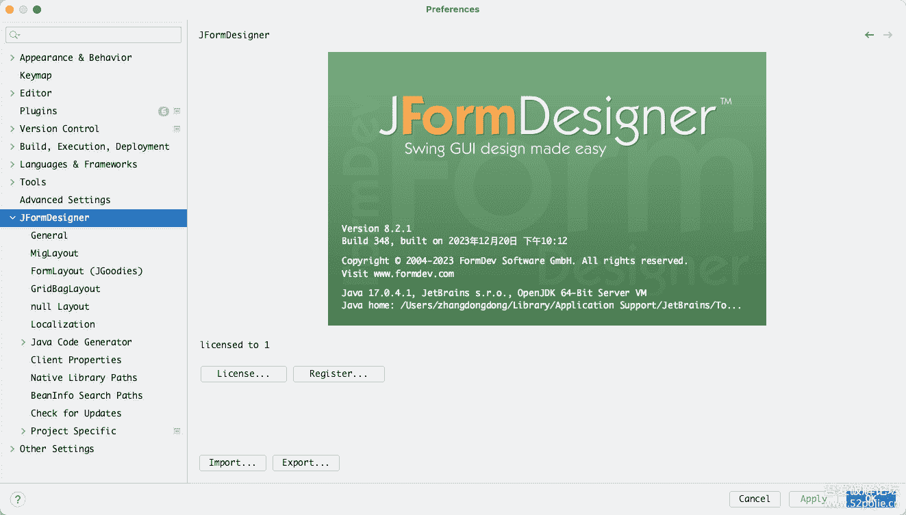

# [MacOS逆向] Mac 上激活 JFormDesigner 插件

- 原帖：<https://www.52pojie.cn/forum.php?mod=viewthread&tid=1902648>
- 抓取时间：2026-11-01T22:34:48

JFormDesigner 是一款先进的 Swing GUI 设计器，对 `MigLayout`、`JGoodies FormLayout`、`GroupLayout`（自由设计）、`TableLayout` 和 `GridBagLayout` 提供了出色的支持，这使得创建专业外观的表单变得容易。

由于没有找到 Mac 上的其他方式，所以这里主要是使用 window 上的激活工具 `JFormDesigner_Keyge.exe` 激活 Mac 上的 IntelliJ IDEA 插件的操作步骤。

## 环境信息

- 一个可以运行 `exe` 程序的[工具](https://www.52pojie.cn/thread-661779-1-1.html)，这里我是用的是 Parallels Desktop。
- `JFormDesigner_Keyge.exe` 注册机，用于激活 JFormDesigner。
- 设置虚拟机和 Mac 宿主机的共享磁盘信息，以保证 window 虚拟机里可以访问到 IntelliJ IDEA 的插件位置。

`image-20240318200646619.png` (678.57 KB, 下载次数: 1)

[附件下载](https://www.52pojie.cn/forum.php?mod=attachment&aid=MjY4MzM1MXwwYzZmNGE2ZnwxNzkzNTcyNDg2fDE2ODA4NnwxOTAyNjQ4&nothumb=yes)

2024-3-18 20:27 上传

`image-20240318201025032.png` (84.17 KB, 下载次数: 2)

[附件下载](https://www.52pojie.cn/forum.php?mod=attachment&aid=MjY4MzM1MnwwYjQ3YjVhOXwxNzkzNTcyNDg2fDE2ODA4NnwxOTAyNjQ4&nothumb=yes)

2024-3-18 20:27 上传

## 进行破解操作

0. 运行 `JFormDesigner_Keyge.exe` 工具。
1. 选择 IntelliJ IDEA 插件。
2. 填写注册信息。
3. 点击 `patch`。
4. 选择 Mac 上插件的 `jar` 包。&#9888;&#65039; 这里是选择 Mac 上插件的 `jar` 包。
5. 然后点击 `Generate`，保存激活 lincense 文件。
6. 最后点 `Exit` 退出。

`image-20240318201445018.png` (658.46 KB, 下载次数: 3)

[附件下载](https://www.52pojie.cn/forum.php?mod=attachment&aid=MjY4MzM1M3w5NDNkYmRkN3wxNzkzNTcyNDg2fDE2ODA4NnwxOTAyNjQ4&nothumb=yes)

2024-3-18 20:27 上传

`image-20240318201657815.png` (402.73 KB, 下载次数: 4)

[附件下载](https://www.52pojie.cn/forum.php?mod=attachment&aid=MjY4MzM1NHwzMzQzNmI2ZXwxNzkzNTcyNDg2fDE2ODA4NnwxOTAyNjQ4&nothumb=yes)

2024-3-18 20:27 上传

`image-20240318201756011.png` (360.98 KB, 下载次数: 2)

[附件下载](https://www.52pojie.cn/forum.php?mod=attachment&aid=MjY4MzM1NXw2ZWUyOWQ3M3wxNzkzNTcyNDg2fDE2ODA4NnwxOTAyNjQ4&nothumb=yes)

2024-3-18 20:27 上传

## 在 IntelliJ IDEA 中进行激活

- 打开 IDEA
- 设置
- 其他设置
- JFormDesigner
- 点击 `Register`
- 选择刚刚生成的 `JFormDesigner_license.txt`
- 点击 `ok` 输入注册信息
- 激活成功

`image-20240318202023836.png` (169.67 KB, 下载次数: 7)

[附件下载](https://www.52pojie.cn/forum.php?mod=attachment&aid=MjY4MzM1NnwxNDg4MmYzMnwxNzkzNTcyNDg2fDE2ODA4NnwxOTAyNjQ4&nothumb=yes)

2024-3-18 20:27 上传

`image-20240318202134292.png` (235.97 KB, 下载次数: 5)

[附件下载](https://www.52pojie.cn/forum.php?mod=attachment&aid=MjY4MzM1N3w0OTYwYjBlY3wxNzkzNTcyNDg2fDE2ODA4NnwxOTAyNjQ4&nothumb=yes)

2024-3-18 20:27 上传

`image-20240318202153184.png` (146.6 KB, 下载次数: 3)

[附件下载](https://www.52pojie.cn/forum.php?mod=attachment&aid=MjY4MzM1OHxiNDBlMTU5YnwxNzkzNTcyNDg2fDE2ODA4NnwxOTAyNjQ4&nothumb=yes)

2024-3-18 20:27 上传
