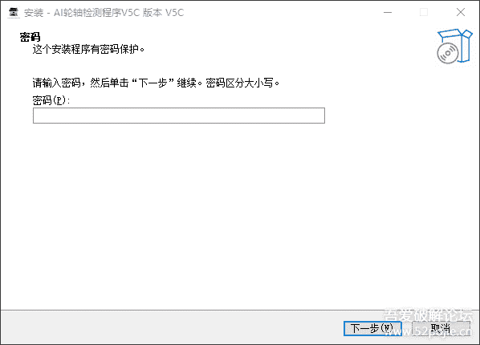
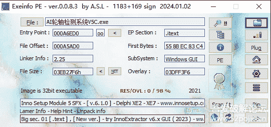
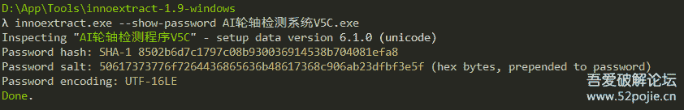
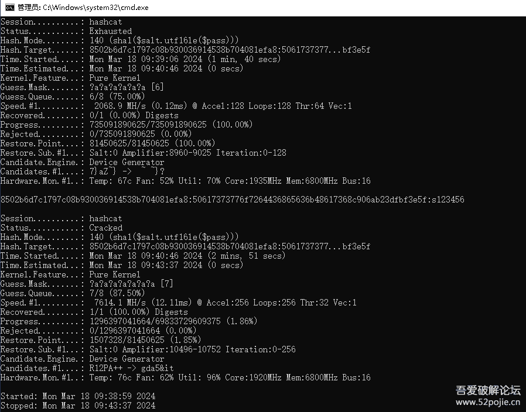
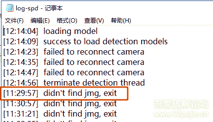
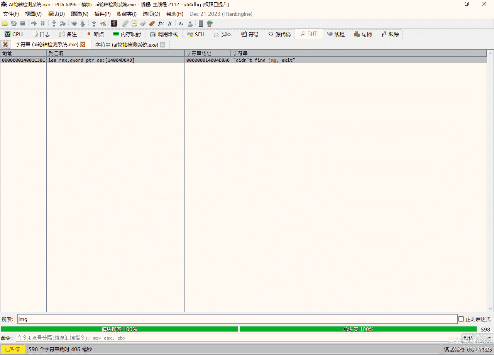
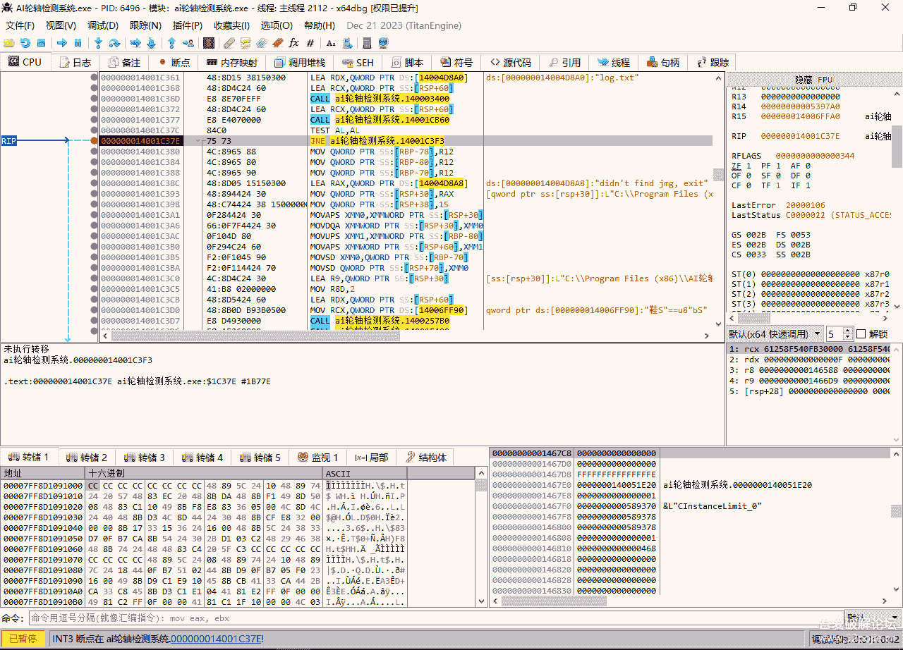
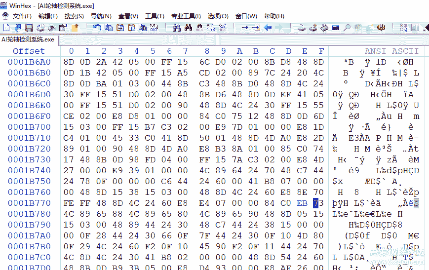
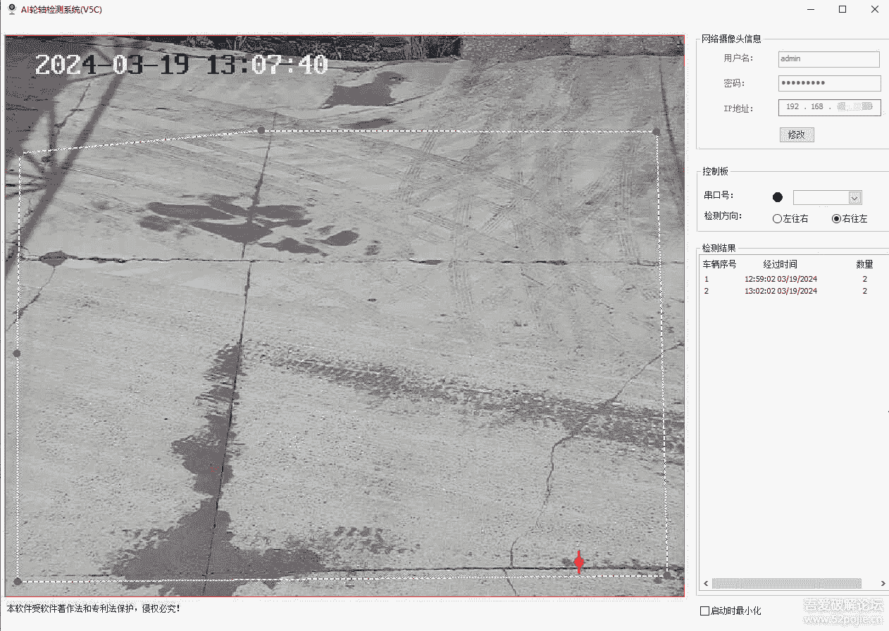

# [原创] 新手破解某AI轮轴检测系统记录

- 原帖：[https://www.52pojie.cn/forum.php?mod=viewthread&tid=1902909](https://www.52pojie.cn/forum.php?mod=viewthread&tid=1902909)
- 抓取时间：2026-11-01T22:34:46

## 背景

从朋友那拿了一个"AI轮轴检测系统"的软件，是用来识别卡车车型，判断车辆载重上限。打算预防车辆超载，之前没有接触过类似识别软件，一直通过预录车牌载重，还是比较麻烦的。



[efa01ee4fbdb567d7c8e1dfbc121723.png](https://www.52pojie.cn/forum.php?mod=attachment&aid=MjY4MzUyM3w3YzhmOGU2MnwxNzkzNTcyNDg0fDE2ODA4NnwxOTAyOTA5&nothumb=yes) (18.93 KB, 下载次数: 0)

2024-3-19 13:01 上传

## 安装包与密码

软件是一个安装包，打开发现还是需要安装密码，尝试了多次弱密码无果。



[ad8e14156fc90243df6f70e27278225.png](https://www.52pojie.cn/forum.php?mod=attachment&aid=MjY4MzUyNHw5ZDY0ZDJkMnwxNzkzNTcyNDg0fDE2ODA4NnwxOTAyOTA5&nothumb=yes) (103.72 KB, 下载次数: 0)

2024-3-19 13:02 上传

## 分析安装包

用 `exeinfo` 查看了下，是用 `Inno Setup` 打包的，网上搜索了几个软件解密 `Inno` 密码的软件都不行，应该是安装包使用的 `Inno` 版本高了。



[9f94d1dc5009fb2d6ecedef8a554458.png](https://www.52pojie.cn/forum.php?mod=attachment&aid=MjY4MzUyNXwyM2VmMGZmOHwxNzkzNTcyNDg0fDE2ODA4NnwxOTAyOTA5&nothumb=yes) (38.71 KB, 下载次数: 0)

2024-3-19 13:02 上传

## 提取并破解安装密码

最后在 `hashcat` issues 中找到提示，用 `innoextract` 导出密码哈希。



[b31cb56c9d1625fcca555cc9c2cb460.png](https://www.52pojie.cn/forum.php?mod=attachment&aid=MjY4MzUyNnw0ZjE5MTQ1NnwxNzkzNTcyNDg0fDE2ODA4NnwxOTAyOTA5&nothumb=yes) (36.79 KB, 下载次数: 0)

2024-3-19 13:02 上传

这样应该可以用 `hashcat` 来跑，`hash` 的格式是 `(Password hash):(Password salt)`。

```
hashcat -d 1 -m 140 8502b6d7c1797c08b930036914538b704081efa8:50617373776f7264436865636b48617368c906ab23dfbf3e5f --hex-salt -a 3 --increment --increment-min 1 --increment-max 8 ?a?a?a?a?a?a?a?a
```

穷举8位，五分钟搞定。



[30ea89585e65cbe61a219c653a8f788.png](https://www.52pojie.cn/forum.php?mod=attachment&aid=MjY4MzUyN3wxYTNiNTI0M3wxNzkzNTcyNDg0fDE2ODA4NnwxOTAyOTA5&nothumb=yes) (23.22 KB, 下载次数: 0)

2024-3-19 13:03 上传

## 程序启动与日志

正常安装软件后，软件还是无法打开。安装目录下有海康威视动态库和 `opencv` 框架，估计是通过 `opencv` 视觉识别轮胎数量来推算车辆类型。

`data` 目录下 `log-spd.log` 的日志文件，有修改记录。



[2c14fcc13b6212e8dfbbacc5125bf73.png](https://www.52pojie.cn/forum.php?mod=attachment&aid=MjY4MzUyOHxiNzFmZTc5MnwxNzkzNTcyNDg0fDE2ODA4NnwxOTAyOTA5&nothumb=yes) (68.04 KB, 下载次数: 0)

2024-3-19 13:03 上传

## 逆向定位

看上去是没有加密狗，尝试用 `x64dbg` 打开下程序，搜索下这个提示字符串 `jmg`。



[35984a395307f5103a552859cf1568e.png](https://www.52pojie.cn/forum.php?mod=attachment&aid=MjY4MzUyOXxhZDZkZDEzMXwxNzkzNTcyNDg0fDE2ODA4NnwxOTAyOTA5&nothumb=yes) (217.64 KB, 下载次数: 0)

2024-3-19 13:04 上传

并找到这个地址，在最近的一个跳转点这里下断点，发现在这里直接跳转进入，软件就可以正常启动。

。



[3c4359eb19db82727b0514cb91d3552.png](https://www.52pojie.cn/forum.php?mod=attachment&aid=MjY4MzUzMnxhYWMwMDA3NnwxNzkzNTcyNDg0fDE2ODA4NnwxOTAyOTA5&nothumb=yes) (93.92 KB, 下载次数: 0)

2024-3-19 13:06 上传

## 修改与结果

那根据偏移量直接修改原文件，`JNE` 指令改成 `JMP`，保存，软件正常启动。



[c6cf7aaa296a2f956f44bd2a1cf88e2.png](https://www.52pojie.cn/forum.php?mod=attachment&aid=MjY4MzUzM3xhODliZWU2NHwxNzkzNTcyNDg0fDE2ODA4NnwxOTAyOTA5&nothumb=yes) (978.39 KB, 下载次数: 0)

2024-3-19 13:08 上传

实际软件最后还是未能正常使用，软件应该还配套其他串口传感器，估计是感应车辆经过信号，缺少完全没有识别率。这三无软件也留下任何联系方式。

。
