# [Web逆向] 浅逆某里227滑块

- 原帖: https://www.52pojie.cn/forum.php?mod=viewthread&tid=1903141
- 抓取时间: 2026-11-01T22:34:40

>
Target：`aHR0cHM6Ly9qb2JzLjUxam9iLmNvbS9zdXpob3UtZ3l5cS8xNTMzMDczMjEuaHRtbA==` ( 多刷新幾次就會觸發滑塊 )
在調試前可先用`fiddler`等工具固定滑塊頁面，這樣會方便很多

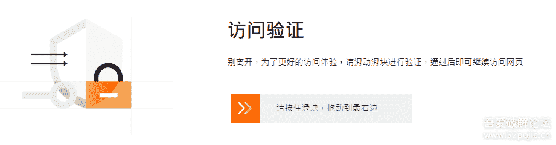
Untitled.png (26.58 KB, 下载次数: 0)

[href="forum.php?mod=attachment&aid=MjY4Mzg1M3xjNzYyMTBiMXwxNzkzNTcyNDc3fDE2ODA4NnwxOTAzMTQx&nothumb=yes" target="_blank"](https://www.52pojie.cn/forum.php?mod=attachment&aid=MjY4Mzg1M3xjNzYyMTBiMXwxNzkzNTcyNDc3fDE2ODA4NnwxOTAzMTQx&nothumb=yes)
2024-3-19 21:16 上传

## 跟n值生成位置

### 第一種方法

在滑動滑塊前先下個`script`斷點，然後會斷在這裡

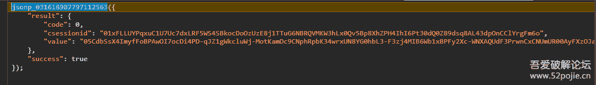
Untitled1.png (26.27 KB, 下载次数: 3)

[href="forum.php?mod=attachment&aid=MjY4Mzg1NHwzMDUzNzkwZHwxNzkzNTcyNDc3fDE2ODA4NnwxOTAzMTQx&nothumb=yes" target="_blank"](https://www.52pojie.cn/forum.php?mod=attachment&aid=MjY4Mzg1NHwzMDUzNzkwZHwxNzkzNTcyNDc3fDE2ODA4NnwxOTAzMTQx&nothumb=yes)
2024-3-19 21:16 上传

這時去看網路面板，可以發現滑塊的驗證是通過`nocaptcha/analyze.jsonp`這個接口，其中最關鍵的參數就是`n`

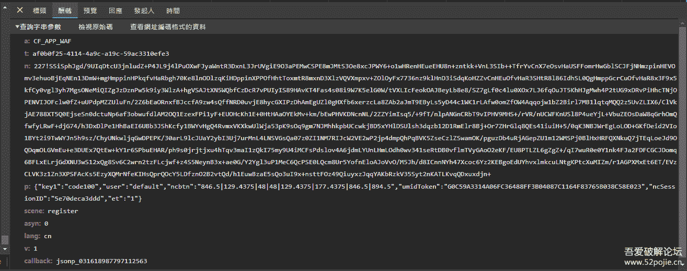
Untitled2.png (102.1 KB, 下载次数: 2)

[href="forum.php?mod=attachment&aid=MjY4Mzg1NXwzZTk0MTVlZXwxNzkzNTcyNDc3fDE2ODA4NnwxOTAzMTQx&nothumb=yes" target="_blank"](https://www.52pojie.cn/forum.php?mod=attachment&aid=MjY4Mzg1NXwzZTk0MTVlZXwxNzkzNTcyNDc3fDE2ODA4NnwxOTAzMTQx&nothumb=yes)
2024-3-19 21:16 上传

簡單跟下棧就能找到`n`的生成位置，`o.__fy_options`固定就可以

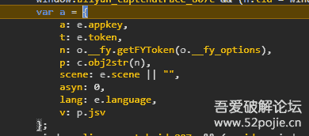
Untitled3.png (16.11 KB, 下载次数: 3)

[href="forum.php?mod=attachment&aid=MjY4Mzg1NnxlM2E5Y2Q2NnwxNzkzNTcyNDc3fDE2ODA4NnwxOTAzMTQx&nothumb=yes" target="_blank"](https://www.52pojie.cn/forum.php?mod=attachment&aid=MjY4Mzg1NnxlM2E5Y2Q2NnwxNzkzNTcyNDc3fDE2ODA4NnwxOTAzMTQx&nothumb=yes)
2024-3-19 21:16 上传

### 第二種方法

這種方法是在別的大佬的文章看到的，一開始我是用第一種方法找到的，但第二種方法感覺也挺好的，特此記錄一下

下個全局的的`mousedown`斷點

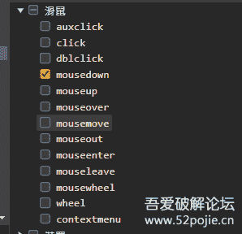
Untitled4.png (14.7 KB, 下载次数: 4)

[href="forum.php?mod=attachment&aid=MjY4Mzg1N3wyNzBhOTcxM3wxNzkzNTcyNDc3fDE2ODA4NnwxOTAzMTQx&nothumb=yes" target="_blank"](https://www.52pojie.cn/forum.php?mod=attachment&aid=MjY4Mzg1N3wyNzBhOTcxM3wxNzkzNTcyNDc3fDE2ODA4NnwxOTAzMTQx&nothumb=yes)
2024-3-19 21:16 上传

斷下後走幾步會到這裡，看到它添加了一個`mousemove`事件，跟入`s`看看

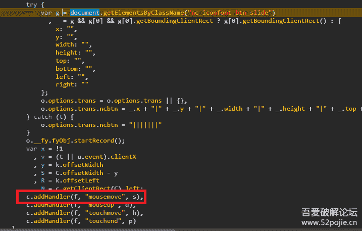
Untitled5.png (45.66 KB, 下载次数: 2)

[href="forum.php?mod=attachment&aid=MjY4Mzg1OHw1ODkxN2I4MXwxNzkzNTcyNDc3fDE2ODA4NnwxOTAzMTQx&nothumb=yes" target="_blank"](https://www.52pojie.cn/forum.php?mod=attachment&aid=MjY4Mzg1OHw1ODkxN2I4MXwxNzkzNTcyNDc3fDE2ODA4NnwxOTAzMTQx&nothumb=yes)
2024-3-19 21:16 上传

經過一些操作後進入`i`，繼續深入`i`看看

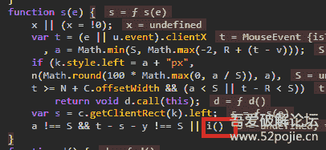
Untitled6.png (27.94 KB, 下载次数: 1)

[href="forum.php?mod=attachment&aid=MjY4Mzg1OXw3OTM0MDhiY3wxNzkzNTcyNDc3fDE2ODA4NnwxOTAzMTQx&nothumb=yes" target="_blank"](https://www.52pojie.cn/forum.php?mod=attachment&aid=MjY4Mzg1OXw3OTM0MDhiY3wxNzkzNTcyNDc3fDE2ODA4NnwxOTAzMTQx&nothumb=yes)
2024-3-19 21:16 上传

前面先移除了各種事件，最後進入了`m`函數

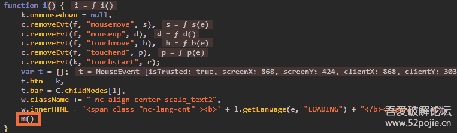
Untitled7.png (35.33 KB, 下载次数: 3)

[href="forum.php?mod=attachment&aid=MjY4Mzg2MHxhZjQwN2FiYnwxNzkzNTcyNDc3fDE2ODA4NnwxOTAzMTQx&nothumb=yes" target="_blank"](https://www.52pojie.cn/forum.php?mod=attachment&aid=MjY4Mzg2MHxhZjQwN2FiYnwxNzkzNTcyNDc3fDE2ODA4NnwxOTAzMTQx&nothumb=yes)
2024-3-19 21:16 上传

然後`m`函數就是`n`值生成的位置

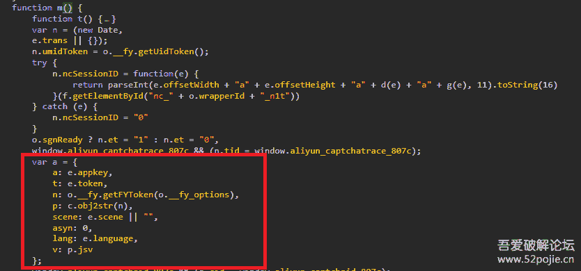
Untitled8.png (40.47 KB, 下载次数: 1)

[href="forum.php?mod=attachment&aid=MjY4Mzg2MXwwYjUxNDRmZHwxNzkzNTcyNDc3fDE2ODA4NnwxOTAzMTQx&nothumb=yes" target="_blank"](https://www.52pojie.cn/forum.php?mod=attachment&aid=MjY4Mzg2MXwwYjUxNDRmZHwxNzkzNTcyNDc3fDE2ODA4NnwxOTAzMTQx&nothumb=yes)
2024-3-19 21:16 上传

## 本地&瀏覽器調試

通常我找到密文生成位置後，會先嘗試導出相關函數，然後在本地簡單補下環境，先讓其出值( 雖然這個值大概率還不能使用 )

### 本地出值

由於我比較懶，我是直接將幾個可能用到的js文件放到本地的環境，然後通過導出相關函數來生成`n`值。
如下所示，按`awsc.js`、`et_f.js`、`fireyejs.js`、`nc.js`的順序

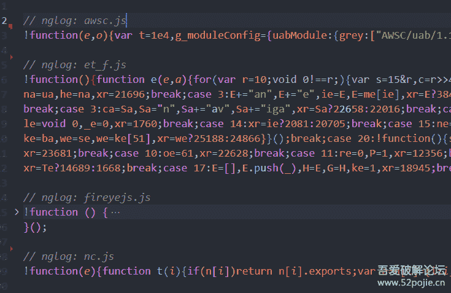
Untitled9.png (72.48 KB, 下载次数: 3)

[href="forum.php?mod=attachment&aid=MjY4Mzg2Mnw1OGViOGVjN3wxNzkzNTcyNDc3fDE2ODA4NnwxOTAzMTQx&nothumb=yes" target="_blank"](https://www.52pojie.cn/forum.php?mod=attachment&aid=MjY4Mzg2Mnw1OGViOGVjN3wxNzkzNTcyNDc3fDE2ODA4NnwxOTAzMTQx&nothumb=yes)
2024-3-19 21:16 上传

在導出加密函數`o.__fy.getFYToken`時發現要先初始化一些環境，跟棧找到`m.init`，這裡直接導出`m`

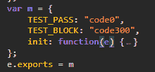
Untitled10.png (5.18 KB, 下载次数: 2)

[href="forum.php?mod=attachment&aid=MjY4Mzg2M3w4ZDdkYzExMXwxNzkzNTcyNDc3fDE2ODA4NnwxOTAzMTQx&nothumb=yes" target="_blank"](https://www.52pojie.cn/forum.php?mod=attachment&aid=MjY4Mzg2M3w4ZDdkYzExMXwxNzkzNTcyNDc3fDE2ODA4NnwxOTAzMTQx&nothumb=yes)
2024-3-19 21:16 上传

本地調用如下：

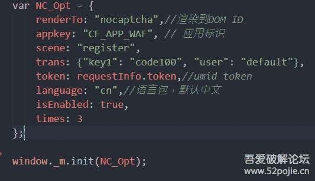
Untitled11.png (34.34 KB, 下载次数: 1)

[href="forum.php?mod=attachment&aid=MjY4Mzg2NHxhODE3Nzg1ZnwxNzkzNTcyNDc3fDE2ODA4NnwxOTAzMTQx&nothumb=yes" target="_blank"](https://www.52pojie.cn/forum.php?mod=attachment&aid=MjY4Mzg2NHxhODE3Nzg1ZnwxNzkzNTcyNDc3fDE2ODA4NnwxOTAzMTQx&nothumb=yes)
2024-3-19 21:16 上传

然後就可以導出`o.__fy.getFYToken`的`o`對象 ( 代碼最好不要格式化，防止有檢測 )

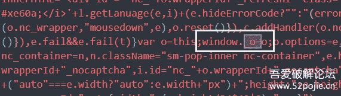
Untitled12.png (31.97 KB, 下载次数: 1)

[href="forum.php?mod=attachment&aid=MjY4Mzg2NXw0NjgyNmU2ZXwxNzkzNTcyNDc3fDE2ODA4NnwxOTAzMTQx&nothumb=yes" target="_blank"](https://www.52pojie.cn/forum.php?mod=attachment&aid=MjY4Mzg2NXw0NjgyNmU2ZXwxNzkzNTcyNDc3fDE2ODA4NnwxOTAzMTQx&nothumb=yes)
2024-3-19 21:16 上传

本地調用如下：

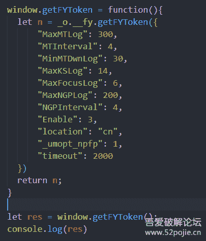
Untitled13.png (35.18 KB, 下载次数: 2)

[href="forum.php?mod=attachment&aid=MjY4Mzg2Nnw1NTViYzk5NHwxNzkzNTcyNDc3fDE2ODA4NnwxOTAzMTQx&nothumb=yes" target="_blank"](https://www.52pojie.cn/forum.php?mod=attachment&aid=MjY4Mzg2Nnw1NTViYzk5NHwxNzkzNTcyNDc3fDE2ODA4NnwxOTAzMTQx&nothumb=yes)
2024-3-19 21:16 上传

在`awsc.js`、`et_f.js`、`fireyejs.js`、`nc.js`這幾個環境初始化時，或者是在`getFYToken`加密的過程中，需要手動補瀏覽器的環境，以下是部份我遇到要補的環境：

- 調用`getComputedStyle`取了`body`所有的屬性，然後放到`pe`中

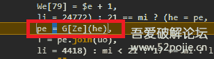
Untitled14.png (12.93 KB, 下载次数: 0)

[href="forum.php?mod=attachment&aid=MjY4Mzg2N3w0OGE1Y2ZmOHwxNzkzNTcyNDc3fDE2ODA4NnwxOTAzMTQx&nothumb=yes" target="_blank"](https://www.52pojie.cn/forum.php?mod=attachment&aid=MjY4Mzg2N3w0OGE1Y2ZmOHwxNzkzNTcyNDc3fDE2ODA4NnwxOTAzMTQx&nothumb=yes)
2024-3-19 21:16 上传

具體效果如這兩句代碼一致
```
t = getComputedStyle(document.body);
pe = [].slice.call(t)
```
- `Performance.prototype.getEntriesByType`
- `font`指紋

```
// 1
ke = Ee[re] != y[J]
// 2
ke = Ee[Be] != B[J]
```
補著補著就能出值了，這是個好的開始

## AST解混淆

在進行瀏覽器跟值這一步前，強烈建議先解一解`fireyejs.js`的混淆( 主要邏輯在這個js文件裡 )，具體做法可以參考大佬的[//www.52pojie.cn/forum.php?mod=viewthread&tid=1818486&extra=&highlight=226&page=1" target="_blank" rel="noopener noreferrer nofollow"](https://www.52pojie.cn/forum.php?mod=viewthread&tid=1818486&extra=&highlight=226&page=1:href="https)。

( 一開始我唔信邪硬剛左一個星期，跟值跟到自閉，無奈只能放棄哩個on9做法… )

由於我`ast`比較菜，所以只解到了多層`switch`→單`switch`那裡，但由於變量作用域等問題，多層`switch`→單`switch`的代碼無法替換瀏覽器裡原本的代碼( 簡單來說就是用不了 )。

雖然不能直接替換使用，但在分析時( 向上跟值、跟調用順序 )卻大有用處，眾所周知控制流平坦化是無法直接通過跟棧來找到上一步的，只能通過控制流的狀態變量一步一步往上跟，而只有一層的`switch`控制流比起多層嵌套的`switch`控制流就容易跟值多了。

舉例來說，以下是只有一層的`switch`控制流，假如狀態變量是`li`，我想跟`case 5157`的上一步是哪，直接搜`li = 5157`，若有多個結果就全部下斷，看它走哪裡


```
case 5157:
  S = b = [U + 64 * ye];
  li = 19041;
  break;
case 5184:
  R = k = f;
  if (bo = (P = (fe = fe  (Y = (A = 215 | (bo = !hi)) 
```

瀏覽器替換用的是多層`switch`嵌套的版本，主要處理了三目运算符、逗号表达式等阻礙調試的東西，看大佬的那篇文章有移除自執行函數這步，但在227移除自執行函數會有變量作用域問題，因此我就保留了（這也導致`ast`要多判斷一些條件）。

（可以看到多層嵌套`switch`控制流，若要向上跟，要考慮多個狀態變量，十分麻煩!!!!）

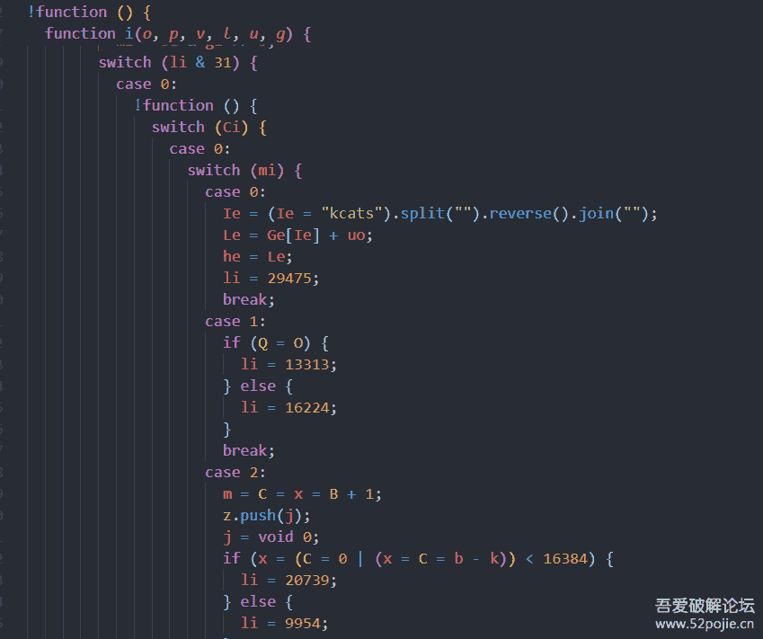

Untitled15.png (50.96 KB, 下载次数: 3)

[附件下载](https://www.52pojie.cn/forum.php?mod=attachment&aid=MjY4Mzg2OHxjYzllOTM3MXwxNzkzNTcyNDc3fDE2ODA4NnwxOTAzMTQx&nothumb=yes)

2024-3-19 21:16 上传

## 4> 瀏覽器跟值

主要目標是找到軌跡相關的邏輯。

跟進`o.__fy.getFYToken`，會走到`i(40, e)`這裡。

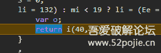

Untitled16.png (10.14 KB, 下载次数: 1)

[附件下载](https://www.52pojie.cn/forum.php?mod=attachment&aid=MjY4Mzg2OXw5NzhiYWYwMHwxNzkzNTcyNDc3fDE2ODA4NnwxOTAzMTQx&nothumb=yes)

2024-3-19 21:16 上传

單步走幾步，發現`s`數組，看它的內容很像是一個環境的特徵數組，`s[90]`還特別像是與軌跡有關，經測試後發現確實如此（所謂測試就是鼠標多滑幾下或少滑幾下，看看這個`s[90]`的長度是否符合預期），接下來看看這個`s`數組的某幾項：

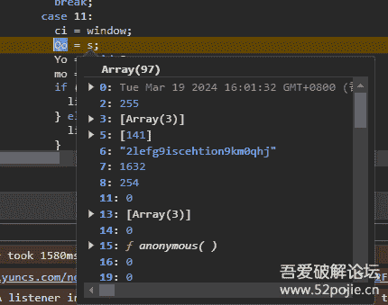

Untitled17.png (29.09 KB, 下载次数: 2)

[附件下载](https://www.52pojie.cn/forum.php?mod=attachment&aid=MjY4Mzg3MHwwYjlhMzEwMHwxNzkzNTcyNDc3fDE2ODA4NnwxOTAzMTQx&nothumb=yes)

2024-3-19 21:16 上传

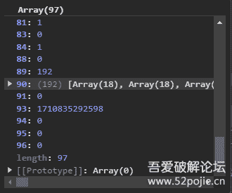

Untitled18.png (18.57 KB, 下载次数: 2)

[附件下载](https://www.52pojie.cn/forum.php?mod=attachment&aid=MjY4Mzg3MXxhNWNhYjE2YnwxNzkzNTcyNDc3fDE2ODA4NnwxOTAzMTQx&nothumb=yes)

2024-3-19 21:16 上传

- `s[5]`：鼠標點擊前的軌跡數組長度 - 1（計`mousedown`那一下的軌跡）

- `s[46]`：與`s[5]`類似，但不計`mousedown`那一下的軌跡，因此比`s[5]`小1，由`i(25)`觸發

- `s[26]`：前兩項是`WebGLRenderingContext`的東西，第3項的`"undefined"`是觸發`DeviceOrientationEvent`事件而來，第4、5項是觸發`MouseEvent`而來，鼠標在頁面不同位置時，對應的`target`（`html`頁面中的某個元素）也不一樣，取的是`target["id"]`

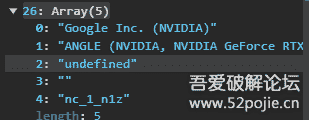

Untitled19.png (13.29 KB, 下载次数: 1)

[附件下载](https://www.52pojie.cn/forum.php?mod=attachment&aid=MjY4Mzg3MnxiMGU4YWU2N3wxNzkzNTcyNDc3fDE2ODA4NnwxOTAzMTQx&nothumb=yes)

2024-3-19 21:16 上传

- `s[23]`：由`ScriptProcessorNode`的`onaudioprocess`事件生成，而`onaudioprocess`事件是通過觸發全局的`mousedown`而來，具體值的來源是`AnalyserNode.prototype.getFloatFrequencyData`

- `s[48]`：與`timestamp`有關的數組

- `s[91]`：`promise`的回調（看堆棧就知道）

- `s[52]`：同樣是某個`promise`的回調觸發的

- `s[3]`：由`FocusEvent`觸發

- `s[90]`：最重要的軌跡數組，有以下幾個要點：

  - 由`mousedown`、`mousemove`觸發（全局正常會有2個`mousemove`、`mousedown`事件，要用第2個），每次會生成一個軌跡

  - 軌跡主要取`MouseEvent.clientX`、`MouseEvent.clientY`、`timestamp`、`MouseEvent.pageY`、`MouseEvent.pageX`等，並進行了異或等咚悖�因此直接看`s[90]`會與軌跡值對不上

  - 這個軌跡數組並非鼠標點擊後才開始`push`，而是只要在頁面上動就會一直在`push`，因此軌跡數組可能要分成點擊前和點擊後

  - 有兩種軌跡，分別是`length`為17和`length`為18的，嘗試過找為什麼有兩種不同的軌跡，但放棄了，最後我在本地手動構建軌跡時發現我的`s[90]`同樣有這兩種，就沒有深究了

- 快速獲取軌跡的方法：在`i`函數一開始下條件斷點

    ```
    o instanceof MouseEvent && ( window.slideArr ? window.slideArr.push({"pageX":o.pageX, "pageY":o.pageY, "clientX":o.clientX, "clientY":o.clientY}) : window.slideArr = [], false)
    ```

- `s[36]`：由滑塊的與鼠點擊事件觸發

## 3> 本地調用結果

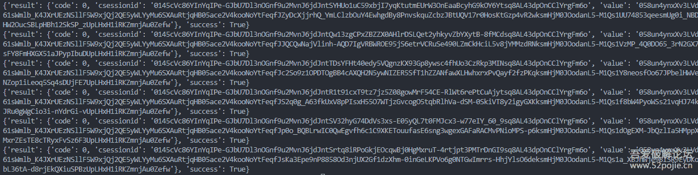

Untitled20.png (102.31 KB, 下载次数: 1)

[附件下载](https://www.52pojie.cn/forum.php?mod=attachment&aid=MjY4Mzg3M3w2MGE3NGEyY3wxNzkzNTcyNDc3fDE2ODA4NnwxOTAzMTQx&nothumb=yes)

2024-3-19 21:16 上传

## 3> 參考

感謝大佬們的分享

- [//blog.csdn.net/weixin_44862184/article/details/135159526](https://blog.csdn.net/weixin_44862184/article/details/135159526)

- [//www.52pojie.cn/forum.php?mod=viewthread&tid=1818486&extra=&highlight=226&page=1](https://www.52pojie.cn/forum.php?mod=viewthread&tid=1818486&extra=&highlight=226&page=1)

- [//zhuanlan.zhihu.com/p/673660020](https://zhuanlan.zhihu.com/p/673660020)

- [//mp.weixin.qq.com/s/s6e4TmOJHdYTsJ4p1ZJGDw](https://mp.weixin.qq.com/s/s6e4TmOJHdYTsJ4p1ZJGDw)

- [//mp.weixin.qq.com/s/almQM3N9VMBk86-Jv2LPow](https://mp.weixin.qq.com/s/almQM3N9VMBk86-Jv2LPow)
