# [Web逆向] 某东常用验证码逆向流程分析

- 原帖：<https://www.52pojie.cn/forum.php?mod=viewthread&tid=1903272>
- 抓取时间：2026-11-01T22:34:37

## 声明

本文章中所有内容仅供学习交流，抓包内容、敏感网址、数据接口均已做脱敏处理，严禁用于商业用途和非法用途，否则由此产生的一切后果均与作者无关，若有侵权，请联系我立即删除！

## 目标

解决 JD 常用的验证码。

## 前言

这里常用的就三种接口：

- 登录接口的滑块
- cfe 链接接口中的滑块
- cfe 链接接口中的点选

还有两个验证码：

- 旋转验证码
  - 这个验证码我一直没有触发。听说触发了这个验证码，就离毁号不远了。且爬且珍惜吧。
- 手势验证码
  - 只有固定接口才有。

## 三种验证

### 登录的滑块接口

接口链接：

> `aHR0cHM6Ly9wYXNzcG9ydC5qZC5jb20vdWMvbG9naW4/bHR5cGU9bG9nb3V0`


`1.png`（35.26 KB，下载次数：0）  
[附件](https://www.52pojie.cn/forum.php?mod=attachment&aid=MjcyODQ0N3xiMWE0NWFmY3wxNzkzNTcyNDc1fDE2ODA4NnwxOTAzMjcy&nothumb=yes)  
2024-10-12 16:21 上传

如上图所示。

这里就不多说废话了。直接刷新看接口。


`2.png`（14.01 KB，下载次数：0）  
[附件](https://www.52pojie.cn/forum.php?mod=attachment&aid=MjcyODQ0OHw4NmQzZjBhZXwxNzkzNTcyNDc1fDE2ODA4NnwxOTAzMjcy&nothumb=yes)  
2024-10-12 16:21 上传

这里可以看到有两个接口请求发出，分别为：

- `s`：负责验证请求
- `g`：负责获取图片和参数

#### `g` 请求

这里看 `g` 请求，直接进第二个栈。

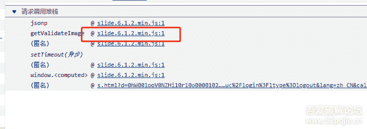

`3.png`（22.98 KB，下载次数：0）  
[附件](https://www.52pojie.cn/forum.php?mod=attachment&aid=MjcyODQ0OXwyMDc4ZDBhYXwxNzkzNTcyNDc1fDE2ODA4NnwxOTAzMjcy&nothumb=yes)  
2024-10-12 16:21 上传

这里看到很多值已经给了我们值了。这里我们重点观察两个值，分别是 `e` 和 `j`。

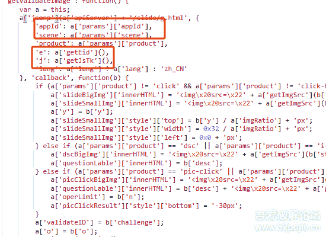

`4.png`（51.96 KB，下载次数：0）  
[附件](https://www.52pojie.cn/forum.php?mod=attachment&aid=MjcyODQ1MHxkY2RmNmUzNXwxNzkzNTcyNDc1fDE2ODA4NnwxOTAzMjcy&nothumb=yes)  
2024-10-12 16:21 上传

这里打断点进栈。

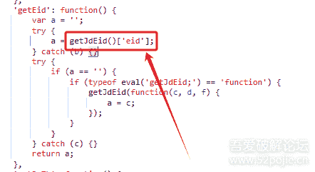

`5.png`（20.42 KB，下载次数：0）  
[附件](https://www.52pojie.cn/forum.php?mod=attachment&aid=MjcyODQ1MXwzZjE5YzBiOXwxNzkzNTcyNDc1fDE2ODA4NnwxOTAzMjcy&nothumb=yes)  
2024-10-12 16:21 上传

好了，然后再进去。然后发现到一个虚拟机里了，这里包含了 `e` 的生成。

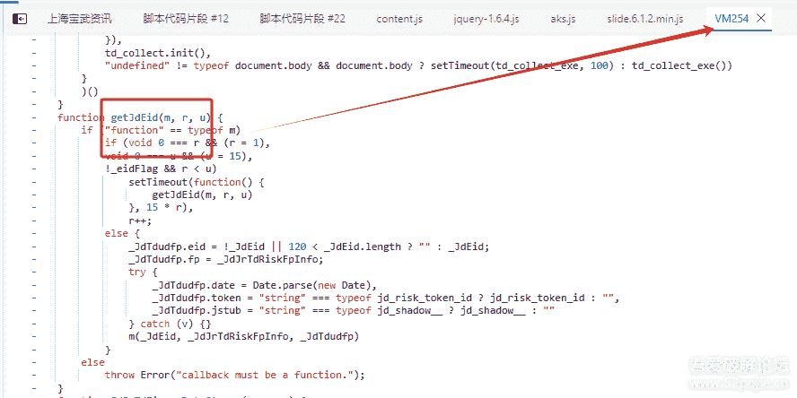

`6.png`（53.62 KB，下载次数：0）  
[附件](https://www.52pojie.cn/forum.php?mod=attachment&aid=MjcyODQ1MnwxNWUwYzRlOXwxNzkzNTcyNDc1fDE2ODA4NnwxOTAzMjcy&nothumb=yes)  
2024-10-12 16:21 上传

然后就是 `j`。

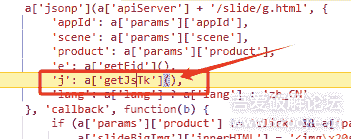

`7.png`（20.89 KB，下载次数：0）  
[附件](https://www.52pojie.cn/forum.php?mod=attachment&aid=MjcyODQ1M3wzZjg4MzZjMnwxNzkzNTcyNDc1fDE2ODA4NnwxOTAzMjcy&nothumb=yes)  
2024-10-12 16:21 上传

`j` 的生成不必多说。看下图就知道了。

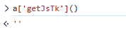

`8.png`（820 Bytes，下载次数：0）  
[附件](https://www.52pojie.cn/forum.php?mod=attachment&aid=MjcyODQ1NHxlZWExYWFlNHwxNzkzNTcyNDc1fDE2ODA4NnwxOTAzMjcy&nothumb=yes)  
2024-10-12 16:21 上传

其他的值：

- `appId`：写死就行
- `scene`：同上
- `product`：同上
- `lang`：同上
- `callback`：一个 `callback` 随机数算法，写死就行

然后看返回值。

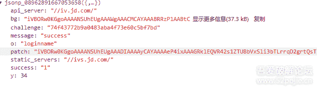

`9.png`（25.46 KB，下载次数：1）  
[附件](https://www.52pojie.cn/forum.php?mod=attachment&aid=MjcyODQ1NXwxMzAxY2IzNHwxNzkzNTcyNDc1fDE2ODA4NnwxOTAzMjcy&nothumb=yes)  
2024-10-12 16:21 上传

上述请求有几个值需要提出来，方便后续 `s` 调用。

#### `S` 请求

这里继续看 `s` 请求。

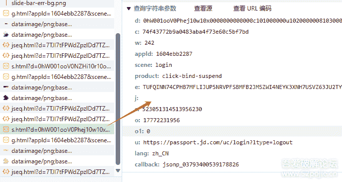

`10.png`（58.94 KB，下载次数：0）  
[附件](https://www.52pojie.cn/forum.php?mod=attachment&aid=MjcyODQ1Nnw1Nzg0NGY1YnwxNzkzNTcyNDc1fDE2ODA4NnwxOTAzMjcy&nothumb=yes)  
2024-10-12 16:21 上传

这里和上图结果图作为比较，可以发现：

`c` 好像就是 `challenge`。

这里话不多说了，其他的值都不重要。

最主要是这个 `d` 参数。

我们重点来看这个 `d`。

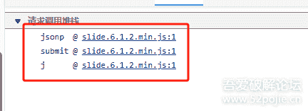

`11.png`（12.04 KB，下载次数：0）  
[附件](https://www.52pojie.cn/forum.php?mod=attachment&aid=MjcyODQ1N3xjOGFmNzNlYXwxNzkzNTcyNDc1fDE2ODA4NnwxOTAzMjcy&nothumb=yes)  
2024-10-12 16:21 上传

如下图所示，很多值的生成都能直接看到。

这里 `d` 值的生成则是由一个方法传参加密了一堆数组。

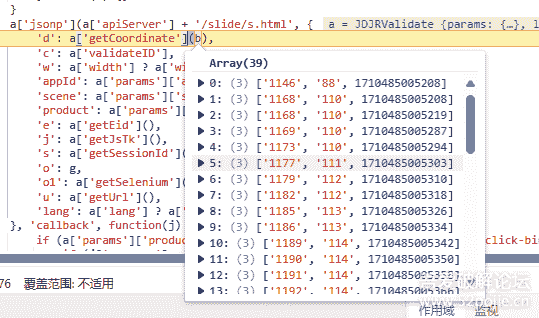

`12.png`（67.63 KB，下载次数：0）  
[附件](https://www.52pojie.cn/forum.php?mod=attachment&aid=MjcyODQ1OHxjN2ZmZmZlOHwxNzkzNTcyNDc1fDE2ODA4NnwxOTAzMjcy&nothumb=yes)  
2024-10-12 16:21 上传

那这个数组是啥东西？其实我们不难发现这就是个轨迹。通过 `getCoordinate` 这个方法才变成了请求接口中的 `d` 这个样子。

`d` 方法如下：

```javascript
'getCoordinate': function(a) {
        var b = this;
        var c = new Array();
        for (var d = 0x0; d 
```

这个方法很简单。缺什么扣什么。

然后传值轨迹。

至于轨迹的生成，可以通过某些算法去实现这个列表数组的生成。

这里是通过举例然后偏移出数组变量。

这里贴个方法用于生成数组。

```python
def offer(distance):

    index = 0

    slide = []

    indexTime = str(int(time.time()))[:9]

    for item in self.base_slide:

        index += 1

        item[2] = int(indexTime + str(item[2])[-4:])

        if int(item[0]) >= (distance + int(self.base_slide[0][0])):

            slide = self.base_slide[:index]

            slide.append(

                [str(distance + int(self.base_slide[0][0])), item[1], item[2] + 700 + int(random.random() * 1000)])

            break

    last = int(slide[-1][0].split('.')[0])

    pIndex = 0

    for item in self.push_slide:

        if pIndex == 0 or pIndex == len(self.push_slide) - 1:

            times = slide[-1][2]

        else:

            times = slide[-1][2] + (self.push_slide[pIndex + 1][2] - self.push_slide[pIndex][2])

        slide.append([str(item[0] + last), '369', times])

        pIndex += 1

    # print(json.dumps(slide))

    return slide
```

最后通过 `getCoordinate` 生成加密值。

最后伪装成功参数，然后请求就行了。返回下图代表成功。

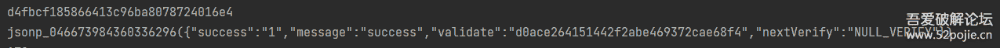

`13.png`（21.9 KB，下载次数：0）  
[附件](https://www.52pojie.cn/forum.php?mod=attachment&aid=MjcyODQ1OXw2ZDhkZjRmZnwxNzkzNTcyNDc1fDE2ODA4NnwxOTAzMjcy&nothumb=yes)  
2024-10-12 16:21 上传

### cfe 接口滑块

下面接口网站如下：

> `aHR0cHM6Ly9jZmUubS5qZC5jb20vcHJpdmF0ZWRvbWFpbi9yaXNrX2hhbmRsZXIvMDMxMDE5MDAvP3JldHVybnVybD1odHRwcyUzQSUyRiUyRml0ZW0uamQuY29tJTJGMTAwMDQ4MjcyNzYyLmh0bWwmcnFob3N0PWh0dHBzJTNBJTJGJTJGYXBpLm0uamQuY29tJnJwaWQ9cnAtMTg2NTQ5NDkwLTEwMDU2LTE3MDk3MTMyMDgzNzEmZXZ0eXBlPTImZXZhcGk9Y29sb3JfcGNfZGV0YWlscGFnZV93YXJlQnVzaW5lc3Mmc291cmNlPTEmZm9yY2VDdXJyZW50Vmlldz0x`

如下图页面，这就到了另一个滑块的接口。

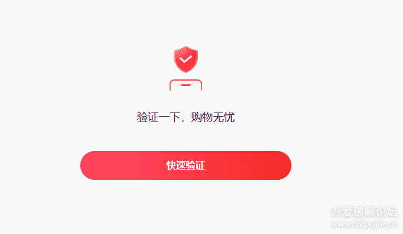

`14.png`（24.85 KB，下载次数：0）  
[附件](https://www.52pojie.cn/forum.php?mod=attachment&aid=MjcyODQ2MHxkYjA4ZjE1MnwxNzkzNTcyNDc1fDE2ODA4NnwxOTAzMjcy&nothumb=yes)  
2024-10-12 16:21 上传

这里我们点击快速验证，然后完整地走一遍流程，看看具体的走向是如何的。

如下图所示。


`15.png`（107.21 KB，下载次数：0）


# 请求分析

## 请求概览

[附件下载](https://www.52pojie.cn/forum.php?mod=attachment&aid=MjcyODQ2MXxiNDQ1NThlNHwxNzkzNTcyNDc1fDE2ODA4NnwxOTAzMjcy&nothumb=yes)

2024-10-12 16:21 上传

这里首先筛选 `xhr` 请求。请求太多。

如下图所示，图中经过了这么多的请求。

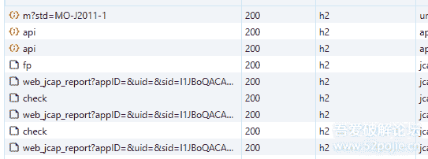

`16.png`（22.99 KB，下载次数：0）

[附件下载](https://www.52pojie.cn/forum.php?mod=attachment&aid=MjcyODQ2MnwxMjcwYmE1NHwxNzkzNTcyNDc1fDE2ODA4NnwxOTAzMjcy&nothumb=yes)

2024-10-12 16:21 上传

我们一个一个看。

第一个 `m?std` 请求，返回值是 0，目测只是判断状态的请求。

第二个 `api` 请求。如下图，返回了一个值。请求参数中 `enbody` 加密了。

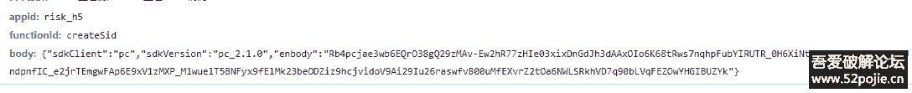

`17.png`（10.51 KB，下载次数：0）

[附件下载](https://www.52pojie.cn/forum.php?mod=attachment&aid=MjcyODQ2M3xjOWRlZTk0OXwxNzkzNTcyNDc1fDE2ODA4NnwxOTAzMjcy&nothumb=yes)

2024-10-12 16:21 上传

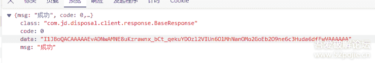

`18.png`（19.2 KB，下载次数：0）

[附件下载](https://www.52pojie.cn/forum.php?mod=attachment&aid=MjcyODQ2NHxkMWUxODkxNnwxNzkzNTcyNDc1fDE2ODA4NnwxOTAzMjcy&nothumb=yes)

2024-10-12 16:21 上传

第三个 `api` 请求也是加密了 `enbody`。返回值没东西。应该也是个请求判定。

第四个 `fp` 请求。请求需要伪装 `si` 和 `ct`。而这个 `si` 刚好和第二个 `api` 请求的 `si` 相同。返回了 `fp` 和 `st`。

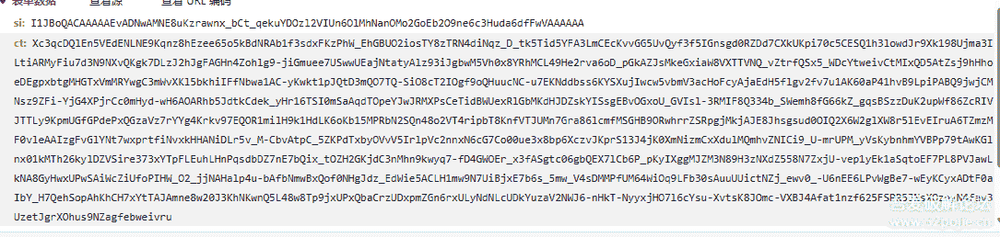

`19.png`（72.8 KB，下载次数：0）

[附件下载](https://www.52pojie.cn/forum.php?mod=attachment&aid=MjcyODQ2NXw3MTY3NDQwZnwxNzkzNTcyNDc1fDE2ODA4NnwxOTAzMjcy&nothumb=yes)

2024-10-12 16:21 上传

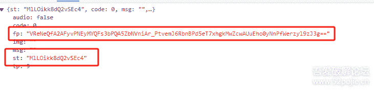

`20.png`（18.09 KB，下载次数：0）

[附件下载](https://www.52pojie.cn/forum.php?mod=attachment&aid=MjcyODQ2Nnw1ZTdkNGVhNXwxNzkzNTcyNDc1fDE2ODA4NnwxOTAzMjcy&nothumb=yes)

2024-10-12 16:21 上传

第五个请求：`web_jcap_report` 返回了 `code` 为 0，无用请求。

第六个请求：请求传参中带有上图 `fp` 参数的加密，还多了个 `tk` 加密。返回值返回了缺口图和背景图。

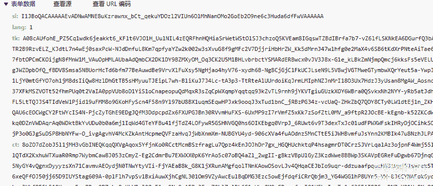

`21.png`（89.01 KB，下载次数：0）

[附件下载](https://www.52pojie.cn/forum.php?mod=attachment&aid=MjcyODQ2N3w5NjRlZDIyOHwxNzkzNTcyNDc1fDE2ODA4NnwxOTAzMjcy&nothumb=yes)

2024-10-12 16:21 上传

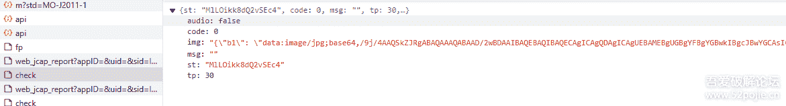

`22.png`（27.99 KB，下载次数：0）

[附件下载](https://www.52pojie.cn/forum.php?mod=attachment&aid=MjcyODQ2OHxiMGFiZDMxNnwxNzkzNTcyNDc1fDE2ODA4NnwxOTAzMjcy&nothumb=yes)

2024-10-12 16:21 上传

第七个请求：无用请求。

第八个请求：即是第二个 `check` 请求。同第六个请求相似。但是返回值不一样。

那这样我们大概就能明白个具体流程了。

- `api` 请求得到 `si`
- 通过 `fp` 请求请求出 `fp` 和 `st`
- 通过上述这些返回值以及其他参数获得 `check` 的请求参数加密
- 通过第一次 `check` 请求得到图片，进行识别
- 然后通过识别到的信息再次请求 `check`，完成滑块加密

## 4> `api` 请求

这里我们首先去看一下 `api` 请求。

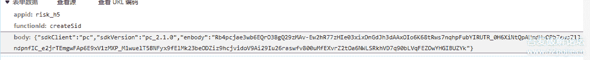

`23.png`（24.64 KB，下载次数：1）

[附件下载](https://www.52pojie.cn/forum.php?mod=attachment&aid=MjcyODQ2OXxkMGNjZmE2Y3wxNzkzNTcyNDc1fDE2ODA4NnwxOTAzMjcy&nothumb=yes)

2024-10-12 16:21 上传

如上图所示，只有这个 `enbody` 值是通过加密获得的。那我们去搜索一下，或者走栈。

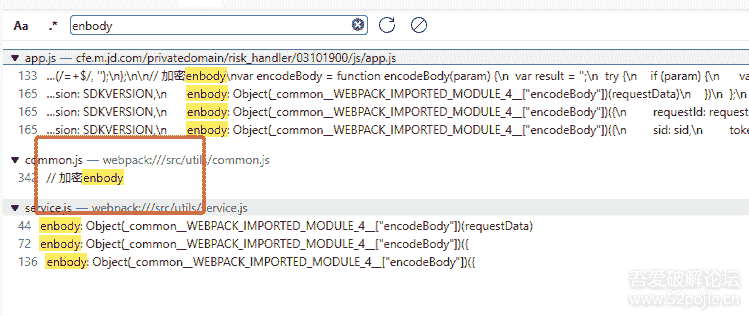

`24.png`（49.08 KB，下载次数：0）

[附件下载](https://www.52pojie.cn/forum.php?mod=attachment&aid=MjcyODQ3MHxjY2RmNmIyNHwxNzkzNTcyNDc1fDE2ODA4NnwxOTAzMjcy&nothumb=yes)

2024-10-12 16:21 上传

如下图所示，直接获取到了 `enbody` 加密的地方。


`25.png`（31.05 KB，下载次数：0）

[附件下载](https://www.52pojie.cn/forum.php?mod=attachment&aid=MjcyODQ3MXwwN2YxMDBmOHwxNzkzNTcyNDc1fDE2ODA4NnwxOTAzMjcy&nothumb=yes)

2024-10-12 16:22 上传

这里简化一下代码。

```javascript
result = encrypt(JSON.stringify(param), 'rhiasnkdhandrisk', 'r-s-h-n_r_isnkdk')
```

然后过一下断点。这里可以看到，加密的值分别为：

- `eid`：可以为空
- `evType`：应该是验证码类型 2
- `requestId`：由另一个接口 `605` 返回的 `requestID`
- `shshshfpx`：是一个随机值的算法，包含随机生成以及时间戳的拼接

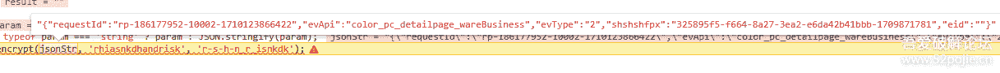

`26.png`（29.89 KB，下载次数：0）

[附件下载](https://www.52pojie.cn/forum.php?mod=attachment&aid=MjcyODQ3MnwxMmY5MzM0YXwxNzkzNTcyNDc1fDE2ODA4NnwxOTAzMjcy&nothumb=yes)

2024-10-12 16:22 上传

第二次 `api` 请求。这里第二次请求加密的值是第一次的返回值，已经第一次的那个请求参数。其实可以不需要。这里也展示一下。


`27.png`（22.31 KB，下载次数：0）

[附件下载](https://www.52pojie.cn/forum.php?mod=attachment&aid=MjcyODQ3M3wyNmYxMGFjN3wxNzkzNTcyNDc1fDE2ODA4NnwxOTAzMjcy&nothumb=yes)

2024-10-12 16:22 上传

## 4> `fp` 请求

这里 `fp` 请求不太好搜索，我们直接进栈。

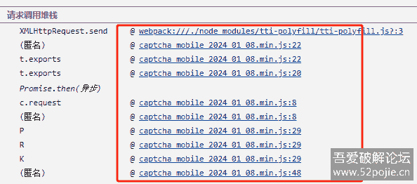

`28.png`（8.7 KB，下载次数：0）

[附件下载](https://www.52pojie.cn/forum.php?mod=attachment&aid=MjcyODQ3NHwwYzFlNTllYnwxNzkzNTcyNDc1fDE2ODA4NnwxOTAzMjcy&nothumb=yes)

2024-10-12 16:22 上传

进栈然后搜索 `.si`，这里可以发现 `ct` 的算法已经出来了。


`29.png`（22.27 KB，下载次数：0）

[附件下载](https://www.52pojie.cn/forum.php?mod=attachment&aid=MjcyODQ3NXxmZWZhYzQwOXwxNzkzNTcyNDc1fDE2ODA4NnwxOTAzMjcy&nothumb=yes)

2024-10-12 16:22 上传


`30.png`（64.28 KB，下载次数：0）

[附件下载](https://www.52pojie.cn/forum.php?mod=attachment&aid=MjcyODQ3N3wxYTZjOGZmOHwxNzkzNTcyNDc1fDE2ODA4NnwxOTAzMjcy&nothumb=yes)

2024-10-12 16:22 上传

这里可以看到，这个值应该就是加密的值。

然后把几个函数互相扣一下就行。

这个 `x` 函数的算法如下。


`30(1).png`（15.59 KB，下载次数：0）

[附件下载](https://www.52pojie.cn/forum.php?mod=attachment&aid=MjcyODQ3Nnw3YTAwYjBlMHwxNzkzNTcyNDc1fDE2ODA4NnwxOTAzMjcy&nothumb=yes)

2024-10-12 16:22 上传

```javascript
function s(t, e, n) {
    var r = t,
        a = o;
    e && (i = e);
    return c(r, a);
}
```

这里层层扣即可。

然后把第一次 `api` 返回的那个 `data` 和这个新生成的 `ct` 去请求，得到 `fp` 和 `st`。

## 4> 两次 `check`

### 第一次

断点继续走，走到下图所在位置。


`31.png`（7.35 KB，下载次数：0）

[附件下载](https://www.52pojie.cn/forum.php?mod=attachment&aid=MjcyODQ3OHw5NzM1ODVkYnwxNzkzNTcyNDc1fDE2ODA4NnwxOTAzMjcy&nothumb=yes)

2024-10-12 16:22 上传

如上图所示。

- `si` 即是第一次请求的返回的 `data`
- `lang`：写死
- `tk`：上述乱七八糟的值拼接加密的值
- `ct`：字符串拼接，包含环境代码
- `version`：写死
- `client`：写死

这里需要注意的是，这里的 `t` 暂时是不传值的。这里 `t` 是什么先留个悬念。


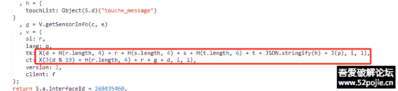
`32.png` (8.79 KB, 下载次数: 0)

[href="forum.php?mod=attachment&aid=MjcyODQ3OXxhNzk2NjY1ZXwxNzkzNTcyNDc1fDE2ODA4NnwxOTAzMjcy&nothumb=yes" target="_blank"](https://www.52pojie.cn/forum.php?mod=attachment&aid=MjcyODQ3OXxhNzk2NjY1ZXwxNzkzNTcyNDc1fDE2ODA4NnwxOTAzMjcy&nothumb=yes)

2024-10-12 16:22 上传

然后进行加密就得到了 `tk` 和 `ct`。

然后请求，得到两张以 `base64` 为编码的图片。

第二次 `check` 请求

这里其他值加密都是一样的。

唯一不同就是这个 `JSON.stringify(t)`，如下图所示。

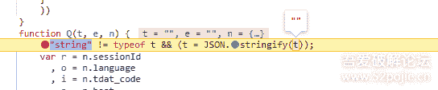
`33.png` (15.77 KB, 下载次数: 0)

[href="forum.php?mod=attachment&aid=MjcyODQ4MHw2ZWVhMjQ2N3wxNzkzNTcyNDc1fDE2ODA4NnwxOTAzMjcy&nothumb=yes" target="_blank"](https://www.52pojie.cn/forum.php?mod=attachment&aid=MjcyODQ4MHw2ZWVhMjQ2N3wxNzkzNTcyNDc1fDE2ODA4NnwxOTAzMjcy&nothumb=yes)

2024-10-12 16:22 上传

这里传值是轨迹。通过两张图片识别出来的距离，最终通过算法生成轨迹。

这里轨迹简单看看，第一个是移动的距离值。

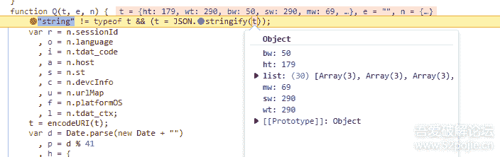
`34.png` (32.01 KB, 下载次数: 0)

[href="forum.php?mod=attachment&aid=MjcyODQ4MXxhYTk4ODM1Y3wxNzkzNTcyNDc1fDE2ODA4NnwxOTAzMjcy&nothumb=yes" target="_blank"](https://www.52pojie.cn/forum.php?mod=attachment&aid=MjcyODQ4MXxhYTk4ODM1Y3wxNzkzNTcyNDc1fDE2ODA4NnwxOTAzMjcy&nothumb=yes)

2024-10-12 16:22 上传

第二个和第三个，如下图 js 所示的位置。

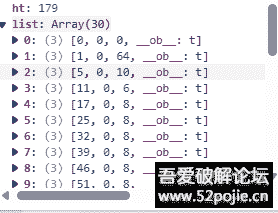
`35.png` (7.47 KB, 下载次数: 0)

[href="forum.php?mod=attachment&aid=MjcyODQ4MnwyNWVkZDliMXwxNzkzNTcyNDc1fDE2ODA4NnwxOTAzMjcy&nothumb=yes" target="_blank"](https://www.52pojie.cn/forum.php?mod=attachment&aid=MjcyODQ4MnwyNWVkZDliMXwxNzkzNTcyNDc1fDE2ODA4NnwxOTAzMjcy&nothumb=yes)

2024-10-12 16:22 上传

这里可以通过算法去实现，也可以通过自建库来实现。

最后通过这些值加密，得到请求参数即可完成滑块。整体流程如下：

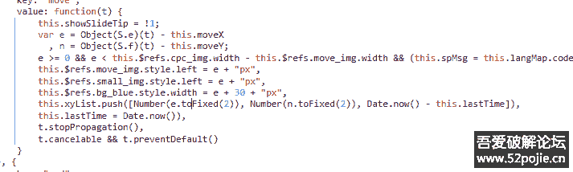
`36.png` (11.77 KB, 下载次数: 0)

[href="forum.php?mod=attachment&aid=MjcyODQ4M3w5MzViYmJiZXwxNzkzNTcyNDc1fDE2ODA4NnwxOTAzMjcy&nothumb=yes" target="_blank"](https://www.52pojie.cn/forum.php?mod=attachment&aid=MjcyODQ4M3w5MzViYmJiZXwxNzkzNTcyNDc1fDE2ODA4NnwxOTAzMjcy&nothumb=yes)

2024-10-12 16:22 上传

### 3> cfe 点选验证

下面接口网站如下：

> aHR0cHM6Ly9jZmUubS5qZC5jb20vcHJpdmF0ZWRvbWFpbi9yaXNrX2hhbmRsZXIvMDMxMDE5MDAvP3JldHVybnVybD1odHRwcyUzQSUyRiUyRml0ZW0uamQuY29tJTJGMTAwMDQ4MjcyNzYyLmh0bWwmcnFob3N0PWh0dHBzJTNBJTJGJTJGYXBpLm0uamQuY29tJnJwaWQ9cnAtMTg2NTQ5NDkwLTEwMDU2LTE3MDk3MTMyMDgzNzEmZXZ0eXBlPTImZXZhcGk9Y29sb3JfcGNfZGV0YWlscGFnZV93YXJlQnVzaW5lc3Mmc291cmNlPTEmZm9yY2VDdXJyZW50Vmlldz0x

和滑块一个连接，不同的是验证码不一样。

触发方式应该是与爬取的等级而定。

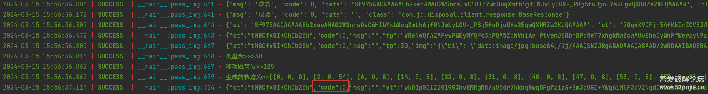
`37.png` (118.81 KB, 下载次数: 1)

[href="forum.php?mod=attachment&aid=MjcyODQ4NHw4ZTY1YjFiYnwxNzkzNTcyNDc1fDE2ODA4NnwxOTAzMjcy&nothumb=yes" target="_blank"](https://www.52pojie.cn/forum.php?mod=attachment&aid=MjcyODQ4NHw4ZTY1YjFiYnwxNzkzNTcyNDc1fDE2ODA4NnwxOTAzMjcy&nothumb=yes)

2024-10-12 16:22 上传

如上图所示。

其实上图大体流程都是一样的。这里唯一有一点区别。

如下图所示。这里 `JSON.stringify(t)` 里面传值的不是轨迹，而是点选的坐标。

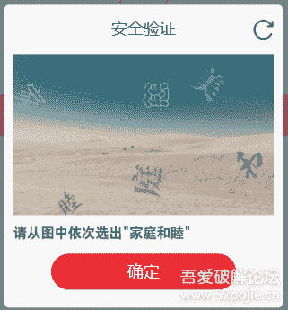
`38.png` (76.74 KB, 下载次数: 0)

[href="forum.php?mod=attachment&aid=MjcyODQ4NXxjYzE2Njk1OHwxNzkzNTcyNDc1fDE2ODA4NnwxOTAzMjcy&nothumb=yes" target="_blank"](https://www.52pojie.cn/forum.php?mod=attachment&aid=MjcyODQ4NXxjYzE2Njk1OHwxNzkzNTcyNDc1fDE2ODA4NnwxOTAzMjcy&nothumb=yes)

2024-10-12 16:22 上传

这里可以通过两种方式去解决：

- 通过打码平台识别——亲测识别率很低

- 通过训练。这里可以导出几百张数据集。然后通过 `yolov5` 识别

这里还有一点需要注意。

这里点选的验证码，第一次 `check` 返回的 `tp` 值是 22，而滑块是 30。

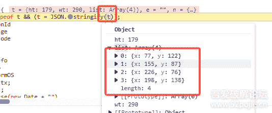
`39.png` (27.67 KB, 下载次数: 0)

[href="forum.php?mod=attachment&aid=MjcyODQ4NnxiY2VhY2QxOHwxNzkzNTcyNDc1fDE2ODA4NnwxOTAzMjcy&nothumb=yes" target="_blank"](https://www.52pojie.cn/forum.php?mod=attachment&aid=MjcyODQ4NnxiY2VhY2QxOHwxNzkzNTcyNDc1fDE2ODA4NnwxOTAzMjcy&nothumb=yes)

2024-10-12 16:22 上传

可以通过这个去区分验证码。
