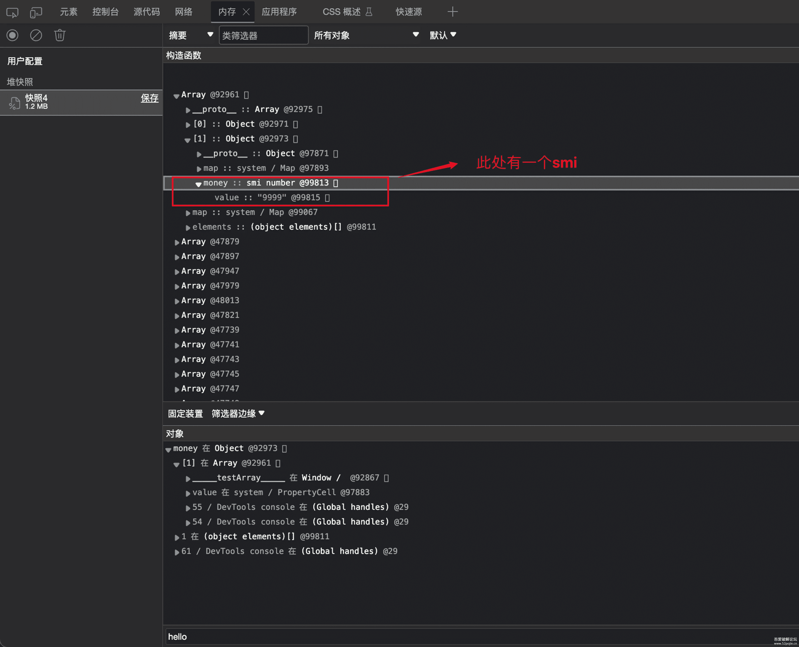

# [分享] 通杀小程序的数据搜索

- 原帖: https://www.52pojie.cn/forum.php?mod=viewthread&tid=1903623
- 抓取时间: 2026-11-01T22:34:34

最近看到有帖子在讨论小程序数据搜索，数据搜索的原理我写过一篇文章，这里直接贴链接了 https://raye.xlog.app/js-memory-v8?q=v8

简而言之就是JS的整数采用`smi`结构来存储，最后一位有其他用处，因此表现上数据就是2倍的关系

image.png (1.24 MB, 下载次数: 0)

[href="forum.php?mod=attachment&aid=MjY4NDEyOXw4ZTYyZTg2N3wxNzkzNTcyNDcyfDE2ODA4NnwxOTAzNjIz&nothumb=yes" target="_blank"](https://www.52pojie.cn/forum.php?mod=attachment&aid=MjY4NDEyOXw4ZTYyZTg2N3wxNzkzNTcyNDcyfDE2ODA4NnwxOTAzNjIz&nothumb=yes)

2024-3-20 20:10 上传

所以你只需要找到对应的进程，PC上使用CE加速来判断，安卓手机也可以使用GG，长按加速来辅助确认

比如测试飞机大战小游戏：

image.png (429.16 KB, 下载次数: 2)

[href="forum.php?mod=attachment&aid=MjY4NDEzMHw3MjE1NmQ1OHwxNzkzNTcyNDcyfDE2ODA4NnwxOTAzNjIz&nothumb=yes" target="_blank"](https://www.52pojie.cn/forum.php?mod=attachment&aid=MjY4NDEzMHw3MjE1NmQ1OHwxNzkzNTcyNDcyfDE2ODA4NnwxOTAzNjIz&nothumb=yes)

2024-3-20 20:10 上传

但是小程序存在一个问题，即找到数值后，下一次重启就又失效了，那是否有基地址呢？我经过多次测试发现是不存在的，这也和JS解释型语言有关吧

因此只能根据特征值来定位了，这里还在研究中
