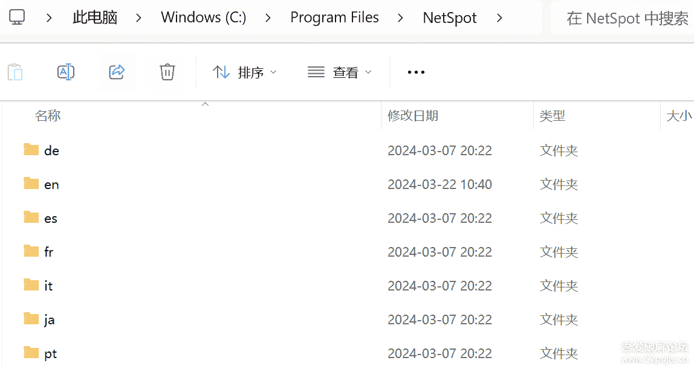
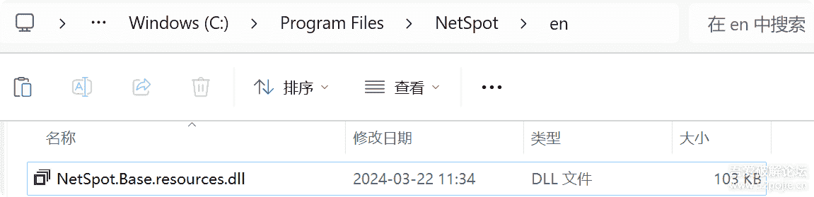
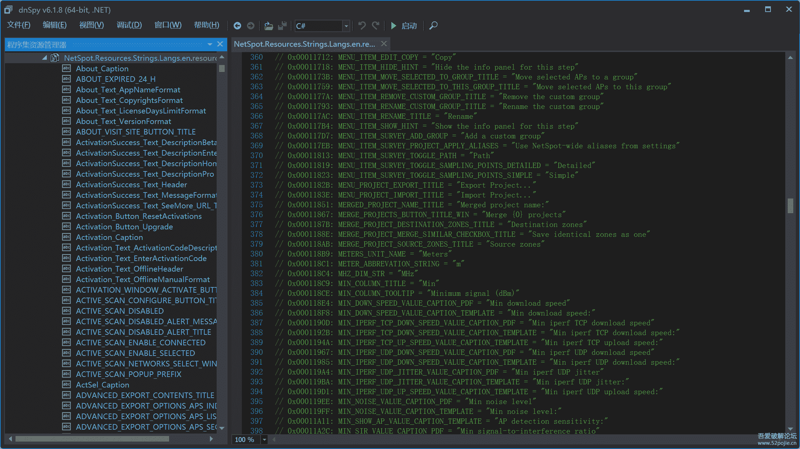
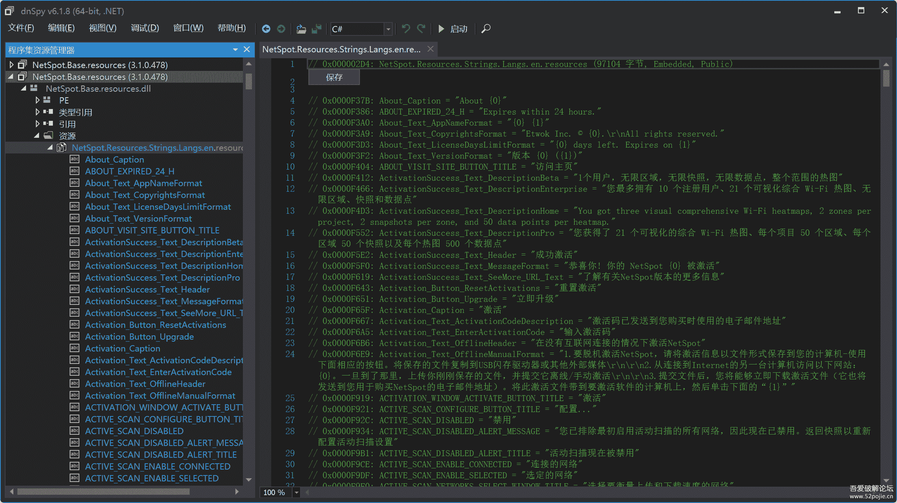
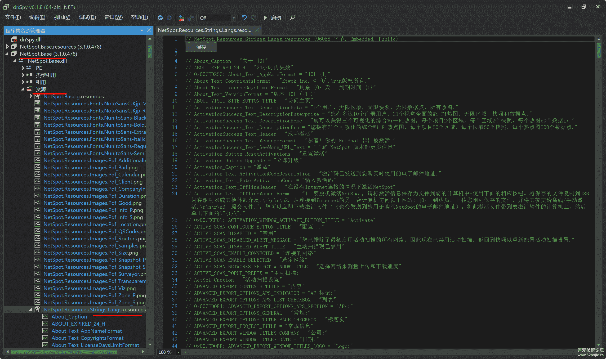
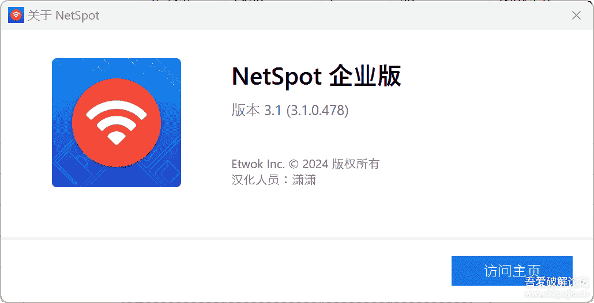

# [原创] NetSpot汉化之路

- 原帖: https://www.52pojie.cn/forum.php?mod=viewthread&tid=1904885
- 抓取时间: 2026-11-01T22:34:18

NetSpot，这是一个广受好评的无线网络分析软件（国内受众可能不是很多），虽然功能强大，但缺乏中文支持，所以使用起来总是有点不那么顺畅。

邮件反馈官方希望添加中文，但等到 `NetSpot 3` 发布也没有，等来的只有 `NetSpot 3` 发布的提醒邮件，好吧，那就自己汉化！接下来分享一下 NetSpot 汉化过程

## 找到 NetSpot 路径

首先，查看 NetSpot 安装路径，在这个目录下，可以发现多个以不同语言代码命名的文件夹

1711174061643.png (53.09 KB, 下载次数: 0)

[href="forum.php?mod=attachment&aid=MjY4NDgwOHwzM2QxMjU2MXwxNzkzNTcyNDU2fDE2ODA4NnwxOTA0ODg1&nothumb=yes" target="_blank"](https://www.52pojie.cn/forum.php?mod=attachment&aid=MjY4NDgwOHwzM2QxMjU2MXwxNzkzNTcyNDU2fDE2ODA4NnwxOTA0ODg1&nothumb=yes)

2024-3-23 14:54 上传

通过观察这些文件夹，可以推测出软件的语言资源可能就存储在这些文件夹中

1711095734768.png (32 KB, 下载次数: 2)

[href="forum.php?mod=attachment&aid=MjY4NDgxMHw4ODg5MTZmZnwxNzkzNTcyNDU2fDE2ODA4NnwxOTA0ODg1&nothumb=yes" target="_blank"](https://www.52pojie.cn/forum.php?mod=attachment&aid=MjY4NDgxMHw4ODg5MTZmZnwxNzkzNTcyNDU2fDE2ODA4NnwxOTA0ODg1&nothumb=yes)

2024-3-23 14:54 上传

## 对 `.dll` 文件进行反编译

接下来，使用如 `dnSpy` 这样的工具对软件的 `.dll` 文件进行反编译，以查找和编辑语言资源。在反编译过程中，选择任意一个语言文件夹（如 `en` ）作为参考，尝试进行汉化操作

1711097721884.png (395.53 KB, 下载次数: 3)

[href="forum.php?mod=attachment&aid=MjY4NDgxNnxlMDdiNDBhNXwxNzkzNTcyNDU2fDE2ODA4NnwxOTA0ODg1&nothumb=yes" target="_blank"](https://www.52pojie.cn/forum.php?mod=attachment&aid=MjY4NDgxNnxlMDdiNDBhNXwxNzkzNTcyNDU2fDE2ODA4NnwxOTA0ODg1&nothumb=yes)

2024-3-23 15:05 上传

1711097494149.png (418.56 KB, 下载次数: 1)

[href="forum.php?mod=attachment&aid=MjY4NDgxMXwyNTAyZTVmMnwxNzkzNTcyNDU2fDE2ODA4NnwxOTA0ODg1&nothumb=yes" target="_blank"](https://www.52pojie.cn/forum.php?mod=attachment&aid=MjY4NDgxMXwyNTAyZTVmMnwxNzkzNTcyNDU2fDE2ODA4NnwxOTA0ODg1&nothumb=yes)

2024-3-23 14:54 上传

然而，在实际操作中发现，即使修改了 `.dll` 文件并替换了原有的文件，重新打开软件后，界面语言并没有发生变化，why ?

重新思考发现，软件只有在安装时提供了语言选项，安装后打开并没有提供语言切换的选项，推测软件的语言设置可能是硬编码在 `.exe` 文件或者其附带的主 `.dll` 文件中

逐个排查 `.dll` 文件，最终锁定到了 `NetSpot.Base.dll` 中，打开后包含语言资源，ok，对 `NetSpot.Base.dll` 进行修改并保存后

1711097991561.png (501.5 KB, 下载次数: 1)

[href="forum.php?mod=attachment&aid=MjY4NDgxMnxiNWJhYmEwZnwxNzkzNTcyNDU2fDE2ODA4NnwxOTA0ODg1&nothumb=yes" target="_blank"](https://www.52pojie.cn/forum.php?mod=attachment&aid=MjY4NDgxMnxiNWJhYmEwZnwxNzkzNTcyNDU2fDE2ODA4NnwxOTA0ODg1&nothumb=yes)

2024-3-23 14:55 上传

打开软件，可以惊喜地发现软件界面已经成功转变为中文，完美汉化：

1711108998821.png (92.37 KB, 下载次数: 1)

[href="forum.php?mod=attachment&aid=MjY4NDgxM3wzOGFmYzZkZnwxNzkzNTcyNDU2fDE2ODA4NnwxOTA0ODg1&nothumb=yes" target="_blank"](https://www.52pojie.cn/forum.php?mod=attachment&aid=MjY4NDgxM3wzOGFmYzZkZnwxNzkzNTcyNDU2fDE2ODA4NnwxOTA0ODg1&nothumb=yes)

2024-3-23 14:55 上传

## 汉化总结

之前一直以为对软件进行汉化很难，实际上手后发现一点都不简单，简单记录分享一下，谢谢大家

最后，也希望 NetSpot 官方能够添加中文支持，让好的软件能够被更多人所用
