# [Web逆向] [新手向]复杂化平坦流还原的小案例

- 原帖: `https://www.52pojie.cn/forum.php?mod=viewthread&tid=1904992`
- 抓取时间: 2026-11-01T22:34:12

最近在尝试用AST来玩下，我就试了下尝试把一个小案例中的复杂化平坦流来进行还原。

这是案例下载链接：`https://pan.baidu.com/s/1kZ_3m7Hn5xyMzttDOfikxA?pwd=bvf3`。

我希望可以用更加易懂的话来解释我的思路(大佬勿喷，纯粹是新人练手),下面是我的思路

## 调试观察

我们首先是进行 `debugger` 来一步步调试，观察规律，可以看到是12开始

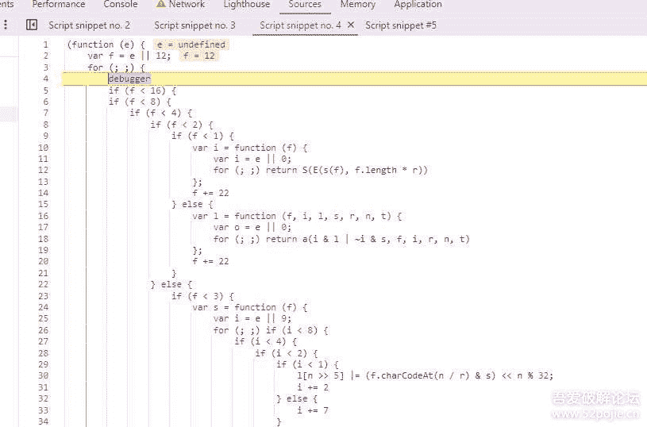

`Snipaste_2024-03-23_20-14-04.jpg` (53.9 KB, 下载次数: 2) [附件](https://www.52pojie.cn/forum.php?mod=attachment&aid=MjY4NDg4OXwwZDUzMTc1N3wxNzkzNTcyNDQ5fDE2ODA4NnwxOTA0OTky&nothumb=yes)

2024-3-23 20:19 上传

可以看到这是12最后进入要执行的部分条件是


`Snipaste_2024-03-23_20-20-48.jpg` (37.8 KB, 下载次数: 2) [附件](https://www.52pojie.cn/forum.php?mod=attachment&aid=MjY4NDg5MHwzNTY1YzdiN3wxNzkzNTcyNDQ5fDE2ODA4NnwxOTA0OTky&nothumb=yes)

2024-3-23 20:20 上传

在12执行完后看到了 `f` 变成了4，然后继续单步

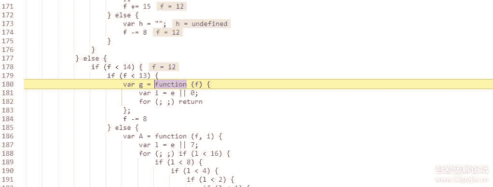

`Snipaste_2024-03-23_20-20-48.jpg` (37.8 KB, 下载次数: 1) [附件](https://www.52pojie.cn/forum.php?mod=attachment&aid=MjY4NDg5MXxmNmRkODFlZHwxNzkzNTcyNDQ5fDE2ODA4NnwxOTA0OTky&nothumb=yes)

2024-3-23 20:22 上传

这时候能看到4是进入了条件是

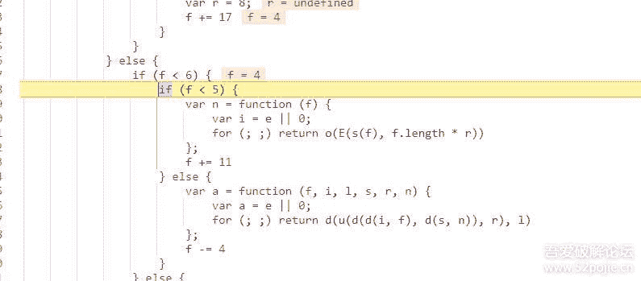

`Snipaste_2024-03-23_20-23-28.jpg` (30.01 KB, 下载次数: 1) [附件](https://www.52pojie.cn/forum.php?mod=attachment&aid=MjY4NDg5MnxhNDViMmE3ZnwxNzkzNTcyNDQ5fDE2ODA4NnwxOTA0OTky&nothumb=yes)

2024-3-23 20:23 上传

然后我们看到 `f` 这时候已经是15了，会如我们所愿吗?

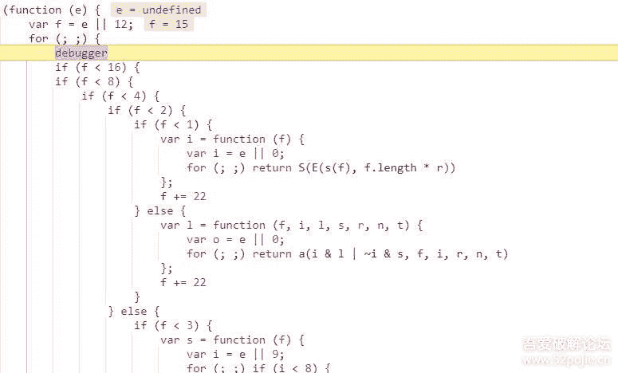

`Snipaste_2024-03-23_20-25-34.jpg` (39.61 KB, 下载次数: 1) [附件](https://www.52pojie.cn/forum.php?mod=attachment&aid=MjY4NDg5M3w2NTUyYTM5YXwxNzkzNTcyNDQ5fDE2ODA4NnwxOTA0OTky&nothumb=yes)

2024-3-23 20:26 上传

会不会和上俩个情况一样进入条件是

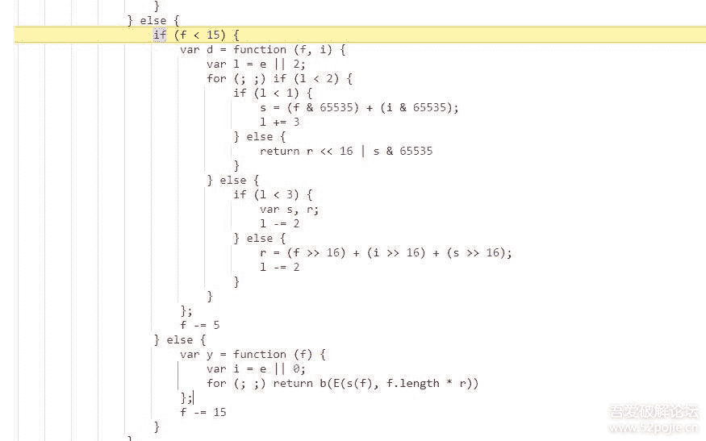

`Snipaste_2024-03-23_20-26-42.jpg` (41.23 KB, 下载次数: 1) [附件](https://www.52pojie.cn/forum.php?mod=attachment&aid=MjY4NDg5NHwyMmMwNjgwNnwxNzkzNTcyNDQ5fDE2ODA4NnwxOTA0OTky&nothumb=yes)

2024-3-23 20:26 上传

很遗憾，并不会，但我们可以再看看，为什么没有进入

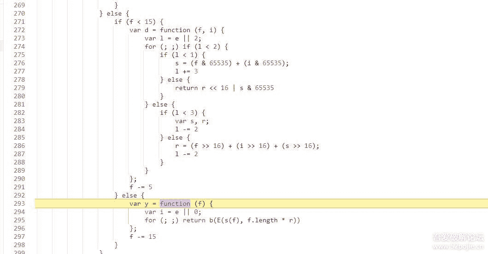

`Snipaste_2024-03-23_20-26-49.jpg` (52.19 KB, 下载次数: 0) [附件](https://www.52pojie.cn/forum.php?mod=attachment&aid=MjY4NDg5NXwyYWE4NjE5OHwxNzkzNTcyNDQ5fDE2ODA4NnwxOTA0OTky&nothumb=yes)

2024-3-23 20:27 上传

这时候神奇事情又发生了，又出现了我们猜测的情况，应该是这样了,那那个15是什么情况呢，在我们多试几次后会发现

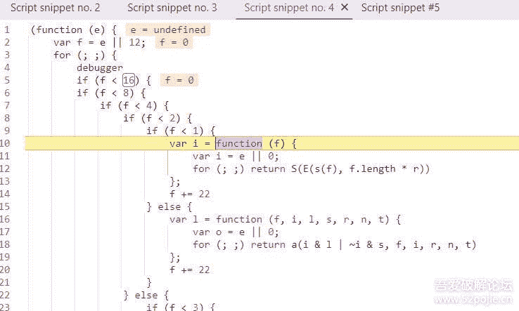

`Snipaste_2024-03-23_20-33-57.jpg` (43.67 KB, 下载次数: 0) [附件](https://www.52pojie.cn/forum.php?mod=attachment&aid=MjY4NDg5N3xkMDVjYmM1NHwxNzkzNTcyNDQ5fDE2ODA4NnwxOTA0OTky&nothumb=yes)

2024-3-23 20:34 上传

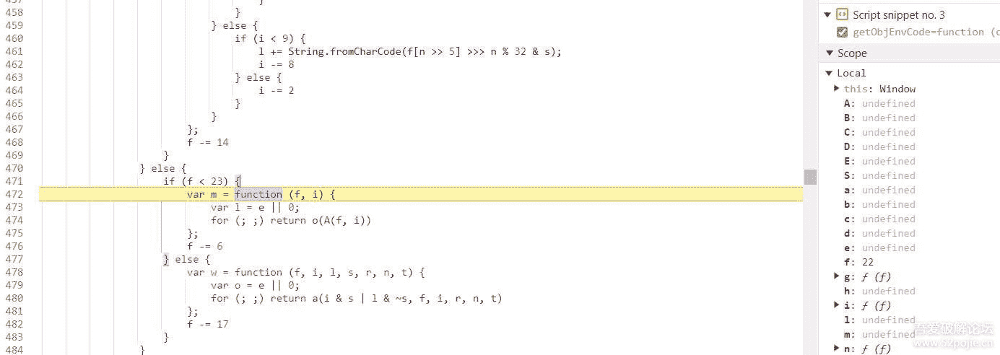

`Snipaste_2024-03-23_20-34-31.jpg` (64.73 KB, 下载次数: 1) [附件](https://www.52pojie.cn/forum.php?mod=attachment&aid=MjY4NDg5OHxiMjIyNGM3NHwxNzkzNTcyNDQ5fDE2ODA4NnwxOTA0OTky&nothumb=yes)

2024-3-23 20:34 上传

`f` 是25 不会进入 `f`

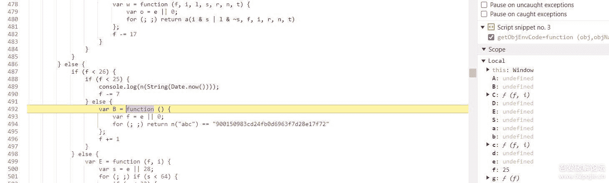

`Snipaste_2024-03-23_20-36-44.jpg` (72.17 KB, 下载次数: 1) [附件](https://www.52pojie.cn/forum.php?mod=attachment&aid=MjY4NDg5OXw0MDI1N2Y0YnwxNzkzNTcyNDQ5fDE2ODA4NnwxOTA0OTky&nothumb=yes)

2024-3-23 20:37 上传

## 规律总结

我们可以进行总结下规律，`f` 进入最后执行的情况要么是 `f` 比如 `f=5` 的时候 会在 `if` 条件是 `f`

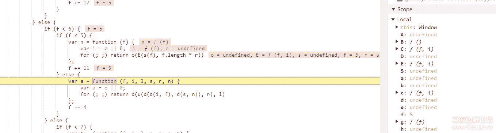

`Snipaste_2024-03-23_20-40-00.jpg` (53.18 KB, 下载次数: 1) [附件](https://www.52pojie.cn/forum.php?mod=attachment&aid=MjY4NDkwMHw0YWE5NmRlOHwxNzkzNTcyNDQ5fDE2ODA4NnwxOTA0OTky&nothumb=yes)

2024-3-23 20:40 上传

比如 `f=8` 的时候，会在 `if` 条件是 `f`

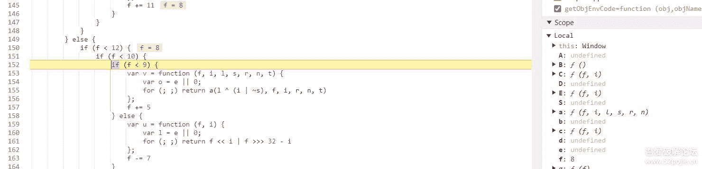

`Snipaste_2024-03-23_20-41-31.jpg` (51.89 KB, 下载次数: 1) [附件](https://www.52pojie.cn/forum.php?mod=attachment&aid=MjY4NDkwMnw0OTJlZmJjZnwxNzkzNTcyNDQ5fDE2ODA4NnwxOTA0OTky&nothumb=yes)

2024-3-23 20:42 上传

如果不相信可以多试几次，会发现这个规律是正确的

## 使用 `ast` 还原

接下来就是如何用 `ast` 还原，这边我只是还原出 `if` 流程，因为思路才是最关键的

```js
traverse(ast,{
    "ForStatement":function (path) {
        path.get('body').replaceWith(types.blockStatement([path.node.body],[]))
    }
})
p=[]
traverse(ast,{
    "IfStatement": {
        'exit':function (path){
                    //条件为什么是这几个，不会有什么问题吗？
                    //首先path.node.alternate是为了防止else{}为空的情况 因为我们接下来要取他的body【0】防止取不到而报错的情况
                    //为什么是left.name==='f' 因为我们在之前可以看到他的条件判断一定是 if(f
```

### 为什么我在代码中 `continue` 呢？

下面是没有 `continue` 的 `ast` 还原后执行情况

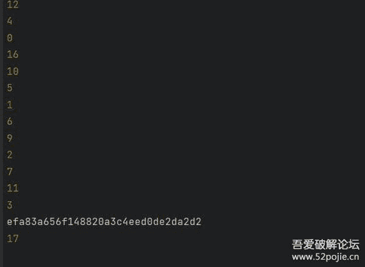

`Snipaste_2024-03-22_22-38-22.jpg` (13.62 KB, 下载次数: 1) [附件](https://www.52pojie.cn/forum.php?mod=attachment&aid=MjY4NDkwM3xlNmFiYzFiM3wxNzkzNTcyNDQ5fDE2ODA4NnwxOTA0OTky&nothumb=yes)

2024-3-23 21:00 上传

但在浏览器中执行是这样的


`Snipaste_2024-03-23_19-41-48.jpg` (50.02 KB, 下载次数: 0) [附件](https://www.52pojie.cn/forum.php?mod=attachment&aid=MjY4NDkwNHxhYTk5ZjMzMnwxNzkzNTcyNDQ5fDE2ODA4NnwxOTA0OTky&nothumb=yes)

2024-3-23 21:01 上传

为什么是这样？你们可以调下没有 `continue` 的 `ast` 还原后的代码看看

举个例子 比如 `f=1` 的时候 `f===1` 的时候会进入 最后出现个 `f+=20;`

此时 `f` 是21 但因为没有 `continue` 会继续往下跑，虽然这个好像没啥问题，但如果你是在 `for` 的时候就 `console.log` 这就不一样了，你可以去调试感受下

这是 `continue` 加后的效果图

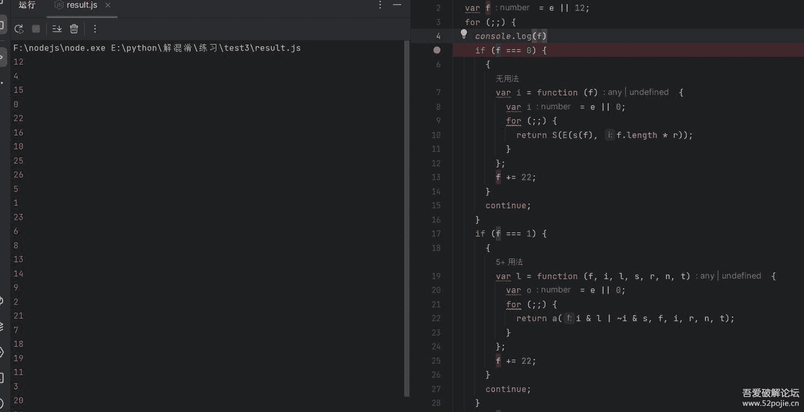

`Snipaste_2024-03-23_20-02-00.jpg` (74.19 KB, 下载次数: 1) [附件](https://www.52pojie.cn/forum.php?mod=attachment&aid=MjY4NDkwNXxmZjAwNzBlOXwxNzkzNTcyNDQ5fDE2ODA4NnwxOTA0OTky&nothumb=yes)

2024-3-23 21:05 上传
