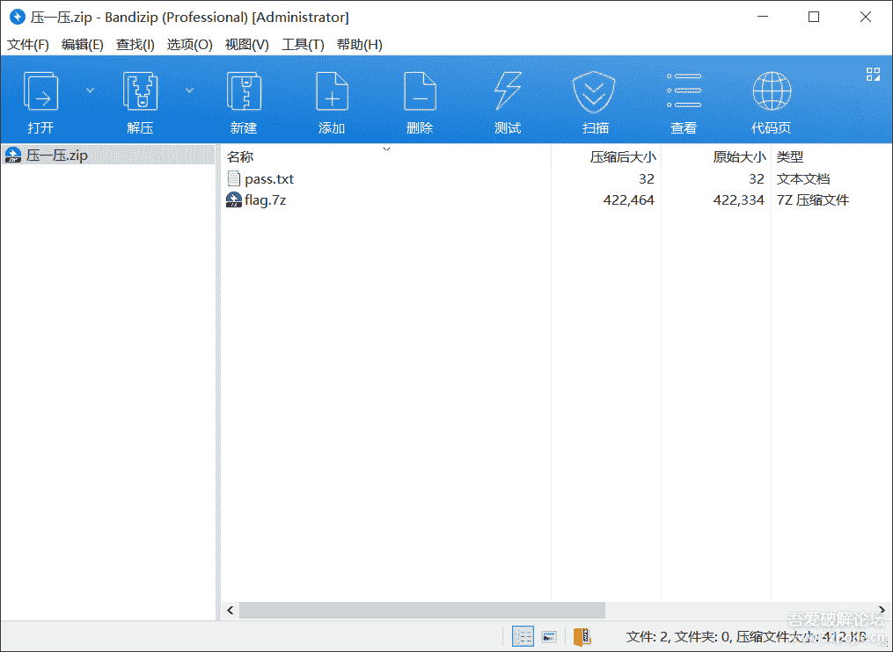
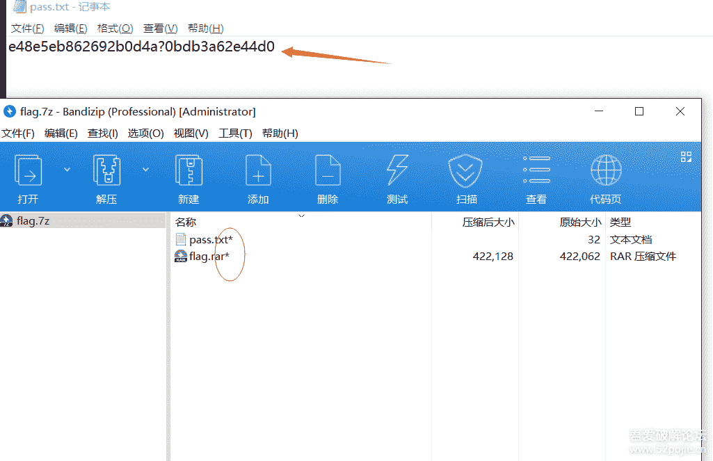
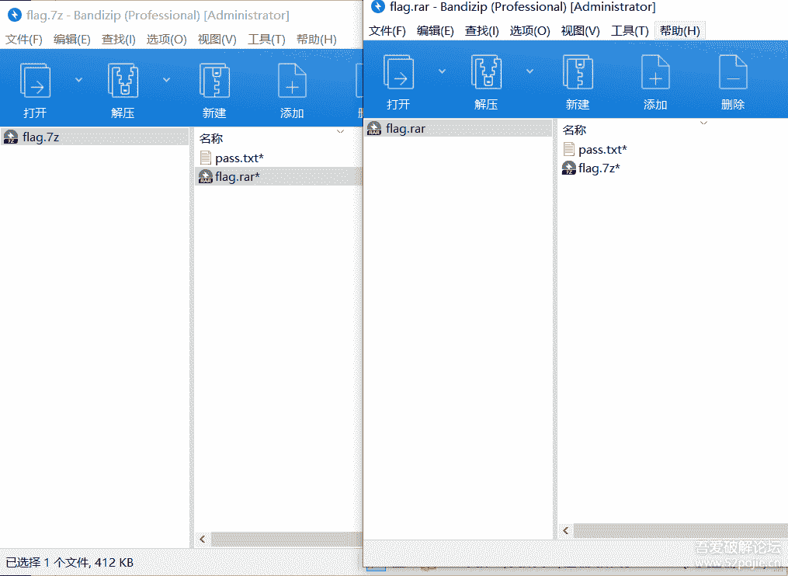
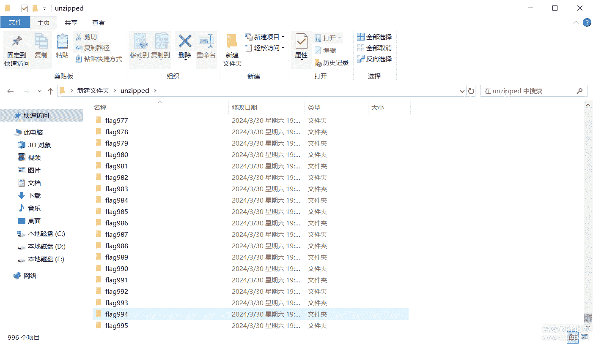
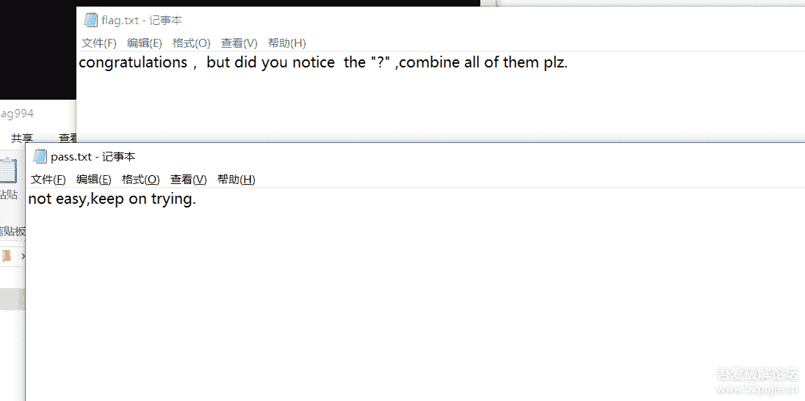
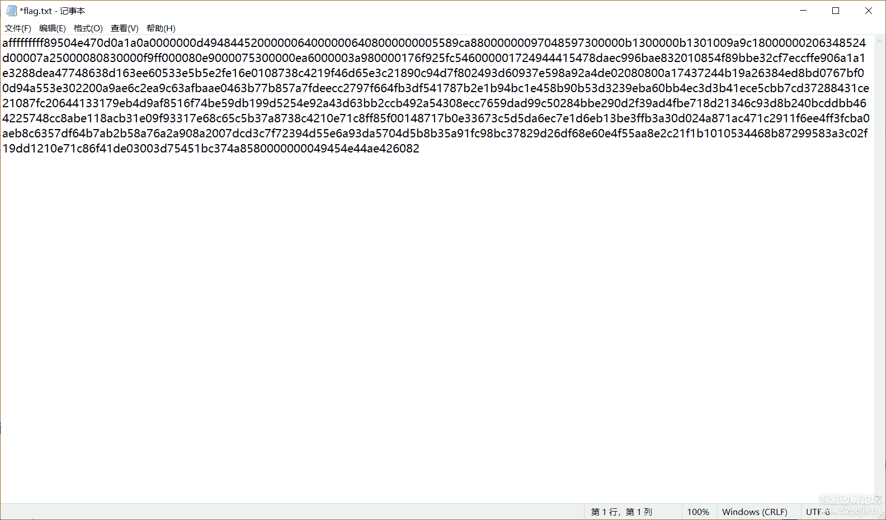
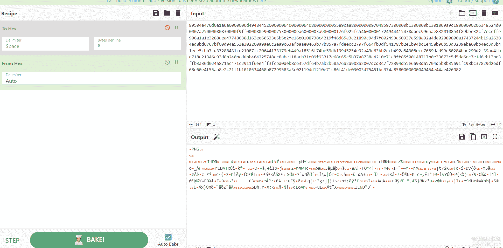
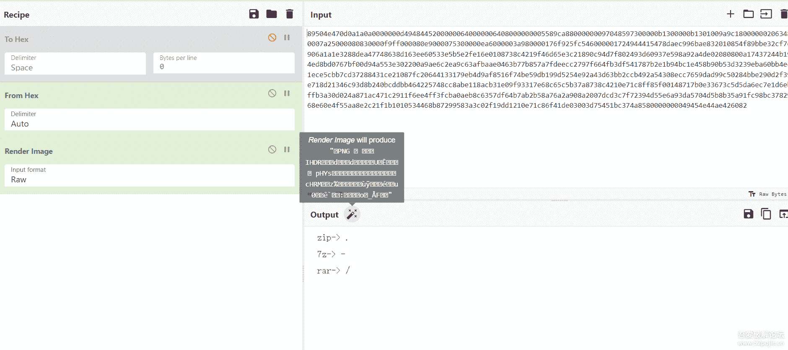
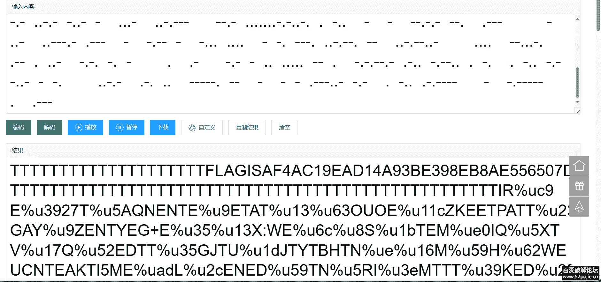

# [CTF] 2024CTF长城杯misc题“压一压”解题思路

- 原帖：[https://www.52pojie.cn/forum.php?mod=viewthread&tid=1908134](https://www.52pojie.cn/forum.php?mod=viewthread&tid=1908134)
- 抓取时间：2026-11-01T22:33:50

## 题目背景

国内近期有一个 CTF 长城杯比赛，出的题还是蛮抽象的，团队里的小伙伴参与了这个比赛并提供了相关的附件（相关附件放在最下面了）。

由于时间的原因，只做出了这一道题。

## 初步分析

我们打开这个压缩包发现里面有两个文件，`flag.7z` 和 `pass.txt`。



附件：[下载](https://www.52pojie.cn/forum.php?mod=attachment&aid=MjY4NjUxNHwwOTQ5NDhjNnwxNzkzNTcyNDI4fDE2ODA4NnwxOTA4MTM0&nothumb=yes)

上传时间：2024-3-31 11:26

解压后先打开了 `pass.txt` 看了看，发现是个 `md5`，又开始 `flag.7z` 查看，发现压缩包有密码（`*` 号代表加密的意思）。



附件：[下载](https://www.52pojie.cn/forum.php?mod=attachment&aid=MjY4NjUxNXxhMWEwNDIzYnwxNzkzNTcyNDI4fDE2ODA4NnwxOTA4MTM0&nothumb=yes)

上传时间：2024-3-31 11:29

那么毫无疑问密码应该是这个 `md5` 解密出来的内容，于是我跑去 `md5` 在线解密，发现解不出来？？？！

仔细观察后发现 `e48e5eb862692b0d4a?0bdb3a62e44d0` 这里面有一个字符居然是“问号”。根据 `md5` 加密原理，`md5` 是由字母 `a-f`、数字 `0-9` 组成的。

那么有个问号的话，无疑就是这16个字符中的其中一个，通过不断尝试，发现这个字符为 `f`。


附件：[下载](https://www.52pojie.cn/forum.php?mod=attachment&aid=MjY4NjUxNnwyNTNkY2E5MnwxNzkzNTcyNDI4fDE2ODA4NnwxOTA4MTM0&nothumb=yes)

上传时间：2024-3-31 11:32

日内瓦，打个 CTF 还要圈我元子是吧，打钱是不可能打钱的，随后变了思路，`md5` 值不固定，解密原理也是通过暴力破解。

所以尝试直接把这个 `md5` 作为解压密码进行解密，结果居然解压成功了。



附件：[下载](https://www.52pojie.cn/forum.php?mod=attachment&aid=MjY4NjUxN3xlOGJmYmQ4NnwxNzkzNTcyNDI4fDE2ODA4NnwxOTA4MTM0&nothumb=yes)

上传时间：2024-3-31 11:34

## 套娃与批量解压

解压成功了发现，里面居然还有压缩包，得，据我了解 misc 题的抽象程度，这肯定是个套娃无疑了。

直接就猜测出，应该是用 `pass.txt` 替换问号，然后在16个字符尝试出正确密码，然后根据这个去解压下一个，再拿到新的 `pass.txt` 内容去继续循环解压。

解压了两次我发现，没解压一次文件小了 1KB，当时猜测应该是套了 400 多个压缩包（实际压缩包有995个左右）。

于是写了个 `python` 脚本，这里就直接给大家最终成品了（后续也会打包在附件内）。

```python
# 原理是先读取pass.txt解压文件将问号替换成a-f 0-9这十六个字符 然后依次去尝试密码，再把解压出来的文件放进创建的文件夹，再次读取新解压出来的pass.txt继续执行替换
# 文件夹中正常只有三个文件 脚本文件 pass.txt 压一压.zip   每次执行请把上次执行的文件都删干净 不然会影响flag.txt结果
# 只能使用winrar来实现批量解压操作
# 会将每个问号替换正确的字符输出到flag.txt里面
# flag.txt里面第一个字符会多出来一个a（取决于16个字符哪个是第一位）是因为这个结果跑了两次 看尝试密码内容就能看出来，如果第一个不是a或者是a比较多那就说明有问题，请看第二条注意事项
import os
import subprocess
from itertools import product

def replace_question_mark(password, char):
    return password.replace('?', char)

def read_password(filename):
    with open(filename, 'r') as file:
        password = file.read().strip()
    return password

def unzip_with_winrar(zip_file, password, output_dir):
    winrar_path = r'D:\WinRAR.exe'  # WinRAR路径
    command = f'"{winrar_path}" x -ibck -y -p{password} "{zip_file}" "{output_dir}"'  # 添加 -y 参数
    subprocess.run(command, shell=True)

def main():
    input_file = '压一压.zip'  # 输入文件名
    output_dir = 'unzipped'  # 输出文件夹名

    # 创建输出文件夹
    if not os.path.exists(output_dir):
        os.makedirs(output_dir)

    # 打开flag.txt文件以便写入
    flag_file = open('flag.txt', 'w')

    # 初始化密码
    password = read_password('pass.txt')

    # 循环解压
    count = 0
    while True:
        output_subdir = os.path.join(output_dir, f'flag{count}')
        os.makedirs(output_subdir, exist_ok=True)

        found_char = None  # 保存找到的字符
        # 替换密码中的问号为所有可能的组合
        for char in 'abcdef0123456789':
            new_password = replace_question_mark(password, char)
            print(f"尝试密码: {new_password}")
            unzip_with_winrar(input_file, new_password, output_subdir)
            files = os.listdir(output_subdir)
            if files:
                input_file = os.path.join(output_subdir, files[0])
                pass_file = os.path.join(output_subdir, 'pass.txt')
                password = read_password(pass_file)
                found_char = char
                break

        if found_char is not None:
            flag_file.write(found_char)  # 将找到的字符写入flag.txt文件
            flag_file.flush()  # 强制刷新缓冲区
        else:
            break

        count += 1

    # 关闭flag.txt文件
    flag_file.close()

    # 实时打印flag.txt内容而不是等运行结束才一次性打印
    with open('flag.txt', 'r') as file:
        for line in file:
            print(line, end='', flush=True)

if __name__ == "__main__":
    main()
```

由于没写线程功能，所以很慢，大家多多担待（写了线程之后就死循环，也懒得修了，有能力的大佬可以自己改一改）。

跑了两年半之后终于解压完毕了，将近1000个文件夹。



文件名：`JH7~0NDDYUL[7CJ66UO$F7X.png` (136.05 KB，下载次数: 7)

附件：[下载](https://www.52pojie.cn/forum.php?mod=attachment&aid=MjY4NjUxOXw4OWYxYmMyZnwxNzkzNTcyNDI4fDE2ODA4NnwxOTA4MTM0&nothumb=yes)

上传时间：2024-3-31 11:49

打开最后一个文件夹发现里面有两个 `txt`，看到里面的内容我直接口吐芬芳了。



文件名：`L@G1P[KUEKAC_AYQ~$}[C}W.png` (31.38 KB，下载次数: 7)

附件：[下载](https://www.52pojie.cn/forum.php?mod=attachment&aid=MjY4NjUyMHxlY2EwZTJmNHwxNzkzNTcyNDI4fDE2ODA4NnwxOTA4MTM0&nothumb=yes)

上传时间：2024-3-31 11:49

于是我又改动了脚本，把对应问号替换的字符都输出到 `flag.txt` 里面（有个小 bug，第一次密码会跑两次，所以说 `flag.txt` 第一个字符是多出来的，如果你没改动的话，默认第一个是 `a`）。

当然上面给大家的脚本是最终版，打开后发现比较像 `hex`。



附件：[下载](https://www.52pojie.cn/forum.php?mod=attachment&aid=MjY4NjUyMXxhMTljNzI2MHwxNzkzNTcyNDI4fDE2ODA4NnwxOTA4MTM0&nothumb=yes)

上传时间：2024-3-31 11:53

解密后发现是张图片？



附件：[下载](https://www.52pojie.cn/forum.php?mod=attachment&aid=MjY4NjUyMnwyYzFhZDA1OXwxNzkzNTcyNDI4fDE2ODA4NnwxOTA4MTM0&nothumb=yes)

上传时间：2024-3-31 11:55



附件：[下载](https://www.52pojie.cn/forum.php?mod=attachment&aid=MjY4NjUyM3w1ZDFmODNkOHwxNzkzNTcyNDI4fDE2ODA4NnwxOTA4MTM0&nothumb=yes)

上传时间：2024-3-31 11:55

## 提取压缩包名称

得，明白什么意思了，按照解压的顺序，根据压缩包名称再替换成对应代表的符号。

于是又写了个脚本，通过 `flag0` 到 `flag995` 文件夹名称顺序，依次读取里面的文件，把里面文件中包含三个压缩后缀的名称输出出来。

（因为我们会知道，一个文件夹下面只有一个压缩包，所以也不用担心会弄乱。）

咳咳，其实还是偷懒了，也没打算弄个通用脚本 emmm....

```python
import os

def list_compressed_files(folder, output_file):
    compressed_files = []

    # 遍历当前文件夹及其所有子文件夹
    for root, dirs, files in os.walk(folder):
        for file in files:
            # 如果文件名后缀为zip、rar或7z，则添加到列表中
            if file.endswith('.zip') or file.endswith('.rar') or file.endswith('.7z'):
                compressed_files.append(file)

    # 将文件名列表写入到文件中
    with open(output_file, 'a') as f:
        for file_name in compressed_files:
            f.write(file_name + '\n')

def main():
    output_file = '123.txt'  # 输出文件路径
    folder_paths = [f"flag{i}" for i in range(996)]  # 生成文件夹路径列表，从flag0到flag995

    # 在开始之前清空输出文件
    if os.path.exists(output_file):
        os.remove(output_file)

    for folder_path in folder_paths:
        # 检查文件夹路径是否存在
        if not os.path.exists(folder_path):
            print(f"文件夹路径 {folder_path} 不存在。")
            continue

        list_compressed_files(folder_path, output_file)
        print(f"文件夹 {folder_path} 中含有压缩文件的名称已经写入到{output_file}文件中。")

if __name__ == "__main__":
    main()
```

生成出来的结果大家用记事本的替换功能，替换成对应他要代表的字符就 OK 了。


别忘记删除回车哦

最后观察一下这个密文，其实就是摩斯电码 把/替换成空格 然后拿去解密就行了



`KKK5PJBNWI$X0$F6(0N%6MX.png` (60.89 KB, 下载次数: 7)

[href="forum.php?mod=attachment&aid=MjY4NjUyNHw3YThlMjdhY3wxNzkzNTcyNDI4fDE2ODA4NnwxOTA4MTM0&nothumb=yes" target="_blank"](https://www.52pojie.cn/forum.php?mod=attachment&aid=MjY4NjUyNHw3YThlMjdhY3wxNzkzNTcyNDI4fDE2ODA4NnwxOTA4MTM0&nothumb=yes)

2024-3-31 12:00 上传

`FLAGISAF4AC19EAD14A93BE398EB8AE556507D`

拿到的内容里面包含了flag，，去除flag和5 6位的这两个字符(原因上面有讲) 又得到了32位的md5 发现也是要元子解密 最后就没去解密了

后面的%有点像某种编码，正确答案也有可能是这个 不过也八九不离十了

由于团队的小伙伴也没做出来这道题，也不清楚这个flag究竟对不对，分析也就到此为止了

脚本写的很臃肿，大佬勿喷

解题思路不敢保证正确，仅供参考

附件地址：https://wwl.lanzoue.com/i57mE1t9p6ub
