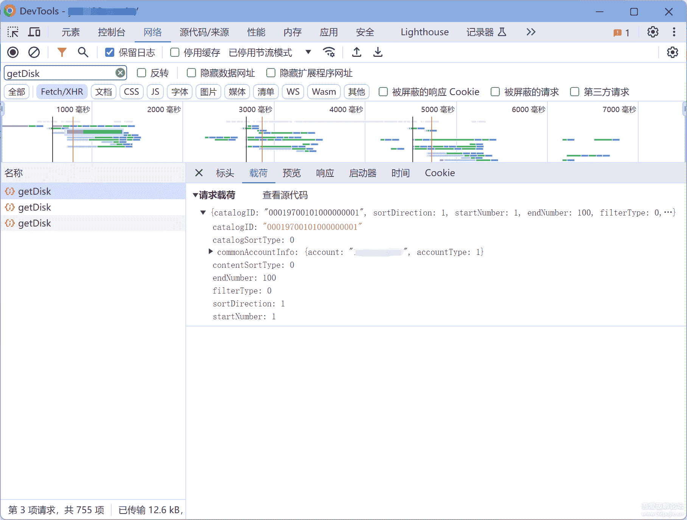
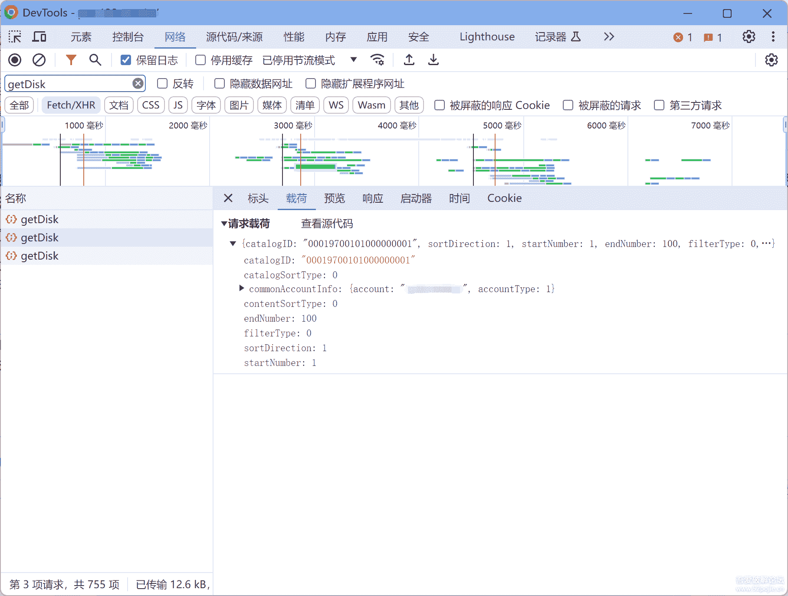
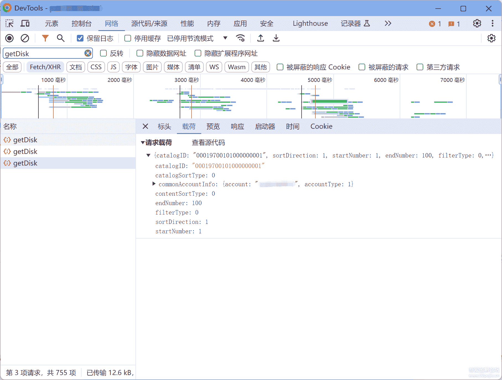
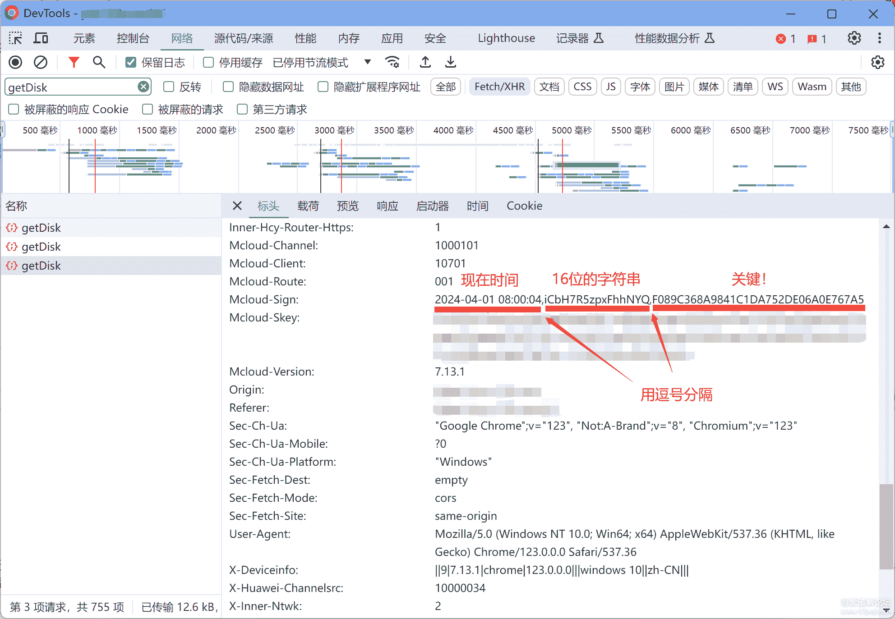
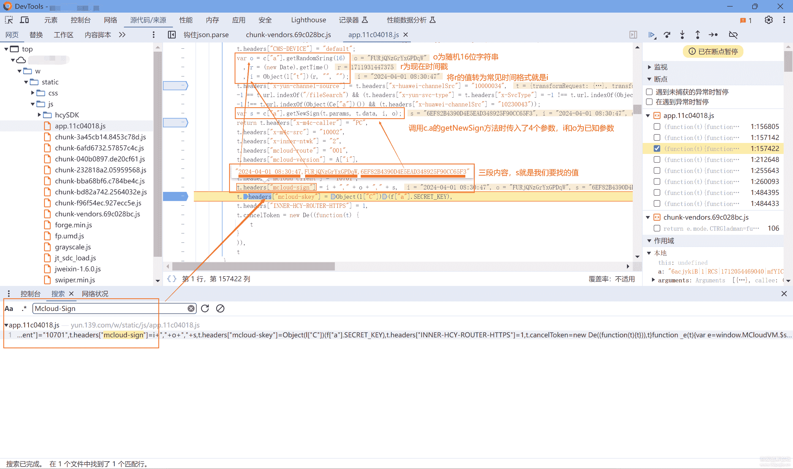
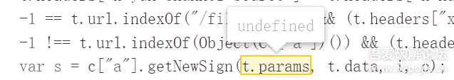
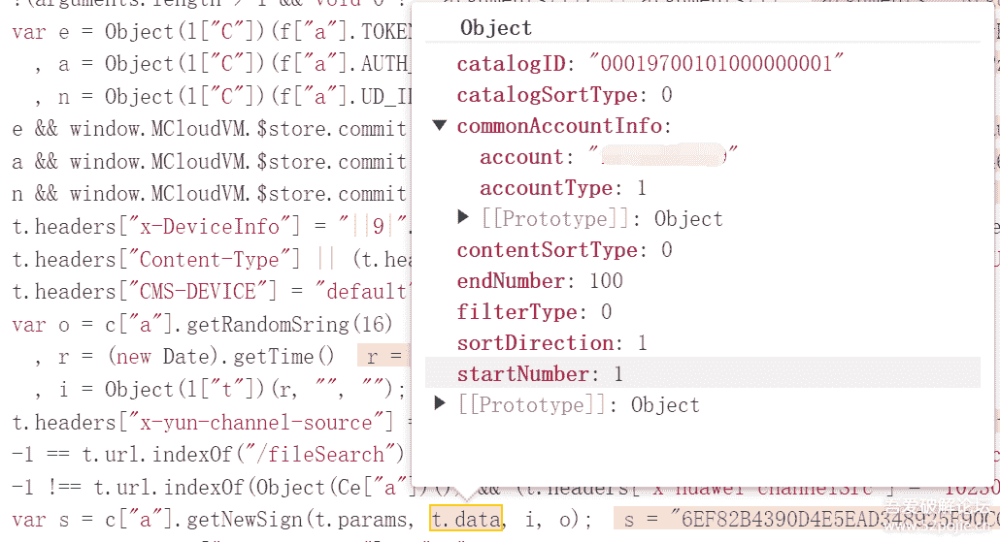
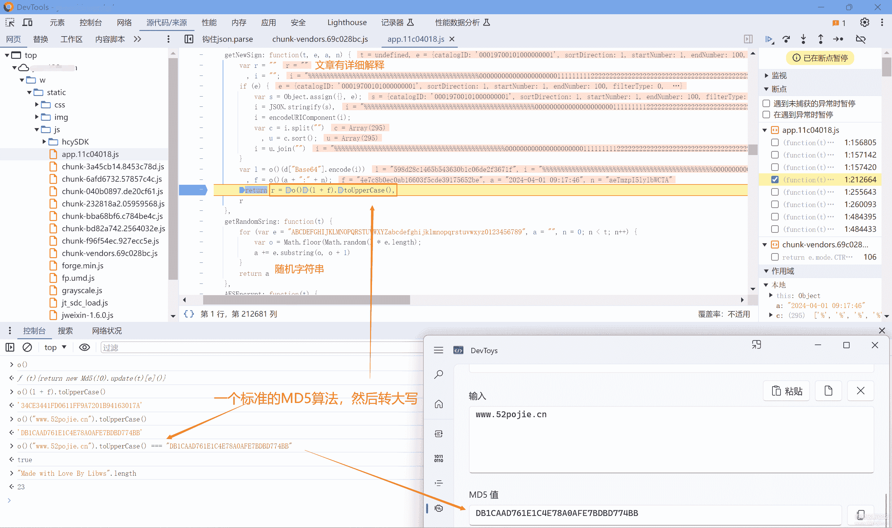
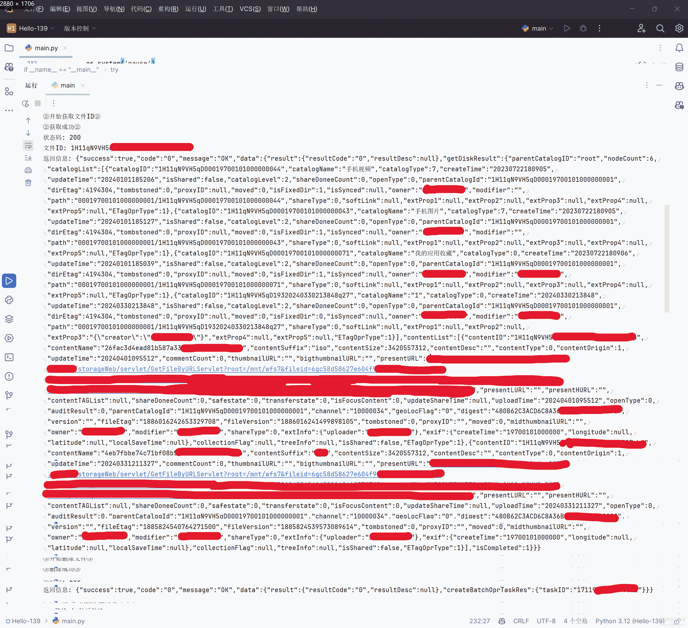

# [Web逆向] 浅谈某云盘签名算法的分析与如何生成

- 原帖: https://www.52pojie.cn/forum.php?mod=viewthread&tid=1908456

- 抓取时间: 2026-11-01T22:33:48

## 声明

本文章中所有内容仅供学习交流使用，不用于其他任何目的，不提供完整代码，抓包内容、敏感网址、数据接口等均已做脱敏处理，严禁用于商业用途和非法用途，否则由此产生的一切后果均与作者无关！

听说最近好像更新了算法，来试试手


新人发帖，请多多指教，各位大佬手下留情


该请求头构建时还有其它参数和载荷数据涉及敏感信息甚至违规，所以已全做打码处理！

## 目标

- POST提交时请求标头中特定`Sign`参数值的分析与生成

- 接口地址：aHR0cHM6Ly95dW4uMTM5LmNvbS9vcmNoZXN0cmF0aW9uL3BlcnNvbmFsQ2xvdWQvY2F0YWxvZy92MS4wL2dldERpc2s=

- 启动！提交！

## 抓包

如图所示，三次请求时的荷载除了`commonAccountInfo`中的`account`值是跟着用户登录信息变化以外，其它的值全部写死了



image.png (187.24 KB, 下载次数: 2)

[附件](https://www.52pojie.cn/forum.php?mod=attachment&aid=MjY4NjY1MXw4OTllMDgxNnwxNzkzNTcyNDI2fDE2ODA4NnwxOTA4NDU2&nothumb=yes)

抓包001

2024-4-1 08:01 上传



image.png (189.48 KB, 下载次数: 0)

[附件](https://www.52pojie.cn/forum.php?mod=attachment&aid=MjY4NjY1MnxjOWQyMDkwOXwxNzkzNTcyNDI2fDE2ODA4NnwxOTA4NDU2&nothumb=yes)

抓包002

2024-4-1 08:01 上传



image.png (188.44 KB, 下载次数: 1)

[附件](https://www.52pojie.cn/forum.php?mod=attachment&aid=MjY4NjY1M3xlOGY1NmJiYnwxNzkzNTcyNDI2fDE2ODA4NnwxOTA4NDU2&nothumb=yes)

抓包003

2024-4-1 08:02 上传

再来看请求头，这个值由三段内容组合，大致为：

- 现在时间

- 一串16位的字符串

- 一个关键的信息*



image.png (333.35 KB, 下载次数: 2)

[附件](https://www.52pojie.cn/forum.php?mod=attachment&aid=MjY4NjY1NHwzNmNkNjYwM3wxNzkzNTcyNDI2fDE2ODA4NnwxOTA4NDU2&nothumb=yes)

抓包004

2024-4-1 08:11 上传

## 分析

鉴于代码没有混淆，直接全局搜索对应参数名，也是中奖了


它由`i`、`o`、`s`三个值组成，用逗号分隔，然后直接拼接到一起

往上找var得知：

- `o`：通过往`c.a`的`getRandomSring()`方法传入一个16整数，获得了一段随机的16位字符串文本

- `r`：通过新建出来的`Date`对象中`getTime()`方法获得当前时间戳

- `i`：通过往`l`对象中的`t`方法传入`r`和2个空文本参数获得当前时间（应该就是一个时间戳转换方法）

- `s`：通过往`c.a`的`getNewSign()`方法传入4个参数来获得关键信息；`t.params`在当前接口请求是`undefined`，`t.data`是载荷，`i`和`o`我们已知



image.png (610.45 KB, 下载次数: 2)

[附件](https://www.52pojie.cn/forum.php?mod=attachment&aid=MjY4NjY1Nnw4NjBmOWYxM3wxNzkzNTcyNDI2fDE2ODA4NnwxOTA4NDU2&nothumb=yes)

初见s值

2024-4-1 08:51 上传



image.png (30.2 KB, 下载次数: 2)

[附件](https://www.52pojie.cn/forum.php?mod=attachment&aid=MjY4NjY1N3wyMDA4ZWZiM3wxNzkzNTcyNDI2fDE2ODA4NnwxOTA4NDU2&nothumb=yes)

`t.params`

2024-4-1 09:08 上传



image.png (164 KB, 下载次数: 1)

[附件](https://www.52pojie.cn/forum.php?mod=attachment&aid=MjY4NjY5OXxhNTZkZjRmM3wxNzkzNTcyNDI2fDE2ODA4NnwxOTA4NDU2&nothumb=yes)

`t.data`

2024-4-1 09:09 上传

那就进去看看吧：



image.png (584.23 KB, 下载次数: 2)

[附件](https://www.52pojie.cn/forum.php?mod=attachment&aid=MjY4NjY2NHw5MTEyMWU2N3wxNzkzNTcyNDI2fDE2ODA4NnwxOTA4NDU2&nothumb=yes)

初见`getNewSign()`方法

2024-4-1 09:33 上传

先对`getNewSign()`方法进行一个解析

```javascript
A = {
    getNewSign: function (t, e, a, n) {
        var sign = ""; // 初始化 sign 字符串
        var encodedData = ""; // 初始化编码后的数据字符串

        // 如果存在额外参数（也就是载荷）
        if (e) {
            // 克隆参数对象，避免修改原对象
            var clonedParams = Object.assign({}, e);

            // 将参数对象转换为 JSON 字符串，并进行 URL 编码
            encodedData = JSON.stringify(clonedParams);
            encodedData = encodeURIComponent(encodedData);

            // 将编码后的字符串转换为数组，然后排序
            var encodedArray = encodedData.split("");
            var sortedArray = encodedArray.sort();

            // 将排序后的数组转换为字符串
            encodedData = sortedArray.join("");
        }

        // 使用 Base64 编码处理编码后的数据
        var base64EncodedData = btoa(encodedData);

        // 拼接a和n（也就是现在时间和随机字符串），并使用 Base64 编码处理
        var base64EncodedCredentials = btoa(a + ":" + n);

        // 将编码后的数据和编码后的凭据连接在一起，并将结果转换为大写形式
        sign = Md5(base64EncodedData + base64EncodedCredentials).toUpperCase();

        return sign;
    }
}
```

此方法的目的是生成一个签名，用于验证POST提交的数据是否合法，以及时间校验等

方法接受四个参数：`t`、`e`、`a`、`n`

其中`t`是一个占位符，似乎没有被使用，不知道以后再更新算法会不会加进去（再拼接一次doge）

`e`是一个对象，包含额外的参数，也就是载荷

`a`和`n`是现在时间和随机字符串

方法的主要逻辑是将参数进行一系列处理，然后使用标准的 MD5 加密算法生成一个签名

## 实战

至此，我已完全参透了算法，是时候掏出器灵（Python）来实战了



20240401095633-已脱敏.png (791.7 KB, 下载次数: 1)

[附件](https://www.52pojie.cn/forum.php?mod=attachment&aid=MjY4NjY3Mnw5M2U2MTc1MHwxNzkzNTcyNDI2fDE2ODA4NnwxOTA4NDU2&nothumb=yes)

实战

2024-4-1 10:14 上传

成功，开香槟~

## 后话

不是很建议像我这样去用器灵请求服务器或者干别的事情，据说有风控，次数多了会喜提禁令，请各位自重！

如有错误请指出，同时也感谢您的阅读，您的指点就是我进步的动力

今天是美好的一天，也祝您拥有美好的心情
