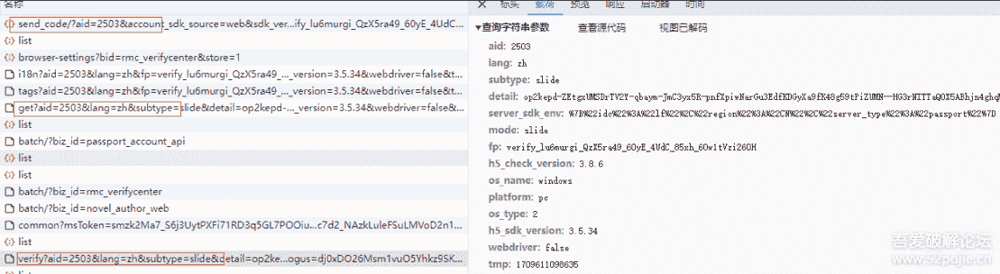
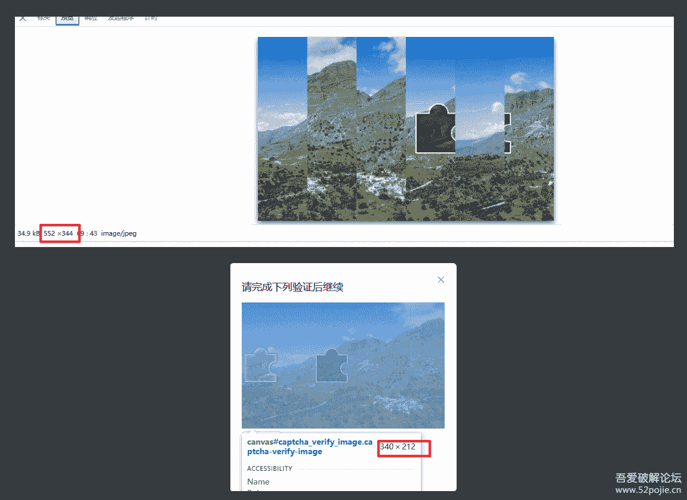
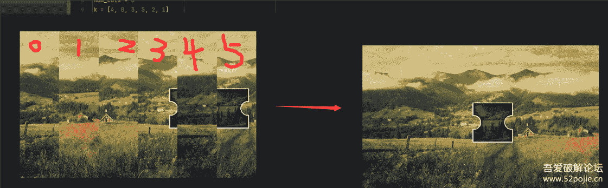
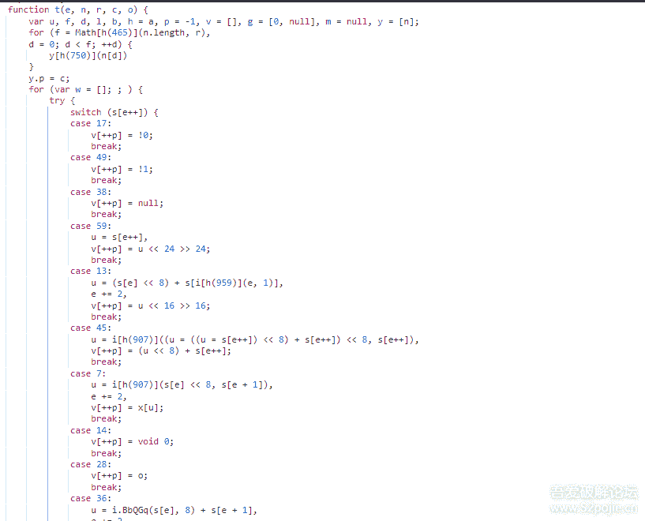
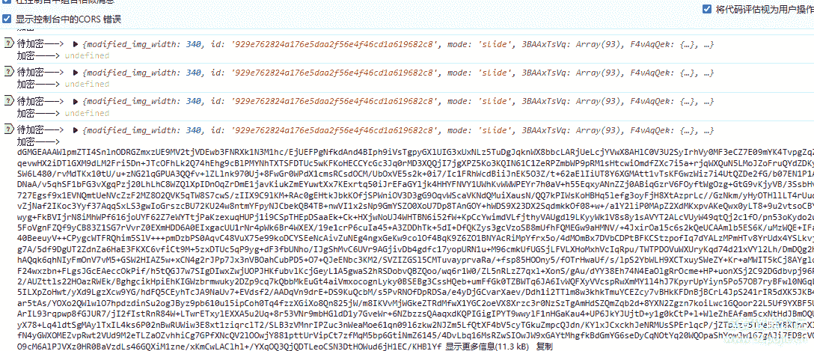
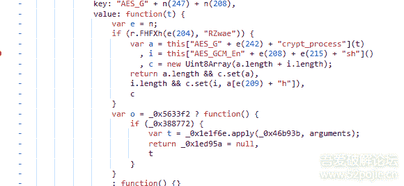
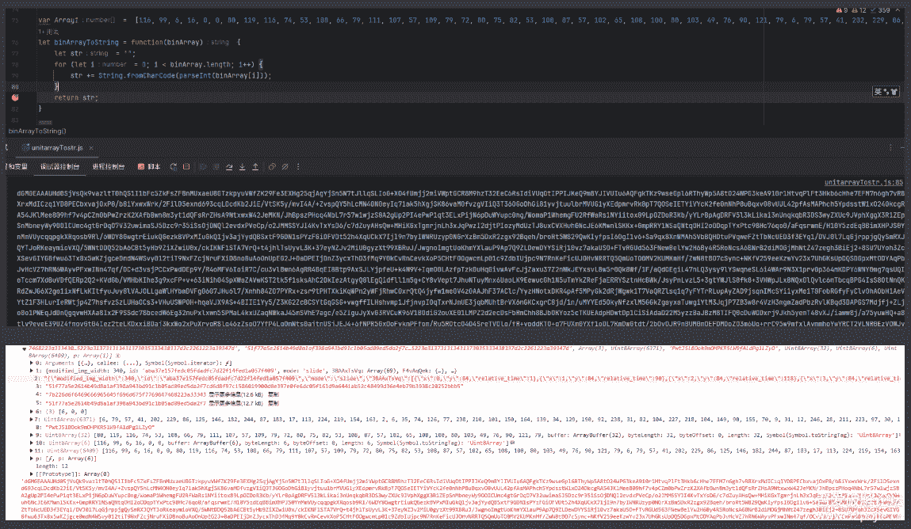
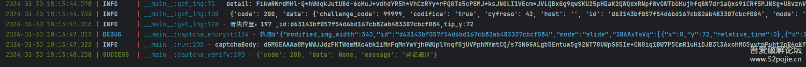

# [Web逆向] 【JavaScript 逆向】某音滑块纯算，底图还原，`captchaBody`，轨迹算法，`abogus`

- 原帖：[查看原帖](https://www.52pojie.cn/forum.php?mod=viewthread&tid=1908744)
- 抓取时间：2026-11-01T22:33:47

## 前言

> 本案例中所有内容仅供个人学习交流，抓包内容、敏感网址、数据接口均已做脱敏处理，严禁用于商业用途和非法用途，否则由此产生的一切后果均与作者无关！

## 一、抓包分析



`1711979678912.jpg`（144.36 KB，下载次数：2；2024-4-1 21:54 上传） · [附件下载](https://www.52pojie.cn/forum.php?mod=attachment&aid=MjY4Njc5MHwxY2I3YmNmN3wxNzkzNTcyNDI1fDE2ODA4NnwxOTA4NzQ0&nothumb=yes)

- `send_code` 触发验证码，将返回 `detail` 用于下个请求获取图片。
- `captcha/get` 通过 `detail` 获取图片、`id`、`tip_y`（这个后面轨迹需要用到，最开始一直没找到这个值）。
- `captcha/verify` 通过轨迹生成的 `captchaBody` 进行校验。

流程比较简单，最头疼的是 `jsvmp`，还有轨迹。

## 二、`mobile` 加密

直接进 `js` 抠出来就完事了，这里直接用 Python 改写。

```
def mobile_encode(t):
    """
    异或运算（XOR）
    """
    t = '+86 ' + t

    def encode_char(c):
        code = ord(c)
        if 0 > 6, 128 | 63 & code]
        else:
            return [224 | 15 & code >> 12, 128 | 63 & code >> 6, 128 | 63 & code]

    encoded = [encode_char(char) for char in str(t)]

    result = []
    for byte_list in encoded:
        for byte in byte_list:
            result.append(hex(5 ^ byte)[2:])

    return "".join(result)
```

## 三、底图还原

打开开发者工具可以算出返回乱序图片和还原后的图片的缩放比。



`1711979746723.jpg`（445.47 KB，下载次数：1；2024-4-1 21:55 上传） · [附件下载](https://www.52pojie.cn/forum.php?mod=attachment&aid=MjY4Njc5MXw0NWQ0MTk1NXwxNzkzNTcyNDI1fDE2ODA4NnwxOTA4NzQ0&nothumb=yes)



`1711979818543.jpg`（511.83 KB，下载次数：3；2024-4-1 21:56 上传） · [附件下载](https://www.52pojie.cn/forum.php?mod=attachment&aid=MjY4Njc5Mnw0MDkyMmI2YnwxNzkzNTcyNDI1fDE2ODA4NnwxOTA4NzQ0&nothumb=yes)

图片还原可以通过 `canvas` 断点找到 `js` 还原图片的方法。

这里仅竖着切割，我们可以不用去扣 `js`，顺序固定为 `[4, 0, 3, 5, 2, 1]`。

直接改写 Python 实现还原。

```
def parse_bg_captcha(img, save_path=None):
    """
    滑块乱序背景图还原
    还原前 h: 344, w: 552
    还原后 h: 212, w: 340
    :param img: 图片路径str/图片路径Path对象/图片二进制
        eg: 'assets/bg.webp'
            Path('assets/bg.webp')
    :param save_path: 保存路径, /; default: None
    :return: 还原后背景图 RGB图片格式
    """
    if isinstance(img, (str, Path)):
        _img = Image.open(img)
    elif isinstance(img, bytes):
        _img = Image.open(io.BytesIO(img))
    else:
        raise ValueError(f'输入图片类型错误, 必须是//: {type(img)}')

    # 定义切割的参数
    cut_width = 92
    cut_height = 344
    k = [4, 0, 3, 5, 2, 1]

    # 创建新图像
    new_img = Image.new('RGB', (_img.width, _img.height))

    # 按照指定顺序进行切割和拼接
    for idx in range(len(k)):
        x = cut_width * k[idx]
        y = 0
        img_cut = _img.crop((x, y, x + cut_width, y + cut_height))  # 垂直切割
        new_x = idx * cut_width
        new_y = 0
        new_img.paste(img_cut, (new_x, new_y))

    # 调整图像大小
    # new_img = new_img.resize((340, 212))

    if save_path is not None:
        save_path = Path(save_path).resolve().__str__()
        new_img.save(save_path)

    img_byte_array = io.BytesIO()
    new_img.save(img_byte_array, format='PNG')
    img_byte_array = img_byte_array.getvalue()

    return img_byte_array
```

## 四、`captchaBody`

`jsvmp` 代码结构。



`1711979901638.jpg`（47.07 KB，下载次数：0；2024-4-1 21:58 上传） · [附件下载](https://www.52pojie.cn/forum.php?mod=attachment&aid=MjY4Njc5M3xjM2RmMTg5YXwxNzkzNTcyNDI1fDE2ODA4NnwxOTA4NzQ0&nothumb=yes)

`jsvmp` 一般采取补环境（是个 `webpack`）和插桩，本文主要讲解插桩日志分析他的算法。

### 插桩分析

有很多个 `vmp`，需要每个 `for` 循环处进行插桩，还有关键的运算位置需要单独打印出来。还有 `fromCharCode`、`charAt`、`charCodeAt` 都需要打印，有完整的日志才能更快更准地分析出。

```
console.log('待加密———>',m,'\n加密————>',b)
```



`1711979941331.jpg`（161.24 KB，下载次数：0；2024-4-1 21:59 上传） · [附件下载](https://www.52pojie.cn/forum.php?mod=attachment&aid=MjY4Njc5OHw5Y2RjM2I0M3wxNzkzNTcyNDI1fDE2ODA4NnwxOTA4NzQ0&nothumb=yes)

日志中你会看到 `aes` 和 `sha512` 算法。



`1711979984684.jpg`（30.32 KB，下载次数：0；2024-4-1 21:59 上传） · [附件下载](https://www.52pojie.cn/forum.php?mod=attachment&aid=MjY4Njc5OXwwNGNlMjVmNXwxNzkzNTcyNDI1fDE2ODA4NnwxOTA4NzQ0&nothumb=yes)

下面这段 `js` 你可能会需要用到。

```
function hexStringToArrayBuffer(hexString) {
    // remove the leading 0x
    hexString = hexString.replace(/^0x/, '');

    // ensure even number of characters
    if (hexString.length % 2 != 0) {
        console.log('WARNING: expecting an even number of characters in the hexString');
    }

    // check for some non-hex characters
    var bad = hexString.match(/[G-Z\s]/i);
    if (bad) {
        console.log('WARNING: found non-hex characters', bad);
    }

    // split the string into pairs of octets
    var pairs = hexString.match(/[\dA-F]{2}/gi);

    // convert the octets to integers
    var integers = pairs.map(function(s) {
        return parseInt(s, 16);
    });

    var array = new Uint8Array(integers);
    console.log(array);
    return array.buffer;
}
```



`1711980025649.jpg`（633.04 KB，下载次数：0；2024-4-1 22:00 上传） · [附件下载](https://www.52pojie.cn/forum.php?mod=attachment&aid=MjY4NjgwMHxhYmNkNGE4ZnwxNzkzNTcyNDI1fDE2ODA4NnwxOTA4NzQ0&nothumb=yes)

### 轨迹

轨迹这里可以自己打上 `log` 去看，鼠标、滚动条。

这里说一下这个参数：

> `"drag":`
> - `"x": 144`，// 边框 20 + 滑动条 64.5，也就是 `x∈[20-84,20+滑块滑动距离-84+滑动距离]`
> - `"y": 287`，// 整个滑块窗口到滑动条距离 `y∈[285,325]`

```
{
    "reply": "30h5Yr0hM",
    "models": "pD6zZEe4",
    "in_modal": "xCiAyhLse",
    "in_slide": "vi5C7jc",
    "move": "8uRj",
    "touch": "ljA42",
    "drag": "YuLFijT",
    "crypt_salt": "1b4d7416e175dc54380b876c721e4af5b406e7a1700ff3118beb029635ba2fe26c794112bb938d17517af1fc36db87b7f43db04ebdc305d5e30f2ba47a184366"
}
```

动态加密，目前还没有想到如何快速拿到映射。

- `code:500,msg:"VerifyErr"` // 滑块缺口距离错误
- `code:500,msg:"VerifyModelErr"` // 滑块位置正确轨迹有问题

## 五、结果展示

这里就不讲太多了，有问题可以私信我。



`1711980097639.jpg`（84.09 KB，下载次数：1；2024-4-1 22:01 上传） · [附件下载](https://www.52pojie.cn/forum.php?mod=attachment&aid=MjY4NjgwMXw1NWYyYTQ3N3wxNzkzNTcyNDI1fDE2ODA4NnwxOTA4NzQ0&nothumb=yes)
